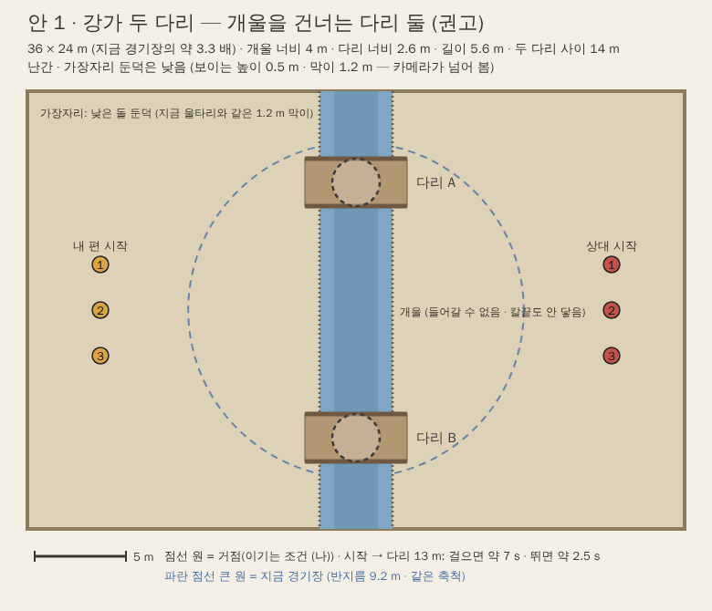
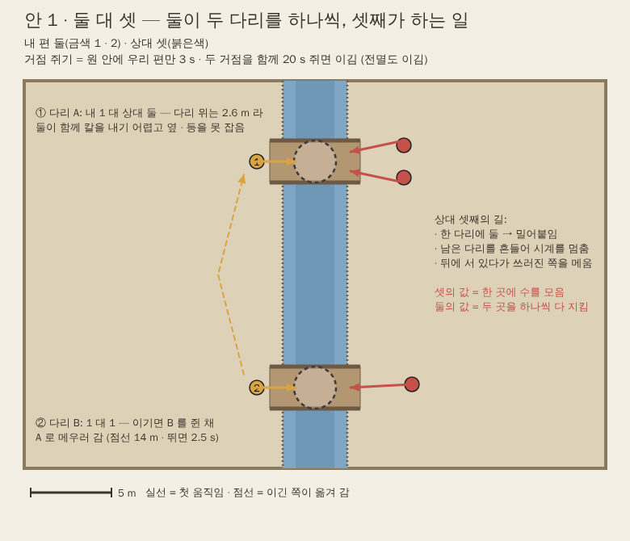
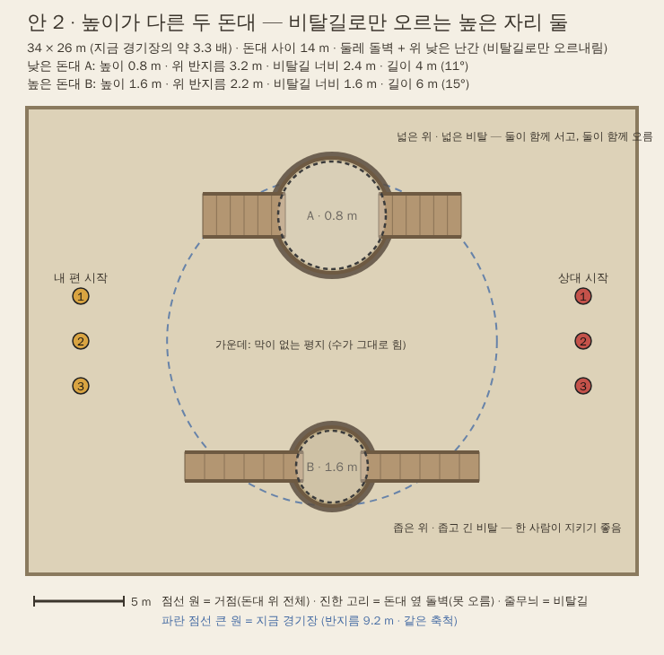
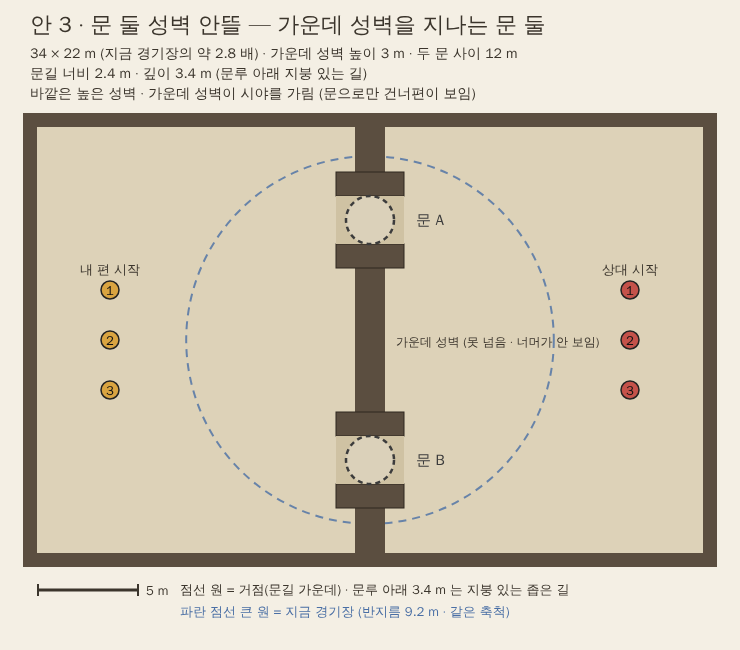
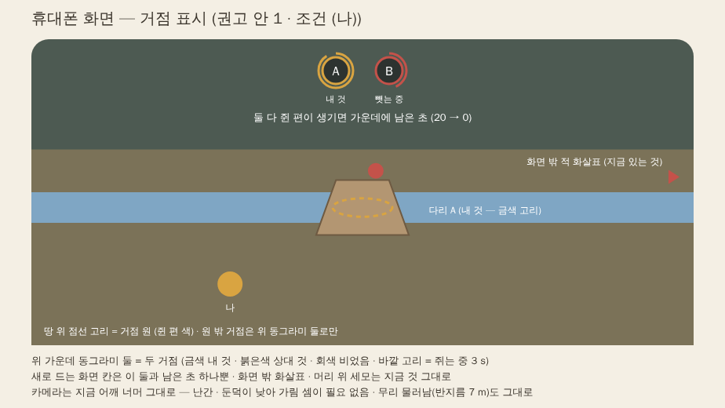

# 생사전 3:3 — 출전 · 쉬기와 전용 맵 셋 (설계 · 2026-11-21)

- 사장님 말씀 (11/21 · 감독 전달 · 원문):
  - "생사전에서 3:3 쓸게."
  - "근데 그러려면 2:3의 선택지가 장단점이 있어야 해. 1) 출전 vs 쉬기의 선택이 전략으로 작동할 수 있게. 2) 생사전 전용 맵의 설계. 훨씬 넓고 다대다 전투의 전략을 발휘할 수 있게. 하지만 주요 거점이나 길목이 두 개라 2인이 출전하는 것만으로 전략의 상당 부분을 충족할 수 있게."
  - (의견) "생사전을 응용해서 도타 카오스나 롤 같은 느낌으로 점령전이나 고지전을 만들 수도 있음. 아예 생사전 맵 설계에 그걸 응용해도 되고. 의견일 뿐."
  - "생사전 맵은 3개 제안해. 피드백 받아서 제작."
- 바탕 원칙(사장님): AI 와 사람은 같은 규칙 ('가급적 ai와 사람이 같아야 한다') · 스위치 없음(정해지면 그냥 기본) · 단순하고 알기 쉽게. 장르의 규칙(거점 · 길목 · 쥐기)만 빌리고 다른 게임의 맵 · 이름 · 모양은 따라 하지 않는다.
- **설계만** — 게임 코드는 바꾸지 않았다. 숫자는 지금 경기장(열린 원)에서 읽기만 하는 재기(§7)와 그 숫자로 맞춘 어림 모형(§2-2)에서 왔다. 재기 무기는 다섯 유파 대표 무기 열(에스톡 · 세이버 안 씀).
- 그림 다섯 장: `docs/design/saengsa_3v3_2026-11-21/` (안 셋 위에서 본 그림 · 권고 안의 2:3 꼴 · 휴대폰 화면 거점 표시).

## 0. 한눈에

1. **지금 규칙에서는 셋이 늘 낫다.** 열린 원 3:2 에서 셋 쪽이 73 % 이기고(49 판), 셋으로 이긴 사람은 한 사람당 덜 다친다(죽음 18 % · 끝 체력 71 — 둘로 셋을 이긴 사람은 31 % · 48). 쉼(+30)은 나섰든 안 나섰든 같다. 그래서 '쉬기'는 아무것도 주지 않는다.
2. **Part A 권고 — 쉼 두 배.** 이긴 뒤, 그 경기에 나서지 않은 사람은 쉼을 두 번 받는다(체력 +60 · 경상 곧 나음). 나선 사람은 지금 그대로(+30 · 경상 쉰 수 +1). 중상 · 죽음 · 부러진 무기는 그대로. 규칙 줄 하나 · 새 숫자 하나(`sitRests` 2).
   - AI 고르기는 지금 가지 그대로(체력 40 이상 모두) — 쉼 두 배 아래에서 40 밑 셋째는 쉬어 +60.
   - **빠른 셈(상대끼리) 값 다시 잡기**(감독 11/21 물음 — §2-4): 1 회전 죽음 일곱은 진 쪽이라 대회를 깎지 않는다. 깎는 것은 이긴 쪽 피해인데 지금은 나선 수 · 앞섬과 상관없이 5 ~ 45 → 엔진처럼 '그 편의 경기 전 이김 확률 P' 로: 이긴 쪽 한 사람 죽음 12 % + 25 % × (1 − P) · 산 사람 −0 ~ 90 × (1.1 − P) · 새 부상 45 % + 40 % × (1 − P) · 셋의 수 몫 0.78(둘 0.85 그대로). 엔진 재기에 맞춘 값.
   - 어림(§2-2): 늘 셋 대 늘 둘의 우승 배수 3.2 배(열린 원 · 지금) → 1.3 배(두 다리 · 쉼 두 배). 두 다리 맵 위에서 셋째가 체력 40 ~ 50 밑이면 쉬게 하는 쪽이 낫고, 성하면 셋 — 상태에 따라 갈림.
   - 쉼 두 배만으로는 모자라고 **맵(길목)이 수의 값을 줄여야** 둘이 산다 — 두 손잡이가 함께 돈다.
   - '지침'(연달아 나서면 판 시작 기력 최대가 깎임)은 재 보니 AI 싸움을 거의 안 바꾼다(−30: 지친 쪽 이김 50 % · −50: 42 % ± 7 — 1:1 48 판씩) → 넣지 않음.
3. **Part B — 맵 셋**(모두 거점 · 길목 둘 · 지금 경기장의 2.8 ~ 3.3 배 · 양 끝에서 시작):
   - **안 1 강가 두 다리 (권고)** — 개울(4 m · 못 건넘)을 건너는 다리 둘(너비 2.6 m · 14 m 떨어짐). 난간이 낮아 카메라 · 시야가 지금 그대로.
   - **안 2 높이가 다른 두 돈대** — 비탈길로만 오르는 높은 자리 둘(0.8 m 넓은 돈대 · 1.6 m 좁은 돈대). '고지전'에 가장 가까운 꼴.
   - **안 3 문 둘 성벽 안뜰** — 가운데 성벽(3 m)을 지나는 문 둘(문루 아래 좁은 길). 시야가 가려 읽기 · 속이기가 생김.
4. **이기는 조건 권고 — (나) 두 거점 쥐기 + 전멸.** 거점 원 안에 우리 편만 3 s 서 있으면 그 거점은 우리 것. 두 거점이 모두 우리 것인 채 20 s 가 지나면 이김(적이 원 안에 서 있는 동안은 멈춤 · 하나를 뺏기면 처음부터). 한 편이 모두 쓰러져도 이김(지금 그대로).
   둘이 나서면 '하나씩 한 거점' 이 곧 이 맵의 기본 꼴이 된다 — 사장님 말씀의 '2인이 출전하는 것만으로 전략의 상당 부분'.
5. **비용**(일꾼 하루 기준 · 그림 · 물리 · AI 를 나눠 지을 수 있음): Part A 1 ~ 1.5 일 · 안 1 + (나) 18 ~ 24 일 · 안 2 + (나) 22 ~ 30 일 · 안 3 + (나) 25 ~ 32 일 (맵만 (가)로는 각 10 ~ 14 · 14 ~ 20 · 17 ~ 22 일). 3:3 자체의 폰 성능(1:1 의 3.3 배 — `many_fighters_2026-11-20.md` §5)이 맵보다 큰 걱정 — 짓기 전에 폰에서 `?test=1&team=3v3&fps=1` 로 먼저 잴 것.
6. 여쭐 것 일곱 (§6) — 모두 권고를 붙임.

## 1. 지금 (코드로 확인)

### 1-1. 경기 사이에 남는 것 · 쉼

| | 경기 사이에 남나 | 어디 |
|---|---|---|
| 체력(0 ~ 100 = 피 1 ~ 쓰러지는 문턱 0.45) | 남음 — 판을 세울 때 피로 바꿔 입힘 | `saengsa_match.js bloodFromHp` · `snapshotFromPerson` |
| 부상(팔 · 다리 · 몸통 · 머리 — 경상 / 중상 문턱 0.5) | 남음 — 닫힌 상처로 입힘(팔다리 기능도 깎임) | 같은 곳 · `saengsa_rules.js injuriesFromWounds` |
| 죽음 | 그 대회 동안 빠짐 | `applyResult` |
| 부러진 무기 | 그 대회 끝까지 | `t.broken` · 무기 묶음 `broken` |
| 기력 | 남지 않음 — 판마다 가득 | `stamina.js` |
| 숙련도 | 대회 동안 그대로 (나서도 오르지 않음) | `saengsa_proficiency.js` |

- **쉼** = 이긴 팀의 경기와 경기 사이 한 번: 산 사람 모두 체력 +30(`restHeal` — 사장님 10/29 15:5x) · 경상 쉰 수 +1 → 둘이면 나음(`lightRests` 2 — 사장님 10/29 14:5x) · 중상 그대로. **나섰나와 상관없이 같다**(`saengsa_rules.js rest`).
- 진 쪽: 엔진 판은 한 편이 모두 쓰러질 때까지라 진 쪽 나선 사람은 모두 죽는다 — 그 팀의 대회는 어차피 끝. 그래서 출전의 위험은 **이긴 경기에서 다치고 죽는 몫**이다.

### 1-2. 고르기

- 나서는 수 1 ~ 3 (사장님 11/21 '생사전에서 3:3 쓸게' · 다른 작업 `wk/saengsa-3v3`). 두 팀이 가린 채 함께 고르고 입장 때 함께 보인다(10/29).
- 상대 AI 고르기(가지 `wk/saengsa-3v3` 0f941d77 — 코드는 그대로 `fit.slice(0, entrantsMax)`): 체력 `aiPairHp` 40 이상인 사람 모두(셋 · 둘 · 하나 — 없으면 가장 센 하나).
- 상대끼리 경기 = 빠른 셈(`quickResolve`): 둘 이상이면 힘 합 × `pairK` 0.85 · 이김 = 힘² 비 → 셋 대 둘 69 % · 이긴 쪽 피해는 나선 수 · 앞섬과 상관없이 5 ~ 45 × (0.5 + 0.5 × 팽팽함) · 진 쪽 한 사람 −50 ~ −120. 그 가지의 연기 시험에서 첫 대진 상대끼리 일곱 판(모두 3:3)에 죽음 7 — §2-4.

### 1-3. 경기장 · AI 가 기대는 것

- 원 · 반지름 9.19 m(`ARENA.radius`) · 보이지 않는 벽 32 조각(높이 1.2 m · `main.js resetWorld`) · 시작 = 편마다 x ∓ 2.8 · 같은 편 1.6 m 옆(`match.js spawnSpots`).
- **생사전 판의 무대 = 그때 여정 무대**(`main.js teamStart` '생사전: 지금 무대').
- AI 걸음: 겨눈 상대에게 곧장(스틱만) · 울타리 띠 = 반지름 − 1.9 m · 가운데 돌 하나만 돌아감(`arena_obstacle.js routeAroundStageObstacle` — 원 하나) · **길 찾기 없음 · 거점 개념 없음**. 무리 판단(`team_sense.js`)은 몸 · 겨눔 · 피만 읽고 땅 모양 · 시야 가림은 모른다.
- 반지름을 읽는 곳 — 지도 꼴이 바뀌면 고칠 곳 열: `ai.js` 4588(울타리 띠) · 4722(디딜 수 없는 곳) · `ai_mindset.js` 131 · `config.js DIG_PROTO.wall` · `gun.js` 679 · `secret_instant.js` 1902 · 2946(물러남 끝) · `main.js` 492(벽) · 2680(카메라 10.5 m) · `arena_obstacle.js CAMERA_GUARD.wall`(10.5 m) · 시뮬 `jelly_harness.mjs newMatch`(벽).
- 카메라: 어깨 너머(뒤 2.9 · 높이 2.3 m) · 무리 판은 7 m 안 산 몸이 다 들게 ≤ 3 m 물러남(`team_hud.js teamFramePull`) · 화면 밖 적 화살표 · 머리 위 세모 · 판 시작 훑기(반지름 9 m · 높이 4.2 m — `camera_rig.js`).
- 돌 하나짜리 무대의 길이 이미 있다: 고정 충돌체 · AI 돌아가기(스틱 방향만 — 보이지 않는 힘 없음) · 카메라 보호(`CAMERA_GUARD` — 돌 꼴로 시선을 재고 막히면 카메라를 내 몸 둘레로 돌림 · 상자 · 원기둥 · 캡슐 · 볼록 꼴). 땅 높이도 이미 있다: 화산섬(`etna_ground.js` — 삼각형 그물 바닥 · 평균 10° · 최대 18° 비탈 · 카메라 땅 높이).

### 1-4. 무리 싸움 재기 — 앞 기록 + 이번

- 앞 기록: 2:1 둘 쪽 이김 72 ~ 86 %(`team_support_2026-11-19.md` §2-2) · 혼자 6 대 4 + 4 = 19.6 % · 6 대 2 + 2 = 36.0 %(`lone_master_2026-11-19.md` §4) · 일본 혼자 강함 · 이탈리아 무리에서 약함 · 독일 · 동방 서포트 · 이베리아 같은 편을 벰 · AI 는 동료 쪽으로 뛰어 끼어듦(`ai_run_2026-11-19.md`).
- 이번(열린 원 · 모두 AI · 판마다 숙련 2 · 4 · 6 돌림 · 섞인 무기 · 최대 90 s — §7):

| 판 (열린 원) | 판 수 | 이김 | 판 길이 가운데 (사분위) | 같은 편 상처 / 판 (그 가운데 중상) |
|---|---|---|---|---|
| 3:2 | 51 (셋 = 0 편 30 · 1 편 21) | **셋 쪽 36 / 49 = 73 %** (끝 안 남 2 뺌 · 0 편일 때 22 / 29 · 1 편일 때 14 / 20 — 편 쏠림 없음) | 30.9 s (25 ~ 53) | 0.50 (0.17) — 0 편 판 30 만 셈 |
| 3:3 | 30 | 0 편 14 · 1 편 15 (끝 안 남 1) | 42.8 s (30 ~ 60) | 0.83 (0.23) · 같은 편 죽임 1 |

| 이긴 쪽 한 사람 | 열린 원 어림 P (경기 전 그 편 이김) | 사람 | 죽음 | 산 사람 잃은 체력 | 산 사람 중상 · 경상만 | 끝 체력 평균 (죽음 = 0) |
|---|---|---|---|---|---|---|
| 셋으로 둘을 이김 | 0.77 | 108 | 18 % | 14 | 28 % · 24 % | 71 |
| 3:3 이긴 쪽 | 0.50 | 87 | 29 % | 25 | 44 % · 24 % | 53 |
| 둘로 셋을 이김 | 0.23 | 26 | 31 % | 31 | 44 % · 33 % | 48 |

- 읽은 것:
  - 셋이 둘을 73 % 이긴다(셋 쪽을 어느 편에 두어도 같음) — 앞 기록 2:1 의 둘 쪽 72 ~ 86 % 와 같은 결. 열린 원에서는 수가 곧 힘.
  - **셋으로 이긴 사람이 덜 다친다**: 죽음 18 % · 끝 체력 71 — 둘로 셋을 이긴 사람은 31 % · 48. 셋이 이기기도 쉽고 사람마다 덜 다치니, 지금 규칙(쉼이 모두 같음)에서는 셋째를 쉬게 할 까닭이 없다.
  - 3:3 은 길고 거칠다: 이긴 쪽도 29 % 가 죽고(셋에 하나 꼴) 같은 편 상처가 0.83 / 판(3:2 0.50 · 11/18 재기 2:2 0.53 · 2:1 0.40) — 몸이 많을수록 같은 편 칼이 는다.
  - 엔진 판에서 진 쪽 나선 사람은 모두 죽는다(판 끝 = 전멸). 그 팀은 대회에서 빠지니 다음 경기에 남는 것은 이긴 쪽 피해뿐.

## 2. Part A — 출전 vs 쉬기

### 2-1. 둘과 셋을 고르게 하는 손잡이

출전을 고르는 값은 넷이다 — ① 쉬는 값(회복) ② 나서는 값(다침 · 죽음 · 지침) ③ 수의 값(셋이 얼마나 더 이기나 — 맵이 정함, Part B) ④ 보상. 지금은 ① 이 0 이고 ③ 이 커서(열린 원) 셋이 늘 낫다.

| 안 | 규칙 (숫자) | 사람 · AI | 단순함 | 재기 · 어림 | 판단 |
|---|---|---|---|---|---|
| **A 쉼 두 배** | 이긴 뒤 **그 경기에 나서지 않은 사람 = 쉼 두 번**: 체력 +60 · 경상 쉰 수 +2(곧 나음). 나선 사람 = 지금 그대로 +30 · +1. 중상은 그대로 | 같은 규칙(편과 상관없음) | 줄 하나 · 사장님 값 30 · 경상 2 번 그대로 | §2-2 표 A · B | **권고** |
| B 지침 | 연달아 나설 때마다 지침 +1(최대 3) · 한 경기 쉬면 0 · 지침 하나 = 판 시작 기력 최대 −15(티소나 '위세'와 같은 길 — `stamina.aweLoss`) · 카드에 지침 칸 | 같음 | 새 칸 하나 · 기력 막대가 짧게 보임 | 1:1 AI 재기: 최대 −30 → 지친 쪽 이김 50 % · −50 → 42 % ± 7 (48 판씩) — AI 는 탈진까지 잘 안 감(`thrust_stamina_2026-10-24.md` §5 와 같은 결) | 효과가 보이지 않아 넣지 않음 |
| A2 쉬면 다 참 | 나서지 않은 사람 = 체력 가득 · 경상 나음 · 나선 사람 +30 | 같음 | 말이 가장 쉬움 · 숫자 없음 | 표 B — A 와 같은 자리에서 갈림 | A 와 맞먹음(사장님이 말이 쉬운 쪽을 고르시면 이것) |
| C 쉰 사람만 회복 | 나선 사람 +10 · 쉰 사람 +50 · 쉰 사람 경상 나음 | 같음 | 줄 하나 · 사장님 값 30 을 바꿈 | 표 B — A 와 같은 자리에서 갈림 | 사장님 값을 바꾸는 만큼 얻는 것이 없어 넣지 않음 |
| D 적은 수 상금 | 상대보다 적게 나서 이기면 금화 +100 | **AI 팀에는 지갑이 없어** 같은 셈이 안 됨 · 돈 때문에 덜 나서는 것은 전략이 아님 | | | 넣지 않음 |
| E 나선 사람만 숙련 오름 | — | 동료는 대회마다 새로 고용(남는 것 없음) · 내 숙련도는 스킬트리 | | | 해당 없음 |

- 셋의 값이 줄어드는 것은 몸이 이미 한다(규칙 아님): 같은 편 칼(같은 편 상처 / 판 3:3 0.83 · 3:2 0.50 · 2:2 0.53 — 이베리아는 더) · 부러질 무기가 셋(빠른 셈 기준 커먼 16 % · 레어 9 % 씩) · 좁은 길목에서는 셋째 칼이 놂(Part B).

### 2-2. 기대값 어림 (모형 — 숫자는 §1-4 재기로 맞춤)

- 대회 = 16 팀 4 대진 · 내 팀 셋 · 상대는 같은 쉼 규칙 · 같은 AI 고르기로 앞 대진을 이기고 올라온 팀(대진마다 4 천 팀을 같은 모형으로 굴려 둠).
- 이김 확률 = A^k ÷ (A^k + B^k) · A = 나선 사람 힘 합 · 힘 = (0.5 + 0.5 × 체력 ÷ 100) × 0.85^중상 × 0.95^경상 × 바탕(0.9 ~ 1.1 — 같은 숙련). 힘 꼴은 빠른 셈(`SAENGSA.quick`)과 같음.
  - k = **3**: 열린 원 — 같은 힘 셋 대 둘 77 %(재기 73 %).
  - k = **1.2**: 두 다리 맵 목표 — 셋 대 둘 62 %(길목이 둘 쪽 하나를 1 대 1 꼴로 받게 함). **재 봐야 할 목표 값** — 아래 k 0.8(58 %)도 견줌.
- 이긴 쪽 한 사람 피해 = §1-4 재기를 '그 편의 경기 전 이김 확률 P' 로 끼움(죽음 · 산 사람 잃은 체력 · 중상 · 경상 — §2-4 의 빠른 셈 권고 값과 같은 꼴). 잃은 체력이 남은 체력 이상이면 죽음(엔진의 피 문턱과 같은 뜻 — 다친 사람이 나서면 더 잘 죽는다). 진 쪽은 대회 끝.
- 값 = 우승 % · 왕의 하사품 기대(우승 3 · 준우승 1). 내 팀이 고르는 법: **늘 셋** · **늘 둘**(가장 약한 사람 쉼) · **AI 규칙**(체력 40 이상 모두 — 지금 가지) · **상태 보고**(셋이 살아 있을 때마다 '셋'과 '센 둘'을 굴려 보고 큰 쪽 · 뒤는 늘 셋).

**표 A — 고르는 법마다 (대회 20 만 번 · 상태 보고는 4 천 번 × 갈래마다 굴림 200)**

| 판 · 쉼 규칙 | 늘 셋 | 늘 둘 | AI 규칙 (체력 40 이상 모두) | 상태 보고 (둘을 고른 몫) |
|---|---|---|---|---|
| 열린 원 · 지금 쉼 | 5.55 % (0.228) | 1.75 % (0.077) | 5.53 % (0.227) | 5.8 % (0.236 · 4 %) |
| 열린 원 · 쉼 두 배 | 5.74 % (0.236) | 1.87 % (0.081) | 5.74 % (0.235) | 5.7 % (0.233 · 4 %) |
| 두 다리 · 지금 쉼 | 5.31 % (0.222) | 4.02 % (0.168) | 5.28 % (0.221) | 4.7 % (0.201 · 30 %) |
| **두 다리 · 쉼 두 배** | 5.32 % (0.224) | 4.06 % (0.169) | 5.35 % (0.224) | 5.4 % (0.222 · 30 % — 대진마다 33 · 23 · 6 · 1 %) |

(칸 = 우승 % (하사품 기대). 고른 팀 하나의 바탕은 16 팀 가운데 6.25 % — 상대가 앞 대진을 이긴 팀이라 조금 낮음. 우승 % 흔들림: 늘 · AI ± 0.05 · 상태 보고 ± 0.36)

**표 B — 장면: 8강 앞 · 앞 둘 체력 90 · 70 · 상대 셋 80 · 80 · 80. 셋째 상태만 바꿔 '셋' 과 '센 둘(셋째 쉼)' 의 하사품 기대 (4 만 번씩 · 3 % 넘게 나으면 그쪽 · 아니면 '비슷')**

| 판 · 쉼 규칙 | 셋째 체력 90 | 70 | 45 · 경상 | 30 · 중상 |
|---|---|---|---|---|
| 열린 원 · 지금 쉼 | 셋 (0.54 / 0.25) | 셋 (0.49 / 0.25) | 셋 (0.35 / 0.23) | 셋 (0.25 / 0.19) |
| 열린 원 · 쉼 두 배 | 셋 (0.55 / 0.25) | 셋 (0.49 / 0.25) | 셋 (0.35 / 0.25) | 셋 (0.26 / 0.22) |
| 열린 원 · 쉬면 다 참 · 쉰 사람만 | 셋 | 셋 | 셋 | 셋 |
| 두 다리 · 지금 쉼 | 셋 (0.56 / 0.45) | 셋 (0.53 / 0.47) | 셋 (0.46 / 0.44) | 둘 (0.40 / 0.41) |
| **두 다리 · 쉼 두 배** | **셋** (0.54 / 0.45) | **셋** (0.52 / 0.45) | **둘** (0.45 / 0.46) | **둘** (0.39 / 0.43) |
| 두 다리 · 쉬면 다 참 (+100) | 셋 | 셋 | 비슷 | 둘 |
| 두 다리 · 쉰 사람만 (+10 / +50) | 셋 | 셋 | 둘 | 둘 |
| 두 다리 길목 더 셈 (k 0.8 · 셋 대 둘 58 %) · 쉼 두 배 | 셋 (0.52 / 0.48) | 셋 (0.51 / 0.48) | 둘 (0.47 / 0.50) | 둘 (0.42 / 0.46) |

(칸 = 더 나은 쪽 (셋 / 둘의 하사품 기대). 두 다리 · 쉼 두 배에서 갈림 점을 더 잘게: 셋째 60 · 50 → 셋 · 40 → 비슷 · 60 경상 → 셋 · 50 경상 → 비슷 · 60 중상 → 셋 · 45 중상 → 비슷 — **셋째 체력 40 ~ 50 이 갈림 점**.)

- 읽기:
  - **맵이 가장 큰 손잡이다.** 늘 셋 대 늘 둘의 우승 배수가 열린 원 3.2 배 → 두 다리(k 1.2) 1.3 배. 열린 원에서는 쉼을 어떻게 고쳐도(두 배 · 다 참 · 쉰 사람만) 셋째가 체력 30 에 중상이어도 셋이 낫다(표 B) — 쉼만으로는 수의 값을 못 넘는다.
  - **쉼 두 배는 '다친 셋째' 에서 고름을 바꾼다.** 두 다리 맵 위에서 셋째가 체력 40 ~ 50 밑이면 쉬게 하는 쪽이 낫고, 성하면 셋이 낫다 — 상태에 따라 갈림 = 사장님 말씀의 2 : 3 장단점. 쉼이 지금 그대로면 갈림은 가장 나쁜 셋째(30 · 중상)에서만.
  - 상태 보고(굴림이 작아 갈림이 작은 경기에서는 흔들림)가 두 다리 · 쉼 두 배에서 30 % 의 경기를 둘로 골라도 늘 셋과 같은 값(5.4 % · 5.32 %) — 같은 흔들림이 지금 쉼에서는 0.6 점 손해(4.7 % · 5.31 %). **둘 · 셋이 맞먹는 경기가 많다**는 뜻. 앞 대진일수록 둘(33 → 1 %) — 결승엔 아낄 뒤가 없다.
  - 쉬면 다 참(+100) · 쉰 사람만(+10 / +50)도 쉼 두 배와 같은 자리에서 갈린다 → 사장님 값(쉼 +30 · 경상 두 번)을 지키는 쉼 두 배가 가장 작은 바꿈.
  - 모형의 한계: k 1.2 는 맵의 목표 값(재기 전) · (나) 쥐기로 이긴 판의 '덜 다침'은 모형에 없음(들어가면 둘 쪽으로 더 기욺) · 사람 손의 실력 차는 뺐음.

### 2-3. AI 가 고르는 법 (같은 규칙 위에서)

- **지금 가지(`wk/saengsa-3v3` 0f941d77)의 '체력 40 이상 모두' 를 그대로 둔다.** 모형에서 그 규칙이 늘 셋과 같은 자리이고(표 A), 쉼 두 배 · 두 다리 맵에서 둘이 나아지는 갈림 점(셋째 체력 40 ~ 50 — 표 B)과 문턱이 맞는다: 40 밑 셋째는 쉬어 +60. 새 숫자가 필요 없다.
- 견줌: '센 둘 + 셋째는 체력 70 이상일 때만' 은 AI 를 약하게 만든다(모형 · 두 다리 · 쉼 두 배 — 그 규칙으로 고르는 팀 우승 5.4 % · 늘 셋 5.9 % · 열린 원에서는 5.7 % · 7.9 %: 다친 셋째를 너무 일찍 쉬게 함) — 넣지 않음.
- 가린 고름 그대로. 사람은 상대 카드(체력 · 부상)를 보고 '셋째가 40 밑이니 둘이 오겠다' 를 읽을 수 있다(보이는 정보 · 같은 규칙).
- 상대끼리 경기(빠른 셈)도 같은 쉼 규칙 · 같은 AI 고르기.

### 2-4. 빠른 셈(상대끼리) 값 다시 잡기 — 감독 11/21 물음

- 지금 꼴(`saengsa_rules.js quickResolve` · `SAENGSA.quick` — 모두 사장님 확인 전): 편 힘 = 나선 사람 힘 합 × `pairK` 0.85(둘 · 셋 같음) · 이김 = 힘² 비(같은 힘 셋 대 둘 69 %) · 진 쪽 한 사람 −50 ~ −120 · 이긴 쪽 한 사람 −5 ~ −45 × (0.5 + 0.5 × 팽팽함) · 새 부상 진 쪽 0.6 · 이긴 쪽 0.3.
- **1 회전 일곱 판 죽음 7 은 진 쪽이다.** 진 팀은 대회에서 빠지니 그 죽음은 대진표 글('죽음 N')에만 남고 대회를 깎지 않는다(엔진 판은 오히려 진 쪽 나선 사람이 모두 죽는다 — 전멸까지). 대회를 깎는 것은 **이긴 쪽 피해**인데, 지금 꼴은 이긴 쪽 한 사람 피해가 나선 수 · 앞섬과 상관없다 — 셋으로 쉽게 이겨도 · 둘로 셋을 겨우 이겨도 같은 5 ~ 45(팽팽함은 양쪽에 같게 셈). 그래서 빠른 셈 안에서는 셋이 늘 손해가 없고, 엔진(이긴 사람의 끝 체력 — 셋으로 둘을 이기면 71 · 둘로 셋을 이기면 48 · 죽음 18 % · 31 %)과 어긋난다.
- **권고 값** — 엔진 재기(§1-4)에 맞춤. P = 그 편의 경기 전 이김 확률(빠른 셈이 이미 셈하는 값):

| 값 | 지금 | 권고 | 엔진 재기 (셋으로 둘을 · 3:3 · 둘로 셋을 = P 0.77 · 0.5 · 0.23) |
|---|---|---|---|
| 편 힘 수 몫 (나선 사람 힘 합에 곱함) | 둘 · 셋 모두 0.85 | **하나 1 · 둘 0.85 · 셋 0.78** → 같은 힘 셋 대 둘 65 % (지금 69 %) | 열린 원 73 % · 두 다리 맵 목표 55 ~ 65 % |
| 이긴 쪽 한 사람 죽음 | 거의 없음 (체력이 낮을 때만) | **0.12 + 0.25 × (1 − P)** → 18 · 25 · 31 % | 18 · 29 · 31 % |
| 이긴 쪽 산 사람 잃는 체력 | 5 ~ 45 × (0.5 + 0.5 × 팽팽함) — 평균 18 ~ 25, 앞섬 · 수와 상관없음 | **0 ~ 90 × (1.1 − P) 고르게** → 평균 15 · 27 · 39 | 14 · 25 · 31 (둘 쪽은 26 명 — 흔들림 큼) |
| 이긴 쪽 새 부상 (심각도 0.1 ~ 0.9 그대로 — 반쯤 중상) | 0.3 | **0.45 + 0.4 × (1 − P)** → 54 · 65 · 76 % | 중상 + 경상만 52 · 68 · 77 % |
| 진 쪽 | −50 ~ −120 · 새 부상 0.6 | 그대로 (대회에 남지 않음 — 대진표 글 몫) | 모두 죽음 (전멸) |

- 이 값이면 빠른 셈(AI 팀)과 엔진(내 팀)이 같은 결로 깎인다 — 셋으로 쉽게 이기면 사람마다 덜 다치고, 둘로 셋을 이기면 크게 다친다. 그 위에서 쉼 두 배가 '다친 셋째를 쉬게 함' 에 값을 주고, 맵이 셋의 값을 줄인다(표 A · B 가 바로 이 꼴로 셈한 것).
- 수 몫의 셋 0.78 은 맵 재기(§4 목표 셋 대 둘 55 ~ 65 %) 뒤 한 번 더 맞춘다.
- 지을 것: `quickResolve` 안 몇 줄(이긴 쪽 피해를 P 꼴로 · 수 몫 표) · `SAENGSA.quick` 값 · `saengsa.test.mjs` 의 빠른 셈 칸 · `SAENGSA_VER` 올림(다시보기 판 가름). 반나절.

### 2-5. 권고 · 지을 것

- **권고: A 쉼 두 배 + AI 고르기 그대로(체력 40 이상 모두) + 빠른 셈 값(§2-4) + 맵(Part B).** 사장님 값(쉼 +30 · 경상 두 번)을 지키며 '쉬기'에 값을 하나 붙이고, 셋이 늘 낫지 않게 하는 나머지 몫은 맵이 진다(k 3 → 1.2).
- 지을 것(1 ~ 1.5 일): `saengsa_rules.js rest(members, entrants)` — `applyResult` 가 그 경기 나선 사람을 넘김 · `config.js SAENGSA.sitRests` 2(나서지 않은 사람이 받는 쉼 수) · 결과 화면 카드에 '쉼 +60' · 빠른 셈 값(§2-4) · 시험 몇 줄. 엔진 · 싸움 코드는 안 건드림(관문 바이트 같음).

## 3. Part B — 전용 맵 셋

### 3-0. 셋에 같은 것

- **크기 기준**: 두 거점 사이 12 ~ 14 m(뛰면 약 2.5 s · 걸으면 약 7 s — 비운 거점을 메우는 데 몇 초 드는 거리) · 시작 → 거점 12 ~ 13 m · 걷기 2.0 m/s · 뛰기 6 m/s(기력 50 부터 · 걷기의 2 배를 씀 — 넓은 맵에서 뛰기가 고름이 된다).
- **시작**: 편마다 한 끝(x ∓ 13 ~ 14) · 세 자리 z −2.5 · 0 · +2.5 (둘이면 ∓1.25 · 하나면 0). 판 시작 발 묶임 2 s 는 그대로.
- **이기는 조건 두 갈래**:
  - (가) 전멸만 — 지금 그대로. 맵은 길목일 뿐.
  - (나) 두 거점 쥐기 + 전멸 — 거점 원 안에 **우리 편만** 3 s 서 있으면 그 거점이 우리 것(쓰러진 · 죽은 몸은 세지 않음 · 처음엔 아무 편도 아님) · 다시 뺏길 때까지 우리 것 · **두 거점이 모두 우리 것인 채 20 s** → 이김(적이 어느 원에든 서 있는 동안은 시계가 멈춤 · 하나를 뺏기면 20 s 부터 다시) · 한 편 전멸도 이김.
- **셋 모두에 드는 짓기 — 공통 8 ~ 11 일**(안마다 비용에 들어 있음): 지도 꼴 하나(`field` — 바깥 테두리 · 막이 · 시작 자리 · 거점 · 길목 점을 적은 표 · `edgeDist(x, z)` · `inward(x, z)`) → §1-3 의 반지름 읽는 곳 열을 이 꼴로(원 무대는 지금과 같은 값 — 1:1 관문 바이트 같음) · 무대 하나(그림 · 충돌체) · 생사전 판을 이 맵에서 · AI 길(길목 점을 거쳐 감 — 스틱 방향만) · AI '길목 · 거점' 판단(`team_sense` 늘림) · 카메라 테두리 · 판 시작 훑기 길 · 시험 · 재기.

### 3-1. 안 1 · 강가 두 다리 (권고)

- **크기** 36 × 24 m(지금 경기장의 약 3.3 배) · 가장자리 = 낮은 돌 둔덕(보이는 높이 0.5 m · 막이 1.2 m — 지금 울타리와 같은 높이).
- **길목 · 거점** = 다리 둘(z ∓ 7 · 사이 14 m) · 다리 너비 2.6 m · 길이 5.6 m · 난간 보이는 높이 0.5 m(막이 1.2 m). 개울 너비 4 m — 못 들어감 · 칼끝(가장 긴 플람베르주 1.39 m 에 팔을 더해도 2.2 m 안팎)이 건너편에 안 닿음. 거점 원 = 다리 가운데 반지름 1.3 m.
- **시작** x ∓ 14 · 시작 → 다리 머리 13 m.
- **2 명이 할 수 있는 것**: 하나씩 한 다리(두 거점을 다 덮음) — 다리 위 2.6 m 에서는 상대 둘이 나란히 칼을 내기 어렵고 옆 · 등을 잡지 못한다(집게 각이 난간에 막힘). 또는 둘이 한 다리 끝에 모여 건너오는 셋을 하나씩 받음((가)일 때).
- **3 명이 할 수 있는 것**: 한 다리에 둘(밀어붙임) + 다른 다리에 하나(묶음 · 시계 멈춤) · 하나는 가운데 뒤에서 기다렸다 빈 다리로(메움) · 셋이 한 다리(다리 위에서 같은 편 칼길이 막혀 셋째 칼이 놂 · 같은 편 상처가 늚).
- **(가) 전멸만**: 수가 적은 쪽이 다리 끝에 서면 많은 쪽이 건너와야 한다 — 길목 덕은 있다. 많은 쪽이 안 건너면 판이 멈춤(AI 는 늘 건너지만 사람이 많은 쪽일 때) — 끝낼 규칙이 따로 필요.
- **(나) 두 다리 쥐기**: 판이 다리 위에서 난다 · 멈춤 없음 · '둘 = 하나씩 한 다리' 가 이 맵의 기본 꼴 · 셋 = 한 곳의 수. 그림 4.

- **지을 것 · 비용**: 공통 8 ~ 11 일(AI 다리 길 — 다리 머리 점 둘 · 건너편 상대면 가까운 다리로 · 바라보는 쪽도 그 점으로 — 이 안에) + 무대(물 · 다리 · 둔덕 · 둘레 경치) 2 ~ 3 일 → **(가) 10 ~ 14 일** · (나)를 더하면 +8 ~ 10 일(§3-5) → **18 ~ 24 일**. 위험 낮음 ~ 가운데 — 막이가 모두 낮은 상자(지금 울타리와 같은 꼴)라 몸 · 칼 물리는 아는 길. 다리 난간에 칼이 걸리는 판은 재 볼 것(지금 울타리에서도 일어나는 일).
- **휴대폰 카메라**: 바꿀 것이 가장 적다 — 난간 · 둔덕이 카메라(2.3 m)보다 한참 낮아 가림 셈이 필요 없음. 테두리 가둠(원 10.5 m → 직사각형 안) · 판 시작 훑기를 크게(반지름 16 m · 높이 7 m — 두 다리가 다 보이게) · 무리 물러남(7 m) · 화면 밖 화살표 그대로. 다른 다리의 일은 위 거점 표시로(§3-6).

### 3-2. 안 2 · 높이가 다른 두 돈대

- **크기** 34 × 26 m(약 3.3 배) · 가운데는 막이 없는 평지.
- **거점** = 돈대 위 둘(z ∓ 7 · 사이 14 m): **A 낮은 돈대** 높이 0.8 m · 위 반지름 3.2 m · 비탈길 둘(서 · 동) 너비 2.4 m · 길이 4 m(11°). **B 높은 돈대** 높이 1.6 m · 위 반지름 2.2 m · 비탈길 둘 너비 1.6 m · 길이 6 m(15°). 둘레는 돌벽(못 오름) · 위 가장자리에 낮은 난간(떨어지지 않음 — 비탈길로만 오르내림).
- **길목** = 비탈길 넷(돈대마다 둘 — 편마다 하나). 거점 원 = 돈대 위 전체.
- **시작** x ∓ 14.
- **2 명이 할 수 있는 것**: 하나씩 한 돈대 — 그런데 두 돈대가 다르다: B(좁은 위 · 좁고 긴 비탈)는 한 사람이 지키기 좋고, A(넓은 위 · 넓은 비탈)는 둘이 함께 오르는 길이라 혼자 지키기 버겁다 → **누구를 어디에 두나**가 고름(일본 혼자 강함 → B · 독일 · 동방 짝 → A 같은 판단).
- **3 명이 할 수 있는 것**: B 비탈 아래에 하나를 세워 B 지기를 묶고 둘이 A 를 침 · (가)에서는 셋이 함께 A 위로(넓은 높은 자리에서 수).
- **(가) 전멸만**: 돈대를 오를 까닭이 없다 — 지키는 쪽이 오르면 AI 는 비탈로 오지만 사람 많은 쪽은 아래에서 기다릴 수 있음(멈춤). 높이가 칼싸움에 무엇을 주는지는 몸이 정한다(아래에서 치면 머리가 멀고 다리가 가깝다 — 재 봐야 앎 · 새 규칙은 안 넣음).
- **(나) 고지전**: 돈대 위 = 거점 — '고지전' 에 가장 맞는 꼴. 두 거점의 값이 달라 고름이 하나 더 생김(B 는 한 사람이 지키기 쉽고 뺏기 어렵다 · A 는 넓어 수가 먹힘).
- **지을 것 · 비용**: 공통 8 ~ 11 일 + 땅 높이(화산섬과 같은 그물 바닥 또는 상자 + 기운 상자 비탈 · 돌벽 · 난간 · AI 비탈길 길 · 돈대 가장자리 띠) 3 ~ 4 일 + 무대 그림 2 ~ 3 일 + 비탈 · 난간에서 몸 · 칼 재기 1 ~ 2 일 → **(가) 14 ~ 20 일** · (나) +8 ~ 10 → **22 ~ 30 일**. 위험 가운데 ~ 높음: 비탈 15° 는 화산섬이 이미 걷는 범위(최대 18°)지만 **좁은 비탈 + 난간 + 여섯 몸**은 처음 · 비탈에서 넘어진 몸이 난간에 걸리는 판 · 칼이 돈대 모서리에 걸리는 판.
- **휴대폰 카메라**: 카메라 높이는 땅 높이를 따라감(화산섬 길) — B 위(1.6 m)에서는 카메라 3.9 m 로 비탈을 내려다봄(좋음). B 아래 바로 옆에서는 돈대 + 난간(2.1 m)이 카메라 높이(2.3 m)에 가까워 돈대 너머가 가려짐 → 지금 카메라 보호(`CAMERA_GUARD` — 원기둥 꼴을 이미 앎)로 돌려 봄. 판 시작 훑기 크게.

### 3-3. 안 3 · 문 둘 성벽 안뜰

- **크기** 34 × 22 m(약 2.8 배) · 바깥은 높은 성벽(4 m — 카메라를 가둠).
- **길목 · 거점** = 가운데 성벽(높이 3 m · 두께 1.5 m)을 지나는 문 둘(z ∓ 6 · 사이 12 m) · 문길 너비 2.4 m · 깊이 3.4 m(문루 아래 지붕 있는 좁은 길). 거점 원 = 문길 가운데 반지름 1.2 m.
- **시작** x ∓ 13.
- **2 명이 할 수 있는 것**: 문 하나씩 — 성벽이 시야를 가려 상대가 어느 문으로 오는지 문에 닿기 전엔 모른다 → 듣고 · 읽고 · 옮겨 감. 또는 한 문에 둘((가)).
- **3 명이 할 수 있는 것**: 둘이 한 문 · 하나는 다른 문을 흔듦(속임) · 문루 아래 3.4 m 는 한두 사람씩만 지나가 셋이 몰려도 한꺼번에 칼을 못 냄.
- **(가) / (나)**: 다리와 같은 결 + **숨은 정보**(어디로 오나). (나)에서 문길 거점은 좁아 지키기 가장 쉬움 — 둘 쪽에 가장 유리한 맵.
- **지을 것 · 비용**: 공통 8 ~ 11 일 + 무대(높은 성벽 · 문루) 3 일 + **AI 시야 가림**(사장님 원칙 'ai와 사람이 같아야' — 사람은 벽 너머를 못 보는데 지금 AI 무리 판단은 벽을 뚫고 본다: `team_sense` 눈 · 상대 고르기에 벽 광선 검사) 3 ~ 4 일 + **카메라 벽 처리**(높은 벽 · 지붕 길 — 벽 비침 또는 카메라 당김) 3 ~ 4 일 → **(가) 17 ~ 22 일** · (나) +8 ~ 10 → **25 ~ 32 일**. 위험 높음 — 휴대폰 카메라가 문루 아래에서 벽에 박히는 판 · AI 시야 맞춤.
- **휴대폰 카메라**: 셋 가운데 가장 어렵다. 성벽(3 m)이 카메라(2.3 m)보다 높아 성벽 가까이에서 카메라 → 내 몸 시선이 막힘 — 지금 카메라 보호는 돌 둘레로 돌리는 꼴이라 긴 벽에서는 돌 곳이 없음 → 벽을 비치게 하거나 카메라를 당겨야 함. 문루 아래(너비 2.4 m · 지붕)에서는 카메라 뒤 2.9 m 가 벽 · 지붕 안 → 당겨 낮춤.

### 3-4. 셋 견줌

| | 안 1 강가 두 다리 | 안 2 높이가 다른 두 돈대 | 안 3 문 둘 성벽 안뜰 |
|---|---|---|---|
| 지형 꼴 | 물 + 낮은 다리 | 높이 + 비탈 | 높은 벽 + 문 |
| 크기 | 36 × 24 m | 34 × 26 m | 34 × 22 m |
| 두 거점 사이 | 14 m | 14 m | 12 m |
| 길목이 받는 수 | 다리 위 1 ~ 2 | A 비탈 2 · B 비탈 1 | 문루 아래 1 ~ 2 (지붕 · 짧음) |
| 둘(2 명)에게 | 하나씩 한 다리 — 고르게 | 누구를 어느 돈대에 — 고름이 하나 더 | 하나씩 한 문 · 숨은 정보 — 가장 유리 |
| 셋째가 하는 일 | 한 다리 몰기 · 메움 | B 묶고 A 몰기 | 속임 · 몰기 |
| (가) 전멸만 | 돎 · 사람이 많은 쪽이면 멈출 수 있음 | 돈대가 뜻을 잃기 쉬움 | 돎 · 멈출 수 있음 |
| (나) 쥐기 | 다리 위 싸움 | 고지전 그대로 | 문 싸움 |
| 카메라 | 그대로(가장 쉬움) | 땅 높이 · 돈대 옆 가림 | 벽 · 지붕 처리(가장 어려움) |
| AI 사람 같게 | 그대로 | 그대로 | 시야 가림 새로 |
| 비용 (가) / (가) + (나) | 10 ~ 14 / 18 ~ 24 일 | 14 ~ 20 / 22 ~ 30 일 | 17 ~ 22 / 25 ~ 32 일 |
| 위험 | 낮음 ~ 가운데 | 가운데 ~ 높음 | 높음 |

**권고 안 1** — 사장님 말씀의 '거점이나 길목이 두 개 · 2 인으로 상당 부분'을 가장 곧게 보이고(다리 둘 = 사람 둘), 휴대폰 카메라와 AI 시야를 지금 그대로 쓸 수 있어 가장 싸고 안전하다. 안 2 는 고지전 맛이 가장 크지만 땅 높이 · 비탈 위 여섯 몸이 처음이고, 안 3 은 숨은 정보가 재미있지만 카메라 · AI 시야가 크다. 셋 모두 §5 값 표로 고칠 수 있다.

### 3-5. 이기는 조건 — 권고 (나) 두 거점 쥐기 + 전멸

- **왜 (나)**: (가)에서는 둘 쪽이 둘로 갈라 두 길목을 하나씩 막는 것보다 한 곳에 모이는 편이 낫다(한 곳 2 대 3 > 두 곳 1 대 2 · 1 대 1) — '2 인이 두 곳을 덮음' 이 맵의 꼴로 서지 않는다. (나)는 두 곳을 다 쥐어야 이기니 **둘 = 하나씩 한 거점** 이 곧 기본 꼴 · 셋 = 한 곳에 수를 모으는 값. 사람이 많은 쪽이 버티고만 있으면 적은 쪽이 두 거점을 쥐고 이기므로 멈춤이 없다. 사장님 의견(점령전 · 고지전)과도 맞음.
- **2 : 3 고름에 주는 것**: 둘은 두 곳을 다 덮을 수 있음(모자란 것은 수) · 셋은 한 곳을 뚫거나 남은 곳을 흔들어 시계를 멈춤(모자란 것은 없지만 그만큼 셋째가 다치고 쉬지 못함). 셋째의 일 = 몰기 · 메움 · 흔들기.
- **출전 · 쉬기에 주는 것**: 전멸 없이 쥐어서 이기는 판이 생겨 이긴 쪽이 덜 다침 → 쉼 두 배(A)와 맞물려 '둘로 쥐고 셋째는 쉼' 이 실제 길이 됨. 진 쪽도 쥐기로 지면 나선 사람이 다 죽지 않는다(대회는 끝 — 다음 대회엔 상관없음) — '생사전' 이름의 무게는 조금 가벼워짐(여쭐 것 §6-4).
- **AI 판단(사람과 같은 규칙 · 판단만 늘림 — `team_sense` 늘림 '거점')**: ① 자리 나눔 — 판 시작에 산 동료와 거점 둘을 비용(거리 + 이미 그리 가는 동료 수)으로 나눔: 둘이면 하나씩 · 셋이면 2 + 1(센 둘을 상대 수가 많을 쪽에) ② 지킴 — 내 거점이 우리 것이고 적이 없으면 원 둘레(1 ~ 3 m)에 서서 길목 쪽을 봄 · 적이 오면 지금 상대 고르기 그대로 싸우되 거점에서 4 m 넘게 끌려가지 않음 ③ 뺏기 · 흔들기 — 적이 두 곳을 쥐고 시계가 돌면 가장 가까운 산 몸이 가까운 원으로 ④ 메움 — 내 거점이 조용하고 다른 거점에서 동료가 수에 밀리면 가장 가까운 한 몸이 감(뛰기 = `ai_run` 끼어듦 그대로). 숙련 층: 바탕은 ①② · 가운데부터 ③④ · 6 은 시계를 내다봄. 시계 · 거점 색은 사람에게 보이는 것과 같은 정보만 읽음.
- **휴대폰 화면**: 위 가운데 동그라미 둘(두 거점 — 금색 내 것 · 붉은색 상대 것 · 회색 빔 · 바깥 고리 = 쥐는 중 3 s) + 한 편이 둘 다 쥐면 그 사이에 남은 초(20 → 0) · 땅 위 거점 원(쥔 편 색 점선 고리). 새로 드는 화면 칸은 이것뿐 — 화면 밖 화살표 · 머리 위 세모는 지금 것. 그림 5.

- **비용(+8 ~ 10 일)**: 규칙 · 상태(`match.js` — 거점 상태 · 시계 · 판 끝 이유 '쥐기') 1 일 · 화면(동그라미 둘 · 남은 초 · 땅 고리) 1.5 일 · AI '거점' 판단 4 ~ 5 일(가장 큼 — AI 가 거점과 상대 사이에서 우물쭈물하지 않게 재며 맞춤) · 이어받기(`SAENGSA.resumeState` — 거점 상태도 사본에) 0.5 일 · 시험 · 재기 1 ~ 2 일. 빠른 셈(상대끼리)은 맵을 모르니 그대로.
- (가)로 먼저 짓고 (나)를 더하는 차례가 싸다(AI 길 · 맵이 먼저 서야 거점 판단을 잴 수 있음) — 스위치가 아니라 짓는 차례. 사장님이 (가)를 고르시면 (나) 몫만 빠진다.

### 3-6. 휴대폰 화면 · 카메라 (셋에 같은 것)

- 넓은 맵이라도 카메라는 지금처럼 내 몸 어깨 너머 · 7 m 안 무리만 담음 — 맵 전체를 보이려 하지 않는다(폰 화면이 작아 몸이 너무 작아짐). 다른 곳의 일은 위 거점 동그라미 · 화면 밖 화살표로.
- 판 시작 훑기를 맵 크기로(반지름 16 m · 높이 7 m · 3 s) — 두 거점과 길목을 한 번 보여 줌. 첫 판만 훑기 · 다시는 내려앉기(지금 규칙).
- 지켜보기(동료만 나섬)는 지금처럼 동료 하나를 따라감 — 거점이 있으면 시계가 도는 거점 쪽 동료를 먼저(작은 일).
- 미니맵은 넣지 않음(화면 칸이 늘고 · 폰에서 읽기 어려움) — 동그라미 둘로 충분한지는 시험판에서 봄.

### 3-7. 성능

- 맵 충돌체는 고정 상자 10 ~ 30 개 — 물리 비용 거의 0(지금 울타리 32 조각과 같은 자리). 몸 여섯이 비용의 거의 다(3:3 = 1:1 의 3.3 배 · 스텝 7 ms 남짓 — `many_fighters_2026-11-20.md` §5). 넓은 맵에서는 몸이 흩어져 맞닿는 쌍이 줄어 조금 가벼워질 수 있음.
- AI 길 · 거점 판단: 몸마다 선분 몇 개 · 거점 둘 — 스텝당 0.01 ms 안팎.
- 그림: 바닥이 넓어지고 그림자 범위가 커짐 — 그림자 카메라를 내 몸 둘레로 두는 지금 꼴이면 그대로. 안 3 높은 벽은 그림자 · 겹침이 늘어 셋 가운데 무거움.
- **짓기 전에**: 폰에서 3:3 을 지금 경기장으로 먼저 잴 것(`?test=1&team=3v3&fps=1`) — 16.7 ms 를 넘으면 맵보다 몸 수가 먼저 일.

## 4. 짓는 차례 · 비용

| 차례 | 무엇 | 일 (일꾼 하루) |
|---|---|---|
| 0 | 폰 3:3 재기 (지금 경기장) | 0.5 |
| 1 | Part A 쉼 두 배 · 빠른 셈 값(§2-4) · 시험 | 1 ~ 1.5 |
| 2 | 지도 꼴(`field`) — 반지름 읽는 곳 열 · 원 무대 바이트 같음 확인 | 2 ~ 3 |
| 3 | 맵 물리 · 시작 자리 · 생사전 판을 이 맵에서 · 카메라 테두리 · 훑기 | 2 |
| 4 | AI 길목 길 · '길목 지키기'(수가 적으면 길목 끝에 섬) | 3 ~ 4 |
| 5 | 무대 그림 (안 1 — 안 2 · 3 은 §3-2 · §3-3 의 더함) | 2 ~ 3 |
| 6 | (가) 재기 — 열린 원 대비 3:2 · 2:3 · 판 길이 · 같은 편 상처 | 1 ~ 2 |
| 7 | (나) 거점 규칙 · 화면 · AI 거점 판단 · 이어받기 | 7 ~ 8 |
| 8 | (나) 재기 · 시험판 | 1 ~ 2 |
| | **안 1 합** (0 · 1 포함 — 맵 2 ~ 8 만이면 18 ~ 24) | **20 ~ 27** |

- 2 ~ 4 와 5 는 나눠 지을 수 있다(그림 · 물리 · AI 따로).
- 목표 값(재기로 맞출 것): 두 다리 맵에서 같은 숙련 3:2 의 셋 쪽 이김 **55 ~ 65 %**(열린 원 73 %) · 3:3 판 길이 60 s 안팎 · 같은 편 상처가 열린 원보다 많지 않을 것.

## 5. 맵 값 표 — 사장님이 고칠 값

모든 값은 무대 표 한 곳(맵마다 한 줄)에 두고, 그림 · 충돌체 · AI 길 · 거점이 그 표를 읽게 짓는다(값을 고치면 맵이 따라 바뀜).

### 5-1. 안 1 · 강가 두 다리

| 값 | 권고 | 고치면 |
|---|---|---|
| 판 크기 | 36 × 24 m | 넓히면 다가가는 시간 · 뛰기 기력이 늘어남 |
| 개울 너비 | 4 m | 3 m 밑이면 긴 칼이 건너 닿을 수 있음 |
| 다리 둘 자리 · 사이 | z ∓ 7 · 14 m | 멀수록 둘이 나눠 지키기 어렵고 셋째(메움)의 값이 커짐 |
| 다리 너비 | 2.6 m | 넓히면 셋 쪽 유리(나란히 둘) · 좁히면 지키는 쪽 유리 |
| 다리 길이 | 5.6 m | 길수록 다리 위 싸움이 길어짐 |
| 난간 · 둔덕 | 보임 0.5 m · 막이 1.2 m | 막이를 낮추면 몸이 넘어갈 수 있음(물에 빠짐 — 새 규칙이 됨) |
| 시작 | x ∓ 14 · z −2.5 · 0 · +2.5 | 가까울수록 첫 다리 싸움이 빨라짐 |
| 거점 원 | 다리 가운데 반지름 1.3 m | |

### 5-2. 안 2 · 높이가 다른 두 돈대

| 값 | 권고 | 고치면 |
|---|---|---|
| 판 크기 | 34 × 26 m | |
| 돈대 둘 자리 · 사이 | z ∓ 7 · 14 m | |
| A 낮은 돈대 | 높이 0.8 m · 위 반지름 3.2 m · 비탈길 둘 너비 2.4 m · 길이 4 m (11°) | 넓을수록 수가 먹힘 |
| B 높은 돈대 | 높이 1.6 m · 위 반지름 2.2 m · 비탈길 둘 너비 1.6 m · 길이 6 m (15°) | 비탈은 18° 를 넘기지 않음(화산섬에서 걸어 본 끝) |
| 비탈길 방향 | 돈대마다 서 · 동 (편마다 하나) | 넷째 비탈(남 · 북)을 더하면 길목이 흐려짐 |
| 난간 | 보임 0.5 m · 막이 1.2 m | 빼면 밀어 떨어뜨리기가 생김(새 위험) |
| 시작 | x ∓ 14 · z −2.5 · 0 · +2.5 | |
| 거점 | 돈대 위 전체 | |

### 5-3. 안 3 · 문 둘 성벽 안뜰

| 값 | 권고 | 고치면 |
|---|---|---|
| 판 크기 | 34 × 22 m · 바깥 성벽 4 m | |
| 가운데 성벽 | 높이 3 m · 두께 1.5 m | 1.2 m 밑으로 낮추면 시야가 열려 다리 맵과 비슷해지고 카메라 · AI 시야 일이 사라짐 |
| 문 둘 자리 · 사이 | z ∓ 6 · 12 m | |
| 문길 | 너비 2.4 m · 깊이 3.4 m · 지붕 | 지붕을 빼면 카메라 일이 줄어듦 |
| 시작 | x ∓ 13 · z −2.5 · 0 · +2.5 | |
| 거점 원 | 문길 가운데 반지름 1.2 m | |

### 5-4. 이기는 조건 (나) — 셋에 같음

| 값 | 권고 | 고치면 |
|---|---|---|
| 쥐는 시간 | 원 안에 우리 편만 3 s | 길면 뺏기 어려워 지키는 쪽 유리 |
| 함께 쥔 시간 | 20 s | 짧으면 쥐기로 끝나는 판이 늘어 덜 죽음 · 길면 전멸로 끝나는 판이 늚 |
| 시계 멈춤 | 적이 어느 원에든 서 있는 동안 | '멈춤 없음'이면 쥔 쪽이 훨씬 유리 |
| 뺏기면 | 20 s 부터 다시 | '이어서'면 앞선 쪽이 유리 |
| 세는 몸 | 서 있는 산 몸 (쓰러짐 · 죽음은 안 셈) | |

## 6. 여쭐 것 (권고를 붙임)

1. **쉼 두 배** — 이긴 뒤 그 경기에 나서지 않은 사람은 쉼을 두 번(체력 +60 · 경상 곧 나음) · 나선 사람은 지금 그대로(+30)? — 권고: 예.
2. **빠른 셈(상대끼리) 값** — 이긴 쪽 피해를 경기 전 이김 확률로(죽음 12 % + 25 % × (1 − P) · 산 사람 −0 ~ 90 × (1.1 − P) · 새 부상 0.45 + 0.4 × (1 − P) — §2-4 표 권고 값) · 수 몫 하나 1 · 둘 0.85 · 셋 0.78 · 진 쪽은 그대로(−50 ~ −120 — 대회에 안 남는 글 몫)? — 권고: 예(엔진 재기에 맞춘 값 · 맵을 재면 수 몫만 한 번 더). 상대 AI 고르기는 지금 가지의 '체력 40 이상 모두' 그대로.
   - (11/21 고침: 이 줄의 숫자가 §2-4 표와 달랐다 — 죽음 3 % + 35 % · 0 ~ 120 × (1 − P) · 0.2 + 0.8 × (1 − P) 를 §2-4 권고 값으로 바로잡음. 사장님 11/21 결정 뒤 쉼 규칙이 바뀌어 AI 고르기 문턱은 다시 정함 — `docs/strike/saengsa_rest_2026-11-21.md`)
3. **맵 셋 가운데** — 권고: 안 1 강가 두 다리. 셋 모두 §5 값으로 고칠 수 있음.
4. **이기는 조건** — (가) 전멸만 / (나) 두 거점 20 s 쥐기 + 전멸? — 권고: (나). 쥐기로 끝난 판은 진 쪽 나선 사람이 다 죽지는 않는다(대회는 그 팀에게 끝 — 다음 대회엔 상관없음) — 괜찮으신지.
5. **생사전 판은 늘 전용 맵** — 지금은 그때 여정 무대에서 싸움. 1 ~ 2 명만 나서는 판도 전용 맵? — 권고: 예, 늘 전용 맵(낮 하나 — 밤 판은 나중).
6. **짓는 차례** — 폰 3:3 재기 → Part A → 맵 (가) → (나)? — 권고: 예(폰이 3:3 을 못 버티면 맵보다 먼저 몸 수 일).
7. **지침(연달아 나서면 기력이 깎임)** — 재 보니 AI 싸움을 거의 안 바꿔 넣지 않음. 그래도 '지친 모습'(기력 막대가 짧게 시작)을 보고 싶으신지? — 권고: 넣지 않음(보이기만 하고 힘이 없는 규칙).

## 7. 재기 기록

- 도구(이 작업의 scratch — 게임 코드 · 저장소 도구는 읽기만 · 커밋하지 않음): 판 `sim_entrants.mjs`(newMatch · 편 = 자리 홀짝 · 3v2 = 자리 0 · 2 · 4 대 1 · 3) · 거울 `sim_mirror.mjs`(셋 쪽을 1 편에 — 편 쏠림 가르기) · 지침 `sim_fatigue.mjs`(한 편에 `stamina.aweLoss` — 씨앗마다 두 판, 지친 편만 맞바꿈) · 어림 `ev_model.mjs` · 끼움 `calib.cjs` · 그림 `draw_maps.cjs`(SVG → PNG · Playwright).
- 판: 3:2 30 판 + 거울 21 판 · 3:3 30 판(2:2 는 일곱 판에서 멈춤 — 뺌) · 씨앗 1 ~ 30 · 숙련 2 · 4 · 6 돌림(한 판 모두 같음) · 무기 = 다섯 유파 대표 무기 열(`(씨앗 × 7 + 자리 × 3) mod 10` — `team_sense.mjs` 와 같은 걸음) · 모두 AI · 벽 · 최대 90 s · 세 갈래(같은 기계 · 다른 일꾼과 나눠 씀 · load 7 ~ 16). 상처 = 심각도 0.05 넘음 · 부상 = `injuriesFromWounds`(경상 0.1 ~ 0.5 · 중상 0.5 넘음) · 체력 = `hpFromFighter`.
- 지침: 1:1 · 씨앗 24 × 두 판 · 최대 60 s(끝 안 남은 판은 피 합으로 가름) · 최대 기력 −30 · −50.
- 어림: `ev_model.mjs --formula` — 대회 20 만 번(늘 셋 · 늘 둘 · AI 규칙) · 상태 보고 4 천 번 × 갈래마다 굴림 200 · 장면 4 만 번씩. 이긴 쪽 피해 = §2-4 권고 꼴(재기에 맞춘 식) · 상대 = 대진마다 4 천 팀.
- 받은 머리: `770c8d5b` (11/21 결정 기록까지). 3:3 여는 코드는 다른 가지 `wk/saengsa-3v3` `0f941d77`(읽기만).
