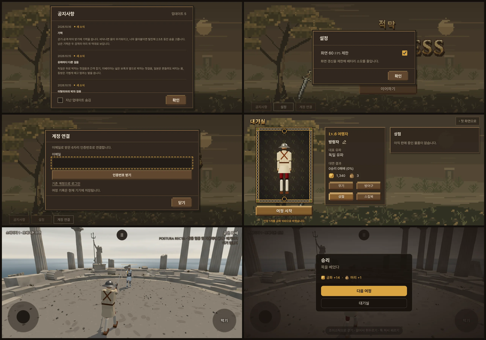
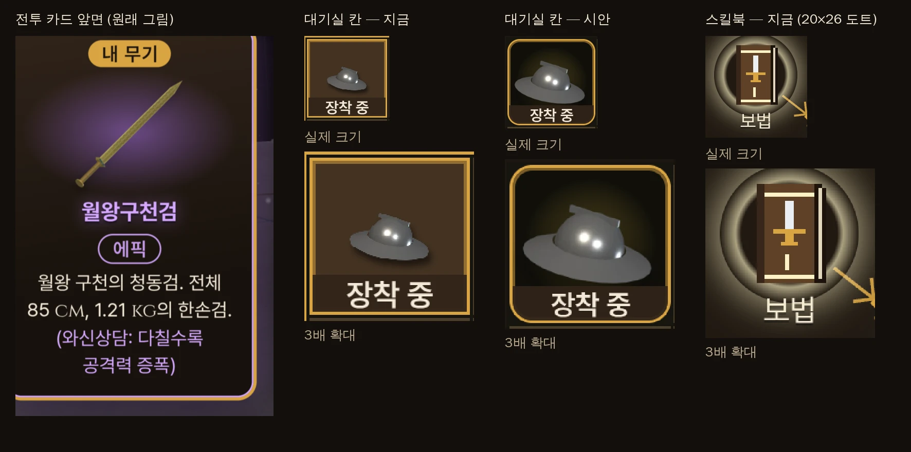
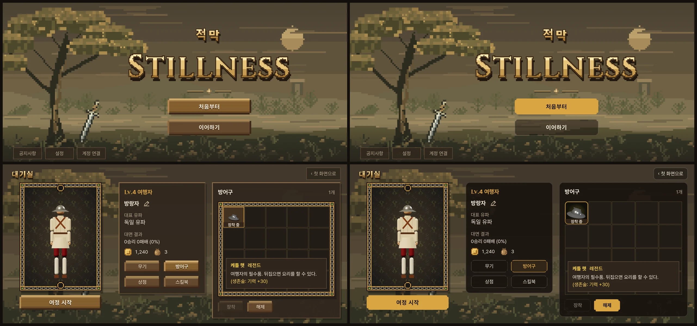

# 첫 화면·대기실 ↔ 전투 화면 디자인 맞추기 — 검토 · 제안 (2026-10-16)

- 사장님 지시 (원문, 10/16 14:4x):
  - ② "우리가 최근 첫 화면이랑 대기실을 업데이트 했잖아. 개발에 시차가 있다보니 전투 화면에서 만들었던 디자인 규칙과 많은 부분에서 다르거든. 픽셀 기반 게임으로서의 장점과 정돈된 깔끔한 그래픽의 장점을 이질적이지 않게 잘 섞어야 해. 디자인이나 UI면에서 발전시킬 부분이 있는지 검토해. 검토와 제안만 해봐 우선."
  - ③ "특히 스킬북을 포함해서 케틀 햇 같은 걸 보면 나중에 만들어진 아이템 섬네일이 해상도가 떨어지거든? 원래 만든 것은 좀 더 매끄럽고 고화질인데 원래가 더 좋아보여 난."
- 상태: **검토 · 제안만**. 코드는 바꾸지 않았다. 사장님이 고르시면 작업한다.
- 바탕: main f19e384. 사진은 모두 폰 가로 844 × 390 · 화소 비 3(실제 폰과 같은 비).

## 0. 원칙 한 줄 — 카드처럼: 겉은 픽셀, 속은 매끈

전투의 무기 카드가 이미 이렇게 섞여 있다. 뒷면은 픽셀 그림이고, 앞면은 매끈한 고화질 무기 그림과 깔끔한 글이다. 이 규칙을 첫 화면·대기실까지 넓힌다.

| | 무엇 | 꼴 |
|---|---|---|
| **겉 — 픽셀** (분위기 · 정체성) | 배경 그림(첫 화면 숲 · 대기실 숲) · 큰 제목 글자(적막 · STILLNESS · 대기실) · 카드와 초상의 틀(캐릭터 카드 사슬 틀 · 별자리 판 틀) · 카드 뒷면 | 지금 그대로 |
| **속 — 매끈** (읽고 누르는 것) | 글자 · 단추 · 창 · 고르개 · 입력칸 · 아이템과 재화 그림 · 아이콘 | 전투 화면 규칙 하나로 |

- 근거:
  - 사장님 10/14 "갈무리+자카드 조합보다 프리텐다드+킨젤 조합이 낫다". 글자는 도트 글꼴보다 깔끔한 쪽을 고르셨다.
  - 10/16 03:5x "전투 화면 스타일 따라서 폰트 정돈해 … '누르는 단추'도 마찬가지야".
  - 이번 ③ "원래(매끈한 고화질)가 더 좋아보여".

## 1. 지금 다른 점

| 항목 | 전투 화면 | 첫 화면 · 대기실 | 제안 |
|---|---|---|---|
| 창(패널) | 반투명 짙은 갈색 `--panel` · 가는 테두리 1 px `--line` · 둥근 모서리 10 | 불투명 나무색 · 두꺼운 볼록 테두리 2 px · 딱딱한 그림자 · 각진 모서리 | 전투 창 하나로(공지 · 설정 · 계정 · 정보 · 재고 · 스킬북 칸) |
| 단추 | 주 = 납작한 금색 · 부 = 테두리만 · 모서리 8 | 나무 판자(밝은 윗면 · 어두운 아랫면 그림자) · 각짐 | 전투 단추 하나로. 대상: 처음부터 · 이어하기 · 여정 시작 · 장착/해제 · 사용/봉인 · 확인 · 닫기 · 인증번호 받기 |
| 탭 | (스킬북 안 유파 탭이 이미 깔끔한 꼴) | 무기 · 방어구 · 상점 · 스킬북 = 나무 판자 넷 | 유파 탭과 같은 테두리 탭. 고른 것 = 금색 테두리 |
| 고르개 | '화면 60 FPS 제한' = 미닫이(토글) | 같은 설정이 네모 체크(✓) · '지난 업데이트 숨김'도 체크 | 미닫이 하나로 |
| 입력칸 | (없음) | 계정 이메일 = 금색 점선 | 가는 테두리 · 누르면 금색 테두리 |
| 색 | 글자 넷(본문 · 보조 · 강조 · 상태) + 등급 색 · 창 색 둘 | 나무 갈색 · 회색 등 40 여 가지 | 창 · 단추를 바꾸면 전투 색 몇 개로 준다 |
| 강조 금색 | '누를 것 · 꼭 볼 것'만 (10/14 규칙) | 'Lv.4 여행자'(계급)도 금색 | 계급은 본문 색 + 굵게 |
| 글자 크기 | 12 · 14 · 17 (+ 판 알림 · 제목 예외) | 거의 같음(10/16 고침) · 공지 10(사장님 결정) | 그대로. 대기실 CSS 의 숫자만 전투와 같은 이름표(토큰)로 묶어, 한 곳을 고치면 둘 다 바뀌게 |
| 아이콘 | Ⅱ(글자) · 미닫이 | 금화 · 주머니 · 책 = 도트 · 연필 = 매끈한 선 · ‹ ✕ = 글자 | 한 벌(가는 선 아이콘 + 매끈한 아이템 그림) |
| 사슬 틀 | 카드 뒷면이 픽셀 틀 | 캐릭터 카드 · 재고 칸 · 별자리 판 = 사슬 틀 셋 | 카드(캐릭터)와 그림 판(별자리)에만. 재고 칸은 틀 없이 창 안 칸으로 |

## 2. 섬네일 (③)

까닭은 셋이다.

1. **대기실 칸이 그림을 '픽셀 확대'로 줄인다.** `src/lobby.css` `.inventory-item img { image-rendering: pixelated }`.
   - 무기 · 케틀 햇 그림 파일은 전투 카드와 같은 256 × 256 매끈한 그림이다(`public/ui/weapons/*.webp` · `public/ui/armor/kettle.webp`).
   - 전투 카드 앞면은 이 그림을 부드럽게 줄이고, 등급 색 빛을 뒤에 깐다.
   - 대기실 칸은 계단지게 줄이고, 빛이 없다.
2. **칸에 비해 그림이 작다.** 케틀 햇이 칸 폭의 약 45 % 이고, 아래를 '장착 중' 띠가 가린다. 나뭇가지는 가는 대각선 하나로만 보인다.
3. **스킬북은 처음부터 20 × 26 칸 도트 그림이다**(`src/skill_tree.js` `bookSvg`). 화면에서 약 3.5 배로 키우니 네모가 그대로 보인다.
   - 금화 · 주머니도 16 × 16 도트다(`src/wallet_icons.js` — 결과 창 금화 줄도 같은 그림).

제안:

- **대기실 칸**:
  - 픽셀 확대를 끄고 부드럽게 줄인다.
  - 그림을 칸의 약 80 % 로 키운다.
  - 전투 카드 앞면과 같은 등급 색 빛을 뒤에 깐다(케틀 햇 = 레전드 금빛).
  - (고르시면) 아이템을 누를 때 뜨는 설명 칸도 전투 카드 앞면과 같은 카드로 한다: 큰 그림 · 이름 · 등급 알약 · 설명 · 특수 능력.
- **스킬북 새 그림 25 장**:
  - 무기 그림과 같은 방식이다: 3D 로 그린 256 px 매끈한 그림, 같은 조명 · 같은 각도.
  - 가죽 표지 + 유파 문양(금박) + 급 숫자(Ⅰ~Ⅴ). 책 모형 하나에 문양 다섯 · 숫자 다섯만 바꿔 찍는다.
  - 안 산 책 = 같은 그림을 어둡게. '사용' 둥근 빛은 그대로.
- **금화 · 주머니**: 모양은 그대로, 같은 매끈한 방식으로 다시 그린다. 결과 창 금화 줄도 같이 바뀐다.

## 3. 시안 (CSS 만 덧입힌 사진 — 코드 안 바꿈)

- 시안에서 바꾼 것:
  - 창 = 전투 창(반투명 짙은 갈색 · 가는 테두리 · 둥근 10)
  - 단추 = 전투 단추(주 금색 · 부 테두리 · 둥근 8)
  - 고른 탭 = 금색 테두리
  - 재고 칸 사슬 틀 없앰
  - 케틀 햇 = 부드럽게 · 크게 · 금빛
- 그대로 둔 것: 숲 배경 · 적막/STILLNESS/대기실 도트 제목 · 캐릭터 카드 사슬 틀.
- 시안 도구: `tools/ui/ui_unify_mock.mjs`(배포판 빌드 + 미리 보기 서버, 폰 가로 · 화소 비 3).
- 시안은 대략이다. 첫 화면 아래 작은 단추 셋 · 설정 · 계정 창은 시안에 넣지 않았다.

## 4. 제안 순서 · 크기

| 단계 | 할 일 | 크기 |
|---|---|---|
| 1 (③) | 대기실 칸 그림(부드럽게 · 크게 · 등급 빛) · 스킬북 새 그림 25 · 금화 · 주머니 매끈하게 | 작업자 1 명 · 2~3 시간 |
| 2 (②) | 창 · 단추 · 탭 · 고르개 · 입력칸 · 색 · 아이콘을 전투 규칙 하나로(첫 화면 · 대기실만 바뀜 — 전투 화면은 그대로) · 재고 칸 사슬 틀 없앰 · 대기실 CSS 숫자를 토큰으로 | 작업자 1 명 · 3~4 시간 |

- 두 단계 모두 화면만 바꾼다. 시뮬 관문 일곱은 그대로일 것이다.
- **고를 맛 하나(선택)**: 단추 밑에 2 px 짙은 턱을 두고, 누르면 1 px 내려가게 한다. 나무 판자의 손맛을 남기는 픽셀 흔적이다. 하면 전투 단추에도 똑같이 건다.

## 5. 사장님께 여쭐 것

1. 원칙 '겉은 픽셀, 속은 매끈'으로 갈지. 시안(§3) 기준으로.
2. 나무 판자 단추를 전투 단추로 바꿀지(권장). 단추 밑 2 px 턱(픽셀 손맛)은 넣을지.
3. 금화 · 주머니도 매끈하게 할지(권장 — 모양 그대로).
4. 1 단계(③ 섬네일)부터 할지.
