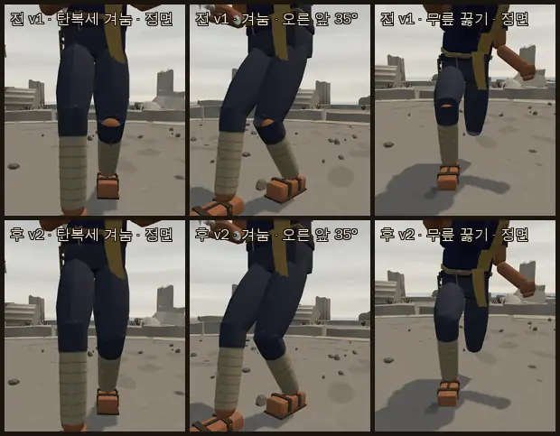
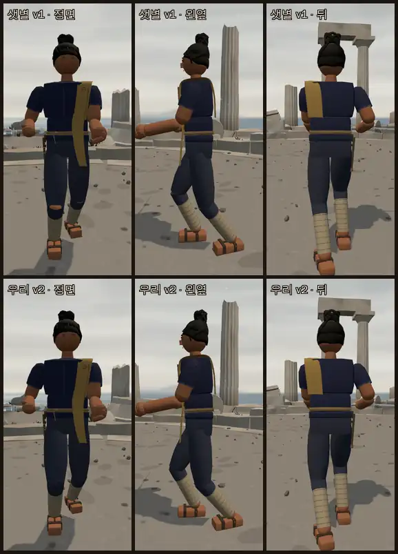
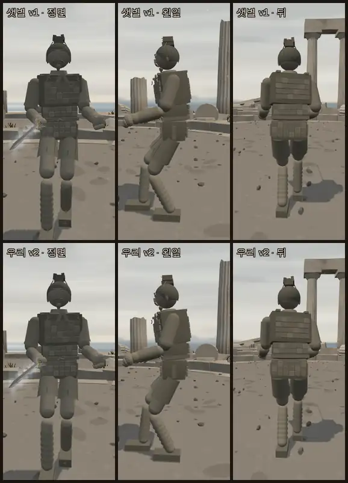
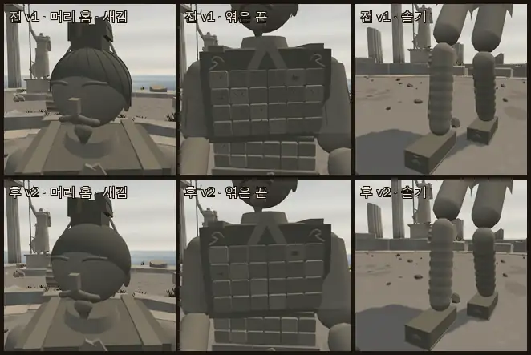
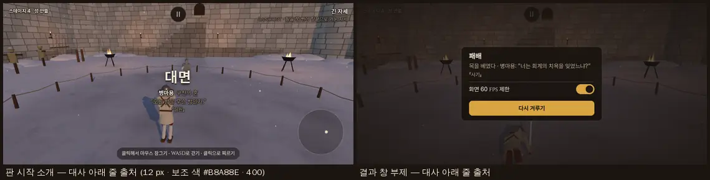
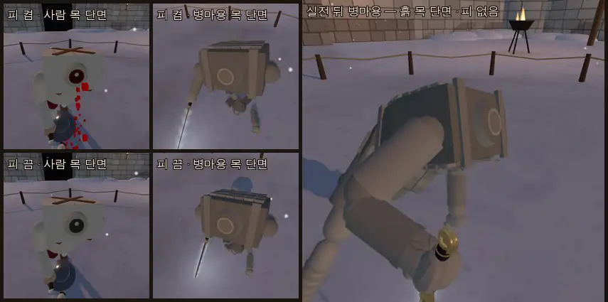
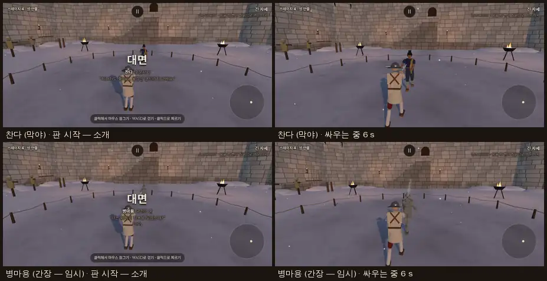

# 찬다 · 병마용 옮김 — 손님 인물 둘 (2026-10-14)

- 가지 `…/chanda-terra` (본판 9efb03d 에서). 커밋만, 병합은 감독.
- 지시: 사장님 결정 10/14 18:3x · 19:4x (감독 전달) — 샛별 저장소의 인물 **찬다**와 **병마용**(샛별에서는 진흙 수호자)을 손님 인물(`CHARACTER_GUESTS`)로. 겉모습 · 인물 시트 · 대사 · 목소리 · 병마용 몸 규칙까지.
- 기준: 샛별 저장소 `origin/main` **7684c732** (찬다 첫 시안 675233e2 → 막야 5a242fa3 · 병마용 b090ccc5 → 피 없음 901b1f39 → 월의 혼 5a242fa3 → 대사 출처 1890fdf1). 샛별 쪽은 `git archive` 로 빈 임시 폴더에 꺼낸 사본만 읽었다(고치거나 받아 오지 않음). 읽은 문서: 찬다 첫 시안 · 병마용 추가 대사 후보 · 월나라 문헌 근거 · 월의 혼(10/13~14).
- 앞선 리뷰: `docs/import/saetbyeol_review5_2026-10-14.md` §3 찬다 · §4 병마용 · §7 위험 5 · §8 이식 계획 2·4·5 단계. 선례: `ratna_port_2026-10-14.md`(손님 인물 꼴) · `salt_desert_port_2026-10-14.md`(다라이시).
- 범위 밖: 무대(화산섬 · 둔황) · 무기(월왕구천검) · `STAGE_FOE` · 여정 자리. 48 판 결투는 돌리지 않았다.

## 사장님 결정 (10/14 18:3x · 19:4x)

| 칸 | 찬다 | 병마용 |
|---|---|---|
| 숙련도 | **2** | **2** |
| 칭호 | **'수문지기'** | **'구천의 혼'** |
| 무기 | 막야(`moye` — 우리에게 있음) | 월왕구천검 — 특수 능력이 정해진 뒤 따로 옮김. **지금은 임시 간장(`ganjiang`)** — 시트 주석 '월왕구천검 들어오면 감독이 바꿈' (샛별도 처음엔 간장) |
| 목소리 | **슈바르츠 묶음** = `sound.js` `margarethe` 묶음(마르그레테와 같이) | **없음**(기합·신음 없음) — 머리나 팔이 잘릴 때 부서지는 소리만 |
| 그 밖 | 라트나와 겹치는 기질은 **찬다 쪽을 손봄**(라트나 값 그대로) · 전용 무대 화산섬은 나중(`STAGE_FOE` 안 건드림, 짝은 감독) · **무릎 맨다리 틈 고침** | 몸 규칙 **샛별 그대로**(출혈 0 · 목 관절이 끊겨야만 죽음 · 흙 알갱이·잔금·마른 타격음) · 대사 **샛별이 만든 것 전부**(추가 후보까지 · 이긴 뒤 옛 노래 두 줄) · **출처까지 화면에** · 겉모습 **≤ 2.7 만 삼각형(칼 포함)** |

## 0. 한눈에

| 무엇 | 한 일 | 어디 |
|---|---|---|
| 찬다 겉모습 | 샛별 v1 그대로 + **v2 무릎** — 무릎 관절 축에 바지 색 공(반지름 0.060)으로 굽힌 무릎 앞 틈을 메움 · 19,318 삼각형 · 메쉬 78(막야 포함) | §1-2 |
| 찬다 시트 | 손님 인물 · 수문지기 · 막야 · 숙련도 2(동방 고유 동작 체보요격·좌익격) · margarethe 목소리 · 해요체 대사 셋씩 | §1-3 |
| 찬다 기질 | 샛별 값(= 라트나와 칸마다 0~0.1 차)을 '수문 앞 한 줄에서 받아 막고 짧게 되받는 문지기'로: 돌기 0.07 · 속임 0.05 · 자세 고집 4.0 · 잇기 0.65 · 절제 0.7 … — 기본 AI 대결에서 라트나보다 막기 6 배 · 잇기 ⅓ · 도는 빠르기 ¾(더미 앞 ½) · 더미 앞 속임 ⅙ (기본 AI 상대 이김은 라트나와 같은 4/12) | §1-4 |
| 병마용 겉모습 | 샛별 v1 그대로 + **v2 잔선 덜기**(1 화소 안 관 여덟 층) — 28,550 → **17,846** 삼각형(간장 포함) · 메쉬 83 → 68 | §2-1 |
| 병마용 시트 | 손님 인물 · 구천의 혼 · 임시 간장 · 숙련도 2 · 목소리 없음 · 기질 값 없음(샛별 그대로) | §2-2 |
| 병마용 대사 | 샛별 여섯 + 추가 후보 넷 = **열** (시작 여섯 · 이김 넷) · 출처 『사기』·『설원』을 대사 아래 줄에(12 px · 보조 색 · 400) | §2-3 · §2-4 |
| 몸 규칙 | `physiology { body 'clay', bleeds false, deathRequiresHeadDetachment true }` — 사람은 같은 길을 한 줄도 다르게 돌지 않음 · 단면 재질을 사람과 나눔(피 켬/끔 섞임 없음) · 부활보다 '죽을 수 있나'를 먼저 봄 | §3 |
| 소리 | 목소리 없음(`VOICES.silent`) · 마른 타격음 · **부서지는 소리**(절차 합성 + 저장소 녹음 'crack' + 바닥 알갱이, 새 파일 0) | §3-5 |
| 시험 | `tools/sim/clay_body_check.mjs` 28 항목 통과 · 브라우저(실전·피 켬/끔·대사 출처·숙련도) 콘솔 오류 0 | §3-3 · §4 · §6 |
| 관문 | 일곱 그대로 · 참수·절단·부활·인물 도구 출력 바이트 그대로 | §6 |
| 확인표 | **1400~1431** | §7 |

## 1. 찬다

### 1-1. 옮긴 것

- 복식 모듈 `src/outfit_chanda.js` — 샛별 모듈을 그대로 두고(머리말 한국어 석 줄만 더함) 우리 판 v2 를 '── v2' 줄로 더했다. 샛별 판(`?look=chanda:v1`)의 꼭짓점 해시는 원본 모듈과 같다(**d9263927**, `tools/sim/look_hash.mjs`).
- 겉모습 `src/looks.js` — `LOOK_ARCHIVE.chanda` v1(샛별 값 그대로) + v2(`chandaRevision 2`, 지금 판). `outfits.js` 에 `chanda_watergate` 한 줄 — 도우미 묶음(`newOutfitHelpers`) 열쇠는 더하지 않았다(샛별 모듈이 쓰는 `artoriaRoundedBox` 등은 라트나 때 이미 있음).
- 인물 시트 `src/characters.js` `CHARACTER_GUESTS` — 출신 · 이야기 · 바람 · 기질 글은 샛별 값 그대로, 유파·장기·즐기는 자세·몸놀림·약점 글은 우리 판(막야 · 동방 · 숙련도 2 에서 열리는 동작)으로 다시 씀(§1-3).
- 물리는 그대로 — 겉모습만(몸·질량·관절·충돌체·상처 면 그대로). 무릎 공도 그리기 전용이다.

### 1-2. 무릎 틈 (v2 — 사장님 결정)

- 까닭: 넓적다리 바짓단은 넓적다리 몸 기준 −0.222 m 에서 끝나는 열린 관, 정강이 바짓단은 정강이 몸 기준 +0.228 m(무릎 관절 위 1.8 cm)에서 시작하는 열린 관이다. 곧게 서면 두 관이 2.5 cm 겹치지만 무릎을 조금만 굽혀도 앞쪽이 벌어져, 그 안의 정강이 살 캡슐(반지름 0.05 — 윗머리가 무릎 관절 자리)의 구릿빛이 **찢어진 바지처럼** 보였다(리뷰 그림 10 과 같은 자리 — 우리 판에서도 같았다).
- 고침: 무릎 관절 축 자리(정강이 몸 기준 y +0.21 = 관절 앵커)에 **바지 색 공 하나**(반지름 **0.060** · 16×10). 살 캡슐(0.05)보다 크고 두 바짓단 관의 안쪽(주름 최솟값 0.061 · 0.063)보다 작아 곧게 선 다리에서는 관 안에 숨고, 무릎이 몇 도로 굽든 축 둘레로 벌어지는 틈을 이 공의 바지 면이 메운다(관절 축에 있어 굽혀도 제자리). 다리마다 288 삼각형 · 메쉬 1.
- 확인: 겨눔(탄복세 — 앞다리 무릎이 굽음) 정면·3/4, 무릎 꿇기(일어서는 중 자세)에서 맨다리 틈 없음. 곧게 선 다리에서 공이 바지 밖으로 비치지 않음.

### 1-3. 시트 — 숙련도 · 칭호 · 목소리 · 대사

- **손님 인물**: `CHARACTERS`(기본 회전 · 무작위 상대 · 시뮬 라운드로빈)에는 넣지 않고 `CHARACTER_GUESTS` 에만 — `CHARACTERS_BY_ID` · 테스트 고르기 '상대' 줄('찬다 · 수문지기 · 여정 밖' — 시트에서 자동) · `?foe=chanda` 로만 나온다. 무대 짝(`STAGE_FOE`) 없음.
- 숙련도 **2**(사장님 결정) → `aiAtProficiency`: 실력 숫자 이름 normal · `persona.proficiency { chinese: 2 }`(막야 = `school 'chinese'`) · 동방 고유 동작 **체보요격(1) · 좌익격(2)** · 패시브·비기 없음.
- 칭호 **'수문지기'**(사장님 결정) · 무기 막야(레전드) · 목소리 `voice: 'margarethe'`(슈바르츠 묶음 — 마르그레테와 같은 녹음, 새 파일 없음). 묶음 셈: margarethe 묶음 = 마르그레테 · 찬다(둘).
- 대사 — **해요체** 셋씩(우리 관례). 샛별 넷 가운데 셋은 그대로, '칼을 거두세요'(아르토리아 '검을 거두세요' · 마야 '무기를 거두세요'와 겹침)는 '이제 돌아가세요'로, 하나씩 더함:

| 갈래 | 샛별 | 우리 |
|---|---|---|
| 시작 (taunt 겸) | 지나가도 좋아요. 물길은 건드리지 마세요. | 그대로 |
| 시작 | 비는 그쳤어도, 물은 아직 내려오고 있어요. | 그대로 |
| 시작 | — | **누구인지는 묻지 않아요. 무엇을 하러 왔나요?** (샛별 기질 글 '누가 왔는지보다 무엇을 하려는지 먼저 묻는다'에서) |
| 이김 | 칼을 거두세요. 아래쪽에는 사람이 살아요. | **이제 돌아가세요. 아래쪽에는 사람이 살아요.** |
| 이김 | 돌 하나에도 물이 가는 길이 달라져요. | 그대로 |
| 이김 | — | **수문은 오늘도 제자리예요.** |

- 해요체는 이졸데·미나미·투야나·(마야)에 이어 다섯째다(리뷰 §3-6). 라트나(하오체)와는 말끝부터 갈린다. '물·길' 소재는 수문지기라 남겼다.
- 글: 유파 '기존 막야와 동방 유파의 쥠·자세·기술을 그대로 쓰는 창작 수문 관리인. 동남아 물가의 실제 무술을 재현한 것은 아니다.' · 장기(숙련도 2 에서 실제로 열리는 좌익격·체보요격만) · 즐기는 자세(요격세 · 직부송서) · 몸놀림 '수문 앞 한 줄 위에서 앞뒤로만 오가고 옆으로 덜 돈다' · 약점 '칼이 짧아 칼끝 밖에서 이어지는 긴 무기의 압박에 약하다. 속임을 거의 쓰지 않아 칼끝이 읽히기 쉽다.' — 모두 아래 §1-4 의 잰 값과 맞춘 글.

### 1-4. 기질 — 라트나와 가르기 (사장님 결정 '찬다 쪽을 손본다')

**문제**: 샛별 찬다 값(level 실력 0.78 · 절제 0.84 · 힘 1 · 조급 0.78 / pers 정확 0.8 · 자세 고집 2.8 · 겁 0.2 · 화 0.1 · 집념 0.35 · 박자 2.8 · 공격 0.8 · 선수 0.4)은 샛별 라트나 값과 칸마다 0~0.1 차이고, 우리 라트나는 그 값을 그대로 옮겼다. 둘 다 '동남아 물가 사람'이라 싸움 결까지 쌍둥이였다.

**방향 — 찬다 설정에서**: 마을이 떠난 뒤에도 옛 수문에 남은 관리인 · '지나가도 좋아요. 물길은 건드리지 마세요.' · 차분하고 실용적 · 누가 왔는지보다 무엇을 하려는지 · 짧은 한손 칼(막야) → **수문 앞 한 줄 위에서 버티며, 들어오는 칼을 받아 막고 짧게 되받는 문지기. 돌지 않고, 속이지 않고, 지나가는 사람은 쫓지 않는다.** 라트나(가장 긴 대검 · 이베리아 몬탄테 — 둥글게 돌며 휘두르고 막혀도 칼을 흘려 다시 벤다)와 반대쪽 끝.

| 칸 (AI 쪽 이름) | 뜻 | 샛별 찬다 | 라트나 (우리, 그대로) | **찬다 (우리)** | 근거 |
|---|---|---|---|---|---|
| 돌기 `circleRate` | 옆걸음 빠르기 | 동방 범위 0.2~0.4 | 이베리아 범위 0.25~0.5 | **0.07** | 수문 앞 한 줄 — 돌지 않는다 |
| 간격 `margin` | 닿는 거리 밖 여유(m) | 동방 범위 0.1~0.3 | 이베리아 범위 0.28~0.55 | **0.12** | 짧은 한손 칼 — 가까이 선다 |
| 자세 고집 `guardStick` | 먼 자세로 덜 건너뜀 | 2.8 | 2.8 | **4.0** | 두 자세(요격세·직부송서)만 오간다 |
| 자세 박자 `rhythm` | 자세 바꾸는 박자(s) | 2.8 | 2.9 | **4.2** | 차분함 |
| 손 `guardSpeed` | 간 볼 때 손 빠르기(m/s) | 동방 0.9 | 이베리아 0.9 | **1.15** | 벤 칼을 곧 몸 가까이 거둔다 |
| 정확 `precision` | 베는 길 정확도 | 0.8 | 0.78 | **0.86** | 실용적 |
| 맞받아 베기 `vor` | 달려드는 상대를 맞받나 | 0.4 | 0.4 | **0.45** | 조금 더 버틴다(0.78 은 기본 AI 상대 0/12 — 아래) |
| 공격 성향 `aggr` · 참을성 `patienceTime` | | 0.8 · 동방 6~10 s | 0.78 · 이베리아 7~12 s | **0.8 · 10 s** | 동방 범위의 참을성 긴 끝 |
| 겁 · 화 · 집념 `fearful`·`angry`·`dogged` | 감정 문턱 | 0.2 · 0.1 · 0.35 | 0.24 · 0.12 · 0.4 | **0.12 · 0.06 · 0.18** | 차분함 · 지나가는 사람은 쫓지 않음 |
| 속임 `feint` | (level) | normal 0.15 | normal 0.15 | **0.05** | 실용적 — 속이지 않는다 |
| 잇기 `followUp` | 막은 뒤 되받기 · 맞힌 뒤 잇기 | normal 0.5 | normal 0.5 | **0.65** | 받아 막고 짧게 되받는다 |
| 맞받기 `counter` | 상대가 칼을 드는 순간 먼저 치기 | normal 0.2 | normal 0.2 | **0.3** | |
| 절제 `discipline` | 다가오는 상대에 물러나는 정도 | 0.84 | 0.84 | **0.7** | 자리를 덜 내준다 |
| 실력 · 힘 · 조급 | | 0.78 · 1 · 0.78 | 0.76 · 1 · 0.76 | **0.78 · 1 · 0.78** | 샛별 값 그대로(실력 축은 숙련도 2 몫) |
| 자세 취향 · 판 시작 자세 | | wechselR 1.4 · langort 1.2 · 기술 zornhau 1.4 · oberhau 1.1 / 아래 탈류 | 없음 / 아래 탈류 | **요격세 sideR 1.7 · 직부송서 langort 1.5 / 요격세** | 샛별 취향은 독일 이름(내려베기 위주)이라 뺐다. 판 시작 자세도 라트나와 갈림 |

**잰 값** (`node tools/sim/guest_temper.mjs 5 12` — 헤드리스, 결정적. 같은 막야·숙련도 2 위에 샛별 값을 얹은 '찬다 샛별 값'도 함께):

| 더미 앞 60 s × 5 | 분당 공격 | 분당 속임 | 첫 공격 s | 자세 전환/초 | 평균 간격 m | 도는 빠르기 °/s |
|---|---:|---:|---:|---:|---:|---:|
| 라트나 | 7.84 | 1.81 | 9.52 | 0.37 | 2.25 | 5.02 |
| 찬다 샛별 값 | 13.21 | 0.48 | 7.63 | 0.34 | 2.80 | 3.03 |
| **찬다** | 12.41 | **0.28** | 9.01 | 0.34 | 2.59 | **2.41** |

| 기본 AI(롱소드 · normal) 대 45 s × 12 | 이김-짐 | 분당 공격 | 분당 막기 | 분당 비켜서기 | 분당 잇기 | 분당 맞받기 | 도는 빠르기 °/s |
|---|---|---:|---:|---:|---:|---:|---:|
| 라트나 | 4-8 | 17.73 | 0.49 | 8.40 | 13.70 | 1.60 | 5.13 |
| 찬다 샛별 값 | 2-10 | 20.95 | 2.70 | 18.43 | 3.36 | 0.60 | 4.30 |
| **찬다** | **4-8** | 20.14 | **2.96** | 15.32 | **4.76** | 0.78 | **3.76** |

- 라트나와: 막기 **6 배**(0.49 → 2.96) · 잇기 **⅓**(13.7 → 4.8 — 라트나는 talho e revez 로 칼을 흘려 잇는다) · 도는 빠르기 **약 ½**(5.0 → 2.4 더미 · 5.1 → 3.8 대결) · 속임 **약 ⅙**(1.81 → 0.28). 기본 AI 상대 이김은 라트나와 같은 4/12, 샛별 값(2/12)보다 낫다.
- 처음 안(참을성 12.5 · 맞받아 베기 0.78 · 잇기 0.32 · 절제 0.92)은 기본 AI 상대 **0/12** — 맞받아 베기가 긴 칼에 먼저 베이고, 막은 뒤 되받지 않아(잇기 0.32) 받기만 했다. 잇기를 '막은 뒤 되받기'로 다시 읽어 0.65 로, 맞받아 베기 0.45 로 내려 지금 값이 됐다(후보 넷을 8 판씩 견줌 — 이김 3·1·1·1, 가장 나은 안). 판 수가 적어 이김 수는 거친 값이다.
- 비켜서기(물러나 헛치게)는 찬다도 많다(15.3) — 간격 끝·찌르기는 물러나 피하는 규칙(`ai.js respond` pVoid 0.8)이 기질 밖이라서. 그래서 글에는 '자리를 지킨다'가 아니라 '한 줄 위에서 앞뒤로만 오간다'로 적었다.

## 2. 병마용

### 2-1. 겉모습 — 잔선 덜기 (v2)

- 복식 모듈 `src/outfit_terracotta.js` — 샛별 모듈 그대로(샛별 판 꼭짓점 해시 **3c7f6982** 원본과 같음) + 우리 v2(`terracottaRevision 2`)를 '── v2' 줄로. `looks.js` `LOOK_ARCHIVE.terracotta` v1(샛별 값) · v2(지금 판), `outfits.js` `terracotta_guard`.
- **뺀 것 — 폰 결투 거리에서 1 화소 안인 관(반지름 0.65~2 mm)으로 만든 층 여덟**: 엮은 끈(갑옷 조각마다 둘, 1.4 mm — 6,912) · 머리 홈(1.2 mm — 2,280) · 얼굴 새김(귀 테·수염 금 0.8~2 mm — 648) · 소매 주름(1.5 mm — 384) · 옷자락 솔기(192) · 다리 천 솔기(96) · 신 솔기(96) · 잔금(0.65~0.8 mm — 96). 엮은 끈·머리 홈은 아예 짓지 않고, 나머지는 지은 조각을 버린다(층을 만들지 않음).
- **남긴 것**: 갑옷 조각(6,480 — 가슴 격자로 읽히는 큰 꼴) · 어깨 띠와 매듭(3.2 mm) · 허리띠와 매듭(4 mm) · 관과 관 끈(3.4 mm) · 상투 · 눈썹 · 귀 · 콧수염·턱수염 덩어리 · 깃 · 소매 · 짧은 옷자락 · 다리 감은 천 · 신 · 남은 안료 두 점. 손은 샛별처럼 꼭짓점 색을 꺼 둔 채(검게 나오지 않음 — 그림으로 확인).
- 삼각형(지금 보이는 몸·옷 · 컬링 전 — 브라우저 `game.enemy` 부위 그룹, 손 포함): v1 **23,004 · 메쉬 62** → v2 **12,300 · 47**. 간장(임시) 5,546 · 21 을 더하면 **28,550 · 83 → 17,846 · 68** — 목표 ≤ 2.7 만 · ≤ 90 안. (리뷰 측정 29,252 는 샛별 빌드 · 월왕구천검 3,836 기준. 우리 공통 몸이 가벼워 v1 도 23,004.)

### 2-2. 시트 — 칭호 · 숙련도 · 임시 무기 · 목소리

- 손님 인물(찬다와 같은 자리 — '병마용 · 구천의 혼 · 여정 밖' · `?foe=terracotta`). id 는 샛별 쪽 그대로 `terracotta`(겉모습·복식 열쇠와 같게 — 화면엔 안 나옴).
- 칭호 **'구천의 혼'**(사장님 결정 — 샛별 '돌아가지 못한 월의 혼'). 숙련도 **2** → normal · `{ chinese: 2 }` · 체보요격·좌익격 · 비기 없음. 기질 값은 샛별처럼 없음(동방 기본 범위에서 판마다 굴림) · 판 시작 자세 탄복세(`pflugR`, 샛별 값).
- 무기 **임시 간장**(`weapon: 'ganjiang'` · `persona.school: 'ganjiang'`) — 시트 주석 '월왕구천검 들어오면 감독이 바꿈'. 테스트 고르기 '상대' 줄의 무기 칸은 시트를 읽어 지금 '간장'으로 보인다.
- 목소리 `voice: 'silent'` → `VOICES.silent = { mute: true }`(우리 `mute` 칸 첫 사용 — 새 묶음, 혼자).
- 글: 이야기 · 바람 · 기질은 샛별 글을 따르되 둔황 무대 화면 이름이 아직 정해지지 않아 '천불의 절벽'을 '사막의 절벽'으로 · '후대 둔황'을 '후대의 사막 석굴'로(무대 이름이 정해지면 맞춤). 유파 '월왕구천검(들어오기 전까지는 간장)과 동방 유파의 쥠·자세·기술을 그대로 쓴다. 흙 갑옷 조각은 장식이라 강철 판금의 방어력이 없다.' · 몸놀림(피 없음·머리로만 쓰러짐·목소리 없음) · 약점(목·머리 한 번에 무너짐 · 잘린 팔다리는 돌아오지 않음)은 우리 글. 이 글들은 화면에 나오지 않는다(설정 자료).

### 2-3. 대사 · 출처 목록 (사장님 결정 '샛별이 만든 대사를 전부')

샛별 직역(고전 원문은 저작권 밖). 데이터의 ASCII 큰따옴표는 뺐다 — 우리 화면이 둥근 따옴표를 붙인다(리뷰 §4-7 걸리는 점 3). 원문 글자는 샛별 근거 문서의 전사 그대로.

| 칸 | 대사 (화면) | 출처 (화면) | 원문 | 말한 사람 · 맥락 | 샛별 자리 |
|---|---|---|---|---|---|
| 시작 · taunt | 너는 회계의 치욕을 잊었느냐? | 『사기』 | 女忘會稽之恥邪？ (권41 「월왕구천세가」) | 구천이 쓸개를 맛보며 스스로에게 | 시작 · 이김 · taunt |
| 시작 | 오늘 밤은 무슨 밤인가. | 『설원』 | 今夕何夕兮 (권11 「선설」 — 월인가) | 월인 뱃사람의 노래(초어 풀이) | 시작 |
| 시작 | 오늘은 무슨 날이기에, 왕자와 한 배를 타는가. | 『설원』 | 今日何日兮，得與王子同舟。 | 같은 노래 | 시작 |
| 시작 | 나는 여기서 끝나는가? | 『사기』 | 吾終於此乎？ | 회계에서 곤경에 빠진 구천의 탄식 | 추가 후보 1 (게임 밖이었음) |
| 시작 | 임금께서는 명을 행하시고, 신은 뜻을 행하겠습니다. | 『사기』 | 君行令，臣行意。 | 떠나려는 범려가 구천에게 | 추가 후보 2 |
| 시작 | 반드시 내 눈을 가져다 오나라 동문에 놓아, 월나라 군대가 들어오는 것을 보게 하라! | 『사기』 | 必取吾眼置呉東門，以觀越兵入也！ | 오나라 신하 오자서의 마지막 말 | 추가 후보 3 |
| 이김 | 산에는 나무가 있고 나무에는 가지가 있건만. | 『설원』 | 山有木兮木有枝， | 월인가 끝 줄 — **이긴 뒤 부르는 옛 노래** | 이김 |
| 이김 | 그대를 좋아하는 내 마음을 그대는 모르네. | 『설원』 | 心說君兮君不知。 | 같은 줄 뒤 — **이긴 뒤 부르는 옛 노래** | 이김 |
| 이김 | 너는 회계의 치욕을 잊었느냐? | 『사기』 | (위와 같음) | | 이김 |
| 이김 | 날아다니는 새가 없어지면 좋은 활을 감추고, 교활한 토끼가 죽으면 사냥개를 삶는다. | 『사기』 | 蜚鳥盡，良弓藏；狡兔死，走狗烹。 | 범려가 대부 종에게 보낸 편지 | 추가 후보 4 |

- 칸 배정 [작업자 판단 — 확인표 1414]: 추가 후보 넷은 샛별 쪽도 게임에 넣지 않았던 것이라 자리가 없었다. 샛별 문서의 쓰임 제안(첫째 = 패배와 회한, 넷째 = 복수 뒤에도 버려진 사람의 원한)을 따라 넷째는 이긴 뒤, 셋(탄식 · 자기 뜻 · 동문의 눈)은 시작으로. 우리 화면은 진 쪽의 대사를 내지 않으므로(죽으면 말이 없다) '패배' 칸은 없다.
- 오자서는 오나라 신하이고 범려의 말도 월군의 구호가 아니다 — 병마용은 '자기 말 대신 오래된 기록과 노래를 되풀이'하는 인물이라 남의 말을 그대로 옮기는 것으로 두었고, 화면에는 책 이름만 붙는다(말한 사람은 이 표와 시트 주석에만).
- 같은 대사가 시작·이김·taunt 세 칸에 되풀이되는 것(회계의 치욕)은 샛별 그대로 두었다.
- 기본 대사 고르기(`randomLine` — 칸마다 고르게)는 그대로라, 시작 여섯 가운데 하나 · 이김 넷 가운데 하나가 나온다.

### 2-4. 화면에 출처 (사장님 '출처까지 다 나오게 해')

- 세 곳 모두: 판 시작 가운데 소개(`showFoeIntro`) · 상대의 승리 대사(`showFoeLine` — 소개 칸을 다시 씀) · 진 판의 결과 창 부제(`menuSub`). 대사 줄 바로 아래 새 줄에 책 이름.
- 꼴 — 우리 글 규칙 그대로: 크기 **작게 12 px**(`--fs-s`) · 색 **보조 #B8A88E**(`--c-sub`) · 굵기 **400**(`--fw-body`) · 위 여백 2 px (`index.html #foeIntro small` · `#menuSub small`). 브라우저에서 계산된 값을 읽어 확인: `12px · 400 · rgb(184, 168, 142)`.
- 출처가 없는 인물은 빈칸이라 줄이 숨는다(`:empty`) — 다른 인물 화면은 그대로. 고르는 함수 `lineSourceOf(시트, 대사)`(`characters.js`)는 난수를 쓰지 않는다.
- 글 검사: 출처 두 낱말도 화면 글이라 `tools/text/texts.mjs` 가 시트의 `lineSources` 를 함께 읽게 했다(같은 출처는 한 번).

## 3. 병마용 몸 규칙 (사장님 결정 '샛별 그대로')

### 3-1. 규칙과 자리

| 규칙 (샛별 901b1f39) | 우리 자리 |
|---|---|
| 시트 `physiology { bleeds: false, deathRequiresHeadDetachment: true }` + 우리 표식 **`body: 'clay'`** | `characters.js` → `main.js` 가 상대 Fighter 를 만들 때 넘김 → `fighter.js` `HUMAN_BODY`(사람 기본값) 위에 덮음. 없으면 `HUMAN_BODY` 그대로 |
| 출혈 0 · 혈액 1 고정 | `updateVitals` 첫머리 · `applyWound` 의 상처 출혈 · `decapitate` · `sever`(팔다리 단면) 출혈 0 |
| 목 관절이 떨어지기 전에는 죽지 않음 | `die()`·`setState('dead')` 가 `canDie`(목 관절 없음)를 먼저 봄 → 몸통 찌르기 · 내려찍기 즉사 · 출혈 · 기절로 죽지 않음 |
| 머리가 떨어지는 길 = 사람의 치명 문턱 그대로(새 문턱 없음) | 목 상처 심각도 > 0.5(베기·찌르기 모두 — 사람은 목을 지나간 베기만 참수) · 머리 베기 > 0.8 · 머리 찌르기 > 0.5 · 머리·목 둔타로 의식 ≤ 0 → `detachHeadFromWound` → `decapitate` → `die` |
| 핏방울·분출·붉은 상처·옷 피 번짐·공격자 칼에 묻는 피 없음 → 흙 알갱이 · 잔금 · 마른 타격음 | `main.js onWound`(흙 갈래) · `updateDrips` · `effects.js clayChips`·`'clay'` 자국 · `sound.js clay()` |
| 목·팔다리 끝면 회갈색 · 뼈 단면 없음 · 분출 없음 | `decap_fx.js` · `limb_fx.js` — **흙 재질을 사람 재질과 따로**(아래) |
| 목소리 없음(몸이 땅에 닿는 소리는 남김) | `VOICES.silent` · `BodySounds` 가 신음을 부르지 않음 · 참수된 몸은 원래 죽음 목소리를 건너뜀 |
| — (사장님 결정) | 머리·팔다리가 떨어질 때 **부서지는 소리**(§3-5) |

### 3-2. 사람 판은 그대로 — 어떻게

- 모든 갈래가 시트 표식(`physiology.body === 'clay'` · `bleeds === false` · `deathRequiresHeadDetachment`)을 본다. 사람의 `HUMAN_BODY` 는 `{ body: 'human', bleeds: true, deathRequiresHeadDetachment: false }` — 사람의 출혈 식은 같은 식을 삼항 안에 그대로 두었고(같은 부동소수 결과), 참수 조건은 `false || (예전 조건)`, `canDie` 는 늘 true, `decapitate` 의 '이미 뗐다' 지킴은 사람 길에서 한 번도 걸리지 않는다(사람은 참수 = 죽음이라 두 번째가 없다).
- 단면 재질: 우리 두 파일은 단면 재질을 모듈에 하나씩 두고 '피 표현'(`particles.bloodOn`)에 따라 **매 프레임 색을 바꾼다**. 같은 재질을 흙 단면이 쓰면 같은 판에서 흙 단면이 핏빛·회색으로 바뀌고 흙빛이 사람 단면에 번진다(샛별도 겪고 나눔). 그래서 흙 단면 재질 둘(`#8B887A` · 테 `#AAA697`)을 따로 두고 피 표현과 상관없이 그 색. 흙 단면은 뼈 원판·분출을 붙이지 않는다(분출 목록에 넣지 않음).
- 겉모습 쪽 난수: 흙 갈래는 `Math.random` 을 새로 쓰지 않는다(흙 알갱이는 차례로 정한 각). 사람 단면은 메쉬를 만드는 차례도 예전 그대로(살 → 테 → 뼈).
- 브라우저 디버그: `window.game.particles` 하나를 더 열었다(피 표현 켬/끔 점검용).

### 3-3. 시험

**헤드리스 `node tools/sim/clay_body_check.mjs`** — 28 항목 **모두 통과** (11.8 s):

| # | 본 것 | 결과 |
|---|---|---|
| ① | 합성 상처 40(몸통·팔다리 베기·찌르기) 뒤 2 s: 상처마다 출혈 0 · 출혈 0 · 혈액 1 · 죽지 않음 | 통과 |
| ① | 실전 3 판(병마용 시트 그대로 — 간장 · 숙련도 2 · 대 기본 AI 롱소드 normal, 30 s): 흙 몸을 친 타격 66(살을 가른 것 24) 동안 출혈 스텝 **0** · 혈액 최솟값 **1** | 통과 |
| ② | `die('출혈'·'기절'·'내려찍기'·'목'·'머리')` 거부 · 의식 0 이어도 기절 없음 · 내려찍기 즉사 찌르기(몸통) 거부 · 몸통 찌르기 심각도 3 · `setState('dead')` 거부 | 통과 |
| ② | 머리 베기 0.9 · 머리 찌르기 0.6 · 지나가지 못한 목 찌르기 0.6 · 목을 지나간 베기 1.2 → 흙 몸은 **목 관절이 떨어지고** 죽음(목 단면 출혈 0). 같은 상처의 사람은 앞의 셋에서 참수 없이 죽음(그대로) | 통과 |
| ② | 머리 둔타 400 J(의식 −1.86) → 목이 부러져 머리가 떨어짐 · 60 J 는 머리를 떼지 않음 | 통과 |
| ② | 부활 시트를 준 흙 몸: 머리 없는 죽음 요청은 남은 부활 횟수를 쓰지 않음 · 머리가 떨어지면 부활 없이 끝 | 통과 |
| ② | 실전 3 판에서 흙 몸이 죽은 판(3 — 7.4 · 19.4 · 23.0 s, 모두 목)은 모두 목 관절 없음 | 통과 |
| ③ | 같은 장면(소리 대역 — 부른 함수만 셈): 흙 몸 팔 둘·다리 하나 절단 → `clayBreak` 셋, 사람 절단 소리 0 · 참수 → `clayBreak(머리)`, 사람 참수 소리 0 | 통과 |
| ④ | 흙 몸 목소리 호출(신음·죽음·숨·부활) **0** — 흙 몸이 부른 소리는 `clayBreak` · 몸이 땅에 닿는 `bodyFall` · 칼 떨어짐 · 머리 닿음뿐 | 통과 |
| ③ | 같은 장면의 사람: 절단 셋 · 참수 하나 · 신음 그대로 · 부서지는 소리 0 | 통과 |
| ③ | 부서지는 소리 조각(절차 합성): 0.7 s · 값이 모두 유한 · 최대 0.9 | 통과 |
| ⑤ | `decap_fx`·`limb_fx` 에 사람·흙 몸을 같은 판에, 피 켬 → 끔 → 켬: 사람 단면 `4a0a0c/6a1a18`+뼈 ↔ `3a3634/4a4644`+뼈, 흙 단면 늘 `8b887a/aaa697` 뼈 없음, 흙 단면만 돌린 프레임의 입자 0 · 사람 참수 단면은 피를 켜면 그대로 붉은 분출 | 통과 |

**브라우저**(이 가지 개발 서버, 헤드리스 SwiftShader · 화면 배율 1 · 바깥 요청 막음 — `node tools/browser/chanda_terra_shots.mjs <주소> <폴더> clay`):

- 같은 판에서 사람(나)과 병마용의 팔꿈치·목을 합성 상처로 자름: 피 켬 — 사람 단면 `4a0a0c/6a1a18/cfc4b2` · 흙 단면 `8b887a/aaa697` · 붉은 입자 86(사람 쪽) / 피 끔 — 사람 `3a3634/4a4644/cfc4b2` · 흙 그대로 · 붉은 입자 0. 흙 몸 출혈 0 · 혈액 1 · 소리 호출 신음 0 · 죽음 0 · 사람 참수 1 · 사람 절단 1 · 부서지는 소리 2(흙 팔 · 흙 머리).
- 실전: 내 자리에도 AI(롱소드 · hard)를 붙여 병마용(시트 그대로)과 싸우게 했다(작은 화면, 판이 끝날 때까지): 14.6 s 에 병마용이 **목으로 참수**되어 끝남 · 병마용을 친 타격 15 번 → 흙 알갱이 15 · 마른 타격음 15 · 병마용 몸의 자국은 **잔금만 15**(상처·찢김·피 번짐 0) · 출혈·혈액 손실 최댓값 **0** · 병마용을 벤 내 칼의 피 **0** · 신음·죽음 목소리 호출 **0** · 부서지는 소리 1(머리) · 사람 참수·절단 소리 0. (나를 친 타격 둘은 사람 길 그대로 — 피 입자 · 살 소리.)
- 콘솔 오류 0 · HTTP 400 이상 0 · 바깥 요청 0.

### 3-4. 부활 순서 (샛별과 맞춤)

- 우리 `die(cause, noRevive)` 는 `tryRevive`(부활 시트가 있으면 첫 죽음을 부활로) 앞에 `canDie` 를 둔다 — 샛별 901b1f39 의 순서와 같다. 흙 몸에게 머리 없는 죽음 요청(출혈·기절·내려찍기·몸통)은 부활로도 가지 않고 그냥 거부되어 **부활 횟수를 쓰지 않는다**.
- 머리가 떨어지면 `decapitated` → `tryRevive` 가 '참수된 몸은 일어서지 않는다'로 거절 → **머리 잘림 = 끝**. 지금 병마용 시트에는 부활이 없지만, 부활 시트를 줘도 이 순서가 지켜지는지 시험에 넣었다(§3-3 ②).
- `revive.js` 는 고치지 않았다.

### 3-5. 소리

- **목소리 없음**: `VOICES.silent = { mute: true }` — 녹음·합성 목소리 없음(`prepareVoices`·`loadVoiceSamples` 가 건너뜀). `BodySounds` 는 목소리 없는 인물에게 신음을 부르지 않고(`hurt` 도 mute 면 곧 돌아감), 참수된 몸은 원래 죽음 목소리를 건너뛴다. 몸이 땅에 닿는 '쿵'(`bodyFall`)은 남는다(목소리 없는 인물은 꼭 한 번, 무겁게 — 기존 규칙).
- **마른 타격음**(샛별 `clay()` 그대로): 병마용을 친 타격마다 살·뼈 소리 대신 뼈 조각 소리를 **0.78 배** 빠르기로 **0.22 s**, 세기 **0.18 + 0.42 × E/150**.
- **부서지는 소리**(사장님 10/14 19:4x '머리나 팔 잘릴 때 부서지는 소리만'): 사람의 참수·절단 소리(젖은 소리 · 뼈 '뚝' · 몸통 '쿵') 대신 `Sound.clayBreak` —
  - 절차 합성 `clayBreak`(소리 조각 표 `BANK` 에 둘): 흙 그릇처럼 둔하게 금이 가는 '딱'(펄스 4~7 개, 0~45 ms) + 짧게 죽는 흙 울림 10 개(500~2600 Hz · 15~45 ms — 길면 도자기 종소리) + 처음 0.15 s 잘게 바스러지는 알갱이 30 + 0.05~0.55 s 동안 드물어지며 떨어지는 조각 6~10 개(1.2~3.6 kHz '똑') + 낮은 '툭'(85~115 Hz). 0.7 s.
  - 위에 저장소에 이미 있는 녹음 'crack'(나무 쪼개짐 — Kenney CC0, 뼈 부러지는 소리로 쓰던 표본)을 0.35 · 0.7~0.8 배로, 0.09 s 뒤 그 무대 바닥 알갱이 녹음(떨어진 조각이 바닥에 흩어짐)을 0.3 으로.
  - 머리: 세기 0.85 · 0.86~0.94 배(조금 크고 낮게) · 팔다리: 0.7 · 0.98~1.08 배. **새 소리 파일 0 · 새 다운로드 0.** 소리 조각 씨앗은 이름으로 정해져 다른 소리 조각은 그대로다.
  - 다리 절단도 같은 소리로 했다(사장님 말씀은 '머리나 팔' — 다리도 같은 흙 몸이고, 사람 절단 소리를 내면 피 없는 몸에 젖은 소리가 난다) [작업자 판단 — 확인표 1427].
- '소리 들어보기' 화면(`sounds.html`)에 두 줄: '병마용 — 흙 몸 타격'(30 · 90 · 150 J) · '병마용 — 부서짐'(팔 · 머리).

## 4. 숙련도 확인

**브라우저** — `?foe=chanda` · `?foe=terracotta` (`node tools/browser/chanda_terra_shots.mjs <주소> <폴더> prof:chanda prof:terracotta`). 무기 카드 뽑기를 건너뛰려고 `weapon=longsword` 를 주고, 그 값이 상대에게 번지지 않게 상대 무기는 시트 무기 그대로 `foeWeapon=` 으로. 판마다 30 s(내가 먼저 죽으면 거기까지) · 내 인물은 가만히 · 소프트웨어 그리기가 느려 화면 320×180 · 판 사이는 결과 창의 '다시 겨루기'.

| 인물 | 판 | 시간 | 무기 · 유파 · 실력 · 숙련도 | 꾸러미의 동방 고유 동작 | 쓴 기술 (공격·속임 시작 수) | 비기 |
|---|---|---:|---|---|---|---:|
| 찬다 | 1 | 16.9 s (내가 짐) | 막야 · 동방 · normal · `{chinese: 2}` · 비기 장착 없음 | 좌익격 · 체보요격 | 분노의 베기 3 · 왼 올려베기 1 · 왼 분노의 베기 1 | 0 |
| 찬다 | 2 | 30 s | 같음 | 같음 | 분노의 베기 5 · 왼 올려베기 2 | 0 |
| 찬다 | 3 | 17.4 s (내가 짐) | 같음 | 같음 | 분노의 베기 3 · 왼 올려베기 2 | 0 |
| 병마용 | 1 | 22.7 s (내가 짐) | 간장 · 동방 · normal · `{chinese: 2}` · 비기 장착 없음 | 좌익격 · 체보요격 | 분노의 베기 8 · 왼 올려베기 3 · **체보요격 2** · **좌익격 1** · 왼 분노의 베기 1 | 0 |
| 병마용 | 2 | 30 s | 같음 | 같음 | 분노의 베기 3 · 정수리 베기 2 · 왼 분노의 베기 1 · 속임 위→다리 1 | 0 |
| 병마용 | 3 | 20.8 s (내가 짐) | 같음 | 같음 | 분노의 베기 6 · **좌익격 2** · **체보요격 1** · 왼 올려베기 1 · 왼 가로베기 1 | 0 |

- 기술 이름은 코드 이름의 우리말 — `zornhau` 분노의 베기 · `zornhauL` 왼 분노의 베기 · `unterhauL` 왼 올려베기 · `oberhau` 정수리 베기 · `zwerchL` 왼 가로베기 · `chebuYaoji` 체보요격 · `zuoyi` 좌익격 · '위→다리' 속임(화면의 자세·기술 이름은 동방 이름표).
- 여섯 판 모두: 꾸러미에 든 동방 고유 동작은 **좌익격 · 체보요격 둘뿐**(염시(3) · 요격/자→격(4)은 없음) · 비기 장착 없음(`ai.secret` null — 비기는 숙련도 5) · 쓴 비기 **0** · 쓴 고유 동작은 체보요격·좌익격 안. 콘솔 오류 0 · HTTP 400 이상 0 · 바깥 요청 0.
- 가만히 선 상대에게는 좌익격(막은 뒤·긴 자세에서)·체보요격(가로베기 자리)이 잘 안 나와 찬다 세 판엔 공용 동작만 나왔다. 그래서 헤드리스 대결(`guest_temper.mjs` — 기본 AI 대 45 s × 12)도 함께 셌다: 찬다 **좌익격 13 · 체보요격 2**, 병마용 **좌익격 6** — 모두 숙련도 2 안, 비기 0. (라트나는 이베리아 둥근 걸음 탈류 7 — 숙련도 2 안.)

## 5. 성능

| 인물 | 판 | 몸·옷 삼각형 · 메쉬 | 칼 삼각형 · 메쉬 | 합 |
|---|---|---:|---:|---:|
| 찬다 | v1 (샛별) | 12,748 · 55 | 막야 5,994 · 21 | 18,742 · 76 |
| 찬다 | **v2 (지금)** | **13,324 · 57** | 막야 5,994 · 21 | **19,318 · 78** |
| 병마용 | v1 (샛별) | 23,004 · 62 | 간장 5,546 · 21 | 28,550 · 83 |
| 병마용 | **v2 (지금)** | **12,300 · 47** | 간장 5,546 · 21 | **17,846 · 68** |

- 브라우저 `game.enemy` 의 부위 그룹(손 포함) · 칼 그룹, 지금 보이는 메쉬, 컬링 전. 같은 값을 node 로 세면(`tools/sim/look_hash.mjs` — 손 빼고) 찬다 v1 12,624 · v2 13,200 / 병마용 v1 22,880 · v2 12,176. 목표 ≤ 2.7 만 · 메쉬 ≤ 90 안.
- 결투 거리 장면(성 안뜰, 폰 가로 844×390 · 화면 배율 1, 싸우는 중 6 s — 그림자 그리기 포함 장면 합): 찬다 그리기 **268** · 삼각형 93,713 / 병마용 **249** · 91,246.

- 실기기 프레임은 재지 못했다(헤드리스 소프트웨어 그리기).

## 6. 관문 · 확인

| 관문 | 기대 | 이 가지 |
|---|---|---|
| `node tools/sim/fights12.mjs` ('deprecated parameters' 줄 뺀 출력의 sha256 앞 8) | 7c95ba21 | **7c95ba21** |
| `node tools/sim/live_battery.mjs` | e7ee3d96 | **e7ee3d96** |
| `node tools/sim/finish_thrust.mjs 1 --stand` | 433ac984 | **433ac984** |
| `node tools/sim/corr_s0.mjs --limits=on,off --scenes=a,b` 의 identical 줄 | 12 | **12** (출력은 'IDENTICAL') |
| `node tools/sim/weapon_smoke.mjs` 의 ' OK ' 줄 | 22 | **22** |
| `npx vite build` | rc 0 | rc **0** |
| `node tools/text/name_policy.mjs` | rc 0 | rc **0** · 위반 0 (화면 글 724 → 748 — 찬다 9 · 병마용 13 · 출처 2) |
| 본판 9efb03d 이후 더한 줄의 모델·회사 이름 | 없음 | 없음 (커밋 꼬리말 밖) |

- 사람 판 도구 — 본판 9efb03d 와 이 가지의 출력을 바이트로 견줌('deprecated parameters' 줄만 뺌), **모두 같음**: `decap_check.mjs probe`(통과) · `decap_check.mjs fights`(참수 7/12 · 죽음 9/12 · NaN 0) · `limb_sever_check.mjs`(모두 통과) · `revive_check.mjs`(16 판 — 본판에서도 시드 14 가 FAIL '부활 0번'으로 끝나는 같은 출력, 이 작업과 무관) · `characters_eval.mjs passive 1`(손님 인물은 `CHARACTERS` 밖이라 그대로).
- 글꼴: `node tools/text/font_glyphs.mjs` — 우리 글꼴에 없는 글자 **0**(『』 포함, 프리텐다드로 그리는 글자 656 → 667 종).
- 겉모습: 샛별 판 꼭짓점 해시가 원본 모듈과 같음 — 찬다 v1 d9263927 · 병마용 v1 3c7f6982 (`tools/sim/look_hash.mjs chanda:v1 terracotta:v1` — 원본 모듈을 그대로 넣었을 때와 v2 를 더한 뒤가 같다). 겉모습은 그리기 전용(물리 몸·충돌체·질량 그대로).
- 헤드리스 새 시험: `node tools/sim/clay_body_check.mjs` 28 항목 통과(§3-3) · `node tools/sim/guest_temper.mjs 5 12`(§1-4 · §4).
- 브라우저(이 가지 개발 서버 — 자기 포트 5400, 의존성 캐시는 임시 폴더 · 헤드리스 SwiftShader · 화면 배율 1 · 127.0.0.1 밖 요청은 막고 셈): views · detail · knee · duel · line · prof · clay 모든 장면 **콘솔 오류 0 · HTTP 400 이상 0 · 바깥 요청 0**. 공용 의존성 캐시(`node_modules/.vite`)는 쓰지 않았다(작업 중 그 수정 시각이 12:56 에 바뀐 것은 그때 새로 뜬 5173 서버 쪽 — 이 작업의 서버·빌드가 아님). 5173·5174 는 건드리지 않았고 끝난 뒤 자기 서버(PID)만 껐다.
- 그림 일곱 장 합 **154,478 B**(`docs/import/chanda_terra/` — `python3 -I tools/browser/chanda_terra_sheets.py <찍은 폴더> docs/import/chanda_terra`).

## 7. 확인표 행

`docs/strike/owner_defaults_table.md` 끝 **1400~1431**(1340~1399 는 다른 작업). 사장님이 정하신 값은 '사장님 결정 10/14', 나머지는 '사장님 확인 전'.

| 번호 | 값 | 상태 |
|---|---|---|
| 1400 | 찬다 숙련도 2 | 사장님 결정 10/14 |
| 1401 | 찬다 칭호 '수문지기' | 사장님 결정 10/14 |
| 1402 | 찬다 기질 값(라트나와 가르기 — §1-4 표) | 가르기는 사장님 결정 · 값은 확인 전 |
| 1403 | 찬다 목소리 margarethe(슈바르츠) 묶음 | 사장님 결정 10/14 |
| 1404 | 찬다 대사 여섯(해요체 — 샛별 셋 그대로 · 하나 고침 · 둘 더함) | 확인 전 |
| 1405 | 찬다 무기 막야 · 손님 인물 · 무대 짝 없음 | 무기·손님은 사장님 결정 · 짝은 감독 |
| 1406 | 찬다 무릎 공(반지름 0.060 · 정강이 y 0.21 · 바지 색) | 고침은 사장님 결정 · 값은 확인 전 |
| 1407 | 찬다 판 시작 자세 요격세 · 자세 취향 요격세 1.7 · 직부송서 1.5 | 확인 전 |
| 1408 | (알림) 찬다 삼각형 18,742 → 19,318 · 메쉬 76 → 78 | 알림 |
| 1409 | 찬다 설정 글(유파·장기·즐기는 자세·몸놀림·약점) 우리 판으로 | 확인 전 |
| 1410 | 병마용 숙련도 2 | 사장님 결정 10/14 |
| 1411 | 병마용 칭호 '구천의 혼' | 사장님 결정 10/14 |
| 1412 | 병마용 무기 임시 간장 | 월왕구천검은 사장님 결정 · 임시 간장은 감독 지시 |
| 1413 | 병마용 목소리 없음(`VOICES.silent`) | 사장님 결정 10/14 |
| 1414 | 병마용 대사 열(샛별 여섯 + 추가 후보 넷) · 칸 배정(시작 여섯 · 이김 넷) · ASCII 따옴표 뺌 | 전부 넣기는 사장님 결정 · 칸·따옴표는 확인 전 |
| 1415 | 출처 화면 표기(대사 아래 줄 12 px · 보조 색 · 400 — 소개 · 승리 대사 · 결과 창) | 표기는 사장님 결정 · 꼴은 확인 전 |
| 1416 | 병마용 v2 뺀 층 여덟 | ≤ 2.7 만은 사장님 결정 · 무엇을 뺄지는 확인 전 |
| 1417 | (알림) 병마용 삼각형 28,550 → 17,846 · 메쉬 83 → 68 | 알림 |
| 1418 | 병마용 설정 글(천불의 절벽 → 사막의 절벽 등) | 확인 전 |
| 1419 | 병마용 기질 값 없음 · 판 시작 자세 탄복세(샛별) | 확인 전 |
| 1420 | 흙 알갱이(5 J 넘으면 3 + E/18 개 · 12 까지 · 9~17 mm · 0.25~0.55 s · 두 빛) | 샛별 값 — 확인 전 |
| 1421 | 잔금 자국(폭 0.035 + E/2200 ≤ 0.07 m · 길이 0.04 + E/900 ≤ 0.18 m) | 샛별 값 — 확인 전 |
| 1422 | 마른 타격음(뼈 조각 0.78 배 · 0.22 s · 0.18 + 0.42·E/150) | 샛별 값 — 확인 전 |
| 1423 | 몸 규칙(출혈 0 · 혈액 1 · 목 관절이 떨어져야만 죽음 · 기존 치명 문턱) | 사장님 결정 10/14 |
| 1424 | 부활 순서(`canDie` 먼저 — 횟수 안 씀 · 참수 = 끝) | 사장님 결정 10/14 몸 규칙 '샛별 그대로'의 일부 (감독 지시) |
| 1425 | 흙 단면 `#8B887A`/`#AAA697` · 뼈 없음 · 분출 없음 · 사람과 다른 재질 | 샛별 값 — 확인 전 |
| 1426 | 부서지는 소리 `clayBreak`(합성 0.7 s + 'crack' 녹음 + 바닥 알갱이 · 머리 0.85 · 팔다리 0.7) | 나는 때는 사장님 결정 · 소리 값은 확인 전 |
| 1427 | 다리 절단도 부서지는 소리 | 확인 전 |
| 1428 | 흙 몸을 벤 칼에 피 안 묻음 · 핏방울·번짐 없음 · 신음·죽음 목소리 없음(땅에 닿는 쿵은 남김) | 샛별 그대로 — 사장님 결정 10/14 |
| 1429 | (알림) 판 길이 — 출혈·내려찍기·기절로 못 이김. 결과 창 사망 원인은 '목'·'머리'만 | 알림 |
| 1430 | 테스트 고르기 '상대' 줄에 둘 더함(시트에서 자동 — 찬다 · 병마용 · 여정 밖) | 손님 인물은 사장님 결정 |
| 1431 | '소리 들어보기'에 두 줄(흙 몸 타격 · 부서짐) | 확인 전 |

## 8. 출처

- 코드·글: 샛별 저장소 `origin/main` 7684c732 — 찬다 항목(첫 시안 675233e2 · 막야 5a242fa3) · `characters_terracotta.js`(b090ccc5 · 901b1f39 · 5a242fa3 · 1890fdf1) · `outfit_chanda.js` · `outfit_terracotta.js` · `looks.js` 의 두 판 · 901b1f39 의 몸 규칙 줄(fighter · decap_fx · effects · limb_sever(_fx) · main · sound) · 1890fdf1 의 출처 표기. 모두 절차 코드 — 사진·질감·남의 그림 없음.
- 대사: 『사기』 권41 「월왕구천세가」 · 『설원』 권11 「선설」(월인가)의 샛별 직역 — 고전 원문은 저작권 밖. 원문 글자는 샛별 근거 문서의 전사 그대로(§2-3).
- 소리: 새 파일 없음 — 절차 합성 `clayBreak` + 저장소에 이미 있는 Kenney CC0 'crack' · 무대 발소리 표본(출처는 `public/sfx/LICENSE.txt`).
- 그림(`docs/import/chanda_terra/` 일곱 장): 모두 이 가지의 게임 렌더. 샛별 쪽 소개 그림·사진은 들이지 않았다.

## 9. 못 한 것 · 한계

- **월왕구천검 · 화산섬 · 둔황**: 범위 밖. 병마용은 임시 간장을 들고 있고(간장의 흰 기운과 점광원이 함께 온다 — 리뷰 §4-3 '간장이면 그리기 +47'), 설정 글은 월왕구천검 기준이다. 무기가 들어오면 감독이 `weapon`·`persona.school` 두 줄을 바꾼다.
- **실기기 프레임**은 재지 않았다(헤드리스 소프트웨어 그리기). 숙련도 확인 판은 그리기가 느려 작은 화면(320×180)으로 돌렸다.
- **찬다 기질의 이김 수**는 12 판·8 판 거친 값이다(48 판 결투는 돌리지 않음). '라트나와 다른 결'은 막기·잇기·돌기·속임으로 가르고 이김 수는 무너지지 않았는지만 봤다.
- 찬다도 비켜서기(물러나 헛치게)는 많다 — 간격 끝·찌르기는 물러나 피하는 규칙이 기질 밖(§1-4).
- 병마용 v2 는 얼굴 새김을 모두 뺐다 — 가까이(판 시작 소개 장면 정도)에서는 눈썹·수염 덩어리·귀만 남는다. 결투 거리에서는 차이가 보이지 않는다.
- 다리 절단의 부서지는 소리는 작업자 판단(사장님 말씀은 '머리나 팔').
- 대사 칸 배정(추가 후보 넷)은 작업자 판단이다. 이긴 뒤 「월인가」 연가 두 줄이 상대를 쓰러뜨린 다음에 나오는 어색함(리뷰 §4-7)은 사장님 결정대로 그대로 두었다.
- 둔황 무대 화면 이름이 정해지면 병마용 이야기 글의 '사막의 절벽'을 맞춰야 한다(화면에는 나오지 않는 글).
