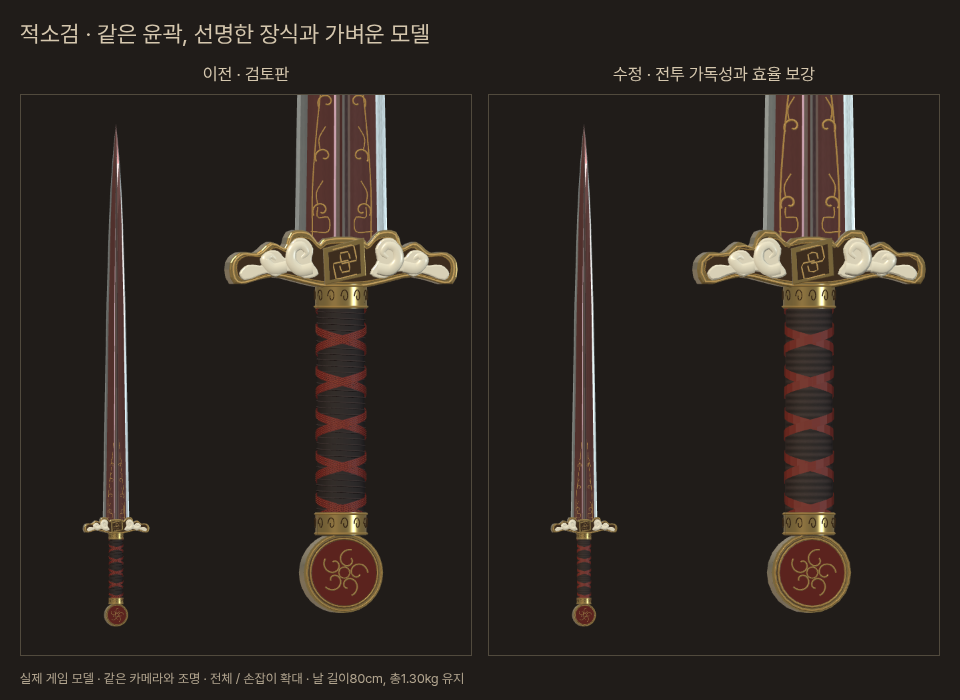
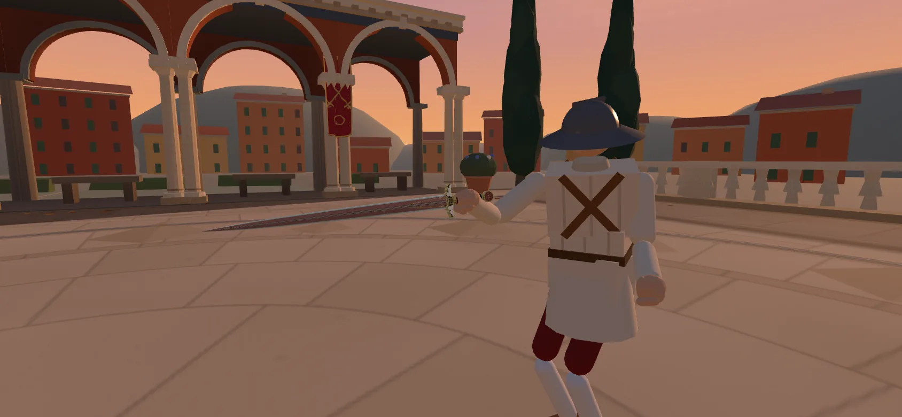

# 적소검 자체 리뷰 반영 · 우화 main 직접 적용

2026-10-27 KST, 샛별. 기준은 우화 `main`의 `f489e3088ee4f754bded7e7aab9264109dfbda3c`.

사용자 명령: **“그래 그렇게 해봐. 다 고친 후 네가 직접 우화의 main에 커밋해”**. 이 작업에 한해 직접 main에 반영한다. 평소 포크·검토·이식 절차를 모든 후속 작업에서 생략한다는 뜻은 아니다.

사용자가 승인한 앞선 자체 리뷰는 우화의 파펜하이머 가독성 보강(e3d43bdc), 뒤랑달 질량 재배분(78d52103), 채찍 조작 검수(5a25f32a)를 참고했다. 자체 적소검 기능 d74291e5 / 5e6f2532 / 7eecfc8b / c5040047만 최신 우화 기준에 옮긴 뒤 아래를 수정했다. 자체 저장소의 다른 실험·유파 동작을 덮어쓰지 않았다.

## 변경

| 항목 | 이전 검토판 | 적용판 |
|---|---|---|
| 유파·등급·손 | 동방·레전드·한손 | 동일 |
| 날 / 전체 길이 | 80 / 100.6 cm | 동일 |
| 전체 질량 | 1.30 kg | 동일 |
| 날 질량 | 1.22 kg | 1.00 kg |
| 자루 / 끝장식 / 코등이 | 합계 80 g | 각각 100 g |
| 손 기준 무게중심 | 42.0 cm | 29.48 cm |
| 휘두르는 축 관성 | 0.260 kg·m² | 0.19057 kg·m² (약 27% 감소) |
| 날 밑동의 최대 두께 | 10 mm | 8.2 mm |
| 모델 삼각형 / 메시 | 50,220 / 15 | 19,972 / 13 |
| 칼날 충돌 | 폭 4.5 cm의 긴 상자 | 밑동 5.4 cm부터 가늘어지는 볼록체 |

날의 중심·관성은 `chixiao_profile.js`의 실제 표시 면을 사면체로 적분해서 계산한다. 날 1kg과 현재 부피의 밀도는 약 7.862 g/cm³이다. 자루·슴베·옥·금동 부품의 배분은 게임 추정이며, 특정 유물 실측의 복원이라고 주장하지 않는다. 앞선 42cm/.26 목표에 질량을 역산하던 방식을 교체했다. 청강검보다 무거운 회전 관성은 남는다.

철빛 적갈색 검면·은회색 날선·백옥과 금동 장식은 유지했다. 작은 구름 무늬는 세 묶음으로 정돈하고 선을 조금 두껍게 했다. 감개의 수만 개 미세 삼각형은 자체 생성한 색·요철 무늬로 옮기고 교차 띠의 형상은 유지했다. 금속·옥의 가장자리 표본 수를 지나치게 줄인 중간안은 실루엣이 무뎌 보여 되돌렸다. 삼각형은 약 60.2% 줄었으며, 이 숫자를 실기기 FPS 개선율로 해석하지 않는다.

칼날의 정면 테이퍼와 최대 두께를 감싸는 단일 볼록 충돌체를 사용한다. 날선·홈의 미세 단면까지 복제한 형상은 아니다. 칼끝 곁의 기존 빈 상자 영역은 더 이상 닿지 않고, 넓어진 밑동은 제대로 닿는다. 99개 Rapier 광선 검사에서 이론 곡선과 반폭 차이는 최대 1.616mm(분할 근사와 Rapier 질의 오차 포함)였다. 최초 영두께 날선까지 넣은 볼록체는 일부 광선 질의가 누락되어 폐기했다. 초기 검사 실패 로그도 보존했다.

베기 1.10 / 찌르기 .85 / 둔타 1.0, 레전드 공통 배율 1.2, 자연 파손 0은 그대로다. 동방 몸꼴·손길·보법·특수기와 모든 인물 수치는 바꾸지 않았다. 기존 33무기 수치도 그대로다. `fighter.js`는 무기에 선택적인 전용 충돌체가 있을 때만 쓰며 기존 무기는 같은 상자/공 경로를 탄다. 강제 절단 시에도 옛 긴 충돌체를 남기지 않도록 대응했다. 자연 파손은 발생하지 않는다.

## 검증과 해석

7방향 × 입력속도 3종의 허공 긋기에서:

| 입력속도 | 이전 회수 중앙값 | 적용판 회수 중앙값 | 이전 / 적용판 최고 칼끝 속도 평균 |
|---|---:|---:|---:|
| 6 | .358초 | .283초 | 13.26 / 13.18m/s |
| 10 | .350초 | .283초 | 10.63 / 11.65m/s |
| 14 | .350초 | .275초 | 11.40 / 12.50m/s |

회수는 약 19~21% 단축됐다. 완전히 멈추는 시간은 모든 조건에서 개선된 것은 아니다. 속도14의 멈춤 중앙값은 .392→.425초이고 측정된 획 수 자체도 5→7로 다르다. 이 표는 허공 조작 측정이며 실제 타격 시점·사람이 느끼는 손맛·전투 우위를 뜻하지 않는다.

새 거리/베기 시간을 같은 실행의 롱소드와 청강검으로 교차 확인했다. 적소검 원 측정값은 `[1.44,1.62,1.11,.29]`, 기존 롱소드 보정 기준에 맞춘 적용 행은 `[1.40,1.68,1.11,.42]`, `CUT_TIME_30=.31`이다. 다른 무기 행은 변경하지 않았다.

### 전투의 이득과 손해

사람 입력을 흉내 낸 봇 대 롱소드·이졸데·토메, 한 판 최대30초. 피해는 게임 내부 상처 심각도 합이며 HP나 백분율이 아니다. 사람이 직접 한 시험이 아니다.

최종 코드로 동일 시드4~7을 비교한 12판:

| 조건 | 승 / 패 | 준 피해 평균 | 받은 피해 평균 | 베기 판정 수 |
|---|---:|---:|---:|---:|
| 옛 질량·옛 상자 | 0 / 3 | .443 | 1.812 | 25 |
| 새 질량·새 볼록체 (적용) | 1 / 7 | .482 | 2.608 | 15 |
| 새 질량·옛 상자 (원인 분리용) | 2 / 3 | 1.170 | 2.542 | 33 |
| 날을 1.10kg로 늘린 대안·새 볼록체 | 0 / 4 | .747 | 2.779 | 33 |

**독립 비교에서는 패배와 받은 피해가 늘었다. 전투 강화가 입증되었다고 판단하지 않는다.** 원인 분리에서도 질량과 접촉 형상 모두 흐름을 바꿨다. 상자 방식은 칼끝 옆의 빈 공간까지 막아 주므로, 승수만 보고 복구하면 외형·접촉 일치 목표에 어긋난다. 날을 다시 무겁게 한 대안도 받은 피해가 줄지 않았고 질량/형상 일치와 회수의 이점이 약해져 채택하지 않았다.

최종 코드로 앞선 시드1~3도 다시 확인했다. 옛 판 0승2패 / 준 .827 / 받은1.480, 적용판 1승2패 / 준1.081 / 받은1.838이다. 합계 각21판의 준 피해는 늘었으나 받은 피해·패배도 늘었다. 소표본이므로 원인이나 크기를 확정하지 않는다. 새 무기의 채택 이유는 **형상에 근거한 물리, 회수 개선, 정확한 접촉, 가독성·모델 절감**이며, 인간 전투에서의 종합적인 득실은 후속 플레이 확인 사항이다. 승률을 높이려고 동방 방어 자세나 피해 배율을 건드리지 않았다.

`duel-final.json` 등 `release`가 없는 초기 탐색은 날 두께10mm·이전 거리표 조건이다. 그때의 유리한 수치만 최종 성능으로 재사용하지 않는다. 모든 원자료와 실패 로그를 보존했다. `variant.mjs`는 비교 도구에만 적용되며 게임 URL에 변형 스위치를 추가하지 않는다.

### 통과한 확인

- 공통5관문: fights12 / live_battery / finish_thrust / weapon_smoke 결과 전후 완전 일치. corr_s0는 마지막 실행시간만 제외하면 동일하며 12비교 모두 IDENTICAL. 원본 양쪽 로그는 `results/common/`.
- 파펜하이머·티소나·달타냥 관련 기존 테스트 23개 통과. 고정 무기 수/목록에 새 적소검을 더한 기대값만 갱신.
- 레전드 기운 규칙 기존 테스트 4개 통과. 적소검의 기운 등록·범위·입자 규칙 확인.
- `tools/sim/chixiao.test.mjs`: 실제 충돌점/빈 공간, 질량·중심·밀도, 형상 유한값, 피묻음, 강제 절단, 카드 등록 확인.
- `check_scope.mjs`: 이번 이식 기준의 기존33무기·모든 인물 보존. 미래의 정상적인 인물 변경까지 막는 상시 테스트로 등록하지 않았다.
- 빌드 성공. 컴파일판 실제 입장·막기 누름/해제·터치 긋기·기력 질량·오라·저장 보호 확인. 카드 568×320 / 844×390 / 390×844에서 설명 넘침 없음, JS 오류0. Chromium 모바일 모사이며 실제 iPhone FPS 검사는 아니다.

## 화면과 재현





`before/`는 비교용 이전 모델과 그 당시 수치 스냅샷이다. 비교 HTML/스크립트는 개발 서버에서만 실행한다. 장착 확대 사진은 실제 게임에서 카메라와 포즈를 고정한 관찰용 사진이며 별도 일러스트가 아니다. 기본 카메라 사진은 `equipped_game.webp`.

```sh
node tools/sim/chixiao.test.mjs
node docs/import/chixiao_2026-10-27/check_scope.mjs
CHIXIAO_CASE=final node --import ./docs/import/chixiao_2026-10-27/variant.mjs tools/sim/whip_duel.mjs --weapons=chixiao --opps=longsword,isolde,tome --seeds=4-7 --dur=30 --json=/tmp/chixiao-duel.json
node tools/sim/swing_feel.mjs chixiao --json=/tmp/chixiao-swing.json
npm run build
```

배포 뒤 시험 주소: `https://yoonjl-svg.github.io/halfsword/?test=1&weapon=chixiao&foe=bran&foeWeapon=tree_branch&stage=clearing&foeWhiff=1&uniqueStage=5`. 일반 여정에서는 다른 레전드와 같은 추첨 규칙을 사용한다. 검토용 주소는 브론에게 나뭇가지를 주며 저장 진행을 바꾸지 않는다.

되돌릴 때는 이 기능 커밋을 반전하면 된다. 다른 팀의 후속 main 커밋을 강제로 되돌리거나 옛 포크 전체를 덮어쓰지 않는다. 현원검 제작·MSG-S-016 연구·용 전투 등 별도 미승인/보류 작업은 이번 범위에 포함하지 않는다.
