# 밤의 봉인의 중정 들여오기 — 샛별 저장소 (2026-10-21)

- 사장님 결정(10/21): 샛별 저장소의 밤 무대 **밤의 봉인의 중정**(`courtyard_night`)을 디자인 · 성능 리뷰 뒤 들인다 · 여정 자리는 무대 순서 규칙(10/16 19:4x '낮 다섯 → 그 다섯의 밤 → 다시 낮')대로 · 상대는 **광기의 마야**(`samira_mad`) · 샛별 쪽이 바꾼 마야 설정(backstory)을 받는다.
- 감독(우화)이 맡김. 작업 가지 `worktree-agent-af91abdea431acf60`(바탕 `2362985`).
- 가져온 것: 샛별 저장소 커밋 `2d392f645`(10/21 11:41) **하나만**. 그쪽 가지에서 그 앞의 무기 커밋 · 뒤의 문서 묶음은 가져오지 않았다. 바탕이 우리 `2362985` 라 부딪힘 없이 그대로 얹혔다.
- 한 줄 결과: 여정 서른 판(17 번째 = 밤의 봉인의 중정, 끝판은 그대로 밤의 소금 사막) · 실제 여정으로 밤의 산호 항구 → 이김 → 밤의 봉인의 중정(광기의 마야 · 세이버 · 프로필 그림) → 이김 → 밤의 잠든 습지 · 단위 시험 119/119 · 이름 규칙 위반 0 · 빌드 · 무대 바꾸기 세 바퀴 GPU 자원 늘지 않음 · 콘솔 오류 0. 성능은 이웃 밤 무대들 안쪽이라 덜기는 하지 않았고, 대신 프레임마다 생기던 가비지(약 22 KB → 0.14 KB)를 없앴다. 디자인 리뷰로 여섯 곳을 고쳤다(§5).

## 1. 무엇이 들어왔나 · 보는 법

| | |
|---|---|
| 이야기 | 봉인된 중정에서 평화 사절단의 비밀회담이 열렸다 → 명령서가 늦게 닿았다 → 잘못된 교전이 큰 전쟁으로 번졌다. 그 뒤 새벽 3 시 포격 |
| 보이는 것 | 무너진 북쪽 회랑 네 칸(그을린 들보) · 동쪽 채 무너진 두 칸과 포탄 구멍 · 서쪽 담에 포격으로 뚫린 틈 · 탑 한쪽이 무너진 문루와 부러진 문짝(붉은 봉인 천 조각) · 무너진 차트리 둘 · 마주 놓인 의자와 갈라진 회담 탁자 · 포탄 셋 · **검은 연기 기둥 셋**(밑동에 타다 남은 들보 · 불씨 · 떠도는 재) · 달 · 옅은 별 |
| 급수정 | 낮과 같은 꼴을 짓되 **지붕 한 귀퉁이와 물받이 한 쪽을 실제로 잘라 냄** · 벽의 금 · 그을음 · 떨어진 지붕 조각 넷 · **이따금 새는 물**(출수구 · 깨진 물받이에서 물방울 · 파문 · 웅덩이 · 젖은 자국 · 물방울 소리) |
| 낮과 같은 것 | 바닥 · 담장 윤곽 · 계단 우물 · 결투장 띠 · **급수정 충돌체 9 · 시작 자리 1.10 / 1.60**(`arena_obstacle.js`) · 바람 · 돌풍 · 세부음(천 · 두레박 · 우물 물방울) |
| 상대 | 광기의 마야 라토르(`samira_mad`) — 늘 세이버(사장님 10/20), 숙련도 4(원본 3 + 1) |

보는 주소: `?stage=courtyard_night`(카드 뽑기 있음 — 상대는 무대 짝) · 카드 없이 `?stage=courtyard_night&weapon=longsword&foeWeapon=sabre` · 테스트 고르기(test.html) 무대 줄 '밤의 봉인의 중정 (여정 17)'.

## 2. 들어온 파일 · 우리 손질

| 파일 | 샛별 판 | 우리 손질 (§3 · §5) |
|---|---|---|
| `src/stage_courtyard_night.js` (새) | 낮 `stage_courtyard.js` 를 복사해 밤으로 바꾼 617 줄 | 주석 우리 말 · 안 쓰는 함수 넷 뺌(122 줄) · 두레박 틀 되살림 · 모래 줄 · 땅 먼지 밤 빛깔 · 결투장 안 그을음 절반 · 이야기 묶음 · 프레임마다 새 객체 없앰 · 천 · 깃발 법선 셈 → 495 줄 |
| `src/stage_courtyard_ruins_detail.js` (새) | 무너진 문루 · 회랑 · 동쪽 채 · 담 · 차트리 · 포탄 자국 · 회담 탁자 · 검은 연기 | 주석 우리 말 · 포탄 구멍 칸의 방 뺌 · 연기 고리 |
| `src/stage_courtyard_damaged_cover.js` (새) | 낮 급수정을 지으며 지붕 귀퉁이 · 물받이를 잘라 냄 · 새는 물 | `putM` 가로채기(떠 있던 돔 갈빗대) · 금 재질 · 새는 물 고리 · 주석 우리 말 |
| `src/stages.js` | 짓는 함수 · 화면 이름 · 짝 `samira_mad` | 여정 순서(17 번째) · 긴 주석 · 줄 주석 |
| `src/arena_obstacle.js` | 밤 중정도 급수정 충돌체 · 시작 자리 | 주석 한 줄 |
| `src/sound.js` | 밤 중정 발소리 · 짧은 울림 — 낮 중정 줄의 주석을 밤 줄로 옮겨 놓음 | 낮 주석 제자리 · 밤 줄 주석 · `night: true` |
| `src/stage_detail_sound.js` | 밤 중정 → 낮 중정 세부음 | 그대로 |
| `src/characters.js` | 마야 설정(backstory) | 받음 · 주석 한 줄(전 설정) |
| `src/test_pick.js` · `src/update_notes.js` · `docs/stages.md` | — | 테스트 고르기 줄 · 공지 · 무대 표 · 순서 표 |
| `tools/browser/courtyard_night_review.mjs` (새) | — | 이번 점검 도구(짓기 · 그리기 양 · update · 새는 자원 · 여정 · 사진) |

## 3. 코드 리뷰 — 고친 것

1. **소리 주석 자리** (알려진 것): `sound.js` 에서 낮 중정 줄의 주석('봉인의 중정: 사암 판석 · 담장에 짧게 되울림 (샛별 저장소 10/17)')이 새 밤 줄로 옮겨져 있었다 → 낮 줄에 되돌리고 밤 줄엔 제 주석('담장이 무너져 되울림이 낮보다 짧고 옅다'). 밤 줄에 다른 밤 무대처럼 `night: true`(지금 중정은 세부음 무대라 소리는 같다).
2. **주석 · 글**: 영어 주석을 우리 말로. 머리말의 그쪽 커밋 해시 · 그쪽 사람 이름을 지우고 우리 문서를 가리키게. 낮 이야기(해 20° · 늦은 오후 · 모래폭풍 · 붉은 깃발 셋 · 차양 둘)를 그대로 말하던 주석을 밤 판에 맞춤.
3. **안 쓰는 코드 122 줄**: 밤엔 부르지 않는 `sandstorm`(모래폭풍 메쉬) · `sealedDoor`(붉은 봉인 X) · `regionalStonework`(자로카 창) · `workingYard`(물구유 · 손수레 · 그늘나무) · 쓰지 않는 `mergeGeometries` 가져오기 · `SH` · `SUN_L`.
4. **허공에서 내려오던 두레박 줄**: `workingYard` 를 통째로 빼며 두레박 틀(기둥 둘 · 팔 · 도르래)도 빠져, 줄과 두레박이 우물 위 2.3 m 허공에서 시작했다 → 틀만 `wellFrame` 으로 되살림(사진 §8). 돌풍 끝 두레박 소리(`courtyardRing`)도 다시 제자리가 생김.
5. **깨진 지붕 위에 떠 있던 돔 갈빗대**: 지붕 자르기가 `K.put` 만 가로채, `limb()`(→ `K.putM`)로 짓는 돔 갈빗대 둘은 잘리지 않고 없어진 귀퉁이 위에 남았다 → `K.putM` 을 가로채 어느 길로 와도 같은 금에서 자름(속 빈 관은 단면 막이를 안 붙임).
6. **프레임마다 생기던 가비지**: 천 · 깃발의 `computeVertexNormals`(대부분) · 모래 줄 띠마다 배열 둘 · 새는 물 `userData` 펼침 · `find` 콜백 · 새는 물 소리 콜백 · `stage.wind` 새 객체 · 깃발 `entries()` · 불씨 `forEach` · 뜨거운 고리의 `for…of` · `Math.hypot` → 격자 법선을 이웃 꼭짓점 차이로 바로 셈(`gridNormals` — 모양 · 빛 같음) · 버퍼 · 객체를 고쳐 씀. 다 데운 뒤 update 한 번 0.093 ms · 21.8 KB → 0.020 ms · 0.14 KB(§4).
7. **이야기 묶음**: 배경 안의 'courtyard-story'(영어 글) → 다른 밤 무대처럼 장면 바로 아래 `courtyard_night-story` `{ hour: 3, visualOnly: true, stories: [우리 말 셋] }`.

남긴 것 (판단 거리):
- **낮 파일의 복사본**이다. 바닥 · 계단 우물 · 둘레 · 바람 · 그림자 줄은 낮과 같은 코드가 두 벌이라, 낮 중정을 고치면 밤도 같이 봐야 한다. 다른 밤 무대처럼 낮 짓는 함수 위에 얹는 꼴(`beginNight`)로 바꾸려면 낮 파일에 갈래를 많이 터야 해 이번엔 하지 않았다.
- **충돌체는 낮과 같다**(사장님 '같은 자리 · 같은 엄폐물'). 그래서 지붕이 깨진 귀퉁이(높이 2.44 m 위, 급수정의 내 시작 자리 쪽 모서리)에도 돌 충돌이 남는다 — 칼끝이 그 높이 그 자리에 닿는 일은 드물다. 맞추려면 밤 전용 충돌 꼴이 필요하다.
- 새는 물 소리는 우물 물방울 합성(`courtyardDrip` — 깊은 우물 울림)을 작게(0.12) 다시 쓴다. 간격 규칙(8 s)을 우물 물방울과 함께 쓴다.

## 4. 성능 — 이웃 밤 무대 · 낮 중정과 견주기

헤드리스 크롬(swiftshader) · 844×420 · 판 시작 훑기가 끝난 경기 카메라. 같은 기계에서 다른 시뮬이 돌고 있어 시간 값은 흔들린다 — **견주기만**. 도구 `tools/browser/courtyard_night_review.mjs --modes=cost,update,leak`.

| 무대 | 짓기 ms | 데우기 ms | 그리기 호출 | 삼각형 (전체 · 무대) | 무대 빛 (그림자) | 그림자 드리우는 메쉬 (삼각형) | 투명 물체 | 무대 무늬 MB | update ms | update 가비지 B | 싸움 프레임 ms |
|---|---:|---:|---:|---:|---|---:|---:|---:|---:|---:|---:|
| **밤의 봉인의 중정 — 샛별 판** | 241 | 1,392 | 367 | 131.3k · 51.5k | 2 (1) | 1 (14.1k) | 53 | 8.3 | 0.093 | **21,803** | 433 |
| **밤의 봉인의 중정 — 고친 판** | 292 | 1,532 | 366 | 131.3k · 51.5k | 2 (1) | 1 (14.0k) | 53 | 8.3 | **0.020** | **139** | 233 |
| 봉인의 중정 (낮) | 258 | 296 | 329 | 127.8k · 56.3k | 2 (1) | 1 (14.2k) | 7 | 8.7 | 0.150 | 239 | 250 |
| 밤의 산호 항구 | 230 | 1,900 | 267 | 146.1k · 85.5k | 2 (1) | 3 (17.5k) | 4 | 4.3 | 0.000 | 161 | 350 |
| 밤의 잠든 습지 | 588 | 1,383 | 304 | 209.6k · 99.4k | 2 (1) | 5 (36.7k) | 4 | 4.8 | 0.018 | 1,537 | 300 |
| 밤의 소금 사막 | 396 | 2,873 | 348 | 164.5k · 94.8k | 10 (1) | 26 (36.8k) | 15 | 11.7 | 0.009 | 760 | 383 |

- 짓기 · 데우기: 한 페이지에서 무대를 네 바퀴 바꿔 둘째 ~ 넷째 바퀴의 가운데 값. 데우기(셰이더 · 무늬를 GPU 에 올리기 — 카드 뽑기 동안)는 밤 무대가 다 1.4 ~ 2.9 s(낮 중정 0.3 s) — 밤 재질(점 · 스프라이트 · 비추지 않는 재질)이 다른 무대와 셰이더를 나누지 못해서이고 밤의 중정은 그 안쪽이다.
- 무대 빛: 장면의 반구광 · 해(달) 둘뿐 — 밤의 중정은 빛을 더하지 않는다. 그림자는 급수정만.
- 그리기 호출 +37(낮 대비): 연기 스프라이트(36 장 가운데 화면 안 약 10) · 새는 물(자국 · 웅덩이 · 물줄기 · 파문 · 물방울 약 11) · 달 · 별 · 불씨 · 재. 삼각형은 이웃 밤 무대보다 적다. 투명 물체 53 은 거의 연기 스프라이트(멀리 있어 덮는 화소는 작다).
- update: 다 데운 뒤(3,000 번) 400 번씩 여덟 토막의 가운데 값. 샛별 판은 프레임마다 약 22 KB(60 fps 면 초당 1.3 MB)의 가비지가 생겨 폰에서 잦은 청소 멈칫의 씨앗이었다 → 0.14 KB.
- 그리기 시간(render + gl.finish 25 번의 가운데 값)도 쟀지만 이 기계에선 무대 전체를 숨겨도 거의 안 변해(잡음이 큼) 표에 넣지 않았다(밤 중정 3.3 · 낮 중정 2.8 · 이웃 밤 2.5 ~ 2.9 ms).
- **판단**: 그리기 호출만 이웃 밤 무대 가운데 가장 많고(366 — 밤의 소금 사막 348) 나머지(삼각형 · 그림자 · 빛 · 무늬)는 같거나 가볍다. 낮 중정 + 37 호출이라 '뚜렷이 무겁다'가 아니어서 모양을 바꾸는 덜기(연기 장 수 줄이기 · 새는 물 합치기)는 하지 않았다.
- **새는 자원**: 한 페이지에서 밤의 중정 → 밤의 산호 항구 → 낮 중정 → 밤의 잠든 습지 → 밤의 중정 → 포세이돈을 세 바퀴 — 무대마다 GPU 모양 · 무늬 · 셰이더 수가 바퀴마다 똑같고(밤의 중정 176 · 16 · 43) 포세이돈에서 첫 바퀴 → 셋째 바퀴 Δ 0 · 0 · 0, 힙 +0.8 ~ 0.9 MB(청소 뒤, 샛별 판 +0.6 MB — 잡음). 밤의 중정이 더한 것은 모두 장면 아래 묶음(배경 · 하늘과 바람 · 이야기)에 달려 `Stages.clear` 가 푼다.

## 5. 디자인 리뷰 (사진 §8)

고친 것:
1. **빛나는 모래 줄 · 땅 먼지** — 땅을 스치는 모래 줄과 먼지 점은 빛을 받지 않는 재질이라, 낮 빛깔(0xe0ae80 · 0xd8a878) 그대로면 어두운 바닥 위에서 **밝은 띠가 빛나 보였다**(폰 사진 급수정 둘레). 밤 바닥보다 조금 밝은 빛깔(0x625850 · 0x6e6052)로.
2. **흰 줄로 보이던 급수정 금** — 금 자국도 빛을 받지 않는 어두운 색(0x302622)이었는데, 밤의 어두운 돌보다 밝아 흰 줄로 보였다 → 빛을 받는 짙은 재질(0x1e1714).
3. **가려진 포탄 구멍** — 북쪽 회랑 뒷벽의 포탄 구멍(가장 큰 것)이 그 칸 방의 안벽 뒤에 숨어 어디서도 안 보였다 → 그 칸만 방을 빼서 아치 너머로 구멍과 밤하늘이 보이게.
4. **허공의 두레박 줄** · 5. **떠 있는 돔 갈빗대** (§3-4 · 5).
6. **결투장 안 그을음** — 결투장 안 두 그을음 자국이 경기 화면에서 짙은 둥근 얼룩이라, 떠 있는 물체의 그림자처럼 보였다 → 짙기 절반(자리 · 크기 그대로).

본 것 · 판단 거리:
- **두 사람 · 칼이 읽히나**: 크림색 내 옷과 광기의 마야의 흰 옷 · 붉은 안광이 장밋빛 · 회갈색 바닥 앞에서 또렷하다. 내 롱소드는 바닥 앞 가는 회색 줄로 읽히고, 마야의 세이버는 밤하늘 앞에서 약하다(다른 밤 무대와 같은 정도 — 칼 잔상이 보탠다). 캐릭터 빛은 다른 밤 무대(`beginNight`)와 비슷한 값.
- **카메라**: 판 시작 훑기 길 · 경기 카메라 모두 무대에 막히지 않음 — `tools/browser/cam_open_shots.mjs` 밤의 중정 · 낮 중정 똑같이 뚫음 0/91 · 무대까지 최소 2.30 m · 두 사람 가림 0. 새 돌무더기 · 탁자 · 무너진 차트리는 가운데에서 12.7 m 밖(결투장 띠 9.2 m · 카메라 둘레 약 10.5 m), 높은 잔해는 모두 담장 쪽.
- **걷는 자리**: 결투장 안에 솟은 것 없음. 급수정 받침 옆 떨어진 지붕 조각 넷(높이 2 ~ 8 cm, 충돌 없음)은 길잡이 반지름(1.45 m) 안이라 사람이 거의 닿지 않는다.
- **연기**: 검은 연기가 밤하늘(0x181c25) 앞의 짙은 회색 기둥으로 문루 위에 읽힌다 — 낮이라면 또렷했을 대비가 밤엔 약하다. 사장님 컨셉 '검은 연기' 그대로 두었다(밝히면 회색 연기가 된다).
- **새는 물**: 경기 거리에서는 물방울(1.2 cm)이 거의 안 보이고, 금 · 깨진 물받이 · 젖은 자국 · 웅덩이가 판 시작 화면에서 보이는 정도 — 가까이 갔을 때의 디테일로 둔다. 깨진 지붕 귀퉁이는 경기 화면 급수정 오른쪽 위에서 읽힌다.
- **같은 곳인가**: 같은 바닥 무늬 · 담장 윤곽 · 계단 우물 · 차트리 · 급수정 꼴 — 낮 사진과 나란히 보면 같은 자리가 무너진 밤으로 읽힌다(§8 낮 · 밤).
- 우물가에 남은 차양(기둥 둘 위 작은 천 한 자락)과 되살린 두레박 틀이 나란히 서 있어, 어두운 데서 교수대처럼 보일 수 있다 — 바꾸지 않았다.
- 바닥 · z 싸움 · 빛 새기: 판 시작 · 싸움 · 위에서 본 사진에서 깜빡임 · 새는 빛 없음(고친 1 · 2 말고).

## 6. 광기의 마야 · 마야 설정

- `samira_mad`(`src/characters.js` 얼터): 광기의 마야 라토르 · 칭호 '붉은 봉인의 전령' · 늘 세이버(사장님 10/20 00:4x) · 숙련도 4 · 목소리 maya · 안광 · 프로필 그림 `public/ui/portraits/samira_mad.webp`(`portraits.js` 얼터 목록에 이미 있음). 대사는 원본과 같은 시트. 카드 뒷면은 `main.js` 가 `_night` 를 떼어 낮 중정 뒷면을 빌린다(다른 밤 무대와 같음 — 손댈 것 없음). 인물마다 따로 잇는 표(패배 대사 · 그림 등)는 더 없다.
- 여정에서 실제로 나오는지: 주소에 무대 · 상대 · 무기 없이 연 판에서 밤의 산호 항구(스테이지 16)를 이기자 '스테이지 17 · 밤의 봉인의 중정' · 상대 '광기의 마야 라토르' · 카드 뽑기의 상대 무기 세이버 · 프로필 그림 200 · 충돌체 9 · 이야기 묶음 있음, 다음 판 '스테이지 18 · 밤의 잠든 습지'(`--modes=journey`).
- **설정 바뀜**(받음 — 화면에는 안 나오는 설정 칸, 얼터도 같은 시트를 복사):

| 전 | 후 (샛별 저장소 10/21) |
|---|---|
| 라자스탄 라지푸트 가문 출신으로, 인도 서해안의 항구에서 출발한 군의 전령. 폭풍으로 철수 명령을 제때 전하지 못한 뒤, 돌아오지 못한 동료들의 이름과 봉인된 명령서를 품고 다닌다. 지금은 먼 성소의 마지막 문을 지키며, 그 문을 넘어갈 사람만큼은 헛되이 보내지 않으려 한다. | 라자스탄 라지푸트 가문 출신의 군 전령. 봉인된 중정에서 열린 평화 사절단의 비밀회담에 관한 명령서를 제때 전달하지 못했다. 잘못된 교전은 큰 전쟁으로 번졌고, 중정은 포격으로 무너졌다. 돌아오지 못한 동료들의 이름과 봉인된 명령서를 품고, 남은 이들에게 전할 마지막 소식을 지킨다. |

- 설정 문서: `docs/character_lore.md` · `docs/character_profiles.md` 는 처음 다섯 검객만 다뤄 마야 설정 글이 없다 — 고칠 곳 없음. 옛 설정이 적힌 곳은 그날의 기록(`docs/design/courtyard_review_2026-10-17.md` §5 · `docs/import/saetbyeol_new_2026-10-10.md`)이라 그대로 둔다. 화면 글(이름 · 칭호 · 대사)은 바뀌지 않았다.
- `docs/stages.md` 순서 표의 마야 숙련도를 지금 값(3 — 사장님 10/20 00:4x)으로 고쳤다(전 1).

## 7. 여정 · 기록

- `STAGE_ORDER`: 둘째 밤 묶음 = 밤의 산호 항구 · **밤의 봉인의 중정** · 밤의 잠든 습지 · 밤의 화산섬 · 밤의 청람잔도 — 낮 묶음(산호 항구 · 봉인의 중정 · 잠든 습지 · 화산섬 · 청람잔도)과 같은 차례. 서른 판, 셋째 낮 21 ~ 25 · 셋째 밤 26 ~ 30. 끝판 밤의 소금 사막.
- `STAGE_FOE.courtyard_night = 'samira_mad'`(샛별 판 그대로) · 화면 이름 '밤의 봉인의 중정'.
- 테스트 고르기 무대 줄에 '밤의 봉인의 중정 (여정 17)' — 철불 절벽 · 소금 사막 번호 23 · 24 → 24 · 25.
- 첫 화면 공지 `20261021-courtyard-night`. 무대 표 · 순서 표 `docs/stages.md`.
- 무대 수를 세는 시험은 없다(`round3_check.mjs` 는 끝판 · 중정 자리만 봄 — 그대로 통과하는 조건).

## 8. 사진

판 시작 훑기 · 경기 화면 · 폰 (고친 판):

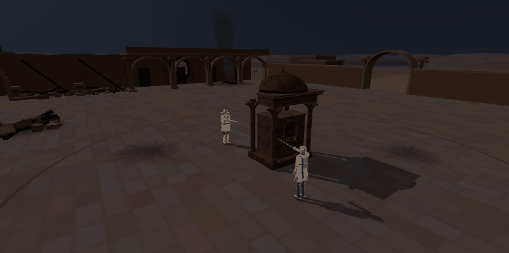
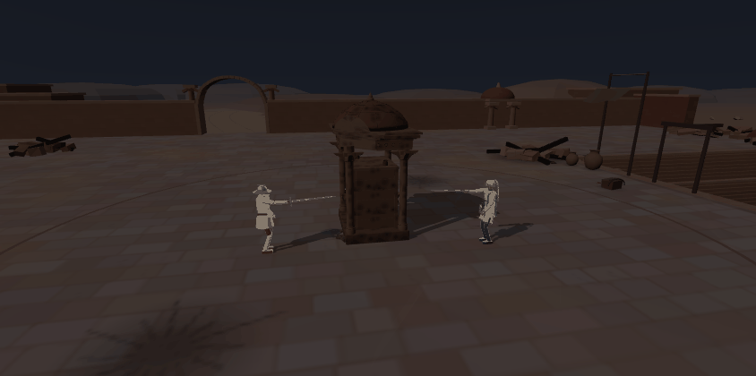
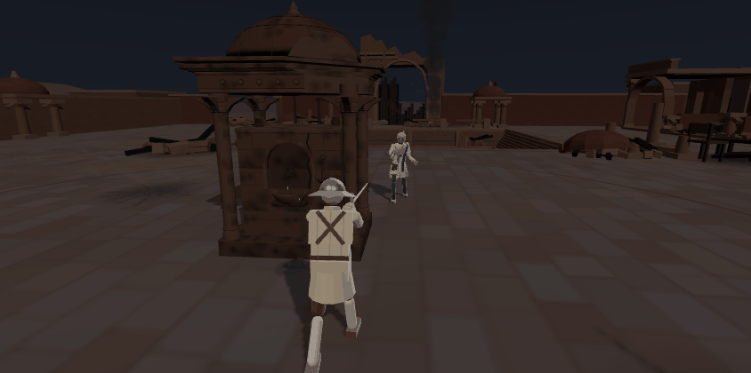
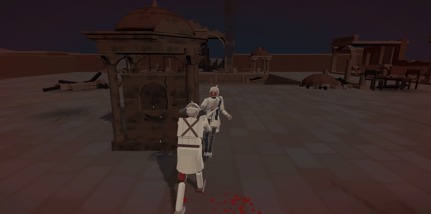
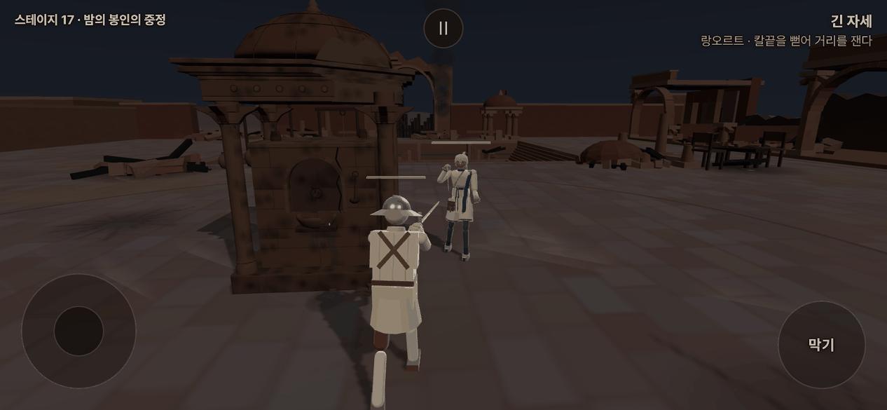

급수정 · 연기 · 포격 자국 · 위에서:

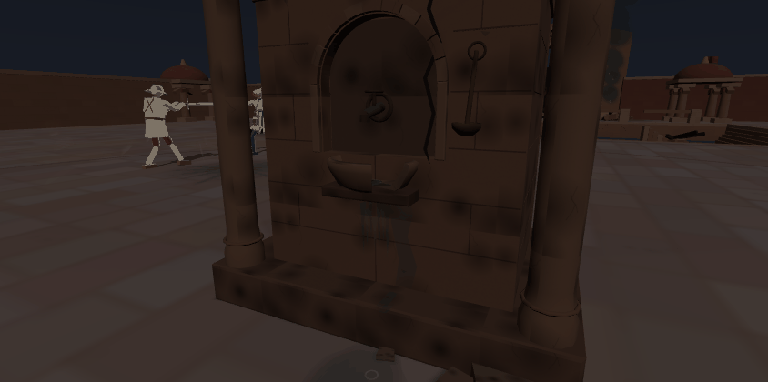
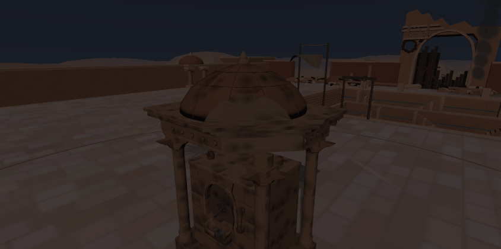
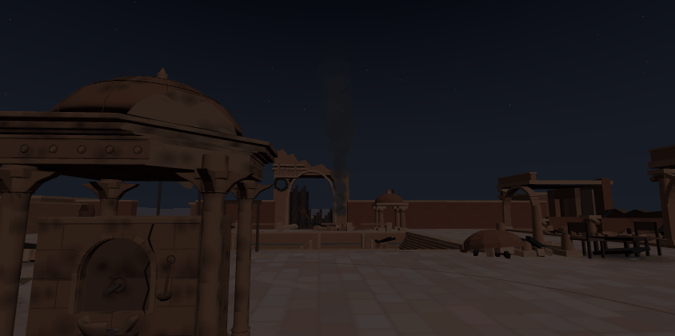
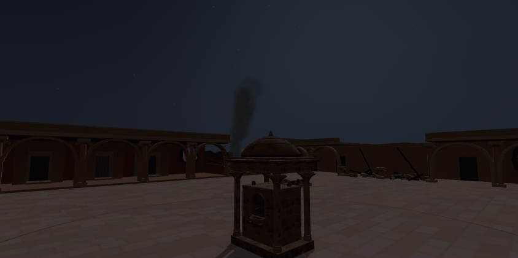
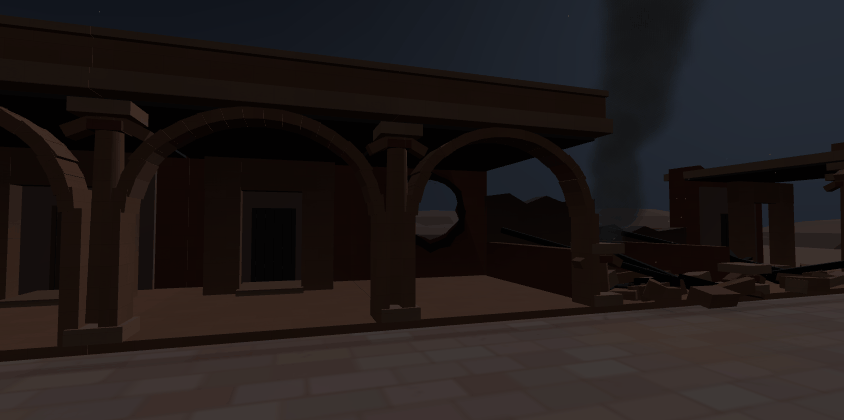
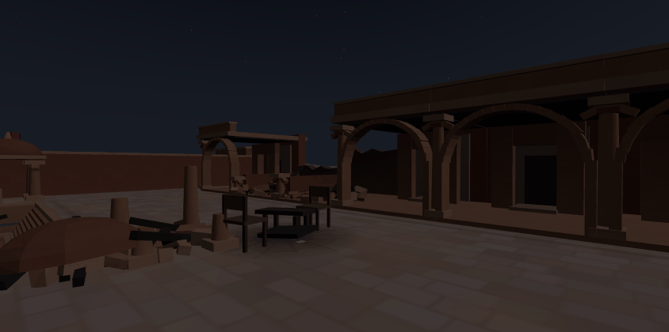
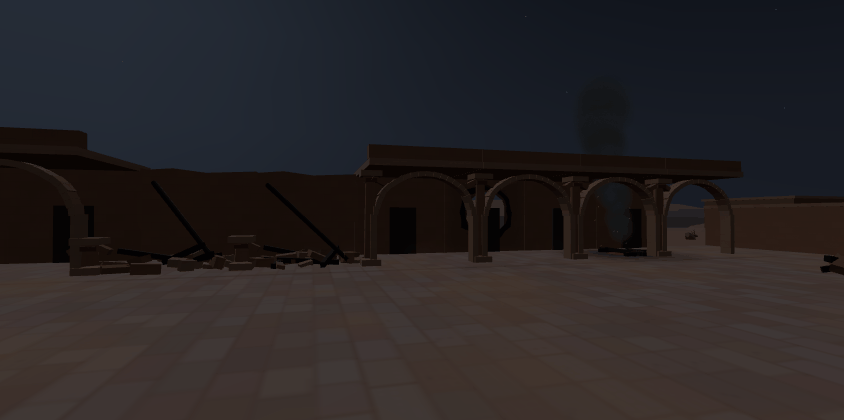
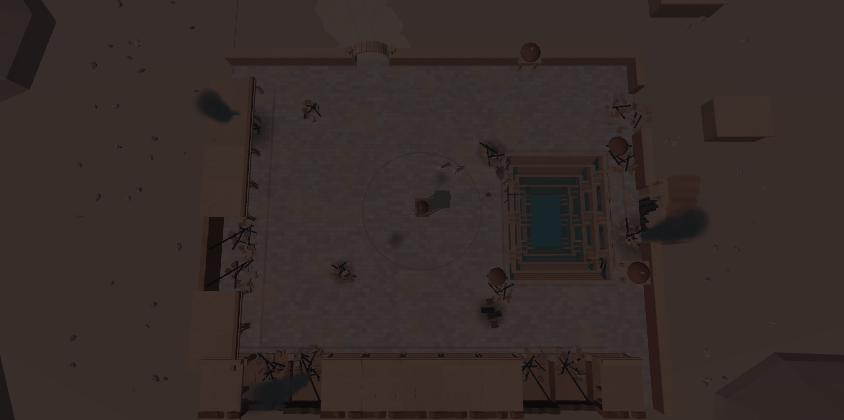

고치기 전 → 뒤:

| 고치기 전 (샛별 판) | 고친 뒤 |
|---|---|
| 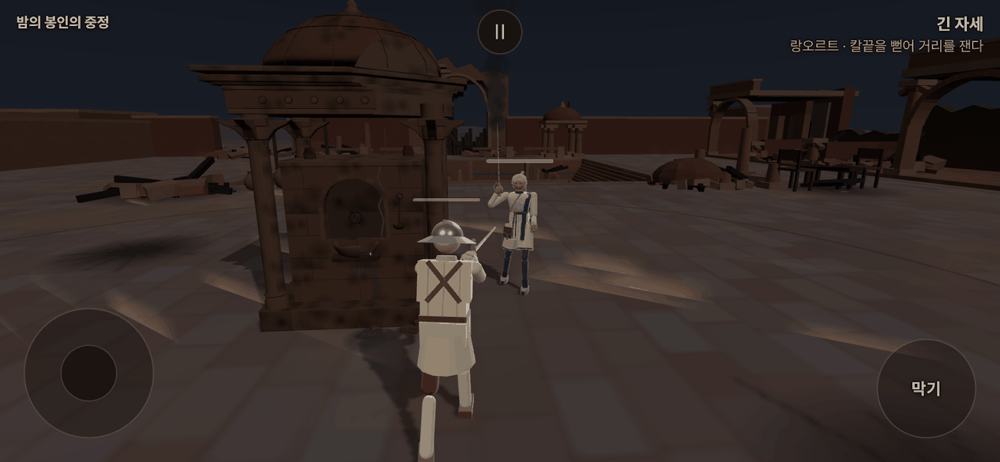 급수정 둘레 빛나는 모래 줄 |  |
| 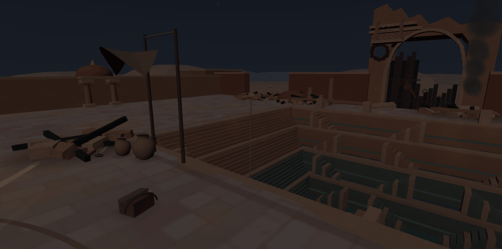 허공에서 내려오는 두레박 줄 | 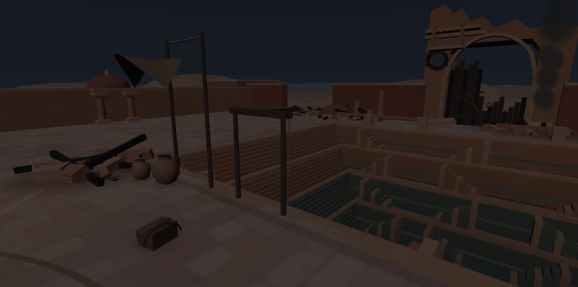 |
| 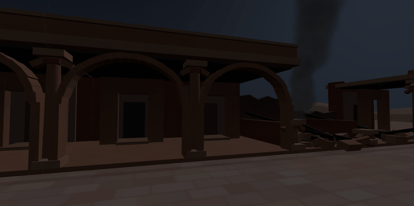 방 안벽에 가린 포탄 구멍 |  |
| 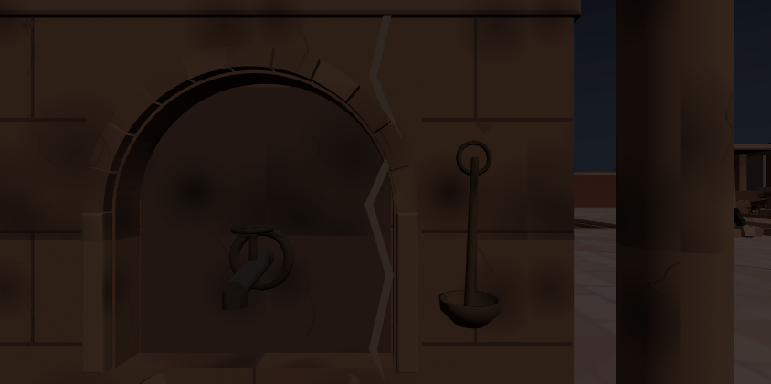 흰 줄로 보이는 금 | 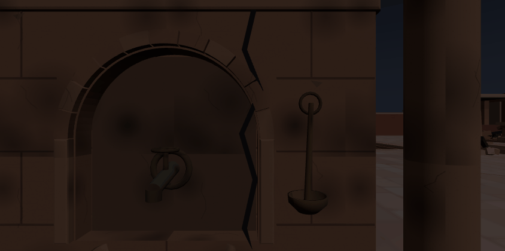 |

낮 · 밤 (같은 카메라):

| 봉인의 중정 (낮) | 밤의 봉인의 중정 |
|---|---|
| 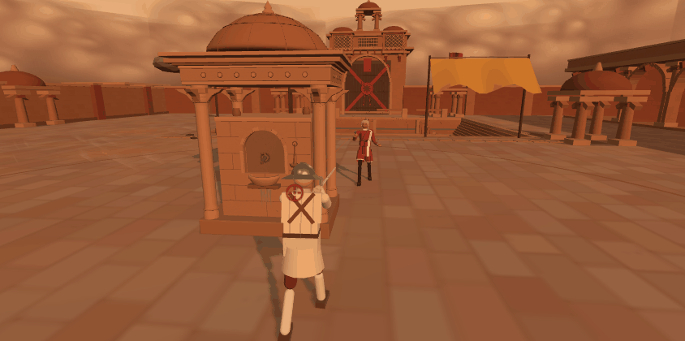 |  |
| 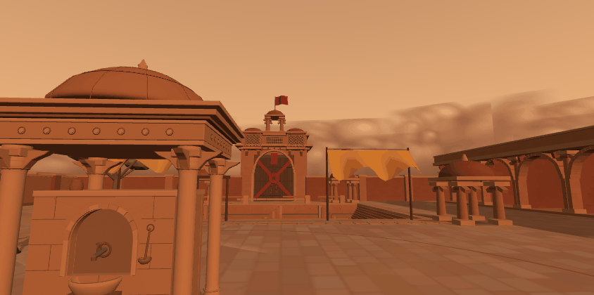 |  |

## 9. 점검

| 무엇 | 결과 |
|---|---|
| `node --test tools/sim/*.test.mjs` | 119/119 |
| `node tools/text/name_policy.mjs` | 위반 0 |
| `npx vite build --logLevel error` | 통과 |
| 여정(밤의 산호 항구 → 밤의 봉인의 중정 → 밤의 잠든 습지) | 위 §6 — 콘솔 오류 0 |
| 판 시작 카메라(`cam_open_shots.mjs courtyard_night,courtyard`) | 뚫음 0 · 가림 0 · 콘솔 오류 0 |
| 무대 바꾸기 세 바퀴 | GPU 자원 Δ 0 |
| 바뀐 글의 이름 점검(모델 · 회사 이름 · 그쪽 저장소 이름) | 0 |
