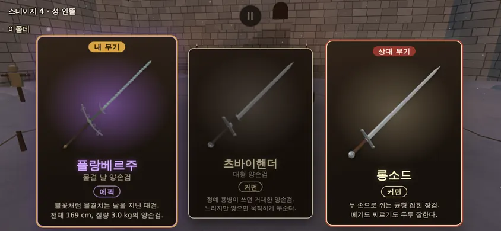
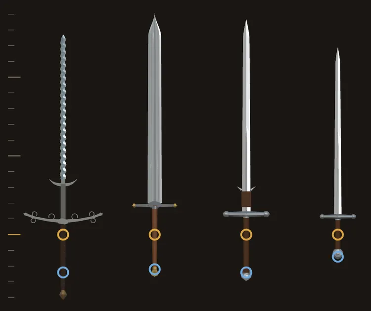
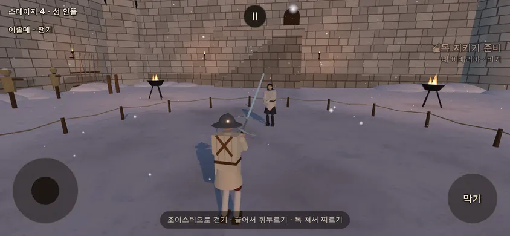
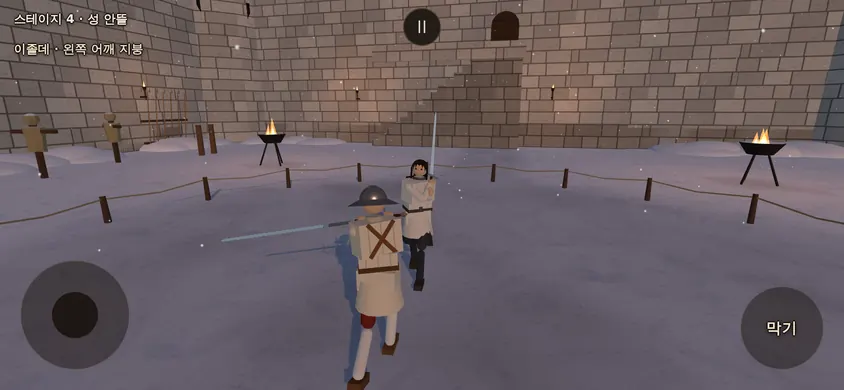
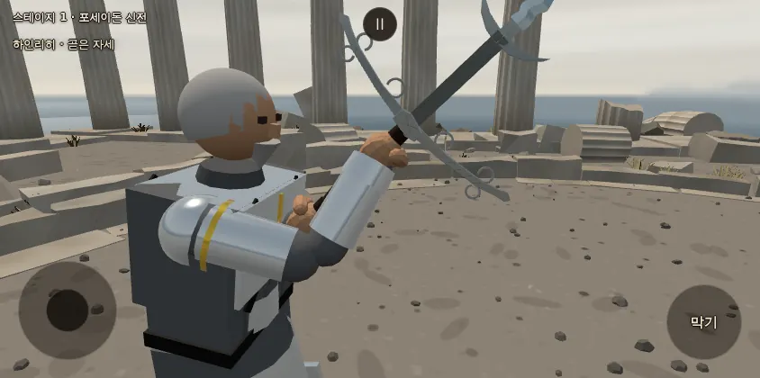
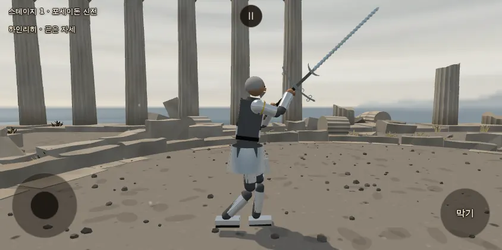
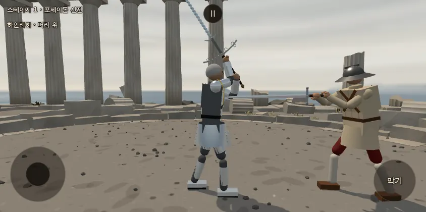
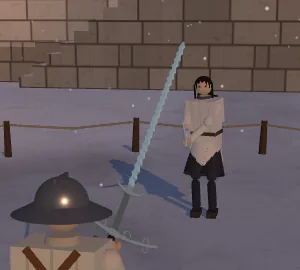

# 플랑베르주 옮기기 — 샛별 겉모습 + 우리 물리 (2026-10-14)

- 지시: 감독(우화) 10/14 — 샛별 저장소의 플랑베르주 **겉모습**을 옮기고, 질량·무게중심·쥠·충돌체·등급·카드는 우리 값으로 새로 정해 무기 하나로 등록한다. 앞선 리뷰 `docs/import/saetbyeol_review3_2026-10-14.md` §1 의 추천 1 과 사장님께 물을 것 1·2 에 감독이 답한 안(표기 플랑베르주 · 에픽 · 3.0 kg · 자동 판정 이베리아)을 따른다.
- 기준: 우리 본판 **37fd2e3** · 샛별 저장소 `origin/main` **325a5c38** (사본은 읽기만 — `git show`·`git archive` 로 빈 새 폴더에 꺼내 읽음). 가지 `…/flamberge`.
- 옮긴 것: 샛별 저장소 origin/main 325a5c38 의 `src/flamberge_design.js`(105 줄) 생김새를 옮겨 고침 → 우리 `src/flamberge_look.js`. 그쪽 문서 「플랑베르주 외형 · 2026-10-11」(`docs/content/flamberge_design_20261011.md`)도 읽었다.
- 새로 정한 수는 모두 `docs/strike/owner_defaults_table.md` **1140~1152** 에 '사장님 확인 전'으로 적었다.

## 0. 한눈에 (사장님용)

| 무엇 | 값 | 확인표 |
|---|---|---|
| 이름 · id | **플랑베르주** (카드 부제 '물결 날 양손검') · `flamberge` | 1140 |
| 등급 | **에픽** (공격 배율 1.1 · 내구 0.95 · 파손 0.0104 — 등급표 그대로) · 특수 능력 없음 | 1141 |
| 질량 · 균형 | **3.0 kg** · 무게중심 손에서 0.226 m(칼날 밑동 앞 0.141 m) · 손 기준 휘두름 관성 **0.692 kg·m²** | 1142 |
| 쥠 | 두 손 · 오른손이 날밑 바로 밑(주먹 가운데 ~ 날밑 아랫면 0.065 m) · 손 사이 **0.24 m** | 1143 |
| 충돌체 | 자루 · 폼멜 · 코등이(박물관 폭 그대로 **50.5 cm**) · 칼날(리카소 포함 118.7 cm) — 네 부품 | 1144 |
| 유파 (자동 판정) | 틀 **앞무게(heavy)** · 방식 **베기(cut)** → **이베리아** (배율 베기 1.1 · 찌르기 0.85 · 둔타 1.15 — 츠바이핸더와 같음) | 1145 |
| AI 간격 | `MEASURED` [1.73, 2.11, 1.38, 0.56] · 베는 시간 0.41 | 1146 |
| 카드 | 「불꽃처럼 물결치는 날을 지닌 대검. / 전체 169 cm, 질량 3.0 kg의 양손검.」 · 카드 그림 3.4 KB | 1148 |
| 48 판 대 롱소드 | **17 %** (95 % 9~30) — 츠바이핸더 21 % · 북부 대공의 검 19 % 와 같은 띠 | 1151 |

- 대검 셋(츠바이핸더 커먼 · 북부 대공의 검 레어 · 플랑베르주 에픽)이 **틀·방식·유파·배율까지 한 칸**이다. 가르는 것은 등급·생김새·길이·쥠·관성뿐이다(§3 비교표). 사장님이 보실 자리.
- 물결 진폭 ±3.6 mm 는 손대지 않았다. 폰 실화면 크기(기기 픽셀 2배)에서 칼날 가장자리의 잔 구슬 결로 희미하게 보이고, CSS 화소 1배로 줄이면 거의 곧은 한 줄이다(§5-3).

## 1. 무엇을 옮겼나 — 겉모습 (`src/flamberge_look.js`)

그대로 옮긴 것(치수·빛깔·재질 값이 그쪽과 같다 — 겉모습 경계 상자 1.689 × 0.505 × 0.048 m · 삼각형 15,626 개로 그쪽 기록과 같음):

- 촘촘하고 얕은 **물결 양날** — `bladeGeometry` 의 `edgeX`·`backX` 로 칼몸 가운데 선이 22 주기 ±3.6 mm 로 흔들린다(칼몸 폭 3.4 cm, 밑동 단면 6.4 mm, 352 마디). 날 세운 부분 92.0 cm.
- 곧고 긴 **리카소**(날 안 세움, 어두운 강철) · 리카소와 물결 날 사이 이음 덩이.
- 앞으로 휜 **보조 갈고리** 둘(뿌리가 넓고 끝으로 가늘다).
- 휜 넓은 **코등이**(폭 50.5 cm 안 — 모따기가 폭을 늘리지 않게 그쪽처럼 맞춤) + 끝 판 + **열린 말림 여섯** + 잔 빗금 새김 + 가운데 덩이.
- 두 마디 **검갈색 가죽 손잡이** · 가죽 이음 띠 일곱 · **황동 리벳** 열넷 · 각진 **청동 폼멜**(여덟 모 회전체).
- 같은 `bladeGeometry`·`metalMat` 을 쓴다. 기운·불꽃 없음.

고친 것:

| | 그쪽 | 우리 |
|---|---|---|
| 원점 | 폼멜 끝 (y 0, 칼끝 +y) | **칼 원점 = 오른손 주먹 가운데** — 그쪽 y 에서 0.417 을 뺀다(칼날 밑동 0.502 − 0.085) |
| 나눔 | 그룹 하나 | 우리 칼 **네 부품**(자루 0 · 폼멜 1 · 코등이 2 · 칼날 3)을 `partMesh` 가 부품마다 그림. 리카소·갈고리·이음 덩이는 츠바이핸더처럼 `decorate` |
| 잔 조각 | 조각마다 메쉬 하나 (약 70) | 같은 재질·같은 부품의 조각을 지오메트리 하나로 합침 → **메쉬 10 개**(우리 `outfits.js` 와 같은 방식, 모양·빛깔은 같음) |
| 칼날 마감 | 거칠기 0.30 · 금속 0.9 · 반사 1 | **에픽 등급 마감**(`FINISH.epic` — 거칠기 0.15 · 금속 0.94 · 반사 1.2 · 푸른 윤 0x9fd8e8 × 0.06). 빛깔 0xa3adb4 와 날 세움 꼭짓점 색은 그대로. 나머지 재질은 그쪽 값 그대로 |
| 피 묻힘 | — | 물결 날 메쉬에만 (리카소는 날 안 세운 자리) |

- 원점을 옮기는 수는 쥠에서 나왔다(§2-2). 겉모습 쪽 상수 `FLAMBERGE_HILT` 0.085 = 무기 스펙 `hiltLength`.
- 물리 몸체(충돌체·질량)는 겉모습과 따로 `weapons.js` 가 정한다(우리 무기 틀 그대로).

## 2. 무엇을 새로 정했나 — 값과 행 번호

### 2-1. 등급 · 이름 · 유파 (1140 · 1141 · 1145)

- 표기 **플랑베르주**(프랑스어 *flamberge*, 외래어 표기법 — 리뷰 §0) · id `flamberge` · 영어 이름 Flamberge. 카드 이름 줄은 '플랑베르주 (물결 날 양손검)' — 부제는 작업자 안(츠바이핸더 '대형 양손검'·모르겐슈테른 '가시 철퇴' 처럼 낯선 이름에 붙임, 7자로 한도 10 안).
- **에픽** → 등급표 값 그대로(공격 배율 1.1 · 내구 0.95 · 충돌 한 번 파손 0.0104). 실효 베기 배율 1.1 × 1.1 = 1.21 (츠바이핸더 1.1 · 북부 대공의 검 1.155 — 등급 차례).
- **특수 능력 없음** · 물결 날에 출혈·파손 특례 없음(리뷰 §1-3). 우리 다른 에픽 셋(모노호시자오 '제비 베기: 출혈' · 청강검 '창천: 무기 절단' · 라이트세이버 '고온 플라스마: 갑옷 무시')은 능력이 있다 — 카드의 능력 줄이 비어 있는 에픽은 이것 하나다.
- 배율 베기 1.1 · 찌르기 0.85 · 둔타 1.15 (츠바이핸더 그대로) · 손목 서보 상한은 두 손 기본 26.
- 유파는 지정하지 않았다(`school` 칸 없음). `weapon_class.js` 자동 판정: 손 기준 관성 0.692 ≥ 0.6 → 틀 **heavy**, 베기 1.1 ≥ 1.1 · 찌르기 0.85 ≤ 0.85 → 방식 **cut** → `schools.js traditionOf` = **이베리아**. 독일로 지정하면 롱소드 자세표·리히테나워 기술을 쓰게 되어 대검 몸놀림과 어긋난다(독일 유파엔 대검 가지가 없다 — 리뷰 §1-2).

### 2-2. 쥠 (1143)

이베리아 몬탄테 쥠 규칙(`docs/motion/iberian_montante_2026-10-10.md` §12·§15·§17 — 손 사이 0.22~0.24, 오른손 날밑 가까이):

| (m, 칼 원점 = 오른손 주먹 가운데) | 값 | 근거 |
|---|---|---|
| 오른손 주먹 가운데 ~ 날밑 덩이 아랫면 | **0.065** | 츠바이핸더 날밑 쥠(§12)과 같은 몫 = 주먹 반 폭 0.045 + 0.02 |
| `hiltLength` (손 → 칼날 밑동) | **0.085** | 날밑 덩이 아랫면은 칼날 밑동보다 0.013~0.020 아래(그쪽 기하) |
| `bladeLength` | **1.187** | 박물관 날 길이(리카소 포함) 그대로 |
| 손 ~ 칼끝 | 1.272 | 롱소드 1.18 · 츠바이핸더 1.36 · 북부 대공의 검 1.41 사이 |
| 손 사이 (`gripAlong`) | **−0.24** | 츠바이핸더 중간 쥠과 같은 값 — 범위 0.22~0.24 가운데 위 끝 |
| 왼손 ~ 폼멜 끝 | 0.177 | 폼멜 목 규칙(0.048)과 다르다 — 아래 |

- 박물관 손잡이 49.2 cm 가 길어서, 오른손을 날밑 바로 밑에 두고 손 사이 0.22~0.24 를 지키면 **왼손이 폼멜 목에 닿지 않는다**(둘을 다 지키면 손 사이가 0.37 m 여야 한다). 왼손은 두 마디 가운데 아래 마디 위쪽(잘록한 곳 바로 밑 2 cm)에 오고, 그 밑으로 자루 7 cm + 폼멜 6.6 cm 가 남는다(그림 §5-2). 0.24 를 고른 까닭: 왼주먹(폭 약 9 cm)이 아래 마디 안에 다 든다(0.22 면 잘록한 곳에 걸림).
- 브라우저(테스트 경로, 플레이어 손가락 긋기 셋 — 두 번 돌림): 빈손이 칼자루를 쥔 몫 **98.4 · 99.0 %** · 손 ~ 쥘 자리 p50 0.050 · 0.036 / p90 0.105 · 0.076 m. 헤드리스 플레이어 계기(`player_edge`, 4 판 × 상대 셋): 쥔 몫 98.6 % · 놓침 5 (츠바이핸더·북부 대공의 검 99 % · 0).

### 2-3. 질량 · 무게중심 · 관성 (1142)

질량 **3.0 kg** 은 우리 안이다(박물관 자료에 무게 없음 — 같은 시대 물결 날 양손검 2.5~3.5 kg 언저리 [추정], 우리 `weapons.js` 북부 대공의 검 머리말의 비교 값 Met 14.25.935 전체 168.9 cm · 2.78 kg 과도 가깝다). 부품 나눔(리뷰 §1-3 '츠바이핸더 비율을 길이에 맞춰'):

| 부품 | 질량 | 어떻게 |
|---|---|---|
| 자루 | 0.325 kg | 츠바이핸더 자루 길이당 0.26/0.365 = 0.71 kg/m × 이 자루 상자 0.455 m [I] |
| 폼멜 | 0.43 kg | 모델의 청동 덩이 부피 49 cm³ × 8.8 g/cm³ [D] (츠바이핸더 0.62 — 이 폼멜은 작다) |
| 날밑 | 0.58 kg | 츠바이핸더 날밑 폭당 0.32/0.28 = 1.14 kg/m × 0.505 m [I] |
| 칼날 (리카소·갈고리 포함) | 1.665 kg | 츠바이핸더 칼날 길이당 1.7/1.215 = 1.40 kg/m × 1.187 m [I] |
| 합 | **3.000 kg** | 3.0 kg 안과 맞아떨어진다 |

- 칼날 질량 분포: 무게중심 비율 **0.353** · 회전 반경 비 **0.272** = 모델의 리카소(밑동 23.7 cm 상자) + 물결 날 단면 부피를 칼날 길이 따라 적분한 값 [D] (츠바이핸더 0.365·0.244 · 북부 대공의 검 0.33·0.25 와 비슷).
- 결과: 무게중심 손에서 **0.226 m**(칼날 밑동 앞 0.141 m) · 손 기준 휘두름 관성 **0.692 kg·m²** · 두 손 가운데 기준 0.898 · 칼날 축(비트는 축) **0.0127** · 베기 위상 기본 시간 T0 0.37 s (`weapon_class.js weaponLayer`).
- 쓰지 않은 길: 모델 겉부피 × 밀도(강철 7.85 · 청동 8.8 · 나무·가죽 0.75 + 슴베 어림)로 그대로 재면 **3.5 kg**, 날밑이 1.28 kg(코등이 판 두께 1.1 cm·가운데 덩이 3.1 cm 가 두껍게 다시 그려짐)이고 칼날이 1.2 kg(칼날 폭 3.4 cm·단면 6.4 mm)이라 무게중심이 날밑 앞 6 cm 에 그친다. 3.0 kg 에 맞춰 줄이면 손 기준 관성 0.47 → 틀이 '양손 보통'(독일)로 떨어진다. 두께·단면이 사진 어림이라 질량 근거로 쓰지 않았다.
- 비트는 축 관성이 츠바이핸더의 4.5 배다(넓은 코등이 0.58 kg × 0.505 m). 날 세우기 힘 배율(`twistScale` = 이 관성 ÷ 롱소드)이 12.5 (츠바이핸더 2.75 · 북부 대공의 검 2.84). 플레이어 계기에서 팽이 0 · 폭발 0 · NaN 0 — 안정하다. 칼 면 맞음은 21.6 % (츠바이핸더 17.7 · 북부 대공의 검 16.7) 로 조금 많다(갈래 대부분 '칼끼리 닿은 직후' 29/55) [넓은 코등이로 날이 늦게 서는 몫으로 추정 — 따로 가르지 않음].

### 2-4. 충돌체 (1144)

| 부품 | 모양 (반치수 m) | 자리 y | 겉모습과 |
|---|---|---|---|
| 0 자루 | 상자 0.019 × 0.2275 × 0.0165 | −0.1575 (날밑 덩이 안 0.070 ~ 폼멜 가운데 −0.385) | 가죽 손잡이 반지름 0.011~0.019 · 눌림 0.86 안 |
| 1 폼멜 | 공 r 0.030 | −0.385 | 청동 덩이 반지름 0.024 · 높이 6.6 cm 와 6 mm 안 |
| 2 코등이 | 상자 **0.2525** × 0.030 × 0.0155 | 0.097 (0.067 ~ 0.127) | 폭 = 박물관 50.5 cm. 휜 끝 판만 위로 1.2 cm 나온다 |
| 3 칼날 | 상자 0.020 × 0.5935 × 0.0045 | 0.6785 (0.085 ~ 1.272) | 물결 마루 ±2.07 cm (상자 밖 0.7 mm) · 리카소 ±1.55 cm |

- **리카소는 칼날 콜라이더 안**이다 — 날 안 세운 26.7 cm 로 맞아도 날 판정(츠바이핸더 리카소와 같은 방식, 값 하나 덜 정함 — 리뷰 §1-3).
- **보조 갈고리(축에서 8.9 cm)는 콜라이더가 없다**(겉모습만 — 츠바이핸더 갈고리와 같은 방식). 겉모습 약속(~1 cm)의 예외로 칼날 상자 밖 약 7 cm.
- 코등이 폭을 그대로 둔 것이 물리에 주는 몫을 48 판으로 쟀다(§3-2): 상자만 28 cm(츠바이핸더 폭)로 좁혀도 승률은 같다(17 % ↔ 17 %).

### 2-5. AI 간격 (1146)

- `src/weapon_measured.js` 에 한 줄: `flamberge: [1.73, 2.11, 1.38, 0.56]` · `CUT_TIME_30.flamberge: 0.41`. 打刀·간장·막야·사인검·북부 대공의 검과 같은 규칙(생성 값 × 롱소드 손 값 ÷ 같은 생성의 롱소드).
- 다만 **지금 측정 도구가 이베리아 자세표에서 앞무게 칼을 못 잰다** — `weapon_measures.mjs --gen --down` (시작 정지 0)이 츠바이핸더 0.07 · 북부 대공의 검 −∞ · 플랑베르주 −0.43 처럼 깨진 값을 낸다(분노의 베기 대본의 준비 자리가 이베리아 자세표와 맞지 않음 [추정]). 그래서 **이베리아 자세표를 끈 채**(`schools.js SCHOOL_ART.table = false` — 무기 틀 표) 넷을 한 생성으로 쟀다(임시 감싸개, 저장소 밖):

| 같은 생성 (자세표 끔) | contact | reach | clinch | 베는 시간 날것 |
|---|---|---|---|---|
| 롱소드 | 1.62 | 1.77 | 1.25 | 0.28 |
| 츠바이핸더 | 1.94 | 2.34 | 1.50 | 0.43 |
| 북부 대공의 검 | 1.94 | 2.51 | 1.50 | 0.52 |
| **플랑베르주** | **1.79** | **2.07** | **1.38** | **0.38** |

- → 1.79 × 1.57/1.62 = 1.73 · 2.07 × 1.80/1.77 = 2.11 · 1.38 · 0.38 × 0.41/0.28 = 0.56 · 0.30 × 0.38/0.28 = 0.41.
- 같은 조건의 북부 대공의 검을 같은 규칙으로 고치면 1.88/2.55/1.50/0.76 — 지금 손 표(1.85/2.32/1.47/0.69, 10/10 생성)보다 크다. 도구 고침은 이번 범위 밖이라 알림만(1146).

### 2-6. 카드 · 테스트 고르기 (1148 · 1149)

- 앞면 글: 「불꽃처럼 물결치는 날을 지닌 대검. / 전체 169 cm, 질량 3.0 kg의 양손검.」 — 우리 카드 규칙(`docs/ui/hud_copy_rules_2026-10-10.md` §4-6: 이름 8 · 부제 10 · 설명 두 문장 40 안, 문장 끝 마침표) — 이름 5 · 부제 7 · 설명 약 34(공백·숫자 반 칸). 리뷰 §1-3 의 예 문구에서 첫 줄 '양손검'을 '대검'으로(두 줄에 같은 낱말이 겹치지 않게 — 북부 대공의 검 글과 같은 꼴).
- 카드 그림 `public/ui/weapons/flamberge.webp` (256×256, 3.4 KB) — `tools/browser/weapon_thumbs.mjs` 로 우리 모델을 찍음.
- 브라우저 확인(`tools/browser/flamberge_shots.mjs` ①): 폰 가로 844×390 · 작은 폰 가로 568×320(낮은 카드 배치) · PC 1280×800 세 크기에서 첫 카드 '플랑베르주' · 부제 '물결 날 양손검' · 등급 글자 '에픽'(에픽 보라 rgb(214, 168, 255)) · **글 넘침 없음** · 설명 두 줄(568×320 은 세 줄 — 옆 두 장도 세 줄). 세로 화면은 게임이 '폰을 가로로 돌려 주세요'만 띄워 뺐다. 설명 글자는 세 장 모두 11px — `fitCardText` 가 어느 조합에서나 바닥까지 줄인다(츠바이핸더+레이피어 · 모노호시자오+청강검 · 리볼버+레이피어도 같음 — 이번 무기 탓이 아님).
- 플레이어 카드 뽑기: `PLAYER_WEAPON_POOL` 은 `WEAPON_LIST` 에서 자동 — 에픽 칸이 셋 → **넷**(모노호시자오·청강검·라이트세이버·플랑베르주)이 되어 에픽 한 장이 나올 때 특정 에픽 몫이 1/3 → 1/4. `RETIRED_WEAPONS` 와 무관.
- 테스트 고르기(`test.html`): 무기 목록은 자동으로 들어가고, '오늘 바뀐 무기' 묶음에 **셋째**로 넣었다(`NEW_NOTE` '샛별 가져오기 3차 · 이베리아 (10/14)'). 처음 고름(기억 없을 때)은 츠바이핸더 그대로.

## 3. 비교표 — 대검 셋이 한 칸에

### 3-1. 크기 · 질량 · 관성 (우리 모델 — `weapon_class.js weaponPhysics` 와 엔진 값)

| | 롱소드 (참고) | 츠바이핸더 | 북부 대공의 검 (`ice`) | **플랑베르주** |
|---|---|---|---|---|
| 등급 | 커먼 | 커먼 | 레어 | **에픽** |
| 전체 길이 (m) | 1.33 | 1.648 | 1.678 | **1.687** (겉모습 1.689) |
| 손 ~ 칼끝 | 1.18 | 1.36 | 1.41 | **1.272** |
| 칼날 (리카소 포함) | 1.05 | 1.215 | 1.21 | **1.187** |
| 코등이 폭 | 0.22 | 0.28 | 0.28 | **0.505** |
| 손 사이 | 0.14 | 0.24 | 0.22 | **0.24** |
| 오른손 주먹 ~ 날밑 아랫면 | 0.10 | 0.11 | 0.17 | **0.065** |
| 질량 (kg) | 1.6 | 2.9 | 3.5 | **3.0** |
| 무게중심 — 손에서 · 칼날 밑동에서 | 0.24 · 0.11 | 0.299 · 0.154 | 0.337 · 0.137 | **0.226 · 0.141** |
| 손 기준 휘두름 관성 (kg·m²) | 0.272 | 0.787 | 1.027 | **0.692** |
| 두 손 가운데 기준 관성 | 0.334 | 1.037 | 1.33 | **0.898** |
| 칼날 축(비트는 축) 관성 · `twistScale` | 0.0010 · 1 | 0.0028 · 2.75 | 0.0029 · 2.84 | **0.0127 · 12.5** |
| 베기 위상 기본 시간 T0 | 0.30 s | 0.38 | 0.42 | **0.37** |
| 틀 · 방식 · 유파 | 두손 보통 · 두루 · 독일 | 앞무게 · 베기 · 이베리아 | 앞무게 · 베기 · 이베리아 | **앞무게 · 베기 · 이베리아** |
| 실효 베기 배율 (등급 × mCut) | 1.0 | 1.1 | 1.155 | **1.21** |
| 충돌 한 번 파손 | 0.056 | 0.056 | 0.032 | **0.0104** |
| 맞붙는 거리 `CLOSE.reach` | 0.77 | 0.785 | 0.84 | **0.725** |
| AI 간격 (`MEASURED`) | 1.57/1.80/1.25/0.41 | 1.71/2.08/1.32/0.48 | 1.85/2.32/1.47/0.69 | **1.73/2.11/1.38/0.56** |
| 겉모습 삼각형 · 메쉬 | 3,822 · 12 | 3,290 · 13 | 6,154 · 23 | **15,626 · 10** |

- 셋이 같은 칸(앞무게·베기·이베리아, 배율 같음)이다. 플랑베르주는 셋 가운데 **손 ~ 칼끝이 가장 짧고(1.27) 휘두름 관성이 가장 작다(0.69)** — 오른손이 날밑 바로 밑이고 긴 자루·폼멜이 뒤를 받친다. 무게(3.0)는 가운데, 코등이는 두 배 가까이 넓다.
- 카드에서 가르는 것: 등급 색(커먼 · 레어 · 에픽)과 생김새(곧은 넓은 날 · 세 줄 홈 대검 · 물결 날 + 50 cm 코등이). 몸놀림은 같은 이베리아 자세표·기술이다.

### 3-2. 48 판 대 롱소드 (`node tools/sim/hybrid.mjs motion_lab.mjs duel <무기> 24 main` — 이 가지, 같은 빌드)

| | 츠바이핸더 | 북부 대공의 검 | **플랑베르주** | 플랑베르주 · 코등이 상자 28 cm (시험) |
|---|---|---|---|---|
| 승 / 패 / 무 · 승률 (95 %) | 10/32/6 · 21 % (12~34) | 9/33/6 · 19 % (10~32) | **8/32/8 · 17 % (9~30)** | 8/32/8 · 17 % (9~30) |
| 평균 끝 | 20.9 s | 17.5 s | 19.9 s | 17.7 s |
| 넘어짐 (시험 쪽) | 55 | 48 | 59 | 39 |
| 칼 부러짐 (시험 · 상대) | 4 · 4 | 1 · 4 | 1 · **11** | 1 · 8 |
| 닿기까지 (분노의 베기 왼쪽 · zornhauL) | 164 ms · 7.2 m/s | 207 ms · 7.5 | 161 ms · 5.3 | — |
| 헛친 칼끝 ½mv² p50 / p75 | 161 / 260 J | 133 / 233 | 172 / 255 | — |
| 간 보기 거리 · 자세 바꿈 | 3.08 m · 25.5/분 | 3.08 · 24.7 | 3.02 · 26.3 | — |

- 셋의 승률은 신뢰 구간이 겹쳐 가를 수 없다. 지금 본판에서 대검은 셋 다 롱소드 AI 에 20 % 언저리다(10/10 몬탄테 문서의 츠바이핸더 54 % 와 다르다 — 그 뒤 AI 숙련도 개편 등으로 판이 바뀐 몫으로 추정, 따로 가르지 않음).
- **코등이 폭**: 충돌 상자만 28 cm 로 좁힌 시험(질량·관성 그대로, 임시 감싸개)도 17 % — 승패에는 몫이 안 보인다. 넘어짐 59 ↔ 39 · 상대 칼 부러짐 11 ↔ 8 은 차이가 나지만 48 판 한 벌이라 잡음 폭을 가르지 않았다 [추정].
- 상대 칼을 부러뜨린 수가 다른 대검의 두세 배(11 · 츠바이핸더·북부 대공의 검 4)다. 까닭은 안 가렸다 — 넓은 코등이(좁혀도 8)·칼날 축 관성·에픽 공격 배율 가운데 어느 것인지 따로 재지 않았다.

## 4. 출처

| 무엇 | 출처 | 저작권 | 저장소에 |
|---|---|---|---|
| 원형 칼 | 클리블랜드 미술관 1919.71 「Two-Handed Sword with Flamboyant Blade」, 독일 1550–1600, Gift of Mr. and Mrs. John L. Severance — https://www.clevelandart.org/art/1919.71 · 열린 자료 API `?accession_number=1919.71` | 박물관 열린 자료 **CC0** (API `share_license_status`, 리뷰 3차에서 다시 확인) | 사진 파일은 넣지 않았다(실측 넷과 설명만) |
| 실측 [M] | 같은 API: 전체 168.9 · 날 118.7(리카소 26.7 포함) · 코등이 50.5 · 손잡이 49.2 cm. 무게 없음 | CC0 | `weapons.js` 머리말 · `flamberge_look.js FLAMBERGE_MUSEUM` · `docs/weapons_research.md` §2 한 줄 |
| 겉모습 기하 | 샛별 저장소 origin/main 325a5c38 의 `src/flamberge_design.js` 생김새를 옮겨 고침 (그쪽 절차 코드 — 실측 넷 + 사진 어림: 물결 22 주기 · 단면 6.4 mm · 뒷면 장식 · 잔 곡률) | 샛별 저장소 코드 — 앞선 가져오기(사인검·북부 대공의 검·간장·막야)와 같은 방식으로 옮김 | `src/flamberge_look.js` (머리말에 출처) |
| 질량·쥠·충돌체·등급·카드 | 우리 값 (이 문서 §2) | — | `src/weapons.js` · `src/weapon_measured.js` |
| 카드 그림 · 문서 그림 | 우리 게임 모델 렌더 (생성 그림 아님) | — | `public/ui/weapons/flamberge.webp` · `docs/import/flamberge/` |

- 기록 방식은 앞선 가져오기와 같다: [M]/[D]/[I] 표시를 `weapons.js` 머리말에 · 가져온 겉모습 파일 머리말에 출처 한 줄 · 이 문서 출처 표. 그쪽 뷰어 페이지·박물관 사진·그쪽 렌더 사진·검사 도구는 옮기지 않았다(리뷰 §6-1 '뺄 것').

## 5. 확인

### 5-1. 관문 (커밋마다 — 기준 37fd2e3 과 같음)

| 명령 | 값 |
|---|---|
| `node tools/sim/fights12.mjs` ('deprecated parameters' 줄 뺀 sha256 앞 8) | **7c95ba21** (그대로 — 롱소드만 씀) |
| `node tools/sim/live_battery.mjs` | **e7ee3d96** (그대로) |
| `node tools/sim/finish_thrust.mjs 1 --stand` | **433ac984** (그대로) |
| `node tools/sim/corr_s0.mjs --limits=on,off --scenes=a,b` IDENTICAL | **12** |
| `node tools/sim/weapon_smoke.mjs` ' OK ' | **22** (21 → 22 — 플랑베르주 한 줄. 다른 21 줄은 기준과 글자까지 같음) |
| `npx vite build` · `npm run build` | 둘 다 종료 0 |
| `node tools/text/name_policy.mjs` | 위반 0 |
| 더한 줄의 금지어 검사 | 0 |

- 무기 목록 끝에 넣어 다른 무기의 차례·난수 소비가 그대로다(겉모습은 fighter.js 의 따로 된 난수 — 부품 넷이라 전역 난수 소비도 같음).
- 무기 점검 줄: `flamberge OK P=stand/1.00 E=stand/1.00 nan=false broken=false/false`.
- 강제 파손 점검(`node tools/sim/weapon_break_check.mjs --weapons=flamberge,zweihander,ice`): **OK** — 칼날 1.187 → 0.594 m · 질량 3.000 → 2.535 kg · 손 기준 관성 0.692 → 0.285 · 절단선 위 남은 꼭짓점 0 · 떨어진 조각 1.6 s 안에 사라짐 · NaN 0 · AI 간격이 함께 줆(물결 날도 다른 칼처럼 절단선에서 갈라짐).

### 5-2. 브라우저 (`tools/browser/flamberge_shots.mjs` · 개발 서버 5392 · 헤드리스 SwiftShader · 콘솔 오류 0)

테스트 경로 `?test=1&weapon=flamberge&hero=player&foe=isolde&stage=castle` (폰 가로 844×390 · 터치, 두 번 — 아래 그림은 첫 번째): 내 무기 `flamberge` · 틀 heavy · 방식 cut · 유파 **iberian** · 쉴 자세 '곧은 자세 (postura recta)' · 판 시작 자세 이름 '비낀 자세'. CDP 터치로 감기 → 긋기 셋(내려 · 가로 · 올려), 게임 시간 약 19 초 동안: 빈손 쥔 몫 98.4 · 99.0 % · 지나간 자세 이름 '곧은 자세 · 가로 레베스 · 아래 레베스 · 탈류 준비 · 아래 탈류 · 가로 탈류 · 칼끝 땅에 · 왼 비낀 자세 · 왼 높이 비낌 · 귀 앞 겨눔' — **이베리아 자세표 이름**이 나온다. NaN 0 · 칼 부러짐 없음 · 콘솔 오류 0 (두 번 다). 그리기 호출 236~239 · 삼각형 9.7~10.0 만(성 안뜰, 인물 둘).

AI 가 플랑베르주를 들게 하고 옆에서(`tools/browser/montante_grip_shots.mjs`, `WEAPON=flamberge` — 츠바이핸더 쥠 그림과 같은 장면): 간 보기 '곧은 자세(langort)'에서 빈손이 쥔 때 · 머리 위 자세에서 정수리 베기(oberhau) 한가운데. 오른손이 날밑 바로 밑, 왼손이 아래 마디 위에 있고 그 밑으로 자루·폼멜이 남는다.

### 5-3. 물결은 경기 거리에서 보이나

- 폰 실화면 크기(기기 픽셀 2배)에서 칼날 가장자리의 **잔 구슬 결로 희미하게** 보인다. CSS 화소 1배(위 경기 그림)로 줄이면 거의 곧은 한 줄이고, '긴 대검 + 넓은 코등이 + 말림'이 먼저 읽힌다(리뷰 §1-1 의 어림과 같음). 가까운 카드 그림(256 px)에서는 물결이 또렷하다.
- 진폭 ±3.6 mm 는 사진 어림 그대로 두었다(실측 충실 먼저 — 키우면 박물관 칼과 달라진다).

## 6. 한계 · 사장님께 물을 것

1. **쥠**: 오른손 날밑 바로 밑 + 손 사이 0.24 라서 왼손이 폼멜 목이 아니다(폼멜 끝에서 0.177 m). 고증대로 왼손을 폼멜 목에 두려면 손 사이 약 0.37 m — 이베리아 규칙(0.22~0.24)과 어긋난다(1143).
2. **대검 셋 한 칸**: 틀·방식·유파·배율이 같다. 가르려면 다음 중 하나 — 등급·생김새로만 둔다(지금) / 플랑베르주 배율을 바꾼다 / 유파 가지를 둔다(1151).
3. **에픽인데 특수 능력 없음** — 다른 에픽 셋은 있다(1141). 물결 날 특례(출혈 등)는 넣지 않았다.
4. **코등이 50.5 cm** 콜라이더 — 승률엔 몫이 안 보였다(48 판). 대신 칼날 축 관성이 커서 날 세우기 배율 12.5 · 플레이어 칼 면 맞음 +4 %p(1144 · 1142).
5. **AI 간격**은 이베리아 자세표를 끈 채 쟀다 — 지금 측정 도구가 이베리아 자세표에서 앞무게 칼을 못 잰다(츠바이핸더·북부 대공의 검도 같음). 도구 고침은 범위 밖(1146).
6. **질량 분포는 [I]** — 츠바이핸더 길이당 질량을 빌렸다. 모델 겉부피로 재는 길은 칼날이 너무 가볍게 나와 버렸다(§2-3).
7. **보조 갈고리 콜라이더 없음** — 칼날 상자 밖 7 cm 는 겉모습만(1144).
8. 겉모습 삼각형 15,626 개(우리 칼의 2.5~5 배, 메쉬는 10 개로 적음). 폰 실기기 프레임은 안 쟀다(`?fps=1`).
9. 48 판·플레이어 계기는 씨앗 한 벌이다. 상대 칼 부러짐이 많은 까닭(11)은 가르지 않았다.
10. 브라우저는 헤드리스 SwiftShader 라 게임 시간이 실제보다 느리게 흐른다(실기기 손맛 아님). 소리·카드 뒤집기 연출은 다른 에픽과 같은 길(등급 반짝임)이다.
