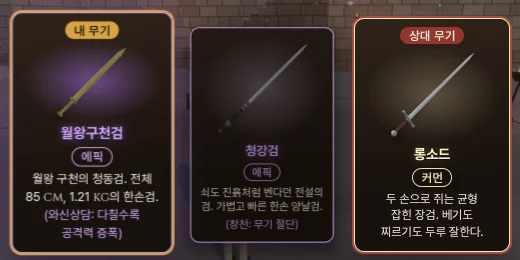
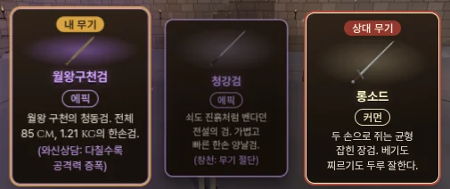
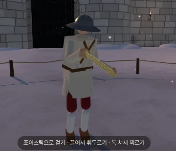
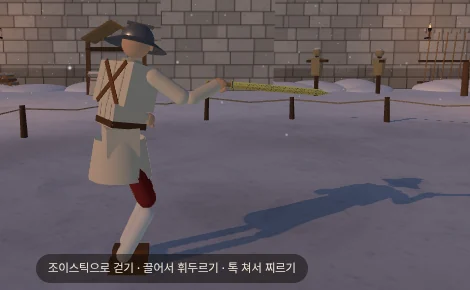

# 월왕구천검 옮기기 — 샛별 무기 + 에픽 특수 능력 '와신상담' (2026-10-14)

- 지시: 감독(우화) 10/14 — 샛별 저장소의 무기 '월왕구천검'(샛별 id `goujian`)을 우리 무기로 옮기고 특수 능력 '와신상담'을 새로 넣는다. 앞선 리뷰 `docs/import/saetbyeol_review5_2026-10-14.md` §5(월왕구천검) · §8-2 3 단계를 따른다.
- 사장님 결정 (10/14): **가져와서 카드 뽑기에 넣는다** · 이름 **'월왕구천검'** · 등급 **에픽** · '에픽은 특수 능력이 있어야 한다' · 특수 능력 원문 "와신상담: 다칠 수록 공격력 증폭 — 특수능력 설명에 이렇게 적고 최대 30%로 하자." · 유파 **동방**(`school: 'chinese'`).
- 기준: 우리 본판 **8b91637** · 샛별 저장소 `origin/main` **7684c732** (사본은 읽기만 — `git show` 로 빈 새 폴더에 꺼내 읽음, 수정·받아오기 없음). 가지 `…/goujian`.
- 읽은 샛별 쪽: `src/weapons.js` 의 goujian · `src/goujian_details.js` · 그쪽 문서 「월왕구천검 제작」·「85 cm 후속」·「조사」(10/14) · `src/schools.js` 의 간격 줄 · `src/fighter.js` 의 피 없음 줄(읽기만).
- 인물 쪽 연결(병마용이 이 칼을 쥐게 하는 `characters.js`)은 감독이 병합 때 한다 — 이 가지는 `characters.js` 를 건드리지 않았다.
- 확인표 `docs/strike/owner_defaults_table.md` **1440~1456**.

## 0. 한눈에 (사장님용)

| 무엇 | 값 | 상태 | 확인표 |
|---|---|---|---|
| 이름 · id | **월왕구천검** (부제 없음) · `goujian` · 영어 Sword of Goujian | 사장님 결정 | 1440 |
| 등급 | **에픽** — 공격 배율 1.1 · 내구 0.95 · 충돌 한 번 파손 0.0104 (등급표 그대로) | 사장님 결정 | 1441 |
| 제원 | 전체 **85 cm**(날 67) · **1.213 kg** · 한손 — 샛별 값 그대로 | 사장님 결정 | 1442 |
| 배율 | 베기 **1.05** · 찌르기 **1.05** · 둔타 **1.0** — 샛별 값 그대로 | 사장님 결정 | 1443 |
| 특수 능력 | 카드 글 **'와신상담: 다칠수록 공격력 증폭'** · 칼 주인이 다친 정도 d(0~1)만큼 공격력 **× (1 + 0.30·d)** — 최대 +30 % | 사장님 결정 | 1444 |
| 뽑기 | 카드 뽑기에 넣음 · 에픽 칸 넷 → **다섯** (에픽 한 자루 몫 카드 한 장 4 % → **3.2 %**) | 사장님 결정 | 1445 |
| 유파 | **동방** (`school: 'chinese'` — 샛별 스펙엔 없어 그대로면 독일) | 사장님 결정 | 1446 |
| d 정의 | d = clamp(max(잃은 피 몫, 상처 심각도 합 ÷ 4, 가장 상한 팔다리 몫), 0, 1) — 피가 없는 몸(병마용)도 오른다 | 사장님 확인 전 | 1447 |
| 기준값 | 상처 심각도 합 **4** = d 1 (정규화 — 사람 12 판에서 잼) | 사장님 확인 전 | 1448 |
| 재질 | `steel` 그대로 (우리 재질표·소리에 청동이 없다 — 새 재질은 만들지 않음) | 사장님 확인 전 | 1449 |
| 카드 글 | 「월왕 구천의 청동검. / 전체 85 cm, 1.21 kg의 한손검.」 + 능력 줄 — 감독 예 문구는 작은 폰에서 넘쳐 줄임 | 사장님 확인 전 | 1451 |

## 1. 제원 — 샛별 값 그대로 (1442 · 1443)

| | 실물 (샛별 조사) | 게임 (샛별 e7eb2f5c = 우리) |
|---|---|---|
| 길이 | 55.7 cm (소장 기관 현 기록 · 옛 소개 55.6) · 폭 4.6 cm | **전체 85 cm**(손 기준 −0.09 ~ +0.76 m) · **날 67 cm** · 폭 4.6 cm |
| 질량 | 875 g (참고 사전) | **1.213 kg** = 날 0.843 (80 cm 판 날 0.78 kg 을 같은 단면으로 날 길이 비 0.67/0.62 만큼) + 자루 0.13 + 폼멜 0.14 + 코등이 0.10 |
| 무게 분포 | 기록 없음 | 칼날 무게중심 비 0.38 · 회전 반경 비 0.26 [I] |
| 쥠 | 청동 직선 양날검 | 한손 (`gripAlong` −0.10 · `hiltLength` 0.09) |

- 게임판은 실물의 복제가 아니라 **늘린 각색**이다(샛별 쪽 사용자 요청 '모르겐슈테른 69 cm 이상' → 80 → 85 cm). 출처는 샛별 조사 문서가 적은 소장 기관 소장품 기록(호북성 박물관 「越王勾践剑」)과 학술 참고사전(DOI 10.1007/978-981-99-5009-6_10374)의 본문 — 사진·도판은 옮기지 않았다.
- 엔진 값(우리 판 그대로 셈): 무게중심 손에서 **0.236 m** · 손 기준 휘두름 관성 **0.128 kg·m²** (샛별 기록 0.236288 · 0.127751 과 같다) · 틀 **한손(one)** · 방식 **두루(versatile)**.
- 충돌체 네 부품(샛별 그대로): 자루 상자 0.016 × 0.079 × 0.014 @ −0.001 · 폼멜 상자(원반) 0.026 × 0.004 × 0.026 @ −0.086 · 코등이 상자 0.034 × 0.007 × 0.016 @ 0.083 · 칼날 상자 0.023 × 0.335 × 0.0045 (0.09 ~ 0.76).
- 우리 다른 동방 칼과: 청강검 0.85 kg · 간장 0.95 · 사인검 1.0 · 막야 1.12 · **월왕구천검 1.21 kg** — 가장 무겁고 가장 짧다(손 ~ 칼끝 0.76 m, 청강검 0.86 · 간장 0.84).
- 실효 베기 배율(등급 × 베기): 월왕구천검 1.1 × 1.05 = **1.155** (사인검 1.155 · 청강검 1.375 · 간장·막야 1.5). 와신상담이 다 차면(d 1) × 1.3 = **1.50** — 간장·막야와 같은 칸이 된다.
- **들어가며 막기(`enterParry`)를 켰다**(1450, 사장님 확인 전): 우리 관례로 짧은 한손 칼(세이버·팔쉬온·청강검·간장·막야·사인검)은 다 켜 둔다 — 샛별 쪽엔 빠져 있었다(간장·막야를 옮길 때와 같은 까닭).

## 2. 재질 판단 — `steel` 그대로 (1449, 사장님 확인 전)

- 샛별은 `material: 'steel'` 로 적고 '청동 따로의 소리·충돌 없음, 청동이라서 생기는 이점을 지어내지 않음'이라고 기록했다.
- 우리 재질표에는 청동이 **어디에도 없다**: 반발 `MATERIALS`(steel · plasma · wood · rubber · frozen) · 소리 재질 `SOUND_MATERIAL` → sound.js `MATERIALS`(steel · armor · flesh · wood · plasma · rubber · frozen) · 부러짐 `MATERIAL_TOUGHNESS`(플라스마만 ∞, 나머지 1). 우리 칼의 청동 부분(청강검 장식 · 플랑베르주 폼멜 · 간장·막야·사인검 금속)도 모두 재질은 `steel` 이고 빛깔만 청동이다.
- **소리**: 주석 청동끼리·청동과 쇠가 부딪히면 금속성 울림이 난다(종이 청동이다) → 칼끼리 '쨍'인 `steel` 이 가장 가깝다. `armor` 는 판금·투구의 '징', 나머지는 금속이 아니다.
- **반발**: 금속끼리 — `steel` 0.7 (청동 따로의 잰 값은 우리 표에 없다).
- **부러짐**: 실물 청동검(주석이 많은 청동)은 강철보다 잘 깨진다. 그런데 우리 부러짐은 **등급표**(`TIER_FRAGILITY`)가 정하고 재질 몫은 플라스마(안 부러짐)만 가른다. 청동을 더 잘 부러지게 하려면 재질 몫 1 보다 작은 **새 수**가 든 새 재질이 필요하다 — 감독 지시대로 **만들지 않고 보고**한다. 지금은 다른 에픽처럼 0.0104.
- 결론: `steel`. 청동만의 소리·부러짐을 원하시면 새 재질 'bronze'(반발 · 소리 재질 짝 · 재질 몫 세 표 + 소리 합성)가 필요하다 — 사장님 결정 몫.

## 3. 등급 · 뽑기 — 에픽, 카드 뽑기에 넣음 (1441 · 1445)

- 등급표 그대로: 공격 배율(power) 1.1 · 내구 0.95 · 충돌 한 번 파손 0.0104 (청강검처럼 따로 덮은 값 없음).
- `WEAPONS` 의 **맨 끝**(flamberge 뒤)에 넣었다 → 다른 무기의 차례가 그대로라 뽑기 난수를 쓰는 수·자리도 그대로다(바뀌는 것은 에픽 칸 안에서 고르는 `floor(r × 칸 수)` 하나). `PLAYER_WEAPON_POOL` 은 `WEAPON_LIST` 에서 자동이라 코드 변경 없이 들어간다(빼 둔 무기·복제품 거름 그대로).
- 뽑기 몫 (`drawWeaponCards` 를 그대로 따라 모든 갈래의 확률을 셈 — 지난 판 무기 없음, 카드 두 장):

| | 전 (18 자루) | 후 (19 자루) |
|---|---:|---:|
| 등급 칸 · 에픽 | 커먼 3 · 레어 4 · **에픽 4** · 레전드 3(간장·막야 한 칸) · 쓰레기 2 · ??? 2 | 같음, **에픽 5** |
| 에픽 한 자루 — 카드 한 장 | **4.00 %** (16 % ÷ 4) | **3.20 %** (16 % ÷ 5) |
| 에픽 한 자루 — 두 장 가운데 | 8.00 % | 6.40 % |
| 월왕구천검 — 한 장 · 두 장 가운데 | — | 3.20 % · 6.40 % |
| 에픽이 두 장 가운데 하나라도 | 29.44 % | 29.44 % (그대로) |
| 에픽 아닌 무기 (예: 롱소드 · 레이피어 · 엑스칼리버) | 13.33 · 6.75 · 2.50 % (한 장) | 같음 |

- 같은 난수 열 2만 판으로 실제 함수를 돌리면 두 장이 전과 같은 판이 **85.6 %** — 나머지는 에픽 칸이 뽑힌 판에서 고르는 자리가 넷 → 다섯으로 바뀐 판이다.
- 무기 수 22 → **23** (`weapon_smoke` 기대 ' OK ' 23).

## 4. 카드 (1451 · 1454)

- 이름 줄 '월왕구천검'(5 자, 부제 없음 — 한자를 붙이지 않음) · 등급 '에픽'(에픽 보라 rgb(214, 168, 255)) · 그림 `public/ui/weapons/goujian.webp` (256×256, **3.5 KB** — `tools/browser/weapon_thumbs.mjs` 로 우리 모델을 찍음).
- 설명: 「**월왕 구천의 청동검.** / **전체 85 cm, 1.21 kg의 한손검.**」 · 능력 줄: 「**(와신상담: 다칠수록 공격력 증폭)**」(괄호는 카드가 붙인다 — 다른 에픽과 같은 꼴, 문구는 사장님 결정 그대로).
- **감독 예 문구에서 바꾼 것**: 예 「월나라 왕 구천의 청동검. / 전체 85 cm, 질량 1.21 kg의 한손검.」은 작은 가로 폰(568×320 · 844×340, 카드 폭 150 px)에서 설명 세 줄 + 능력 줄 두 줄(능력 줄은 사장님 문구라 줄일 수 없다)이 되어, **고른 카드**('내 무기' 꼬리표가 위에 붙는다)의 글이 앞면 아래 테두리 밖으로 **3.6 px** 넘쳤다(그림 칸이 가장 작은 36 px 까지 줄고도). 후보 여덟을 같은 화면에서 재어(설명 줄 수), '월나라 왕' → '월왕'(무기 이름과 같은 말) · '질량' 을 뺀 글이 세 화면 모두 **두 줄** → 넘침 없음. '전체 N cm, … kg의 한손검.' 꼴(간장·막야·사인검)은 지켰다.
- 글 규칙(`docs/ui/hud_copy_rules_2026-10-10.md` §4-6·4-7): 두 문장 · 약 24 (한도 40) · 숫자와 단위 사이 한 칸. 화면 글꼴에 없는 글자 0 (`font_glyphs` — 프리텐다드 658 종) · 표기 방침 위반 0.
- '늘린' 낱말: 샛별 카드 글은 '전체 85cm로 **늘린** 한손 양날검' 으로 실물보다 길다는 것을 드러냈다. 우리 글은 두 줄에 넣느라 빠졌다 — 넣으려면 세 줄이 되어 작은 폰에서 다시 넘친다(1451 에 적음).

카드 넘침 점검 (모두 화면 배율 1, 헤드리스):

| 도구 | 결과 |
|---|---|
| `tools/browser/goujian_shots.mjs` ① — 첫 카드 월왕구천검을 **고르고 뒤집은 뒤** | 844×390 · 568×320 · 1280×800 넘침 없음 (설명 2 줄 · 능력 줄 2 · 2 · 1 줄, 글 끝 ~ 앞면 아래 11 px = 안쪽 여백 안). 고른 카드의 그림 칸 높이 568×320 **38 px** · 844×340 50 px (가장 작게 36 — 예 문구일 때는 36 까지 줄고도 3.6 px 넘쳤다) |
| `tools/cardface/desc_fit_check.mjs` (화면 배율만 1 로 바꾼 사본 — 저장소 밖) | 다섯 화면 × 24 장 = **120 장 넘침 0** · 콘솔 오류 0. 월왕구천검 여유 844×390 62 · 932×430 86 · 844×340 32 · 568×320 20 · 1280×720 173 px. 전체에서 가장 작은 여유(568×320 리볼버·간장 4 px)는 웹폰트 기록과 같다 |
| `tools/cardface/face_check.mjs` | 144 장 가운데 72 장 넘침 — **1280×720 · 1920×1080 은 24 장 모두**(롱소드 포함) 넘침으로 나온다. 이 도구는 10/10 판이라 능력 글을 설명 칸에 붙여 넣고 테두리 안쪽을 픽셀 뒷면 세 칸으로 재는 옛 판정이다(10/14 글자 규칙 뒤 크게 맞지 않음 — 기준 판은 안 돌림). 월왕구천검은 폰 네 화면에서 넘침 없음 |

## 5. 와신상담 — 정의 · 구현 · 시험

### 5-1. 식 (사장님 결정 1444)

공격력 배율 = 등급 power × **(1 + woundRage × d)**, `woundRage` **0.30** (무기 스펙의 능력 칸 — 이 칼에만 있다). d = 칼 주인이 다친 정도(0 ~ 1). 판정 에너지(베기·찌르기의 실효 에너지 · 둔타 에너지)에만 곱하고 물리(속도·질량·되튐)는 그대로 — 등급 power 와 같은 자리.

### 5-2. 다친 정도 d — 작업자 정의 (1447, 사장님 확인 전)

**d = clamp( max( 잃은 피 몫, 상처 몫, 팔다리 몫 ), 0, 1 )**

| 몫 | 식 | 뜻 | 피 없는 몸(병마용) |
|---|---|---|---|
| 잃은 피 | (1 − `blood`) ÷ (1 − `VITALS.collapseBlood`) | 쓰러지는 문턱(피 0.45)까지 잃으면 1 — 있는 수(0.45)만 씀 | `blood` 가 늘 1 → 0 |
| 상처 | Σ `wounds[].severity` ÷ **4** | 상처가 쌓인 양 — 잘린 단면 상처도 센다 | **그대로 오른다** |
| 팔다리 | max over `limbs`(칼 팔 · 빈팔 · 앞다리 · 뒷다리) of (1 − 기능) | 상처로 망가지거나(기능 −= 심각도 × 0.7) 잘려 나가면(`sever` → 0) 그 팔다리 하나로 1 | **그대로 오른다** |

- **쌓이는 손상만** 쓴다: 셋 다 판 동안 줄지 않는다(피는 부활 때만 0.7 까지 돌아오고, 상처 목록은 남는다). 아픔(`pain`, 초당 0.6 씩 빠짐)·의식·균형처럼 맞는 순간 튀었다 가라앉는 값은 쓰지 않았다 — 맞을 때마다 배율이 출렁이지 않는다. 상처가 날 때 계단처럼 한 번 오르고 그 자리에 머문다.
- **max** 로 묶는다(더하지 않음): 몫마다 '중상 = 1' 로 따로 맞췄고, 한 상처가 피·상처·팔다리 세 몫에 함께 잡혀도 두 번 세지 않는다.
- 사람과 병마용: 사람은 상처가 난 순간 상처 몫·팔다리 몫이 오르고 피 몫은 피가 흐르며 뒤따라 오른다. 피 없는 몸은 피 몫만 0 이다 — 상처 몫의 기준값을 '사람이 그 상처로 잃을 피'에 맞췄으므로(5-3) 같은 상처면 둘의 d 가 비슷하다.
- 심각도 1 짜리 상처 하나가 올리는 d (참고 — 몫마다 기울기가 다르다):

| 상처 자리 | 잃은 피 몫 (사람, 다 흐른 뒤) | 상처 몫 | 팔다리 몫 |
|---|---:|---:|---:|
| 가슴 베기 | 0.38 | 0.25 | — |
| 배 베기 · 찌르기 | 0.45 · 0.73 | 0.25 | — |
| 팔 베기 | 0.18 | 0.25 | **0.70** |
| 다리 베기 | 0.23 | 0.25 | **0.70** |
| 목 베기 | 3.0 (심각도 0.5 넘으면 어차피 죽음) | 0.25 | — |

  (잃은 피 = 심각도 × 부위 출혈 `ANATOMY.bleed` × 찌르기 1.6 ÷ 굳는 빠르기 0.12, 그것을 0.55 로 나눔.) 팔다리를 다친 쪽이 가장 빨리 오른다 — 칼 팔 기능 0.15 아래면 칼을 놓치고 두 다리 평균 0.25 아래면 주저앉으며 다리가 잘리면 서지 못하는 우리 규칙상 '그 팔다리를 못 쓰게 된 것'을 중상으로 본 것이다. 더 느리게 하려면 팔다리 몫을 (넷의 잃은 기능 합) ÷ 2 로 바꾸는 길이 있다(1447 에 적음).

### 5-3. 기준값 4 — 정규화 (1448, 사장님 확인 전)

새로 정한 수는 상처 몫의 분모 하나다(정규화 — 상한·문턱·쿨다운 아님). fights12 와 같은 12 판(롱소드 AI 둘, 30 s, 시드 1~12)을 따로 돌려 잼(저장소 밖 임시 도구):

| 잰 것 | 값 | 기준값으로 |
|---|---|---|
| 살아남은 다친 싸움꾼 13 명의 '정해진 잃은 피 ÷ 상처 심각도 합' (정해진 잃은 피 = 1 − blood + bleed ÷ 0.12 — 지금 출혈이 다 흐를 몫까지) | 가운데 **0.121** (0.100 ~ 0.211) | 피 0.55 를 잃을 상처 합 = **4.5** |
| 같은 13 명 합끼리 나눈 비 | 0.151 | **3.6** |
| 죽은 9 명이 죽은 순간의 상처 심각도 합 | 1.0 · 1.5 · 2.4 · 3.9 · 4.2 · 5.6 · 6.1 · 6.4 · 10.4 — 가운데 **4.2** | **4.2** |

→ **4**. 이 값으로 같은 12 판의 d: 죽은 9 명 가운데 6 명은 죽는 순간 d ≈ 1(0.98 ~ 1), 목 한 칼에 바로 죽은 셋은 0.25 · 0.36 · 0.61 · 판 끝(30 s)에 서 있던 13 명은 멀쩡한 둘 0 · 다친 열 0.05 ~ 0.53(가운데 약 0.2) · 빈팔 기능이 0 이 된 하나 1 · 쓰러졌다 일어나던 둘은 1.

### 5-4. 구현 (`src/combat.js` · `src/weapons.js` · `src/main.js`)

- `weapons.js` goujian: `ability: '와신상담: 다칠수록 공격력 증폭'` · `woundRage: 0.3`.
- `combat.js`: `WOUND_RAGE = { sevRef: 4 }` · `woundDegree(f)`(d — 읽기만) · `woundRageMult(f)`(칼에 `woundRage` 가 있으면 1 + 0.3·d, 없으면 1). `analyze` 에서 `power = weaponCfg.power × rage` 를 베기·찌르기 배율(`wMult`)과 둔타 에너지 두 곳에 쓴다 — 전엔 두 곳 다 `weaponCfg.power`. **능력이 없는 무기는 `rage` 가 1 이고 d 를 셈하지도 않는다**(power × 1 은 power 그대로라 판이 바이트까지 같다 — §7 관문). 그 능력이 있는 칼의 타격 결과에만 `woundRage`(그 타격의 배율) 칸이 붙는다. AI 의 미리 셈(predict)도 같은 함수라 칼이 살을 가를지 미리 볼 때도 배율이 들어간다.
- 디버그: 브라우저 콘솔 **`game.woundRage`** → `[{ name, weapon, d, mult }, …]` 두 싸움꾼 한 줄씩(그 능력이 없는 칼은 늘 mult 1).
- 새 상한·문턱·쿨다운 없음(0.30 만 사장님 값, 4 는 정규화). 카드에 숫자는 적지 않았다(사장님 문구 그대로).

### 5-5. 시험 — `node tools/sim/wound_rage_check.mjs` (82 항목 모두 통과)

**A0. 대본 베기**(live_battery `hit()` 꼴 — 상대는 가만히, 상대 칼 충돌 끔): 같은 순간의 같은 접촉을 칼 주인 상태만 바꿔 `analyze` 로 다시 셈. 문턱과 견주는 실효 에너지의 비:

| 칼 주인 상태 | d | 월왕구천검 정수리 베기(머리 100.6 J) · 분노의 베기(목 145.2 J) · 가로 베기(팔 143.8 J · 가슴 174.3 J) 등 6 타격 | 롱소드 6 타격 |
|---|---:|---|---|
| 멀쩡 | 0 | × 1 | 그대로 |
| 사람 — 피 0.725 | 0.5 | **× 1.15** | 그대로 (값 === 같음) |
| 사람 — 피 0.45 | 1 | **× 1.30** | 그대로 |
| 피 없는 몸 — 피 1 · 상처 심각도 합 2 | 0.5 | **× 1.15** | 그대로 |
| 피 없는 몸 — 피 1 · 상처 심각도 합 4 | 1 | **× 1.30** | 그대로 |
| 피 없는 몸 — 상처 심각도 합 6 | 1 (더 안 오름) | × 1.30 | 그대로 |
| 빈팔 기능 0.5 | 0.5 | × 1.15 | 그대로 |

- 배율은 1e-9 안에서 정확히 1 · 1.15 · 1.30 이다. 롱소드는 일곱 상태 모두 에너지가 같고(`===`) 결과에 `woundRage` 칸이 없다. AI 판(월왕구천검 대 롱소드, 시드 3)의 실제 타격도 같다(월왕구천검 쪽 잔 접촉 3 · 롱소드 쪽 4).

**C. 피 없는 몸 흉내**(매 스텝 blood 1 · bleed 0 — 병마용처럼 피가 줄지 않는 몸)에 진짜 `fighter.applyWound` 로 상처 여섯:

| 상처 | 피 | 상처 심각도 합 (÷ 4) | 가장 상한 팔다리 | d | 배율 |
|---|---:|---|---:|---:|---:|
| 가슴 베기 0.6 | 1 | 0.6 (0.15) | 0 | 0.15 | × 1.045 |
| 빈팔 아래팔 베기 0.5 | 1 | 1.1 (0.275) | 0.35 | 0.35 | × 1.105 |
| 배 찌르기 0.9 | 1 | 2.0 (0.5) | 0.35 | 0.50 | × 1.15 |
| 앞 허벅지 베기 0.4 | 1 | 2.4 (0.6) | 0.35 | 0.60 | × 1.18 |
| 가슴 베기 1.3 | 1 | 3.7 (0.925) | 0.35 | 0.925 | × 1.2775 |
| 골반 찌르기 0.8 | 1 | 4.5 (1.125) | 0.35 | **1** | **× 1.30** |

같은 여섯 상처를 사람(피 있음)이 받으면 1.8 s 뒤 피 0.888 · 정해진 잃은 피 1.07(피 몫 1.94 — 곧 출혈로 쓰러질 몫) → d 1. 피 없는 몸은 상처 심각도 합 4.5 에서 d 1 — 두 몸의 '중상'이 같은 곳에 온다.

**D. 실제 판**(30 s, 피 없는 월왕구천검 대 롱소드 AI, 시드 1): 월왕구천검 쪽 피는 끝까지 1 · 상처 16 · 첫 상처(칼 든 아래팔, 심각도 1.04 — 칼 팔 기능 0.27) 7.4 s 에 d 0.73 → 그 사이 낸 타격 1(11.2 s 둔타 × 1.218) → 11.5 s 에 칼 팔이 한 번 더 베여 기능 0 · **그 순간 칼을 놓침**(칼 팔 0.15 아래 — 우리 규칙) · d 1. 배율은 늘 1 ~ 1.3 안. 팔다리 몫이 1 이 되는 가장 흔한 길(칼 팔)은 칼을 놓치는 길이기도 해서, 칼을 쥔 채로 팔다리 몫으로 받는 배율은 칼 팔만 다쳤을 때 × 1.255(기능 0.15)까지다 — 빈팔·다리를 다치면 쥔 채 1 까지 간다.

브라우저(§6-2)에서도 `game.woundRage` 가 `[{"weapon":"goujian","d":0,"mult":1}, {"weapon":"longsword","d":0,"mult":1}]` 이고, 플레이어 피를 잠깐 0.725 로 두면 `{"d":0.5,"mult":1.15}` · 롱소드 쪽 1 그대로.

## 6. 겉모습 · 브라우저

### 6-1. 겉모습 (`src/goujian_details.js` — 1452, 사장님 확인 전)

- 샛별 `goujian_details.js` 를 **바이트 그대로** 가져오고 한국어 머리말 두 줄만 더했다(그쪽 영어 주석도 원문 그대로 — 사인검·북부 대공의 검을 가져올 때와 같은 방식). 우리 `weapon_looks.js` 의 `metalMat`·반사 환경을 그대로 받는다(두 저장소의 그 함수가 같음).
- 금갈색 청동 날 · 검은 마름모 격자 상감 · 가운데 능선 · 칼막이 가까이 두 줄 여덟 글자 꼴 장식(조충서 느낌 — 탁본 아님) · 칼막이 앞 푸른 유리·뒤 청록 · 두 고리 손잡이 · 원반 폼멜 아래 동심원 11. 사진·새 질감 없음. **메쉬 7 · 삼각형 3,836**(샛별 기록과 같음) · 겉모습 상자 0.068 × 0.850 × 0.052 m(콜라이더와 같은 폭).
- **에픽 등급 마감을 칼날에 입히지 않았다**: 이 겉모습은 등급 마감 인자를 받지 않고 청동 재질값(거칠기 0.32 · 금속 0.82 · 반사 1.15)을 직접 쓴다. 우리 에픽 마감(`FINISH.epic` — 거칠기 0.15 · 금속 0.94 · 반사 1.2 · **푸른 윤** 0x9fd8e8)은 '결이 고운 강철'용이라 금빛 청동에 푸른 기가 돈다. 에픽은 카드 등급 색으로 보인다. 입히려면 칼날 재질 한 줄(플랑베르주처럼) — 1452 에 적음.

### 6-2. 브라우저 (`tools/browser/goujian_shots.mjs` · 개발 서버 5401 · 헤드리스 SwiftShader · 화면 배율 1)

- ① 카드 앞면 세 화면(§4) — 첫 카드 이름 '월왕구천검' · 그림 `goujian` · 등급 '에픽' · 능력 줄 문구 그대로 · 넘침 없음.
- ② 쥔 모습: `?stage=castle&foe=isolde&weapon=goujian&foeWeapon=longsword` → 판 시작 정지 동안. 내 무기 `goujian` · 틀 one · 방식 versatile · **유파 chinese(동방)** · 쉴 자세 '직부송서 (直符送書)'(동방 자세표 — 화면 오른쪽 위 자세 칸도 '직부송서') · 질량 1.213 kg · 손 기준 관성 0.128 · 무게중심 0.236 m. NaN 0 · 그리기 155 · 삼각형 6.2 만(성 안뜰, 인물 둘).
- **콘솔 오류 0** (카드 세 화면 + 쥔 모습 — 마지막 돌림. 그 앞 한 번은 돌리는 도중 `weapons.js` 를 고쳐 개발 서버가 화면을 다시 불러 요청이 끊긴 것이 잡혔다 — 고친 뒤 다시 돌려 0).

### 6-3. AI 간격 (`src/weapon_measured.js` — 1453)

- `MEASURED.goujian` **[1.27, 1.39, 1.01, 0.38]** · `CUT_TIME_30.goujian` **0.28** — 앞서 가져온 넷(간장·막야·사인검·북부 대공의 검)과 같은 규칙: `node tools/sim/with_config.mjs ARENA.startHold=0 weapon_measures.mjs --gen --down` 생성 값 1.31 / 1.37 / 1.01 / 0.26 을 같은 생성의 롱소드(1.62 / 1.77 / 1.25 / 0.28)에 대한 비율로 롱소드 손 값(1.57 / 1.8 / 1.25 / 0.41)에 붙임. 같은 생성에서 다시 잰 사인검 1.41 / 1.50 / 1.09 / 0.25 · 간장 1.39 / 1.47 / 1.07 / 0.24 는 10/10 기록과 같았다(도구가 그대로 잰다). 생성 파일은 저장소 밖에 썼다(`data/weapon_measured.gen*.json` 은 손대지 않음).
- 샛별 쪽은 청강검 간격에 칼 길이 비 0.76/0.86 을 곱한 추정(1.19 / 1.34 / 0.92)이었다.
- 강제 파손 점검(`node tools/sim/weapon_break_check.mjs --weapons=goujian,qinggang,sain`): **ALL OK** — `goujian L 0.670→0.335 m 1.213→0.943 Ihand 0.1278→0.0410 … above 0 debris 1 gone@1.60s NaN 0 M.contact 1.22→0.94 reach 1.39→1.05`.

## 7. 관문 (마지막 커밋 트리 — 기준 8b91637 과 같음)

| 명령 | 기대 | 결과 |
|---|---|---|
| `node tools/sim/fights12.mjs` ('deprecated parameters' 줄 뺀 sha256 앞 8) | `7c95ba21` | **7c95ba21** |
| `node tools/sim/live_battery.mjs` | `e7ee3d96` | **e7ee3d96** |
| `node tools/sim/finish_thrust.mjs 1 --stand` | `433ac984` | **433ac984** |
| `node tools/sim/corr_s0.mjs --limits=on,off --scenes=a,b` | identical 12 | **IDENTICAL 12** |
| `node tools/sim/weapon_smoke.mjs` ' OK ' | 23 | **23** — 앞 22 줄은 기준과 글자까지 같고 끝에 `goujian          OK  P=stand/1.00  E=stand/1.00  nan=false  broken=false/false` 한 줄 |
| `npx vite build` | rc 0 | **0** (`npm run build` 의 오프라인 앱 목록도 0 — 329 파일 · 6,664,464 B) |
| `node tools/text/name_policy.mjs` | rc 0 | **0** (화면 글 727 줄 · 위반 0) |
| 더한 줄의 금지어 검사 | 비어 있음 | 비어 있음 |

- 유파 판정: `traditionOf(goujian)` = **chinese** → 화면 이름 **동방** (`school` 이 없으면 틀 one · 방식 versatile → german 이었다).
- 다른 무기·사람 판이 바이트 그대로인 까닭: 와신상담은 `woundRage` 가 있는 칼에서만 셈하고(그 밖엔 배율 1 — power × 1 = power), 월왕구천검은 목록 끝에 있다(앞 무기들의 차례·난수 그대로). 시뮬 관문 넷은 롱소드만 쓴다.

## 8. 바꾼 파일

| 파일 | 바꾼 것 |
|---|---|
| `src/weapons.js` | import 한 줄 · `goujian` 스펙(머리말 · 제원 샛별 그대로 · 에픽 · 동방 · `enterParry` · 능력 · `woundRage`) · `WEAPONS` 끝 한 줄 |
| `src/goujian_details.js` (새) | 샛별 겉모습 바이트 그대로 + 머리말 두 줄 |
| `src/combat.js` | `VITALS` import · `WOUND_RAGE` · `woundDegree` · `woundRageMult` · `analyze` 의 power 두 곳 · 결과 `woundRage` 칸 |
| `src/main.js` | `game.woundRage` 디버그 한 줄(import 포함) |
| `src/weapon_measured.js` | `goujian` 간격 두 줄 |
| `public/ui/weapons/goujian.webp` (새) | 카드 그림 3.5 KB |
| `tools/sim/wound_rage_check.mjs` (새) | 와신상담 시험 |
| `tools/browser/goujian_shots.mjs` (새) | 카드 앞면 · 쥔 모습 그림과 확인 |
| `docs/import/goujian/` (새) | 그림 다섯 (webp, 합 57 KB) |
| `docs/strike/owner_defaults_table.md` | 1440~1456 |

## 9. 한계 · 사장님께 물을 것

1. **d 정의**(1447)와 **기준값 4**(1448) — 작업자 안. 팔다리 몫이 가장 빨리 올라(팔 한쪽 심각도 1 이면 d 0.7) 팔다리를 다친 월왕구천검은 일찍 +20 % 를 넘긴다. 더 느리게 하려면 팔다리 몫을 (잃은 기능 합) ÷ 2 로.
2. **재질**(1449) — 청동만의 소리·부러짐은 새 재질이 필요해 하지 않았다.
3. **카드 글**(1451) — 감독 예 문구는 작은 폰에서 넘쳐 '월왕 구천의 청동검. / 전체 85 cm, 1.21 kg의 한손검.' 으로 줄였다. 고른 카드 568×320 에서 앞면 안 여유는 그림 칸이 줄어들 몫(약 2 px)까지 빠듯하다. 실물보다 늘렸다는 말('늘린')은 빠졌다.
4. **에픽 마감**(1452) — 칼날에 안 입힘(청동 재질값 그대로).
5. **들어가며 막기**(1450) — 짧은 한손 칼 관례로 켰다(샛별엔 없음).
6. 승률·손맛은 안 쟀다(48 판 결투 안 돌림 — 감독 지시). AI 판 한 판(D)에서 월왕구천검 AI 가 낸 타격은 하나뿐이었다 — 이 칼의 AI 세기는 병마용 인물을 넣을 때 다시 볼 일.
7. **병마용 몸 규칙(피 없음)은 아직 우리 코드에 없다** — 시험은 매 스텝 피를 1 로 되돌리는 흉내로 했다(샛별의 '피 없음'도 피 1 · 출혈 0 · 상처는 그대로 쌓이는 꼴이라 같은 뜻). 그 규칙이 들어오면 `wound_rage_check` 의 C · D 를 진짜 몸으로 다시 돌린다.
8. `characters.js` 의 병마용 무기 연결 · 테스트 고르기 '오늘 바뀐 무기' 묶음(`test_pick.js`)은 손대지 않았다(무기 목록에는 자동으로 들어감 — '동방 유파').
9. 브라우저는 헤드리스 SwiftShader · 화면 배율 1 — 실기기(폰 실화면 2~3 배) 카드·칼은 못 봤다.
