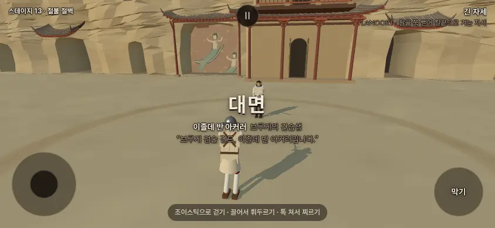
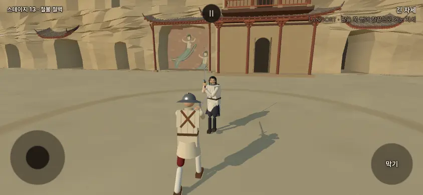
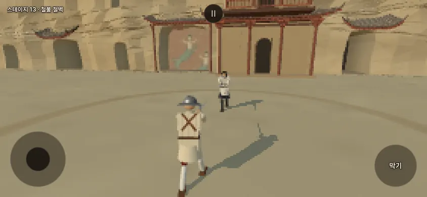
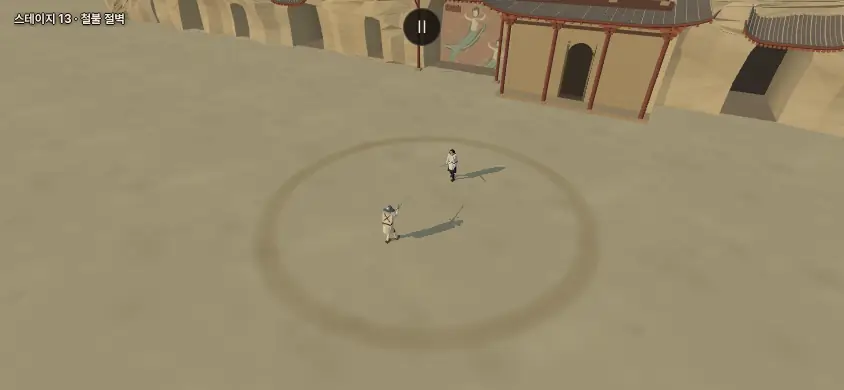
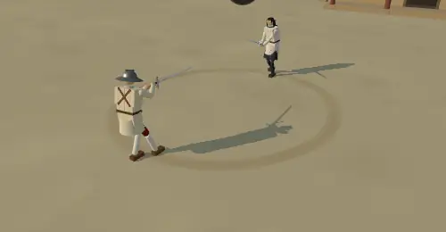
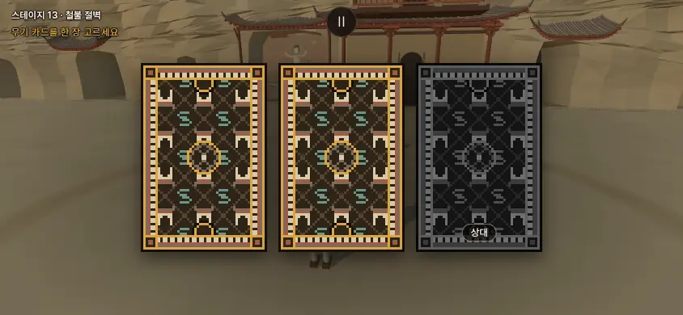

# 철불 절벽(dunhuang) 옮김 · 여정 정식 경로에 세 무대 (2026-10-14)

- 지시: 감독 10/14 — **A.** 샛별 저장소의 둔황 무대를 옮긴다(코드 id `dunhuang` 그대로). **B.** 여정 정식 경로에 잠든 습지(`sluice`) · 철불 절벽(`dunhuang`) · 소금 사막(`dayr`)을 넣는다.
  - **사장님 결정 10/14 19:4x**: 화면 이름 **'철불 절벽'**('둔황'은 화면 이름에 넣지 않음) · 벽화는 **그대로**(두 인물 머리 뒤 둥근 테도 그대로 — 불상은 없고 벽화는 창작) · 결투장 띠를 **넣는다**(바닥에 납작한 닳은 띠, 물리 영향 없음 — 소금 사막 결투장 고리와 같은 결) · 여정은 "습지, 소금 사막과 함께 정식 경로 포함"(화산섬 — 용암 무대 — 은 나중에 따로 옮김).
  - **감독 안(그대로 따름)**: `STAGE_ORDER` 끝(청람잔도 뒤)에 잠든 습지 → 철불 절벽 → (화산섬 자리, 나중) → 소금 사막. 끝은 숙련도 4 다라이시. 짝 `STAGE_FOE`: `sluice: 'ratna'` · `dayr: 'silver_wanderer'` · `dunhuang` 은 비워 둠(무작위 상대 — 병마용이 들어오면 감독이 `'terracotta'`로).
- 앞선 리뷰: `docs/import/saetbyeol_review5_2026-10-14.md` §2(둔황 — 그림결·빛·경계·성능·소리·카드 뒷면) · §8 이식 계획 1 단계. 선례: `docs/import/salt_desert_port_2026-10-14.md`(무대 이식 꼴 · 결투장 고리 · 무대 전용 그림자) · `docs/import/sluice_port_2026-10-14.md`.
- 출처: 샛별 저장소 origin/main **7684c732**(무대 내용은 1890fdf1 까지 — 그 뒤는 기록 커밋뿐)의 `src/stage_dunhuang.js` 와 `sound.js` · `stage_detail_sound.js` 의 둔황 줄. 그쪽 `stage_kit.js` 는 우리 것과 바이트 같고(확인함), `stages.js` · `main.js` 에는 옮길 둔황 줄이 없었다(BUILDERS 한 줄 · 짝 한 줄뿐 — 우리 값으로 따로 적음). 샛별 쪽은 `git show` 로 꺼낸 사본만 읽었다 — 고치거나 받아 오지 않았다.
- 가지: …/ironcliff (본판 9efb03d 에서). 새 값은 확인표 **1380~1390**(사장님 확인 전 — 사장님이 정한 값은 '사장님 결정 10/14 19:4x'), 잠든 습지·소금 사막의 '여정 밖' 줄 **1119 · 1209 · 1214 · 1225** 는 '사장님 결정 10/14 19:4x — 정식 경로'로 고쳤다.
- 커밋: ① 코드·카드 뒷면 eb71c9a · ② 이 기록 · 그림 · 확인표 · 문서. push 하지 않았다.

## 0. 한눈에

| 무엇 | 한 일 | 어디 |
|---|---|---|
| 무대 | 샛별 무대를 옮김 · 화면 이름 '철불 절벽'(id `dunhuang` 그대로) · 벽화·둥근 테 그대로 · 짓는 순서·난수 그대로 | §1-1 |
| 그림자 | 먼 경관(절벽·누각·처마)은 드리우지 않음 — 그림자 그리기 **−3 호출 · −68,217 삼각형**, 판 시작 경기 화면 **화소 차 0** · 인물·칼·수레는 그대로 | §1-2 |
| 결투장 띠 | 보이지 않는 벽 자리(6.62 m)에 납작한 닳은 띠 — 소금 사막과 같은 꼴, 빛·그림자를 받지 않는 곱하기 띠(인물 그림자가 띠 위에서 안 끊김) · 충돌체 없음 | §1-3 |
| 빛 | 샛별 값 그대로 — 해 (−12, 8, −9) 높이 28° · 아침 베이지와 하늘색 | §1-4 |
| 소리 | `STAGE_SOUND.dunhuang` · 바탕 두 겹 · 세부음 `dunhuangWood` 를 세부음 표 **끝(자리 14)** 에 — 있던 씨앗 0~13 그대로 | §1-5 |
| 카드 뒷면 | `px_dunhuang_*` 넷 + 회색 넷 새로 그림 · `PX_BACKS` · 습지·소금 사막 뒷면은 이미 있음(확인) | §1-6 |
| 성능 | 우리 판 **233 호출 · 115,915 삼각형**(샛별 판 그대로면 235 · 182,852 — 우리 최대 16.0 만 넘음) | §1-7 |
| 여정 | 열한 판 → **열넷 판**: … 청람잔도 → 잠든 습지(라트나) → 철불 절벽(무작위) → 소금 사막(다라이시) → 다시 포세이돈 | §2 |
| 도구 | 여정 한 바퀴 도구 `stages_sb_shots.mjs`(열한 → 열넷 + 짝 검사) · `stage_cost.mjs`(기본 목록 열넷 · `--foe=`) | §2-4 |

## 1. 무대 — 철불 절벽 (`dunhuang`)

*개발 서버(이 가지, 자기 포트)에서 `?stage=dunhuang&weapon=longsword&foe=isolde`(+ 도트 모드 `&pixel=1`), 헤드리스 SwiftShader · 화면 배율 1. 바깥 요청은 막고 찍었다(막힌 요청 0 · 콘솔 오류 0). 철불 절벽은 아직 무대 짝이 없어 사진은 상대를 이졸데로 고정했다(리뷰 5차의 그리기 측정과 같은 상대).*

### 1-1. 옮긴 것 · 고친 것
- **옮긴 것(샛별 판 그대로)**: 침식된 절벽 앞 석굴 앞뜰, 초가을 맑은 아침 8 시. +x(판 시작에 상대 뒤) — 높이 약 24 m 절벽(삼각형을 쪼개 굴곡을 준 평면 음영) · 석굴 입구 29 · 6 층 누각(벽체·회랑·파인 문·지붕·서까래·공포) · 창작 벽화 8.3×6.8 m(띠를 두르고 나는 두 인물 · 머리 뒤 둥근 테) · 처마 밑 글씨 없는 나무 간판(흔들림). −x — 부서진 수레(찢긴 천막·열린 궤짝 속 흙병사 머리·바퀴 자국) · 마른 강바닥과 제방·자갈 · 먼 능선 두 겹. 바닥 모래 알갱이 92(점 하나). 결투면은 평평한 y 0, 카메라 궤도 10.5 m 안은 바닥뿐(가장 가까운 경관 13.5 m), 충돌체·지형 규칙 없음.
- 질감 다섯은 모두 캔버스로 코드가 그린다(흙 1024² · 바위 512² · 벽화 1024×768 · 하늘 512×256 · 모래 32²). **사진·사진 질감·그림 파일은 옮기지 않았다** — 리뷰 5차 §6 대로 샛별 쪽 참고 사진 넷은 그쪽 제안 페이지 전용이고, 무대 코드는 그림을 읽는 줄이 없다(`drawImage`·`TextureLoader`·`.jpg` 0).
- 공구는 우리 `src/stage_kit.js`(샛별 쪽과 바이트 같음 — `cmp` 로 확인)를 그대로 쓰고 새 공구는 없다. 무대 파일 `src/stage_dunhuang.js`(701 줄 · 47,086 B, 샛별 650 줄 · 40,843 B) — 샛별 영어 줄 설명은 원문 그대로 두고 우리 판에서 고친 곳에 한국어 줄을 달았다(소금 사막 선례와 같음).
- **고친 것**(무대 파일 머리말 ①~③):
  1. 먼 경관 그림자 끔(§1-2).
  2. 결투장 띠(§1-3).
  3. 샛별 판의 무대 정보 객체(`info` — 그쪽 화면 이름 '천불의 절벽'·'apsara' 설명 글 등)를 뺐다. 우리 판에서 읽는 곳이 없고 그 이름이 사장님 결정과 다르다. 짓는 함수의 차례와 난수(시드 141400 …)는 그대로라 무대 꼴·색은 샛별 판과 같다.
- 바꾸지 않은 것: 벽화(두 인물 머리 뒤 둥근 테까지 — 사장님 결정) · 빛·안개 · 인물 빛 · 수레·강바닥·능선 · 세부음이 나는 때(간판 흔들림 끝) · 벽화 메쉬 이름(`dunhuang-apsara-mural` — 화면에 안 나옴).
- 사람 꼴 입체는 리뷰 5차 §2-4 의 확인대로 수레 궤짝 속 흙병사 머리 하나뿐이다. 불상·탑·글씨·연꽃 무늬 없음.

### 1-2. 먼 경관 그림자 끔 (확인표 1382 — 리뷰 5차 §2-6 권고)
- 샛별 판은 절벽(`cliff`)·누각·처마(`plaster` · `interior` · `timber` · `tile`)와 수레 둘(`procession` · `procession-cloth`)이 그림자를 드리웠다. 우리 판은 **수레 둘만** 드리운다(`CAST_BINS`). 그림자를 받는 것은 그대로 모두(바닥·절벽·누각), 인물·칼은 다른 무대처럼 드리운다.
- 까닭: 해가 (−12, 8, −9) 쪽 — 결투장 −x·−z 위 — 이라 +x 의 절벽·누각(결투장 가운데에서 14.7 m 밖) 그림자는 결투장 반대쪽으로 떨어진다. 그림자 상자(main.js — 내 몸 무게중심 둘레 해와 직각 ±4 m · 깊이 1~25 m)에도 거의 들어오지 않는다(아래 19 화소). 그런데 무대는 재질별로 한 메쉬로 합쳐져(절벽 하나가 z −64 ~ 66 m) 둘레 구가 그림자 상자에 걸치기만 해도 메쉬 통째로 그림자 그리기에 올라간다 — 보이지 않는 그림자에 삼각형만 썼다.
- 잰 값(경기 카메라 · 844×420 · 상대 이졸데 · AI 멈춤, 같은 멈춘 장면에서 드리우기만 켜고 끔):

| 그림자를 드리우는 무대 메쉬 | 그리기 호출 | 삼각형 |
|---|---:|---:|
| 샛별 판(절벽·누각·처마 + 수레) · 띠 없음 | 235 | 182,852 |
| 샛별 판 + 띠 | 236 | 184,132 |
| **우리 판(수레만) + 띠** | **233** | **115,915** |

| 하나씩 켜 봄 | 그림자 그리기에 더해지는 호출 · 삼각형 |
|---|---|
| 절벽 `cliff` | 1 · 29,105 |
| 서까래·기둥·난간 `timber` | 1 · 19,832 |
| 기와 `tile` | 1 · 19,280 |
| 회벽 `plaster` · 안벽 `interior` | 0 · 0 (원래 그림자 상자 밖 — 그리기에서 저절로 빠짐) |
| 수레 둘 끔 ↔ 켬 | 0 · 0 (그림자 상자 밖) |

- **보이는 그림은 그대로다**: 판 시작 경기 화면(카메라·해 멈춤)을 드리우기 켬/끔으로 두 번 그려 견주면 **바뀐 화소 0**. 내 몸이 결투장 +x 끝에 섰을 때(해 과녁 (6.2, 0, −1.6) — 그림자 상자가 누각에 가장 가까울 때)는 **19 화소**(누각 아랫단 밑의 실 같은 그림자 한 줄, 화면의 0.005 %)가 달랐다.
- 리뷰 5차의 샛별 빌드 측정(243 · 186,324 → 무대 그림자 끔 240 · 118,107)과 결이 같다 — 차이는 빌드·인물 차(우리 빌드에서 샛별 판 그대로를 다시 잰 값이 위 표 첫 줄).

### 1-3. 결투장 띠 (확인표 1383 — 사장님 결정 10/14 19:4x)

- 리뷰 5차 §2-3: 같은 모래 앞뜰이 벽(6.75 m)을 지나 이어져 결투장 끝이 안 보였다. 보이지 않는 벽(`ARENA.radius` 6.5 m — 충돌 벽 가운데 6.75 m · 안쪽 면 6.55 m) 자리에 **반지름 6.62 m**(소금 사막과 같은 `ARENA.radius + 0.12`) · 가운데 폭 ±0.30 m + 녹아드는 폭 0.20 m · 둘레 닳음 차 0.3(사인 두 겹) · 자리 흔들림 ±7 cm · 160 마디 — **꼴은 소금 사막 띠와 같다**. 난수를 쓰지 않아 뒤 무늬·소품의 난수 차례는 그대로.
- **칠하는 법만 다르다**: 감독 지시대로 띠는 **그림자를 받지 않는다**(드리우지도 않는다). 그런데 소금 사막처럼 밝은 색을 덧칠하면 인물 그림자가 띠를 지나는 곳에서 그림자가 지워져 보인다(띠가 그림자 위에 해 든 색으로 칠해진다). 그래서 빛을 받지 않는 재질(MeshBasic)에 **곱하기 섞기**(three 의 MultiplyBlending — premultipliedAlpha 필요)로, 화면에 이미 그려진 바닥 색에 `mix(1, tint, 알파)` 를 곱한다 — 해 든 바닥이든 그림자 진 바닥이든 같은 비율로 조금 짙어지므로 그림자가 그대로 이어진다(위 검사 그림).
- 색은 사람이 앞뜰 가운데를 둘러 다니며 고운 흙먼지가 쓸려 나가고 다져진 흙이 조금 짙게 드러난 띠: 곱하는 색 `#c4ae8c` · 가운데 알파 **0.34**(가장자리 0.7 배 → 0). 여기 바닥은 이미 밝은 베이지라 밝은 띠는 거의 안 보인다. 첫 시안(알파 0.5 · `#c7b394`)은 경기 화면에서 칠한 선처럼 진해 소금 사막 띠(은은함)에 맞춰 낮췄다.
- 물리 영향 없음(충돌체 없음, 그림만) · 그리기 +1 호출 · +1,280 삼각형 · 투명 물체 +1.

### 1-4. 빛 (확인표 1380 — 샛별 값 그대로)
- 해 방향 (−12, 8, −9) — 높이 약 28°, 판 시작 카메라에서 플레이어 뒤 왼쪽(상대 앞빛) · 1.8 m 사람 그림자 약 3.4 m · 해 `0xffedcd` 세기 2.25 · 반구광 하늘 `0xc3dcec` · 땅 `0xc2b18e` · 1.55 · 하늘색 `0xc7d7d8` · 안개 `0xcbd2c9` 95~330 m · 인물 빛 `fighterLight` level 0.53 · rim 0.76 · 색 `0xf3ecdc` · 테 색 `0xd9e8ef`.
- 그림자 카메라는 다른 무대와 같은 처음 값(±4 m · 1~25 m · 1024²) — 이 무대 전용 그림자 카메라는 없다. 소금 사막(전용 ±5 m · 1~42 m)에서 넘어와도 처음 값으로 돌아오는 것을 확인했다(§5 무대 바꾸기).

### 1-5. 소리 (확인표 1384 · 1385 — 샛별 값 그대로, 새 파일 없음)
- `STAGE_SOUND.dunhuang`: 발소리·쓰러짐 알갱이 `step`(마른 모래흙 — 산호 항구와 같은 녹음) · 절벽에 짧고 약하게 되튀는 반사 `room` { dur 0.28 · rt 0.16 · e0 0.035 · e1 0.075 · lp 2600 · metal 0.055 · flesh 0.018 }(우리 `STAGE_SOUND` 의 room 칸이 그대로 받음).
- 바탕(`StageDetailSound.ambience`): 옅게 움직이는 공기 760 Hz 세기 0.0018 + 고운 모래 스침 2100 Hz 0.00065. 합창·드론·종소리 없음.
- 세부음 `dunhuangWood`: 간판 이음매가 흔들림 끝에서 버티는 짧은 삐걱(1.65 s · 세기 0.023 · 최소 간격 24 s) — 무대가 간판 흔들림 끝(무대 시계 11 s 첫, 31 s 마다)에 그 자리에서 알린다. 합성 함수는 샛별 원문과 글자까지 같다(한국어 줄 하나만 더함).
- **세부음 표 자리**: 표 차례가 난수 씨앗(`9127 + 자리 × 311 + 변형 × 101`)이라 **끝(자리 14 — 소금 사막 `caravanRing` 뒤)** 에 붙였다 → 있던 세부음 열넷(자리 0~13)의 씨앗은 하나도 안 바뀐다. 샛별 표에서는 자리 15(그쪽 14 가 화산섬 `etnaCrust`)라 변형 셋의 잡음 결은 샛별 판과 다르다(합성 꼴·길이·세기·나는 때는 같다). 나중에 화산섬의 `etnaCrust` 는 이 줄 뒤(자리 15)에 붙인다고 표에 적어 두었다. 리뷰 5차 §8-2 는 '샛별 차례대로 `etnaCrust` → `dunhuangWood`'였으나 감독 지시(끝에 붙여 기존 씨앗 그대로)를 따랐다.
- 들어 본 것(헤드리스, 소리 켬): 무대 시계 **11.08 s · 42.05 s** 에 `dunhuangWood` 알림 둘 — 둘 다 받아들임(accepted 2 · rejected 0), 바탕 켜짐.

### 1-6. 카드 뒷면 (확인표 1388)

- 샛별 쪽에 없어 우리 도구로 새로 그렸다(`tools/cardbacks/gen_pixel_cardbacks.py dunhuang()` + `grey_foe.py`, 우리 규칙 그대로: 16×32 바탕 · 20×20 테두리 · 14×14 가운데 · 10×10 배지, 180° 대칭). `px_dunhuang_{tile,frame,center,plaque}{,_foe}.png` 여덟(109~234 B). 있던 조각은 다시 뽑아도 바이트 그대로(git 에 바뀜 없음).
- 짙은 모래빛 갈색 바탕 `#2d2418` · 모래빛 마름모 격자 · **처마를 인 석굴 입구**(끝이 들린 지붕 · 붉은 도리 · 회백 절벽에 뚫린 아치 굴 — 땅까지 열림)와 **청록 S 자 띠**(벽화의 흩날리는 띠에서 — 사람 꼴 없이 띠만, 스스로 180° 대칭)를 번갈아 · 띠는 기와 끝 · 붉은 도리 · 서까래 끝 · 가운데는 반대쪽 뜰 부서진 수레의 **수레바퀴(살 여섯)** · 귀퉁이 붉은 처마. 강조색은 무대처럼 둘(붉은 처마 · 벽화 청록). 리뷰 5차 §2-7 안(석굴 아치 · 서까래 끝 · 수레바퀴 — 연꽃·비천 같은 종교 무늬는 피함)을 따랐고, 살 여덟 바퀴는 법륜(불교 상징)으로 읽힐 수 있어 여섯으로 했다 [작업자 판단].
- 잠든 습지(`px_sluice_*`)·소금 사막(`px_dayr_*`) 뒷면은 이미 있다(각 여덟 · `PX_BACKS` 에 있음) — 새로 만들지 않았다.

### 1-7. 성능 — 우리 다른 무대와 (`tools/browser/stage_cost.mjs --foe=isolde`, 844×420 경기 카메라 · AI 멈춤 · 헤드리스 SwiftShader — 폰 수치 아님)

| 자리 | 무대 | 그리기 호출 | 삼각형(그림자 포함) | 투명 물체 | 안개 |
|---:|---|---:|---:|---:|---|
| 1 | 포세이돈 신전 | 228 | 79,788 | 1 | 20–480 |
| 2 | 화전 터 | 241 | 96,447 | 5 | 26–230 |
| 3 | 산사 | 183 | 158,062 | 0 | 40–560 |
| 4 | 성 안뜰 | 230 | 72,653 | 2 | 35–420 |
| 5 | 밤의 포세이돈 신전 | 241 | 82,390 | 6 | 30–260 |
| 6 | 대성당 | 176 | 72,680 | 4 | 28–190 |
| 7 | 붉은 회랑 | 233 | 101,059 | 1 | 27–125 |
| 8 | 산호 항구 | 203 | 94,499 | 2 | 50–270 |
| 9 | 신목의 숲 | 187 | 147,584 | 4 | 22–88 |
| 10 | 얼어붙은 만 | 235 | 129,122 | 3 | 62–205 |
| 11 | 청람잔도 | 215 | 110,791 | 0 | 80–2000 |
| 12 | 잠든 습지 | 207 | 159,818 | 4 | 26–90 |
| **13** | **철불 절벽(우리 판)** | **233** | **115,915** | 2 | 95–330 |
| 14 | 소금 사막 | 232 | 87,370 | 2 | 68–290 |
| (참고) | 철불 절벽 — 샛별 판 그대로(같은 장면에서 먼 경관 드리우기를 되돌리고 띠를 숨김) | 235 | 182,852 | 1 | 95–330 |

- 우리 무대 범위: 그리기 176~241 · 삼각형 72,653~159,818(가장 많은 곳 잠든 습지 · 산사). **철불 절벽 233 · 115,915 — 범위 안**(삼각형은 가운데쯤). 샛별 판 그대로였다면 182,852 로 우리 최대를 넘었다(리뷰 5차 측정 186,324 와 같은 결).
- 투명 물체 2 = 날리는 모래 알갱이(점) + 결투장 띠. 무대 메쉬 21(샛별 판 20 + 띠) · 무대 삼각형 89,607(샛별 판 88,327 + 띠 1,280) — 장면에서 무대 메쉬(이름 `dunhuang-*` 18 + 간판·끈 셋)를 센 값으로, 샛별 기록의 무대 값(88,327 · 20)과 띠만큼 다르다.
- 상대는 모두 이졸데로 고정(`--foe=isolde`), 내 무기 롱소드, 두 사람 가만히 겨눈 자세. 첫 번째 돌림은 포세이돈~붉은 회랑 일곱을 재고 산호 항구에서 도구의 '싸움 시작 기다림 90 s'를 넘겨 멈췄다(같은 기계에서 다른 작업의 브라우저가 돌아 부하 평균 약 15 · 4 코어). 같은 도구·같은 인자로 나머지 일곱을 다시 쟀다. 잠든 습지 159,818 · 소금 사막 232 · 87,370 은 앞선 기록(`docs/import/saetbyeol_review5_2026-10-14.md` · `salt_desert_port_2026-10-14.md`)과 같은 값이다.
- 프레임 ms(헤드리스 참고치)는 위 부하 때문에 적지 않았다 — 실기기 `?fps=1` 로만 안다.

### 1-8. 이름 · 종교 표현 (확인표 1381 · 1387)
- 화면 이름 **'철불 절벽'**(`STAGE_NAME_KO.dunhuang`) — 왼쪽 위 '스테이지 13 · 철불 절벽', 테스트 고르기 '철불 절벽 (여정 13)'. '둔황'은 화면 이름 어디에도 없다(코드 id·파일 이름·소리 표 열쇠만 `dunhuang` — 화면에 안 나옴). 샛별 화면 이름 '천불의 절벽'도 쓰지 않는다.
- 벽화는 사장님 결정대로 그대로 — 코드가 곡선 띠·타원으로 그린 창작 그림(특정 굴 복원 아님)이고 두 인물 머리 뒤 둥근 테도 남겼다. 불상은 없다(사장님 10/14 18:3x · 리뷰 5차 §2-4 확인).

## 2. 여정 정식 경로 (B)

### 2-1. 새 순서와 짝 (확인표 1386)

| 자리 | 무대 | 상대(`STAGE_FOE`) |
|---:|---|---|
| 1~11 | 포세이돈 신전 → 화전 터 → 산사 → 성 안뜰 → 밤의 포세이돈 신전 → 대성당 → 붉은 회랑 → 산호 항구 → 신목의 숲 → 얼어붙은 만 → 청람잔도 | 그대로 |
| **12** | **잠든 습지** `sluice` | **라트나** `ratna`(숙련도 2) |
| **13** | **철불 절벽** `dunhuang` | **비움 — 무작위 상대**(병마용이 들어오면 감독이 `'terracotta'` — 샛별 쪽 id 를 확인함) |
| (화산섬 자리 — 나중) | | |
| **14** | **소금 사막** `dayr` | **다라이시** `silver_wanderer`(숙련도 4 — 여정의 끝) |
| 그다음 | 다시 포세이돈 신전 | |

- `src/stages.js`: `STAGE_ORDER` 끝에 `'sluice', 'dunhuang', 'dayr'` · `STAGE_FOE` 에 `sluice: 'ratna', dayr: 'silver_wanderer'`. 앞 열한 판의 순서·자리는 그대로. 화산섬이 오면 `'dunhuang'` 과 `'dayr'` 사이에 넣는다(그러면 소금 사막이 열다섯째)고 주석에 적었다.
- 손님 인물(`CHARACTER_GUESTS` — 라트나·다라이시)은 `CHARACTERS_BY_ID` 에 들어 있어(`characters.js` — 기본 회전 · 변형 · 손님을 다 묶음) `pickFoe` 의 `CHARACTERS_BY_ID[stageFoeId(…)]` 로 풀린다 — 여정 한 바퀴에서 습지 '라트나 위라세타쿤' · 소금 사막 '다라이시'로 나왔다(§2-5). 손님은 무작위 회전(`CHARACTERS`)에는 그대로 없다 → 시뮬 라운드로빈·`characters_eval`·`revive_check` 출력은 안 바뀐다.
- 철불 절벽은 `stageFoeId` 가 짝 없음(undefined)을 돌려 `randomCharacter(지난 상대)` 로 간다(어두운 홀과 같은 규칙).
- 리뷰 5차 §2-5 는 '여정에 넣는다면 소금 사막과 붙이지 않기'를 권했다. 화산섬이 오기 전까지는 철불 절벽(13)과 소금 사막(14)이 붙는다 — 화산섬 자리가 둘을 떼어 놓는다(감독 안).

### 2-2. 여정을 깬 뒤 — 확인만 (사장님 '스테이지는 그냥 계속되야해')
- 지금 동작(바꾸지 않음): 소금 사막(14)을 이기면 결과 단추가 '다음 여정'이고, 다음 판은 **포세이돈 신전부터 다시**다(`nextStage` 가 `STAGE_ORDER` 를 나머지 셈으로 돈다 — 끝 화면 없음). 깬 무대 수(인장 셈 — 10 의 배수마다 인장)는 계속 쌓인다(`addJourneyClear`, 순서표 길이와 무관). 왼쪽 위 번호도 '스테이지 1 · 포세이돈 신전'으로 돌아간다.
- 여정 한 바퀴 도구로 열다섯째 판이 포세이돈인 것을 확인했다(§2-5).

### 2-3. 시험 경로 '무대' 줄
- 테스트 고르기 화면 '무대' 줄: '무작위 (여정 무대)'(기본 — 이제 열네 곳 가운데서) · **'잠든 습지 (여정 12)'** · **'철불 절벽 (여정 13)'**(새) · **'소금 사막 (여정 14)'**(전 '… (여정 밖)'). 고르면 `stage=<id>` 로 그 무대에 고정(기억하지 않음 — 그대로). 괄호 번호는 왼쪽 위 '스테이지 N' 과 같다 — 화산섬이 들어오면 소금 사막은 15 로 고쳐야 한다(주석에 적음).
- '상대' 줄의 손님 인물 표시 '… · 여정 밖' → **'… · 무작위 밖'**(라트나·다라이시가 이제 여정의 제 무대에 나오므로 '여정 밖'이 틀린 말이 됐다 — 무작위 상대 목록에 없다는 뜻만 남김) [작업자 판단].

### 2-4. 바꾼 도구 · 검사
| 도구 | 바꾼 것 |
|---|---|
| `tools/browser/stages_sb_shots.mjs` | ③ 여정 한 바퀴: 열한 판 + 처음 → **열네 판 + 처음(열다섯 판)** · 기대 순서에 `sluice`·`dunhuang`·`dayr` · 무대 짝 검사(습지 '라트나 위라세타쿤' · 소금 사막 '다라이시') · 한 바퀴 뒤 비교 줄을 `rows[11]` → 마지막 판으로 · 새 `--journey`(①·② 캡처 없이 ③ 만 — 캡처는 화면 배율 2 라서) · 결과 단추 이름 주석 '다음 상대' → '다음 여정' |
| `tools/browser/stage_cost.mjs` | 기본 무대 목록(여정 순서) 열하나 → **열넷** · 새 `--foe=<id>`(무대마다 같은 상대로 재기 — 안 주면 지금처럼 무대 짝) |
| `tools/cardbacks/gen_pixel_cardbacks.py` | `dunhuang()` 테마 + 돌리는 목록에 한 줄 |
| 확인했으나 바꾸지 않음 | `tools/browser/restart_leak_check.mjs`(옛 여섯 무대를 고정 목록으로 돌리는 누수 검사 — 여정 길이를 세지 않음) · `tools/browser/grove_shots.mjs`(신목의 숲 다음 무대 한 줄만 적음) · 시뮬 관문 다섯(무대를 읽지 않음) |

### 2-5. 여정 한 바퀴 (`node tools/browser/stages_sb_shots.mjs <자기 포트> <임시 폴더> --journey`, 640×400 · 화면 배율 1)

| 판 | 무대 | 상대 | GPU 모양 · 질감 |
|---:|---|---|---|
| 1 | 포세이돈 신전 | 하인리히 도른 | 144 · 15 |
| 2 | 화전 터 | 브란 오소리 | 139 · 13 |
| 3 | 산사 | 랴오 쓰위엔 | 144 · 10 |
| 4 | 성 안뜰 | 이졸데 반 아커러 | 130 · 11 |
| 5 | 밤의 포세이돈 신전 | 광기의 하인리히 도른 | 159 · 22 |
| 6 | 대성당 | 마르그레테 슈바르츠 | 142 · 14 |
| 7 | 붉은 회랑 | 토메 비달 | 150 · 15 |
| 8 | 산호 항구 | 오마리 | 138 · 16 |
| 9 | 신목의 숲 | 미나미 | 156 · 18 |
| 10 | 얼어붙은 만 | 투야나 니콜라예바 | 157 · 15 |
| 11 | 청람잔도 | 김씨 | 161 · 15 |
| **12** | **잠든 습지** | **라트나 위라세타쿤** | 152 · 16 |
| **13** | **철불 절벽** | 미나미(무작위 — 짝 없음) | 152 · 17 |
| **14** | **소금 사막** | **다라이시** | 153 · 19 |
| 15 | 포세이돈 신전(한 바퀴 뒤) | 하인리히 도른 | 145 · 23 |

- 순서 · 짝 검사(새로 넣은 습지 '라트나 위라세타쿤' · 소금 사막 '다라이시') 통과, 판마다 결과 단추 '다음 여정' — 소금 사막을 이긴 뒤에도 '다음 여정'이고 열다섯째 판은 포세이돈 신전이다. 콘솔 오류 0 · 도구 종료 0.
- (참고 줄) 포세이돈 처음 144 · 15 → 한 바퀴 뒤 145 · 23. 상대를 하인리히로 고정하고 같은 열네 무대를 `game.setStage` 로 한 바퀴 돌리면 144 · 15 → 145 · 16 이고 철불 절벽은 두 번 다 152 · 12 · 셰이더 34 로 같았다 — 늘어난 질감 대부분은 판마다 바뀌는 상대·상대 무기 몫이고 무대 짓기·치우기 몫이 아니다(무대만 바꾸는 세 바퀴 검사는 §5).
- 짓기 ms 는 부하(다른 작업의 브라우저와 같은 기계)로 흔들려 적지 않았다.

## 3. 고친 '여정 밖' 글
- 코드 주석: `src/stages.js`(BUILDERS 두 줄 · 순서 주석 · 짝 주석) · `src/test_pick.js`(머리말 · 상대 · 무대 줄 주석) · `src/test_route.js`(stage= · foe= 설명) · `src/characters.js`(손님 인물 머리 주석 · `CHARACTERS_BY_ID` 설명 — 주석만).
- 문서: `docs/stages.md`(맨 위 표에 세 무대 · 순서 글 · 검객 표에 라트나·다라이시·철불 절벽 · '여정 밖' 글머리 → '정식 경로' · 여정을 깬 뒤 동작 · 습지·소금 사막 절 머리와 '여정' 줄 · 새 '철불 절벽' 절 · 그리기 부담 표 한 줄) · `docs/import/sluice_port_2026-10-14.md` · `docs/import/salt_desert_port_2026-10-14.md`(머리에 '여정 정식 경로' 한 줄 — 아래 옛 기록은 그대로).
- 확인표: 1119(습지 여정 밖) · 1214(소금 사막 이름·여정 밖) · 1225(다라이시 손님 · 짝 없음) · 1209(라트나 '상대' 줄) — 앞에 '사장님 결정 10/14 19:4x — 정식 경로 → 1386' 머리를 달고 상태를 고쳤다(옛 값은 지운 줄로 남김).
- 남겨 둔 것: `src/outfits.js` · `src/looks.js` · `src/sound.js`(목소리 묶음 주석)의 '여정 밖 인물' 은 옷·겉모습·목소리를 들일 때의 기록이라 그대로 두었다(뜻이 '손님 인물'과 같고, 인물 파일은 다른 작업이 손대는 중).

## 4. 확인표 (`docs/strike/owner_defaults_table.md` 1380~1390 — 1340~1379 는 다른 작업 몫이라 비워 둠)

| 행 | 값 | 상태 |
|---|---|---|
| 1380 | 빛(샛별 값 그대로) | 확인 전 |
| 1381 | 무대 그림(벽화·둥근 테 그대로 · 질감 다섯) | 벽화·둥근 테는 사장님 결정 10/14 19:4x · 나머지 확인 전 |
| 1382 | 먼 경관 그림자 끔(수레만 드리움) | 확인 전 |
| 1383 | 결투장 띠(6.62 m · ±0.30 + 0.20 · 알파 0.34 · `#c4ae8c` · 곱하기 · 그림자 안 받음) | 띠 넣기는 사장님 결정 · 값은 확인 전 |
| 1384 | 소리(발소리 · 절벽 반사 · 바탕) | 확인 전 |
| 1385 | 세부음 `dunhuangWood` · 표 자리 14 | 확인 전 |
| 1386 | 여정 정식 경로 · 차례 · 짝 | 사장님 결정 10/14 19:4x — 정식 경로(차례·짝은 감독 안) |
| 1387 | 화면 이름 '철불 절벽' · id `dunhuang` | 사장님 결정 10/14 19:4x(id 는 감독 지시) |
| 1388 | 카드 뒷면 `px_dunhuang_*` | 확인 전 |
| 1389 | 테스트 고르기 '무대' 줄 · '상대' 줄 표시 | 확인 전 |
| 1390 | (알림) 그리기 양 · 여정을 깬 뒤 동작(바꾸지 않음) | 알림 |

## 5. 관문 · 확인

### 관문 (커밋 ① eb71c9a 위에서 — ② 는 문서·그림만이라 ② 위에서 `npx vite build` · `name_policy` · 금지어 검사를 다시 돌림)

| 명령 | 기대값 | 결과 |
|---|---|---|
| `node tools/sim/fights12.mjs` | `7c95ba21` | **7c95ba21** |
| `node tools/sim/live_battery.mjs` | `e7ee3d96` | **e7ee3d96** |
| `node tools/sim/finish_thrust.mjs 1 --stand` | `433ac984` | **433ac984** |
| `node tools/sim/corr_s0.mjs --limits=on,off --scenes=a,b` | `identical` 12 줄 | **12 줄** |
| `node tools/sim/weapon_smoke.mjs` | ` OK ` 22 줄 | **22 줄** |
| `npx vite build` | rc 0 | **rc 0** |
| `node tools/text/name_policy.mjs` | rc 0 | **rc 0**(화면 글 724 줄 · 위반 0) |

- 해시는 출력에서 `grep -v 'deprecated parameters' | sha256sum | cut -c1-8`. 가지를 만들기 전 본판 9efb03d 에서도 이 기계에서 같은 다섯 값을 얻었다(시뮬은 무대 파일을 읽지 않는다).
- 덧붙여 `npm run build`(PWA) rc 0 — 담는 파일 336(카드 뒷면 조각 여덟 늘어남).
- 금지어 검사(본판 9efb03d 이후 더한 줄 — 감독 지시의 명령 그대로, 꼬리말 두 줄 뺌) — 비어 있음. 샛별 쪽 사본 경로·저장소 이름은 저장소 파일에 적지 않았다.

### 브라우저 (헤드리스 SwiftShader · 화면 배율 1 · 바깥 요청은 막고 셈 — 막힌 요청 0)
- **폰 가로 844×390**(터치 화면 꼴): 판 시작 · 싸움 중 · 도트 모드 · 카드 고르기(§1 · §1-6 그림) — 콘솔 오류 0. 왼쪽 위 '스테이지 13 · 철불 절벽'.
- **무대 바꾸기 세 바퀴**(`game.setStage` 철불 절벽 → 소금 사막 → 잠든 습지 → 성 안뜰, 한 판 안에서) — GPU 모양 · 질감 · 셰이더:

| 바퀴 | 철불 절벽 | 소금 사막 | 잠든 습지 | 성 안뜰 |
|---:|---|---|---|---|
| 1 | 133 · 11 · 57 | 132 · 11 · 51 | 131 · 10 · 56 | 129 · 10 · 53 |
| 2 | 133 · 11 · 53 | 132 · 11 · 51 | 131 · 10 · 56 | 129 · 10 · 53 |
| 3 | 133 · 11 · 53 | 132 · 11 · 51 | 131 · 10 · 56 | 129 · 10 · 53 |

  같은 무대마다 같은 값 — 누수 없음(철불 절벽 셰이더는 페이지를 처음 연 판에서 57, 다시 올 때마다 53). 그림자 카메라는 소금 사막에서만 전용 값(±5 · 위 3.92 · 아래 −1.13 · 1~42 m), 철불 절벽·잠든 습지·성 안뜰은 처음 값(±4 · 1~25 m · 1024²)으로 돌아왔다. 물리 콜라이더 69(잠든 습지만 76 — 석상 7).
- **열네 무대 한 바퀴**(상대 하인리히 고정, `game.setStage`): 포세이돈 144 · 15 → 한 바퀴 뒤 145 · 16, 철불 절벽은 두 번 다 152 · 12 · 34 — 콘솔 오류 0.
- **세부음 알림**: 무대 시계 11.08 · 42.05 s 에 `dunhuangWood` 둘 — 받아들임 2 · 거절 0 · 바탕 켜짐(§1-5).
- **먼 경관 그림자** 켬/끔 화소 차 0(판 시작) · 19 화소(+x 끝) · **띠 위 그림자** 이어짐(§1-2 · §1-3).
- **여정 한 바퀴**(§2-5): 열다섯 판 순서·짝 맞음, 새 세 무대까지 도달 · 소금 사막 다음 포세이돈.
- **테스트 고르기**: '무대' 줄에서 철불 절벽 · 잠든 습지 · 소금 사막을 골라 '시작' → 주소 `test=1&…&stage=dunhuang`(· `sluice` · `dayr`) · 그 무대 고정(`game.stage.pinned`) · 메뉴 한 줄 '… 상대 무작위 · 무대 철불 절벽 · …' · 콘솔 오류 0. '상대' 줄에 '습지 안내인 · 무작위 밖' · '예니체리 · 무작위 밖'.
- **그리기 양** 열네 곳(§1-7).
- 개발 서버는 이 가지에서 자기 포트(5399)로 따로 띄우고 의존성 캐시는 저장소 밖 임시 폴더로 — 공용 캐시는 건드리지 않았다. 끝난 뒤 자기 프로세스만 껐다. 임시 도구·원본 화면·샛별 사본은 저장소 밖 임시 폴더에만 두었고 끝난 뒤 지웠다.

## 6. 출처
- 무대·소리: 샛별 저장소 origin/main 7684c732(무대 내용은 1890fdf1 까지)의 둔황 무대 모듈과 소리 줄을 옮겨 고쳤다. 철불 절벽을 모티브로 한 창작 석굴 앞뜰이고, 벽화는 코드로 그린 창작 그림이다. 사진·사진 질감·그림 파일은 옮기지 않았다(게임 자산엔 없음 — 리뷰 5차 §6).
- 결투장 띠 · 그림자 처리 · 카드 뒷면 · 여정 차례 반영은 이 가지에서 새로 만들었다(띠 꼴은 소금 사막 띠와 같음).
- 그림(`docs/import/ironcliff/` 여섯 장, 합 86,040 B): 모두 이 가지의 게임 렌더.

## 7. 못 한 것 · 한계
- 실기기 프레임(`?fps=1`)은 재지 못했다 — 헤드리스 SwiftShader 의 그리기 양만 쟀다.
- 철불 절벽의 무대 짝은 비워 두었다(병마용 이식 뒤 감독이 넣음). 그때까지 철불 절벽은 무작위 상대라 판마다 상대가 바뀐다.
- 세부음 `dunhuangWood` 의 변형 셋은 표 자리(14)가 샛별 판(15)과 달라 잡음 결이 샛별 판과 다르다(감독 지시 — 기존 씨앗 지키기).
- 결투장 띠는 곱하기 섞기라 밑 바닥보다 밝게는 못 칠한다(짙게만). 투명 물체로 그려 도트 모드에서도 같은 꼴이다.
- 화산섬 자리가 비어 있는 동안 사막 결 두 무대(철불 절벽 · 소금 사막)가 붙는다(§2-1).
- 리뷰 5차가 짚은 첫 화면 강조색 둘(붉은 기둥 · 벽화 청록)·누각 잔부재(난간 동자·서까래 1 화소 안팎)는 손대지 않았다 — 이번 지시 범위(그림 그대로) 밖.
