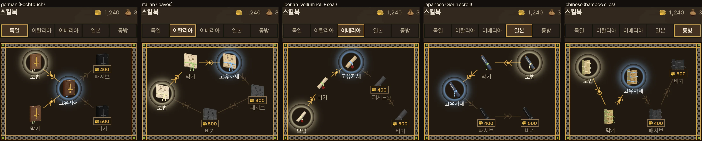
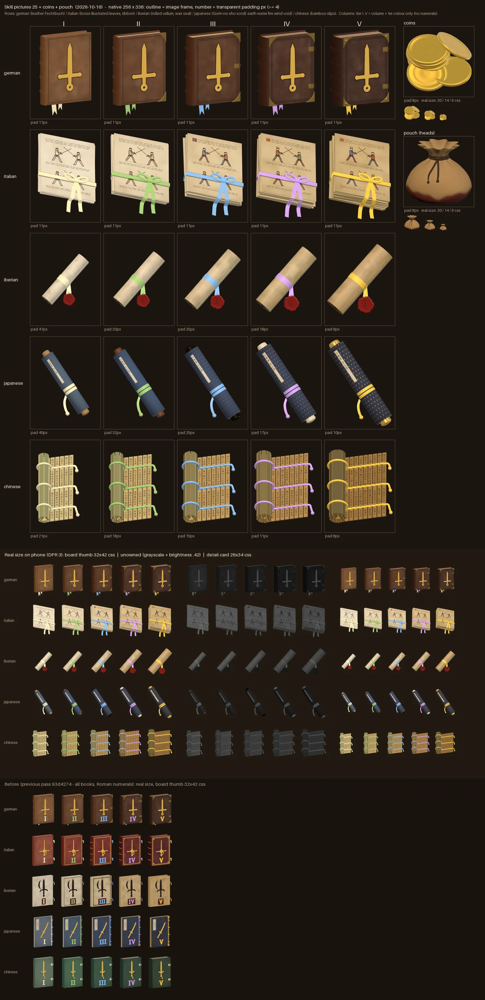
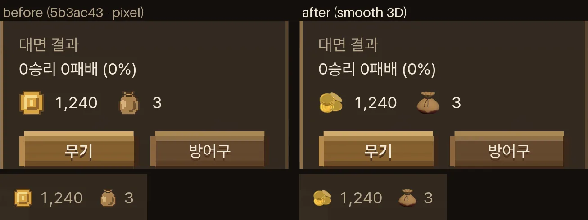
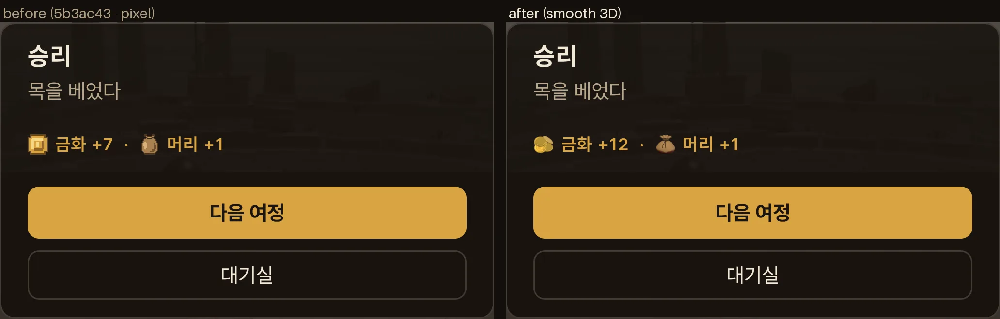
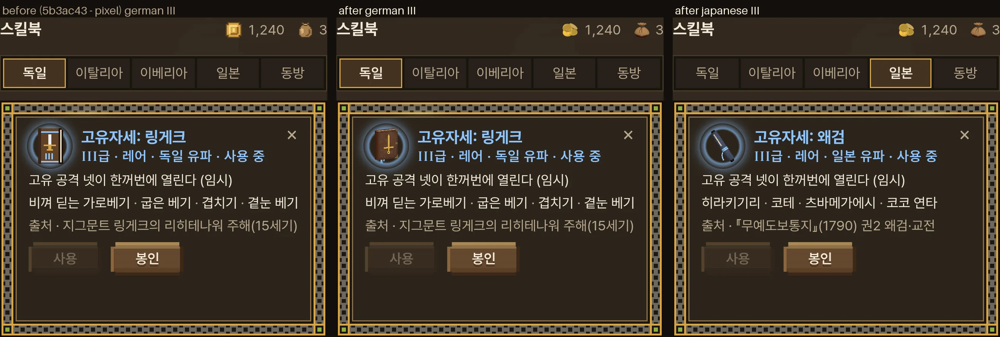

# 아이템 그림 매끈하게 — 스킬북 25 · 금화 · 머리 (2026-10-16)

- 지시 (사장님 원문):
  - 14:4x ③ "특히 스킬북을 포함해서 케틀 햇 같은 걸 보면 나중에 만들어진 아이템 섬네일이 해상도가 떨어지거든? 원래 만든 것은 좀 더 매끄럽고 고화질인데 원래가 더 좋아보여 난."
  - 15:3x ⑦ "금화와 주머니도 매끈하게 해. 동전이 여러 개 비정형적으로 쌓인 모습이면 더 좋겠어." · ⑧ "주머니는 아래가 살짝 피에 젖어 있게 해." · ⑨ "내가 적은 것 이외에 네가 쓴 '1단계' 작업해" (감독 검토의 1 단계 — 스킬북 그림을 무기 그림과 같은 방식으로)
  - 16:1x "그리고 스킬북 25장 각기 다르게 그려야 하는데, 모든 디테일이 계속 다르긴 어려울테니, 유파별로 스킬북을 그리고 급수 별로 종이나 표지 색, 끈 색, 볼륨 등의 디테일을 달리 표현해. 무기 섬네일이 그렇듯, 기본적으로는 스킬북도 사실성을 가진 외형이었음 좋겠어."
  - 17:3x "전부 책이라 어색하다. 말린 양피지나 서류더미처럼 여러 가지 형태를 써서 다양성을 주고 싶어. 로마자는 빼도 돼. 볼륨과 색깔만으로도 충분히 표현되는 듯."
  - 17:4x "일본의 가짜 글짜는 좋은데? 어차피 글자가 읽히지 않을 정도로 작기 때문에... 실제 오륜서를 모티브로 해봐. 동방 책도 실제 책을 모티브로... 그래 동방 죽간 좋다."
- 감독 계획 (17:4x 뒤): 유파마다 실제 옛 물건을 본뜬 문서 꼴 하나 — 윤곽 다섯이 다르게. 급 I~V 는 볼륨과 색만(로마 숫자는 모두 뺀다). 금화 · 주머니는 승인 — 그대로.
- 스타일 규칙: `docs/design_language.md` 머리 · §5 '겉은 픽셀, 속은 매끈' — 아이템 · 재화 그림은 '속' → 매끈한 고화질, 무기 그림과 같은 집안. 진단: `docs/design/ui_unify_2026-10-16.md` §2.
- 가지 `…/item-art-2q36ha` (바탕 5b3ac43 · 앞 작업자가 멈춘 자리 93d4274 를 이어 받음). 값 · 자리는 `docs/strike/owner_defaults_table.md` **1960~1969** — 사장님 말로 정한 것은 '사장님 결정', 작업자 · 감독이 고른 꼴 · 색 · 볼륨은 '사장님 확인 전'.
- 다른 가지(화면 — `…/ui-unify-2q36ha`)가 `src/lobby.css` · `src/start_pixel.css` · `src/start_screen.css` · `src/entrance_type.css` · `src/entrance_ui.css` · `src/lobby.js` · `src/start_screen.js` · `src/lobby_progress.js` · `src/game_entry.js` 를 고치고 있어 그 파일들은 안 건드렸다 — 필요한 CSS 는 §6 메모.
- 그림만 바꿨다. 싸움 · 시뮬은 그대로(관문 일곱은 병합 때 감독이 돌림).

## 0. 한눈에

| 사장님 말 | 한 것 | 파일 |
|---|---|---|
| ③ 나중 섬네일이 해상도가 떨어진다 · ⑨ 1 단계 | 스킬북 · 금화 · 머리를 무기 그림과 같은 방식(3D 로 찍은 매끈한 그림)으로 | `tools/browser/item_thumbs.mjs` |
| 16:1x 유파별로 · 급마다 종이 · 색 · 끈 · 볼륨 · 사실적 | 유파마다 한 꼴 · 급마다 볼륨 · 끈 색 · 재료 | `public/ui/books/<유파>_<급>.webp` |
| 17:3x 전부 책이라 어색 · 말린 양피지 · 서류 더미 · 로마자 빼기 | 문서 꼴 다섯(책 · 낱장 묶음 · 말린 양피지 · 두루마리 · 죽간) · 숫자 0 | §2 |
| 17:4x 가짜 글자 좋음 · 실제 오륜서 · 동방 죽간 | 일본 = 『五輪書』 두루마리 다섯 권(地 · 水 · 火 · 風 · 空) · 동방 = 銀雀山 『孫子兵法』 죽간 · 작은 글자(진짜 한자) | §2-1 |
| ⑦ 금화 매끈 · 비정형 더미 · ⑧ 주머니 아래 살짝 피 | 그대로(승인) — 이번에 다시 안 찍음 | `public/ui/wallet/coins.webp` · `pouch.webp` |
| (코드) 같은 고리 · 클래스 · 파일 이름 | 그대로 — 그림 파일만 바뀜 | `src/skill_tree.js`(주석만) |

## 1. 그림 도구 — `tools/browser/item_thumbs.mjs`

- 무기 카드 그림 도구(`tools/browser/weapon_thumbs.*`)와 같은 짜임이다. 쪽(`item_thumbs.html` + `item_thumbs_page.js`)이 Three.js 로 모형을 짓고 찍어 `window.thumbs` 에 담는다. 노드 스크립트가 그것을 파일로 저장한다.
- 같은 집안으로 맞춘 것:
  - 빛 넷: 반구 1.3 · 해 1.8 · 뒤 윤곽 0.6 · 카메라 쪽 윤 1.0. 무기 그림 · 케틀 햇 그림과 같은 값이다.
  - 금속(금박 · 놋쇠 · 금 축 머리): `src/weapon_looks.js` `metalMat` (무기 반사 환경).
  - 카메라와 저장: 정사영 카메라 · 두 배로 그려 곱게 줄임 · webp 품질 0.86 · 투명 바탕.
- 겉감은 캔버스 결로 그린다: 가죽 낟알 · 양피지 얼룩 · 낱장 그림 · 비단 무늬 · 대쪽 결과 먹 글자.
- 한자(제목 쪽지 · 죽간 글자)는 이 컴퓨터의 한자 글꼴(IPAGothic · WenQuanYi)로 쓴다. 256 px 그림에서도 한 글자가 몇 px 라 화면에선 먹 점 줄로 보인다(사장님 17:4x '어차피 글자가 읽히지 않을 정도로 작기 때문에'). 글꼴이 없는 곳에서 다시 찍으면 네모가 찍히니 그림 판으로 확인한다.
- 실행:
  - 개발 서버 `npx vite --port 5251` 을 띄운다.
  - `node tools/browser/item_thumbs.mjs http://127.0.0.1:5251 books` — 스킬북 25 장을 `public/ui/books` 에 저장한다(금화 · 머리는 `coins` · `pouch` — 이번엔 안 찍음).
  - `node tools/browser/item_thumbs.mjs http://127.0.0.1:5251 japanese_3` — 한 장만. `--out=<폴더>` — 다른 곳에 시험 저장.
  - 브라우저로 `/tools/browser/item_thumbs.html` 을 열면 그림과 실제 화면 크기를 눈으로 볼 수 있다.
- **자리 점검** (못 넘으면 저장은 하되 실패로 끝남): 투명 여백 ≥ 4 px — 물건 · 늘어진 끈이 그림 틀에 닿지 않게(사방). 앞 작업의 '급 숫자 여백 · 문양-숫자 틈' 점검은 숫자가 없어져 뺐다.
- 걸리는 시간: 25 장에 약 2.5 분(소프트웨어 GL).

## 2. 스킬북 25 장 — `public/ui/books/<유파>_<급>.webp`

- **크기 256 × 336.** 책 칸 `.book-thumb` 32 × 42 css(설명 카드 26 × 34)와 같은 비다. `.book-svg` 는 칸을 가로 · 세로 100 % 로 채운다(`src/lobby.css` — 이번에 못 고치는 파일, 화면 가지에서도 그대로). 그래서 정사각형 256 × 256 이면 세로로 1.31 배 찌그러진다 — 비를 칸에 맞췄다. 사방 투명 여백은 그대로 둔다(8~42 px).
- **틀.** 유파마다 다섯 장(I~V)을 담는 한 틀(같은 배율)로 찍는다. 한 유파 안에서 급마다 볼륨 차이가 그대로 크기로 보인다. 유파끼리는 저마다 칸을 채운다(별자리 판은 유파 탭 하나씩 보여 준다).

### 2-1. 문서 꼴 다섯 (사장님 17:3x '여러 가지 형태' · 17:4x '실제 … 모티브')

| 유파 | 꼴 (본뜬 실제 물건) | 겉감 · 모양 | 등급 색 자리 | 놓는 방향 |
|---|---|---|---|---|
| 독일 | **가죽 펜히트부흐** — 탈호퍼 사본 같은 15 세기 검술 책 | 나무 판자에 씌운 갈색 송아지 가죽 · 둥근 책등 띠 넷 · 민무늬 눌린 테 · 놋쇠 귀 · 걸쇠 · 금박 롱소드 문양 (앞 작업 책 그대로, 숫자만 뺌 — 문양은 가운데로 조금 크게) | 가름끈 둘 (책 아래로 늘어짐) | 선 책 3/4 |
| 이탈리아 | **그림 있는 낱장 묶음** — 피오레 데이 리베리 『Fior di Battaglia』 사본의 낱장 | 크림 양피지 낱장이 조금씩 어긋나고 기울어 쌓임 · 맨 위 장에 맞선 두 검사 그림 두 줄(펜 선 + 옅은 채색 · 스승은 금관) · 글 줄 | 가로로 감은 리본 + 나비 매듭 (꼬리가 아래 모서리를 넘어 늘어짐) | 탁자에 놓인 묶음을 앞 위에서 |
| 이베리아 | **말린 양피지** — 스페인 검술 사범 시험 증서 carta de examen | 크림 양피지 두루마리 · 말린 끝에 감긴 겹 · 바깥 끝 가장자리 | 가운데 리본 + 리본 두 끝에 매단 **붉은 밀랍 인장**(인장에 몬탄테 문양) — 인장은 늘 붉은색(유파 표지) | '/' (가로에서 44°) |
| 일본 | **『五輪書』 두루마리(巻物)** — 미야모토 무사시. 급 I **地之巻** · II **水之巻** · III **火之巻** · IV **風之巻** · V **空之巻** | 비단 겉감 · 양 끝 축 머리 · 바깥 끝 대나무 살 · 축을 따라 붙은 제목 쪽지(題簽) — 진짜 글자 '五輪書 ○之巻' | 나란히 두 번 감은 납작한 끈 + 늘어진 끝(끝 매듭) | '\' — 이베리아와 반대로 눕혀 작은 크기에서도 두 두루마리가 갈린다 |
| 동방 | **죽간(竹簡)** — 銀雀山 한나라 무덤 『孫子兵法』 대쪽 | 누런 대쪽(등은 푸르스름한 대 껍질) · 왼쪽은 말린 뭉치 · 오른쪽은 펼친 대쪽 · 대쪽마다 먹 글자 한 줄 — 진짜 글자 「始計篇」 '孫子曰兵者國之大事…'(오른쪽 첫 대쪽부터 · 끈 자리는 비움) | 엮은 끈 셋 (뭉치 겉을 감고 · 오른쪽 끝에서 늘어짐 · 끝 매듭) | 탁자에 놓인 죽간을 앞 위에서 |

- 작은 크기에서 먼저 눈에 드는 것은 윤곽과 빛깔이다: 짙은 갈색 선 책 · 크림 네모 묶음과 나비 매듭 · 크림 막대와 붉은 점 · 쪽빛 막대와 축 머리 · 누런 줄무늬 판. 안 산 책(회색 · 어둡게)에서도 윤곽으로 갈린다(그림 판 가운데 띠).
- 앞 작업의 제목 쪽지는 '빈 쪽지'였다(감독 17:0x '뜻 없는 글자 꼴은 어색하다'). 사장님 17:4x 로 바뀌어 쪽지 · 대쪽에 작은 진짜 한자를 썼다.

### 2-2. 급 다섯 — 볼륨 + 색만 (사장님 17:3x '로마자는 빼도 돼. 볼륨과 색깔만으로')

| | I 커먼 | II 언커먼 | III 레어 | IV 에픽 | V 레전드 |
|---|---|---|---|---|---|
| 등급 색 (끈 · 리본) | 크림 `--tier-common` | 풀색 `--tier-uncommon` | 파랑 `--tier-rare` | 보라 `--tier-epic` | 금 `--tier-legend` |
| 독일 볼륨 (쪽 두께) | 0.09 | 0.13 | 0.17 | 0.21 | 0.25 |
| 이탈리아 볼륨 (쌓인 높이 · 장 묶음) | 0.035 · 4 | 0.064 · 6 | 0.093 · 8 | 0.122 · 10 | 0.15 · 12 |
| 이베리아 볼륨 (길이 · 반지름) | 0.70 · 0.084 | 0.76 · 0.095 | 0.82 · 0.106 | 0.88 · 0.118 | 0.94 · 0.13 |
| 일본 볼륨 (길이 · 반지름) | 0.72 · 0.068 | 0.78 · 0.075 | 0.84 · 0.082 | 0.90 · 0.089 | 0.96 · 0.096 |
| 동방 볼륨 (펼친 · 말린 대쪽) | 6 · 12 | 7 · 16 | 8 · 20 | 9 · 25 | 10 · 30 |
| 독일 재료 | 밝은 송아지 가죽 · 쇠 없음 | 바깥 귀 | 짙은 가죽 · 걸쇠 하나 · 테 둘 | 네 귀 · 걸쇠 둘 · 금 가장자리 | 가장 짙은 가죽 · 귀 징 · 금 가장자리 |
| 이탈리아 재료 | 새 크림 종이 · 펜 선만 | 크림 · 옅은 채색 · 땅 선 | 바랜 양피지 · 푸른 · 붉은 채색 · 머리글자 | 더 바램 · 스승 금관 · 금 머리글자 | 가장 바램 · 금관 둘 |
| 이베리아 재료 | 새 흰빛 양피지 | 상아 | 따뜻한 양피지 | 바랜 금빛 · 바깥 끝 금 테 | 가장 바램 · 금 테 · 인장이 가장 큼 |
| 일본 재료 (겉감 · 축 머리) | 쪽빛 종이 · 밝은 나무 | 쪽빛 비단 · 짙은 나무 | 무늬 비단 · 검은 옻칠 | 금빛 무늬 · 상아 · 쪽지 금박 조각 | 금빛 무늬 짙게 · 금 · 쪽지 금박 조각 |
| 동방 재료 (대 빛깔) | 새 대 빛 | 누런 대 | 호박빛 | 짙은 호박빛 | 가장 짙은 호박빛 · 옻칠 윤 |

- 모형 단위는 표지 · 장 높이 약 1 이다.
- 급 I 이 칸에서 너무 작으면 읽기 어려워, 이베리아 · 일본 · 동방은 I 과 V 의 차이를 좁혔다(첫 시안의 I 은 V 의 길이 약 2/3 · 굵기 약 1/2 → 길이 약 3/4 · 굵기 약 2/3 · 동방 대쪽 5 → 6).
- **끈 끝을 물건 밖으로**: 크림(커먼) 끈은 밝은 종이 · 양피지 위에서 묻힌다. 그래서 모든 유파의 등급 색 끈은 한 끝이 물건 밖 — 어두운 칸 바탕 위 — 으로 나오게 했다(가름끈 · 리본 꼬리 · 인장 끈 · 두루마리 끈 끝 · 죽간 끈 끝). 끈은 살짝 스스로 빛나게(0.16) 해 작은 크기에서 색이 죽지 않는다.

### 2-3. 읽힘 점검 — 실제 크기 (폰 화소 비 3)

- 그림 판 위쪽: 원래 크기 256 × 336 — 테두리 선 = 그림 틀, 아래 숫자 = 투명 여백 px.
- 가운데 띠: 실제 폰 크기 — 별자리 책 칸 32 × 42 css(= 96 × 126 화소) · 안 산 책(회색 · 어둡게 — `grayscale(1) brightness(.42)`) · 설명 카드 26 × 34 css.
- 맨 아래 띠: 전(앞 작업 93d4274 — 모두 책 · 로마 숫자) 실제 크기.
- 본 것:
  - 유파 다섯이 윤곽 · 빛깔로 갈린다.
  - 급은 크기(볼륨)와 끈 색으로 갈린다. 회색에서도 크기는 남는다.
  - 고친 것: 첫 시안의 이탈리아 검사가 막대 사람처럼 보여 펜 선 + 채색 사람으로 · 일본 쪽지가 옆을 봐 카메라 쪽으로 · 나선 끈이 끊겨 보여 나란한 두 바퀴로 · 죽간 끈 끝이 갈고리처럼 말려 늘어진 끝 + 매듭으로 · 급 I 이 너무 작아 볼륨 폭을 좁힘 · 일본 I · II 가 붓처럼 가늘어 조금 굵게.

- 판 만들기: `python3 tools/browser/itemart_sheet.py sheet public/ui docs/handoff/itemart_sheet.webp <전 그림 폴더>`

## 3. 금화 · 머리 — `public/ui/wallet/` (승인 — 그대로)

- 이번에 다시 찍지 않았다. 파일은 앞 작업(ac17984) 그대로다.
- **금화** `coins.webp` (256 × 256) — 여덟 닢: 뒤 왼쪽 다섯 닢이 조금씩 어긋나 쌓임 · 그 윗모서리에 약 40° 로 기댄 한 닢 · 앞에 흩어진 두 닢. 금 `metalMat` #f0b840 · 약 45° 내려다봄.
- **머리(천 주머니)** `pouch.webp` (256 × 256): 불룩한 아마 천 주머니 · 목을 두 번 감은 가죽 끈 · 늘어진 두 가닥. **피**(⑧ '살짝'): 바닥에서 스며 오른 짙은 빨강 #701a14 → 바닥 #3a0d0b · 높이 약 22 % · 흘러내림 없음.
- 화면 크기: 대기실 지갑 20 px(낮은 가로 18 px) · 스킬북 칸 위 지갑 14 px · 결과 창 14 px · 스킬북 값 표지 9 px.

## 4. 코드 — 고리 · 클래스 · 파일 이름 그대로

| 파일 | 바뀐 것 |
|---|---|
| `src/wallet_icons.js` | (앞 작업) `COIN_ICON` · `POUCH_ICON` = `` · 주소 `COIN_SRC` · `POUCH_SRC` |
| `src/skill_tree.js` | (앞 작업) 책 = `_<급>.webp" alt="" aria-hidden="true">` · 값 표지 금화 = ``. 이번엔 그림 설명 주석만 고침(문서 꼴 다섯 · 숫자 없음) |
| `src/main.js` `showRewardLine` · `index.html` | (앞 작업) 결과 창 그림 = 꾸밈 img · `.reward img` |

- `.book-node[data-state=unowned] .book-thumb` 의 `filter: grayscale(1) brightness(.42)` 는 그림에도 그대로 먹는다(안 산 책 = 어둡게). '사용' 둥근 빛도 그대로다.

## 5. 사진

- 찍은 조건: 폰 가로 844 × 390 · 화소 비 3 · 터치. 저장 상태: 금화 1,240 · 머리 3 · 유파마다 I · II · III 삼(II 봉인).
- 전 = 5b3ac43(픽셀 그림 — 앞 작업자가 찍은 사진을 다시 씀) · 후 = 이 가지 마지막 빌드.

  | 장면 | 파일 |
  |---|---|
  | 별자리 판 독일 (사용 · 봉인 · 안 삼 + 값 표지) 전 · 후 | `docs/handoff/itemart_tree.webp` |
  | 별자리 판 유파 다섯 (후) | `docs/handoff/itemart_tree_schools.webp` |
  | 설명 카드 (독일 III 전 · 후 + 일본 III 후) | `docs/handoff/itemart_detail.webp` |
  | 대기실 지갑 전 · 후 | `docs/handoff/itemart_wallet.webp` |
  | 결과 창 (이긴 판 금화 + 머리) 전 · 후 | `docs/handoff/itemart_result.webp` |
  | 그림 판 (25 장 + 금화 + 머리 · 원래 크기 · 실제 크기 · 전) | `docs/handoff/itemart_sheet.webp` |

- **대기실 지갑 사진의 '후'** 는 화면 가지가 지우는 `lobby.css` `.coin-icon { image-rendering: pixelated }` 를 사진 도구에서만 끈 모습이다(`--lobby-smooth`). 합친 뒤의 모습을 미리 보려는 것이다(화면 가지 lobby.css 에서 그 줄이 빠진 것을 확인). 이 가지만으로는 지갑 그림이 계단지게 줄어든다.
- 화면 가지는 별자리 사슬 틀을 `.skill-tree-host` 로 옮긴다. 합친 뒤 판 둘레 모습은 이 사진과 조금 다르다 — 그림 자체는 같다.
- 도구:
  - 찍기: `node tools/browser/itemart_capture.mjs <주소> <폴더> [--lobby-smooth]`
  - 판 만들기: `python3 tools/browser/itemart_sheet.py scenes <전> <후> docs/handoff`

## 6. CSS 메모 (감독께 — 이번에 못 고친 파일)

1. `src/lobby.css` `.book-edge` · `.book-pages` · `.book-cover` · `.book-spine` · `.book-band` · `.book-numeral` · `.emblem-blade` · `.emblem-hilt` 는 이제 쓰는 곳이 없다(책이 그림이 됨). 지워도 된다.
2. `src/lobby.css` `.coin-icon { image-rendering: pixelated }` — 화면 가지에서 빠졌다. 두 가지를 다 합치면 매끈하다.
3. (고를 것) `.book-svg, .price-coin, .coin-icon { pointer-events: none; -webkit-touch-callout: none }`. iOS 에서 그림을 길게 누르면 '이미지 저장' 메뉴가 뜰 수 있다. 무기 칸 그림 `.inventory-item img` 은 이미 `pointer-events: none` 이다.
4. 정사각형 그림을 원하면 `.book-svg` 에 `object-fit: contain` 을 넣고 `--q=bookh=256` 으로 다시 찍는다. 다만 물건이 칸에서 약 25 % 작아지므로 권하지 않는다.

## 7. 점검

- 빌드 (내 폴더 — 감독 폴더 · 5173/5174 안 씀 · Vite 캐시도 따로 둔 설정 파일):
  - `npx vite build --outDir /tmp/agent-itemart2/dist`
  - `node tools/pwa/build.mjs /tmp/agent-itemart2/dist`
  - 미리 보기: `npx vite preview --outDir … --port 5252`
- 그림이 실제로 읽히는지(`complete` · `naturalWidth` 256 · 책 세로 336)는 앞 작업이 넣은 점검이 그대로 본다: `ui_fix_smoke`(결과 창) · `lobby_fix_smoke` ③⑤(지갑 · 책 다섯 · 값 표지 · 설명 카드 · 결과 창) · `skill_tree_layout` ④(유파 다섯 = 25 장 모두).
- 점검 여섯은 마지막 빌드(`/tmp/agent-itemart2/dist` — 일본 두루마리를 조금 굵게 다시 찍은 뒤)에서 돌렸다. 모두 통과 · 콘솔 에러 0.
- 기계가 바쁠 때(다른 작업의 브라우저까지 4 코어에 부하 약 10) `lobby_fix_smoke` 가 세 번 그림과 상관없는 싸움 기다림(카드 → 싸움 · 진 판 → 결과 창 · 목 벰 → 결과 창, 각 30 s)에서 멈췄다. 멈춘 자리가 매번 달랐고, 그림 점검(③)은 그 앞에서 늘 통과했다. 부하가 내려간 뒤 혼자 돌려 11 개 모두 통과했다.

| 점검 | 결과 (마지막 빌드) |
|---|---|
| ui_fix_smoke | PASS 7 · errors 0 — 결과 창 금화 그림이 읽힘(256) · 14 px · 꾸밈 |
| lobby_fix_smoke | PASS 11 · errors 0 — 지갑 금화 · 머리(alt · 18 px · 칸 14 px) · 일본 책 다섯(32 px · 세로 336) · 값 표지 금화 다섯(9 px) · 설명 카드(26 px) · 도트 svg 0 · 결과 창 금화 + 주머니(14 px) |
| lobby_equipment_smoke | PASS 11 · errors 0 |
| skill_tree_layout | PASS — 유파 다섯 × 화면 여섯 겹침 없음 · 룬 줄 비킴 · 책 그림 25 장 + 값 표지 금화가 그 유파 주소로 읽힘 |
| no_seals_smoke | PASS 7 · errors 0 |
| title_smoke | PASS 16 · errors 0 |

## 8. 사장님께 여쭐 것

1. 유파마다 고른 문서 꼴 다섯(§2-1) — 특히 이탈리아 '그림 낱장 묶음'과 이베리아 '말린 양피지 + 붉은 인장'.
2. 급 표시(§2-2): 볼륨이 급마다 커지는 폭(급 I 은 V 의 약 3/4)과 끈 색. 이베리아 인장은 급과 상관없이 늘 붉은색으로 두었다(유파 표지).
3. 일본 다섯 권 = 地 · 水 · 火 · 風 · 空 차례로 급 I~V. 쪽지 · 죽간 글자는 진짜 한자(오륜서 권 이름 · 손자병법 始計篇) — 화면에선 읽히지 않는 먹 점이다.
4. 책 그림 비 256 × 336(책 칸과 같은 비 — §2, §6-4).
