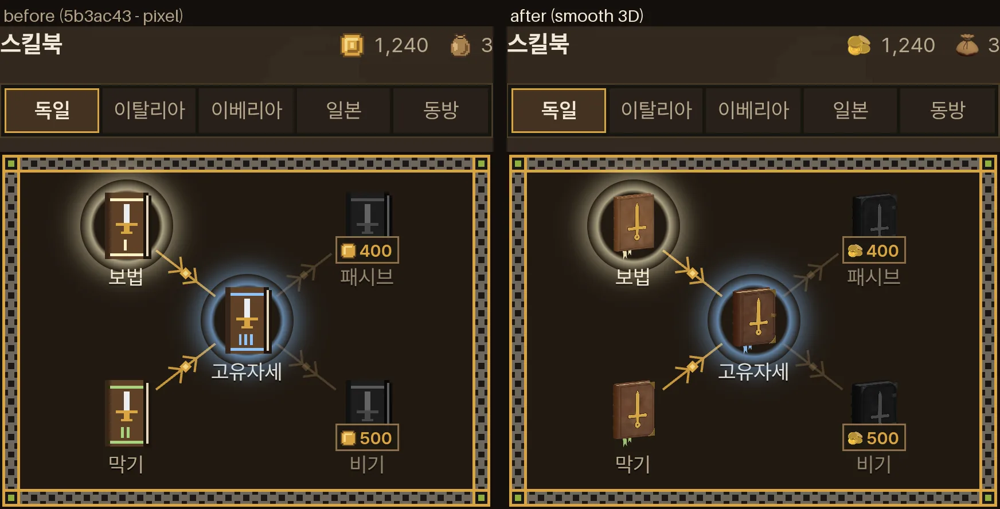

# 아이템 그림 매끈하게 — 스킬북 25 · 금화 · 머리 (2026-10-16)

- 지시 (사장님 원문):
  - 14:4x ③ "특히 스킬북을 포함해서 케틀 햇 같은 걸 보면 나중에 만들어진 아이템 섬네일이 해상도가 떨어지거든? 원래 만든 것은 좀 더 매끄럽고 고화질인데 원래가 더 좋아보여 난."
  - 15:3x ⑦ "금화와 주머니도 매끈하게 해. 동전이 여러 개 비정형적으로 쌓인 모습이면 더 좋겠어." · ⑧ "주머니는 아래가 살짝 피에 젖어 있게 해." · ⑨ "내가 적은 것 이외에 네가 쓴 '1단계' 작업해" (감독 검토의 1 단계 — 스킬북 그림을 무기 그림과 같은 방식으로)
  - 16:1x "그리고 스킬북 25장 각기 다르게 그려야 하는데, 모든 디테일이 계속 다르긴 어려울테니, 유파별로 스킬북을 그리고 급수 별로 종이나 표지 색, 끈 색, 볼륨 등의 디테일을 달리 표현해. 무기 섬네일이 그렇듯, 기본적으로는 스킬북도 사실성을 가진 외형이었음 좋겠어."
- 스타일 규칙: `docs/design_language.md` 머리 · §5 '겉은 픽셀, 속은 매끈' — 아이템 · 재화 그림은 '속' → 매끈한 고화질, 무기 그림과 같은 집안. 진단: `docs/design/ui_unify_2026-10-16.md` §2(스킬북 20 × 26 도트 · 금화 · 머리 16 × 16 도트).
- 가지 `…/item-art-2q36ha` (바탕 5b3ac43). 새 값 · 자리는 `docs/strike/owner_defaults_table.md` **1960~1969** — 사장님 말로 정한 것은 '사장님 결정', 작업자가 고른 것(각도 · 색 · 닢 수 · 피 높이 · 책 꼴)은 '사장님 확인 전'.
- 같은 시간에 다른 작업자(2 단계 — 화면)가 `src/lobby.css` · `src/start_pixel.css` · `src/start_screen.css` · `src/entrance_type.css` · `src/lobby.js` · `src/start_screen.js` · `src/lobby_progress.js` 를 고치고 있어 그 파일들은 안 건드렸다 — 필요한 CSS 는 §6 메모.
- 그림만 바꿨다. 싸움 · 시뮬은 그대로(관문 일곱은 병합 때 감독이 돌림).

## 0. 한눈에

| 사장님 말 | 한 것 | 파일 |
|---|---|---|
| ③ 나중 섬네일이 해상도가 떨어진다 · ⑨ 1 단계 | 스킬북 그림을 무기 그림과 같은 방식(3D 로 찍은 매끈한 그림)으로 25 장 | `public/ui/books/<유파>_<급>.webp` · `tools/browser/item_thumbs.mjs` |
| 16:1x 유파별 책 · 급마다 종이 · 표지 색 · 끈 색 · 볼륨 · 사실적 | 유파마다 책 꼴 하나(펜히트부흐 · 모로코 가죽 · 양피지 · 和綴じ · 천 갑) · 급마다 종이 · 표지 · 두께 · 쇠붙이 · 금박 · 등급 색 끈 | §2 |
| ⑦ 금화 매끈 · 여러 개가 비정형으로 쌓인 모습 | 금화 여덟 닢 — 다섯 쌓임 · 하나 기댐 · 흩어진 둘 | `public/ui/wallet/coins.webp` |
| ⑦ 주머니 매끈 · ⑧ 아래가 살짝 피에 젖음 | 천 주머니 · 아래에서 스며 오른 짙은 빨강(높이 약 22 %) | `public/ui/wallet/pouch.webp` |
| (코드) 같은 고리 · 클래스 | 대기실 지갑 · 결과 창 · 별자리 책 · 값 표지 · 설명 카드가 새 그림을 씀 | `src/wallet_icons.js` · `src/skill_tree.js` · `src/main.js` · `index.html` |

## 1. 그림 도구 — `tools/browser/item_thumbs.mjs`

- 무기 카드 그림 도구(`tools/browser/weapon_thumbs.*`)와 같은 짜임이다. 쪽(`item_thumbs.html` + `item_thumbs_page.js`)이 Three.js 로 모형을 짓고 찍어 `window.thumbs` 에 담는다. 노드 스크립트가 그것을 파일로 저장한다.
- 같은 집안으로 맞춘 것:
  - 빛 넷: 반구 1.3 · 해 1.8 · 뒤 윤곽 0.6 · 카메라 쪽 윤 1.0. 무기 그림 · 케틀 햇 그림과 같은 값이다.
  - 금속: `src/weapon_looks.js` `metalMat` (무기 반사 환경).
  - 카메라와 저장: 정사영 카메라 · 두 배로 그려 곱게 줄임 · webp 품질 0.86 · 투명 바탕.
- 실행:
  - 개발 서버 `npx vite --port 5251` 을 띄운다.
  - `node tools/browser/item_thumbs.mjs http://127.0.0.1:5251` — 27 장을 `public/ui/books` · `public/ui/wallet` 에 저장한다.
  - `node tools/browser/item_thumbs.mjs http://127.0.0.1:5251 coins pouch german_3` — 몇 장만 찍는다. `books` 는 책 25 장 모두.
  - `--out=<폴더>` — 다른 곳에 시험 저장. `--q='by=0.6&bx=0.25'` — 구도 시험값(쪽 머리말).
  - 브라우저로 `/tools/browser/item_thumbs.html` 을 열면 256 px 그림과 실제 화면 크기를 눈으로 볼 수 있다.
- **자리 점검** (감독 16:09 요청 — 못 넘으면 저장은 하되 실패로 끝남):
  - 투명 여백 ≥ 4 px — 물건이 그림 틀에 닿지 않게.
  - 급 숫자(이베리아는 숫자 딱지까지)가 표지 안으로 ≥ 0.035 — 책 높이 1 기준, 256 px 그림에서 약 9 px.
  - 문양 아래 끝과 숫자 위 끝 사이 ≥ 0.015.
  - 눌린 자국 테까지 넣은 '보이는 넓이'로 잰다.
- 걸리는 시간: 27 장에 약 2.5 분이다(소프트웨어 GL — 컴퓨터가 바쁘면 5 분).

## 2. 스킬북 25 장 — `public/ui/books/<유파>_<급>.webp`

- **크기 256 × 336.** 책 칸 `.book-thumb` 32 × 42 css(설명 카드 26 × 34)와 같은 비다.
  - `.book-svg` 는 칸을 가로 · 세로 100 % 로 채운다(`src/lobby.css` — 이번에 못 고치는 파일). 그래서 정사각형 그림이면 세로로 1.31 배 늘어난다.
  - 256 px 칸 판에 늘어놓고 보면 그림 아래쪽이 다음 줄에 가려 숫자가 잘린 것처럼 보인다. 파일은 안 잘렸다 — §2-3 점검 · 그림 판의 테두리 선.
- **보는 각도 3/4.** 책등(왼쪽)이 보이게 0.5 rad 돌리고, 윗면(쪽 가장자리)이 보이게 0.2 rad 숙인다.
- **틀.** 유파마다 다섯 권(I~V)을 담는 한 틀로 찍는다.
  - 한 유파 안에서는 표지가 같은 자리 · 같은 배율이라 급마다 두께 차이가 그대로 보인다.
  - 유파끼리는 저마다 칸을 채운다. 별자리 판은 유파 탭을 하나씩 보여 준다.
- 유파 문양은 옛 `EMBLEMS`(12 × 12 도트 칼 다섯)를 매끈한 모양으로 다시 그렸다.
  - 금박은 같은 모양을 조금 넓힌 짙은 '눌린 자국' 위에 올렸다. 작은 크기에서 금이 표지에 안 묻히게 하려는 것이다.
  - 칼날 가운데에는 등줄을 한 겹 더 올렸다.

### 2-1. 유파 다섯 (사장님 16:1x '유파별로 스킬북을 그리고')

| 유파 | 책 꼴 (본뜬 것) | 표지 | 등급 색 끈 | 문양 |
|---|---|---|---|---|
| 독일 | 펜히트부흐 — 나무 판자에 씌운 가죽 · 둥근 책등 띠 넷 · 민무늬로 눌러 찍은 테 · 놋쇠 귀 · 걸쇠 | 갈색 송아지 가죽 | 가름끈 (책 아래로 늘어짐) | 금박 롱소드 |
| 이탈리아 | 르네상스 논고 — 붉은 모로코 가죽 · 얇은 판자 · 납작한 책등 · 금박 틀 | 붉은 가죽 | 앞마구리 비단 끈 둘 | 금박 레이피어 |
| 이베리아 | 데스트레사 논고 — 판자 없는 부드러운 양피지(쪽보다 조금 큼) · 둥근 책등 · 숫자 밑 가죽 딱지 | 크림색 양피지 | 앞마구리 가죽 끈 둘 (끝 매듭) | 먹 몬탄테 — 밝은 양피지 위에선 금박보다 먹이 작은 크기에서 읽힌다 |
| 일본 | 和綴じ(四つ目綴じ) — 판자 없는 종이 표지 · 오른쪽을 실로 꿰맴 · 왼쪽 위 제목 쪽지(가는 테와 바랜 붓 자국 하나 — 글자는 쓰지 않음, 감독 17:0x 확인 '뜻 없는 글자 꼴은 어색하다' → 빈 쪽지) · 왼쪽은 종이 겹 | 쪽빛 종이 | 꿰맨 실 | 금박 우치가타나 |
| 동방 | 線裝 책을 담은 천 갑(函套) — 천 씌운 판자 넷 · 위아래가 열려 안의 책 머리가 보임 · 오른쪽 뼈 걸쇠 둘 | 초록 천 — 쪽빛이면 일본 책과 작은 크기에서 섞인다 | 걸쇠를 감은 끈 | 금박 검(지엔) |

- 가장 먼저 눈에 드는 것은 표지 색 · 겉감이다. 갈색 가죽 · 붉은 가죽 · 크림 양피지 · 쪽빛 종이 · 초록 천 — 다섯이 폰 책 칸에서 한눈에 갈린다.
- 그 다음은 윤곽이다. 판자 책 · 얇은 종이 책 · 갑, 그리고 끈 · 걸쇠의 자리.

### 2-2. 급 다섯 (사장님 16:1x '급수 별로 종이나 표지 색, 끈 색, 볼륨 등의 디테일을 달리')

| | I 커먼 | II 언커먼 | III 레어 | IV 에픽 | V 레전드 |
|---|---|---|---|---|---|
| 종이 (유럽 책) | 새 크림 | 크림 | 바랜 상아 | 금 가장자리 | 금 가장자리 |
| 종이 (일본 · 동방) | 흰 한지 | 크림 | 상아 | 바랜 황갈 | 더 바랜 황갈 |
| 표지 | 가장 밝게 | ← | 급이 오를수록 짙고 깊게 | → | 가장 짙게 |
| 두께 (쪽 · 책 높이 1 기준) | 독일 0.10 · 이탈리아 0.09 · 이베리아 0.08 · 일본 0.05 · 동방 1 권 | | 0.15 · 0.13 · 0.12 · 0.08 · 2 권 | | 0.20 · 0.17 · 0.16 · 0.11 · 4 권 |
| 독일 쇠붙이 | 없음 | 바깥 귀 | + 걸쇠 하나 · 테 둘 | 네 귀 · 걸쇠 둘 | + 귀 징 |
| 이탈리아 금박 | 민무늬 테 | 금 테 | 금 테 둘 · 책등 금줄 | + 네 귀 꽃 | 테 셋 · 큰 꽃 |
| 이베리아 | 맨 양피지 | 먹 테 | 먹 테 둘 | 금 테 | 금 테 둘 |
| 일본 | — | — | 귀 천 | 금빛 귀 천 · 금박 조각 종이 | 금박 조각 더 많이 |
| 동방 | — | — | — | 금빛 무늬 비단 | 무늬 더 진하게 |

- **등급 색**(index.html `--tier-*` · 언커먼은 `src/entrance_type.css` `--tier-uncommon`)은 두 군데에 나온다.
  - 급 숫자 I~V: 세리프 로마 숫자 · 표지 아래 · 눌린 자국 테.
  - 그 유파의 끈: 가름끈 · 비단 끈 · 가죽 끈 · 꿰맨 실 · 걸쇠 끈.
- 표지 색은 급마다 같은 집안 안에서 짙어진다. 그래서 유파는 색으로, 급은 숫자 · 끈 색으로 읽힌다.

### 2-3. 점검 — 숫자 자리 · 투명 여백 (감독 16:09 요청)

- `item_thumbs.mjs` 가 25 장 모두 확인했다. 기준과 지금 값:

  | 잰 것 | 기준 | 지금 값 |
  |---|---|---|
  | 투명 여백 | ≥ 4 px | 책 11~14 px · 금화 · 머리 8 px |
  | 급 숫자 여백 | ≥ 0.035 | 0.044(이베리아 — 딱지 포함) ~ 0.076 |
  | 문양-숫자 틈 | ≥ 0.015 | 0.020 ~ 0.051 |

- 그림 판 위쪽(원래 크기): 그림마다 테두리 선(= 그림 틀)과 세 값을 적었다. 아래쪽: 실제 폰 크기(화소 비 3) — 별자리 책 칸 · 안 산 책(어둡게) · 설명 카드.

- 판 만들기: `python3 tools/browser/itemart_sheet.py sheet public/ui docs/handoff/itemart_sheet.webp <item_thumbs.mjs 출력 로그>`

## 3. 금화 · 머리 — `public/ui/wallet/`

- **금화** `coins.webp` (256 × 256) — 여덟 닢:
  - 뒤 왼쪽에 다섯 닢이 조금씩 어긋나고 기울어 쌓였다.
  - 그 쌓임 윗모서리에 한 닢이 약 40° 로 기댔다.
  - 앞에 두 닢이 흩어졌다. 하나는 다른 닢 가장자리에 걸쳐 기울었다.
  - 동전 단면: 도드라진 테 · 안쪽 고리 · 가운데 볼록 · 깎은 옆면.
  - 금: `metalMat` #f0b840 · 거칠기 0.2 · 금속 0.9.
  - 약 45° 로 내려다본다. 작은 크기에서 동전 얼굴이 둥글게 읽히게 하려는 것이다.
- **머리(천 주머니)** `pouch.webp` (256 × 256):
  - 불룩한 아마 천 주머니 · 위로 벌어진 주름 · 목을 두 번 감은 가죽 끈 · 매듭 · 늘어진 두 가닥(끝 매듭).
  - **피**(⑧ '살짝'): 바닥에서 스며 오른 짙은 빨강 #701a14 → 바닥 #3a0d0b.
    - 높이는 주머니의 약 22 % 다.
    - 경계는 고르지 않게(물이 스며 오른 꼴), 경계에는 옅게 마른 띠를 두었다.
    - 흘러내림 · 방울은 없다. 감독 확인(16:09): '지금처럼 은은하게'.
- **화면 크기**:
  - 대기실 지갑 20 px(낮은 가로 18 px) · 스킬북 칸 위 지갑 14 px · 결과 창 14 px · 스킬북 값 표지 9 px.
  - 9 px 에서도 금빛 동전 더미로 읽힌다.

## 4. 코드 — 고리 · 클래스 그대로

| 파일 | 바뀐 것 |
|---|---|
| `src/wallet_icons.js` | `COIN_ICON` = `` · `POUCH_ICON` = `` · 주소 `COIN_SRC` · `POUCH_SRC` 를 내보낸다 — 대기실 지갑(lobby.js — 안 고침)이 그대로 읽는다 |
| `src/skill_tree.js` | 책 = `_<급>.webp" alt="" aria-hidden="true">` (별자리 · 설명 카드) · 값 표지 금화 = ``(꾸밈). 옛 도트 문양 `EMBLEMS` · 숫자 `NUMERAL` · 책 svg 코드는 다른 곳에서 안 써서 지웠다 (`SVG_NS` 는 룬 줄이 써서 둠) |
| `src/main.js` `showRewardLine` | 결과 창 그림은 꾸밈 — 빈 alt · `aria-hidden` (전과 같이 읽는 글 '금화 +12 · 머리 +1' 에서 뺀다) |
| `index.html` | `.reward svg` → `.reward img` · `image-rendering: pixelated` 뺌 (그 한 줄만) |

- `.book-node[data-state=unowned] .book-thumb` 의 `filter: grayscale(1) brightness(.42)` 는 그림에도 그대로 먹는다(안 산 책 = 어둡게). '사용' 둥근 빛도 그대로다.

## 5. 사진

- 찍은 조건: 폰 가로 844 × 390 · 화소 비 3 · 터치. 저장 상태: 금화 1,240 · 머리 3 · 독일 I · II · III 삼(II 봉인).
- 사진 넷 (왼쪽 전 = 5b3ac43 · 오른쪽 후):

  | 장면 | 파일 |
  |---|---|
  | 별자리 판 (사용 · 봉인 · 안 삼 + 값 표지) | `docs/handoff/itemart_tree.webp` |
  | 설명 카드 | `docs/handoff/itemart_detail.webp` |
  | 대기실 지갑 | `docs/handoff/itemart_wallet.webp` |
  | 결과 창 (이긴 판 금화 + 머리) | `docs/handoff/itemart_result.webp` |

- 그림 판 하나: `docs/handoff/itemart_sheet.webp` — 25 권 + 금화 + 머리, 원래 크기와 실제 크기.
- **대기실 지갑 사진의 '후'** 는 다른 작업자가 지우고 있는 `lobby.css` `.coin-icon { image-rendering: pixelated }` 를 사진 도구에서만 끈 모습이다(`--lobby-smooth`). 합친 뒤의 모습을 미리 보려는 것이다. 이 가지만으로는 그 줄이 남아 지갑 그림이 계단지게 줄어든다 — §6-2.
- 도구:
  - 찍기: `node tools/browser/itemart_capture.mjs <주소> <폴더> [--lobby-smooth]`
  - 판 만들기: `python3 tools/browser/itemart_sheet.py scenes <전> <후> docs/handoff`

## 6. CSS 메모 (감독께 — 이번에 못 고친 파일)

1. `src/lobby.css` 106~107 줄 `.book-edge` · `.book-pages` · `.book-cover` · `.book-spine` · `.book-band` · `.book-numeral` · `.emblem-blade` · `.emblem-hilt` 는 이제 쓰는 곳이 없다(책이 그림이 됨). 지워도 된다.
2. `src/lobby.css` `.coin-icon { image-rendering: pixelated }` — 다른 작업자가 지우는 중이다. 지우기 전에는 대기실 금화 · 머리 그림이 최근접으로 줄어 계단이 진다. 두 가지를 다 합치면 매끈하다.
3. (고를 것) `.book-svg, .price-coin, .coin-icon { pointer-events: none; -webkit-touch-callout: none }`. iOS 에서 그림을 길게 누르면 '이미지 저장' 메뉴가 뜰 수 있다. 무기 칸 그림 `.inventory-item img` 은 이미 `pointer-events: none` 이다. 책은 단추 안이라 눌림은 그대로 단추가 받는다.
4. 정사각형 책 그림을 원하면 두 가지를 같이 한다. 다만 책이 칸에서 약 25 % 작아지므로 권하지 않는다.
   - `.book-svg` 에 `object-fit: contain` 을 넣는다.
   - `node tools/browser/item_thumbs.mjs <주소> books --q=bookh=256` 으로 다시 찍는다.

## 7. 점검

- 빌드 (내 폴더 — 감독 폴더 · 5173/5174 안 씀):
  - `npx vite build --outDir /tmp/agent-itemart/dist` (Vite 캐시도 따로 둔 설정 파일)
  - `node tools/pwa/build.mjs /tmp/agent-itemart/dist`
  - 미리 보기: `npx vite preview --outDir … --port 5252`
- 고친 점검:
  - `ui_fix_smoke` — 결과 창 그림이 `img` · 실제로 읽힘(가로 256) · 14 px · 꾸밈(빈 alt · aria-hidden) · 옛 svg 0.
  - `lobby_fix_smoke` ③ — 지갑 둘(금화 · 머리 — alt) · 별자리 책 다섯(일본 I~V 주소 · 세로 336) · 값 표지 금화 다섯 · 설명 카드 책이 읽힘 · 도트 svg 조각 0.
  - `lobby_fix_smoke` ⑤ — 결과 창 금화 + 주머니 그림 · 14 px · 꾸밈.
  - `skill_tree_layout` ④ — 유파 다섯 × 화면 여섯에서 책 그림(25 장 모두)과 값 표지 금화가 그 유파 주소로 읽힘.
  - `resultfix_capture` — 그림 셈을 svg → img 로.

| 점검 | 결과 (최종 빌드) |
|---|---|
| ui_fix_smoke | (아래 채움) |
| lobby_fix_smoke | |
| skill_tree_layout | |
| lobby_equipment_smoke | |
| no_seals_smoke | |
| title_smoke | |

## 8. 사장님께 여쭐 것

1. 유파마다 고른 책 꼴 · 표지 색(§2-1). 특히 두 가지:
   - 동방은 초록 천 갑으로 했다. 쪽빛이면 일본 책과 작은 크기에서 섞인다.
   - 이베리아 문양은 금박 대신 먹으로 했다.
2. 급마다 달라지는 단계(§2-2): 종이(새 크림 → 금 가장자리) · 표지가 짙어짐 · 두께 · 쇠붙이 · 금박.
3. 금화 여덟 닢의 쌓임 · 내려다보는 각도, 그리고 주머니 피 높이(약 22 %)와 색.
4. 책 그림 비 256 × 336 (책 칸과 같은 비 — §2, §6-4).
