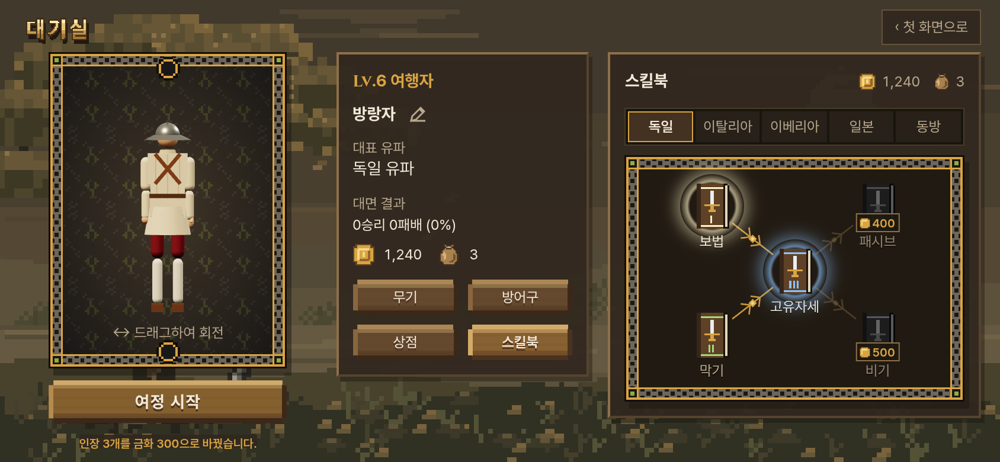
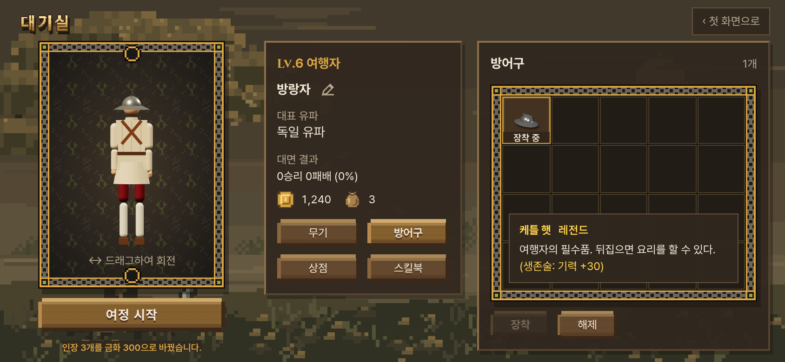
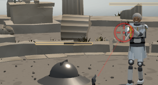
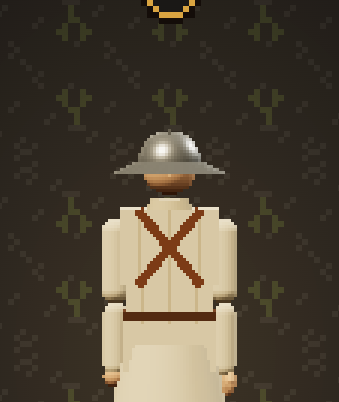
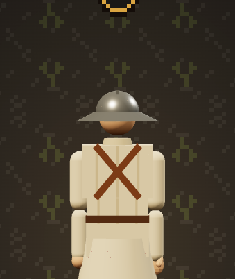
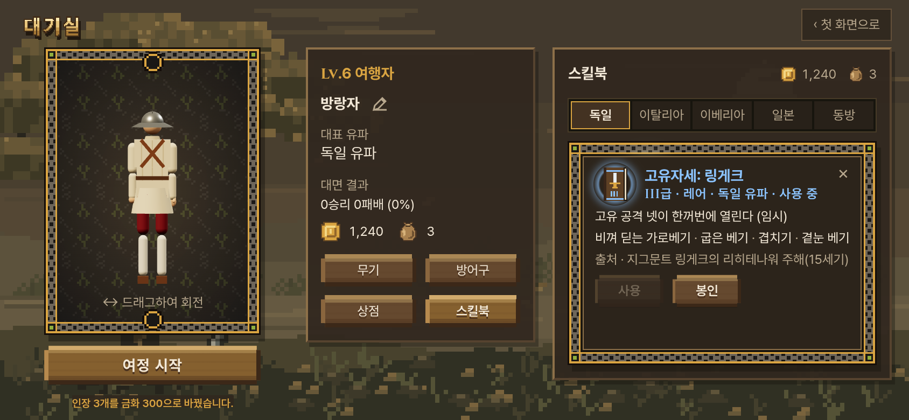
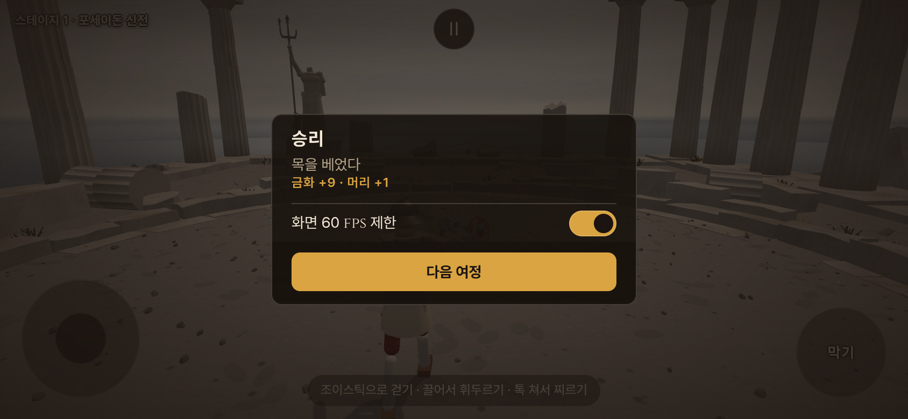

# 대기실 고친 것 — 사장님 답 · 스킬북 (2026-10-16)

- 지시 (사장님 원문):
  - 03:5x (리뷰 답) "10px 글자 … 난 글자가 작아보여야 좋은 거 같아. 전투 화면 스타일 따라서 폰트 정돈해. 몇몇 위계와 강조표시 만으로. '누르는 단추'도 마찬가지야. 금화 걍 둬. 장착하면 실제 전투에 가져나가게 해. 케틀 햇은 전설 등급으로 하고 설명 뒤에 특수능력 문구 추가 "(생존술: 기력 +30)" 캐릭터쪽 해상도 너무 낮던데. 좋아지게 할 방법은 없어? 상점은 걍 둬."
  - 03:5x (스킬북) "스킬북 쪽은 월드오브워크래프트나 디아블로의 스킬트리처럼 유파별 문서가 박힌 스킬트리를 만들어. 다 들어 있는데 해금되면 색이 밝아지고 누르면 설명과 함께 장착 해제 뜸. 스킬북 종류는 샛별이 기획 만들어 놨어."
  - 04:0x "… 기획 순서 그대로. … 응 패시브 개발할거야. 나중에 바꿔도 되니까 일단 지금꺼 토대로 만들어놔. 디자인 보려는 거야."
  - 04:1x "스킬트리는 순서대로 해금이 아니라, 금화나 머리를 얻으면 교환해서 개방하는 걸로 할게. 자기가 알아서 고르도록. 등급별 가격이 다를거애야. 100부터 500까지."
  - 04:2x "이미 받은 인장은 인장마다 금화 *100으로 바꿔줘."
  - 04:3x "책은 책이지만 별자리나 스킬트리처럼 룬 문자처럼 연결돼 있어. 구입하면 밝아지고 사용 봉인 선택 가능. 사용하면 섬네일 자리를 둥근 빛이 감쌈. 머리는 적의 머리를 베면 1개씩 주는 재화. 금화 옆에 천 주머니 모양으로 만들어. 금화는 승리시 랜덤으로 벌어. 5~15원 중 랜덤. 패배시 1~5원 감소."
  - 사이사이 감독 전달(인장 쌓는 속도는 그대로 · 인장은 아무것도 안 엶 · 앞으로 받는 인장은 안 바꿈 · 머리로 사기는 꺼 둠 · `?coins=N` · 테스트 경로는 모두 열림 · AI·시뮬 그대로)은 해당 칸에 적었다.
- 가지 `…/lobby-fix` — `…/lobby-in`(첫 화면·대기실 들여옴, `docs/import/lobby_port_2026-10-16.md`) 위에 본판 3fd1685 를 먼저 병합(95f4e1a)하고 고쳤다. 본판 들이기는 감독 확인 뒤.
- 새 값·자리는 `docs/strike/owner_defaults_table.md` **1880~1911** — 사장님이 정한 것은 '사장님 결정', 그 밖은 '사장님 확인 전'. 이 일로 바뀐 옛 줄: 1856(금화 100 고정) · 1857(대표 유파 = 인장) · 1866(케틀 햇 커먼) · 1867(장착은 겉모습만) · 1868(스킬북 = 인장 단계).
- 유파가 플레이어에게 주는 것이 바뀌었으므로 `docs/strike/school_kit_map.md` §2 · §3 · §7 도 같이 고쳤다(2c43e13).

## 0. 한눈에

| 사장님 답 | 지금 가지에서 | 문서 |
|---|---|---|
| 글자 정돈 | 첫 화면 · 공지 · 설정 · 계정 · 대기실 글자를 **싸움 화면 글자 규칙(토큰)** 으로 — 크기는 안 키움 · 위계 넷 + 표지 하나 · 강조는 금색이나 굵기만 · 라틴 글자 Cinzel · 등급 글은 등급 색 · 단추 꼴·크기 그대로 | §1 |
| 금화 · 상점 | 그대로 (상점 '아직 판매 중인 물품이 없습니다.') — 금화는 뒤 답(04:1x · 04:3x)대로 벌고 쓴다 | §2 · §6 |
| 장착을 싸움에 | 첫 화면·대기실 여정만: 무기를 장착했으면 **무대마다 카드 없이 그 무기**(없으면 지금처럼 카드) · 케틀 햇 장착 = 투구(겉모습 + 머리 막아 줌) · 벗음 = 맨머리 | §3 |
| 케틀 햇 레전드 · 생존술 | 등급 **레전드** · '여행자의 필수품. 뒤집으면 요리를 할 수 있다. (생존술: 기력 +30)' · 실제로 **플레이어 최대 기력 130**(문턱 0 · −40 · −80 그대로 · AI 그대로 · 기본 장착) | §3 |
| 미리보기 해상도 | 화소 비 **min(기기 화소 비, 3)** + 계단 펴기 — 화소 9 배, 그리기 호출 41 그대로, 미리보기 준비 +3 ms | §5 |
| (리뷰 거리) | 계정 번호 단계가 폰 가로 한 화면에 · 세로 대기실 '싸움은 가로 화면입니다' · 대기실이 0.3 s 걷히며 넘어감 | §4 |
| 스킬북 | 유파 다섯 × 책 다섯(보법 100 · 막기 200 · 고유자세 300 · 패시브 400 · 비기 500 금화) · **금화로 아무 차례로나** · 사용(둥근 빛) / 봉인(판에서 꺼짐) · 별자리 룬 줄 · 책 없으면 기본 동작만 | §6-1 ~ §6-3 |
| 인장 | 인장은 이제 아무것도 안 엶(쌓는 속도 그대로) · 이미 받은 인장 = 인장마다 **금화 100 한 번** | §6-4 |
| 금화 · 머리 | 여정 판 끝 이기면 **+5~15** · 지면 **−1~5**(0 밑 안 감) · 결과 창 '금화 +12' · 상대 목을 베면 **머리 +1** · 금화 옆 천 주머니 | §6-5 · §6-6 |
| 관문 | 일곱 그대로(fights12 a071c0af · live 648aca66 · finish 2de06c03 · corr 12 · smoke 23 · 빌드 · 표기 0) · node 시험 71 · 브라우저 시험 일곱 콘솔 오류 0 | §9 |

## 1. 글자 — 싸움 화면 규칙으로 (03:5x)

- 한 곳: `src/entrance_type.css`(새). 첫 화면·대기실 CSS(`start_screen.css` · `start_pixel.css` · `lobby.css`) 뒤에 붙어 글자 값만 덮는다 — 꾸밈(나무 판 · 카드 틀 · 단추 꼴 · 단추 크기)은 그 파일들 그대로.
- 값은 우리 싸움 화면 토큰(`index.html` `:root` — `--font-ui` · `--fs-s` 12 · `--fs-m` 14 · `--fs-l` 17 · `--fw-body` 400 · `--fw-label` 600 · `--fw-head` 700 · `--c-text` · `--c-sub` · `--c-accent` · `--tier-*`)을 그대로 읽는다. Shadow DOM 안이라도 `:root` 의 사용자 속성은 물려받는다(등급 색 `[data-tier]` 줄만 문서 밖이라 다시 이음).
- 위계 넷 + 표지 하나: 창 제목 17 · 700 / 이름·첫 줄 14 · 700 / 줄 14 · 400 / 둘째 줄·설명 12 · 400 보조 색 / 표지(새 소식 · 등급 · 장착 중) 12 · 600.
- 강조는 금색(레벨 · 새 소식 · 알림 줄)이나 굵기만. 등급 글은 등급 색(커먼 크림 · 레어 파랑 · 에픽 보라 · 레전드 금). 라틴 글자는 Cinzel(`Lv.` · 원어 출처). 한글은 낱말 가운데서 줄을 안 바꿈(`keep-all`).
- 단추 글: 주 단추(처음부터 · 이어하기 · 여정 시작 · 확인 · 연결하기 · 장착 · 구입) 700 / 부 단추(첫 화면으로 · 아래 줄 · 해제 · 취소 · 고르지 않은 탭) 400 · 고른 탭 600.
- **크기는 키우지 않았다**(사장님 '작아보여야 좋은'): 낮은 가로 화면의 10 px 두 곳(장착 배지 · 상태 줄)도 그대로.
- 메일 주소 · 번호 · 입력 칸만 `--font-plain`(프리텐다드) — Cinzel 작은 대문자로는 메일 주소를 맞게 썼는지 보기 어렵다.
- 시험: `title_smoke`(첫 화면·공지 글자 규칙 · Cinzel · keep-all) · `lobby_equipment_smoke`(굵기 700 · 600 · 400 · 레전드 카드 색).

## 2. 금화 · 상점 — 그대로 (03:5x)

- 상점 칸 · 금화 꼴은 손대지 않았다. 금화는 뒤의 답대로 여정에서 벌고(§6-5) 스킬북을 산다(§6-1).
- 금화 옆에 머리 수(천 주머니 그림)를 붙였다(§6-6 — 04:3x).

## 3. 장착을 싸움에 · 케틀 햇 레전드 (03:5x)

- 범위: **첫 화면·대기실에서 연 여정만**(`journeySaves` — 주소로 무대·상대·무기를 고정한 판 · 테스트 경로 · 게임 인자가 있는 옛 메뉴 판은 지금 그대로). `src/main.js` `journeyLoadout`.
- 무기: 대기실에서 무기를 장착했으면 **무대마다 카드 없이 그 무기**로 싸운다(지금 무기 칸은 나뭇가지 하나). 장착이 없으면 지금처럼 카드. 이어하기 지점엔 무대·상대만 적어, 다음에 해제하고 이어가면 그 무대를 카드부터.
- 케틀 햇: 장착 = 지금 플레이어 겉모습(케틀 햇 투구) — 투구는 겉모습에서 정해지므로 머리 막아 줌도 같이 · 벗음 = 맨머리(투구 겉모습 없음 = 머리 막아 줌 없음). **기본은 장착**(대기실 기록이 없으면 케틀 햇을 쓴 채로 시작 — 처음 온 사람도 130).
- 레전드: `LOBBY_ARMOR.tier = 'legend'` — 등급 글 '레전드' · 이름과 등급은 레전드 금색. 카드 글 = '여행자의 필수품. 뒤집으면 요리를 할 수 있다.' 뒤에 **'(생존술: 기력 +30)'** 를 등급 색으로(무기 카드 특수 능력 줄과 같은 꼴).
- 생존술 = 실제 능력: 플레이어 **최대 기력 130**(`src/stamina.js` `maxBonus` · `setMaxBonus`). 판을 130 에서 시작하고 130 까지 회복 · 탈진 문턱 0 · −40 · −80 은 그대로 · 머리 위 막대는 130 의 몫(65 = 반). 대기실에서 장착한 케틀 햇만 · AI 는 그대로 100. `?stamina=0`(기력 끔)이면 아무 일 없음 — 관문은 바이트 같음.
- 판 중에 투구가 맞아 벗겨져도 그 판은 130 그대로(판 시작 장착으로 정함 — 사장님 확인 전) → **사장님 결정 10/16 08:1x** "아이템은 사라져도 효과는 그대로 둬."(확인표 1888 · 코드 주석 `src/main.js` `newRound` · `src/fighter.js` `knockOffHelmet`).
- 시험: `lobby_fix.test` 130 · 기력 끔 100 · 실제 싸움 130 ↔ 100 / `lobby_fix_smoke` 나뭇가지 장착 → 카드 없이 싸움 · 해제 → 카드 · 케틀 햇 → 투구 + 130 · 벗음 → 맨머리 + 100.

## 4. 계정 번호 단계 · 세로 안내 · 넘어가기 (리뷰 거리)

- 계정 번호 단계: 폰 가로(높이 500 px 이하)에서 창 너비 `min(540px, 100vw − 48px)` · 칸 사이를 줄여 **창 안 스크롤 없이** 번호 칸 · 연결하기 · 다시 받기 · 닫기가 한 화면에(`src/start_pixel.css`). 입력 칸 초점 테두리는 2 px 띄움.
- 세로 폰 대기실: 출발 단추 밑에 '↻ 싸움은 가로 화면입니다 / 시작하면 폰을 돌려 주세요'(세로 + 터치일 때만 — 돌려 달라는 안내와 같은 조건).
- 넘어가기: 출발을 누르면 대기실이 0.3 s 에 걷히고(움직임 줄이기면 바로), 세로 폰이면 돌려 달라는 안내가 0.5 s 에 걸쳐 나타나며 '돌리면 바로 이어집니다' 한 줄. 전에는 대기실이 사라지자마자 안내가 툭 떴다.
- 좁은 화면(폭 680 px 아래) 대기실: 캐릭터 칸 높이를 풀어 출발 단추 밑 안내·알림 줄이 아래 칸 뒤로 안 숨게.
- (알림 · 안 바꿈) 돌려 달라는 안내 뒤에서도 싸움 시간은 흐른다 — 이 일 전부터 그렇다.

## 5. 캐릭터 미리보기 해상도 (03:5x '좋아지게 할 방법은 없어?')

- `src/lobby_character.js`: 그리개 화소 비 1 → **min(기기 화소 비, 3)** · 계단 펴기(antialias) 켬. 그리는 때는 그대로(돌리거나 크기·장착이 바뀔 때만 — 그동안 게임 그리개는 멈춤).
- 잰 값 (`tools/browser/lobby_preview_cost.mjs` · 폰 가로 844 × 390 · 화소 비 3 · 소프트웨어 GL · 판마다 새 창 9 번 — 실기기 값이 아니라 두 판의 비):

| | 고치기 전 | 고친 판 |
|---|---|---|
| 한 번 그리기 호출 | 41 | **41** (그대로 — 화소 비는 호출 수를 안 바꾼다) |
| 그리는 화소 | 177 × 217 = 38,409 | 531 × 651 = 345,681 (**9 배**) |
| 계단 펴기 | 없음 | 있음 |
| 미리보기 준비(문맥 → 첫 그림) 가운데 | 25.4 ms | 28.7 ms (23.7~50.5) |
| 첫 그림('처음부터' → 첫 그림) 가운데 | 122.9 ms (97.2~1,496.8) | 131.3 ms (96.0~1,377.1) |
| 한 번 그리기(돌릴 때) 가운데 | 0.7 ms | 0.8 ms (0.7~1.0) |

- 첫 그림은 대기실·게임 묶음 받기가 섞여 흔들림이 크다 — 미리보기 몫(준비)은 +3 ms. 돌릴 때만 그리므로 가만히 있을 때 값은 0.
- 맞대기 사진(화소 비 3 확대): `lobbyfix_preview-before_phone-landscape.png` ↔ `lobbyfix_preview-after_phone-landscape.png` — 투구 테 · 어깨 · 띠의 계단이 사라졌다.

 

## 6. 스킬북 · 금화 · 머리 · 인장 (03:5x · 04:0x~04:3x)

### 6-1. 책 다섯 · 값 · 사는 법

- 유파 탭 다섯(독일 · 이탈리아 · 이베리아 · 일본 · 동방) × 책 다섯. 급 차례와 등급 이름은 샛별 저장소의 스킬북 기획을 따랐다(사장님 '스킬북 종류는 샛별이 기획 만들어 놨어' · 04:0x '기획 순서 그대로'). 값은 사장님 04:1x.

| 급 | 책 | 등급 | 금화 |
|---|---|---|---|
| I | 보법 | 커먼 | 100 |
| II | 막기 | 언커먼 | 200 |
| III | 고유자세 | 레어 | 300 |
| IV | 패시브 | 에픽 | 400 |
| V | 비기 | 레전드 | 500 |

- **금화로 아무 차례로나 산다**(04:1x '순서대로 해금이 아니라 … 자기가 알아서 고르도록'). 별자리 줄은 꾸밈 — 앞 책이 없어도 산다. 시작 금화 100 = 1급 한 권.
- 상태 셋(`src/skill_books.js` `bookState`): **안 삼** = 어둡게 + 값 표지 + 설명의 '구입 · 금화 N'(모자라면 못 누름) / **사용** = 밝게 + 섬네일을 둥근 빛이 감쌈(등급 색 · 2.6 s 숨) / **봉인** = 밝게, 빛 없음 — 판에서 꺼짐. 새로 산 책은 '사용'. 사용 ↔ 봉인은 설명 카드의 두 단추.
- 책 이름 = '갈래: 출처 인물·책'(예 '보법: 리히테나워' · '막기: 마이어' · '고유자세: 링게크' · 5급은 지금 비기 이름). 출처 줄은 우리 조사 문서(`docs/motion/`)에서 새로 썼다.
- 머리로 사는 값은 아직 없다 — `BOOK_HEAD_PRICE = null`(자리만 · 단추 없음 · 사장님 확인 전).
- Lv = 1 + 산 것 수(옛 규칙 그대로 — 책 25 권이면 Lv.26). 대표 유파 = 책을 가장 많이 산 유파(같으면 탭 차례 앞) · 없으면 '아직 없음'.

### 6-2. 책이 여는 것 — 판에 건 곳 (04:0x '지금꺼 토대로')

책은 지금 게임에 있는 그 유파 몫을 연다. **손에 든 무기의 유파 책**이 '사용'일 때만 켜진다(`playerKit` — 해금 규칙의 오직 한 자리).

| 책 | 켜면 | 책 없음 · 봉인 | 거는 곳 |
|---|---|---|---|
| I 보법 | 유파 걸음 칸 전부(독일 박차기·간격 잡기 · 이탈리아 박자 걸음 · 이베리아 넓은 보폭·옆 박차기 · 일본 낮은 자세·버티기 · 동방 가벼운 발) · 유파 걷기 기력(일본 2.1 · 동방 0.7) | 기본 걸음 · 걷기 기력 1.4 | Fighter `schoolFootwork: false` → `schools.js footworkTradition` → `gait.js` · `stamina.js` |
| II 막기 | 유파 막기 자리 · 몸꼴 덧씌우기(독일 왕관 · 동방 거정세·어거세·요략세 · 일본 오른쪽 아래 낮은 자세) | 무유파 막기 자리 · 덧씌우기 없음 | Fighter `schoolParry: false` → `parry_button.js` |
| III 고유자세 | 고유 공격 넷 **한꺼번에**(임시 — 감독 04:0x 전달) | 고유 공격 없음 | `kitUniqueStage` → `PlayerUniqueAssist` |
| IV 패시브 | '개발 예정' — 사람 몫이 아직 없다(지금 패시브는 모두 AI 몫). 사고 사용/봉인은 저장되지만 판에서 하는 일은 없다 | — | — |
| V 비기 | 유파 비기 | 비기 창 없음 | `PlayerSecretWatch({ locked })` |

- 책이 하나도 없는 플레이어 = **기본 동작만**(기본 걸음 · 무유파 막기 · 고유 공격·비기 없음). 무유파 무기(나뭇가지 · 둔기 · 권총)는 책이 없다 — 유파 몫이 원래 없다.
- 이탈리아·이베리아 막기 책은 지금 **차이가 없다** — 두 유파의 막기 자리가 무유파 자리와 같은 값이다(설명 카드에도 '지금은 무유파 자리와 같다'). 고칠지 사장님 확인 전.
- 보법·막기 꺼짐은 싸움꾼을 만들 때 넘긴다(걸음을 만들기 전 — 첫 걸음부터 기본 걸음). `false` 일 때만 속성이 생기므로 AI·시뮬은 바이트 같음.
- 시험: `lobby_fix.test` 보법 끔 → 일본 걸음 값 대신 기본 · 흔들림 1 · 걷기 기력 1.4 / 막기 끔 → 무유파 자리(일본 오른쪽 아래 · 동방 덧씌우기 없음) / 고유·비기 끔 · `lobby_fix_smoke` 일본 책 사기 → 사용 → 실제 판에서 걸음 'japanese' · 흔들림 0.75 · 고유 4 단계 · 비기 열림 → 모두 봉인 → 모두 꺼짐 · 책 없는 레이피어 = 기본.

### 6-3. 별자리 화면 (04:3x '별자리나 스킬트리처럼 룬 문자처럼 연결')

- `src/skill_tree.js`(새) · 꾸밈 `src/lobby.css` '스킬북' 칸. 대기실 '스킬북' 단추 → 오른쪽 칸: 금화 · 천 주머니 / 유파 탭 다섯 / 카드 틀 안의 별자리 판(좌표 300 × 210).
- 별자리 꼴(유파 무기·몸놀림을 본뜸): 독일 **엇갈린 두 칼(X)** — 가운데 III 에서 네 귀로 · 이탈리아 **컵 고리**(오각 고리) · 이베리아 **머리 위로 크게 도는 호**(몬탄테) · 일본 **휜 칼날(초승달)** · 동방 **꺾이는 걸음(W)**.
- 룬 줄: 두 책 칸(섬네일 · 값 · 이름)을 잰 뒤 그 밖에서 시작하는 곧은 줄 + 가운데 룬 꺾쇠 둘(ᚲ 꼴)과 작은 마름모. 두 책을 다 샀으면 금빛, 아니면 흐린 갈색. 위아래로 붙은 책 사이 줄은 아래 책 이름에 가려 안 쓴다 — 줄은 모두 비스듬하다.
- 책 섬네일: 우리 픽셀 책(가죽 표지 · 책등 · 쪽 가장자리 · 가운데 유파 문양 · 아래 급 숫자 · 위아래 띠 = 등급 색). 안 산 책은 흑백으로 어둡게 + 책 아래쪽에 값 표지(금화 그림 + 값).
- 책을 누르면 판 위에 설명 카드: 이름(등급 색) · '급 · 등급 · 유파 · 사용 중|봉인' · 효과 한 줄(고유자세는 넷의 이름과 '(임시)') · 출처 · 단추(안 삼 = 구입 · 산 책 = 사용 / 봉인). 폰 가로에서도 단추까지 스크롤 없이.
- 판이 좁으면 책·이름·값을 같은 비로 줄인다: 판 너비 263 px(폰 가로 844 × 390)가 기준 1, 더 좁으면 비례(0.6 까지 · 값 글자 8 px 아래로는 안 줄임), 더 넓으면 그대로.
- 잰 도구 `tools/browser/skill_tree_layout.mjs` — 책을 하나도 안 산 판(값 표지가 가장 많을 때) × 유파 다섯 × 화면 여섯(폰 가로 844 · 740 · 680 · 폰 세로 · PC · 작은 가로 568): 다른 책끼리 섬네일·이름·값 겹침 **0** · 판 밖 **0** · 룬 줄이 책 칸을 지남 **0** · 줄마다 룬 꺾쇠(보이는 줄 가장 짧은 것 폰 가로 26.4 · 680 폭 25.4 판 좌표).

### 6-4. 인장 → 금화 (04:2x)

> 뒤에 바뀜: 10/16 08:1x 사장님 "인장 제도 없애." — 인장은 얻지도 알리지도 않고, 이미 받은 인장을 한 번 금화로 바꾸는 것만 남았다. 바꾸는 때도 '처음 대기실을 열 때' → '이 판을 처음 연 때(어느 길이든)'로 옮겼다. `docs/strike/school_kit_map.md` §3 · 확인표 1920~1928 · `docs/import/ui_fix_2026-10-16.md` §1. 아래는 04:2x 때 기록 그대로.

- 인장은 이제 **아무것도 열지 않는다**(유파 몫은 책이 엶). 쌓는 셈은 그대로 — 여정에서 무대 10 번 깰 때 하나 · 25 개까지(감독 전달 '인장 속도 그대로').
- 이미 받은 인장은 **인장마다 금화 100 으로 한 번** 바꿨다(`src/seal_coins.js`): 처음 대기실을 열 때 깬 수(`stillness.journeyClears.v1` — 주소 `?clears=` 덮어쓰기는 안 읽음)로 인장 수를 세어 금화를 더하고 기록 `stillness.lobby.sealCoins.v1` 을 남긴다 — 두 번 안 준다. 알림 줄 '인장 N개를 금화 N×100으로 바꿨습니다.'(예 깬 수 37 → '인장 3개를 금화 300으로 바꿨습니다.'). 인장 0 이면 알림 없이 기록만.
- 앞으로 받는 인장은 안 바꾼다 — `CONVERT_FUTURE_SEALS = false`(감독 전달 · 켜면 판 끝에 새 인장을 바로 금화로). 이 여정에선 인장 알림도 안 띄운다(아무것도 안 열므로). 대기실의 인장 표시도 숨겼다(대표 유파는 책으로 — §6-1).
- 테스트 경로 · `?clears=` 고정에선 안 바꾼다. 저장이 막힌 브라우저는 이번 실행 동안만 기억(다시 열면 또 줄 수 있음 — 금화도 같이 안 남으므로 늘지는 않음).
- 시험: `lobby_fix.test` 인장 0 → 0 · 25 → 2,500 · 37 → 300 한 번 · 두 번째 0 · 미래 켬이면 새 인장만 / `lobby_fix_smoke` 깬 수 250(인장 25) → 금화 2,600 한 번 · 다시 열어도 그대로 · 테스트 경로 안 바꿈.

### 6-5. 여정 금화 · 결과 창 (04:3x)

- 첫 화면·대기실 여정의 판 끝마다: 이기면 **+5~15** · 지면 **−1~5**(고른 무작위 · 금화는 0 밑으로 안 감 — 금화 2 에서 −5 면 0). 주소 고정 판 · 테스트 경로 · 옛 메뉴 판은 안 바뀜. 무작위는 `crypto.getRandomValues` — AI 가 쓰는 난수 줄을 안 건드린다(`src/lobby_progress.js` `JOURNEY_COINS` · `journeyCoins`).
- 결과 창(승리 · 패배) 둘째 줄 밑에 한 줄: **'금화 +12'** · **'금화 −3'**(금화 0 에서 지면 '금화 ±0') · 머리를 얻었으면 ' · 머리 +1'. 늘면 강조 색, 줄면 보조 색.
- `?coins=N` (개발 인자 — 디자인 보기·사진용): 금화를 N 으로(0~10,000,000 정수 — 그 밖은 무시 · 저장 · 게임 인자 셈에서 빼 첫 화면이 뜸).
- 시험: `lobby_fix.test` 범위 · 0 밑 안 감 · 무작위 칸 모두 나옴 / `game_entry_smoke` 이긴 판 +5~15 · 결과 줄 · 테스트 경로 안 바뀜 / `lobby_fix_smoke` 진 판 −1~5 · 결과 줄.

### 6-6. 머리 · 천 주머니 (04:3x)

- 머리 = 첫 화면·대기실 여정 싸움에서 **상대의 목을 베면 +1** — 지금 목 베기 사건(`combat.js` `COMBAT_HOOKS.onDecapitate` — `fighter.js` 목 상처로 떨어질 때 · 흙 머리가 떨어질 때)에 걸었다. 한 상대에 한 번(`awardHead` — 상대에 `headTaken` 표시).
- 금화 옆에 **천 주머니** 픽셀 그림 + 수(대기실 내 정보 칸 · 스킬북 칸 위).
- 머리로 무엇을 사는지는 아직 없다(§6-1 — 사장님 확인 전).
- 시험: `lobby_fix.test` 한 상대 한 번 · 목 사건 한 번 / `lobby_fix_smoke` 목 베기 → 머리 +1 · 결과 줄.

### 6-7. 테스트 경로 · 저장 열쇠

- 테스트 경로(`?test=1`)는 지금처럼 **모두 열림** — 별자리는 다섯 권 모두 '사용'으로 보이고 사고팔기 단추가 없다('테스트 경로 — 모든 책이 열려 있습니다'). 금화·머리·인장 안 바뀜.
- 새 저장 열쇠: `stillness.lobby.skillbooks.v1`(봉인 목록) · `stillness.lobby.sealCoins.v1`(바꿈 기록). 금화 · 머리 · 산 책은 원래의 `stillness.lobby.progress.v1` 안(산 책 = 얻은 것 `skillbook:<유파>:<급>`).

## 7. 그대로 둔 것 · 고른 것

- **AI · 시뮬 그대로**: AI 는 책과 상관없이 유파 몫을 다 쓴다(보법·막기 늘 켬 · 고유 동작은 인물 숙련도). 사람은 책으로 연다 — 사람에게 없는 동작을 AI 만 쓰는 '유령 동작'은 아니지만(사람도 책을 사면 쓴다), 책 없는 사람과 AI 가 다르다는 것은 사장님이 볼 거리(§10).
- **옛 메뉴 판**(게임 인자가 있는 주소 — 도구·확인 주소): 지금 규칙 그대로(보법·막기 늘 켬 · 고유 공격·비기 = 인장 단계). 책은 첫 화면·대기실 여정만 읽는다 — 도구 주소가 안 바뀌게 고른 것(사장님 확인 전).
- 인장 쌓는 속도 · 깬 수 열쇠 · 이어하기 지점 · 대면 결과 · 이름 · 공지 · 계정은 손대지 않았다.

## 8. 사진 (우리 게임 실제 화면 — `tools/browser/lobbyfix_capture.mjs`)

`docs/handoff/lobbyfix_<장면>_<크기>.png` — 크기 `phone-landscape`(844 × 390 · 화소 비 2 · 터치) · `phone-portrait`(390 × 844) · `desktop`(1280 × 720). 저장 상태는 사진용으로 미리 채움: 깬 수 37(인장 3 → 첫 대기실에서 금화 +300) · 금화 940 + 300 · 머리 3 · 산 책 = 독일 I · II · III(II 봉인) · 일본 I · V.

| 장면 | 크기 | 보이는 것 |
|---|---|---|
| `notices` · `title` | 셋 | 공지 창 · 첫 화면 새 글자 |
| `account-code` | 폰 가로 | 계정 번호 단계 한 화면 |
| `lobby` | 셋 | 대기실 새 글자 · Lv.6 · 대표 유파 독일 · 금화 1,240 · 천 주머니 3 · '인장 3개를 금화 300으로 바꿨습니다.' |
| `landscape-hint` · `rotate` | 폰 세로 | 대기실 가로 안내 · 출발 뒤 돌려 달라는 안내 |
| `branch-card` | 셋 | 나뭇가지 장착 · 설명 카드 |
| `kettle-card` | 셋 | 케틀 햇 레전드 · '(생존술: 기력 +30)' |
| `tree-german` · `tree-japanese` | 셋 | 별자리 — 사용(둥근 빛) · 봉인 · 안 삼(값) 섞임 |
| `book-unowned` · `book-sealed` · `book-unique` | 셋 | 설명 — 안 삼(구입 · 금화 400) · 봉인(사용 단추) · 고유자세 넷(사용 중 · 봉인 단추) |
| `stamina130` · `stamina130-zoom` · `stamina65-zoom` | 폰 가로 | 싸움 — 케틀 햇 · 최대 130(가득이면 막대가 옅어짐) · 65 = 반 |
| `result-win` · `result-loss` | 폰 가로 | '금화 +14 · 머리 +1' · '금화 −5' |
| `preview-before` · `preview-after` | 폰 가로 · 화소 비 3 확대 | 미리보기 맞대기(§5) |

## 9. 시험 · 관문

- node 시험 `node --test tools/sim/*.test.mjs` **71 통과** — 새 `lobby_fix.test.mjs` 13(케틀 햇 130 · 기력 끔 100 · 실제 싸움 130 ↔ 100 · 책 값·사기·사용/봉인 · `playerKit` · 보법·막기·고유·비기 끔 · 인장 바꿈 0 / 25 / 37 / 두 번째 / 미래 · 덮어쓴 깬 수 안 읽음 · 여정 금화 범위·바닥 · 머리 한 번) · `lobby_progress.test` 레전드 · 능력 줄.
- 브라우저 시험(`npm run build` → `npx vite preview` · 인증 서버 막음): `lobby_fix_smoke` 10 · `game_entry_smoke` 24 · `lobby_equipment_smoke` 11 · `title_smoke` 14 · `title_account_smoke` 9 · `lobby_records_smoke` 4 · `skill_tree_layout` 유파 다섯 × 화면 여섯 — 모두 통과, 콘솔 오류 0. 고친 규칙에 맞춰 옛 시험의 기대값을 바꿈(4f1330a — 글자 굵기 · 공지 12 px · 대표 유파 '아직 없음' · 장착 무기로 곧장 싸움 · 레전드 카드 · 계정 창 스크롤 없음).
- 관문 일곱 그대로: fights12 **a071c0af** · live **648aca66** · finish **2de06c03** · corr **12** · smoke **23** · 빌드(`npm run build` — 오프라인 묶음 355 파일 7,108,648 B · 대기실 묶음 28.6 → 43.3 KB · 게임 묶음 +1.4 KB) · 표기 방침 위반 0.

## 10. 사장님 확인할 것

1. **이탈리아·이베리아 막기 책**은 지금 차이가 없다(두 유파 막기 자리 = 무유파 자리). 유파 막기 자리를 만들지, 책을 그대로 둘지.
2. **AI 는 책 없이 유파 몫을 다 쓴다**(감독 'AI·시뮬 그대로'). 책 없는 사람은 기본 동작만 — 사람·AI 가 다른 규칙으로 괜찮은지.
3. 고유자세 책 = 고유 공격 **넷 한꺼번에**(임시). 한 가지 자세로 바꿀 때까지.
4. 케틀 햇 130 은 판 중에 투구가 벗겨져도 그 판은 그대로 · **기본 장착**이라 처음 온 사람도 130. → 앞 몫(벗겨져도 그대로)은 **사장님 결정 10/16 08:1x** "아이템은 사라져도 효과는 그대로 둬."(확인표 1888).
5. 머리: 흙 머리(병마용)가 떨어져도 1 · **머리로 사는 값**(지금 없음).
6. 앞으로 받는 인장을 금화로 바꿀지(`CONVERT_FUTURE_SEALS` 꺼짐) — 지금은 인장이 쌓이기만 하고 쓰는 곳이 없다. → 10/16 08:1x 인장 없앰으로 끝남(스위치 지움 · 확인표 1920).
7. 2급 '언커먼' 색 `#a8d67e`(무기 등급엔 없는 칸) · Lv = 1 + 산 책 수(최대 Lv.26) · 대표 유파 = 책을 가장 많이 산 유파.
8. 옛 메뉴 판(게임 인자가 있는 주소)은 옛 규칙(인장 단계) 그대로. → 10/16 08:1x 인장 없앰으로 옛 메뉴 판도 산 책(확인표 1921).
9. 별자리 꼴 다섯 · 룬 줄 · 값 표지 자리 · 설명 카드 글.
