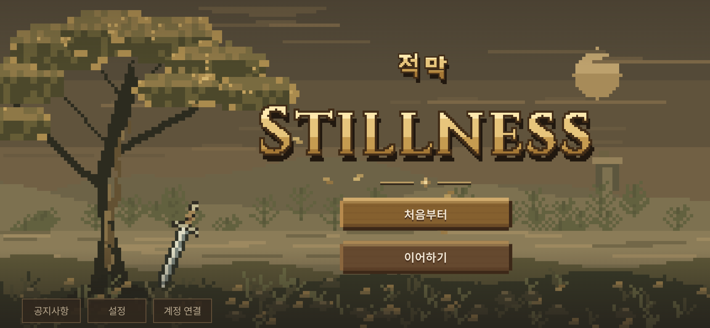
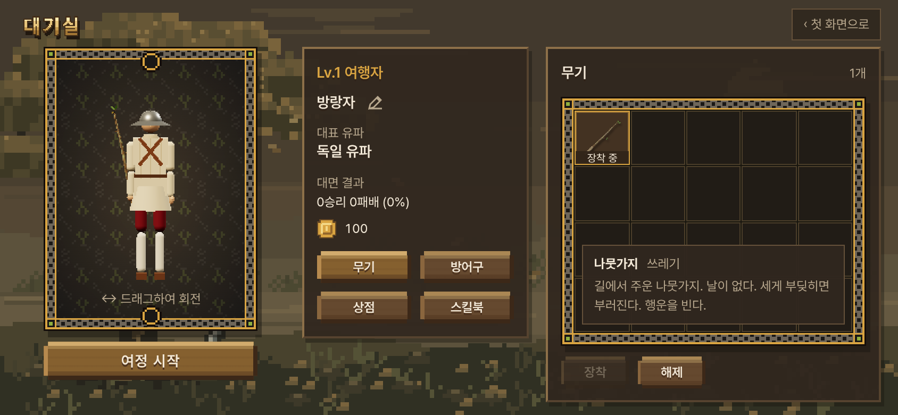

# 첫 화면·대기실 들여옴 — 디자인 리뷰용 (2026-10-16)

- 지시: 사장님 10/16 01:0x "지금 샛별이가 '첫 화면'이랑 '대기실' 디자인했어. 그거 확인해서 가져와. 가져와서 디자인 리뷰 먼저 해. 내가 그 리뷰를 컨펌하면 본게임 바로 적용. 참고로 가져오면서 '무기'에 롱소드는 삭제하고 '나뭇가지'에는 실제 무기 설명을 '투구'처럼 붙여놔. '투구'는 이름 바꾸자." 이어 같은 01:0x 에 감독을 거쳐 둘을 더 받았다: ① 이메일 계정 연결도 넣는다(사장님이 인증 프로젝트를 일부러 만들었다 — 메일 6자리 번호로만) ② 방어구 이름은 **'케틀 햇'**.
- 기준: 우리 본판 **4f17370** · 샛별 저장소 `origin/main` **e52d23b0**. 샛별 저장소는 10/14 우리 **fdd6455** 에서 다시 갈라졌으므로, fdd6455 와의 차이에서 화면 몫(첫 화면 · 들머리 · 이어하기 · 대기실 · 계정)만 골랐다. 사본은 읽기만 했다(`git show`).
- 가지 `…/lobby-in`. **본판(main)에는 사장님이 이 리뷰를 확인하기 전까지 들어가지 않는다.**
- 새로 정한 값과 자리는 `docs/strike/owner_defaults_table.md` **1850~1877** 에 적었다(사장님 결정 넷 말고는 '사장님 확인 전').
- 이 리뷰에 대한 사장님 답(10/16 03:5x~04:3x — 글자 · 장착을 싸움에 · 케틀 햇 레전드 · 미리보기 · 스킬북 · 금화 · 머리 · 인장)으로 고친 것은 `docs/import/lobby_fix_2026-10-16.md`(확인표 1880~1911).

## 0. 한눈에

| 무엇 | 지금 가지에서 | 문서 |
|---|---|---|
| 들어가는 길 | 인자 없는 주소(설치한 앱 포함): **공지 → 픽셀 첫 화면 → 대기실 → 무기 카드 → 싸움** | §2 · §3 |
| 시험 주소 | 게임 인자가 하나라도 있으면(`?stage=` `?weapon=` `?foe=` `?look=` `?test=1` `?stamina=0` `?foeWhiff=1` `?tempo=` …) **지금처럼 곧바로 '여정 시작' 메뉴** · `?title=0` 늘 건너뜀 · `?title=1` 첫 화면 | §5-1 |
| 이어하기 | 무대 시작 자리 저장 — 무대 차례는 우리 `STAGE_ORDER`, 깬 수·인장·설정은 그대로 | §5-3 |
| 무기 칸 | **나뭇가지 하나**(롱소드 뺌) · 설명 카드 = 우리 `weapons.js` 이름·등급·설명 | §4-1 · §4-2 |
| 방어구 | **'케틀 햇'** — `src/lobby_equipment.js` `LOBBY_ARMOR.nameKo` 한 줄 | §4-3 |
| 계정 연결 | 메일 **6자리 번호로만**(링크 없음) · 저장 열쇠 `stillness-account:v1:auth` · 사장님 쪽 Supabase 설정 셋이 남았다 | §4-4 · §4-5 |
| 공지 | 우리 본판 글 다섯(기력 · 유파 걸음 · 이탈리아 박자 · 카메라 · 걸음 빠르기) — **사장님 확인 전** | §6 |
| 찾은 문제 | PWA 가 같은 판인데도 새로 고칠 뻔(고침) · 같은 출처라 두 판이 깬 수·설정 열쇠를 이미 같이 씀(알림) 등 | §7 |
| 리뷰 거리 | 누름 자리 대부분 44 px 아래 · 픽셀 꾸밈과 우리 HUD(둥근 단추·반투명 판·라틴 글자 Cinzel)의 이음 · 세로 대기실 뒤 곧바로 '가로로 돌려 주세요' 등 | §8 |
| 관문 | 일곱 그대로(fights12 a071c0af · live 648aca66 · finish 2de06c03 · corr 12 · smoke 23 · 빌드 0 · 표기 0) · 브라우저 시험 콘솔 오류 0 | §10 |





## 1. 가져온 커밋 (샛별 저장소)

| 커밋 | 무엇 | 가져온 몫 |
|---|---|---|
| 4bb2d8f8 · 1b92b798 | 공지 → 첫 화면 첫 시안(바람 장면) | 공지 창 동작(화면에 든 공지만 읽음 · 숨김 기억) · 바탕 꾸밈 `start_screen.css`. 바람 장면 `pixel_wind.js` 와 시안 쪽 `start.html` 은 안 가져옴 |
| c84b8ca0 · 9754fb20 | 따뜻한 픽셀 숲 · 나무 결 단추 | `pixel_grove.js` · `start_pixel.css` |
| ced47392 | 한글 '적막' 픽셀 글자 · 공지 줄이기 | 같은 두 파일 |
| ca888541 | 꽂힌 롱소드 · 공지 아래 한 줄 | `pixel_grove.js plantedLongsword` |
| 215d7b7e (+ cce9a58d 점검) | 첫 화면을 게임에 잇기 · 이어하기 지점 | `game_entry.js` · `journey_save.js` · `main.js` 이음 · 시험 |
| 817db21c · 869d43ff | 대기실 세 칸 · 이름 · 대면 결과 | `lobby.js` · `lobby.css` · `lobby_character.js` · `player_profile.js` |
| b73a9c82 · 0ab0bc31 | 첫 화면 꾸밈의 대기실 · 장착 미리보기 | `lobby_weapon.js` · `lobby_equipment.js` |
| 3b280a1b | 레벨·호칭·금화 · 무기/방어구 나눔 · 설정을 첫 화면으로 · 케틀햇 섬네일 | `lobby_progress.js` · 설정 창 · `public/ui/armor/kettle.webp` · `armor_thumb.mjs` |
| 3688f391 | 첫 화면 계정 연결 · '막' 한 도트 내림 | 계정 모듈(고쳐서 — §4-4) · `letterOffsets [0, 1]` |
| 8874c735 · e52d23b0 | 기록·배포 문서뿐 | 화면 코드 없음 — 안 가져옴 |

그쪽 문서(점검 기록 · 사진 · 자동 교환 · 안내 파일)와 시안 쪽 두 쪽(`start.html` · `start-pixel.html`)은 가져오지 않았다. 마지막 판의 들머리가 `start-pixel.html` 을 글로 읽어 꾸밈을 꺼냈는데, 그 꾸밈은 `src/start_screen.js` 의 `ENTRANCE_HTML` 로 옮겨 그 쪽이 필요 없게 했다.

## 2. 무엇을 옮겼나 — 파일마다

| 우리 파일 | 샛별 쪽 | 옮김 / 고침 |
|---|---|---|
| `src/game_entry.js` (새) | 같은 이름 | 들머리. 첫 화면·대기실을 Shadow DOM 안에 띄우고 게임(`main.js`)은 뒤에서 받는다. **고침**: 건너뛰는 규칙(§5-1) · 대기실 묶음과 계정 묶음은 고를 때·첫 화면을 그린 뒤 따로 받음(첫 그림을 늦추지 않게) · 꾸밈은 `ENTRANCE_HTML` |
| `src/start_screen.js` (새) | 같은 이름 | 공지 · 첫 화면 동작 그대로. **고침**: 픽셀 시안만 · 아래 줄 세 칸(공지사항 · 설정 · 계정 연결) · 설정 창은 3b280a1b 판 · 꾸밈 `ENTRANCE_HTML` 을 안에 둠 |
| `src/start_screen.css` (새) | 같은 이름 | 그대로. 글꼴 선언(@font-face) 셋만 뺐다(§7-6) |
| `src/start_pixel.css` (새) | 같은 이름 | 그대로 + 3b280a1b 판의 설정 창 꾸밈 일곱 줄 |
| `src/pixel_grove.js` (새) | 같은 이름 | 그대로 (머리말 주석만) |
| `src/update_notes.js` (새) | 같은 이름 | **글을 우리 것으로**(§6) |
| `src/journey_save.js` (새) | 같은 이름 | 읽기·쓰기 그대로. **고침**: 열쇠 `stillness.journey.checkpoint.v1` · `isDirectGameLink` 대신 `skipsTitle`(§5-1) |
| `src/lobby.js` · `src/lobby.css` (새) | 같은 이름 | 그대로. **고침**: 설명 카드를 무기에도(§4-2) · 등급 글은 `TIER_LABEL` |
| `src/lobby_character.js` · `src/lobby_weapon.js` (새) | 같은 이름 | 그대로. 화면 읽기 글의 무기 이름을 `weapons.js` 에서 읽게(롱소드·나뭇가지 두 이름을 박아 두던 것) |
| `src/lobby_equipment.js` (새) | 같은 이름 | **고침**: 무기 칸 나뭇가지 하나 · 방어구 이름 '케틀 햇' · 등급을 `tier: 'common'` 으로 · 열쇠 `stillness.lobby.weapon.v1` · `armor.v1` |
| `src/lobby_progress.js` · `src/player_profile.js` (새) | 같은 이름 | 그대로. 열쇠만 `stillness.lobby.progress.v1` · `profile.v1` |
| `src/account/config.js` · `title_account.js` (새) | 같은 이름 | **고침**(§4-4): 번호만 · 익명 잇기와 옛 열쇠 읽기 뺌 · 우리 앱 이름·열쇠 · 글 |
| `public/ui/armor/kettle.webp` (새, 2,342 B) | 같은 파일 | 그대로. `tools/browser/armor_thumb.mjs` 로 **우리 게임에서 다시 찍으니 바이트가 같다**(플레이어 케틀햇 겉모습이 fdd6455 이후 그대로) |
| `index.html` | 같은 고침 | `<html data-start-open>` · 그동안 뒤 화면 숨김 한 줄 · 첫 모듈을 `game_entry.js` 로 |
| `src/main.js` | 같은 고침 | 이어하기 저장·되살림 · 대기실 이름 · 대면 결과 · 첫 화면 동안 그리기·키 쉼 · 내보내기 다섯(§5). 기력 몫은 이미 본판에 있어 안 건드림 |
| `src/pwa.js` | — | 새 판 확인을 `<script src>` 만으로(§7-1) |
| `package.json` · `package-lock.json` | 같은 고침 | `@supabase/supabase-js` **2.117.3 고정**(그쪽 잠금 줄 그대로 — 받은 꾸러미의 무결성 값도 같음) |
| `vite.config.js` | 시안 쪽 두 쪽을 묶음에 넣던 줄 | **안 바꿈**(시안 쪽을 안 가져와서) |

시험 도구:

| 우리 도구 | 샛별 쪽 | 바꾼 것 |
|---|---|---|
| `tools/browser/game_entry_smoke.mjs` | 같은 이름 | 우리 열쇠 · `?title=1&cards=` · 나뭇가지 · 설정 창 · 주소 건너뛰기 넷 · PWA 같은 판 새로 고침 없음 · 인증 서버 부르면 실패 |
| `tools/browser/lobby_equipment_smoke.mjs` | 같은 이름 | 나뭇가지 하나 · 설명 카드 내용·넘침 · '케틀 햇' · 아래 줄 세 칸 · 화면 다섯 크기 |
| `tools/browser/lobby_records_smoke.mjs` | 같은 이름 | 우리 열쇠 · 진 판의 이어하기 지점 · 주소 고정 판에서 이겨도 저장 안 함 |
| `tools/browser/title_account_smoke.mjs` | 같은 이름 | 번호만(redirect_to 없음) · 익명 잇기 없음 · 글 · 메일 링크 꼴 주소·다른 판 열쇠 안 읽음 |
| `tools/browser/title_smoke.mjs` | `start_screen_smoke.mjs` | 시안 쪽 대신 게임 주소의 첫 화면에서 같은 점검 |
| `tools/browser/lobby_capture.mjs` | 같은 이름 | 이 리뷰 사진 34 장(§9) |
| `tools/browser/armor_thumb.mjs` | 같은 이름 | 저장 파일 인자 · 배포판에서도 돌게(three 를 `game.THREE` 로) |
| `tools/sim/journey_save.test.mjs` · `lobby_progress.test.mjs` | 같은 이름 | 우리 열쇠 · 건너뛰기 규칙 · 프로필 · 장착 |

## 3. 대기실 (세 칸)

- **첫 칸 캐릭터**: 메뉴 뒤에 세워 둔 실제 플레이어의 겉모습을 복제(몸·관절·물리는 안 건드림 — 시험에서 돌린 앞뒤 몸 자리·회전이 같음). 끌기 = 폭 한 번에 360° · 좌우 방향키 22.5° · Home 정면. 장착 미리보기(나뭇가지를 손에) · 케틀 햇 보이기/숨기기. 그 아래 출발 단추 '여정 시작'(이어하기로 들어오면 '여정 이어가기').
- **둘째 칸 내 정보**: `Lv.1 여행자` · 이름(연필 단추로 바꿈 · 최대 16 자) · 대표 유파(인장이 가장 많은 유파 — 없으면 '아직 없음') · 대면 결과 `0승리 0패배 (0%)` · 금화 100 · 메뉴 넷(무기 · 방어구 · 상점 · 스킬북).
- **셋째 칸**: 5 × 4 칸 가방 · 장착/해제 단추 · 상점('아직 판매 중인 물품이 없습니다.') · 스킬북(유파 다섯 × 고유 동작 넷 + 비기, 우리 `unique_assist.js` 의 인장·단계 그대로).
- 대기실 장착은 **대기실 캐릭터 겉모습에만** 보인다(샛별 쪽 그대로). 싸움 무기는 지금처럼 카드(또는 이어하기 지점)가 정하고, 케틀 햇을 벗겨도 싸움에선 쓴다 — §8-7 리뷰 거리.

## 4. 우리 손댐

### 4-1. 무기 칸에서 롱소드 뺌 (사장님 결정)

`src/lobby_equipment.js` `LOBBY_ITEMS = ['tree_branch']`. 옛 장착 기록에 롱소드가 있으면 맨손으로 읽는다(시험 있음).

### 4-2. 나뭇가지 설명 카드 (사장님 결정)

방어구 카드와 같은 꼴(이름 · 등급 · 설명)을 무기에도 띄운다. 글은 새로 쓰지 않고 우리 `src/weapons.js` 의 `tree_branch` 를 그대로 읽는다:

| 칸 | 값 | 어디서 |
|---|---|---|
| 이름 | 나뭇가지 | `nameKo` |
| 등급 | 쓰레기 | `tier: 'trash'` → `TIER_LABEL.trash` (무기 카드 `.wtier` 와 같은 표) |
| 설명 | 길에서 주운 나뭇가지. 날이 없다. 세게 부딪히면 부러진다. 행운을 빈다. | `desc` (카드처럼 줄바꿈은 빈칸으로 흐름) |

방어구 카드의 등급도 같은 표에서 읽게 했다(`tier: 'common'` → '커먼', 샛별 쪽 글과 같다).

### 4-3. 방어구 이름 '케틀 햇' (사장님 결정 — 바꾸는 자리 한 줄)

**`src/lobby_equipment.js` 의 `LOBBY_ARMOR.nameKo: '케틀 햇'` 한 줄.** 대기실 칸의 그림 이름 · 설명 카드 · 장착 알림('케틀 햇 장착') · 화면 읽기 글이 모두 이 값을 읽는다. 다른 곳에 이름을 박지 않았다(샛별 쪽 공지 글의 옛 이름은 공지를 우리 글로 바꾸며 없어졌다).

### 4-4. 계정 연결 — 메일 6자리 번호로만 (사장님 결정)

샛별 쪽 마지막 판은 화면이 번호를 묻는데 메일엔 확인 링크가 실렸고, 그 링크가 사장님 폰을 localhost 로 보냈다. 고친 것:

- **링크 없음**: `signInWithOtp` 에 `emailRedirectTo` 를 넘기지 않는다 · 주소에 붙은 로그인 정보를 읽지 않는다(`detectSessionInUrl: false`). 흐름 = 이메일 → `signInWithOtp({ email, options: { shouldCreateUser } })` → 메일의 6자리 번호 → `verifyOtp({ email, token, type: 'email' })`.
- **익명 잇기 갈래 뺌**: 익명 계정을 `updateUser` · `email_change` 로 잇던 갈래와 옛 저장 열쇠 읽기를 지웠다(그쪽 옛 기록만을 위한 것).
- **글**: '이메일로 받은 6자리 인증번호로 연결합니다.' · 번호 단계 '(주소)로 보낸 메일의 6자리 인증번호를 입력하세요.' · 보낸 뒤 '메일을 확인해 주세요. 메일이 보이지 않으면 스팸함도 확인해 주세요.' 자리 수는 `CODE_DIGITS = 6` 한 곳(입력 칸은 6~10 자리를 받는다 — 사장님이 번호 길이를 바꾸면 이 값만).
- **우리 이름**: `appId: 'stillness'` · 저장 열쇠 **`stillness-account:v1:auth`**(같은 출처의 샛별 쪽 판 열쇠와 다르다 — §5-2). 인증 SDK 의 탭 사이 알림 이름·잠금 이름도 이 열쇠를 따른다.
- **공개 값만**: `src/account/config.js` 에는 공개 주소와 공개(publishable) 키만. 관리자·비밀 키는 없다.
- 그대로 둔 것: '기존 계정으로 로그인'(새 사용자 안 만듦) · 다시 받기 60 s · 요청 12 s 끊음 · 연결되면 단추에 메일 `@` 앞만 · '이 기기에서 로그아웃' · 범위는 로그인 연결뿐(여정·대기실 기록은 이 기기에만 — 창에도 적음) · 저장된 로그인이 없으면 인증 서버에 묻지 않는다(시험으로 확인).
- 작은 고침: `AbortSignal.any` 가 없는 옛 브라우저에서 요청이 그 자리에서 깨지지 않게 했다.
- 시험은 인증 서버 응답을 모두 가짜로 돌렸다 — **이 상자에서는 인증 서버에 닿지 않았고 메일은 한 통도 보내지 않았다.** 실제 메일 받기는 사장님 기기에서 확인할 일.

### 4-5. 사장님 쪽 Supabase 설정 (남은 일)

이 인증 프로젝트는 샛별 저장소 판의 설정에도 같은 주소로 들어 있다 — 아래 메일 틀·주소 설정은 두 판에 함께 먹는다.

1. **Authentication → Email Templates**: 'Confirm signup'(새 사용자)과 'Magic Link'(기존 사용자) 둘 다, 링크(`{{ .ConfirmationURL }}`)를 지우고 번호 `{{ .Token }}` 을 싣는다. 제안 글:
   - 제목: `[적막] 인증번호 {{ .Token }}`
   - 본문:
     ```html
     <h2>적막 계정 연결</h2>
     <p>게임의 '계정 연결' 창에 아래 6자리 인증번호를 입력해 주세요.</p>
     <p style="font-size:28px;font-weight:bold;letter-spacing:6px">{{ .Token }}</p>
     <p>번호는 잠시 뒤 쓸 수 없게 됩니다. 직접 요청하지 않았다면 이 메일은 지워 주세요.</p>
     ```
2. **Authentication → URL Configuration**: Site URL 을 우리 게임 주소 `https://yoonjl-svg.github.io/halfsword/` 로, Redirect URLs 에도 같은 주소를 넣는다 — 틀에 남은 링크가 있어도 localhost 로 가지 않게.
3. (골라서) **Authentication → Providers → Email**: 번호 길이(기본 6 — 바꾸면 `CODE_DIGITS` 도)와 만료 시간(기본 3600 s).
4. (알림 · 추정) 내장 메일 발송은 시간당 보낼 수 있는 수가 아주 적고, 프로젝트 팀원 주소로만 보내도록 바뀌었다고 알려져 있다 — 손님에게 열려면 Authentication → SMTP Settings 에 바깥 메일 발송을 잇는 것이 맞는지 사장님 화면에서 확인해 주실 것 [추정].

## 5. 이어 붙인 결정 (열쇠 · 여정 · 주소)

### 5-1. 첫 화면을 건너뛰는 주소

- 샛별 쪽은 `test · weapon · foe · foeWeapon · stage · hero · look · lookv` 여덟 열쇠만 건너뛰었다. 그 규칙이면 `?stamina=0` · `?tempo=` · `?schoolArt=0` · `?pommel=1` 같은 우리 비교 주소가 모두 공지·첫 화면·대기실을 거쳐야 하고, 그 주소로 메뉴를 누르는 우리 도구(`build_smoke` 의 `?schoolArt=0` 등 · PWA 시험의 `?offline=1`)가 깨진다.
- 그래서 **게임 인자가 하나라도 있으면 지금처럼 곧바로 메뉴**로 했다(`src/journey_save.js skipsTitle`). 셈에서 빼는 인자: `title` 자신 · `nosw`(서비스 워커 비상 스위치) · 바깥 링크가 붙이는 `utm_*` · `fbclid` · `gclid`. `?title=0` = 늘 건너뜀 · `?title=1` = 다른 인자가 있어도 첫 화면(대기실 화면 점검용 — 그때 무대·상대·무기를 주소로 고정했으면 여정은 저장하지 않는다).
- 이 규칙이라 메뉴를 누르는 우리 도구에 `?title=0` 을 더할 곳이 없었다(인자 없는 주소로 여는 `test_route_shots` 의 '본판' 점검과 PWA 시험은 첫 화면 뒤의 게임 상태만 읽어 그대로 통과).

### 5-2. 저장 열쇠 · 같은 출처

우리 게임과 샛별 쪽 판은 같은 출처(yoonjl-svg.github.io — 길만 다름)라 **localStorage 를 같이 쓴다.** 새 열쇠는 모두 우리 이름으로 했고 샛별 쪽 열쇠와 하나도 겹치지 않는다:

| 우리 새 열쇠 | 무엇 | 샛별 쪽 같은 몫 |
|---|---|---|
| `stillness.title.notices.v1` | 공지 읽음 · 숨김 | `stillness.start.notices.v1` |
| `stillness.journey.checkpoint.v1` | 이어하기 지점 | `stillness.fork.journey.v1` |
| `stillness.lobby.profile.v1` | 이름 · 대면 결과 | `stillness.fork.profile.v1` |
| `stillness.lobby.progress.v1` | 레벨·호칭·금화 | `stillness.fork.progress.v1` |
| `stillness.lobby.weapon.v1` · `stillness.lobby.armor.v1` | 대기실 장착 | `stillness.fork.lobbyEquipment.v1` · `lobbyArmor.v1` |
| `stillness-account:v1:auth` | 로그인 | `stillness-account:v1:…:auth` 꼴 둘(가운데에 그쪽 앱 이름) |

**두 판이 이미 같이 쓰는 열쇠**(같은 코드에서 갈라져서 — 이번 일과 상관없이 지금도): `gladiator-settings`(화면 60 fps 제한) · `stillness.journeyClears.v1`(깬 무대 수 = 인장 · 숙련도) · `stillness.testRoute.v1`(테스트 고르기 기억). 한쪽에서 깬 무대·받은 인장·fps 설정이 다른 쪽에도 그대로 보인다 — 사장님이 나눌지 정하실 일(확인표 1873). 서비스 워커·캐시는 길(scope)마다 따로라 안 겹친다(캐시 이름에 길이 들어감).

### 5-3. 이어하기 = 우리 여정

- 저장 단위는 샛별 쪽 그대로 **무대 시작 자리**: 카드를 펼치면 {무대 · 상대 · 상대 무기 · 내 카드 둘}, 카드를 고르면 {… · 내 무기}, **이기면 그 순간 {다음 무대}**(다시 열어 같은 승리·인장을 또 받지 않게). 싸움 중 몸·상처·물리는 저장하지 않는다.
- 무대 차례는 우리 `STAGE_ORDER`(`nextStage`) · 깬 수·인장은 지금 그대로 `checkRoundEnd` 의 `addJourneyClear` 만 센다(이어하기 지점은 해금을 바꾸지 않는다). '처음부터' = 첫 무대(포세이돈)부터 새 카드, 깬 수·인장·설정은 그대로.
- 우리에 맞춘 것(`src/main.js validJourney`): 무대가 `STAGE_ORDER` 밖이면 이어하기 없음(샛별 쪽은 무대 목록 전체를 받았다 — 어두운 홀 같은 순서 밖 무대) · 상대가 그 무대의 짝(`STAGE_FOE` · 후보 `STAGE_FOE_EXTRA`)이 아니거나 무기가 지금 뽑기 목록(빼 둔 무기 제외) 밖이면 **무대 자리는 지키고 그 무대를 처음부터**(샛별 쪽은 그때 이어하기 전체를 버렸다).
- 저장·대면 결과·대기실 이름은 **첫 화면·대기실에서 연 여정에서만**(`journeySaves`): 주소로 무대·상대·무기를 고정했거나 테스트 경로면 저장하지 않는다(깬 수를 세는 조건과 같은 잣대 + 고정 무기 없음).
- 이 기능 전에 한 여정은 이어갈 수 없다: 지금 본판은 열 때마다 포세이돈부터라 깬 수만 쌓여 있고 무대 자리가 없다. 깬 수로 자리를 짐작하지 않았다(샛별 쪽과 같은 원칙).

### 5-4. 첫 화면 뒤의 게임

- 첫 화면이 앞에 있는 동안 게임은 뒤에서 받아 세워 두되 **3D 그리기·물리 시간은 멈추고**(`main.js frame` — 시험: 싸움 시간 0) 게임 키(P · F · 1 · 2)는 쉰다. 처음 열 때 옛 메뉴가 비치지 않게 뒤 화면을 숨긴다(`index.html`).
- 대기실 '여정 시작'을 누르면 `launchJourney` 가 무대를 짓고(이어하기면 그 무대) 지금의 `startFight` 로 들어간다 — 카드 · 판 시작 카메라(무대 훑기) · 일시정지 · 결과 · '다음 여정'은 모두 지금 그대로.
- 대기실 플레이어 이름은 첫 화면에서 연 여정의 싸움 속 이름이 된다(샛별 쪽 그대로 — 우리 화면엔 플레이어 이름이 나오는 자리가 없어 보이는 차이는 없다). 메뉴 뒤 판·주소 판은 그대로 '나'(테스트 경로 점검이 읽는다).

## 6. 공지 글 (사장님 확인 전)

샛별 쪽 공지(그쪽 판에 나간 기력·대기실·계정 소식)를 우리 본판(4f17370)에 들어간 것만으로 바꿨다(`docs/decisions.md` 10/14~10/16). 꼴은 그대로(날짜 · 제목 · 한두 문장 · '새 소식').

| 날짜 | 제목 | 글 |
|---|---|---|
| 2026.10.16 | 기력 | 걷기·공격·막아 받기에 기력을 씁니다. 바닥나면 몸이 무거워지고, 너무 몰아붙이면 탈진해 2.5초 동안 숨을 고릅니다. 남은 기력은 두 검객의 머리 위 막대로 보입니다. |
| 2026.10.15 | 유파마다 다른 걸음 | 독일은 뒤로 박차는 첫걸음과 간격 잡기, 이베리아는 넓은 보폭과 옆으로 박차는 첫걸음, 일본은 흔들려도 버티는 몸, 동방은 가볍게 떼고 멈추는 발을 씁니다. |
| 2026.10.15 | 이탈리아의 박자 걸음 | 이탈리아 유파는 짧고 빠른 디딤 둘, 긴 디딤 둘을 번갈아 밟으며 박자를 탑니다. |
| 2026.10.15 | 따라붙는 카메라 | 카메라가 걸음에 바로 따라붙고, 뒤로 물러설 때도 거리를 지킵니다. 무대의 첫 판은 무대를 한 번 훑어본 뒤 시작합니다. |
| 2026.10.15 | 걸음 빠르기 | 앞걸음을 실제 걸음에 가깝게 늦추고, 뒷걸음은 앞걸음의 70%, 옆걸음은 40%로 맞췄습니다. |

근거: 기력 1780~1806(탈진 2.5 s · 머리 위 막대) · 박차기 독일 뒤·이베리아 옆(1760~) · 간격 잡기(1638~) · 일본 버티기 × 0.75 · 동방 가벼운 발(1649~) · 보폭 규칙 이베리아 1.2 · 이탈리아 짧은 짝 0.8 + 몸 × 1.3 · 긴 짝 1.1(1725) · 카메라 따라가기·무대 훑기(1560~) · 앞 1.8 · 뒤 0.7 · 옆 0.4(1602 등). 상대 헛스윙(테스트 경로만)은 손님 화면이 아니라 뺐다.

## 7. 들여오며 찾은 문제

1. **PWA 가 같은 판인데도 새로 고칠 뻔(고침)**: 게임 묶음을 들머리가 뒤이어 받으면 Vite 가 머리에 `modulepreload` 링크 10 개를 붙인다. `pwa.js` 는 화면의 `script`·`link` 이름 전부를 받아 온 `index.html` 과 견주어 '새 판'을 가렸는데, 받아 온 HTML 엔 그 10 개가 없어 **늘 새 판으로 읽었다** — 첫 화면·대기실·옛 메뉴(상태 'menu')에서 앱으로 돌아올 때마다 새로 고쳤을 것(옛 식 서명이 같은 판에서 다름을 첫 화면 `/` 와 `?stage=castle` 둘 다에서 확인). `<script src>` 만 세게 고쳤다 — 진입 묶음 이름은 그 아래 묶음이 바뀌면 같이 바뀐다. 시험: 같은 판 31 s 뒤 돌아와도 새로 고침 없음 · PWA 수명 시험 11/11(새 판은 그대로 잡음).
2. **샛별 쪽 건너뛰기 규칙이면 우리 시험 주소·도구가 깨짐** → §5-1 규칙으로.
3. **카메라 도구 둘이 멈춤(고침)**: `cam_open_flows` · `cam_follow_browser` 는 `requestAnimationFrame` 을 가상 시계로 바꿔 두고 `DOMContentLoaded` 에서 `window.game` 을 기다리는데, 게임 모듈이 이제 그 뒤에 떠서 기본(rAF) 기다림이 다시 묻지 못했다. 기다림만 `polling: 100` 으로(도구 한 줄씩). `cam_open_flows` 는 본판과 같은 값으로 통과, `cam_follow_browser` 는 살아 있는 AI 때문에 판마다 값이 흔들린다(본판도 박차기 0.04~0.48 m · 오른쪽 걸음 0.20~0.77 m/s — 이번 일과 무관).
4. **두 판이 이미 같은 열쇠를 씀(알림)** → §5-2 · 확인표 1873.
5. **메일 링크(고침 + 사장님 할 일)** → §4-4 · §4-5. 메일 틀을 번호로 바꾸기 전에는 지금 메일에 링크가 그대로 실린다(링크가 가는 곳은 Site URL).
6. **Shadow DOM 안 글꼴 선언**: 바탕 꾸밈의 `@font-face` 는 `/fonts/…` 절대 경로라, 그 선언을 따르는 브라우저에선 하위 경로 배포(`/halfsword/`)에서 404 가 났을 것. 크로미움은 Shadow DOM 안 선언을 무시해 그쪽 시험엔 안 보였다. 뺐다 — 같은 파일을 `index.html` 이 이미 선언한다.
7. **대기실 이름을 늘 싸움 이름으로 쓰면** 테스트 경로 점검('본판: 나')이 깨진다 → 첫 화면에서 연 여정에서만(§5-4).
8. **계정 번호 단계가 폰 가로에서 넘침**: 창 안이 스크롤된다(맨 아래 '여정 기록은 현재 기기에 저장됩니다.'가 반쯤 가림 — 사진 `lobby_account-code_phone-landscape.png`). 꾸밈은 안 바꿨다 — §8-4.
9. 그 밖: 화면 읽기 글의 무기 이름 박힘(고침) · 시안 쪽을 보던 첫 화면 시험(게임 주소로 다시 씀) · `test_route_shots` 의 실패 둘~셋(무기 17종 · 고르기 기억 · 무작위 상대 이름)은 **본판에서도 같이 난다**(이번 일과 무관 — 본판 3 · 가지 2, 콘솔 오류 둘 다 0).

## 8. 디자인 리뷰 — 감독이 볼 것

### 8-1. 폰에서 읽힘

- 글 크기는 12 · 14 · 17 px 세 단계로 우리 HUD 규칙과 같다. 공지 본문 14 px · 보조 색(#b8a88e) — 폰 가로에서 한 줄이 길어(창 500 px) 두 줄 넘는 소식은 눈이 많이 간다.
- 대기실 둘째·셋째 줄 글(12 px)이 많다: 대면 결과 · 금화 · 탭 글 · 장착 배지 '장착 중'(12 px, 폰 가로 낮은 화면에선 10 px) · 상태 줄(10 px). 10 px 은 우리 HUD 규칙(최소 12 px) 밖.
- '적막'은 18 px 글꼴을 도트로 다시 그린 작은 글자라 'Stillness' 보다 훨씬 작다(첫 화면에서 한글 이름이 덜 보임 — 샛별 쪽 의도인지 물을 거리).

### 8-2. 누름 자리 크기 (CSS px — 보통 권장 44 이상)

| 자리 | 폰 가로 844×390 | 폰 세로 390×844 | PC 1280×720 |
|---|---|---|---|
| 처음부터 · 이어하기 | 205 × 39 | 228 × 49 | 228 × 49 |
| 공지사항 · 설정 · 계정 연결 | 70 × **29** | 70 × **32** | 70 × 32 |
| 공지 확인 · 숨김 칸 | 72 × 36 · 18 × **18**(글 포함 117 × 25) | 72 × 36 · 18 × 18 | 같음 |
| 계정: 받기 · 연결하기 · 다시 받기 · 이메일 수정 | 328 × 34 · 72 × **26** · 55 × **26** | 298 × 34 · 72 × 26 · 55 × 26 | 같음 |
| 대기실: 첫 화면으로 · 이름 연필 | 84 × 30 · **28 × 28** | 84 × 30 · 28 × 28 | 같음 |
| 대기실: 탭 넷 · 장착 · 해제 | 89 × 30 · 64 × 30 | 75 × 36 · 64 × 36 | 129 × 36 · 64 × 36 |
| 대기실: 가방 칸 · 여정 시작 | 51 × 51 · 201 × 36 | 60 × 60 · 159 × 41 | 81 × 81 · 228 × 49 |

우리 HUD 는 일시정지 38 × 38 · 막기 84 × 84 · 메뉴 주 단추 약 44 높이다. 첫 화면 아래 줄 · 계정 글 단추 · 이름 연필 · 공지 숨김 칸이 특히 작다.

### 8-3. 우리 HUD·색과의 어울림

- 같은 것: 글자 색 셋(본문 #f3e9d8 · 보조 #b8a88e · 강조 #d9a441)과 크기 셋이 우리 토큰과 같은 값이다.
- 다른 것 (꾸밈은 안 바꾸고 적기만 함):
  - 선 `--line`: 그쪽 불투명 갈색 #65513a ↔ 우리 반투명 흰빛 rgba(243,233,216,.18). 판 바탕: 그쪽 #30271e(ee) 나무 판 · 2 px 베벨 테두리 ↔ 우리 `--panel` rgba(24,18,14,.88) · 1 px 선 · 둥근 모서리 10 px.
  - 단추: 나무 결 픽셀 단추(모서리 깎음 · 딱딱한 그림자) ↔ 우리 금색 둥근 주 단추 · 둥근 알약 안내 · 둥근 일시정지.
  - 굵기: 그쪽 제목·단추 600 ↔ 우리 창 제목·주 단추 700(`--fw-head`).
  - 라틴 글자: 그쪽은 모두 프리텐다드(스킬북 '(Zwerch mit Abtritt)' 등) ↔ 우리 HUD 는 라틴 글자를 Cinzel 로(`--font-ui` — 자세 칸 'LANGORT'). 영문 제목 'Stillness' 는 Cinzel 600 을 도트로 다시 그린 것(우리 메뉴는 Cinzel 20 px 그대로).
  - 글자 그림자: 그쪽 2 px 딱딱한 도트 그림자 ↔ 우리 1 px 외곽선 + 흐림(`--hud-outline`).
  - 등급 글: 대기실 카드의 '쓰레기'·'커먼'은 보조 색 ↔ 우리 무기 카드의 등급은 등급 색(`--tier-*`).
- 이음새: 공지·첫 화면·대기실(픽셀 나무 판) → 카드 뽑기·싸움 HUD(반투명·둥근) → 일시정지·결과 창(우리 옛 메뉴 꼴)으로 꾸밈이 두 번 바뀐다. 결과 창의 '다음 여정'·'다시 겨루기'도 우리 옛 메뉴 꼴이다.
- 우리 메뉴의 부제 '길 위에선 이름을 묻지 않는다.'는 첫 화면에 없다(주소 판 메뉴엔 그대로).

### 8-4. 글 넘침

- 무기·방어구 설명 카드: 다섯 화면 크기(1280 · 1440 · 390 · 320 · 568 폭)에서 가방 틀 안 · 넘침 없음(시험). 다만 카드가 가방 아래 줄 칸을 덮는다(아이템이 늘면 가려진다).
- 계정 번호 단계: 폰 가로에서 창 안이 스크롤된다(§7-8). 폰 세로·PC 는 들어맞음.
- 스킬북: 셋째 칸 안에서 스크롤(유파 다섯 × 줄 다섯 — 폰 가로에선 한 화면에 두 유파쯤).
- 이름 16 자 · 연결된 계정 아이디: 이름 줄은 넘치면 줄바꿈(`overflow-wrap:anywhere`), 계정 단추는 최대 min(220 px, 40vw) 에서 말줄임.
- 줄바꿈 자리: 우리 HUD 는 한글 글에 `word-break: keep-all`(낱말 가운데서 안 끊음 — 무기 카드 설명 · 안내 · 무대 소개)인데 들여온 꾸밈엔 없어, 공지·계정 창·설명 카드 글이 '인증번호 / 를' · '확인해 주 / 세요'처럼 낱말 가운데서 줄이 바뀐다(사진 `lobby_account-code_phone-portrait.png`).
- 계정 번호 칸에 초점이 가면 점선 테두리가 위 '인증번호' 글 아랫부분을 살짝 덮는다(같은 사진).

### 8-5. 3D 대기실 미리보기의 무게 (로컬 · 소프트웨어 GPU — 실기기 아님)

- WebGL 그리개가 **하나 더**(게임 그리개와 따로 · 픽셀 비 1). 계속 돌지 않고 **돌리거나 크기·장착이 바뀔 때만** 그린다. 그동안 게임 그리개는 멈춤.
- 그리기 호출: 캐릭터만 **41** · 나뭇가지 장착 **60**(나뭇가지 하나가 19 — 잔가지·잎·헝겊 조각이 따로).
- 첫 그림: '처음부터'를 누르고 **74~328 ms**(첫 번은 대기실 묶음 28.6 KB 받기 + 셰이더 만들기 포함).
- 묶음 크기: 첫 화면 진입 22.4 KB + 숲 그림 18.3 KB · 대기실 28.6 KB · 계정 219.4 KB(압축 약 57 KB — 첫 화면을 그린 뒤 받음) · 게임 3.2 MB(그대로). 오프라인 묶음 345 파일 6.78 MB → 354 파일 7.08 MB.
- 첫 화면이 뜨는 때: 열고 0.6~2.4 s(공지) · 게임 준비 1.7~2.4 s(로컬). 느린 폰에서 게임이 덜 받아졌을 때 '처음부터'를 누르면 단추만 잠기고 기다리는 표시가 없다.

### 8-6. 세로 ↔ 가로

- 첫 화면·공지·대기실은 세로를 받는다(세로 대기실 = 캐릭터·내 정보 위, 가방 아래로 스크롤). 그런데 '여정 시작'을 누르면 곧바로 **'폰을 가로로 돌려 주세요'**가 덮는다(사진 `lobby_fight-start_phone-portrait.png` — 그 뒤 HUD 는 `lobby_fight-start-hud_phone-portrait.png`). 세로로 대기실까지 온 사람에게 갑작스럽다.
- 폰 가로(높이 390)에선 대기실이 빠듯하다: 탭·장착 단추 높이 30 · 카드 틀 12 px · 상태 글 10 px.
- 세로 대기실은 출발 단추와 가방 칸 사이가 비어 있다(사진 `lobby_panels_phone-portrait.png`).

### 8-7. 흐름 (샛별 쪽 동작 그대로 — 물을 거리)

- 대기실에서 '첫 화면으로' 돌아오면 공지가 다시 뜬다('지난 업데이트 숨김'을 안 켰으면).
- 대기실 장착은 겉모습뿐 — '장착'이라는 말과 달리 싸움 무기는 카드가 정한다. 케틀 햇을 벗겨도 싸움에선 쓴다.
- '이어하기'는 저장이 없어도 눌리고 안내 한 줄만 뜬다. '처음부터'는 저장된 지점을 묻지 않고 덮어쓴다(첫 카드에서).
- 첫 화면 '설정'은 '화면 60 fps 제한' 하나(일시정지 메뉴에도 같은 줄).
- 첫 화면·대기실에 있을 때 새 판이 올라오면 앱으로 돌아오는 순간 새로 고쳐 첫 화면으로 간다(옛 메뉴와 같은 '안전한 순간' 규칙).

## 9. 사진 (docs/handoff/lobby_*.png — 우리 게임 실제 화면 34 장)

`node tools/browser/lobby_capture.mjs http://127.0.0.1:5201 docs/handoff` (배포판 · 깬 무대 37 = 인장 셋 · 폰은 터치 흉내 · 픽셀 비 2, PC 1).

| 장면 | 폰 가로 844×390 | 폰 세로 390×844 | PC 1280×720 |
|---|---|---|---|
| 공지 | `lobby_notices_phone-landscape` | `lobby_notices_phone-portrait` | `lobby_notices_desktop` |
| 첫 화면 | `lobby_title_phone-landscape` | `lobby_title_phone-portrait` | `lobby_title_desktop` |
| 계정 — 이메일 단계 | `lobby_account-email_phone-landscape` | `lobby_account-email_phone-portrait` | — |
| 계정 — 번호 단계 | `lobby_account-code_phone-landscape` | `lobby_account-code_phone-portrait` | — |
| 대기실 세 칸(무기) | `lobby_panels_phone-landscape` | `lobby_panels_phone-portrait` · `lobby_panels-scrolled_phone-portrait` | `lobby_panels_desktop` |
| 나뭇가지 장착 · 설명 카드 | `lobby_branch-card_phone-landscape` | `lobby_branch-preview_phone-portrait` · `lobby_branch-card_phone-portrait` | `lobby_branch-card_desktop` |
| 케틀 햇 설명 카드 | `lobby_armor-card_phone-landscape` | `lobby_armor-card_phone-portrait` | `lobby_armor-card_desktop` |
| 상점 · 스킬북 | `lobby_shop_…` · `lobby_skills_phone-landscape` | `lobby_shop_…` · `lobby_skills_phone-portrait` | `lobby_shop_…` · `lobby_skills_desktop` |
| 무기 카드 | `lobby_draw_phone-landscape` | `lobby_draw_phone-portrait`(돌려 달라는 안내) | `lobby_draw_desktop` |
| 첫 판 시작('대면') | `lobby_fight-start_phone-landscape` | `lobby_fight-start_phone-portrait`(안내) · `lobby_fight-start-hud_phone-portrait`(안내만 숨김) | `lobby_fight-start_desktop` |

계정 사진의 메일 주소는 시험용 가짜(traveler.test@example.com)이고 번호 단계는 가짜 인증 응답으로 넘어간 화면이다. PC 싸움 사진 오른쪽 아래 원은 지금 본판에도 있는 마우스 손 자리 표시다.

## 10. 점검

- 관문(이 가지에서 다시 잼): fights12 **a071c0af** · live **648aca66** · finish **2de06c03** · corr **12** · smoke **23** · `npx vite build` 0 · `node tools/text/name_policy.mjs` 위반 0 · 금지 낱말 0. 관문은 시뮬이라 `main.js` 이음과 상관없다(시뮬 쪽 파일은 안 바꿈).
- 새 시험(배포판 + 미리 보기 서버 · 콘솔 오류 0 · 인증 서버는 가짜/막음):
  - `game_entry_smoke` **23** — 공지 → 첫 화면(뒤 게임 정지·숨김) · 설정 창 = 게임 fps 설정 · 저장 없는 이어하기 · 대기실(터치 돌림 앞뒤 몸 그대로 · 나뭇가지 · 이름 · 스킬북 · 계정 창 · 돌아가기) · 첫 무대 카드 저장 · 새로 열어 이어하기 = 같은 카드 · 카드 고름 → 싸움(대기실 이름) · 터치 걷기·톡 공격 · 일시정지 · 고른 무기로 이어하기 · **이긴 판(디버그로 상대 쓰러뜨림 — 승패 실측 아님) → 다음 무대 저장 · 새로 열어 이어하기 = 화전 터 · 깬 수 37 → 38 한 번만** · 처음부터 = 포세이돈 · 깬 수·설정 그대로 · '처음부터 다시' · 테스트 주소 건너뜀·저장 안 건드림 · `?stamina=0` `?foeWhiff=1` `?stage=` `?look=` 곧바로 메뉴 · 화면 셋 · 저장 막힘 · PWA 같은 판 새로 고침 없음
  - `lobby_equipment_smoke` **11** · `lobby_records_smoke` **4** · `title_account_smoke` **8** · `title_smoke` **14** · `node --test` **12**
- 우리 옛 도구: `test_route_shots`(테스트 경로 · '본판' 점검 통과 · 실패 둘은 본판과 같음 §7-9) · `build_smoke` **12/12** · `tools/pwa/lifecycle.mjs` **11/11** · `cam_open_flows` 흐름 모두 맞음 · `stamina_smoke` **10** · `techcue_smoke` 통과 · 개발 서버(Vite dev)로도 첫 화면 → 대기실 → 카드 오류 0.

## 11. 빼놓은 것 · 못 한 것

- 안 가져옴: 시안 쪽 두 쪽(`start.html` · `start-pixel.html`)과 그 진입 `start_preview.js` · 첫 시안 바람 장면 `pixel_wind.js` · 그쪽 문서·사진·자동 교환 도구·안내 파일.
- 실제 메일 받기·실제 인증 서버 응답: 이 상자에서 확인 못 함(가짜 응답 시험만). 사장님 쪽 설정(§4-5) 뒤 기기에서 확인할 일.
- 실기기(아이폰 사파리 · 안드로이드) 화면·속도: 확인 못 함. 위 숫자는 로컬 크로미움(소프트웨어 GPU).
- 공지 글·기본 이름·금화·방어구 설명 등은 사장님 확인 전(확인표 1850~1877).
