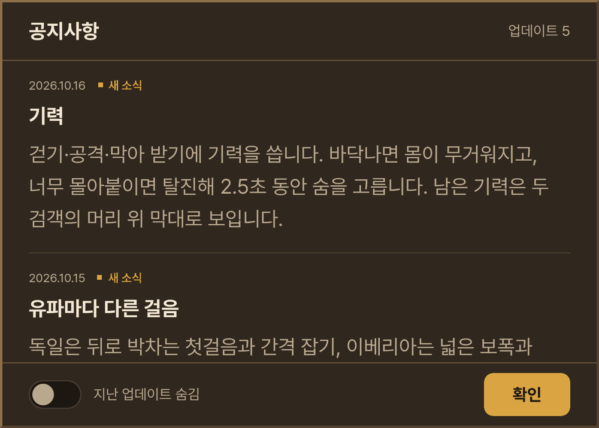
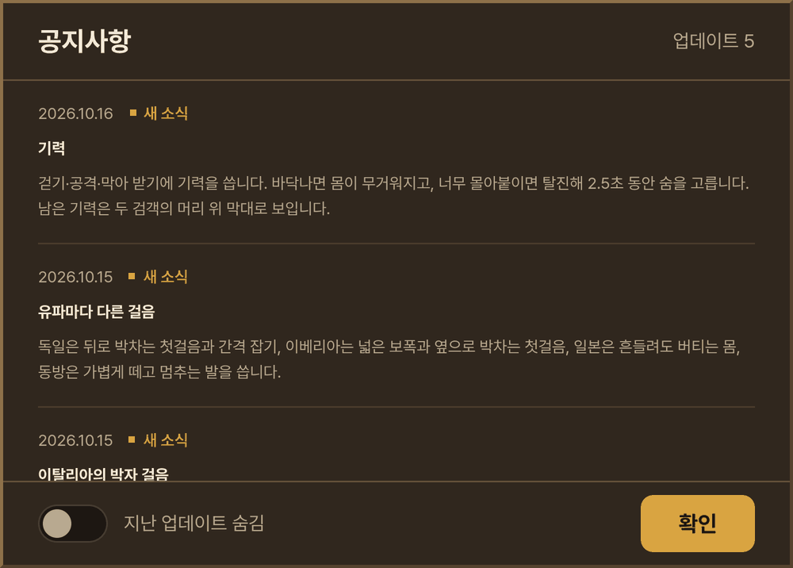
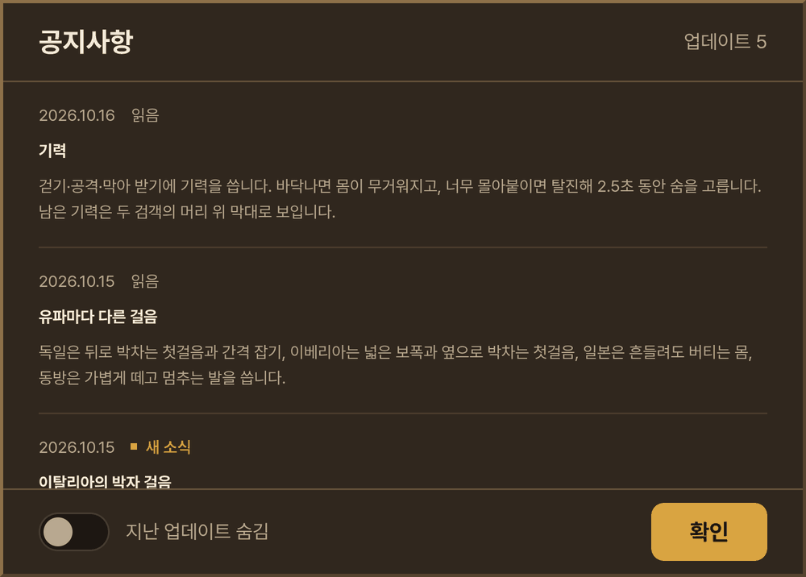

# 첫 화면 공지 글자 크기 — 처음 들어올 때 공지 = '공지사항' 공지 (2026-10-17)

- 지시 (사장님 원문): "첫화면 버그: 들어가자마자 뜨는 공지의 글자가 여전히 크게 나옴. '공지사항' 눌러서 보면 정상인데 그 크기로 통일."
- 시작점 main 32ba623. 글자 크기 값(창 제목 17 · 공지 제목 · 본문 · 날짜 10)은 그대로 — 처음 들어올 때 공지도 '공지사항'으로 연 공지와 같은 값으로 그려지게 했다.
- 확인표 · 결정 기록은 감독이 정리한다(이 문서는 까닭 · 고친 것 · 잰 값만).

## 0. 한눈에

| | 전 | 후 |
|---|---|---|
| 처음 들어올 때 공지 (사장님 아이폰) | 공지 제목 · 본문 **17 px** (창 제목 '공지사항'과 같은 크기) — 웹킷 글자 자동 키움 | **10 px** |
| '공지사항'으로 연 공지 | 10 px | 10 px |
| 고친 곳 | — | `src/entrance_type.css` `:host` 에 `-webkit-text-size-adjust: 100%` · `text-size-adjust: 100%` 두 줄 (첫 화면 · 공지 · 설정 · 계정 · 대기실 글자가 물려받음) |
| 크로미움(이 상자) 화면 | 두 길 모두 10 px — 이 버그가 안 생긴다 | 같음 (사진 화소까지 같음) |

## 1. 까닭

**사장님 폰(아이폰 17e · 홈 화면 앱)의 웹킷이 처음 들어올 때 공지의 제목 · 본문만 10 → 17 px 로 키웠다.** 우리 CSS 값 문제가 아니다 — 계산 글자 크기(getComputedStyle)는 두 길 모두 10 이고, 크로미움에는 이 셈이 없어 시험 브라우저에서는 늘 정상이었다.

### 1-1. 아이폰 웹킷의 글자 자동 키움

아이폰(작은 화면)은 웹킷 '글자 자동 키움(text autosizing)'이 기본으로 켜져 있다. 우리 페이지는 어디에도 `-webkit-text-size-adjust` 를 적지 않아 값이 `auto`(키워도 됨)였다. 웹킷 소스로 확인한 셈:

- 아이폰은 옛 셈을 쓴다(아이패드만 idempotent 셈 — `WebPreferencesDefaultValuesIOS.mm` `defaultTextAutosizingUsesIdempotentMode`). 최소 확대 글자 15 · 한 줄 계수 1.7 · 여러 줄 1.95 · 최대 1.7 배 (`UnifiedWebPreferences.yaml` `MinimumZoomFontSize` · `SettingsBase.h`).
- 기준 폭 = **화면의 세로 기준 폭** — 폰을 돌려도 그대로(`WebPageProxyIOS.mm` `textAutosizingWidth` = `screenSize().width()` = `UIScreen _referenceBounds`). 아이폰 17e 는 390.
- 가로 화면에서 이 폭보다 넓은 글 칸(블록)의 작은 글자를 키운다(`RenderBlockFlow::adjustFontSizes`): 최소 크기 = round(15 × 칸 폭 ÷ 390), 새 크기 = min(최소 크기, 크기 × 계수 ÷ log10(크기)), 같은 꼴 글이 둘 이상이면 평균, 최대 1.7 배(`TextAutoSizingValue::adjustTextNodeSizes`). 글자 칸의 `text-size-adjust` 가 `auto` 일 때만.
- 공지 제목 · 본문 칸 = **452 px**(창 500 − 테두리 · 옆 여백) > 390 → round(15 × 452 ÷ 390) = **17** → 10 px 이 17 px 로(줄 높이도 1.7 배: 본문 16 → 27 · 제목 14 → 23). 날짜 · 읽음 줄은 flex 낱칸이라 칸이 좁아(48 px) 10 그대로, 창 제목 '공지사항'(17)은 이미 17.

### 1-2. 두 길이 갈린 까닭

이 셈은 배치(layout)가 끝날 때 **그 배치의 뿌리부터 아래로** 돌고(`LocalFrameViewLayoutContext::applyTextSizingIfNeeded` → `RenderElement::adjustFontSizesOnBlocks`), **높이가 고정된 블록 아래로는 내려가지 않는다**(`includeNonFixedHeight`).

- 첫 화면 바탕 `#entrance` = `height: 100svh`(고정 px) · `overflow: hidden` · 폭 100 % → 웹킷 **배치 경계**(`RenderObject.cpp` `isLayoutBoundary`). 그 안이 바뀌면 배치가 `#entrance` 에서 시작한다.
- 공지 창은 맨 위 층(showModal)이어도 렌더 트리에선 DOM 자리 그대로 `#entrance` 안이다(웹킷은 그리는 층과 기준 상자만 화면으로 옮긴다 — `RenderObject::containingBlock`).
- **화면 전체에서 시작한 배치**: 셈이 `#entrance`(고정 높이)에서 멈춰 공지 창에 안 닿는다 → 안 커진다.
- **`#entrance` 에서 시작한 배치**: 셈이 그 안의 공지 창까지 닿는다 → 커진다. 한 번 커진 글자는 화면 크기가 바뀌어 셈을 되돌릴 때(`resetTextAutosizing`)까지 그대로.

| 길 | 창이 열린 동안 `#entrance` 안(창 밖)에서 바뀐 것 (잰 것 — 크로미움 폰 가로) | 웹킷 |
|---|---|---|
| 처음 들어올 때 | 약 0.5 s 픽셀 제목 'Stillness' 그림(글꼴을 받은 뒤 `paintPixelWordmark` 가 h1 에 canvas 를 붙임) · 약 0.6~1.1 s 계정 단추 글(계정 모듈을 따로 받은 뒤 '계정 연결' 단추를 다시 씀) · 약 1.1 s '적막' 그림. 세로로 열고 가로로 돌리면 돌린 뒤 바람 장면 캔버스 크기 | `#entrance` 에서 시작하는 배치 → 공지 제목 · 본문 **17** |
| '공지사항'으로 열 때 | **없음**(0 건) — 그림 · 계정 단추는 이미 끝났고, 창을 여는 배치는 화면 전체에서 시작(맨 위 층 창의 기준 상자 = 화면) | 셈이 창에 안 닿음 → **10** |

### 1-3. '여전히'인 까닭

앞서 본문 12 → 10(`ui_fix_2026-10-16.md` §2) · 제목 14 → 10(§11)으로 줄였지만, 키운 크기는 min(17, …) — **칸 폭(452)만으로 정해진다**: 본문 12 → 17 · 10 → 17, 제목 14 → 17 · 10 → 17. 처음 들어올 때 공지는 줄인 값과 상관없이 늘 17 이었고, '공지사항'으로 연 공지만 줄어 보였다. 앞 시험(`title_smoke` 계산값 10)이 통과한 것도 같은 까닭 — 웹킷은 계산값이 아니라 그릴 때 쓰는 크기만 바꾼다.

## 2. 고친 것

- `src/entrance_type.css` (첫 화면 · 대기실 글자 값 한 곳) `:host` 에 `-webkit-text-size-adjust: 100%; text-size-adjust: 100%;` — 물려받는 값이라 Shadow DOM 안 글자 모두(첫 화면 · 공지 · 설정 · 계정 · 대기실). 웹킷 셈은 `text-size-adjust` 가 `auto` 일 때만 키우므로, 어느 배치에서 시작하든 공지 글자는 CSS 값(10) 그대로 → **두 길이 같다**. 배치 순서 · 시간에 기대지 않는다.
  - `100%` 를 쓴 까닭: 키움을 끄는 값 가운데 모바일 브라우저마다 뜻이 같은 값(배율 1). 글자 크기 · 굵기 · 색 · 줄 간격 값은 그대로.
  - 빌드 결과에 `-webkit-text-size-adjust:100%` 가 남는 것 확인(lightningcss 가 `-moz-` 도 붙임).
- 같은 셈을 받을 수 있던 곳: 계정 창(가로 낮은 화면 폭 540 — 글 칸 492 px, 12 px 글이 웹킷 셈으론 19) — 같은 줄로 함께 막힌다. 첫 화면 · 대기실에는 폭 390 px 넘는 글 칸이 없다(잰 것) → 폰에서 달라지는 곳은 처음 들어올 때 공지뿐.
- `src/start_screen.js` · 꾸밈 CSS 는 그대로(다른 작업자가 첫 화면 · 대기실 소리를 넣는 중).
- 시험: `tools/browser/title_smoke.mjs` 에 한 점검 — 공지 글자(창 제목 · 공지 제목 · 본문 · 날짜 줄 · 업데이트 수 · 숨김 글)의 text-size-adjust = 100 % · '공지사항'으로 연 공지의 크기 · 줄 높이 · text-size-adjust = 처음 들어올 때 공지와 같음.
- 도구: `tools/browser/notice_size_capture.mjs` — 두 길의 글자 값 · 창이 열린 동안의 `#entrance` 바뀜 · 아이폰 모형 크기를 재고 사진을 찍는다(아래).

## 3. 잰 값

배포판 빌드 + 미리 보기 서버, 폰 가로 844 × 390 · 폰 세로 390 × 844(공지는 '폰을 가로로 돌려 주세요'가 덮어 창을 안 그림 → 가로로 돌려 잼) — 화소 비 3 · 터치 · 매번 새 브라우저 문맥(공지 읽음 기록 없음). 값은 px, **전 → 후**.

| 화면 · 길 | 창 제목 | 공지 제목 | 본문 | 날짜 줄 | text-size-adjust |
|---|---|---|---|---|---|
| 폰 가로 · 처음 들어올 때 | 17 → 17 | 10 → 10 · **아이폰 17 → 10** | 10 → 10 · **아이폰 17 → 10** | 10 → 10 | auto → 100% |
| 폰 가로 · '공지사항' | 17 → 17 | 10 → 10 · 아이폰 10 → 10 | 10 → 10 · 아이폰 10 → 10 | 10 → 10 | auto → 100% |
| 폰 세로 → 가로 · 처음 들어올 때 | 17 → 17 | 10 → 10 · **아이폰 17 → 10** | 10 → 10 · **아이폰 17 → 10** | 10 → 10 | auto → 100% |
| 폰 세로 → 가로 · '공지사항' | 17 → 17 | 10 → 10 · 아이폰 10 → 10 | 10 → 10 · 아이폰 10 → 10 | 10 → 10 | auto → 100% |

- 앞 숫자 = 크로미움 계산 글자 크기(실제로 잰 것). 줄 상자 높이(창 제목 20 · 나머지 12) · 글 칸 폭(공지 제목 · 본문 452 · 날짜 47.5 · 창 제목 58.8) · 줄 수 · 줄 높이(제목 14 · 본문 16)도 전후 · 두 길 모두 같다. 창 사진은 전후 화소까지 같다(크로미움은 원래 이 셈이 없어 고친 줄이 그림을 바꾸지 않는다).
- **아이폰** = 1-1 의 웹킷 셈을 위에서 잰 칸 폭 · 줄 수 · text-size-adjust · '창이 열린 동안 `#entrance` 안이 바뀌었나'에 그대로 적용한 값(모형 — 이 상자엔 아이폰이 없어 기기에서 잰 값이 아니다). 전: 처음 들어올 때만 17(사장님이 본 것), 후: text-size-adjust 가 auto 가 아니라 셈에서 빠져 두 길 모두 10.
- 창이 열린 동안 `#entrance` 안 바뀜: 처음 들어올 때 가로 11 건(그림 둘 · 계정 단추) · 세로 → 가로 2 건(돌린 뒤 바람 캔버스 크기) / '공지사항' 0 건 — 전후 같다(바뀐 건 셈이 글자를 키울 수 있느냐뿐).
- 콘솔 · 페이지 오류 0, 4xx/5xx 응답 0.

## 4. 사진 (공지 창만, 폰 가로 844 × 390)

전 — 처음 들어올 때(아이폰 모형: 웹킷 셈이 낸 17 px 을 크로미움에 입혀 그린 것) · 전 — '공지사항'으로 연 것(실제 화면)

 

후 — 처음 들어올 때 · '공지사항'으로 연 것(실제 화면 — 두 길 같은 10 px)

 

(두 '새 소식' / '읽음' 표지 차이는 앞서 확인을 눌러 읽음으로 친 것 — 글자 크기와 상관없음. 도구 원본은 화소 비 3, 문서에는 2/3 로 줄여 넣음.)

## 5. 시험 · 관문

- 브라우저 시험(배포판 빌드 + PWA 워커 · 미리 보기 서버 · 인증 서버 막음 · 소프트웨어 GL): `title_smoke` 17(16 + 새 점검 1) · `title_account_smoke` 9 · `ui_unify_smoke` 11 — 모두 통과 · 콘솔 오류 0.
- `game_entry_smoke` · `lobby_fix_smoke`: 이 상자가 다른 작업자들의 브라우저 시험으로 붐빌 때(부하 평균 11~17, 4 코어) 둘 다 싸움 쪽 기다림에서 시간 초과 — `game_entry_smoke` 는 10 점검(첫 화면 · 공지 · 설정 · 대기실 · 카드 · 싸움 들어감 · 조이스틱 · 정지 · 이어하기) 통과 뒤 결과 창 기다림 30 s(한 번은 6 점검 뒤 카드 → 싸움 60 s), `lobby_fix_smoke` 는 1 점검 뒤 카드 → 싸움 30 s. **고치기 전 빌드도 같은 부하에서 같은 자리에서 멈췄다**(game_entry 10 점검 뒤 결과 창 · lobby_fix 1 점검 뒤 카드 → 싸움) · 콘솔 오류 0. 같은 부하에서 기다림을 늘려 재 보니 카드 → 싸움 38 s · 상대를 쓰러뜨린 뒤 결과 창 33 s(게임 시간이 벽시계의 0.056 배로 흐름) — 흐름은 정상이고 시험의 30 s 기다림을 넘을 뿐이다. 고친 것은 Shadow DOM 글자 꾸밈 두 줄이라 싸움 화면에 닿지 않는다 — 한가할 때 다시 돌려 볼 것.
- 빌드 0 · 표기 방침 위반 0(`node tools/text/name_policy.mjs`). 글자 꾸밈 두 줄만 바꿔 싸움 · 시뮬 길은 그대로다.

## 6. 남은 것 · 사장님 확인

- 사장님 폰에서: 홈 화면 앱이 새 판을 받은 뒤(한 번 열었다 닫고 다시 열기), 새 공지가 있을 때 처음 뜨는 공지의 제목 · 본문이 '공지사항'으로 연 공지와 같은 크기(10)인지. 이 상자에서는 웹킷 셈을 소스와 모형으로만 확인했다.
- 싸움 화면(index.html)도 `text-size-adjust` 를 적지 않았다 — 가로에서 폭 390 px 넘는 작은 글 칸이 있으면 같은 셈을 받을 수 있다. 이번 지시 밖이라 손대지 않았다(감독 판단).
