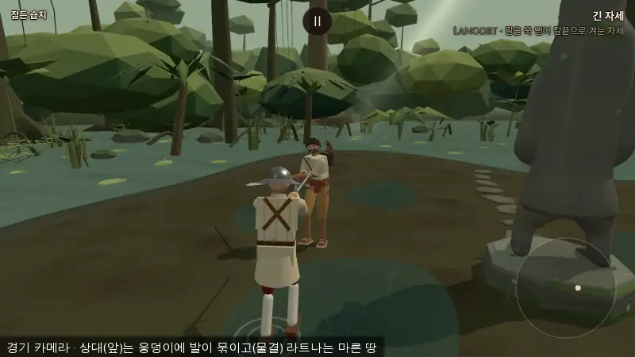
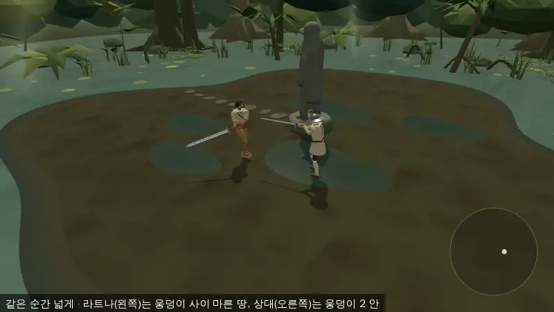
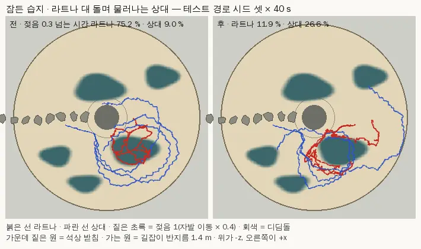
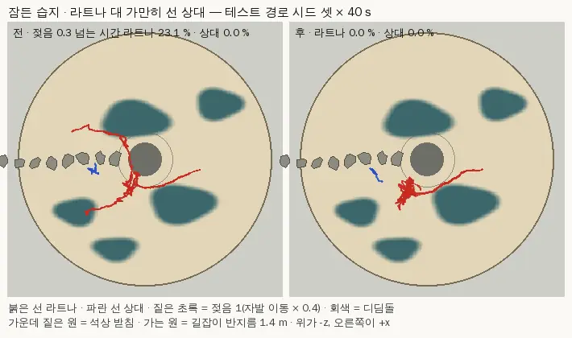

# 라트나 '마른 길을 아는 AI' — 잠든 습지에서만 (2026-10-14)

- 가지 `…/ratna-drypath` (본판 3295464 에서). 커밋만, 병합은 감독.
- 지시: 사장님 10/14 18:3x **"라트나 마른길 AI 넣어."** — 감독 추천안에서 이미 승인된 항목(비용 때문에 미뤄 둔 것). 감독 설계 요구 1~5 를 따랐다.
- 미뤄 둔 기록: `docs/import/ratna_port_2026-10-14.md` §9 ("'마른 길을 아는 AI'(디딤돌로 다니며 상대를 웅덩이로 모는 것)는 이번 범위 밖") · `src/characters.js` 라트나 머리말(→ '넣음'으로 고침).
- 손대지 않은 것: 진흙 감속 값·웅덩이 꼴(`wetland_ground.js`)·석상 충돌체·AI 돌아가기(`arena_obstacle.js`)·다른 인물 AI·플레이어 물리·여정 자리·무대 상대 묶기(`STAGE_FOE`). **감속 면제 없음** — 라트나도 웅덩이 한가운데서 자발 이동 × 0.4 (신발은 옷차림만, 확인표 1116 그대로).
- 샛별 저장소는 읽지 않았다(참고해도 된다는 지시였으나 사본 자리는 감독 문서에만 있어 열지 않음) — 설계·값은 모두 이 가지에서 새로 정했다.

## 0. 한눈에

| 칸 | 내용 |
|---|---|
| 켜지는 조건 | 인물 표식 `persona.terrainSense: 'wetland'`(라트나 한 칸) **그리고** 그 몸의 `movementSurface === 'wetland'`(잠든 습지 — main.js 가 판마다 붙인다). 매 스텝 다시 읽는다 |
| 꺼져 있으면 | 옛 길 **바이트 그대로** — 시뮬 관문 다섯 그대로 · 노드 대조(3295464 의 `ai.js` 와 스텝마다 결정 해시가 같음) · 브라우저 결정 흔적 같음 (§1) |
| 판단 근거 | **물리와 같은 젖음 지도** `wetlandWetness`(진흙 감속이 읽는 그 값) — 그림의 디딤돌은 보지 않는다 |
| 하는 일 | (a) 마른 쪽으로 걸음 틀기 · 웅덩이에 들면 빠져나오기 · 석상 돌아갈 쪽을 마른 쪽으로 (b) 상대 등 뒤가 웅덩이가 되게 돌기 · 그때 앞으로 누르기 (c) 상대가 젖은 자리에 서면 공격 결심에 작은 가산점 |
| 세기 | 숙련도별 표, **라트나(2) = 0.55** — 늘 마른 쪽을 고르지는 않는다 |
| 새 값 | `config.js` `DRYPATH` 한 묶음 9 칸(세기 표 · 거리 둘 · 각 둘 · 무게 둘 · 누르기 · 가산점). 새 상한·문턱·쿨다운·난수 없음 — 확인표 **1340~1352** |
| 결과 (노드 · 시드 24 × 40 s) | 라트나가 젖음 0.3 넘는 자리에 선 시간 **14.4 → 0.3 %**(가만히 선 상대) · **5.8 → 1.4 %**(물러나는 상대) · **35.2 → 17.2 %**(돌며 물러나는 상대). 돌며 물러나는 상대가 젖은 시간 **9.7 → 21.4 %**. 칼이 나간 공격 131 → 128 · 120 → 126 · 132 → 134 (그대로) |
| 결과 (브라우저 · 테스트 경로 · 시드 셋 × 40 s) | 라트나 젖음 > 0.3 — 가만히 선 상대 **23.1 → 0.0 %** · 돌며 물러나는 상대 **75.2 → 11.9 %** · 그 상대가 젖은 시간 **9.0 → 26.6 %** · 칼이 나간 공격 12 → 15 · 11 → 11 · 끼임 0 → 0 · 콘솔 오류 0 (§4-2) |
| 디딤돌 ↔ 감속 지도 | **어긋남 없음** — 디딤돌 여덟 모두 윗면 위 젖음 0 (§5) |

## 1. 켜지는 조건 · 꺼지면 바이트 그대로

- 표식: `src/characters.js` 라트나 `ai.persona.terrainSense = 'wetland'` 한 칸. 다른 인물·기본 상대에는 없다.
- `ai.js` `get drySense()` = 표식이 `'wetland'` **이고** `this.me.movementSurface === 'wetland'` 일 때 `DRYPATH.power[숙련도]`, 아니면 **0**. 0 이면 아래 네 자리를 하나도 타지 않는다:
  - `update()` — `dryRouteSide`(돌아가기 앞) · `dryFeet`(돌아가기 뒤) 부르지 않음
  - `opportunity()` — 가산점 줄 지나침
  - `moveFeet()` 돌기 고르기 — 같은 굴림 `x` 를 옛 식 그대로 (`ds ? dryCircle(x) : 옛 식`)
- 난수를 새로 굴리지 않는다(돌기 고르기도 옛 굴림 `x` 하나를 그대로 쓴다). 그래서 꺼진 판은 `Math.random` 호출 수까지 같다.
- 판 도중 무대를 바꾸면(`game.setStage`) `movementSurface` 가 바뀌어 다음 스텝부터 따라간다.
- 확인 (모두 이 가지 마지막 코드):
  - 시뮬 관문 다섯 기대값 그대로 (§4-4).
  - 노드 대조 `node tools/sim/ratna_drypath_sim.mjs eq --base=3295464` — 3295464 의 `src/ai.js` 와 지금 `ai.js` 를 같은 판(잠든 습지 석상·진흙·시작 비킴까지 세운 세계)에 세워 20 s 동안 스텝마다 스틱·손 목표·꼴·골반 자리 해시를 견줌: **A** 라트나 · 기본 무대 시드 1~3 **같음** · **B** 다른 인물 열넷(기본 열둘 + 광기의 하인리히 + 다라이시) · 잠든 습지 **같음** · **C** 라트나 · 잠든 습지 · 표식만 뺌 시드 1~3 **같음** · **D** 라트나 · 잠든 습지 · 표식 그대로 시드 1~3 **다름**(켜진 판만 달라진다).
  - 브라우저 결정 흔적 (§4-3).

## 2. 무엇을 하나

내 발 자리 = 골반 수평 자리(진흙 감속 판정과 같은 점). 상대 자리 = 반응 시간만큼 늦게 본 가슴 + 골반 속도 × 앞질러 봄(`updateCombat` 의 거리 셈과 같은 꼴 — AI 가 몰래 더 보지 않는다).
'디딜 수 없는 곳'도 젖은 땅처럼 본다(`dryCost`): 석상 길잡이 반지름 1.4 m(받침 0.90 + 옛 `OBSTACLE_ROUTE.clear` 0.5) 안 · 울타리 6.5 m 밖 — 가장자리는 웅덩이와 같은 폭 0.3 m(옛 `WETLAND_RIM`)로 녹인다. 그래서 마른 쪽을 찾다가 석상으로 파고들거나 울타리로 붙지 않는다.

| 갈래 | 언제 | 무엇 | 자리 |
|---|---|---|---|
| (a) 걸음 틀기 | 간 보기 · 물러나기 · 막으며 물러서기 · 다가가기(칼을 들며 · 닿기 전) | 이번 스텝 스틱이 가리키는 쪽에서 좌우로 `fan` 0.9 rad 돌린 두 자리를 `look` 0.9 m 앞에서 견주어 덜 젖은 쪽으로 튼다. 트는 각 = fan × 세기 × (한쪽 값 − 다른 쪽 값) — 라트나는 가장 크게 0.5 rad(약 28°). 땅 위 빠르기(옆 · 뒤 걸음 몫까지 셈)는 그대로 | `dryFeet` ③ |
| (a) 나오기 | 같음 | 지금 발 자리 값 w > 0 이면 둘레 여덟 쪽 look m 땅의 마른 몫으로 가리킨 쪽(마른 몫 × 그쪽 단위 벡터의 합 ÷ 2)으로 걸음을 세기 × w 만큼 섞는다 — 웅덩이 한가운데서도 가장자리 쪽을 가리킨다 | `dryFeet` ② |
| (a) 석상 돌아갈 쪽 | 상대에게 가는 길이 석상에 막혀 돌아가기 시작할 때 한 번 | 길잡이 고리(2.15 m) 위 두 길의 걸리는 시간 = 길이 ÷ (1 − 0.6 × 세기 × 젖음)이 짧은 쪽. 막힌 동안은 바꾸지 않는다(옛 `obstacleSide` 걸쇠) — 마른 땅뿐이면 옛 고르기처럼 짧은 쪽 | `dryRouteSide` |
| (b) 돌기 고르기 | 옛 돌기 박자(`circleTimer` 0.8~2.2 s)마다 한 번 | 상대 둘레를 `orbit` 0.4 rad 돈 오른쪽 · 제자리 · 왼쪽 자리 값 = `herd` 0.8 × 상대 등 뒤 젖음(나 → 상대 줄 너머 `back` 2.4 m 를 ⅓ · ⅔ · 끝 셋으로 나눈 자리 평균) − `self` 1 × 내 발 자리 값. 돌아간 자리에서 석상이 상대를 가리면 가장 나쁜 값. 옛 몫(멈춤 0.45 · 즐겨 도는 쪽 0.40 · 반대 0.15)을 세기 × 값 차 ÷ (herd + self)만큼 기울인다 — 땅이 다 같으면 옛 줄과 같은 `x` 에서 같은 값 | `dryOrbit` · `dryCircle` |
| (b) 누르기 | 간 보며 옆으로 도는 거리 안(moveFeet 와 같은 조건) | 지금 자리에서 상대 등 뒤 젖음 b 만큼 스틱을 앞으로 세기 × b × `press` 0.3 더 민다(라트나 가장 크게 +0.165) — 상대가 물러나면 웅덩이로 | `dryFeet` ① |
| (c) 가산점 | 간 보기의 기회 판단(0.06~0.14 s 마다) | 점수 += `bonus` 0.3 × 세기 × 상대 자리 젖음 — 라트나 가장 크게 +0.165(견줌: '칼끝이 나를 겨누지 않음' 0.25). 기회 종류(kind)는 그대로라 기술 고르기는 안 바뀐다 | `opportunity` |

- 이어지는 값만 쓴다: 트는 각·섞는 몫·누르는 몫·가산점이 모두 젖음(0~1, 가장자리 0.3 m 에서 부드럽게)에 비례해, 웅덩이 가장자리를 지나도 스텝마다 쪽이 뒤집히지 않는다. 고르는 박자(돌기 고르기 · 돌아갈 쪽)는 옛 박자·옛 걸쇠를 그대로 쓴다.
- 베는 걸음(strike · follow)·비껴 딛는 기술 걸음·쓰러짐·발 묶임(판 시작 2 s)·부활 동안은 손대지 않는다 — 공격 길이는 바뀌지 않는다.
- 설계 중 버린 것 (§4-1 에 잰 값): ① 돌기 고르기의 몫 기울이기만으로는 상대 등 뒤 젖음이 늘지 않았다(신호가 약함) → 누르기를 더함. ② 간 보며 값이 나은 쪽으로 옆걸음을 더하는 '몰이 옆걸음'은 공격 시도를 줄여(돌며 물러나는 상대 216 → 181~198) 뺐다. ③ 걸음 틀기만으로는 웅덩이 한가운데 서 있을 때(스틱이 거의 0) 나오지 못해 '나오기'를 더함.

## 3. 값 묶음 — `config.js` `DRYPATH` (확인표 1340~1352, 모두 사장님 확인 전)

| 칸 | 값 | 뜻 |
|---|---|---|
| `power` | 0.3 · 0.4 · **0.55** · 0.7 · 0.85 · 1 (숙련도 0~5) | 세기 — 아래 몫마다 곱한다. 지금 쓰는 인물은 라트나(2)뿐, 다른 칸은 같은 기울기로 둔 자리 |
| `look` | 0.9 m | 발 살피기 거리 (걸음 틀기 앞 · 나오기 둘레 여덟 쪽) |
| `fan` | 0.9 rad (약 52°) | 걸음 틀기에서 견주는 좌우 각 — 가장 크게 트는 각 = fan × 세기 |
| `orbit` | 0.4 rad | 돌기 고르기에서 미리 보는 상대 둘레 각 |
| `back` | 2.4 m | 상대 등 뒤 살피기 (⅓ · ⅔ · 끝 셋 평균) |
| `self` | 1 | 돌기 고르기: 내 발 자리 무게 |
| `herd` | 0.8 | 돌기 고르기: 상대 등 뒤 무게 |
| `press` | 0.3 | 누르기 |
| `bonus` | 0.3 | 공격 결심 가산점 |

옛 값을 다시 쓴 것(새 값 아님): 석상 길잡이 반지름(받침 0.90 + `OBSTACLE_ROUTE.clear` 0.5) · 돌아가기 고리(+ `ring` 0.75) · 돌기 걸음 간격(`step` 0.58 rad) · 웅덩이 가장자리 폭 `WETLAND_RIM` 0.3 · 한가운데 감속 `WETLAND_CORE_SPEED` 0.4 · 울타리 `ARENA.radius` 6.5 · 옆 · 뒤 걸음 몫 `GAIT.sideFactor` · `backFactor` · 돌기 박자 `circleTimer` · 돌기 몫 0.45 / 0.40 / 0.15 · 스틱 자르기(moveFeet 와 같은 폭).
식 안의 고정 수: 나오기의 '÷ 2'(반쯤 마른 둘레에서 걸음 몫 약 1.3)와 둘레 여덟 쪽 · 등 뒤 세 자리(⅓ · ⅔ · 끝) — 확인표 1345 · 1347 에 함께 적었다.

**확인표 줄** (`docs/strike/owner_defaults_table.md` 끝 '라트나 마른 길을 아는 AI' 절): 1340 켜지는 조건 · 1341 세기(`power`) · 1342 판단 근거 · 1343 디딜 수 없는 곳 · 1344 걸음 틀기(`look` · `fan`) · 1345 나오기 · 1346 석상 돌아갈 쪽 · 1347 돌기 고르기(`orbit` · `back` · `self` · `herd`) · 1348 누르기(`press`) · 1349 공격 가산점(`bonus`) · 1350 감속 면제 없음(알림) · 1351 디딤돌 ↔ 감속 지도(알림) · 1352 측정(알림).

## 4. 측정

플레이어 정해진 입력 셋(스틱만, 몸은 늘 상대를 본다): **가만히** — 움직이지 않음 · **물러남** — 라트나가 2.3 m 안이면 물러나고(−0.8) 3.4 m 밖이면 다가감(+0.5) · **돌며 물러남** — 물러남 + 늘 오른쪽 옆걸음 0.5 (상대가 둘레를 돌아 웅덩이 곁을 지나게 된다).
'전' = 같은 코드에서 AI 의 표식만 뺀 판 — §1 대조 C 로 3295464 와 결정이 같음을 본 판이다. 판 시작 정지 2 s 는 빼고 센다. '젖음 > 0.3' = 골반 자리 젖음이 0.3 넘는 시간 몫(감속 × 0.82 아래). '석상 1.25 m 안' = 골반이 석상 가운데에서 1.25 m 안 — 받침(0.86 m)에 몸이 닿는 거리. '끼임' = 스틱을 0.3 넘게 미는데 골반이 0.15 m/s 아래로 0.5 s 넘게. '칼 나감' = 공격 시도 − 다가가다 거둔 것.

### 4-1. 노드 (결정적 · 잠든 습지 그대로 — 석상 충돌체 · 진흙 감속 · 시작 비킴 · 발 받침 바닥) — 시드 24 × 40 s = 960 s 씩

`node tools/sim/ratna_drypath_sim.mjs stats <정책> 40 1,2,…,24`

| 플레이어 | 라트나 젖음 > 0.3 (평균) | 상대 젖음 > 0.3 (평균) | 공격 시도 · 거둠 · **칼 나감** · 맞힘 | 석상 1.25 m 안 | 끼임 |
|---|---|---|---|---|---|
| 가만히 · 전 | 14.4 % (0.120) | 0.1 % (0.001) | 131 · 0 · **131** · 23 | 293.1 s | 0 |
| 가만히 · 후 | **0.3 %** (0.006) | 0.0 % (0.000) | 128 · 0 · **128** · 30 | **3.2 s** | 0 |
| 물러남 · 전 | 5.8 % (0.045) | 0.0 % | 166 · 46 · **120** · 13 | 50.1 s | 0 |
| 물러남 · 후 | **1.4 %** (0.012) | 0.0 % | 141 · 15 · **126** · 9 | **3.2 s** | 0 |
| 돌며 물러남 · 전 | 35.2 % (0.330) | 9.7 % (0.083) | 216 · 84 · **132** · 12 | 13.7 s | 0 |
| 돌며 물러남 · 후 | **17.2 %** (0.136) | **21.4 %** (0.191) | 225 · 91 · **134** · 16 | **0.7 s** | 0 |

- 라트나 젖음은 셋 모두 줄고(가만히 −98 %, 물러남 −76 %, 돌며 물러남 −51 %), 돌며 물러나는 상대는 웅덩이에 든 시간이 두 배 남짓이 되었다.
- **싸움을 피하지 않는다**: 칼이 나간 공격은 그대로(131 → 128 · 120 → 126 · 132 → 134). 물러나는 상대에서 '시도'가 166 → 141 로 준 것은 거둔 시도(다가가다 시간 안에 못 붙어 그만둔 것)가 46 → 15 로 준 몫이다 — 전에는 석상 받침에 붙거나 웅덩이에서 느려져 다가가다 거두는 일이 많았다. 맞선 시간(상대 칼 닿는 거리 + 0.9 m 안)은 885 → 871 s 로 같다. 노드 소음 폭: 아무것도 안 바꾼 판끼리 시도 수가 ±5 % 안팎 흔들린다(물러남 166 ↔ 162).
- **석상**: 전에는 가만히 선 상대를 석상 너머로 두고 받침에 붙어 서 있는 시간이 길었다(960 s 가운데 293 s — 옛 AI 의 버릇). 후에는 디딜 수 없는 곳을 젖은 땅처럼 보아 3 s 로 줄었고, 끼임은 전·후 모두 0. 같은 꼴 안에서 0.5 s 안에 스틱이 세 번 넘게 뒤집히는 '떨림 구간'은 돌며 물러나는 상대에서 전 5 · 후 5 로 늘지 않았다.
- 갈래 떼어 보기(물러남 · 시드 48 · 설계 중 fan 0.6 판): 라트나 젖음 > 0.3 이 전 5.4 % · 나오기를 뺀 판 4.4 % · 넣은 판 1.1 % — 젖음을 줄이는 것은 대부분 '나오기'다. 걸음 틀기 fan 0.6 rad 은 0.9 보다 조금 덜 줄었다(가만히 1.5 % · 물러남 1.6 % · 돌며 물러남 18.6 %).

### 4-2. 브라우저 — 테스트 경로 `index.html?test=1&weapon=longsword&hero=player&foe=ratna&stage=sluice` · 헤드리스 · 화면 배율 1

`node tools/browser/ratna_drypath_probe.mjs <서버> <폴더> dry 1 2 3` (`POL=still|circle`). 판을 여는 같은 자바스크립트 차례 안에서 `Math.random` 을 시드로 바꾸고 화면 시각을 가짜 시계로 넘겨 결정적으로 돌렸다(같은 판 두 번 = 같은 흔적, §4-3). '전'은 판을 연 그 차례에 AI 의 표식만 뺐다.

| 플레이어 · 시드 셋 × 40 s | 라트나 젖음 > 0.3 (평균) | 상대 젖음 > 0.3 (평균) | 공격 시도 · 칼 나감 · 맞힘 | 석상 1.25 m 안 | 끼임 · 뒤집힘 |
|---|---|---|---|---|---|
| 가만히 · 전 | 23.1 % (0.200) — 시드별 0.7 · 28.5 · 40.2 % | 0 % | 12 · 12 · 0 | 22.9 s | 0 · 11 |
| 가만히 · 후 | **0.0 %** (0.004) — 0.0 · 0.0 · 0.0 % | 0 % | 15 · 15 · 7 | **0.0 s** | 0 · 8 |
| 돌며 물러남 · 전 | 75.2 % (0.719) — 45.4 · 90.2 · 90.0 % | 9.0 % (0.086) — 26.9 · 0.0 · 0.0 % | 23 · 11 · 0 | 2.8 s | 0 · 6 |
| 돌며 물러남 · 후 | **11.9 %** (0.080) — 5.2 · 13.9 · 16.5 % | **26.6 %** (0.248) — 54.6 · 23.6 · 1.5 % | 19 · 11 · 0 | 0.8 s | 0 · 11 |

- 브라우저에서도 노드와 같은 쪽으로 갈렸다: 라트나는 웅덩이를 비켜 가고(가만히 23.1 → 0.0 % · 돌며 물러남 75.2 → 11.9 %), 돌며 물러나는 상대는 웅덩이에 든 시간이 세 배 가까이 되었다(9.0 → 26.6 %). 칼이 나간 공격은 12 → 15 · 11 → 11.
- '돌며 물러남 · 전'은 노드(35.2 %)보다 훨씬 젖었다 — 브라우저의 플레이어 스틱은 화면마다(0.11 s) 바뀌고 손이 기본 자세에 머물러 판이 다르게 흐른다. 같은 조건끼리의 전/후만 견준다.
- 석상 근처 뒤집힘은 돌며 물러남에서 6 → 11 번(석상 근처를 밀며 지난 시간 5.0 → 3.4 s)으로 늘었으나, 노드 시드 24 에서 같은 꼴 안의 '떨림 구간'(0.5 s 안 세 번 넘게)은 5 → 5 로 그대로다 — 다가가기 · 칼을 들기와 베기 사이 꼴이 바뀔 때의 뒤집힘이 대부분이다. 끼임은 0.
- 콘솔 오류 0 · HTTP 400 이상 0 (모든 갈래).

### 4-3. 대조 — 켜기 전과 같은가 (브라우저 결정 흔적 · 스틱 · 손 목표 · 꼴, 판 시작 정지 뒤 20 s)

`node tools/browser/ratna_drypath_probe.mjs <서버> <폴더> same` (`SAME_SECS=20`) — 판마다 페이지를 새로 열어 같은 시드로.

| 대조 | 흔적 | 판정 |
|---|---|---|
| ① 라트나 · 잠든 습지 · 같은 판 두 번 | `ab73810b` / `ab73810b` | 같음 — 브라우저 측정이 결정적이다 (세기 0.55) |
| ② 라트나 · **기본 무대(arena)** · 표식 있음 / 뺌 | `ae5d4687` / `ae5d4687` | **같음** — 세기 0 (진흙 감속이 없는 무대라 꺼짐) · 공격 1 / 1 |
| ③ **하인리히** · 잠든 습지 · 그대로 / 표식 칸 지움 | `a9b6725b,ff499b37` / 같음 (첫 판이 끝나 둘째 판까지) | **같음** — 세기 0 · 공격 7 / 7 |
| ④ 라트나 · 잠든 습지 · 표식 뺌 / 있음 | `4d5a5256` / `ab73810b` | 다름 — 켜진 판만 달라진다 |

- 노드 대조(§1 — 3295464 의 `ai.js` 와 견줌, 다른 인물 열넷 모두 같음)와 함께, 라트나를 다른 무대에 세우거나 다른 인물을 습지에 세운 판의 AI 결정은 켜기 전과 같다.
- 콘솔 오류 0 · HTTP 400 이상 0.

### 4-4. 관문 (이 가지 마지막 코드)

| 명령 | 기대 | 결과 |
|---|---|---|
| `node tools/sim/fights12.mjs` | `7c95ba21` | `7c95ba21` |
| `node tools/sim/live_battery.mjs` | `e7ee3d96` | `e7ee3d96` |
| `node tools/sim/finish_thrust.mjs 1 --stand` | `433ac984` | `433ac984` |
| `node tools/sim/corr_s0.mjs --limits=on,off --scenes=a,b` | identical 12 줄 | 12 |
| `node tools/sim/weapon_smoke.mjs` | ` OK ` 22 줄 | 22 |
| `npx vite build` | rc 0 | 0 |
| `node tools/text/name_policy.mjs` | rc 0 | 0 (위반 0) |

(sha 는 stdout 에서 'deprecated parameters' 줄을 뺀 sha256 앞 8 자리.) 금지어 검사(`git diff 3295464 HEAD` 의 더한 줄) 결과 없음.

## 5. 디딤돌과 감속 지도 — 어긋남 없음

`node tools/sim/ratna_drypath_sim.mjs stones` — `stage_sluice.js` `paving()` 의 디딤돌 여덟을 같은 난수(`rng(63977)`)·같은 소비 순서(이끼 칠 몫까지)로 다시 지어, 돌 윗면 다각형(돌림 포함) 안을 2 cm 격자로 `wetlandWetness` 를 쟀다.

| 돌 | 가운데 (x, z) m | 반지름 m | 윗면 위 젖음 가장 큼 | 가장 가까운 웅덩이 · 그 그림 가장자리까지(돌 가운데에서) |
|---|---|---|---|---|
| 1 | (−7.25, 0.11) — 울타리 밖 | 0.28 | 0 | 웅덩이 3 · 3.33 m |
| 2 | (−6.39, 0.21) | 0.28 | 0 | 웅덩이 3 · 2.66 m |
| 3 | (−5.63, 0.22) | 0.31 | 0 | 웅덩이 3 · 2.23 m |
| 4 | (−4.77, 0.19) | 0.33 | 0 | 웅덩이 3 · 1.94 m |
| 5 | (−3.94, 0.08) | 0.33 | 0 | 웅덩이 3 · 1.86 m |
| 6 | (−3.14, −0.05) | 0.32 | 0 | 웅덩이 1 · 1.53 m |
| 7 | (−2.28, −0.09) | 0.28 | 0 | 웅덩이 1 · 1.07 m |
| 8 | (−1.52, −0.06) | 0.34 | 0 | 웅덩이 1 · 0.91 m (돌 가장자리에서 약 0.57 m) |

- **'마른 길처럼 보이는데 느려지는' 곳은 없다** — 고칠 것 없음. 디딤돌은 판 시작 쪽(−x)에서 받침 앞까지 z ≈ 0 줄을 따라 웅덩이 1(위)과 웅덩이 3(아래) 사이 마른 띠 위에 있다.
- 반대 꼴(보고만): 웅덩이 둘레 '젖은 진흙 테'(`wetRims` — 물가 안쪽 0.06 m 에서 바깥 0.42 m 까지 짙고 윤기 나는 흙)는 감속 0 이다. 또 그림의 물가(감속 0)에서 안쪽 0.3 m 까지는 감속이 차오르는 중이다(젖음 0 → 1). '젖어 보이나 느려지지 않는' 띠가 물가 바깥 약 0.4 m 있는 셈 — 디딤돌과는 상관없고, 플레이어 감속이 걸린 일이라 손대지 않았다.
- 라트나 AI 는 디딤돌을 따로 찾지 않는다(근거는 감속 지도). 디딤돌 줄이 마른 띠 위에 있어 그 근처에서는 결과가 같다.

## 6. 그림 (`docs/import/ratna_drypath/` — 넷, 합 81,126 B)

브라우저 테스트 경로(헤드리스 · 화면 배율 1 · 800×450). 돌며 물러나는 상대 · 시드 2 · 후 판에서 '라트나 발밑 젖음 0 · 상대 발밑 젖음 > 0.5 · 거리 < 3.2 m · 공격 꼴 아님'이 처음 된 순간(판 시작 정지 뒤 18.8 s — 라트나 (−0.24, 3.29) 젖음 0 · 상대 (2.14, 2.85) 젖음 1) 물리를 멈추고 찍었다(`tools/browser/ratna_drypath_probe.mjs … shots` 와 같은 조건).

자취 지도 (`tools/browser/ratna_drypath_map.py` — §4-2 브라우저 판의 골반 자리 0.1 s 마다, 전 / 후):

## 7. 사장님께 물을 것

1. 값 아홉(확인표 1341 · 1344 · 1347 · 1348 · 1349) — 특히 세기 0.55(라트나 숙련도 2): 브라우저 세 판에서는 젖음 > 0.3 시간이 0 이 될 만큼 잘 피한다. '너무 영리해 보이면' 세기를 낮추면 된다(한 칸).
2. 석상 받침에 붙어 서는 옛 버릇(가만히 선 상대를 석상 너머에 둘 때 — 라트나 전 960 s 가운데 293 s)은 다른 인물에게도 있다: 노드 시드 8 × 40 s · 가만히 선 상대에서 골반이 석상 가운데 1.25 m 안에 있는 시간 하인리히 37 % · 토메 20 % · 미나미 43 % · 브란 18 %. 라트나만 고쳐진 셈이다 — 다른 인물도 손볼지(이번 범위 밖, 손대지 않음).
3. 젖어 보이나 느려지지 않는 물가 바깥 띠(젖은 진흙 테 0.42 m) — 그대로 둘지(§5, 플레이어 감속이 걸린 일).
4. 인물 소개 글(`movementNotes` '…신발은 옷차림일 뿐 걸음에 주는 특혜가 없다')에 '마른 길을 안다'를 한 줄 더할지(지금은 글을 바꾸지 않았다).

## 8. 못 한 것 · 한계

- 48 판 결투는 돌리지 않았다(그 도구는 무대를 읽지 않는다). 노드 측정은 무대를 그대로 세운 이 가지의 도구(`tools/sim/ratna_drypath_sim.mjs`)로 했다. 결투는 칼끝이 조금만 달라져도 판이 갈라져(노드 소음 폭 ±5 %) 공격·맞힘 수의 작은 차이는 소음 안이다.
- 상대 등 뒤 몰이는 지역적이다: 돌기 고르기는 ±0.4 rad 앞만 보므로, 상대가 웅덩이에서 먼 곳(판 시작 자리 등)에 서 있으면 몰 신호가 없다. 가만히 선 상대·물러나는 상대는 시작 자리에서 웅덩이까지 멀어 상대 젖음이 늘지 않았다(0 → 0). 몰이가 보이는 것은 상대가 웅덩이 곁을 지날 때다(돌며 물러남 9.7 → 21.4 %).
- 브라우저 측정은 기계 부하(다른 작업의 브라우저가 함께 돌았다) 때문에 시드 셋 × 40 s 만 했다 — 판별 흔들림이 크다(가만히 · 전 시드별 0.7 · 28.5 · 40.2 %).
- 물리 바닥은 평평한 그대로라(디딤돌 윗면 y 0.024) '디딤돌 위를 디딘다'는 그림은 따로 만들지 않았다 — AI 가 고르는 것은 젖음 지도의 마른 땅이다.
- 실기기(폰) 프레임 영향은 재지 않았다 — 늘어난 셈은 라트나 AI 한 스텝에 젖음 값 최대 약 30 번(한 번 = 웅덩이 다섯 타원 셈 · 석상 돌아갈 쪽을 안 정한 동안의 두 길 견줌 약 13 번 포함)이다. 다른 인물·다른 무대는 0.
