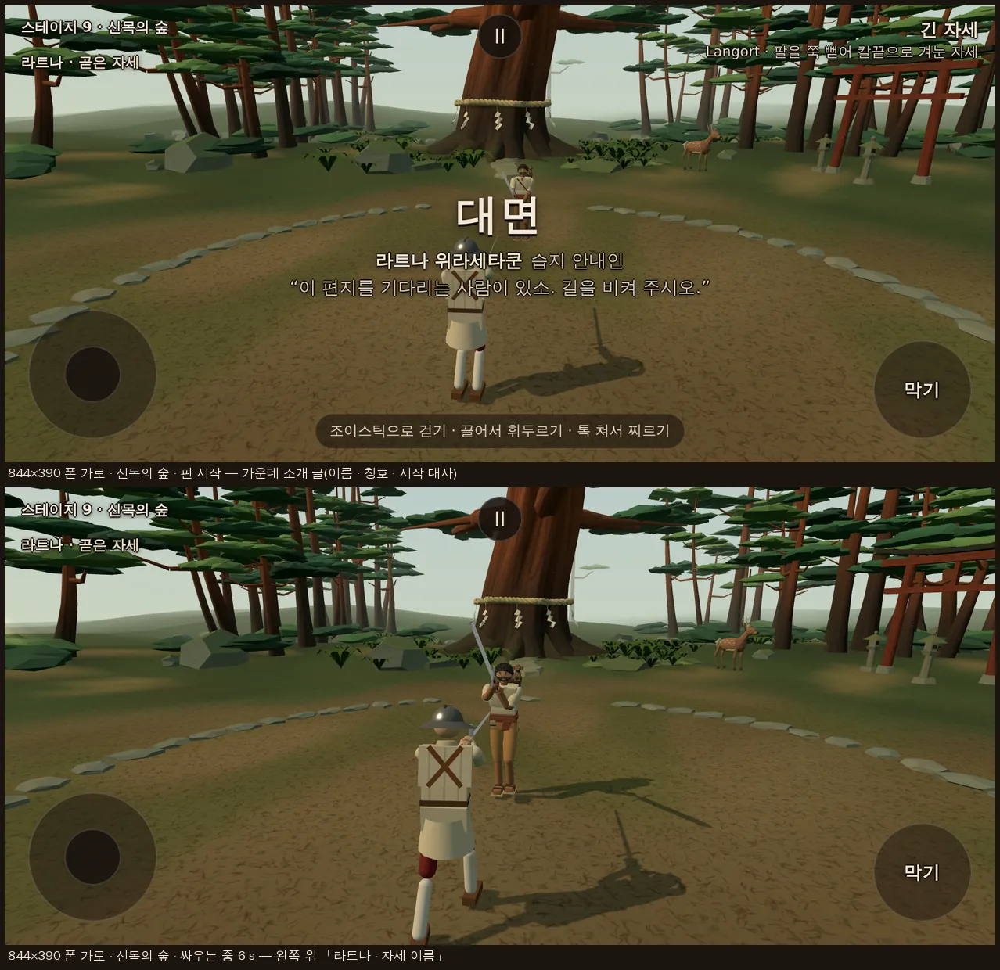
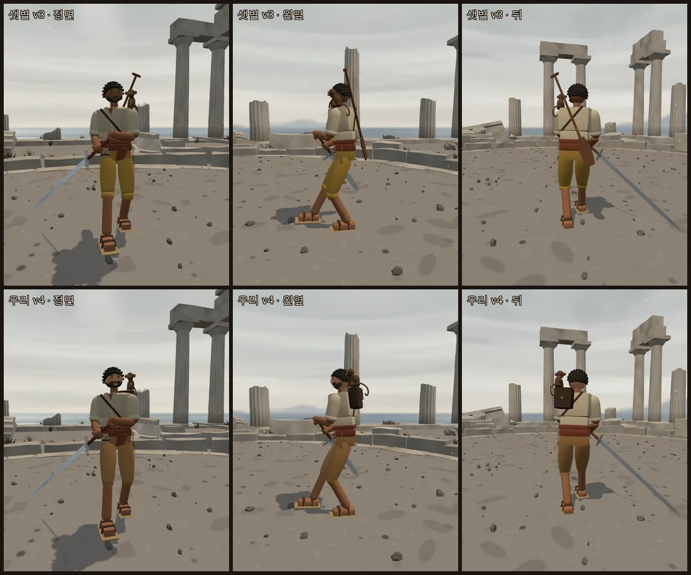
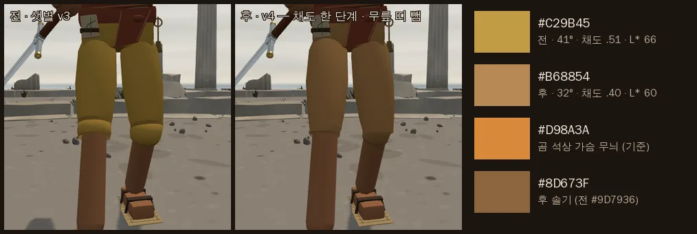
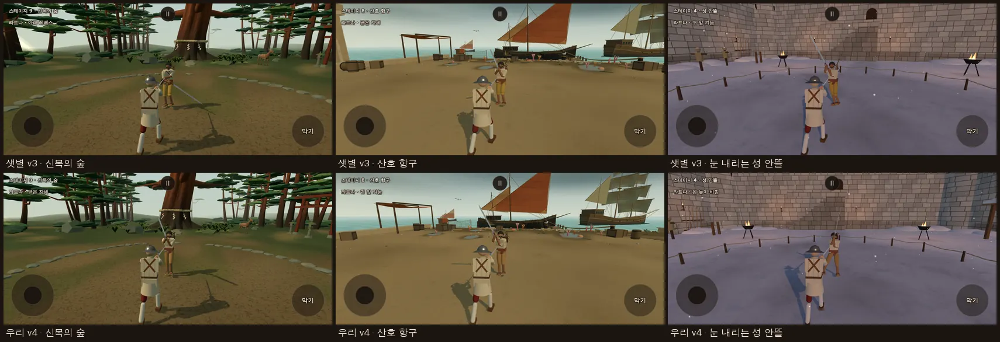
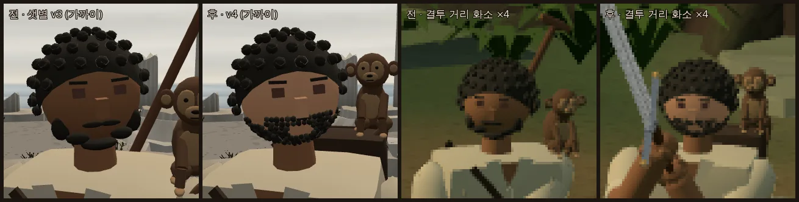
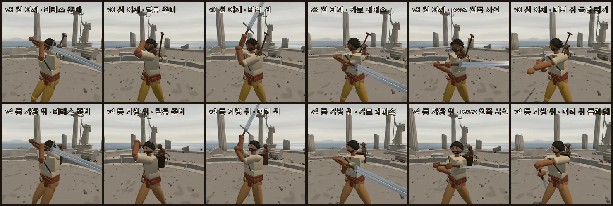

# 라트나 위라세타쿤 옮김 — 습지 안내인 · 북부 대공의 검 (2026-10-14)

- 가지 `…/ratna` (본판 38eb466 에서). 커밋만, 병합은 감독.
- 지시: 사장님 10/14 02:3x · 03:0x 결정 (감독 전달) — 샛별 저장소의 인물 **라트나 위라세타쿤**을 옮기되 무기는 **북부 대공의 검(`ice`)**, 감독 디자인 수정(사장님 승인)을 반영.
- 기준: 샛별 저장소 `origin/main` **325a5c38** (라트나 v3 = **ed736cf5**, 처음 d5b3151a · v2 bf202a00). 샛별 쪽은 읽기 전용 사본에서 `git archive` 로 빈 폴더에 꺼내 읽기만 했다 (코드를 돌리지 않았다).
- 앞선 리뷰: `docs/import/saetbyeol_review3_2026-10-14.md` §3 (그때 이름 '습지 뱃사공' — 지금 칭호는 '습지 안내인').
- 무대(잠든 습지 `sluice`)·곰 석상은 다른 작업에서 옮기는 중이라 손대지 않았다. 라트나 ↔ 무대 짝은 무대 병합 뒤 감독이 잇는다.

## 0. 한눈에

| 칸 | 샛별 v3 | 우리 (이 가지) | 근거 |
|---|---|---|---|
| 이름 · 칭호 · 나이 | 라트나 위라세타쿤 · 습지 안내인 · 52 | 그대로 | 사장님 결정 |
| 무기 · 유파 | 레이피어 · 이탈리아 (앞서 팔쉬온) | **북부 대공의 검 `ice` · 이베리아(자동 판정)** — 쥠·자세표 14 칸·기술은 우리 이베리아 대검 것 그대로 | 사장님 결정 |
| 숙련도 | 'normal' | **2** (실력 숫자 normal · 고유 동작 둘 · 비기 없음) | 사장님 결정 |
| 기질 숫자 | level·pers + 레이피어 자세·기술 취향 | 실력·성격 숫자 그대로, **레이피어 취향(쟁기·찌르기 guardPref·techPref)은 뺌** · 판 시작 자세 '아래 탈류'(샛별 팔쉬온 판 값) | 레이피어 자세 금지 |
| 유파·장기·약점 글 | 레이피어 기준 | **북부 대공의 검 기준으로 다시 씀** (§2) | 사장님 결정 |
| 대사 | 반말 + 하게체 넷 | **하오체 여섯** (§3) | 김씨·토메와 겹치지 않게 |
| 목소리 | 토메 묶음 | 토메 묶음 그대로 (새 파일 없음) | 사장님 결정 |
| 습지 감속 면제 신발 | 있음 | **옮기지 않음** — 신발은 옷차림만 | 사장님 결정 |
| 여정 자리 | 습지 무대의 주인 | **여정 밖** — 테스트 경로 상대 고르기 · `?foe=ratna` 로만. 본판 무작위 상대 목록에 없음 | 사장님 결정 |
| 등의 노 | 있음 | **뺌** | 사장님 승인 |
| 머리 | 솟은 나선 곱슬 + 가는 새치 | 그대로 | 사장님 승인 ('부처 나발·용과') |
| 수염 | 큰 덩어리 일곱 | **잔 곱슬 매듭 촘촘히** (§4) | 사장님 승인 |
| 바지 | 밝은 황토 #C29B45 | **#B68854** — 채도 한 단계 ↓, 곰 석상 가슴 무늬(#D98A3A) 계열 · 무릎 다듬음 (§4) | 사장님 승인 |
| 얼굴 | 피부 #A87350 | **얼굴 구·코만 #B48362 + 같은 색 제빛 0.18** (§4) | 사장님 승인 |
| 어깨 원숭이 | 왼 어깨 위 (목 쪽 3 cm) | **등 가방 위 왼쪽** — 어깨 위는 들린 왼팔·칼과 겹쳐 옮김, 앉을 자리로 작은 가방을 더함 (§5) | 사장님 승인 ('겹치면 왼쪽 어깨나 등(가방 위)') |

**한 줄**: 라트나는 여정 밖 인물로 들어왔다(`?foe=ratna` · 테스트 고르기의 '상대' 줄). 무기 북부 대공의 검 · 이베리아 숙련도 2 · 토메 목소리 · 하오체 대사. 겉모습은 샛별 v3 에서 노를 빼고 수염·바지·무릎·얼굴을 고쳤고, 원숭이는 어깨 위가 이베리아 두 손 자세에서 들린 왼팔·칼과 겹쳐(자세 6/14 · 기술 21/21 · 실전 서 있는 표본의 22.5 %) **등 가방 위**로 옮겼다(자세 0/14 · 기술 0/21 · 실전 0.5~0.6 % — §5). 관문 여섯 그대로.

## 1. 옮긴 것 (샛별 그대로)

- 복식 모듈 `src/outfit_ratna.js` — 샛별 ed736cf5 판(머리 v1~v3 길 · 셔츠 · 허리천 · 수심추 · 방수 지도 · 갈대·나무 밑창 신발 · 원숭이 모양)은 바이트 그대로 두고, 우리 판(`ratnaRevision 4`)의 고침만 '── v4' 줄로 더했다. 우리 `outfits.js` 의 도우미 묶음(`newOutfitHelpers`)에 샛별 쪽과 같은 열쇠 `artoriaRoundedBox` 하나만 더했다(본디 함수는 이미 있었다 — 두 쪽 정의가 글자까지 같음을 확인).
- 겉모습 `src/looks.js` — `LOOK_ARCHIVE.ratna` v1 · v2 · v3 (샛별 값 그대로, `?look=ratna:v3` 로 볼 수 있다) + 우리 v4 (지금 판).
- 인물 시트 `src/characters.js` — 새 목록 **`CHARACTER_GUESTS`(여정 밖 인물)** 에 둔다. `CHARACTERS`(기본 회전·무작위 상대·시뮬 라운드로빈)에는 넣지 않았고 `CHARACTERS_BY_ID` 에만 든다 → `?foe=ratna`·테스트 경로로만 나온다. 출신·이야기·바람·기질 글·실력/성격 숫자·목소리 묶음은 샛별 값 그대로(이야기의 원숭이 한 줄만 자리에 맞춤).
- 물리는 그대로: 겉모습만이다(몸·질량·관절·충돌체·상처 면 그대로). 라트나 겉모습을 입힌 판과 옷을 뺀 판의 물리 세계 스냅샷이 v1~v4 모두 같다(§7).

## 2. 고친 글 (북부 대공의 검 기준)

| 칸 | 샛별 (레이피어) | 우리 |
|---|---|---|
| 유파 | 가상의 습지 안내인. 전용 무기는 기존 레이피어이며 공통 레이피어 유파와 한손검 제어를 사용한다. | 기존 북부 대공의 검과 이베리아 유파(몬탄테 — 두 손 대검)의 쥠·자세·기술을 그대로 쓰는 창작 습지 안내인. 동남아 습지의 실제 무술을 재현한 것은 아니다. |
| 장기 | 칼끝으로 물러날 길을 남겨 두고, 상대가 들어오는 순간 짧게 찌른 뒤 거리를 되찾는다. | 칼을 얼굴 앞에 세워 길을 막고 있다가, 오른쪽 앞으로 둥글게 돌아 디디며 사선으로 내려벤다(둥근 걸음 탈류). 곧게 내려벤 칼을 같은 줄로 되올리기도 한다(위아래 사슬). 막히거나 헛쳐도 칼을 멈추지 않고 반대 어깨로 흘려 다시 벤다. |
| 즐기는 자세 | 오른쪽 쟁기와 긴 자세. | 긴 자세(얼굴 앞에 멈춘 칼)와 아래로 떨군 칼(아래 탈류·아래 레베스). 판 시작에는 칼끝을 오른쪽 아래로 떨군 채 선다. |
| 몸놀림 | 넓고 가벼운 갈대·나무 밑창 신발 덕분에 습지의 감속을 받지 않는다. 등에는 나무 노를 메고 … | 이베리아 유파의 몬탄테 걸음을 그대로 쓴다. 넓은 갈대·나무 밑창 신발은 옷차림일 뿐 걸음에 주는 특혜가 없다. 등짐과 그 위의 원숭이는 몸통에 붙은 장식이라 맞지도, 따로 움직이지도 않는다. |
| 약점 | 찌르기를 비껴 칼끝 안쪽으로 파고드는 연속 압박. | 닿는 거리가 가장 긴 칼인 만큼 칼끝 안쪽으로 깊이 붙는 압박에 약하고, 크게 휘두른 뒤 칼을 다시 세우기까지 빈틈이 길다. |

- 장기의 두 고유 동작은 숙련도 2 에서 실제로 열리는 것만 적었다(머리 위 돌려 베기 3 · 번갈아 올려베기 4 · 비기 5 는 닫힘). '닿는 거리가 가장 긴 칼'은 `weapon_measured.js` 실측(북부 대공의 검 닿는 거리 2.32 m — 무기 표에서 가장 김, 날것 베는 시간 0.69 s — 가장 느림).
- 대검을 든 까닭을 말하는 글·대사는 넣지 않았다(사장님 결정). 리뷰 3차의 '주인에게 돌려줄 유품' 안도 넣지 않았다.

## 3. 말투 — 하오체

| 인물 | 말투 | 보기 |
|---|---|---|
| 토메 | 합쇼체 | '칼끝을 보십시오. 답은 거기 있습니다.' |
| 김씨 | 하게체(+해라) | '이제 길을 비켜 주겠나.' |
| 오마리 | 짧은 해라체 | '물때 전에 끝내자.' |
| 미나미 · 투야나 | 해요체 | '금줄 안쪽은 내줄 수 없어요.' |
| 아르토리아 · 마야 | 합쇼체 · 해요체 | '검을 거두세요. 여기서 끝냅시다.' |
| 브란 · 하인리히 · 마르그레테 · 랴오 | 해라체 · 반말 | '서두르는 쪽이 먼저 베인다.' |
| **라트나** | **하오체** | '발밑을 보시오. 물이 깊은 데가 있소.' |

까닭:
1. 지금 인물 열둘 가운데 하오체를 쓰는 사람이 없다. 끝맺음부터 토메('-습니다')·김씨('-게·-나·-지')와 갈린다('-오·-소').
2. 하오체는 낯선 어른끼리 서로 낮추지도 올려 세우지도 않는 말이다. 쉰두 살 안내인이 나이를 모르는 길손을 맞을 때 — 손님을 낮추지 않고(하게체가 아님), 섬기는 자리도 아니다(합쇼체가 아님).
3. '-오·-소'는 짧고 낮게 끝나 기질 글 '목소리가 낮고 서두르지 않는다'와 맞고, 폰 화면 가운데 소개(두 줄)에 짧게 든다. 느낌표는 쓰지 않는다.
4. 낱말은 안내인의 일 — 길·물·물자국·편지·발밑·마른 길. 겹치지 않게 뺀 것: 오마리의 물때·배·뭍, 마르그레테의 '서두르-', 여럿(아르토리아·마야)이 쓰는 '칼/무기를 거두-'.

| 갈래 | 샛별 | 우리 |
|---|---|---|
| 시작 | 길이 잠긴 거지, 사라진 건 아니야. | **길은 잠겼을 뿐, 사라지지 않았소.** (taunt 도 이 줄) |
| 시작 | 이 편지를 기다리는 사람이 있어. 길을 비켜 주게. | **이 편지를 기다리는 사람이 있소. 길을 비켜 주시오.** |
| 시작 | — | **발밑을 보시오. 물이 깊은 데가 있소.** |
| 이김 | 물은 길을 바꿔도, 돌아갈 곳은 남아 있지. | **물은 길을 바꿔도, 돌아갈 곳은 남아 있소.** |
| 이김 | 칼은 거두게. 건너갈 배는 아직 있어. | 뺌 ('칼을 거두-' 겹침 · 배는 뱃사공 시절 소품) → **물자국은 거짓말을 하지 않소.** (샛별 소개 글 '나무껍질에 남은 물자국을 읽으며'에서) |
| 이김 | — | **편지는 내가 마저 전하겠소.** |

- 경기 화면: 우리 HUD 규칙 그대로 — 판 시작 정지 2 s 동안 가운데에 '라트나 위라세타쿤 · 습지 안내인' + 시작 대사 하나, 왼쪽 위 둘째 줄 '라트나 · 자세 이름'(이베리아 자세 이름 — 곧은 자세 · 귀 앞 겨눔 · 왼 높이 비낌 …).

- 표기 방침 검사(`tools/text/name_policy.mjs`)가 여정 밖 인물 글도 보게 했다(`tools/text/texts.mjs` 한 줄) — 704 → 713 줄, 위반 0.

## 4. 겉모습 고침 (v4)

| 칸 | 샛별 v3 | v4 | 값 |
|---|---|---|---|
| 등의 노 | 나무 노(비스듬히) + 끈 | **노 뺌**. 끈은 원숭이가 앉는 가방의 끈으로 남김 | — |
| 머리 | 솟은 나선 곱슬 90 여 개 + 17 번째마다 가는 새치 · 관자놀이 새치 줄 | 그대로 (사장님 '부처 나발·용과처럼' — 감독의 '불규칙하게' 의견 철회) | — |
| 수염 | 턱 옆·볼 아래·콧수염·턱 끝에 큰 덩어리 일곱 (반지름 1.6~2.5 cm) | **잔 곱슬 매듭 153 개** — 반지름 5.0~6.6 mm, 간격 9.5 mm로 엇갈려 깔아 이웃이 겹친 한 덩어리 · 겉은 머리처럼 오돌토돌. 귀 밑(머리 끝)에서 볼 아래·턱선을 따라 턱 끝까지 + 콧수염 + 입가, **입 자리는 비움**(입이 없는 얼굴에서 입처럼 읽힌다) · 매듭 넷에 하나는 머리 곱슬의 골 색 #48443A · 크기·높이를 황금각 수열로 조금씩 달리해 구슬 줄처럼 보이지 않게(난수 없음) · 가는 새치 줄은 그대로 | 확인표 1204 |
| 바지 | 밝은 황토 #C29B45 (색상 41° · 채도 0.51 · L* 66) · 솔기 #9D7936 | **#B68854** (32° · 0.40 · L* 60) · 솔기 **#8D673F** — 채도 한 단계 낮추고 곰 석상 가슴 무늬 주황금 #D98A3A(30°)와 같은 색 계열 | 확인표 1202 |
| 무릎 | 정강이 덮개가 가운데 반지름 0.069 로 불룩(정강이 0.05 · 넓적다리 끝 0.065) + 넓적다리 끝 짙은 띠(0.069 × 2.3 cm) — 두 띠 사이가 공처럼 읽힘 | 바짓가랑이를 무릎 관절 아래 3 cm 까지(끝 0.063) · **무릎 띠 뺌** · 덮개는 넓적다리에서 이어 내려와 0.063 → 0.056 으로 가늘게, 닫는 둥근 끝은 정강이 살 끝을 감싸게 · 끝단 솔기 0.058 | 확인표 1205 |
| 얼굴 | 피부 #A87350 (얼굴·목·팔 같음) | **얼굴 구·코만** 바탕 #B48362(한 단계 — L* 53 → 59) + 같은 색 제빛 0.18. 목·팔·다리 살·전체 조명 그대로. 피를 흘리면 창백해지는 셈(fighter.js)은 이 바탕색에서 그대로 | 확인표 1203 |
| 원숭이 | 왼 어깨 위 (목 쪽 3 cm) | **등 가방 위 왼쪽** (§5) | 확인표 1206 |

*잠든 습지 무대는 아직 우리 판에 없어(다른 작업) 바지 색은 기준 색 #D98A3A 와 무대 셋에서 보았다 — 습지 무대 위에서의 확인은 무대 병합 뒤.*

- 얼굴 칸 평균 색(화면 그대로 sRGB): 가까이(아레나) (68, 44, 28) → **(108, 77, 56)** · 결투 거리(신목의 숲 싸움 6 s, 카메라 ~ 머리 5.4 m, 폰 가로 화면 배율 2) (74, 51, 30) → **(112, 81, 55)**. 눈(#302019, 빛을 안 받는 재질)·수염(#302E28)과의 명도 차가 커져 결투 거리에서 눈은 점으로, 수염은 턱을 두른 띠(입 자리 틈)로 읽힌다. 목은 그대로라 얼굴과 목 사이에 조금 차가 있다(턱 그늘과 겹쳐 눈에 띄지 않음).

- 삼각형(몸·옷만, 칼 뺌): v3 19,611 → **v4 22,171** — 노 −532 · 가방 +396 · 수염 매듭 20 × 153 = 3,060(전 덩어리 약 580) · 바짓가랑이·덮개 줄 +216. 다른 인물: 투야나 22,590 · 김씨 21,696 · 아르토리아 20,944.
- 상처·절단 면: 소매·바짓가랑이를 바꿀 때 본디 캡슐 모양 값(parameters)을 그대로 둔다(샛별 쪽 방식 그대로) — 상처 자국이 옷 위에 붙는다. 브라우저 실전(§7)에서 베임·자국 오류 없음.

## 5. 어깨 원숭이 — 겹침 검사

### 5-1. 검사 방법 (`tools/sim/ratna_monkey_clear.mjs`)
- 원숭이 = 라트나 겉모습이 실제로 만든 원숭이 메쉬를 이어진 조각마다 볼록 껍질로(꼬리 관은 마디마다) · 칼 = 칼 몸체의 실제 충돌체 + 두 주먹(반지름 5.5 cm) · 팔 = 겉모습 크기 캡슐(위팔 살 0.053 · 소매 0.067 · 아래팔 0.044 · 손 0.05) · 거리는 Rapier 모양끼리의 거리(음수 = 겹친 깊이). 물리·난수는 건드리지 않는다(읽기만).
- 원숭이 조각을 둘로 나눴다: **자유 조각**(머리·몸·팔·손·꼬리)은 팔·칼에 조금이라도 뚫리면 겹침, **앉은 자리 조각**(발·엉덩이 — 샛별 v3 에서 둥근 어깨 소매에 1~3 cm 묻혀 '앉은' 꼴)은 쉴 때(곧은 자세) 묻힌 깊이보다 1 cm 넘게 더 묻히면 겹침. 칼·주먹은 어디든.
- ① 자세 14 칸: 플레이어 몸으로 그 자세 패드에 1.4 s 들고 1.0~1.4 s 의 가장 가까운 거리. ② 기술 21: 이베리아 꾸러미 공용 13 · 고유 4 · 속임수 2 · 비기 길목 지키기 좌우를 패드 9 · 11 · 13 m/s 로 따라가며 길 전체 + 끝난 뒤 0.6 s (패시브 셋은 이 기술을 쓴다). ③ 실전: 라트나 AI(숙련도 2 · 5) 대 롱소드 AI, 4 판 × 30 s, 서 있는 동안 두 스텝마다.

### 5-2. 샛별 v3 자리 (왼 어깨 위) — 겹침

| # | 자세 (이베리아 이름) | 칼·주먹 | 왼팔 (자유 조각) | 왼팔 (앉은 자리 · 쉴 때 −3.1) | 오른팔 | 겹침 |
|---|---|---|---|---|---|---|
| 0 | 머리 위 (altibaxo) | 16.3 | **−4.0** (손) | **−6.1** | 18.2 | 왼팔 |
| 1 | 탈류 준비 (talho) | 13.8 | **−5.3** (손) | **−4.8** | 19.9 | 왼팔 |
| 2 | 귀 앞 겨눔 (orelha direyta) | 20.8 | **−0.6** (손) | −3.7 | 28.5 | 왼팔 |
| 3 | 곧은 자세 (postura recta) | 19.7 | 0.3 | −3.1 | 29.0 | 없음 |
| 4 | 가로 탈류 (talho orizontal) | 34.4 | 1.5 | −2.3 | 30.9 | 없음 |
| 5 | 비낀 자세 (postura obtusa) | 36.3 | 1.8 | −1.7 | 30.9 | 없음 |
| 6 | 아래 탈류 (talho de baxo) | 30.5 | 1.8 | −2.0 | 31.6 | 없음 |
| 7 | 뒤 탈류 (talho por detras) | 39.7 | 1.9 | −2.0 | 32.2 | 없음 |
| 8 | 칼끝 땅에 (ponta no chão) | 29.6 | 1.9 | −2.0 | 29.0 | 없음 |
| 9 | 레베스 준비 (revez) | 0.7 | **−6.8** (손) | **−6.1** | 16.4 | 왼팔 |
| 10 | 왼 높이 비낌 (linha obtusa) | 15.0 | **−0.2** (손) | −3.4 | 25.0 | 왼팔 |
| 11 | 가로 레베스 (revez orizontal) | 21.9 | **−1.0** (손) | −3.8 | 26.2 | 왼팔 |
| 12 | 왼 비낀 자세 (postura obtusa) | 32.1 | 1.6 | −2.0 | 30.8 | 없음 |
| 13 | 아래 레베스 (revez de baxo) | 36.3 | 0.9 | −2.6 | 31.3 | 없음 |

cm · 음수 = 겹친 깊이 · (괄호) = 닿은 원숭이 조각. **겹친 자세 6 / 14.**

| 기술 | 갈래 · 열리는 숙련도 | 칼·주먹 | 왼팔 (자유 조각) | 왼팔 (앉은 자리) | 오른팔 |
|---|---|---|---|---|---|
| talho 오른쪽 사선 (zornhau) | 공용 | 18.6 | **−3.4** (손) | **−5.4** | 18.9 |
| altibaxo 위에서 아래로 (oberhau) | 공용 | 25.7 | **−5.2** (손) | **−6.0** | 25.4 |
| talho horizontal (zwerch) | 공용 | 24.4 | **−1.2** (손) | −4.0 | 28.8 |
| talho de baxo 올려베기 (unterhau) | 공용 | 20.8 | **−0.6** (손) | −3.7 | 26.8 |
| revez 왼쪽 사선 (zornhauL) | 공용 | **−3.2** (발) | **−5.7** (손) | **−6.1** | 9.2 |
| revez horizontal (zwerchL) | 공용 | 3.1 | **−5.2** (꼬리) | −3.9 | 20.4 |
| revez de baxo (unterhauL) | 공용 | 25.0 | **−2.6** (꼬리) | **−4.2** | 25.8 |
| estocada (stichPflug) | 공용 | 15.1 | **−0.4** (손) | −3.5 | 29.2 |
| estocada 왼쪽 (stichPflugL) | 공용 | 19.9 | **−1.1** (손) | −3.9 | 28.5 |
| estocada alta (stichOchs) | 공용 | 10.0 | **−1.9** (손) | **−4.3** | 25.0 |
| estocada alta 왼쪽 (stichOchsL) | 공용 | 20.2 | **−0.8** (손) | −3.9 | 27.0 |
| estocada baixa (stichAlber) | 공용 | 24.2 | **−0.2** (손) | −3.4 | 29.0 |
| talho e revez (talhoReves) | 공용 | 17.4 | **−3.4** (손) | **−5.6** | 18.9 |
| 머리 위 돌려 베기 (redondo) | 고유 3 | **−4.6** (머리) | **−3.8** (손) | **−5.7** | 17.4 |
| 위아래 사슬 (altibaxo) | 고유 2 | 0.9 | **−5.4** (손) | **−6.0** | 20.1 |
| 번갈아 올려베기 (talhoRevezBaixo) | 고유 4 | 21.8 | **−1.7** (손) | **−4.2** | 27.3 |
| 둥근 걸음 탈류 (talhoRodeado) | 고유 1 | 18.6 | **−3.4** (손) | **−5.4** | 18.9 |
| 속임수 위→다리 | 속임수 | 25.7 | **−5.1** (손) | **−6.0** | 25.4 |
| 속임수 찌르기→베기 | 속임수 | 26.1 | **−3.7** (손) | **−4.9** | 29.4 |
| 비기 길목 지키기 (오른 옆 → 왼 옆) | 비기 5 | 17.6 | **−1.8** (손) | **−4.4** | 25.7 |
| 비기 길목 지키기 (왼 옆 → 오른 옆) | 비기 5 | 8.1 | **−6.2** (꼬리) | **−4.4** | 20.4 |

**겹친 기술 21 / 21.** 실전: 숙련도 2 — 서 있는 표본의 **22.47 %** 가 겹침(왼팔, 가장 깊게 −9.4 cm — talho e revez · revez de baxo · talho 사선 · 귀 앞 겨눔 자세 · 아래 탈류 자세 · 둥근 걸음 탈류에서) · 숙련도 5 — **22.59 %** (칼 0.32 % 포함 · 왼팔 −9.8 · 칼 −5.5 cm).

→ 두 손 대검은 빈손(왼손)이 늘 폼멜을 쥐고 앞·위로 올라가 있어, 위팔이 들릴 때마다 어깨 위 원숭이의 손(무릎에 얹은 앞발)·꼬리를 뚫는다. 샛별 판은 한 손 칼(레이피어·팔쉬온)이라 왼팔이 내려가 있었다.

### 5-3. 다른 자리 (같은 도구 — `--seat=<이름>` · `--all-seats`)

| 자리 (가슴 좌표 앉은 점 [앞, 위, 오른쪽] m) | 자세 | 기술 | 실전 2 / 5 | 메모 |
|---|---|---|---|---|
| 샛별 v3 — 왼 어깨 위, 목 쪽 [−0.01, 0.123, −0.195] | 6/14 | 21/21 | 22.47 / 22.59 % | 위 표 |
| 샛별 v2 — 왼 어깨 위, 바깥 [−0.01, 0.104, −0.225] | 12/14 | — | — | 곧은 자세도 겹침 |
| 왼 어깨 뒤(어깨뼈 위) [−0.085, 0.112, −0.17] · 30° | 13/14 | — | — | 0.2~2.2 cm 씩 |
| 등 왼쪽 위(가방 없이) [−0.165, 0.07, −0.11] | 0/14 | 3/21 | — | revez 왼쪽 사선 −3.1 · revez horizontal −0.2 · 길목 왼→오 −0.7 |
| 등 가운데 위 [−0.17, 0.06, −0.02] | 0/14 | — | — | 원숭이 머리가 라트나 머리와 −1 cm |
| 등 가운데 낮게 [−0.17, −0.02, −0.04] | 0/14 | 1/21 | — | revez 왼쪽 사선 끝 −2.6 (원숭이 머리) · 앞에서 안 보임 |
| 가방 위 왼쪽 (윗면 0.10 · 0.085) | 0/14 | 1/21 | — | revez 왼쪽 사선 −2.8 · −3.5 |
| 가방 위 가운데 쪽 넷 (0.09~0.10, 돌림 0~25°) | 0/6 고른 자세 | 1/5 고른 기술 | — | revez 왼쪽 사선 −2.2~−3.4 |
| **높은 등짐 위 왼쪽 [−0.20, 0.16, −0.14] — v4** | **0/14** | **0/21** | **0.64 / 0.48 %** | 아래 표 |
| 높은 등짐 위 가운데 [−0.20, 0.16, −0.10] | — | — | 0.55 / 0.32 % | 원숭이 머리가 라트나 머리 뒤에 숨음 |
| 등짐 위 조금 낮게 [−0.21, 0.13, −0.12] | — | — | 0.64 / 0.35 % | |

- 낮은 등 자리의 한 겹침은 revez 왼쪽 사선(zornhauL)이 오른쪽 아래로 끝난 뒤 0.5 s 쯤, 왼 위팔이 제 몸통 안을 지나 목 뒤로 넘어간 장면이다(위팔 가운데가 가슴 몸체 좌표 [−0.05, 0.09, −0.06] — 래그돌이 원래 갖는 자기 몸 뚫림). 원숭이를 어깨보다 2 cm 높은 등짐 위로 올려 그 길에서 뺐다.
- 어깨 쪽(v3 · v2 · 어깨 뒤)은 모두 들린 왼팔과 겹쳐 '왼쪽 어깨'로는 옮길 자리가 없었다 → 지시대로 '등(가방 위)'.

### 5-4. v4 자리 (등 가방 위 왼쪽) — 결과

| # | 자세 | 칼·주먹 | 왼팔 (자유 조각) | 왼팔 (앉은 자리 · 쉴 때 12.8) | 오른팔 | 머리 (참고) |
|---|---|---|---|---|---|---|
| 0 | 머리 위 (altibaxo) | 25.0 | 11.4 | 13.8 | 25.0 | 5.3 |
| 1 | 탈류 준비 (talho) | 28.9 | 11.1 | 14.1 | 28.9 | 5.7 |
| 2 | 귀 앞 겨눔 (orelha direyta) | 27.8 | 10.8 | 11.5 | 29.2 | 5.6 |
| 3 | 곧은 자세 (postura recta) | 31.3 | 11.4 | 12.8 | 29.1 | 5.4 |
| 4 | 가로 탈류 (talho orizontal) | 52.0 | 11.6 | 13.3 | 29.9 | 5.9 |
| 5 | 비낀 자세 (postura obtusa) | 50.5 | 10.7 | 12.3 | 29.5 | 5.5 |
| 6 | 아래 탈류 (talho de baxo) | 46.2 | 11.4 | 13.0 | 29.9 | 5.7 |
| 7 | 뒤 탈류 (talho por detras) | 54.0 | 11.0 | 12.5 | 30.0 | 5.9 |
| 8 | 칼끝 땅에 (ponta no chão) | 41.7 | 11.3 | 12.7 | 28.7 | 5.4 |
| 9 | 레베스 준비 (revez) | 18.7 | 9.6 | 12.2 | 25.8 | 5.1 |
| 10 | 왼 높이 비낌 (linha obtusa) | 23.5 | 10.8 | 12.0 | 28.3 | 5.2 |
| 11 | 가로 레베스 (revez orizontal) | 41.2 | 10.8 | 12.2 | 28.5 | 5.1 |
| 12 | 왼 비낀 자세 (postura obtusa) | 48.9 | 10.8 | 12.3 | 29.5 | 5.3 |
| 13 | 아래 레베스 (revez de baxo) | 42.7 | 10.8 | 11.4 | 29.6 | 5.2 |

**겹친 자세 0 / 14** (가장 가까운 칼 18.7 cm — 레베스 준비 · 왼팔 9.6 cm).

| 기술 | 갈래 · 열리는 숙련도 | 칼·주먹 | 왼팔 (자유 조각) | 왼팔 (앉은 자리) | 오른팔 | 머리 (참고) |
|---|---|---|---|---|---|---|
| talho 오른쪽 사선 (zornhau) | 공용 | 33.2 | 10.3 | 11.1 | 27.4 | 4.6 |
| altibaxo 위에서 아래로 (oberhau) | 공용 | 35.9 | 9.5 | 11.7 | 27.4 | 5.0 |
| talho horizontal (zwerch) | 공용 | 37.3 | 10.6 | 11.9 | 28.2 | 5.0 |
| talho de baxo 올려베기 (unterhau) | 공용 | 37.4 | 10.7 | 11.7 | 28.4 | 5.2 |
| revez 왼쪽 사선 (zornhauL) | 공용 | 9.7 | 4.1 | 5.3 | 26.1 | 5.0 |
| revez horizontal (zwerchL) | 공용 | 22.2 | 6.2 | 7.5 | 27.5 | 5.1 |
| revez de baxo (unterhauL) | 공용 | 33.0 | 7.2 | 8.4 | 29.0 | 5.1 |
| estocada (stichPflug) | 공용 | 26.8 | 10.4 | 12.0 | 29.2 | 5.2 |
| estocada 왼쪽 (stichPflugL) | 공용 | 30.0 | 9.8 | 11.5 | 28.9 | 5.3 |
| estocada alta (stichOchs) | 공용 | 23.9 | 10.8 | 12.2 | 29.0 | 5.2 |
| estocada alta 왼쪽 (stichOchsL) | 공용 | 28.6 | 10.7 | 11.9 | 28.4 | 5.2 |
| estocada baixa (stichAlber) | 공용 | 36.9 | 10.5 | 11.3 | 28.8 | 5.3 |
| talho e revez (talhoReves) | 공용 | 29.5 | 10.3 | 11.5 | 27.4 | 4.9 |
| 머리 위 돌려 베기 (redondo) | 고유 3 | 10.9 | 9.3 | 10.5 | 26.7 | 4.9 |
| 위아래 사슬 (altibaxo) | 고유 2 | 2.9 | 8.4 | 9.8 | 26.2 | 4.9 |
| 번갈아 올려베기 (talhoRevezBaixo) | 고유 4 | 35.9 | 9.9 | 11.1 | 28.5 | 5.2 |
| 둥근 걸음 탈류 (talhoRodeado) | 고유 1 | 33.2 | 10.3 | 11.1 | 27.4 | 4.6 |
| 속임수 위→다리 | 속임수 | 35.9 | 9.7 | 11.7 | 27.4 | 5.4 |
| 속임수 찌르기→베기 | 속임수 | 38.4 | 10.2 | 11.5 | 29.1 | 4.9 |
| 비기 길목 지키기 (오른 옆 → 왼 옆) | 비기 5 | 30.2 | 10.4 | 11.7 | 28.0 | 5.0 |
| 비기 길목 지키기 (왼 옆 → 오른 옆) | 비기 5 | 27.1 | 5.8 | 6.9 | 27.5 | 5.1 |

**겹친 기술 0 / 21** (가장 가까운 칼 2.9 cm — 위아래 사슬 · 왼팔 4.1 cm — revez 왼쪽 사선).

실전 (4 판 × 30 s, 서 있는 동안 두 스텝마다):

| 숙련도 | 표본 | 겹친 표본 | 칼 | 왼팔 | 가장 깊게 | 겹친 때 |
|---|---|---|---|---|---|---|
| 2 (라트나 시트) | 2,359 | **0.64 %** | 0 % | 0.64 % | 왼팔 −6.4 cm (원숭이 머리) | talho e revez 한 번 — 8 자로 돌려 왼쪽 위로 올린 왼 위팔이 머리 옆 원숭이 머리에 0.25 s |
| 5 (`?foeProficiency=5`) | 6,212 | **0.48 %** | 0.31 % | 0.18 % | 칼 −6.0 · 왼팔 −3.3 cm | revez 왼쪽 사선 한 번(칼이 왼 어깨 뒤로 넘어가며 원숭이 몸·머리) · talho e revez 감기 |

샛별 v3 자리 22.5 % → v4 0.5~0.6 %. 남은 겹침은 실전 AI 의 빠른 8 자 돌림·왼 사선 감기에서 판 하나의 한 장면(0.25~0.3 s, 패드로 따라가는 기술 길 21 에서는 0)이다. 등 위 다른 두 자리(위 표 아래 두 줄)도 같은 두 장면이 남았고 자리 사이 차이는 장면 하나 크기(표본 10~15) 안이라, 앞에서 원숭이가 가장 잘 보이는 v4 자리를 골랐다.

*기술 두 장면은 시뮬에서 v3 자리 칼이 가장 깊던 때(revez 왼쪽 사선 패드 9 m/s · 0.158 s, 머리 위 돌려 베기 13 m/s · 0.925 s)를 브라우저에서 같은 길로 다시 낸 것 — 물리 박자가 시뮬과 몇 mm 다를 수 있다.*

## 6. 값과 확인표 행

`docs/strike/owner_defaults_table.md` 끝에 **1200~1209** (감독 지시로 1150 대 → 1200 대 — 플랑베르주 작업 1140~1152 와 겹치지 않게). 모두 사장님 확인 전(사장님이 이미 정하신 값은 '사장님 결정'으로 함께 적음).

| 번호 | 값 |
|---|---|
| 1200 | 숙련도 2 (사장님 결정) |
| 1201 | 기질 숫자(샛별 그대로) · 레이피어 취향 뺌 · 판 시작 자세 아래 탈류 |
| 1202 | 바지 #B68854 · 솔기 #8D673F |
| 1203 | 얼굴 바탕 #B48362 + 제빛 0.18 |
| 1204 | 수염 매듭 (153 개 · 5.0~6.6 mm · 간격 9.5 mm · 입 자리) |
| 1205 | 무릎 (바짓가랑이 무릎 아래 3 cm · 띠 뺌 · 덮개 0.063 → 0.056 · 솔기 0.058) |
| 1206 | 원숭이 자리 등 가방 위 왼쪽 · 가방 크기·자리·색 |
| 1207 | 등의 노 뺌 (사장님 결정) · 끈은 가방 끈으로 |
| 1208 | 대사 여섯 (하오체) |
| 1209 | 테스트 고르기 '상대' 줄 (무작위 기본 · 여정 밖 인물) |

## 7. 관문 · 확인

| 관문 | 기준 | 이 가지 |
|---|---|---|
| `node tools/sim/fights12.mjs` (stdout, 'deprecated parameters' 줄 뺌, sha256 앞 8) | 7c95ba21 | **7c95ba21** |
| `node tools/sim/live_battery.mjs` | e7ee3d96 | **e7ee3d96** |
| `node tools/sim/finish_thrust.mjs 1 --stand` | 433ac984 | **433ac984** |
| `node tools/sim/corr_s0.mjs --limits=on,off --scenes=a,b` 의 identical 줄 | 12 | **12** |
| `node tools/sim/weapon_smoke.mjs` 의 ' OK ' 줄 | 21 | **21** |
| `npx vite build` · `npm run build` | rc 0 · 0 | rc **0 · 0** (pwa 298 파일) |
| `node tools/text/name_policy.mjs` | 위반 0 | 위반 0 (화면 글 704 → 713 줄 — 라트나 9 줄) |
| `git diff 38eb466 HEAD` 의 더한 줄에 모델·회사 이름 | 없음 | 없음 (커밋 꼬리말 밖) |

- 관문 숫자가 그대로인 까닭: 바뀐 것은 겉모습(장식 메쉬)·인물 시트(`CHARACTERS` 밖 새 목록)·테스트 고르기 화면·글 검사 목록뿐 — 관문 도구는 인물을 쓰지 않고(롱소드 기본 AI) 물리·AI 코드는 한 줄도 안 바뀌었다.
- 물리 그대로: 라트나 겉모습 v1~v4 를 입힌 판과 옷을 뺀 판(`outfit: null`)의 물리 세계 스냅샷 sha256 이 같다(시드 73, 롱소드 대 북부 대공의 검). 장식은 `isolatedVisual` 안에서 만들어 판의 난수 흐름도 그대로다.
- 브라우저 (개발 서버 5393, 이 worktree): 헤드리스 크로미움 · 폰 가로 844×390 화면 배율 2 (`node tools/browser/ratna_shots.mjs <주소> <폴더> route`).
  - ① 실제 테스트 경로: test.html 의 '상대' 줄 = **무작위 · 라트나 위라세타쿤** → 라트나와 롱소드를 눌러 '시작' → 주소 `index.html?test=1&weapon=longsword&hero=player&foe=ratna&stage=random` · 메뉴 한 줄 '테스트 경로 · 롱소드 · 기본 주인공 · 상대 라트나 위라세타쿤 · 무대 무작위 · 고유 동작·비기 모두 열림' → 판 시작 가운데 '라트나 위라세타쿤 · 습지 안내인 · “길은 잠겼을 뿐, 사라지지 않았소.”' → 싸움 25 s(가만히 선 나): 상대 무기 `ice` · 유파 iberian · 실력 normal · 숙련도 2 · 왼쪽 위 둘째 줄 '라트나 · 곧은 자세' → '라트나 · 귀 앞 겨눔'.
  - ② 라트나 겉모습을 내가 입고(`?test=1&weapon=ice&hero=ratna&foe=omari&stage=castle`) 오마리와: 15.4 s 에 짐(피를 너무 흘림) — 상처 4 · 잘림 1 · 옷 위 상처 자국 8, 원숭이·가방 붙은 그대로.
  - ①② 와 그림 찍기(정면·옆·뒤 · 가까이 · 결투 거리 무대 셋 · 원숭이 장면 12) 모두 **콘솔 오류 0** (Rapier 의 'deprecated parameters' 경고만) · ① 과 그림 찍기는 HTTP 400 이상 응답도 0.
- 원숭이 겹침: §5 (`node tools/sim/ratna_monkey_clear.mjs` — v4 자리 그대로 · `--seat=v3` 샛별 자리).

## 8. 출처

- 코드·글: 샛별 저장소 d5b3151a · bf202a00 · ed736cf5 (`src/outfit_ratna.js` · `src/characters_expansion.js` 의 ratna 항목 · `src/looks.js` 의 ratna 판) — 모두 절차 코드, 그림·소리 파일 없음. 읽은 문서: `docs/content/ratna_sunbear_refinement_20261013.md` · `ratna_wetland_play_20261013.md` · `ratna_marsh_centre_20261013.md` · `character_roster_and_silver_stages_20261013.md` · 공개 소개 `public/sluice.html` 의 라트나 글.
- 들이지 않은 것: 샛별 쪽 소개 사진(`public/encounters/ratna-*.webp`)·검사 도구·습지 무대 규칙(`terrainTraits`)·찬다. 새 바이너리는 이 문서의 그림(`docs/import/ratna/`)뿐이다.
- 목소리: 우리 저장소에 이미 있는 토메 묶음(`src/sound.js` — 출처·라이선스는 그 묶음의 기록 그대로). 새 소리 파일 없음.

## 9. 못 한 것 · 한계

- **원숭이 남은 겹침**: 패드로 따라가는 자세 14·기술 21 에서는 0 이지만, 실전 AI 판에서는 서 있는 표본의 0.5~0.6 % 가 남는다 — talho e revez 를 8 자로 빠르게 돌려 왼쪽 위로 올릴 때 왼 위팔이 머리 옆 원숭이 머리를 지나가는 한 장면(약 0.25 s), 숙련도 5 의 revez 왼쪽 사선 감기에서 칼이 왼 어깨 뒤 원숭이를 지나가는 한 장면(약 0.3 s). 등 위 다른 자리 둘도 같은 장면이 남아(§5-3) 더 옮기지 않았다 — §5-3 에서 재어 본 자리는 모두 무언가 하나는 남았다.
- **원숭이가 앞에서 덜 보인다**: 등 가방 위라 정면에서는 라트나 머리 왼쪽 뒤로 고개·귀만 나온다(옆·뒤·돌 때는 다 보인다). 원숭이·가방은 충돌체가 없어 상대 칼도 겉으로 지나간다(샛별 쪽과 같음).
- **가방은 새로 더한 소품**이다 (샛별에 없음): 지시 '등(가방 위)'를 따라 앉을 자리로 — 크기·색·끈은 사장님 확인 전(확인표 1206 · 1207).
- 얼굴 제빛 0.18 은 무대 빛과 상관없이 더해진다 — 낮 무대 넷(아레나·신목의 숲·산호 항구·성 안뜰)에서 보았고, 어두운 홀·밤 무대에서는 얼굴이 조금 더 떠 보일 수 있다(그쪽은 캐릭터 조명이 이미 채운다) — 실기기 확인 전.
- 무릎: 곧게 선 다리에서는 덮개 끝이 바짓가랑이에 덮이지만, 무릎을 크게 굽히면 덮개의 둥근 끝이 무릎 앞으로 조금 나온다(살 뚜껑은 안 보임).
- 수염 매듭은 가까이서는 작은 알갱이 줄로 보인다(머리 곱슬과 같은 결) — 결투 거리에서는 턱을 두른 짙은 수염으로 읽힌다(그림 `ratna_face.webp`).
- 삼각형: 라트나 22,171 (몸·옷, 칼 뺌) — 지금 인물 가운데 투야나(22,590) 다음. 머리 곱슬(샛별 v3 그대로) 8,760 이 가장 크다. 실기기 프레임은 재지 않았다(헤드리스 소프트웨어 그리기).
- 여정·무대: 잠든 습지 무대와 짝짓지 않았다(무대 병합 뒤 감독). '마른 길을 아는 AI'(디딤돌로 다니며 상대를 웅덩이로 모는 것)는 이번 범위 밖. 습지 감속 면제는 옮기지 않았다.
- 목소리: 토메·김씨·라트나 셋이 같은 녹음(사장님 '당분간'). `voices.html` 듣기 화면은 기본 회전 인물만 보여 라트나 줄은 없다(같은 토메 묶음).
- 샛별 v1·v2 모듈 길은 그대로 남겼다(`?look=ratna:v1` · `v2` 로 볼 수 있다) — 쓰지 않는 길이지만 출처 비교를 위해.
- 테스트 고르기의 '상대' 줄은 무작위 + 여정 밖 인물(지금 라트나 하나)만 — 본판 인물을 하나로 고정하는 칸은 만들지 않았다(범위).
- 겹침 검사의 팔은 겉모습 크기 캡슐 어림(소매 꼭대기 몇 mm 차이), 머리 칸은 반지름 0.12 m 공 어림(참고)이다. 기술 길은 패드 따라가기라 실제 AI 박자와 다르다 — 그래서 실전 판도 함께 쟀다.
- 작업 중 한 번: 첫 개발 서버를 저장소 설정 그대로 띄웠을 때 node_modules 가 본 checkout 과 공유된 링크라 vite 의존성 캐시(`node_modules/.vite`)를 한 번 다시 묶었다(10/14 03:4x 무렵) — 곧바로 끄고 이 작업자 전용 캐시 폴더로 다시 띄웠다. 다른 개발 서버가 그때 의존성 다시 읽기 알림을 한 번 받았을 수 있다.
