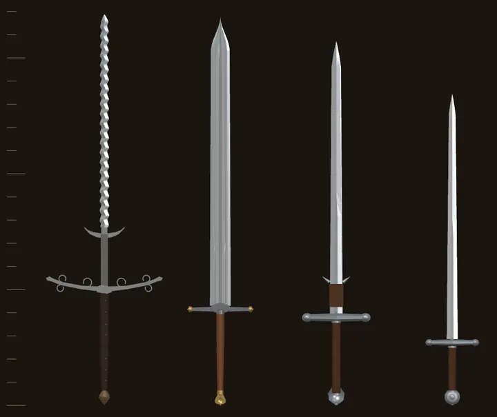
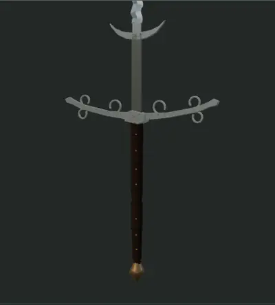
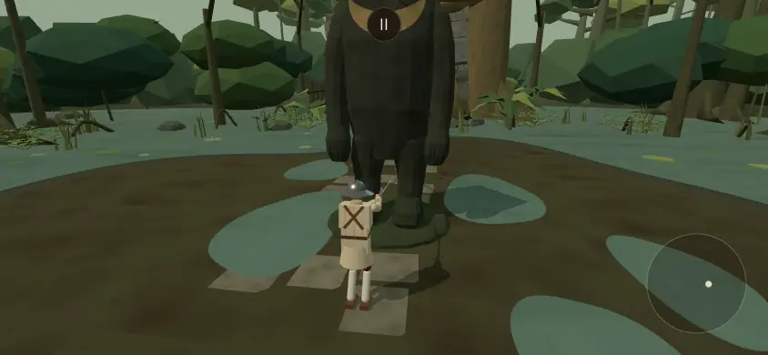
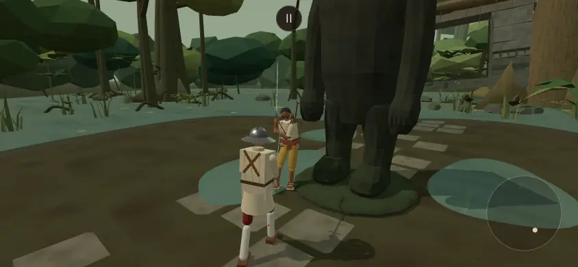
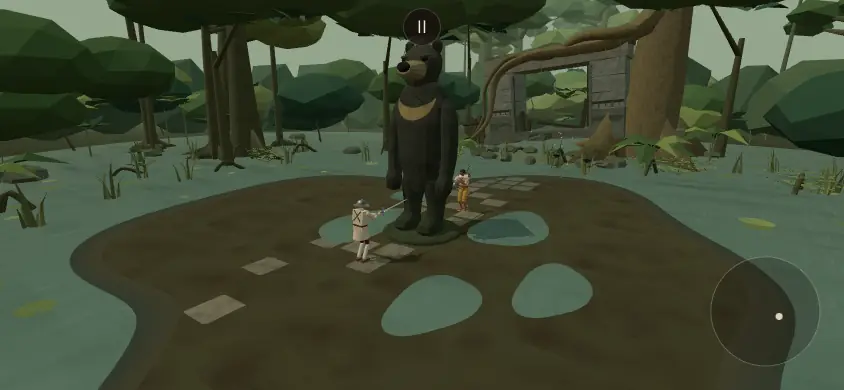
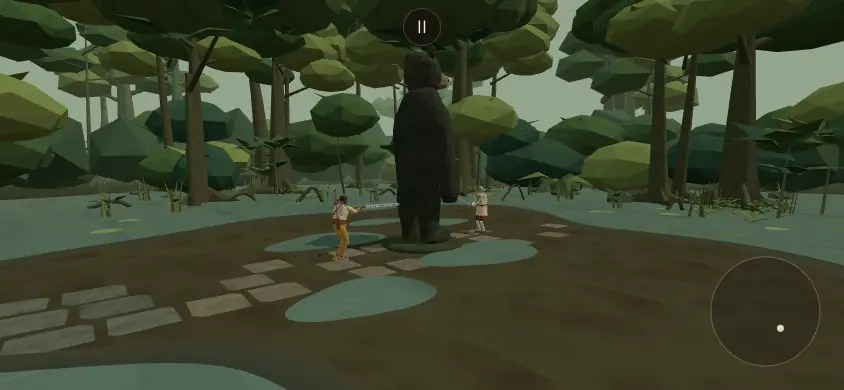
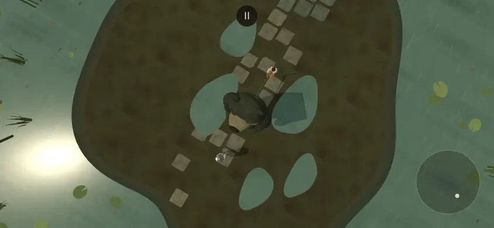
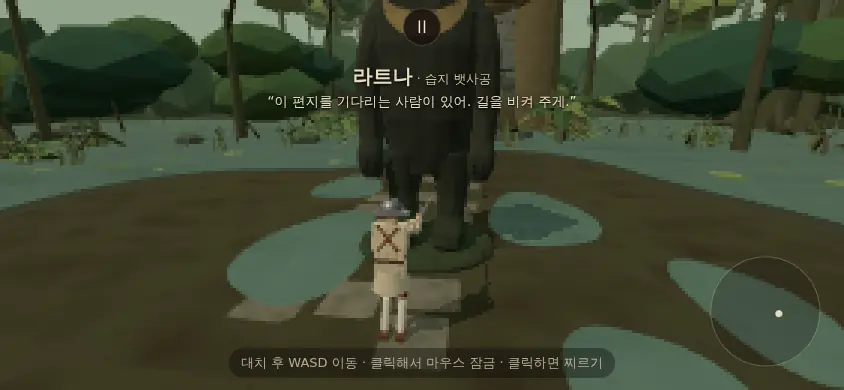
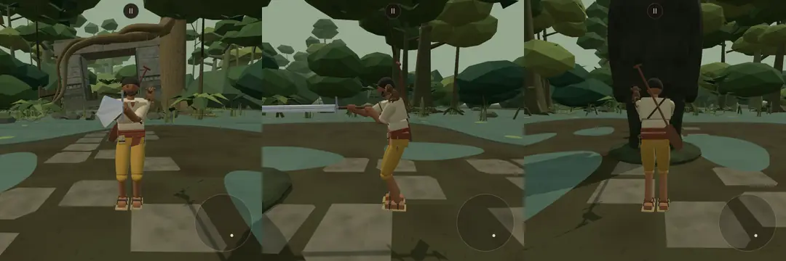
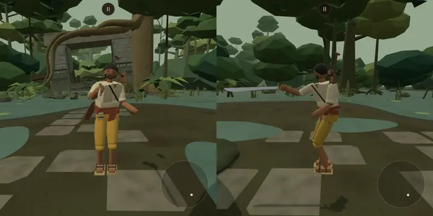

# 샛별 가져오기 3차 — 가져오기 전 디자인 리뷰: 플랑베르주 · 잠든 습지 · 습지 뱃사공 라트나 (2026-10-14)

- 지시: 사장님 10/14 01:5x "샛별이 만든 플람베르주(표기법 이게 맞나?), 잠든 습지 스테이지, 습지 안내인 캐릭터 가져와. 습지 안내인은 북부 대공의 검 줘. 적용 전 이전에 했듯 디자인 리뷰부터 해."
- 범위: **리뷰만** 했다. 게임 코드·무대·무기·인물 파일은 하나도 옮기지 않았다(이 문서와 `docs/import/review3/` 그림만).
- 기준: 우리 본판 **0d14a42** · 샛별 저장소 `origin/main` **af089dbb**(내용은 bf202a00 — 그 뒤는 기록 커밋뿐). 샛별 쪽은 `git archive` 로 꺼낸 사본만 읽고 돌렸다.
- 읽은 샛별 문서: 플랑베르주 외형(10/11) · 잠든 물길·찬다 첫 시안 · 잠든 밀림 · 잠든 습지와 라트나 제안 · 진흙·곰 석상·라트나 · 습지 뱃사공 라트나와 중앙 말레이곰 입상(모두 10/13). 코드: `flamberge_design.js` · `stage_sluice.js` · `stage_sluice_bear.js` · `wetland_ground.js` · `arena_obstacle.js` · `outfit_ratna.js` · `characters_expansion.js` 와 `fighter.js`·`gait.js`·`ai.js`·`main.js` 의 해당 줄.
- 앞선 리뷰: `docs/import/saetbyeol_review_2026-10-10.md`(같은 꼴).

## 0. 한눈에 (사장님용)

**추천 3줄**
1. **플랑베르주는 고쳐서 가져온다** — 샛별 쪽은 *겉모습 시안뿐*(질량·쥠·충돌체·카드 없음, 그쪽 문서도 '전투 추가 완료가 아님'). 생김새는 그대로 쓰고 무게·쥠·카드는 우리가 새로 정한다. 우리 틀에 넣으면 자동으로 **이베리아**(츠바이핸더·북부 대공의 검과 같은 칸) — 이탈리아 부족은 그대로 남는다.
2. **잠든 습지 무대는 가져오되 물리 규칙은 끈 채 먼저** — 그림결은 우리와 맞다(로우폴리·평면 음영·캔버스 무늬, 새 소리 파일 없음). 다만 가운데 곰 석상은 판 시작부터 상대를 가리고 첫 접근을 약 9 초 늘린다. 진흙·석상은 스위치를 달아 두 번째 단계로, 카드 뒷면은 새로 그린다.
3. **라트나는 고쳐서 가져온다** — 북부 대공의 검(`ice`)을 쥐면 유파 이베리아·숙련도 칸 하나만 정하면 된다. 다만 **감속 면제 신발 + 가장 긴 대검**이 겹쳐 진흙판에서 플레이어만 느려지는 판이 된다. 둘 중 하나는 사장님이 정해 주셔야 한다(§3-5).

**표기**: '플람베르주'는 맞지 않다. 프랑스어 *flamberge* [flɑ̃.bɛʁʒ] 는 외래어 표기법(프랑스어 표: 비모음 [ɑ̃] → '앙', 낱말 끝 [ʒ] → '주')으로 **'플랑베르주'**. 독일어 *Flamberg* 로 읽으면 '플람베르크'다. '플람베르주'는 독일어 앞 반·프랑스어 뒤 반을 섞은 꼴이다. (샛별 쪽도 '플랑베르주'로 적었다.)

| # | 항목 | 한 줄 평 | 추천 | 급 |
|---|---|---|---|---|
| 1 | 플랑베르주 생김새 | 클리블랜드 1919.71(독일 1550–1600) 실측 넷(전체 168.9 · 날 118.7 · 리카소 26.7 · 코등이 50.5 cm)을 맞춘 절차 모델. 물결 날·보조 갈고리·말린 코등이가 멀리서도 읽힌다 | 겉모습 그대로 | 하 |
| 2 | 플랑베르주 물리 | **없음** — 질량·무게중심·쥠·충돌체·등급을 우리가 정해야 한다 | 우리 값으로 새로 (§1-3) | 상 |
| 3 | 플랑베르주 유파 | 자동 판정 = 앞무게(heavy) · 베기 → **이베리아**. 이베리아 2 → 3, 이탈리아 1 그대로 | 이베리아(츠바이핸더와 같은 결정) | 중 |
| 4 | 플랑베르주 겹침 | 크기가 북부 대공의 검(168 cm)과 거의 같고, 츠바이핸더까지 대검 셋이 한 칸(앞무게·이베리아) | 등급(에픽)과 생김새로 가름 · 사장님 확인 | 중 |
| 5 | 잠든 습지 그림결 | 로우폴리·평면 음영·캔버스 무늬, 텍스처 파일 0 — 우리 결 그대로. 섬 물가가 결투장 경계로 잘 읽힌다 | 그대로 | 하 |
| 6 | 잠든 습지 성능 | 경기 화면 그리기 265~311 · 삼각형 17.9~18.9 만(인물 포함) — 우리 무대 범위의 **위 끝**(신목의 숲 18.3 만 수준, 그리기는 가장 많음) | 실기기 `?fps=1` 확인 | 중 |
| 7 | 곰 석상(가운데, 충돌) | 키 약 5.7 m. 판 시작에 상대가 완전히 가려지고, 첫 접근(가슴 사이 2 m)이 **11.0 초**(2 초 정지 포함, 플레이어 가만히) | 사장님 결정: 가운데 충돌 / 바깥 풍경 / 없음 | 상 |
| 8 | 진흙 감속 | 웅덩이 다섯(결투장 넓이의 약 19 %) 한가운데서 자발 이동 40 % — 균형 걸음·중력·공격은 그대로 | 스위치 달아 두 번째 단계 | 중 |
| 9 | 이식 비용(물리) | fighter.js 한 줄 · ai.js 한 줄 · main.js 몇 곳 · **gait.js 바닥 힘 계산 고침**(우리 쪽은 벽·석상에 발이 닿은 힘도 체중 받침으로 센다) | §5 단계 3 | 중 |
| 10 | 카드 뒷면 | 샛별 쪽에 없다(그쪽도 404 로 목록에서 뺐음) | **새로 그림** (px_sluice 넷 + 회색) | 중 |
| 11 | 라트나 생김새 | 황토 바지·크림 셔츠·적갈색 허리천이 진흙 바닥 위에서 잘 읽힌다. 어깨 원숭이·등의 노·갈대 신발로 소품이 우리 인물 가운데 가장 많다 | 그대로 · 원숭이는 사장님 확인 | 하 |
| 12 | 라트나 + 북부 대공의 검 | 유파 이베리아 · 숙련도 2 안 · 비기(길목 지키기)는 숙련도 5 에서만. **글(유파·장기·약점)이 팔쉬온 기준**이라 고쳐야 함 | 고쳐서 | 상 |
| 13 | 감속 면제 + 대검 | 닿는 거리 2.32 m(팔쉬온 1.56) + 진흙 면제 → 진흙 속 플레이어를 칼끝에 묶어 둔다 | 면제 끔·약하게, 또는 진흙 끔 | 상 |
| 14 | 목소리 | 토메 묶음 빌림 → 토메·김씨·라트나 **셋이 한 목소리**, 김씨와는 말투(하게체)까지 겹침 | 알림 · 사장님 결정 | 중 |
| 15 | 출처 | 박물관 사진 CC0(공식 API 로 확인) · 무대 무늬 캔버스 생성 · 무대 소리 절차 합성 · 곰은 그쪽 사용자 사진의 형상만(사진 파일 없음) | 문제 없음 | — |

- 급: 상 = 옮기기 전에 정할 것 · 중 = 사장님 결정 뒤 · 하 = 참고.

## 1. 플랑베르주

*왼쪽부터 플랑베르주 · 북부 대공의 검 · 츠바이핸더 · 롱소드, 같은 축척(왼쪽 눈금 10 cm, 굵은 눈금 50 cm). 샛별 판 모델로 찍었다(우리 북부 대공의 검·츠바이핸더는 쥠 길이가 조금 다르다).*

### 1-1. 생김새
- 원형: 클리블랜드 미술관 1919.71 *Two-Handed Sword with Flamboyant Blade*, 독일 1550–1600. 공식 API 로 다시 확인한 실측: 전체 168.9 · 날 118.7(리카소 26.7 포함 — 날 세운 부분 92.0) · 코등이 50.5 · 손잡이 49.2 cm. **무게는 API 에 없다**(샛별 쪽도 '웹 무게 2.98 은 단위가 없어 안 씀').
- 모델(`flamberge_design.js`, 105 줄): 촘촘하고 얕은 물결 22주기(사진 추정) · 곧고 긴 리카소 · 앞으로 휜 보조 갈고리 · 휜 넓은 코등이 + 열린 말림 여섯 · 두 마디 검갈색 가죽 손잡이 · 황동 리벳 · 각진 청동 폼멜. 우리와 같은 `bladeGeometry`·`metalMat` 을 쓴다. 기운·불꽃 없음.
- 우리 결과: 기본 도형·병합·금속 재질 — 우리 무기 만드는 방식과 같다. 실루엣이 다른 대검과 확실히 다르다(물결 날 + 50 cm 코등이 + 갈고리). 경기 거리(폰)에서는 물결 진폭 ±3.6 mm 가 거의 안 보이고 '긴 대검 + 넓은 코등이'로 읽힐 것이다 [추정 — 경기 화면 안 찍음, 무기 등록이 없어서].
- 원점이 **폼멜 끝**이다(우리 무기는 오른손 주먹 가운데). 옮길 때 자리를 옮기고 부품(손잡이·코등이·칼날)으로 나눠야 한다.

### 1-2. 우리 무기 틀에 넣으면
- 쥠: 손잡이 49.2 cm 는 츠바이핸더 '중간 쥠'(날밑 아래 ~ 폼멜 끝 0.40 m)·북부 대공의 검(0.44 m)보다 길다 → `two-hand`, 손 사이 0.22~0.24(이베리아 몬탄테 쥠 규칙, 츠바이핸더 §15) 그대로 쓸 수 있다. 오른손이 날밑 밑에 오면 손 ~ 칼끝 약 1.24 m(롱소드 1.18 · 츠바이핸더 1.36 · 북부 대공의 검 1.41 사이).
- 유파: `weapon_class.js` 자동 판정 — 두 손에 질량 약 3 kg·칼끝 쪽 무게면 손 기준 관성이 0.6 kg·m² 를 넘어 **틀 '앞무게(heavy)'**, 배율을 츠바이핸더처럼 베기 1.1 / 찌르기 0.85 로 두면 **방식 '베기'** → `traditionOf` = **이베리아**.
  - 역사로는 독일 란츠크네히트(도펠죌트너) 무기다. 하지만 우리 츠바이핸더도 독일 무기인데 앞무게라서 이베리아(몬탄테)로 간다 — 같은 결정을 따르면 이베리아. 독일로 지정(`school: 'german'`)하면 롱소드 자세표·리히테나워 기술을 쓰게 되어 대검 몸놀림과 어긋난다(독일 유파에 대검 가지가 없음).
- 지금 무기 표와 겹침:

  | 무기 | 등급 | 전체 | 질량 | 틀·방식 | 유파 |
  |---|---|---|---|---|---|
  | 츠바이핸더 | 커먼 | 약 165 cm | 2.9 kg | 앞무게·베기 | 이베리아 |
  | 북부 대공의 검 (`ice`) | 레어 | 168 cm | 3.5 kg | 앞무게·베기 | 이베리아 |
  | **플랑베르주 (안)** | 에픽 안 | 168.9 cm | 3.0 kg 안 | 앞무게·베기 | 이베리아 |

  - 10/13 '독일 무기가 너무 많다'로 에스톡·세이버·팔쉬온을 카드에서 뺀 것과는 겹치지 않는다(독일 칸이 아님). 대신 **대검 셋이 같은 칸**에 모인다. 셋을 가르는 것은 등급(커먼·레어·에픽)과 생김새, 무게(2.9·3.0·3.5)다.
- 유파 균형(주인공 카드 풀 — 빼 둔 셋·복제품 빼고, `traditionOf` 로 셈):

  | 유파 | 지금 | 플랑베르주 뒤 |
  |---|---|---|
  | 독일 | 3 (롱소드·엑스칼리버·라이트세이버) | 3 |
  | 이베리아 | 2 (츠바이핸더·북부 대공의 검) | **3** |
  | 이탈리아 | 1 (레이피어) | 1 |
  | 일본 | 2 (모노호시자오·우치가타나) | 2 |
  | 동방 | 4 자루 · 3 칸 (청강검·사인검·간장/막야) | 그대로 |
  | 무유파 | 5 (나뭇가지·고무 닭·냉동 참치·리볼버·모르겐슈테른) | 5 |

  → 이베리아는 독일과 같은 3 이 된다. **이탈리아 1 은 이번으로 안 풀린다**(다음 가져오기 후보로 한손 찌르기 무기 하나가 필요).
- 에픽 칸(모노호시자오·청강검·라이트세이버)이 넷이 되면 에픽 한 자루가 나올 몫이 16/3 → 16/4 로 준다.

### 1-3. 우리가 새로 정할 값 (제안 — 모두 사장님 확인 전)
- 등급: 에픽(샛별 쪽 '에픽 후보'). 질량 3.0 kg 안(같은 시대 물결 날 양손검 2.5~3.5 kg 언저리, 실측 없음 [추정]). 부품 나눔은 츠바이핸더 비율(자루·폼멜·날밑·칼날)을 길이에 맞춰.
- 리카소 26.7 cm 를 '날 아님' 부품으로 둘지(맞으면 둔타) — 츠바이핸더는 리카소를 겉모습(decorate)으로만 둔다. 같은 방식이면 값 하나 덜 정한다.
- 코등이 50.5 cm 를 충돌체에 그대로 넣으면 상대 칼을 더 잘 걸어 받는다(츠바이핸더 날밑 28 cm). 물리 차이가 생기는 자리라 48 판으로 잴 것.
- 물결 날에 출혈·파손 특례는 주지 않는다(샛별 쪽도 '자동 증가 효과 부여 안 함'). 특수효과는 그쪽 문서에서도 사장님(그쪽 사용자) 결정으로 남아 있다.
- 카드 그림은 `tools/browser/weapon_thumbs.mjs` 로 우리 모델을 찍어 새로 만든다. 카드 문구 예: '불꽃처럼 물결치는 날을 지닌 양손검.\n전체 169 cm, 질량 3.0 kg의 양손검.'
- AI 간격 표(`weapon_measured.js MEASURED`)에 한 줄 — `tools/sim/weapon_measures.mjs --gen` 으로 잰다.

## 2. 잠든 습지 (`sluice`)

*폰 가로 844×390, 우리 `?weapon=longsword` 대 라트나(북부 대공의 검, 샛별 판), 헤드리스 SwiftShader. 바깥 요청은 막고 찍었고 콘솔 오류 0.*

### 2-1. 무엇
- 열대 담수 침수림, 비 그친 뒤 한낮. 불규칙한 진흙 섬(결투장)과 둘레의 얕은 물, 수관 높은 나무·늘어진 뿌리·사초·뜬 잎, 뒤에 뿌리가 감은 옛 돌 수문. 빛은 공용 반구광·해만(새 조명 없음, 해 1.42·반구광 1.23, 안개 26~90 m).
- 이름이 세 번 바뀌었다: 잠든 물길(찬다 첫 시안) → 잠든 밀림 → **잠든 습지**(지금). 내부 id 는 그대로 `sluice`.

### 2-2. 그림결 (우리 `docs/design_language.md` 와)
- 맞는 점
  - 로우폴리 평면 음영·꼭짓점 색 덩어리 — 잎 덩어리·바위·나무가 우리 산사·신목의 숲과 같은 결이다. 텍스처 파일 0(무늬는 `canvasTex` 넷).
  - **섬 물가가 결투장 경계**로 자연스럽게 읽힌다(밧줄·돌 고리 없이도). 10/10 리뷰에서 얼어붙은 만에 적었던 '결투장 경계가 안 보인다'가 여기엔 없다.
  - 라트나의 황토 바지·크림 셔츠가 어두운 진흙 위에서 또렷하다. 우리 플레이어(흰 옷)도 잘 읽힌다.
  - 도트 모드에서 웅덩이·석상·인물이 덩어리로 읽힌다(그림 6).
- 아쉬운 점
  1. **곰 석상이 화면 위 가운데를 차지한다** — 거의 검은 돌(#444941 바탕)이라 폰 화면에서 큰 검은 덩어리이고, 멈춤 단추가 석상 가슴 위에 겹친다. 판 시작에는 상대가 완전히 가려진다(그쪽 문서: '의도한 지형 장애물').
  2. 웅덩이가 테두리·잔물결 없는 옅은 청록 타원이라 바닥에 붙인 판처럼 보인다(위에서 볼 때 특히). 진흙 판정 자리를 정확히 보여 준다는 장점은 있다.
  3. 돌 디딤판(밝은 회색 네모)이 바닥에서 가장 밝아 시선을 끈다 — 흰 옷 플레이어와 명도가 가깝다.
  4. 우리 '적막하고 고독한 대결' 쪽에서 보면 어깨 원숭이·새 소리(약 30 초 간격)·물방울(약 2.5 초)은 많지 않다. 소리는 절제된 편.
- 우리 무대 관례와 다른 것: 우리는 '카메라 궤도 10.5 m 안에는 납작한 것만, 결투장 안은 비움'이 관례인데, 석상은 결투장 한가운데에 선다. 그래서 그쪽은 카메라가 석상을 뚫지 않게 막는 함수(`clampStageCamera`)를 따로 두었다.

### 2-3. 성능
- 이 리뷰에서 잰 값(경기 카메라, 844×390, 인물 둘 포함): 시작 **265 그리기 · 179,437 삼각형** → 싸우는 중 **311 · 188,674** · 텍스처 10~12 · 셰이더 32.
- 샛별 쪽 기록(무대만): 106,859 삼각형 · 19 그리기 · 텍스처 4(예산 110,000 / 40 안). 석상 3,936 삼각형 한 메쉬. 라트나 인물 14,160 삼각형(장식 6,927).
- 우리 무대(같은 종류 측정 `stage_cost.mjs` 844×420 — 도구가 달라 대략 비교): 성 안뜰 230·7.3 만 · 얼어붙은 만 267·16.1 만 · 청람잔도 246·14.0 만 · 신목의 숲 256·18.3 만. → 삼각형은 위 끝, **그리기 호출은 가장 많다**. 옮길 때 우리 `stage_cost.mjs` 로 다시 잴 것. 실기기 프레임은 `?fps=1` 로.
- 조명: 새 빛 없음. 그림자 드리우는 해 하나는 공용. 인물 빛(fighter_light)은 무대 표에 없어 기본값.
- 소리: **새 파일 없음**. 발소리는 우리에게도 있는 `stepMud`(8개) 재사용, 세부음 셋(물방울·잎 바스락·새)은 `stage_detail_sound.js` 절차 합성(그쪽 160 초 검사 통과). 우리 쪽에 세 줄 + `sound.js STAGE_SOUND` 한 줄.

### 2-4. 물리 규칙 둘과 우리 싸움
**(가) 진흙 감속** (`wetland_ground.js`, 34 줄)
- 웅덩이 다섯(타원, 화면 윤곽과 판정이 같은 정의) 가장자리 30 cm 에서 부드럽게, 한가운데서 **자발 이동 목표 × 0.4**. 골반 수평 자리로 판정. 균형 잡는 걸음·중력·공격·물리 시간은 그대로. 다른 무대는 1.
- 웅덩이 넓이 약 24.7 m² = 결투장(반지름 6.5 m, 132.7 m²)의 **약 19 %**.
- '양측 공통'이지만 이 무대의 상대 라트나는 신발로 면제 → **실제로 느려지는 사람은 플레이어뿐**이다. AI 는 웅덩이를 모른다(일부러 끌어들이지 않음) — 이점은 우연히 생긴다.
- 우리 fighter.js 에는 한 줄(`mv` 계산에 배율 곱) + `import`. 다른 무대에서 배율이 정확히 1 이라 값은 바이트 같을 것.
- 화면 글 '진흙 · 발이 느려집니다'(index.html 새 칸, main.js 표시).

**(나) 가운데 말레이곰 석상** (`stage_sluice_bear.js` + `arena_obstacle.js`)
- 고정 충돌체 8개(원기둥·캡슐·상자), 몸·칼을 막는다. 총알은 땅처럼 막힌다. 피해 특례 없음. 오르기·부수기 없음.
- 시작 자리: 두 사람이 석상 양쪽에 선다(시작 거리 5.6 m, 석상 회피 반지름 1.35 m) — 일직선이 막힌다.
  - **잰 값**: 플레이어 가만히, 상대 라트나만 걸어 옴 → 가슴 사이 2 m 까지 **11.0 초**(2 초 정지 포함, 약 9 초 걷기). 샛별 쪽 시드 셋 10.53~10.61 초와 같다. 다른 무대보다 판 시작이 몇 초 길어진다.
- AI 우회(`routeAroundStageObstacle`): AI 이동 입력의 **방향만** 돌린다(세기·멈춘 공격·물러남·부활 입력 보존). 플레이어는 손대지 않는다(직접 돌아가야 함).
- 카메라: 석상을 뚫거나 안으로 들어가지 않게 잘라 낸다(우리 `updateCamera` 두 곳).
- **우리 gait.js 에 고칠 것 하나**: 우리 `groundForce` 는 발이 고정 몸체(바닥·경계 벽 — 같은 몸체)에 닿은 접촉 충격을 방향 없이 모두 '바닥이 받치는 힘'으로 센다. 석상에 발이 부딪힌 힘도 체중 받침으로 잘못 들어가 발 붙잡기(핀 마찰) 한도가 커진다. 샛별 쪽은 위 방향 성분만 세게 고쳤다(평평한 바닥은 값이 같다고 기록). 우리도 같은 고침이 필요하고, **경계 벽에 발이 닿는 판에서는 지금도 같은 일이 일어나고 있을 수 있다** [추정 — 안 잼].
- 우리 쪽 고칠 범위(대략): fighter.js 2 줄 · ai.js 2 줄(import·update 끝) · gait.js `groundForce` 접촉 법선 읽기 · main.js(판 만들 때 석상 몸체 만들고 지우기, 상대 신발 칸, 카메라 두 곳, 화면 글) · index.html 한 칸. 시뮬 도구(`jelly_harness`)는 무대를 안 지으므로 그대로.

### 2-5. 여정 자리 후보 (`src/stages.js STAGE_ORDER` — 지금 11 개)
| 안 | 자리 | 좋은 점 | 걸리는 점 |
|---|---|---|---|
| A | 맨 끝(12번째, 청람잔도 뒤) | 앞 열한 자리 그대로(지금까지 했던 방식) | 초여름 한낮(잔도) → 열대 한낮(습지) — 낮·초록이 둘 잇달음 |
| B | 얼어붙은 만과 청람잔도 사이(10·11) | 겨울 새벽 → 비 갠 열대 → 맑은 한낮, 계절이 번갈아 | 청람잔도 번호가 11 → 12 로 밀림 |
| C | 산호 항구 뒤(8번째) | 바다 항구 → 열대 습지(같은 남쪽 결) | 습지·신목의 숲 두 숲이 잇달음, 뒤 무대 셋이 밀림 |
| D | 여정 밖(`?stage=sluice` 로만) | 물리 규칙을 시험하는 동안 여정을 안 건드림 | 라트나가 무작위 회전에서만 나옴 |

- 사장님이 무대 설정을 생각 중이시라 안만 둔다. 단계 2(규칙 끔) 동안은 D 가 안전하다.

### 2-6. 카드 뒷면
- **새로 만들어야 한다**. 우리 규칙(`design_language.md` — '새 스테이지를 만들면 카드 뒷면도 함께'): `px_sluice_{tile,frame,center,plaque}.png` + `grey_foe.py` 회색 조각 + main.js `PX_BACKS` 바탕색 한 줄. 샛별 쪽에는 없다(그쪽도 첫 시안에서 404 로 목록에서 뺐음).
- 문양 안: 말레이곰 가슴의 U자 초승달(가운데 장식) · 뜬 잎과 잔물결(바탕 반복) · 수위 눈금(띠). 바탕 어두운 물빛 초록(예 `#182a22`). 180° 대칭, 배지 자리 원판 지킴.

## 3. 습지 뱃사공 라트나

*샛별 빌드에서 `foe=ratna&foeWeapon=ice|falchion`, AI 를 세워 두고 가까이서. 우리 북부 대공의 검은 쥠이 조금 다르다(손 사이 0.22).*

### 3-1. 외형
- 52세 뱃사공. 구릿빛 피부·짧은 곱슬머리에 자연스러운 새치·짧은 수염, 크림 걷은 소매 셔츠·적갈색 허리천·**밝은 황토 무릎바지**·넓은 갈대/나무 밑창 신발, 등에 비스듬한 나무 노, 허리에 황동 수심추·접은 방수 지도, **왼쪽 어깨의 작은 원숭이**(몸통에 붙은 장식, 따로 움직이지 않음·맞지 않음). 공통 몸·얼굴·눈·충돌 크기 그대로. v1(청록 바지·회색 덩어리 머리)도 보관돼 있다.
- 우리 인물들과: 큰 면·4~6색 원칙에 거의 맞다(크림·적갈·황토·나무·황동 + 피부). 진흙 바닥·초록 숲과 명도·색상 대비가 좋다. 소품(노·추·지도·원숭이)이 우리 인물 가운데 가장 많다.
- 대검과 함께: 긴 자세(왼쪽 그림)에서 원숭이·노가 칼·팔과 겹치지 않았다. 높은 자세(지붕·황소)에서는 왼손이 왼어깨 원숭이 가까이 지나가 겉으로 뚫고 지나갈 수 있다 [추정 — 그 자세는 안 찍음]. 원숭이·노는 충돌체가 없어 물리에는 영향 없다.
- 옮길 때: `outfit_ratna.js`(277 줄)는 우리 `outfits.js` 에 이미 있는 도움 함수(`artoriaCloth`·`artoriaRoundedBox` 등)를 쓴다. 우리 쪽엔 그쪽 `newOutfitHelpers` 묶음 내보내기만 없다 — 한 줄 더하면 된다. `looks.js` 에 v1·v2 두 항목.

### 3-2. 칭호·대사·목소리
- 칭호: 그쪽 확정 '**습지 뱃사공**'(사장님 지시문은 '습지 안내인'). 우리 칭호는 짧은 편(가장·왕·걷는 남자·빙판의 사제) — 둘 다 결에 맞다. 사장님이 고르실 것.
- 대사(intro 2 · win 2): '길이 잠긴 거지, 사라진 건 아니야.' / '이 편지를 기다리는 사람이 있어. 길을 비켜 주게.' / '물은 길을 바꿔도, 돌아갈 곳은 남아 있지.' / '칼은 거두게. 건너갈 배는 아직 있어.' — 반말 + 하게체. 게임이 지금 쓰는 갈래(intro·win)는 다 있다.
- 목소리: 그쪽은 `tome` 묶음 → 우리도 같은 묶음이 있다(기본 상대 녹음 + `tome_ko1_clean`). **토메·김씨·라트나 셋이 한 목소리**가 되고, 김씨와는 하게체 말투까지 겹친다(김씨 '…주겠나', 라트나 '…비켜 주게'). 다른 묶음(예: `generic`·`omari`)으로 바꾸거나 그대로 두는 것은 사장님 결정.

### 3-3. 인물 자료 꼴 (우리 `characters.js`)
- 그쪽 꼴: `ai: { level: 'normal', persona: { school: 'falchion', level, pers, idle } }` + `terrainTraits: { wetlandImmunity: true }` + 긴 설정 글(origin·backstory·want·school·signatureMoves·favoriteGuards·temperament·movementNotes·weaknesses).
- 우리 꼴로: `ai.proficiency`(숫자 하나 — 10/13 새 칸)를 쓰고 `level` 이름은 `finishAI` 가 채운다. `persona.school` 은 무기 id 꾸러미 열쇠라 `'falchion'` → **`'ice'`**. `terrainTraits` 는 우리 시트에 없는 새 칸(main.js 가 상대에게 넘김).
- 기질 값(`persona.level`·`pers`)은 그대로 써도 된다. 다만 `guardPref.tagR` 은 이베리아 간 보는 자세 목록에 없어 효과가 없다(`wechselR` 아래 탈류는 있음 — 남음). `techPref` 분노의 베기·정수리 베기는 이베리아에서도 쓰인다.

### 3-4. 무기를 북부 대공의 검으로 바꾸면
- 이름 확인: 우리 `weapons.js` id `'ice'` = **'북부 대공의 검'**(10/11 01:4x 이름 바꿈, 레어, 전체 168 cm · 3.5 kg, 두 손, 서보 26).
- 유파: `traditionOf(ice)` = **이베리아**(앞무게·베기). 이베리아를 쓰는 인물은 지금 오마리(츠바이핸더, 숙련도 1) 하나 → 둘.
- 숙련도: 그쪽 실력 이름 'normal' = 우리 숙련도 2(`AI_PROFICIENCY.ofLevel`). **안: 2** → 실력 숫자 'normal', 고유 동작 둘이 열린다(둥근 걸음 탈류 · 위아래 사슬), 머리 위 돌려 베기(3)·번갈아 올려베기(4)는 닫힘. 바퀴로 받기(맞받아치기 목록)와 패시브 셋(베어서 막기·이어 돌기·올려 맞받기)은 숙련도 표에 없어 늘 켜진다. **비기 '길목 지키기'는 숙련도 5 에서만** — 2 면 없음.
- 고쳐야 할 글: `school`('기존 팔션 유파와 공통 한손검 제어') · `signatureMoves`('몸 가까이 칼을 두고 짧게…') · `weaknesses`('짧은 칼끝 바깥에서 이어지는 긴 무기의 압박') — 모두 짧은 한손 칼 기준이라 대검과 거꾸로다.
- 설정 한 줄 안(사장님 확인 전): 라트나는 '떠난 사람들의 집에서 유품을 찾아 돌려주는' 인물이라, 북부 대공의 검을 **주인에게 돌려주러 지니고 다니는 유품**으로 두면 열대 뱃사공과 북부 검의 어긋남이 이야기로 이어진다.

### 3-5. 감속 면제 신발 × 북부 대공의 검 — 밸런스
- 그쪽 설계에서 면제 신발은 **짧은 팔쉬온**(닿는 거리 1.56 m, 베는 시간 0.33)의 약점(그쪽 글 '긴 무기의 압박')을 메우는 짝이었다.
- 북부 대공의 검은 닿는 거리 **2.32 m**(우리 표에서 가장 김) · 베는 시간 0.69(가장 느림). 면제 신발과 겹치면:
  - 플레이어가 웅덩이에 들어가면 걸음이 40 % 로 줄어 **칼끝 밖으로 빠지지도, 안쪽으로 파고들지도 못한다**. 라트나는 제 속도로 간격을 고른다 → 긴 칼의 약점(안쪽으로 파고들기)이 진흙에서 지워진다.
  - 이베리아 기질은 많이 도는 편(`circleRate` 0.25~0.5)이라 면제와 잘 맞물린다.
  - 반대로 라트나가 일부러 진흙으로 끌어들이지는 않는다(AI 가 웅덩이를 모름) — 이점은 판마다 들쭉날쭉.
- 안(사장님 결정): ① 진흙 감속은 켜고 면제는 끔(양측 공통으로) ② 면제 대신 약하게(예: 0.4 → 0.7) ③ 진흙 감속을 이 무대에서 끔(그러면 신발은 겉모습만) ④ 그대로 두고 숙련도를 1 로. 48 판으로 재어 고르는 것을 권한다(라트나 대 플레이어 대리, 진흙 켬·끔).

## 4. 출처·파일 크기
| 무엇 | 출처 | 크기 | 우리에게 필요? |
|---|---|---|---|
| 플랑베르주 모델 | 그쪽 절차 코드(실측 넷 + 사진 추정) | `flamberge_design.js` 6.4 KB | 예(고쳐서) |
| 박물관 사진 `flamberge-reference.jpg` | 클리블랜드 미술관 1919.71 · 공식 API `share_license_status: CC0` (이 리뷰에서 다시 확인) | 30.6 KB | 아니오(뷰어 페이지용) |
| 플랑베르주 사진 넷 `details/flamberge-*.webp` | 그쪽 모델 렌더 | 4.8~11.2 KB, 합 34.6 KB | 아니오 |
| 무대 무늬 | `canvasTex` 로 코드가 그림 | 파일 0 | — |
| 무대 소리 | `stepMud` 재사용(우리에게 있음, 출처는 우리 `public/sfx/LICENSE.txt`) + 절차 합성 셋 | 새 파일 0 | — |
| 곰 석상 | 그쪽 사용자 사진의 형상을 참고한 절차 모델 — 사진 파일은 저장소에 없음 | `stage_sluice_bear.js` 13.6 KB | 단계 3 |
| 무대 코드 | — | `stage_sluice.js` 42.3 KB · `wetland_ground.js` 1.7 KB · `arena_obstacle.js` 4.8 KB | 예 |
| 라트나 옷 | 그쪽 절차 코드 | `outfit_ratna.js` 17.6 KB | 예 |
| 라트나 목소리 | 기존 `tome` 묶음(이미 우리 저장소·라이선스 안) | 새 파일 0 | — |
| 소개 사진 `encounters/ratna-*.webp`·`sluice-*.webp` | 그쪽 게임 렌더(그쪽 문서: 그림 생성 아님) | 17.6~54.4 KB, 합 131.7 KB | 아니오(그쪽 소개 페이지용) |

- 결론: 출처가 흐린 파일 없음. 우리가 옮길 것은 **코드뿐**이고, 새 바이너리는 우리가 만들 카드 그림(`ui/weapons/flamberge.webp`, 20 KB 안)과 카드 뒷면 조각(각 100~250 B)뿐이다.

## 5. 위험
1. **판 시작 길이·시야**(곰 석상): 첫 접근 약 9 초 걷기, 그동안 상대가 안 보임. 폰 첫 화면이 검은 석상. → 사장님 결정(§7-4).
2. **gait.js 바닥 힘** 고침은 걸음 전체에 닿는다. 평평한 바닥은 같다는 그쪽 기록이 있지만, 우리 fights12 는 경계 벽을 켜고 돈다(`walls: true`) — 발이 벽에 닿는 판이 있으면 sha 가 바뀔 수 있다. 바뀌면 까닭을 적고 기준을 다시 잰다.
3. **겹치는 작업**: main.js·fighter.js·ai.js·gait.js·characters.js·looks.js·outfits.js·weapons.js·stages.js·sound.js·stage_detail_sound.js·index.html 이 모두 손댈 자리다. 지금 고유 동작 이어 주기(궤적 다시 만들기) 작업이 fighter·skill 쪽에 있다 — 단계마다 본판 최신에서 다시 맞춘다.
4. **라트나가 CHARACTERS 에 들어가면** 무작위 회전과 인물을 도는 도구(`characters_eval`·`revive_check` 등) 출력이 바뀐다(fights12 는 인물을 안 씀).
5. **대검 셋 한 칸**: 카드에서 대검이 자주 보이게 된다(커먼·레어·에픽 각 하나).
6. 성능: 그리기 호출이 우리 무대 가운데 가장 많다. 폰에서 무거우면 잎 덩어리·사초부터.
7. 무기가 석상을 칠 때: 우리 combat.js 는 바닥(고정 몸체) 접촉을 이미 다루지만, 칼이 석상을 세게 칠 때 소리·파손 굴림이 어떻게 되는지는 안 봤다 [단계 3 에서 확인].

## 6. 이식 계획 (초안)

### 6-1. 가져올 것 / 고쳐서 가져올 것 / 뺄 것
- **그대로**: `stage_sluice.js` · `wetland_ground.js` · 세부음 셋(`stage_detail_sound.js` 안) · `outfit_ratna.js` · 라트나 looks v2(v1 보관).
- **고쳐서**: 플랑베르주(`flamberge_design.js` → 우리 무기 스펙: 원점·부품·질량·쥠·등급·카드) · `stage_sluice_bear.js` + `arena_obstacle.js`(스위치 달고, 석상 자리는 사장님 결정대로) · fighter/ai/gait/main 의 규칙 줄 · 라트나 시트(무기 `ice`·숙련도·글·목소리·칭호).
- **뺄 것**: 플랑베르주 뷰어 페이지·박물관 사진·소개 사진·`sluice.html` 입구·그쪽 검사 도구(`tools/browser/sluice_delivery_*` 등)·찬다(이번 지시 밖)·그쪽 계정·성장 관련.

### 6-2. 단계 (각 단계 끝에 관문)
1. **무기 — 플랑베르주**: `weapons.js` 끝에 스펙(목록 순서 안 밀리게) · `weapon_measured.js` 한 줄 · 카드 그림 · `RETIRED_WEAPONS` 와 무관 확인. 관문: fights12 sha 그대로(롱소드만 씀) · `weapon_smoke` 전 무기 OK · `motion_lab duel flamberge 24`·`ref_duel vs flamberge` 로 츠바이핸더·북부 대공의 검과 나란히(48 판).
2. **무대 — 규칙 끔**: `stages.js` BUILDERS·이름(`STAGE_NAME_KO.sluice`)·`STAGE_FOE`(단계 4 전엔 비움) · `sound.js` 한 줄 · 세부음 셋 · 카드 뒷면 넷 + 회색 + `PX_BACKS` · `docs/stages.md`. 석상은 이 단계에선 **충돌 없이 결투장 밖**(그쪽 앞 판처럼 풍경 [14, 0, −2] 쪽)에 두거나 뺀다 — 가운데에 충돌 없이 두면 사람이 뚫고 지나간다. 여정 자리는 D(밖)로 시작. 관문: fights12 그대로 · `stage_cost.mjs` · 무대 세 바퀴 바꾸기 누수 없음 · 폰 화면·도트 모드 사진.
3. **물리 규칙**(사장님이 켜라 하시면): 진흙(`?wetland=0` 끔 스위치) · 석상 충돌체 + AI 우회 + 카메라 보호(`?bear=0`) · gait.js 바닥 힘 위 방향 성분. 관문: fights12(바뀌면 까닭 기록) · live_battery · 걸음 대조(마른 바닥 바이트 같음) · 석상 근처 넘어짐/끼임 몇 판 · 판 시작 접근 시간.
4. **인물 — 라트나**: `outfits.js`(도움 묶음 + 등록) · `looks.js` · `characters.js`(우리 꼴, 무기 `ice`, 숙련도, 글 고침, 목소리) · `terrainTraits` 를 main.js 가 넘김 · `STAGE_FOE.sluice = 'ratna'`. 관문: fights12 그대로 · `characters_eval` 새 줄 · 48 판(진흙 켬·끔 × 면제 켬·끔).

### 6-3. 충돌 예상 파일
`src/main.js`(판 만들기·카메라·화면 글·카드 뒷면) · `src/fighter.js` · `src/ai.js` · `src/gait.js` · `src/stages.js` · `src/weapons.js` · `src/weapon_measured.js` · `src/characters.js` · `src/looks.js` · `src/outfits.js` · `src/sound.js` · `src/stage_detail_sound.js` · `index.html` · `tools/cardbacks/gen_pixel_cardbacks.py` · `docs/stages.md`.

### 6-4. 관문에 주는 영향 (예상)
| 관문 | 단계 1 | 단계 2 | 단계 3 | 단계 4 |
|---|---|---|---|---|
| fights12 | 그대로 | 그대로 | 진흙 줄은 그대로(배율 1) · 바닥 힘 고침은 벽 닿는 판이 있으면 바뀔 수 있음 | 그대로 |
| live_battery | 그대로 | 그대로 | 위와 같음 | 그대로 |
| weapon_smoke | 한 줄 늘어남 | — | — | — |
| characters_eval·revive_check | — | — | — | 인물 하나 늘어 바뀜 |
| 게임(무작위) | 카드 풀·뽑기 결과 바뀜 | 여정 그대로(D) | — | 무작위 회전 바뀜 |

## 7. 사장님께 물을 것
1. **표기**: '플랑베르주'(프랑스어, 흔히 쓰는 꼴)로 갈까요, '플람베르크'(독일어)로 갈까요?
2. **플랑베르주 등급·무게·유파**: 에픽 · 3.0 kg · 이베리아(자동, 츠바이핸더와 같은 결정) 안으로 갈까요? 대검 셋(츠바이핸더·북부 대공의 검·플랑베르주)이 한 칸에 모여도 괜찮을까요?
3. **진흙 감속**을 켤까요(켬 / 끔 / 약하게)?
4. **곰 석상**: 결투장 가운데 충돌(지금 그쪽 판, 판 시작 약 9 초 돌아오기·상대 가림) / 결투장 밖 풍경(그쪽 앞 판, 물리 없음 — 얼어붙은 만 북극곰처럼) / 없음?
5. **여정 자리**: A 맨 끝 / B 얼어붙은 만과 청람잔도 사이 / C 산호 항구 뒤 / D 여정 밖(시험 주소만)?
6. **라트나 숙련도**: 2(안 — 그쪽 'normal')로 할까요?
7. **면제 신발 × 북부 대공의 검**: 면제 끔 / 약하게 / 진흙 끔 / 그대로(숙련도 1)?
8. **칭호**: '습지 뱃사공'(그쪽 확정) / '습지 안내인'(사장님 말씀)?
9. **목소리**: 토메 묶음(토메·김씨와 셋이 같이) 그대로 / 다른 묶음?
10. **어깨 원숭이** 그대로 둘까요(장식, 맞지 않음)?
11. 북부 대공의 검을 든 까닭을 '주인에게 돌려줄 유품'으로 설정 한 줄 더할까요?
12. 찬다(마지막 수문지기)는 이번 범위 밖으로 둬도 될까요?

## 8. 확인
- 샛별 사본은 `git archive` 로 빈 새 폴더에 풀어 `npm ci --ignore-scripts` 뒤 Vite(5391)로 띄웠다. 스크립트는 먼저 읽고 돌렸다. 바깥 요청은 모두 막았고, 찍은 여섯 페이지 콘솔 오류 0.
- 크기 나란히 그림은 리뷰용 임시 페이지(샛별 무기 모듈 + 플랑베르주 모듈, 같은 축척 정사영)로 찍었다 — 그 페이지는 저장소 밖에만 있다.
- 숫자: 유파·틀·질량은 우리 0d14a42 의 `weapons.js`·`weapon_class.js`·`schools.js traditionOf` 를 그대로 불러 셌다. 플랑베르주 값은 아직 없는 무기라 '안'이다.
- SwiftShader(헤드리스 소프트웨어 렌더)라 프레임 시간은 재지 않았다. 접근 시간은 게임 시계(simTime)로 쟀다.
- 그림 10 장, 합 약 129 KB(`docs/import/review3/`).
