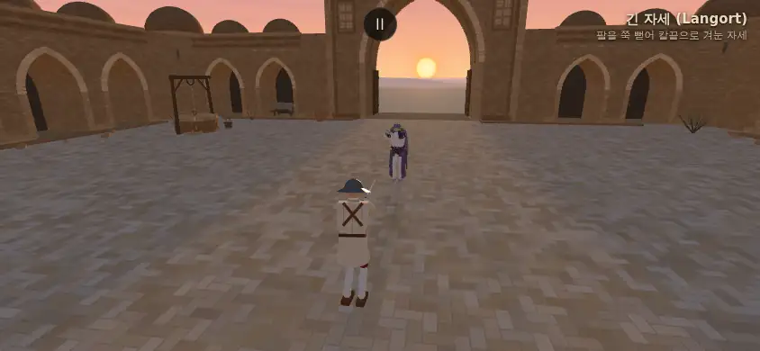
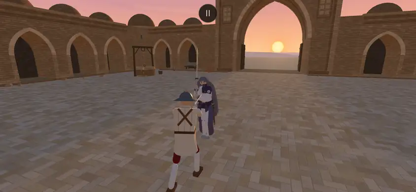
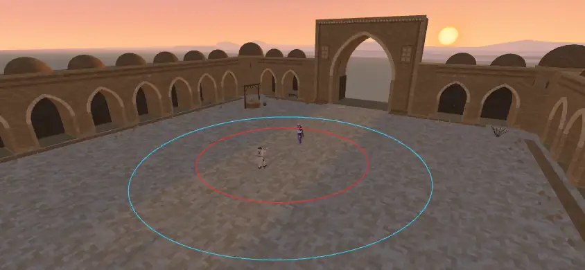
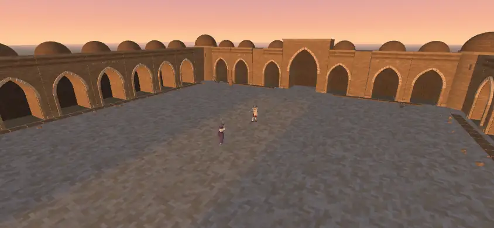
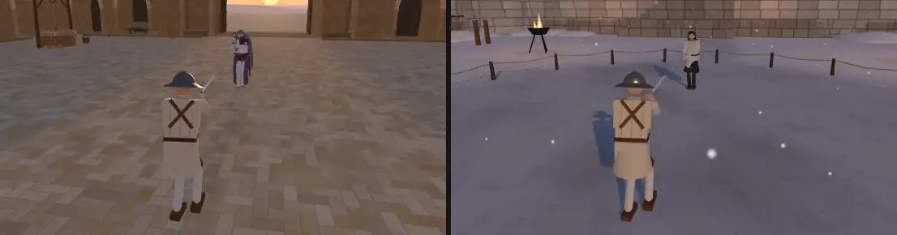
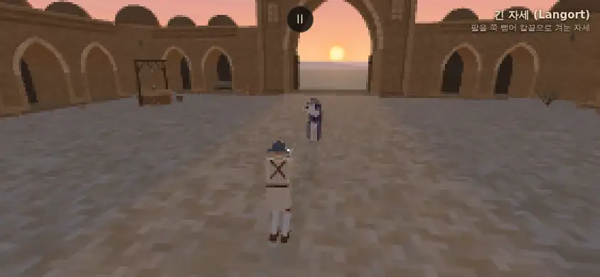
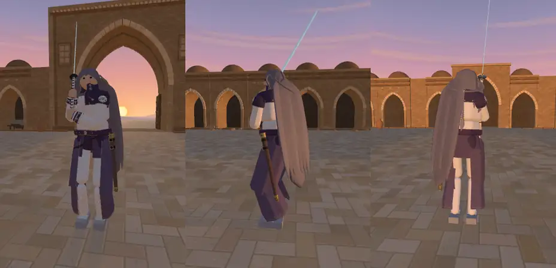
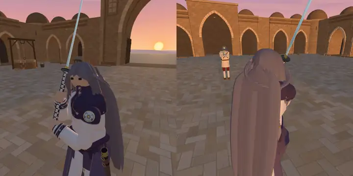
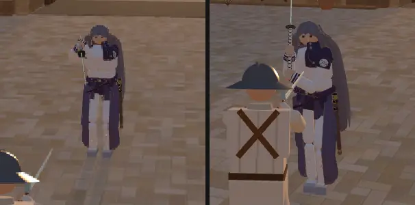

# 샛별 가져오기 4차 — 가져오기 전 디자인 리뷰: 소금길의 역참(일몰) · 다라이시 (2026-10-14)

- 지시: 사장님 10/14 03:5x "샛별이 방금 만든 소금길의 역참과 다라이시도 가져와 숙련도 4. 디자인 리뷰 먼저 해."
- **결정됨**: 다라이시 숙련도 **4**. 나머지는 이 리뷰로 여쭐 것을 정리했다(§7).
- 범위: **리뷰만** 했다. 게임 코드·무대·인물 파일은 하나도 옮기지 않았다(이 문서와 `docs/import/review4/` 그림만).
- 기준: 우리 본판 **8b1d7d3** · 샛별 저장소 `origin/main` **db729604**(내용은 9cf69988 일몰판 — 그 뒤는 기록 커밋뿐). 샛별 쪽은 `git archive` 로 꺼낸 사본만 읽고 돌렸다.
- 읽은 샛별 문서: 소금길의 역참·은발의 왕실 근위검사(10/14) · 다라이시·일몰의 소금길 역참(10/14) · 캐릭터 전체 현황과 은발의 검사 무대 후보(10/13) · 곁으로 은발의 검사 외형 시안·머리 v3·v4·장식 v2(10/11). 코드: `stage_dayr.js` · `characters_wanderers.js`(silver_wanderer 항목) · `outfit_silver_wanderer*.js` 다섯 · `looks.js`·`sound.js`·`stage_detail_sound.js`·`stages.js` 의 해당 줄 · `public/silver-wanderer.html`.
- 앞선 리뷰(같은 꼴): `docs/import/saetbyeol_review3_2026-10-14.md` · `docs/import/saetbyeol_review_2026-10-10.md`.

## 0. 한눈에 (사장님용)

**추천 3줄**
1. **소금길의 역참은 가져오되, 결투장 표시와 인물 그림자부터 고친다** — 그림결(벽돌 이완·볼트 방·낮은 돔, 캔버스 무늬, 그림 파일 0)과 노을 색은 우리 결에 맞고, 무대만의 그리기 양도 우리 무대 범위 안이다. 물리 규칙·장애물이 없어 습지보다 훨씬 쉽게 옮긴다. 다만 36 m 빈 안뜰 한가운데 **보이지 않는 벽(반지름 6.5 m)이 아무 표시 없이** 있고, 해를 2.1° 로 낮춘 일몰판에서 **인물 그림자가 사라졌다**(오후판에는 있었다).
2. **다라이시는 겉모습을 덜어서 가져온다** — 결투 거리에서 실루엣(보라 자락·흰 소매·긴 은발)은 잘 읽힌다. 그러나 인물 하나가 **삼각형 4.8 만·메쉬 116** 으로 우리 인물 가운데 가장 큰 값(삼각형 2.7 만·메쉬 91)을 크게 넘고(삼각형 1.8 배), 같은 무대에서 그리기 호출을 **+120** 늘린다. 1~2 mm 문양 선과 땋은 머리는 폰 화면에서 보이지 않는다 — 어깨 원판 같은 큰 면만 남기는 안.
3. **숙련도 4 는 결정대로 넣되, 미나미와 겹침을 정해야 한다** — 우리 표에서 숙련도 4 = 실력 'hard' + 일본 고유 동작 넷(히라키기리·코테·츠바메가에시·코코 연타), 비기 없음. 같은 모노호시자오·같은 '지키는 사람'인 미나미(숙련도 3)와 기질 값까지 둘 다 비어 있어 싸움이 거의 같다(차이는 코코 연타 하나). 목소리도 토메 묶음이면 토메·김씨·(라트나)·다라이시가 한 목소리다.

| # | 항목 | 한 줄 평 | 추천 | 급 |
|---|---|---|---|---|
| 1 | 역참 그림결 | 벽돌 이완·볼트 방·낮은 돔, 캔버스 무늬 다섯·그림 파일 0 — 우리 결. 모스크·글씨·종교 상징 없음 | 그대로 | 하 |
| 2 | 노을 색·강조색 | 살구·산호 노을 + 보랏빛 위 하늘, 호박색 해가 문루 안 상대 머리 위 — 첫 화면 초점이 좋다. 다라이시 보라와 보색 | 그대로 · 여정에서 성 안뜰(역시 해 질 녘)과 떼어 둠 | 하 |
| 3 | 빛 방향·인물 그림자 | 해 높이 **2.1°**, 상대 등 뒤(역광). 해 그림자 켬/끔 화면 차이 **8 화소**(성 안뜰 2,465) — 인물이 바닥에서 뜬다 | 해를 올리거나(예 8~12°) 발밑 접지 그림자 | **상** |
| 4 | 결투장 경계 | 36×36 m 안뜰 전체가 같은 헤링본 바닥. 경계 벽(6.5 m)·카메라 한계(10.5 m) 어디에도 표시 없음 | 납작한 바닥 띠(벽돌 테두리·닳은 원) | **상** |
| 5 | 가림·장애물·물리 | 카메라 반경 10.5 m 안은 바닥뿐 · 충돌체·지형 규칙 없음(평평한 y 0) | 그대로 | — |
| 6 | 무대 성능 | 무대만(같은 상대 이졸데로 잼, 샛별 빌드): 그리기 **243**·삼각형 **12.0 만** — 빌드 차이를 빼면 우리 무대(176~241 · 7.3~15.8 만) 안, 그리기는 위 끝 | 그대로 · 실기기 `?fps=1` | 중 |
| 7 | 무대 소리 | 마른 바람 둘(우리 무대 가운데 가장 작음) + 우물 고리(절차 합성, 약 33 초 주기) + `stepStone` 재사용 · 새 파일 0 | 그대로 · 세부음 표 순서 지킴(§1-7) | 하 |
| 8 | 카드 뒷면 | 샛별에 없음(그쪽은 옛 classic 뒷면으로 떨어짐) | 새로 그림(px_dayr 넷 + 회색) | 중 |
| 9 | 다라이시 실루엣 | 5.6 m 에서 키 약 62 px(화면 높이 16 %) — 보라 자락·흰 상의·긴 은발이 플레이어와 확실히 갈림. 1.9 m 에서 어깨 원판까지 읽힘 | 그대로 | 하 |
| 10 | 문양·땋은 머리·비용 | 문양 선 반지름 1~2.3 mm(폰 1 화소 안), 땋음은 머리와 명도가 같아 안 보임. 인물 하나 4.8 만 삼각형·메쉬 116, 같은 무대 그리기 +120 | 큰 면만 남기고 잔선·땋음 덜기 — 목표 ≤ 2.7 만·메쉬 ≤ 90 | **상** |
| 11 | 숙련도 4 (결정됨) | hard + 일본 고유 동작 1~4 · 비기 없음 · 아르토리아와 같은 최고 숙련도. 미나미(3)와 기질 값이 둘 다 비어 차이는 코코 연타 하나 | 기질 값을 따로 줄지 사장님 확인 | 중 |
| 12 | 모노호시자오 | 우리 무기 그대로(모델·질량 같음 — 우리 쪽만 `school: 'japanese'`) → 우리 판에서는 일본 유파 자세·동작으로 싸워 샛별 화면과 다르다. 빈 검집 66 cm < 날 90 cm | 그대로 · 검집 길이만 | 하 |
| 13 | 말투·대사 | 해라체 명령('용건을 밝혀라', '다가오지 마라'). 하게체(김씨·라트나)·해요체(미나미·투야나·이졸데)와는 안 겹침. 하인리히('무릎 꿇어라. 왕의 검 앞이다.')와 '왕 + 명령' 꼴이 겹치고, '이름' 소재가 넷째 | 한두 줄 손볼지 사장님 확인 | 중 |
| 14 | 목소리 | 토메 묶음 → 지금 토메·김씨 둘 + 다라이시 = 셋, 라트나도 토메 묶음으로 옮기면 **넷이 한 목소리** | 사장님 결정 | 중 |
| 15 | 이름·문화 | 무대 화면 이름에 실존 유적 이름 없음 · '다라이시' 말뿌리 기록 없음 · '이란 왕실'은 지금 왕실이 없는 현대 국가 이름 · 카드 글 '사사키 코지로의 노다치' + 기억 잃은 검사 → 코지로 본인으로 읽힐 수 있음 | 사장님 확인 | 중 |
| 16 | 출처 | 역참 사진(위키미디어, CC BY-SA 4.0)은 참고만 — 사진·사진 질감 파일 없음(확인). 소개 그림은 게임 렌더. 다만 **인물 첫 시안은 샛별 쪽 사용자가 준 그림**(저장소에 없음, 그린 이 기록 없음)이고, 머리 v3 는 상업 게임 인물 참고(미채택) | v3 는 빼고 · 첫 시안 그림 출처 확인 | **상** |

- 급: 상 = 옮기기 전에 정할 것 · 중 = 사장님 결정 뒤 · 하 = 참고.

## 1. 소금길의 역참 (`dayr`)

*샛별 판 빌드(db729604)에서 `?stage=dayr&foe=silver_wanderer&weapon=longsword&foeWeapon=monohoshizao`, 헤드리스 SwiftShader. 바깥 요청은 막고 찍었고(막힌 요청 0) 콘솔 오류 0. 비교의 성 안뜰만 우리 본판 빌드.*

### 1-1. 무엇
- 이란 데이르에 가친 역참(카라반사라이)에서 착안한 가상의 해 질 녘 역참. 깊은 이완 문루(+x 쪽, 높이 약 10.9 m)·작은 아치 회랑 방·낮은 돔·네 귀퉁이 둥근 탑, 닳은 벽돌 헤링본 바닥, 문루 너머 소금벌판과 낮은 능선, 지평선에 걸친 해. 안뜰은 36×36 m(벽 ±18 m).
- 소품: 우물(나무 틀·두레박·줄 고리 — 흔들리는 것은 줄 고리 하나) · 물항아리 셋 · 짐꾸러미 하나 · 마른 덤불 여섯 · 바깥 둘레 잔돌. 모두 결투장 가운데서 16 m 넘게 떨어져 있다.
- 오후판(0840e812) → 일몰판(9cf69988)에서 바뀐 것: 해 방향·높이(플레이어 뒤 45° → 문루 쪽 2.1°), 노을 하늘·보이는 해, 바닥 굽기(차가운 그늘 + 문루로 들어오는 따뜻한 띠), 문짝 철물·벽돌 바구니 짜임, 짐꾸러미. 건축·소리 사건은 그대로.
- 그쪽은 일반 여정 순서에 넣지 않고 따로 들어가는 입구로만 이었다(`STAGE_FOE.dayr = 'silver_wanderer'`).

### 1-2. 그림결 (우리 `docs/design_language.md` 와)
- 맞는 점
  - 기본 도형·밀어낸 아치(ExtrudeGeometry)·꼭짓점 색 굽기 — 산사·성 안뜰과 같은 짓는 방식이다. `stage_kit.js` 는 우리 것과 **바이트 같다**(그대로 들어온다).
  - 무늬는 캔버스 다섯(벽돌 512² · 바닥 헤링본 1024² · 나무결 256×512 · 하늘 1024×512 · 해 512²). 그림 파일 0.
  - 이슬람 사원 요소·글씨(타일 명문)·종교 상징을 일부러 뺐다(코드 주석 'not a mosque', 'no added tile or writing'). 이완·볼트 방·돔은 역참 건축의 일반 꼴이다.
  - 카메라 궤도 10.5 m 안은 바닥뿐 — 우리 무대 관례('결투장 안은 비움')를 지킨다.
  - 도트 모드에서 문루·해·두 인물이 덩어리로 그대로 읽힌다(그림 6).
- 아쉬운 점
  1. **결투장 경계가 안 보인다**(§1-4) — 10/10 리뷰에서 얼어붙은 만에 적었던 것과 같은 문제이고, 여기는 안뜰이 넓어 더 크게 느껴진다.
  2. 바닥 헤링본(벽돌 한 장 0.36 m, 반복 5.76 m)이 화면 아래 절반을 채운다. 가까이선 벽돌로 읽히고 먼 곳은 잔 얼룩이 된다. 도트 모드에서도 먼 바닥은 자글자글하다(그림 6). 크게 거슬리진 않으나 우리 무대 바닥 가운데 잔 편이다(결투장 안쪽만 무늬 대비를 낮추는 안).
  3. 보이는 해(먼 투명 판 하나 — 이 무대의 유일한 투명 물체)가 문루 한가운데, 판 시작 화면에서 상대 바로 위다. 초점으로는 좋지만 가장 밝은 점이 상대 옆에 계속 있다(번짐 효과는 없음).

### 1-3. 빛·색 (일몰)
- 하늘 띠: 위 `#273554` → `#536386` → 보랏빛 `#9990b2` → 분홍 `#ce98aa` → 살구 `#f4b095` → 지평선 `#ffcb99`. 바탕 `#e6ad96` · 안개 `#e1ad9b` 68~290 m.
- 반구광 하늘 `#b8bfdf`(차가운 라벤더)·땅 `#d0a386`·1.55 · 해 `#ffb878`·2.6 · 인물 빛 `0xffe3cf`·테 `0xffd09a` 0.92·세기 0.55(오후판 0.8·0.43 에서 올림 — 역광인 상대를 읽히게).
- **빛 방향**: 해가 +x(문루 쪽), 높이 **2.1°**(`sunOffset {x:14, y:0.515, z:−0.25}`). 경기 카메라는 플레이어 뒤에서 +x 를 보므로 **판 시작마다 상대가 정역광**이다. 상대 앞면은 반구광 + 인물 빛으로만 밝다 — 찍은 화면에서 얼굴·옷 앞면이 충분히 읽혔다(인물 빛 덕).
- **인물 그림자가 없다**: 그림자 지도는 플레이어 둘레 ±4 m·깊이 25 m 인데(main.js), 2.1° 해에서는 1.8 m 사람 그림자가 약 49 m 로 늘어져 거의 안 그려진다. 같은 멈춘 장면을 해 그림자 켬/끔으로 찍으면 바뀐 화소가 역참 **8** · 성 안뜰(해 24°) **2,465**(그림 5). 오후판 소개 그림에는 플레이어 그림자가 있었다. 우리 다른 낮은 해: 얼어붙은 만 13.6° · 붉은 회랑 17.0° · 화전 터 17.5° · 성 안뜰 24.1°.
  - 안: ① 해를 8~12° 로 올림(노을 하늘·해 판은 그대로 두고 빛만 — 그림자가 키의 5~7 배로 길게 드리워 저녁 느낌은 남는다 [추정 — 안 찍어 봄]) ② 해는 두고 인물 발밑에만 둥근 접지 그림자(무대 공용 기능이 없어 새로 만들어야 함 [추정]) ③ 그대로.
- 색 구성: 따뜻한 황토 벽·회베이지 바닥·분홍 하늘 — 한 색 덩어리로 묶이고, 강조는 호박색 해 하나. 다라이시 보라 `#433653` 가 그 위에서 보색으로 잘 뜬다. 우리 플레이어(흰 옷)는 회베이지 바닥 위에서 명도가 가깝지만 모자·가죽끈으로 읽힌다.
- 성 안뜰도 '해 질 녘'이다(눈 내리는 회청색). 색은 다르지만 저녁 무대가 둘이 되니 여정에서 붙이지 않는 편이 낫다(§1-9).

### 1-4. 결투장 경계·가림
- 우리 물리 경계는 원형 보이지 않는 벽(반지름 6.5 m + 0.25)이고 카메라는 10.5 m 밖으로 못 나간다. 다른 무대는 밧줄·돌 고리·상감 띠·섬 물가로 이 자리를 보여 준다(그림 5 오른쪽). 역참은 **같은 바닥이 벽(18 m)까지 이어져** 플레이어가 아무것도 없는 곳에서 막힌다(그림 3).
- 안(물리 영향 없음, 납작한 것만 — 카메라 궤도 관례 지킴): ① 바닥 벽돌을 결투장 둘레만 세워 깐 한 줄 띠 ② 둘레가 더 닳아 밝은 원(오가던 짐수레 자국) ③ 낮은 말뚝 + 짐 묶는 밧줄 고리(성 안뜰과 같은 꼴 — 겹칠 수 있음). ①이 무대 결에 가장 맞아 보인다.
- 가림: 카메라 반경 10.5 m 안에 서 있는 물체가 없다 — 상대를 가리는 구조물 없음. 문루 해가 상대 뒤에 오는 것은 가림은 아니고 눈부심(위 1-2-3).

### 1-5. 성능
같은 방법으로 쟀다: 우리 `tools/browser/stage_cost.mjs` 와 같은 순서·같은 화면(844×420, 경기 카메라, 두 사람 가만히, 롱소드)에 인물 삼각형 셈만 더한 임시 도구. 헤드리스 SwiftShader 라 프레임 시간은 안 쓴다.

| 무대 (빌드) | 상대 | 그리기 호출 | 삼각형(그린 것) | 상대 인물 삼각형 · 메쉬 |
|---|---|---:|---:|---:|
| **역참 (샛별)** | **다라이시** | **363** | **197,986** | **47,622 · 116** |
| 역참 (샛별) | 이졸데 | 243 | 119,754 | 8,506 · 56 |
| 역참 (샛별) | 미나미 | 265 | 129,434 | 13,346 · — |
| 성 안뜰 (샛별) | 이졸데 | 238 | 76,125 | 8,506 · 56 |
| 성 안뜰 (샛별) | 다라이시 | 358 | 154,357 | 47,622 · 116 |
| 잠든 습지 (샛별, 참고) | 라트나 | 249 | 185,575 | 24,705 · 77 |
| 우리 열한 무대 (본판, 자기 짝) | 각 무대 짝 | 192~307 | 72,653~168,198 | 7,434~26,996 |
| 우리 열한 무대 (본판, 같은 상대) | 이졸데 | 176~241 | 72,653~158,062 | 7,458 · 54 |

- 우리 열한 무대를 같은 상대(이졸데)로 잰 값: 포세이돈 228·8.0 만 · 화전 터 241·9.6 만 · 산사 183·15.8 만 · 성 안뜰 230·7.3 만 · 밤의 포세이돈 241·8.2 만 · 대성당 176·7.3 만 · 붉은 회랑 233·10.1 만 · 산호 항구 203·9.4 만 · 신목의 숲 187·14.8 만 · 얼어붙은 만 235·12.9 만 · 청람잔도 217·11.1 만.
- 두 빌드 차이: 성 안뜰·이졸데로 샛별 판이 그리기 +8·삼각형 +3,472 많다(플레이어·이졸데 몸 모양이 조금 달라서). 이를 빼면 **역참 무대는 우리 판에서 그리기 약 235·삼각형 약 11.6 만** [추정] — 우리 무대 범위 안(그리기는 위 끝, 삼각형은 가운데).
- **무거운 것은 인물이다**: 다라이시를 넣으면 같은 무대에서 그리기 +120·삼각형 +7.8 만(그림자 그리기 포함). 우리 인물 가운데 그리기가 가장 많은 마야가 +74(성 안뜰 230 → 304). §2-3.
- 그쪽 기록(무대만, 그쪽 카메라): 56,302 삼각형 · 그리기 17 · 모양 17·재질 15·질감 5, 세 번 짓고 풀기 누수 없음.
- 사장님 10/14 습지 결정('그리기 호출은 적정선까지만')에 비추면, 무대는 적정선 안이고 다라이시 v6 는 적정선 밖이다.

### 1-6. 물리 규칙·장애물
- **없다.** 충돌체 0, 바닥 y 0 평면, 지형 규칙(진흙 같은 감속) 없음. 그쪽 10/13 무대 후보 글의 '바깥 느슨한 모래만 감속' 안은 만들지 않았다.
- 그래서 우리 `fighter.js`·`ai.js`·`gait.js`·`main.js` 물리 줄은 손댈 것이 없다(습지와 다름). 시뮬(fights12 등)은 무대를 안 지으므로 그대로일 것.

### 1-7. 무대 소리
- 발소리: 우리에게도 있는 `stepStone`(청람잔도·붉은 회랑과 같음). `sound.js STAGE_SOUND` 에 한 줄. 울림 방(room) 없음.
- 바탕: 마른 바람 잡음 둘(세기 0.0017·0.00075) — 우리 무대 바탕 가운데 가장 작다(청람잔도 0.0014+0.0018, 얼어붙은 만 0.0026+0.0035). '적막'에 맞는다.
- 세부음 하나 `caravanRing`: 우물 줄 고리가 흔들림 끝에서 쇠말뚝에 닿는 소리(670·1093·1771 Hz 감쇠 부분음, 1.1 초, 세기 0.025). 무대 시계 11 초에 처음, 그 뒤 약 33 초마다(최소 간격 22 초). 절차 합성, 새 파일 0. 그쪽 120 초 검사에서 네 번.
- **난수 seed·순서**: 세부음 버퍼 seed 가 `9127 + (STAGE_DETAIL_PROFILES 안 자리) × 311 + 변형 × 101` 이다. 그쪽 표 순서는 … 청람잔도 둘 → **습지 셋 → `caravanRing`**. 우리 표에 끝에 붙이면 있던 세부음 seed 는 안 바뀐다. 다만 습지보다 먼저 들어오면 `caravanRing` 자리가 10(그쪽 13)이 되어 소리 변형이 그쪽과 달라지고, 뒤에 습지 셋이 그 뒤에 붙으면 습지 seed 도 그쪽과 달라진다. → **습지 셋 다음에 붙인다**(먼저 들어가면 자리를 비워 둘 수 없으니 습지 병합 뒤에 넣는 것을 권함).
- 바탕 잡음은 공용 잡음 버퍼를 쓰고 `sound.js` 합성 seed 는 이름 기준이라 `STAGE_SOUND` 에 줄을 더해도 다른 소리 seed 에 영향 없다.

### 1-8. 카드 뒷면
- **새로 만들어야 한다**(우리 규칙: 새 스테이지 = 카드 뒷면 함께). 그쪽 `PX_BACKS` 에 `dayr` 가 없어 옛 classic 뒷면이 나온다.
- 할 일: `px_dayr_{tile,frame,center,plaque}.png` + `grey_foe.py` 회색 + main.js `PX_BACKS` 한 줄 + `gen_pixel_cardbacks.py` 테마.
- 문양 안: 바탕 반복 = 헤링본 벽돌 결 + 작은 소금 알갱이 · 띠 = 엇갈린 벽돌(바구니 짜임) · 가운데 = 팔각 별(이란 벽돌 장식의 흔한 기하 꼴, 스스로 180° 대칭) 안 작은 해. 바탕 짙은 저녁 벽돌(예 `#2a1d1b`) + 황토 `#c7a77d` · 살구 `#f4b095` · 보랏빛 `#536386`.

### 1-9. 여정 자리 후보 (`src/stages.js STAGE_ORDER` — 지금 11 개)
| 안 | 자리 | 좋은 점 | 걸리는 점 |
|---|---|---|---|
| A | 맨 끝(12번째, 청람잔도 뒤) | 앞 열한 자리 그대로 · 한낮(잔도) → 일몰(역참) → 다시 포세이돈, 하루가 흐른다 · 성 안뜰(4번째, 해 질 녘)과 멀다 | 여정 한 바퀴를 세는 도구 기대값 고침 |
| B | 산호 항구 뒤(8번째) | 바다 교역항 → 소금길 역참, 교역로로 이어진다 | 뒤 무대 셋이 밀림 · 숲(신목)까지 따뜻한 색이 잇달음 |
| D | 여정 밖(`?stage=dayr` 로만, 샛별과 같음) | 습지와 같은 결정(사장님 10/14 '여정 밖') · 여정 안 건드림 | 다라이시가 무작위 회전에서만 나옴 |

- 사장님이 무대 설정을 생각 중이시라 안만 둔다. 옮기는 동안은 D 가 안전하다.

## 2. 다라이시 (샛별 id `silver_wanderer`)

*샛별 빌드에서 `foe=silver_wanderer&foeWeapon=monohoshizao`, 외형 v6(`court_braided_layers`). 인물 세 장은 AI 를 세워 두고 자유 카메라로, 확대는 경기 카메라 화면을 잘랐다.*

### 2-1. 생김새 (v6)
- 은회색 풍성한 장발 + 앞머리 층 + 양옆·뒤 세 가닥 땋음(상아색 비녀 고리 하나), 높이 선 보라 깃과 짧은 어깨 망토, 흰 셔츠·흰 소매 + 보라 손목띠·은 고리, 자주 허리띠(가운데 팔각 꽃), 앞이 갈라진 보라 긴 자락, 흰 바지·은 각반, 왼허리에 빈 검집(금 장식). 공통 몸·얼굴·눈·충돌 크기 그대로, 갑옷·투구 물리 없음.
- 색: 흰 `#e9e9e5` · 보라 `#433653` · 자주 자락 `#665976` · 은 `#b6bbc3` · 금 `#a88b45` · 머리 `#77737f` · 피부 `#e0bf9f`. 바탕 + 3~4 색 원칙에 맞는다.
- 판 이력: v1 첫 시안(샛별 사용자 그림) → v2 장식 → v3 우쿄풍 머리(미채택) → v4 원래 긴 머리 숱 보강 → v5 반묶음 → v6 땋음·자락 다듬기(지금). 그쪽은 v1·v2·v4·v5 비교 입구를 남겼다.

### 2-2. 결투 거리에서 (폰 가로)
- 5.6 m(판 시작): 키 약 62 px(화면 높이 16 %). 보라 자락 두 쪽 + 흰 상의 + 등 뒤로 늘어진 긴 머리 → '긴 옷·긴 머리 검사'로 바로 읽히고, 흰 옷 플레이어와 확실히 갈린다. 어깨 원판은 흰 점 하나, 땋음·문양은 안 보인다. 칼날은 문루의 밝은 하늘 앞에서 가늘어 거의 안 보인다(다른 무기도 같은 조건).
- 1.9 m(칼이 닿는 거리): 키 약 125 px. 어깨 원판(팔각 꽃)·깃 테·손목 은 고리·빈 검집까지 보인다. 얼굴은 시작 자세(`tagR` — 오른 어깨 지붕, 우리 일본 유파 이름 핫소)에서 두 손에 반쯤 가린다.
- 뒤·옆: 뒷머리가 등 전체를 덮는 넓은 한 면(무릎 위까지). 노을 빛에서 은발이 따뜻한 회베이지로 보여 역참 벽·바닥과 명도가 가깝다 — 뒷모습만은 배경에 묻히는 편.

### 2-3. 문양·머리 — 미니멀 기준과 비용
- 문양 선(깃 덩굴·손목 잎·자락 테·박음질)은 관 반지름 **1~2.3 mm**, 잎 조각은 약 1 cm 다. 1.9 m 에서도 1 화소 안팎이라 폰에서는 반짝이는 잔선이거나 안 보인다. 우리 디자인 언어('머리카락 같은 가는 선은 쓰지 않는다')에 어긋나는 쪽이다. 결투 거리에서 읽히는 문양은 **어깨 원판(약 8×7 cm, 팔각 꽃)** 하나뿐이다.
- 땋음 세 가닥은 굵기 약 2~3 cm, 색 `#918b99` 가 머리 `#77737f` 와 명도가 가까워 가까이서만 보인다.
- 비용(같은 성 안뜰·같은 카메라, 샛별 빌드, 상대만 바꿈):

| 외형 판 | 인물 삼각형 | 그리기 호출(무대 전체) | 이졸데 대비 |
|---|---:|---:|---:|
| v1 첫 시안(문양 없음) | 18,230 | 264 | +26 |
| v2 문양 넣음 | 31,434 | 320 | +82 |
| v4 숱 보강 + 페르시아풍 문양 | 35,734 | 334 | +96 |
| v5 반묶음 | 38,450 | 340 | +102 |
| **v6 땋음·자락 (지금)** | **47,622** | **358** | **+120** |
| 참고: 우리 인물(본판 성 안뜰) | 7,458~26,996 | 230~304 | +0~+74 |

  - 가장 큰 계단은 v1 → v2(문양 잔선, +1.3 만 삼각형·+56 그리기)와 v5 → v6(땋음·덮는 머리층, +0.9 만·+18).
  - 우리 무거운 인물(본판 성 안뜰, 삼각형·메쉬): 투야나 2.70 만·76 · 김씨 2.61 만·78 · 아르토리아 2.54 만·69 · 마야 2.50 만·91(그리기 +74 — 지금 가장 많음) · 미나미 1.65 만·72.
- 안: ① 어깨 원판·허리 팔각 꽃·깃 테만 큰 면으로 남기고 잔선(덩굴·잎·박음질)을 뺀다 ② 땋음은 한 가닥(뒤)만 굵게, 또는 뺀다 ③ 같은 색 조각을 한 메쉬로 합친다. 목표: 우리 인물 무게(삼각형 ≤ 2.7 만·메쉬 ≤ 90). 사장님 미니멀 지향과도 같은 방향이다. 샛별 판 그대로를 원하시면 그리기 적정선은 넘는다.

### 2-4. 모노호시자오와
- 우리 `weapons.js` 의 `monohoshizao`(에픽, '제비 베기: 출혈' 출혈 ×2, 날 0.90 m·츠카 0.25 m)와 그쪽 것은 모델·질량·글이 같고, **우리 쪽에만 `school: 'japanese'`** 가 있다.
- 겉모습 겹침: 시작 자세(오른 어깨 지붕)에서 칼이 머리 옆에 세로로 서서 긴 머리 바로 앞을 지난다. 가까이선 칼(푸른빛 강철)과 머리(회보라)가 구별되고 앞에서 볼 땐 하늘 앞이라 칼이 읽히지만, 결투 거리에서 머리 앞을 지날 때는 둘 다 밝은 회색 가는 덩어리라 칼끝이 묻히기 쉽다 [추정]. 낮은 자세·와키가마에에서 칼끝이 긴 자락을 뚫고 지나갈 수 있다 [추정 — 그 자세는 안 찍음]. 머리·자락은 충돌체가 없어 물리에는 영향 없다.
- 왼허리 빈 검집(0.66 m, 곧은 관)이 날(0.90 m, 휜 날)보다 짧다 — 롱소드 임시 배정 때 만든 검집으로 보인다 [추정]. 1.9 m 에서 보이므로 옮길 때 길이를 맞추거나 뺀다.
- 인물 겹침: **미나미(수호자, 모노호시자오, 숙련도 3)** 와 무기·유파가 같고, '이곳은 내가 지킨다'·'호송대를 호위' 로 역할 말도 '지키는 사람'이 겹친다.

### 2-5. 숙련도 4 (결정됨) — 우리 AI 표에서
우리 `aiAtProficiency` 로 다라이시 시트(무기 `monohoshizao`, 숙련도 4)를 계산했다.

| 칸 | 값 |
|---|---|
| 실력 숫자 이름 `ai.level` | **hard** (`AI_PROFICIENCY.levels[4]` — 3 과 같은 숫자: 반응 0.17 s · 막기 0.85 · 맞받기 0.35 · 속임 0.3 · 이어 치기 0.75 · 읽기 0.9 · 힘 1.15 · 실력 0.85) |
| `persona.proficiency` | `{ japanese: 4 }` |
| 고유 동작(일본, 단계 차례) | 히라키기리(1) · 코테(2) · 츠바메가에시(3) · **코코 연타(4)** — 넷 다 |
| 패시브 | 잔신 · 데바나 · 카에시(츠바메가에시로 받아 치기 — 3 이상이라 대체 없이 그대로) |
| 비기 | **없음**(고노센은 숙련도 5 에서만) |
| 단계 이름 | 4 = 마스터 (AI 는 인장 표시 안 함 — 사장님 10/13) |
| 무기 몫 | 에픽 배율 1.1 · 출혈 ×2 |

- 숙련도 4 인 인물은 지금 아르토리아(엑스칼리버, 레전드) 하나 → 둘. 일본 유파 인물은 미나미(3) 하나 → 둘.
- **미나미와의 차이**: 미나미 시트도 `persona: { school: 'monohoshizao', pers: {} }`(기질 값 비움 → 일본 유파 기본 기질), 다라이시 그쪽 시트도 기질 값 없이 시작 자세 `tagR` 만 있다. 그래서 우리 판에서 둘은 **같은 실력 숫자(hard)·같은 기질·같은 무기**이고, 다른 것은 코코 연타 하나와 시작 2 초 자세뿐이다. 둘을 가르려면 다라이시에게 기질 값(예: 간격 넓게·속임 적게·반격 위주 — '과묵하고 기억나지 않는 일을 아는 척하지 않는다')을 따로 주는 안이 있다(사장님 결정).
- 광기 변형 규칙(+1)으로 변형을 만들면 5 → 비기 고노센이 열린다(참고).

### 2-6. 유파
- 무기 → 자동 판정: 우리 `traditionOf(monohoshizao)` = **일본**(스펙 `school: 'japanese'` — 틀은 앞무게). 이름 표기 방침상 일본 유파 글은 한자·가나 없이 — 다라이시 글에는 둘 다 없다(위반 없을 것).
- 그쪽 판은 유파 체계가 없는 옛 무기별 꾸러미(높은 자세 묶음)로 싸운다. **샛별 화면의 싸움 모습과 우리 판 싸움 모습은 다르다**(우리는 일본 자세표·고유 동작·숙련도 거르기).

### 2-7. 대사·말투
- 칭호 '기억을 잃은 왕실 근위검사' · intro '왕실의 호송대다. 용건을 밝혀라.' / '이름은 잊었지만, 이 자세는 기억한다.' · win '이곳은 내가 지킨다.' / '더 다가오지 마라.' — 게임이 지금 쓰는 갈래(intro·win)는 다 있다.
- 말투 표(intro·win 기준):

| 말투 | 인물 |
|---|---|
| 합쇼체 | 토메 · 아르토리아 · 마야(+해요체) |
| 해요체 | 이졸데 · 미나미 · 투야나 |
| 하게체 | 김씨('…주겠나') · 라트나(옮기면, '…비켜 주게') · 랴오 일부('…재나') |
| **해라체 명령** | 하인리히('무릎 꿇어라') · 오마리('비켜라') · 브란 일부 · **다라이시('밝혀라'·'마라')** |

  - 하게체·해요체와는 겹치지 않는다. 대신 **하인리히와 겹친다**: '무릎 꿇어라. 왕의 검 앞이다.' ↔ '왕실의 호송대다. 용건을 밝혀라.' — 둘 다 '왕(실) + 명령' 첫 마디다.
  - '이름' 소재가 넷째가 된다: 하인리히('이름 따위 필요 없다'·'이름 없는 자는 이름 없이 묻힌다') · 토메('이름은 묻지 않겠습니다') · 아르토리아('이름보다 무거운 것은') · 다라이시('이름은 잊었지만').
  - 설정 글 '예의 바르고 과묵하다'와 명령조 첫 마디가 조금 어긋난다(근무 중 근위병이라 말은 된다). win '더 다가오지 마라.'는 상대가 쓰러진 뒤에 나오는 줄이라 때가 어색하다.
  - 칭호 길이: 사장님이 10/11 에 칭호를 짧게 바꾸셨다('왕'·'수호자'·'걷는 남자'). '기억을 잃은 왕실 근위검사'(11 음절)는 지금 가장 긴 '아르키진나시오의 사서'(10 음절)보다 길다.

### 2-8. 목소리
- 그쪽은 `voice: 'tome'`(토메 묶음 — 기본 상대 녹음 HaelDB 를 파일 복사 없이 빌림). 우리 `sound.js` 에도 같은 묶음이 있다.
- 우리 묶음 쓰임(본판): 토메 묶음 = **토메·김씨** · 이졸데 = 이졸데·미나미 · 조용한 들숨 = 아르토리아·투야나 · 하인리히 = 하인리히·광기의 하인리히 · 나머지 혼자.
- 다라이시를 토메 묶음으로 두면 셋, 지금 옮기는 라트나도 리뷰 3 안대로 토메 묶음이면 **넷이 한 목소리**(토메·김씨·라트나·다라이시)다. 같은 판에 둘이 나오지는 않지만 여정에서 이어 들으면 같은 사람으로 들린다.
- 안(사장님 결정): ① 그대로(넷) ② 지금 한 사람만 쓰는 묶음을 빌림 — 오마리 전용 녹음(CC0) · 랴오 묶음 ③ 새 녹음.

### 2-9. 이름·설정 (이름 정책)
- 무대: 화면 이름 '소금길의 마지막 역참'(그쪽 소개 페이지) / '소금길의 역참'(그쪽 문서 제목). 실존 유적 이름(데이르에 가친)은 화면에 안 나오고 코드 id `dayr` 만 그 첫 낱말이다 — 우리 관례(실존 장소는 착안만, 화면 이름은 창작)에 맞는다. 우리 HUD 는 '스테이지 N · 이름' 이라 짧은 쪽이 폰에 맞다.
- 인물 이름 '다라이시': 그쪽 사용자 표기. 말뿌리·뜻이 기록에 없다. 실존 인물 이름으로 쓰인 예는 못 찾았다 [추정 — 검색 못 함]. 페르시아식(다라 = 다리우스 계열)으로도, 일본식 끝소리('-이시')로도 읽힐 수 있다.
- **사사키 코지로**: 우리 카드 글이 '사사키 코지로의 노다치.'다. '옛 이름과 출신을 잃은 검사'가 그 칼을 들면 **코지로 본인 아니냐**로 읽힐 여지가 있다. 그쪽은 출신을 확정하지 않는다고 적었다. 실존 인물과 이어질 수 있는 설정이라 열어 둘지 사장님이 정하실 일.
- 그쪽 기록의 다른 실존 인물: 의상은 '실제 살라딘 갑옷 복원 아님'이라고만 적혀 있다(복원을 주장하지 않음).
- id: 그쪽 `silver_wanderer`('은발의 방랑자' — 지금 설정은 방랑자가 아님). 우리 관례는 둘 다 있다(투야나 `eira`·김씨 `renji` 는 그대로, 마야 `crown_boss` → `samira` 는 바꿈). 외형·복식 이름과 맞추려면 그대로가 편하다(감독 판단).

### 2-10. 이란 문화 요소
- 무대: 종교 건물 요소·글씨·종교 상징 없음, 역참 건축의 일반 꼴만. 실존 유적의 규모·배치 복제가 아니라고 그쪽이 밝혔다. 무리 없다.
- 문양: 팔각 꽃(로제트)·갈라진 잎·덩굴은 페르시아 장식의 일반 꼴이고 특정 왕조 유물 전사가 아니라고 적혀 있다. 정치색이 있는 상징(예: 사자와 해 문장)은 없다.
- 인물: '출신 불명'이 이란 왕실 근위대에 들어간 설정이라 이란 사람을 그린 것이 아니고, 터번·곡도 같은 흔한 고정관념 소품이 없다.
- 걸릴 수 있는 한 곳: **'이란 왕실'** — 지금 이란에는 왕실이 없다(1979 년 왕정 폐지). 시대를 정하지 않은 설정에서 현대 국가 이름에 '왕실'을 붙이면 특정 정치 시기와 이어 읽힐 수 있다. '페르시아 왕실'(여러 왕조를 아우르는 옛 이름)로 쓰면 덜 걸린다 [제안]. 우리 다른 인물도 실제 지역 이름을 쓰므로(브리튼·라자스탄·동시베리아) 그대로도 관례 밖은 아니다.

### 2-11. 인물 자료 꼴 (우리 `characters.js`)
- 그쪽 꼴: `ai: { level: 'normal', persona: { school: 'monohoshizao', idle: { guard: 'tagR', gesture: 'still' } } }` + 짧은 설정 글(origin·backstory·want·school·temperament). 나이·signatureMoves·favoriteGuards·movementNotes·weaknesses 없음(우리 화면엔 이름·칭호·대사만 나오므로 비어도 된다).
- 우리 꼴로: `ai: { proficiency: 4, persona: { school: 'monohoshizao', idle: {…}, (기질 값 — 사장님 결정) } }` — `level`·`persona.proficiency` 는 `finishAI` 가 채운다. `voice` · 칭호·대사는 §7 결정대로.
- 외형: `looks.js` 에 v1·v2·v4·v5·v6(**v3 빼고**) + `CHARACTER_LOOK_VERSION`. 복식은 우리 `outfits.js` 도움 함수를 쓴다 — 우리 `newOutfitHelpers` 에 `artoriaRoundedBox` 열쇠 하나만 더하면 된다(라트나도 같은 열쇠가 필요).

## 3. 출처·파일 크기
| 무엇 | 출처 | 크기 | 우리에게 필요? |
|---|---|---|---|
| 무대 코드 `stage_dayr.js` | 그쪽 절차 코드 | 27.9 KB | 예(경계 띠·해 높이 고쳐서) |
| 무대 무늬 다섯 | `canvasTex` 로 코드가 그림 | 파일 0 | — |
| 역참 사진 | 위키미디어 공용(curid 72779065, CC BY-SA 4.0) — 그쪽이 시각 참고만 했다고 적음. **저장소에 사진·사진 질감·사진을 붙인 그림이 없음을 확인**(그쪽 dayr 커밋 셋이 더한 그림 파일은 아래 소개 그림뿐, jpg 는 플랑베르주 사진 하나). 건물은 수백 년 된 유적이라 꼴을 본뜬 것에 걸리는 권리는 없을 것 [추정] | — | 아니오 |
| 무대 소리 | `stepStone` 재사용(우리에게 있음) + 절차 합성(바람 둘·고리 하나) | 새 파일 0 | 예(코드 몇 줄) |
| 소개 그림 `encounters/dayr-*.webp` 넷 | 그쪽 게임 렌더(눈으로 확인 — 로우폴리·조이스틱 보임) | 68~98 KB, 합 330 KB | 아니오 |
| 인물 소개 그림 `encounters/silver-wanderer-*.webp` 열일곱 | 그쪽 게임 렌더(열일곱 모두 눈으로 확인 — 공통 몸·관찰 조명) | 20~46 KB | 아니오 |
| 인물 복식 `outfit_silver_wanderer.js`·`_detail.js`·`_full_hair.js`·`_court_hair.js` | 그쪽 절차 코드. **첫 시안 v1 은 그쪽 사용자가 준 그림을 캐릭터화** — 그림은 공개하지 않는다고 적혀 있고 저장소에 없으며 그린 이 기록이 없다 | 10.1·18.4·4.3·10.9 KB | 예(덜어서) — **그림 출처 확인 뒤** |
| 머리 v3 `outfit_silver_wanderer_hair.js` | 상업 격투 게임(사무라이 쇼다운) 인물 우쿄의 공식 그림을 참고한 머리(그쪽 사용자 미채택) | 3.4 KB | **아니오 — 옮기지 않음**(`_detail.js` 가 이 파일을 import 하므로 그 줄과 v3 갈래도 지움) |
| 인물 목소리 | 기존 `tome` 묶음(이미 우리 저장소·라이선스 안) | 새 파일 0 | — |
| 소개 페이지 `silver-wanderer.html` | 그쪽 | 9.0 KB | 아니오 |

- 결론: 무대 쪽은 출처가 흐린 파일 없음. 인물 쪽은 **첫 시안 그림의 출처**만 확인이 필요하다(직접 그린 그림이면 문제 없음). 우리가 새로 만들 바이너리는 카드 뒷면 조각(각 100~250 B)뿐.

## 4. 위험
1. **경계 없는 넓은 안뜰**: 경계 띠 없이 들이면 '아무것도 없는 데서 막히는' 판이 된다(§1-4).
2. **그림자 없는 인물**: 해 높이를 그대로 두면 발 디딤·넘어짐이 바닥에 붙어 보이지 않는다. 해를 올리면 노을 느낌이 조금 준다 — 사장님 눈으로 고를 일(§1-3).
3. **인물 무게**: v6 그대로면 그리기 호출이 우리 최고치를 넘는다(무대 전체 약 355 [추정]). 폰 발열·프레임은 실기기 `?fps=1` 로만 알 수 있다.
4. **미나미와 겹침**: 같은 무기·유파·기질·역할 말 — 무작위 회전에서 연달아 나오면 같은 인물처럼 느껴질 수 있다.
5. **겹치는 작업**(지금 습지·라트나·플랑베르주를 옮기는 중): `stages.js`(import·BUILDERS·STAGE_NAME_KO·STAGE_FOE·STAGE_ORDER) · `sound.js STAGE_SOUND` · `stage_detail_sound.js`(표 순서 = seed, `hasStageDetails` 한 줄, 합성·바탕 갈래) · main.js `PX_BACKS`(한 줄짜리 객체라 둘이 같은 줄을 고친다) · `outfits.js`(import·`newOutfitHelpers`·OUTFITS) · `looks.js` · `characters.js`(배열 끝) · `gen_pixel_cardbacks.py` · `docs/stages.md` · `docs/strike/owner_defaults_table.md`(확인표 번호 — 습지 1110~·플랑베르주 1140~1152, 이번 몫은 다른 번호대를 받아야 함).
6. **CHARACTERS 에 들어가면** 무작위 회전·인물 도는 도구(`characters_eval`·`revive_check` 등) 출력이 바뀐다(fights12 는 인물을 안 씀).
7. **여정에 넣으면** 여정 한 바퀴를 세는 도구(`stages_sb_shots.mjs` 열한 판 등)의 기대값을 고쳐야 한다.
8. 저작권: 첫 시안 그림이 남의 그림이면 겉모습 전체가 걸린다 — 확인 전에는 무대만 먼저 옮기는 것을 권한다.

## 5. 이식 계획 (단계마다 관문)

### 5-1. 가져올 것 / 고쳐서 가져올 것 / 뺄 것
- **그대로**: `stage_dayr.js`(아래 고침 둘 말고) · 세부음 `caravanRing`·바탕 바람 둘 · `STAGE_SOUND.dayr`.
- **고쳐서**: 역참 — 결투장 바닥 띠 · 해 높이(또는 접지 그림자) / 다라이시 — 복식 넷(잔선·땋음 덜기, v3 import 빼기, 검집 길이) · `looks.js`(v3 빼고) · 시트(우리 꼴, 숙련도 4, 기질·목소리·칭호·대사는 사장님 결정).
- **뺄 것**: 머리 v3 모듈 · 소개 페이지·소개 그림 · 그쪽 검사 도구(`tools/browser/dayr_*_20261014.mjs`, 전달 도구) · 계정·성장 관련 · 세르파·찬다(이번 지시 밖).

### 5-2. 단계
1. **무대 — 역참** (습지 병합 뒤 권함): `stage_dayr.js` 추가(+ 경계 띠·해 높이) · `stages.js` BUILDERS·import·`STAGE_NAME_KO.dayr` · `STAGE_FOE` 는 3 단계 전엔 비움 · 여정 자리는 D(밖)로 시작 · `sound.js` 한 줄 · `stage_detail_sound.js`(습지 셋 **뒤에** `caravanRing`, `hasStageDetails`, 합성·바탕 갈래) · 카드 뒷면 넷 + 회색 + `PX_BACKS` · `docs/stages.md`.
   - 관문: fights12 sha 그대로(시뮬은 무대 안 읽음) · live_battery 그대로 · `npx vite build` · `stage_cost.mjs`(우리 도구로 다시) · 무대 세 바퀴 바꾸기 누수 없음 · 폰 화면·도트 모드 사진 · 콘솔 오류 0 · 그림자 켬/끔 화소 차이(고친 뒤 0 이 아님) · 세부음 알림 수.
2. **인물 겉모습 — 다라이시** (첫 시안 그림 출처 확인 뒤): 복식 넷 + `outfits.js`(import 둘·`newOutfitHelpers.artoriaRoundedBox`·OUTFITS 둘) + `looks.js`.
   - 관문: 인물 삼각형·메쉬·그리기(같은 성 안뜰에서 — 목표 ≤ 2.7 만·≤ 90) · 앞/옆/뒤·결투 거리 사진 · 몇 판 동안 부상 자세에서 머리·자락 뚫림 · 콘솔 0.
3. **인물 시트 — 숙련도 4**: `characters.js`(우리 꼴, `proficiency: 4`) · `STAGE_FOE.dayr`(여정 결정대로) · 목소리.
   - 관문: fights12 그대로 · `node tools/text/name_policy.mjs` 위반 0 · `characters_eval` 새 줄 · `revive_check` · 숙련도 확인(`?foe=…` 로 30 초 × 3 판 — 쓴 고유 동작이 일본 1~4 안, 비기 0, 10/13 숙련도 작업의 확인 방식) · 브라우저 스모크.
4. **여정 자리**(사장님이 넣으라 하시면): `STAGE_ORDER` 와 여정 도는 도구 기대값.

### 5-3. 충돌 예상 파일
`src/stages.js` · `src/sound.js` · `src/stage_detail_sound.js` · `src/main.js`(PX_BACKS 한 줄) · `src/outfits.js` · `src/looks.js` · `src/characters.js` · `tools/cardbacks/gen_pixel_cardbacks.py` · `public/ui/cardbacks/` · `docs/stages.md` · `docs/strike/owner_defaults_table.md`. 물리 파일(`fighter.js`·`ai.js`·`gait.js`)·`weapons.js` 는 **손대지 않는다**(습지·플랑베르주와 안 겹침).

### 5-4. 관문에 주는 영향 (예상)
| 관문 | 단계 1 | 단계 2 | 단계 3 | 단계 4 |
|---|---|---|---|---|
| fights12 · live_battery | 그대로 | 그대로 | 그대로 | 그대로 |
| weapon_smoke | — | — | — | — |
| name_policy | — | — | 인물 글 늘어남(위반 0 기대) | — |
| characters_eval · revive_check | — | — | 인물 하나 늘어 바뀜 | — |
| 게임(무작위) | 여정 그대로(D) | — | 무작위 회전 바뀜 | 여정 바뀜 |

## 6. 확인 (이 리뷰에서 한 것)
- 샛별 사본은 `git archive` 로 빈 새 폴더에 풀어 스크립트(`package.json` 은 vite 뿐)를 먼저 읽고 `npm ci --ignore-scripts` 뒤 자기 포트의 Vite 로 띄웠다. 우리 본판도 다른 자기 포트로 띄워 같은 도구로 쟀다. 브라우저는 바깥 요청을 모두 막았다(막힌 요청 0 — 바깥으로 나가려 한 것이 없음). 찍은 페이지 콘솔 오류 0.
- 숫자: 그리기·삼각형은 `game.renderInfo()`(그림자 그리기 포함), 인물 삼각형은 그 인물 메쉬를 센 값(컬링 전). 숙련도 4 결과는 우리 8b1d7d3 의 `characters.js aiAtProficiency`·`schools.js traditionOf`·`unique_assist.js` 를 그대로 불러 계산했다.
- 그림자: 같은 멈춘 장면을 해 그림자 켬/끔으로 두 번 찍어 문턱 12 넘게 바뀐 화소를 셌다.
- SwiftShader(헤드리스 소프트웨어 렌더)라 프레임 시간은 재지 않았다 — 실제 폰 확인 필요.
- 임시 도구·원본 화면은 저장소 밖에만 두었고 끝난 뒤 지웠다. 그림 9 장, 합 약 117 KB(`docs/import/review4/`).

## 7. 사장님께 물을 것
1. **무대 화면 이름**: '소금길의 역참'(짧게) / '소금길의 마지막 역참'(샛별 소개 페이지 표기)?
2. **결투장 표시**: 바닥에 납작한 띠(결투장 둘레만 세워 쌓은 벽돌 한 줄 등)를 넣어도 될까요? (샛별 판엔 없음)
3. **해 높이**: 지금 2.1°(노을 최대, 인물 그림자 없음) / 8~12° 로 올려 그림자 살림 / 해는 두고 발밑 접지 그림자만?
4. **여정 자리**: A 맨 끝(청람잔도 뒤) / B 산호 항구 뒤 / D 여정 밖(습지와 같게)?
5. **다라이시 겉모습**: 잔 문양·땋음을 덜어 우리 인물 무게(≤ 2.7 만 삼각형)로 / 샛별 v6 그대로?
6. **숙련도 4 (결정됨)에 더해**: 미나미와 싸움을 가르도록 기질 값(간격·반격·속임 취향)을 따로 줄까요, 일본 유파 기본 그대로 둘까요?
7. **칭호**: '기억을 잃은 왕실 근위검사'(샛별) / 짧게 '근위검사' / '이름 잃은 근위검사'?
8. **목소리**: 토메 묶음(토메·김씨·라트나와 넷이 한 목소리) / 다른 묶음(오마리·랴오 빌림)?
9. **설정 낱말**: '이란 왕실' 그대로 / '페르시아 왕실'?
10. **코지로 읽힘**: 카드 글이 '사사키 코지로의 노다치'라 '기억 잃은 검사 = 코지로'로 읽힐 수 있습니다. 열어 둘까요, 아니라고 못 박을까요?
11. **첫 시안 그림 출처**: 샛별 님께 다라이시 첫 시안 그림이 직접 그린 것인지 확인해 주실 수 있을까요? (확인 전에는 무대만 먼저 옮기기를 권합니다)
12. **대사**: 하인리히와 꼴이 겹치는 '왕실의 호송대다. 용건을 밝혀라.'와, 이긴 뒤에 나오는 '더 다가오지 마라.'를 그대로 둘까요?
