# 샛별 가져오기 5차 — 가져오기 전 디자인 리뷰: 용암지대 산비탈 · 둔황(철불 절벽) · 찬다 · 병마용 · 월왕구천검 (2026-10-14)

- 지시: 사장님 10/14 17:5x "샛별이가 용암지대 산비탈 스테이지, 둔황 (철불 절벽) 스테이지 만들었으니까, 그거랑 찬다 캐릭터, 병마용 캐릭터 가져와. 어떻게 적용할지 디자인 리뷰 먼저 해봐."
- **사장님 답 10/14 18:3x — 결정됨**
  1. 둔황: "우리 스테이지에서 철불 절벽이 모티브가 된 건 맞지만 벽화는 순수 창작이고 불상도 없어." — 종교 표현 항목(§2-4)을 이 말을 기준으로 다시 쓰고, 코드·그림으로 확인한 것을 붙였다.
  2. 숙련도: 찬다 **2** · 병마용 **2** (§3-5 · §4-6 — 우리 표 계산).
  3. **월왕구천검을 가져온다** — 무기 이름 '월왕구천검'(§5). 등급(레어/에픽)은 감독이 추천한다 — 이 문서에는 사실만 적었다.
  4. 다라이시 목소리는 하인리히 묶음으로 확정(묶음 셈에 반영).
  - 나머지(화면 이름·칭호·찬다 목소리·병마용 몸 규칙 등)는 §10.
- 범위: **리뷰만** 했다. 게임 코드·무대·인물·무기 파일은 하나도 옮기지 않았다(이 문서와 `docs/import/review5/` 그림 15 장만). 가지 …/sb-review5.
- 기준: 우리 본판 **3295464** · 샛별 저장소 `origin/main` **7684c732**(내용은 1890fdf1 까지 — 그 뒤는 기록 커밋뿐). 샛별 쪽은 `git archive` 로 꺼낸 사본만 읽고 돌렸다.
- 본 샛별 커밋: 용암 산비탈 0116047c → 37c8857b → 53188ff8 · 둔황 af7fb03f → 87a38fa0 → 901b1f39 → f448bc59 → 1890fdf1 · 찬다 675233e2 → 5a242fa3 · 병마용 b090ccc5 → 901b1f39 → 5a242fa3 → 1890fdf1 · 월왕구천검 c9719902 → e7eb2f5c.
- 읽은 샛별 문서: 에트나 셋(10/14) · 둔황 일곱(제안·시안·후속·지평선·지평선 근거·거리감과 대사 출처) · 찬다 첫 시안(10/13) · 병마용 추가 대사 후보·월나라 문헌 근거·월의 혼(10/14) · 월왕구천검 셋(제작·85 cm·조사). 코드: `stage_etna.js` · `etna_ground.js` · `terrain_navigation.js` · `stage_dunhuang.js` · `characters_terracotta.js` · `characters_expansion.js`(찬다 항목) · `outfit_chanda.js` · `outfit_terracotta.js` · `goujian_details.js` · `weapons.js`·`schools.js`·`looks.js`·`outfits.js`·`fighter.js`·`main.js`·`effects.js`·`decap_fx.js`·`sound.js`·`stage_detail_sound.js`·`stages.js` 의 해당 줄.
- 앞선 리뷰(같은 꼴): `docs/import/saetbyeol_review4_2026-10-14.md`. 앞선 이식 기록: 잠든 습지·소금 사막·라트나·플랑베르주(`docs/import/*_port_2026-10-14.md`).

## 0. 한눈에 (사장님용)

**추천 3줄**
1. **둔황(철불 절벽)은 먼저, 고쳐서 가져온다** — 물리 규칙이 없는 평지 무대라 옮기기 쉽고(무대 파일이 우리 `stage_kit.js` 와 바이트 같은 공구만 쓴다), 첫 화면 초점(절벽·누각·벽화가 상대 뒤)도 좋다. 사장님 말씀대로 **불상은 없고 벽화는 코드로 그린 창작임을 확인했다**. 남는 것은 ① 결투장 표시가 없고 ② 벽화의 두 인물이 띠를 두르고 날며 머리 뒤에 둥근 테가 있어 비천(불교 그림의 하늘 사람)으로 읽힐 수 있고(샛별 코드 이름도 'apsara') 화면 이름 후보 둘('철불 절벽'·'천불의 절벽')에 모두 '불(佛)'이 들어간다는 것 ③ 먼 절벽의 그림자 그리기로 삼각형이 우리 최대를 넘는다는 것 — 결투장에 안 떨어지는 그림자라 끄면 우리 범위 안이다.
2. **용암지대 산비탈은 가장 큰 이식이다 — 용암 규칙을 켬/약하게/끔 가운데 고르시게 둔다** — 결투장 전체가 평균 10° 불규칙 비탈이고 같은 삼각형을 그림·물리 바닥·발 디딤·AI 가 함께 읽어, 걸음(gait)·몸·AI·카메라·핏방울까지 엔진 열 곳 넘게 손을 대야 한다(우리 gait.js 와 많이 갈라져 손으로 옮김). 용암은 '다리 화상 → 무릎 꺾임, 6 초 닿아 있으면 사망'이라 진흙 감속(느려짐만)보다 판의 결말을 크게 바꾼다. 그리기 양은 우리 무대 가운데 가장 가벼운 쪽이지만 첫 화면 밝기가 우리 밤 무대보다 어둡다.
3. **찬다·병마용은 손님 인물로(숙련도 둘 다 2 — 결정됨, 우리 표에서 normal · 동방 고유 동작 둘)** — 찬다는 무릎에 보이는 맨다리 틈만 고치면 무게(2.1 만 삼각형) 안이고 막야는 이미 있다. 다만 라트나와 '동남아 물가 사람'·기질 값이 거의 겹친다. 병마용은 **'피 없음 + 머리가 떨어져야만 죽음'이 게임 규칙을 바꾸므로**(출혈·내려찍기 즉사·용암으로 못 이김) 먼저 정해야 한다. 무기 월왕구천검은 가져오기로 결정됐다 — 샛별 스펙에 유파가 없어 `school: 'chinese'` 를 적어야 동방이고, 무기 수가 22 → 23 이 된다. 잔 끈·홈을 덜면 병마용 무게도 목표 안에 든다.

| # | 항목 | 한 줄 평 | 추천 | 급 |
|---|---|---|---|---|
| 1 | 용암 산비탈 그림결·색 | 정이십면체 돌·굴곡 면·꼭짓점 색, 그림 파일 0 · 검푸른 현무암 + 해 뜨기 전 하늘 + 주황 용암 하나 — 색 수는 적다. 첫 화면 평균 밝기 39(밤의 포세이돈 49) | 그대로 · 재 바닥 잔무늬만 덜기 | 중 |
| 2 | 용암 규칙(물리 위험·열 상처) | 감지 상자. 다리 0.25 s 에 무릎, 6 s 노출 사망('용암'), 팔은 칼 놓침, 출혈 0 · AI 만 피하기(사람은 스스로) | 켬/약하게/끔 사장님 결정 | **상** |
| 3 | 불규칙 산비탈 지형 | 평균 10.3°(2.6~17.7°) · 결투장 위아래 높이 차 약 2.1 m · 물리 바닥 상자 1 → 삼각형 14,280 · 엔진 열 곳 넘게 손댐 | 규칙 결정 뒤 마지막 단계로 | **상** |
| 4 | 용암 산비탈 경계·가림 | 내리막은 용암이 경계로 보임 · 나머지 셋은 표시 없음 · 벽 안 넓이의 6 % 가 용암 · 가림 없음 | 오르막·옆에 납작한 띠 | 중 |
| 5 | 용암 산비탈 성능 | 그리기 232 · 삼각형 7.6 만(샛별 빌드, 이졸데) — 우리 무대 범위의 가벼운 끝. 용암 그리기는 −2 호출뿐, 비용은 점광원 둘·빛나는 셰이더·1024² 질감 셋(약 14 MB) | 점광원 덜기 검토 · 실기기 `?fps=1` | 중 |
| 6 | 둔황 그림결·색 | 평면 음영 침식 절벽·누각·캔버스 질감 다섯 · 베이지 + 붉은 기둥 + 청록 벽화(강조 둘이 상대 뒤에 겹침) · 난간·서까래 1 화소 안팎 | 그대로 · 잔부재 덜기 | 중 |
| 7 | 둔황 종교 표현·실존 유적 | 모티브는 철불 절벽 · 벽화는 순수 창작 · 불상 없음(사장님 10/14 18:3x — 코드·그림으로 **확인함**: 사람 꼴 입체는 수레 속 흙병사 머리 하나, 석굴·누각 안은 빈 어두운 판) · 다만 벽화 두 인물은 흩날리는 띠·머리 뒤 둥근 테(광배 꼴)로 비천으로 읽힐 수 있음(샛별 코드 이름 'apsara') · 이름 후보 둘 다 '불(佛)' · 우리 선례 산사·대성당 | 화면 이름·둥근 테 사장님 결정 | 중 |
| 8 | 둔황 결투장 경계 | 모래 앞뜰이 벽(6.75 m)을 지나 이어짐 — 표시 없음(옛 역참과 같은 문제) | 납작한 닳은 띠 | **상** |
| 9 | 둔황 성능 | 그리기 243 · 삼각형 18.6 만(우리 최대 16.0 만 넘음) → 무대 그림자 끄면 240 · 11.8 만 | 먼 경관 그림자 끔 | 중 |
| 10 | 둔황 ↔ 다른 무대 | 사막 결 무대는 우리 판에 소금 사막 하나 — 첫 화면은 확실히 갈림, 반대쪽 빈 벌판은 비슷 · 청람잔도와는 '절벽'만 겹침 | 여정에서 떼어 둠 | 하 |
| 11 | 두 무대 소리·카드 뒷면 | 절차 합성·새 파일 0, 세부음 표 순서는 샛별과 같은 자리 · 카드 뒷면은 둘 다 없음 | 그대로 · 뒷면 새로 | 중 |
| 12 | 찬다 겉모습·무게 | 남색 상의·황토 어깨천·구릿빛 피부·검은 올림머리 · 20,694 삼각형(막야 포함)·그리기 +33 · **앞에서 무릎에 맨다리 틈** | 무릎 틈 고쳐서 | 중 |
| 13 | 찬다 무기·유파 | 막야(우리에게 있음, 레전드) → 자동 판정 동방 · 새 무기 없음 | 그대로 | 하 |
| 14 | 숙련도 2 (결정됨) | 찬다·병마용 둘 다 → 실력 normal · `{ chinese: 2 }` · 동방 고유 동작 체보요격·좌익격 · 패시브·비기 없음 · 랴오(3)보다 염시 하나 적음 | 결정대로 | — |
| 15 | 찬다 겹침 | 라트나와 '동남아 물가 사람'·거의 같은 기질 값 · 해요체 넷째 · '칼을 거두세요'(아르토리아·마야) · 첫 무대는 샛별 습지(지금 라트나 무대) | 사장님 결정 | 중 |
| 16 | 병마용 겉모습·무게 | 회갈색 흙 단색·가슴 갑옷 조각 · 29,252 삼각형(월왕구천검 포함)·그리기 +30 — 목표를 조금 넘음, 엮은 끈(반지름 1.4 mm)·머리 홈이 약 0.9 만 | 잔선 덜어 ≤ 2.7 만 | 중 |
| 17 | 병마용 피 없음·머리로만 죽음 | 출혈 0 · 목 관절이 떨어져야만 사망 · 흙 알갱이·잔금·마른 소리 · 우리 판 손댈 파일 여섯(+ 살펴볼 둘) | 사장님 결정 | **상** |
| 18 | 병마용 무기 | **월왕구천검 가져옴(결정됨)** — 샛별 스펙엔 유파가 없어 그대로면 우리 판정이 독일 → `school: 'chinese'` 를 적어 동방 · 간장 갈음은 참고만 | 동방으로 들임 · 등급은 감독 추천 | 중 |
| 19 | 병마용 대사·이름 | 『사기』·『설원』 직역 인용 + 화면에 출처 표기 · 이긴 뒤 연가 · '병마용'은 실존 유물 이름, 월왕 구천은 실존 인물 | 사장님 확인 | 중 |
| 20 | 목소리 | 찬다 = 마야 묶음(둘이 됨) · 병마용 = 목소리 없음(우리 `mute` 칸 첫 사용) · 하인리히 묶음은 다라이시 확정으로 셋 | 사장님 결정 | 중 |
| 21 | 월왕구천검 제원·등급·카드 | 실물 55.7 cm → 85 cm·1.21 kg · 샛별 tier 'rare' · 베기·찌르기 1.05 · 능력 없음 · 우리 표 레어/에픽 = power 1.05/1.1 · 파손 0.032/0.0104 · 뽑기 무게 27/16 · 카드 글은 우리 글 규칙에 맞춰 손봄 · weapon_smoke 22 → 23 | 뽑기에 넣을지/전용 사장님 결정 | 중 |
| 22 | 출처 | 사진 4 장(위키미디어 공용 CC BY 2.0·CC BY-SA 4.0/3.0·퍼블릭 도메인)은 샛별 제안 페이지에만 — 게임 자산엔 사진·사진 질감 없음(파일 확인) | 사진은 옮기지 않음 | 하 |

- 급: 상 = 옮기기 전에 정할 것 · 중 = 사장님 결정 뒤 · 하 = 참고 · — = 결정됨(10/14 18:3x).

## 1. 용암지대 산비탈 (샛별 id `etna`)

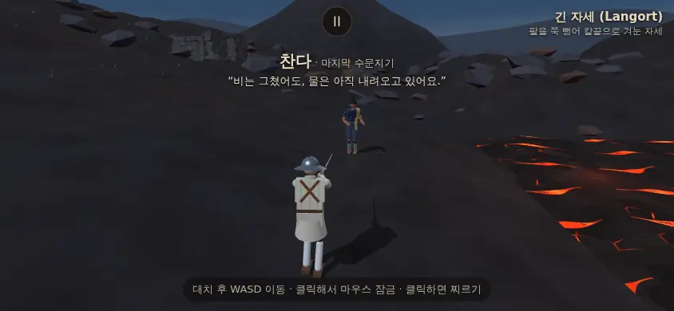

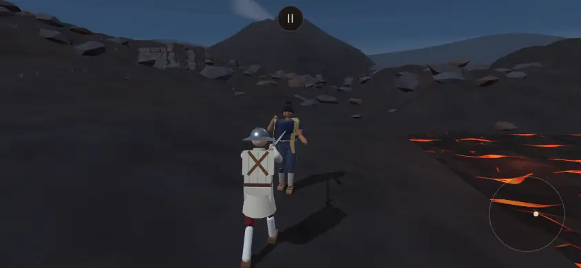

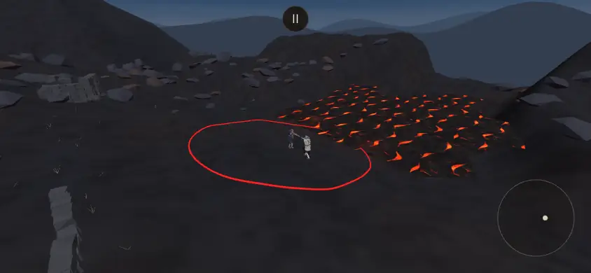

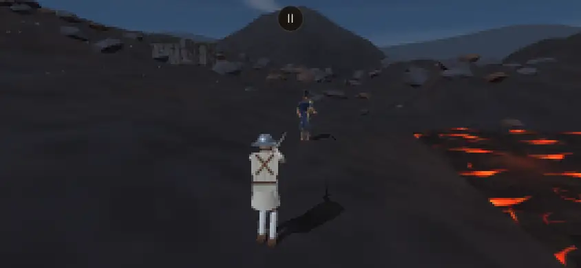

*샛별 빌드(7684c732)에서 `?stage=etna&foe=chanda&foeWeapon=moye`, 헤드리스 SwiftShader·화면 배율 1. 샛별 쪽 시험 상대는 아르토리아지만, 인물 리뷰와 함께 보려고 찬다로 찍었다. 바깥 요청은 막고 찍었고(막힌 요청 0) 콘솔 오류 0.*

### 1-1. 무엇
- 샛별 기록 이름 '에트나 · 검은 재의 능선'(안내 페이지 제목은 '검은 재의 능선'). 에트나 화산에서 착안한 **해 뜨기 전** 화산 능선: 검은 현무암·재 비탈, 낮은 쪽(+z)에 굳은 껍질 사이로 붉은 틈이 보이는 용암, 오래된 관측소 터(낮은 돌담·무너진 지붕), 먼 분화구 원뿔과 옅은 재 연기, 별과 옅은 달(해 원반 없음).
- 세 커밋: 0116047c 가운데 7° 비탈 + 위쪽 평지 + **용암 닿으면 즉사** → 37c8857b 10° · 흐르는 용암(무늬 흐름·작은 조각 16) · **즉사 대신 열 상처**(다리 → 무릎) · 6 s 지속 노출 사망 → 53188ff8 **결투장 전체가 불규칙 비탈**(평지 없음).
- 그쪽은 여정·인물 회전을 안 건드린 별도 입구다. `STAGE_FOE` 짝 없음(시험 상대는 세르파 → 아르토리아로 임시 배정).
- 무대만: 35,691 삼각형 · 메쉬 11 · 질감 5 (샛별 기록). 결투장 안(카메라 10.5 m)은 비탈뿐, 가장 가까운 단단한 장식 12.0 m.

### 1-2. 그림결·빛·색 (우리 `docs/design_language.md` 와)
- 맞는 점
  - 정이십면체 돌·굴곡 지형의 삼각형 면·꼭짓점 색 굽기 — 우리 결. 그림 파일 0(캔버스 질감 다섯: 재 1024² · 용암 1024² 두 장(색·빛) · 하늘 1024×512 · 연기 128²).
  - 색: 검푸른 현무암(`#494448`·`#59443b`) + 해 뜨기 전 하늘(`#0a1022` → `#344d6b` → `#7c7d89`) + **강조색 하나**(용암 주황, 빛남 `#ff822b`). '바탕 + 몇 색' 규칙에 가장 잘 맞는 편이다.
  - 빛 방향: 해 (−6, 8, −5) — 높이 약 46°, 플레이어 뒤 왼쪽(오르막 쪽). 판 시작에 상대는 앞빛이고 인물 그림자가 비탈에 또렷하다(그림 1).
  - 도트 모드에서 원뿔·관측소·용암 덩어리가 그대로 읽힌다(그림 4).
- 아쉬운 점
  1. **어둡다**: 판 시작 화면 평균 밝기(0~255 회색값) 용암 산비탈 **39** · 우리 밤의 포세이돈 49 · 소금 사막 94 · 얼어붙은 만 110 · 둔황 136. 흰 옷 플레이어는 잘 뜨지만, 남색 옷 찬다는 검은 비탈과 명도가 가까워 피부·어깨천으로만 읽힌다(그림 11 왼쪽).
  2. 재 바닥 질감이 촘촘하다(1024² 에 점 3 만·결 185 줄) — 화면 아래 절반이 잔 얼룩. 우리 '거친 무늬 정도'보다 잘다 [눈으로].
  3. 용암 무늬는 경기 시점에선 굳은 판 사이 불규칙한 틈으로 읽히나, 높은 곳에서 보면 같은 꼴 초승달이 되풀이된다(그림 3).
  4. 용암 위 점광원 둘(주황, 거리 8 m) — 용암 가까이 가면 인물이 주황으로 물든다(의도된 연출). 비용은 §1-7.

### 1-3. 결투장 경계·가림
- 내리막(화면 오른쪽)은 용암이 곧 경계로 보인다. 나머지 셋은 표시가 없다 — 보이지 않는 벽(반지름 6.75 m)과 돌 무리(12 m 밖) 사이가 같은 재 비탈이다(그림 3).
- 용암 가장자리(z 5.25 m)가 벽보다 안이라 **벽 안 넓이의 약 6 %(8.7 m²)가 용암**이다 — '밟을 수 있는 위험'이 결투장 안에 있다. 오르막 쪽 벽 자리와 용암 가장자리의 높이 차는 약 2.1 m.
- 가림: 카메라 반경 안에 서 있는 물체 없음 — 상대를 가리는 구조물 없음.
- 안(물리 영향 없는 납작한 것만): 오르막·옆 쪽 벽 자리에 밝은 재 띠 또는 납작한 돌 줄 [제안 — 소금 사막 '닳은 둥근 띠'와 같은 처리].

### 1-4. 지형 — 불규칙 산비탈과 우리 걸음·넘어짐·AI
- 샛별 구조: `etna_ground.js` 의 **삼각형 그물 하나**(결투장·카메라 둘레 0.5 m, 30 m 까지 1 m, 그 밖 2 m 칸)를 그림·물리(Rapier 삼각형 그물 충돌체 14,280 삼각형, 마찰 0.9)·발 높이·법선·AI 가 함께 읽는다. 결투장 표본 평균 **10.28°**(최소 2.59° · 최대 17.69°), 계단·수직 단차 없음. 평지 무대는 전과 같은 상자 바닥.
- 바뀌는 엔진(샛별 세 커밋 합, 바뀐 줄 수): `fighter.js` 57(지면 높이·법선, 발목 기울기, 수직 속도·넘어짐 판정을 지면 기준으로) · `gait.js` 144(발 디딤 높이·발바닥 방향·서는 높이를 지면 기준으로) · `main.js` 47(바닥 그물·벽 높이·용암 감지·카메라·해 높이) · `ai.js` 2 + `terrain_navigation.js`(새) · `effects.js`(핏방울이 비탈에 앉고 용암에 사라짐) · `revive_fx.js`(부활 빛 비탈) · `finish_entry.js`·`opportunity_target.js`(낮은 상대 판정) · 시험 도구.
- 우리 판과 맞물리는 곳
  - **걸음 받침**: 우리 `setSupportFloor(world, 바닥)` 는 알린 바닥 콜라이더와의 접촉만 센다(습지 이식) → 비탈 그물 하나를 바닥으로 알리면 그대로 맞물린다. 다만 우리는 접촉 충격의 크기를 방향 없이 세므로, 비탈(최대 17.7°)에서는 미끄럼을 막는 마찰 몫까지 '받침'으로 들어간다(샛별은 위 방향 성분만 센다) — 옮길 때 견줘 볼 곳 [추정].
  - **갈라진 코드**: 우리 `gait.js` 80 KB · `fighter.js` 241 KB, 샛별 63 KB · 162 KB — 줄을 손으로 옮겨야 한다. 습지(진흙 배율 한 줄·바닥 알림)보다 몇 배 큰 일이다.
  - **넘어짐·일어서기**: 샛별은 완만 3.1°·가파른 17.2° 자리에서 몸 높이·받침 접촉으로 일어서기를 확인했다(기록). 우리 일어서기(앞발 먼저 펴기 `getupLead` 등)는 다른 판이라 다시 재야 한다.
  - **AI 거리 잡기**: 간격표(contact·reach)는 수평 거리다. 위아래로 갈린 두 사람의 실제 닿는 거리는 다르다 — 샛별도 간격표는 그대로다 [추정].
  - **플레이어**: 피하기 도움 없음. 사람은 스스로 용암을 피한다(샛별 안내 글 '발 디딜 곳을 살피세요').
- 샛별 기록의 확인(우리 판에서 다시 해야 함): 실제 Fighter·Gait·Rapier 걸음 14 조건(발 접촉 94.8 % 이상 · 발바닥 침투 최대 10.8 mm · 몸 기울기 최대 27.7°) · 평지 120 프레임 전 부위 위치·속도·회전 같음.

### 1-5. 용암 — 물리 위험과 열 상처 (37c8857b 이후)
- 용암은 힘이나 벽이 아니라 **감지 상자**다(윗면 = 보이는 용암면). 몸 콜라이더가 닿으면(그림 프레임이 아니라 물리 스텝마다) 닿은 부위만 데인다. 양쪽 같은 규칙.
  - 다리: 기능이 초당 3 씩 줄어 **약 0.25 s 에 지지 문턱 0.25 아래** → 기존 무릎 꿇기(`knockDown(false)`). 평균 다리 값이 아니라 **탄 다리 하나만으로도** 꿇게 하는 새 판정(`legsCannotSupport` — 문턱 값은 우리 `legHealth` 0.25 와 같음).
  - 칼 든 팔: 기능 0.15 아래면 칼을 놓친다(우리 `VITALS.dropSwordArm` 0.15 와 같은 값).
  - 상처: 부위마다 'burn' 상처 하나(심각도 0.5 + 초당 1, 상한 1.5, **출혈 0**). 통증은 첫 닿음 +0.8, 닿는 동안 초당 +5(상한 2) — 우리 붉은 가장자리(통증 몫)가 켜진다. 피격 신음도 난다.
  - **6 s 지속 노출 → '용암' 사망**(부활 없음 — 이졸데 부활도 막음). 벗어나면 노출이 초당 0.5 s 식고, 잃은 다리 기능은 돌아오지 않는다.
  - 칼·떨어진 조각·잘린 부위만 닿으면 화상 없음.
- AI: 내리막 자발 이동을 0.45 s 미리 보고, 용암 가장자리 1.25 m 앞에서 오르막·안쪽으로 돌린다(목표 1.75 m 밖). 내리막 기술 걸음은 취소. 밀리면 들어간다(보이지 않는 보호벽 아님). 샛별 기록: 6 s 접근에서 내리막 요청을 77~122 번 돌림.
- 겉모습: 다리가 녹는 형상 변형은 없다 — 기능 손상과 물리 무릎 꺾임으로만 보인다. 그쪽 터치 시험: 용암 진입 2.3 s 뒤 골반 0.5 m 내려앉음, 6 s 에 사망(기록).

### 1-6. 진흙 감속 선례와 — 켬 / 약하게 / 끔
진흙(잠든 습지)은 '느려짐'만이고 사장님이 "새 스테이지 특징이야. 유지해."라고 하셨다. 용암은 '무릎 → 6 초 뒤 사망'이라 판의 결말을 바꾼다. 새 값은 정하지 않았고, 안만 둔다.

| 안 | 무엇 | 좋은 점 | 걸리는 점 |
|---|---|---|---|
| 켬 (샛별 그대로) | 다리 화상·무릎 · 6 s 노출 사망 · AI 피하기 | 무대 특징이 가장 뚜렷하다 | 새 사망 원인 '용암'(결과 화면 글) · 이졸데 부활 예외 · 이식이 가장 큼 |
| 약하게 | 화상·무릎만, 사망 없음(샛별 쪽에서도 '무릎 꿇은 채 생존안'이 답을 기다리는 질문) | 발 한 번 헛디딘 것이 곧 패배는 아님 | 꿇은 채 계속 데는 판이 길어질 수 있음 [추정] |
| 끔 | 용암을 벽 밖으로(그림만), 비탈만 남김 | 물리 규칙은 비탈 하나 | '용암'이 구경거리가 됨 |
| 비탈도 끔 | 결투장만 평평, 비탈·용암은 배경 | 엔진 손댐 없음 | 사장님이 말씀하신 '산비탈'이 사라짐 |

### 1-7. 성능
같은 방법: 우리 `tools/browser/stage_cost.mjs` 와 같은 순서·같은 화면(844×420, 경기 카메라, 두 사람 가만히, 롱소드)에 인물 삼각형 셈만 더한 임시 도구. 그리기·삼각형은 `game.renderInfo()`(그림자 그리기 포함). 헤드리스 SwiftShader 라 프레임 시간은 안 쓴다.

| 무대 (빌드) | 상대 | 그리기 호출 | 삼각형 |
|---|---|---:|---:|
| **용암 산비탈 (샛별)** | 이졸데 | **232** | **75,775** |
| 용암 산비탈 — 용암 판·튀는 조각·점광원 끔 (샛별, 시험) | 이졸데 | 230 | 75,692 |
| 용암 산비탈 (샛별) | 찬다(막야) | 257 | 89,519 |
| **둔황 (샛별)** | 이졸데 | **243** | **186,324** |
| 둔황 — 무대 메쉬 그림자 드리우기 끔 (샛별, 시험) | 이졸데 | 240 | 118,107 |
| 둔황 (샛별) | 병마용(월왕구천검) | 273 | 221,812 |
| 성 안뜰 (샛별) | 이졸데 | 238 | 76,125 |
| 성 안뜰 (본판 3295464) | 이졸데 | 230 | 72,653 |
| 소금 사막 (본판) | 이졸데 | 232 | 87,370 |
| 청람잔도 (본판) | 이졸데 | 215 | 110,791 |
| 얼어붙은 만 (본판) | 이졸데 | 235 | 129,122 |
| 신목의 숲 (본판) | 이졸데 | 187 | 147,584 |
| 산사 (본판) | 이졸데 | 183 | 158,062 |
| 잠든 습지 (본판) | 이졸데 | 207 | 159,818 |

- 두 빌드 차이: 성 안뜰·이졸데로 샛별 판이 그리기 +8 · 삼각형 +3,472(리뷰 4차와 같은 값). 이를 빼면 우리 판에서 **용암 산비탈 약 224 · 7.2 만**, **둔황 약 235 · 18.3 만(무대 그림자 끄면 약 232 · 11.5 만)** [추정]. 리뷰 4차의 다른 무대(8b1d7d3): 포세이돈 228·8.0 만 · 화전 터 241·9.6 만 · 밤의 포세이돈 241·8.2 만 · 대성당 176·7.3 만 · 붉은 회랑 233·10.1 만 · 산호 항구 203·9.4 만.
- **흐르는 용암의 비용**: 용암 판·튀는 조각·점광원 둘을 끄면 그리기 −2 · 삼각형 −83 — 그리기 호출로는 거의 공짜다. 비용은 ① 점광원 둘 — 장면에서 빛 받는 모든 재질(무대·인물)의 픽셀 계산에 더해진다(우리 판 점광원은 레전드 기운 하나·이졸데 부활 하나뿐 — 막야를 든 찬다가 오면 셋) ② 빛나는 용암 셰이더(무늬 흐름 + 열 박동) ③ 1024² 캔버스 셋 — 이 무대 질감 합 약 14 MB(RGBA, 밉맵 전 — 소금 사막 약 8.5 MB). ①②는 폰에서만 잴 수 있다(`?fps=1`). 튀는 조각 16 은 메쉬 하나·64 삼각형을 매 프레임 같은 버퍼로 고친다.
- 물리: 바닥이 상자 1 에서 삼각형 14,280 그물로 바뀐다. 몸 조각마다 그물과 접촉을 찾는다 — 폰 CPU 비용은 재지 않았다 [추정].

### 1-8. 소리 · 카드 뒷면 · 여정 자리
- 발소리 `stepStone`(우리에게 있음) · 바탕 바람 두 겹(370 Hz 0.0038 + 95 Hz 0.0020) · 세부음 `etnaCrust`(먼 굳은 껍질이 부서지는 소리 1.6 s · 세기 0.032 · 무대 시계 8 s 첫, 15~23 s 마다 · 위치 = 용암 가장자리). 절차 합성, 새 파일 0. 불 굉음·폭발 없음 — '적막'에 맞는다.
- **세부음 표 순서 = 씨앗**: 씨앗이 `9127 + (표 자리) × 311 + 변형 × 101` 이다. 샛별 표는 `caravanRing`(자리 13) 뒤에 `etnaCrust`(14) · `dunhuangWood`(15), 우리 표도 `caravanRing` 이 13 이다. 두 줄을 이 차례로 붙이면 씨앗이 샛별과 같다. **한 무대만 먼저 옮겨도 표 줄은 둘 다 넣어 자리를 지키기 권함** — 무대가 부르지 않는 줄은 소리가 나지 않는다.
- 카드 뒷면: 샛별 `PX_BACKS` 에 없다(옛 classic 뒷면으로 떨어짐) → 새로 그린다. 문양 안: 바탕 짙은 현무암 판 사이 주황 틈 · 띠 = 밧줄 꼴 용암 물결 · 가운데 = 원뿔과 연기 [제안].
- 여정 자리: 물리 규칙이 있는 무대라 **여정 밖**(테스트 '무대' 줄 + `?stage=`, 습지·소금 사막과 같게)을 권한다. 넣는다면 맨 끝(청람잔도 한낮 → 새벽 화산)이 앞 열한 자리를 안 민다.

### 1-9. 시뮬 관문 (코드 확인)
- `fights12`·`live_battery` 는 `tools/sim/jelly_harness.mjs` 의 평평한 상자 바닥(+ `setSupportFloor`)으로만 돈다 — `stages.js`·무대 파일을 읽지 않는다. 그래서 `stage_etna.js` 자체는 관문을 안 바꾼다.
- 다만 비탈은 `fighter.js`·`gait.js`·`ai.js` 를 고친다. 샛별처럼 '지형이 없으면 옛 길 그대로'로 옮기면 바이트가 같아야 하고(샛별 기록: 평지 480 스텝·양측 960 표본 같음), 다르면 옮긴 줄이 평지 길을 건드린 것이다.

## 2. 둔황 — 철불 절벽 (샛별 id `dunhuang`, 샛별 화면 이름 '천불의 절벽')

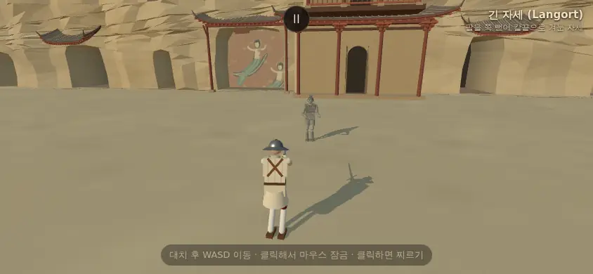

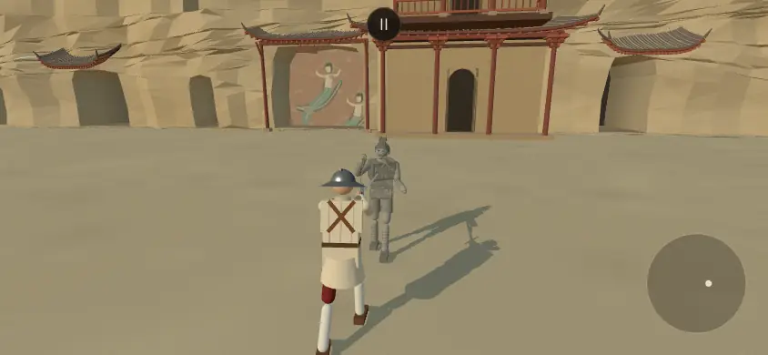

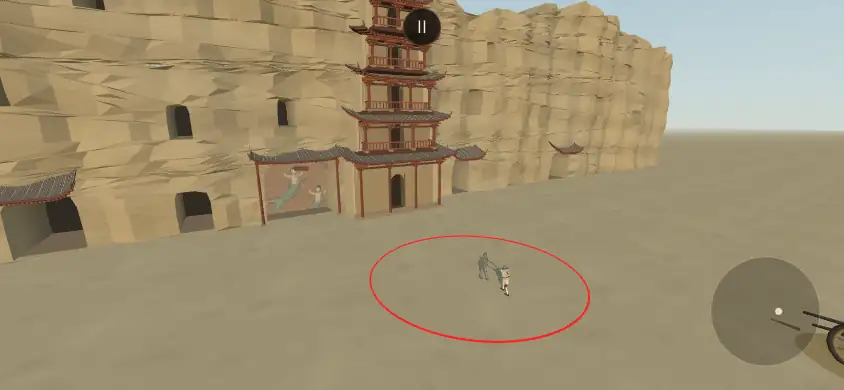

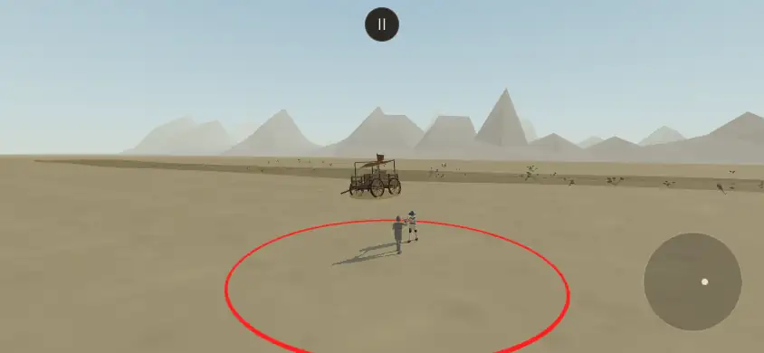

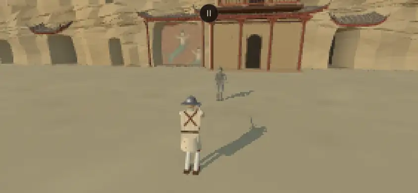

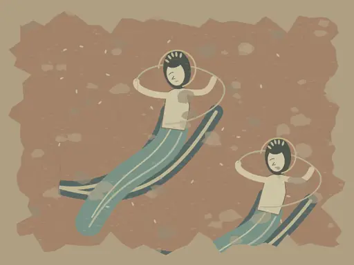

*샛별 빌드에서 `?stage=dunhuang&foe=terracotta&foeWeapon=goujian`(그쪽 짝 그대로), 같은 조건. 그림 9b 는 그 페이지에서 벽화 재질의 캔버스를 그대로 꺼낸 것.*

### 2-1. 무엇
- 모티브는 '철불 절벽'(사장님 10/14 18:3x). 샛별 기록은 '막고굴에서 착안한 **초가을 아침 8 시** 석굴 앞뜰 — 고증 복원 아님'. 결투면은 평지 y 0 · 카메라 10.5 m 안 비움 · 가장 가까운 경관 13.5 m.
- +x(판 시작에 상대 뒤): 높이 약 24 m 침식 절벽과 석굴 입구 29 · **6 층 누각**(벽체·약 1 m 회랑·0.83 m 파인 문·두께 18 cm 지붕·서까래·공포) · **창작 벽화**(띠를 두르고 나는 두 인물, 8.3×6.8 m, 상대 뒤 왼쪽) · 바람에 흔들리는 글씨 없는 나무 간판. −x(반대쪽): 부서진 수레(기운 차체·찢긴 천막·열린 궤짝 속 흙병사 머리·바퀴 자국) · 마른 강바닥과 제방·자갈 · 먼 능선 두 겹. 바닥 모래 알갱이 92(투명 점 하나).
- 커밋 흐름: af7fb03f 제안(참고 사진 4) → 87a38fa0 무대·병마용 시안 → 901b1f39 누각 깊게(63,719 → 83,335 삼각형) → f448bc59 수레를 반대쪽으로·평면 능선을 입체 세 겹으로 → 1890fdf1 강바닥 10 m 멀리·가까운 능선 한 겹 뺌.
- 무대만 88,327 삼각형 · 메쉬 20 · 질감 5(샛별 기록). 그쪽 `STAGE_FOE.dunhuang = 'terracotta'`.

### 2-2. 그림결·빛·색
- 맞는 점
  - 침식 절벽은 삼각형을 쪼개 굴곡을 준 평면 음영, 누각은 상자·원기둥과 끝이 들린 지붕 면. 캔버스 질감 다섯(흙 1024² · 바위 512² · 벽화 1024×768 · 하늘 512×256 · 모래 32²), 그림 파일 0. 무대 파일이 쓰는 공구(`stage_kit.js`)는 우리 것과 **바이트 같다**.
  - 빛: 해 (−12, 8, −9) — 높이 약 28°, 플레이어 뒤 왼쪽. 상대 앞빛 · 긴 인물 그림자(그림 5). 안개 95~330 m.
  - 도트 모드에서 절벽·누각·벽화가 덩어리로 읽히고 병마용 회색이 모래 위에 뜬다(그림 9).
- 아쉬운 점
  1. 강조가 둘이다: 붉은 기둥(`#844a3c`·`#a76048`)과 벽화 청록(`#3d5558`·`#698c83`)이 상대 바로 뒤에 겹친다. 회색 기와까지 더해 첫 화면 색이 우리 무대 가운데 많은 편 [눈으로].
  2. 누각 난간 동자(폭 6 cm)·서까래(3.3 cm)는 경기 거리(약 25 m, 시야각 55°)에서 화면 배율 1 기준 0.6~1.2 화소 — 자글거린다 [계산]. 벽화는 그림 질감이라 우리 무대 가운데 가장 '그림 같은' 면이다.

### 2-3. 결투장 경계 · 가림 · 경기 시점에서 보이는 것
- **결투장 표시가 없다** — 같은 모래 앞뜰이 벽(6.75 m)을 지나 이어진다(그림 7). 리뷰 4차의 옛 역참과 같은 문제다. 소금 사막 이식의 '은은하게 닳은 둥근 띠' 같은 납작한 처리가 맞다(물리 영향 없음).
- 가림 없음(카메라 반경 안 비움 · 수레는 18 m 밖).
- 판 시작 시점에는 절벽·누각·벽화가 상대 뒤를 채운다 — 첫 화면 초점이 강하다(그림 5). 수레·강바닥·능선은 반대쪽이라 카메라가 돌아갈 때만 보이고, 그쪽은 평평한 모래 + 낮은 수레 하나 + 뾰족한 먼 봉우리로 거의 빈 화면이다(그림 8).

### 2-4. 종교 표현 · 실존 유적 (사장님 10/14 18:3x 답 기준)
- 사장님: "우리 스테이지에서 철불 절벽이 모티브가 된 건 맞지만 벽화는 순수 창작이고 불상도 없어."
- 코드·그림으로 확인한 것
  - **불상·불교 조각 형상: 없음 — 확인함.** 무대 메쉬 17 개(하늘·땅·강바닥·수레·천·모래·절벽·회벽·안벽·석굴·그늘·목재·기와·돌·관목·먼 산·벽화)를 다 훑었다. 사람 꼴 입체는 수레 궤짝 속 흙병사 머리 하나(병마용을 잇는 소품 — 구·상자·원기둥)뿐이다. 석굴 입구 29 는 어두운 판과 바닥 그늘 판, 누각 문 안은 어두운 안벽 판이고 그 안에 형상이 없다. 탑·글씨·연꽃 무늬도 없다(간판은 글씨 없는 판).
  - **벽화는 창작 — 확인함.** 사진·그림 파일을 읽지 않고 코드가 곡선 띠·타원으로 그린 캔버스다(샛별 주석 '특정 굴 복원 아님', 그림 9b).
  - **다만 그림의 소재는 비천으로 읽힐 수 있다**: 두 인물이 흩날리는 긴 띠를 두르고 비스듬히 날며, **머리 뒤에 둥근 테**(광배 꼴, 금빛 선)와 머리 위 작은 꽃잎 장식이 있다(그림 9b). 샛별 코드의 이름표도 'apsara'(메쉬 이름 `dunhuang-apsara-mural` · 무대 정보 'original procedural apsara painting')이고, 샛별 안내 글도 '빛바랜 비천'이라 적었다. 첫 화면에 상대 바로 뒤 왼쪽에 보인다(그림 5).
- 6 층 누각은 샛별 기록상 막고굴의 누각 꼴에서 착안했고, 안에 상(像)은 없다(위 확인).
- 피: 사람(플레이어)은 이 앞에서 피를 흘린다. 병마용은 피가 없다(§4-4).
- 우리 선례: 산사(대웅전·삼층 석탑 둘·석등·연등 — 한국 절), 대성당(빈 제단·촛대), 신목의 숲(금줄) — 종교 장소 앞 결투는 이미 있다.
- 화면 이름: 후보 '철불 절벽'(사장님) · '천불의 절벽'(샛별) — 둘 다 '불(佛)'이 들어간다. 우리 무대 이름(14 곳)에는 지금 실제 지명이 없다(소금 사막 = 데이르 착안, 청람잔도 = 실제 지명 아님 [추정]) — '둔황'을 넣으면 첫 실제 지명이다.
- 안(벽화): ① 그대로 ② 머리 뒤 둥근 테만 뺌(띠를 두르고 나는 인물 그림으로만) ③ 사람 없는 빛바랜 무늬로.

### 2-5. 사막 무대와 견줌
- 우리 판에서 사막 결 무대는 **소금 사막 하나**다(감독 메모의 '둘'은 확인하지 못함 — 산호 항구는 모래 선착장, 청람잔도는 절벽 협곡). 김씨 설정의 '변방 사막 길목의 객잔'은 무대가 아니다.
- 소금 사막과: 해 질 녘 살구·보랏빛(`salt_desert/start.webp`) ↔ 아침 베이지·하늘색 · 사방 벽돌 안뜰 ↔ 한쪽 절벽 + 반대쪽 트인 벌판. 첫 화면은 확실히 갈린다. 반대쪽 보기(그림 8 — 베이지 맨바닥·먼 산)는 소금 사막 문루 너머 풍경과 결이 비슷하다.
- 청람잔도와: 둘 다 '절벽'이지만 잔도는 협곡 위 바위 쉼터·발아래 강, 둔황은 절벽 앞 평지 — 겹침이 작다.
- 여정에 넣는다면 소금 사막과 붙이지 않기 권함.

### 2-6. 성능
- 이졸데로 잰 값 243 · 186,324 — 그리기는 우리 범위(183~235) 위 끝 근처, **삼각형은 우리 최대(잠든 습지 159,818 · 산사 158,062)를 넘는다**(빌드 차이 빼면 약 18.3 만 [추정]).
- 까닭은 그림자 그리기다. 무대 메쉬의 그림자 드리우기를 끄면 240 · **118,107**(−6.8 만). 절벽·누각을 재질별 한 메쉬로 합쳐서 그림자 카메라에 조금만 걸려도 통째로 그림자 지도에 그려지는 것으로 보인다 [추정]. 절벽은 해 반대쪽(+x)이라 그 그림자가 결투장에 떨어지지 않는다 → 먼 경관 그림자를 끄는 안(소금 사막에서 건물 그림자를 끈 것과 같은 처리).
- 질감 합 약 8.5 MB(RGBA, 밉맵 전).

### 2-7. 소리 · 카드 뒷면 · 여정 자리
- 발소리 `step`(모래흙 — 산호 항구와 같은 녹음) + 짧은 절벽 반사(`room` 0.28 s — 우리 `STAGE_SOUND` 의 room 칸 그대로 받음) · 바탕 두 겹(760 Hz 0.0018 + 2100 Hz 0.00065 — 작다) · 세부음 `dunhuangWood`(간판 이음매 삐걱 1.65 s · 세기 0.023 · 11 s 첫, 31 s 마다 · 간판 흔들림 끝과 같은 때·같은 자리). 절차 합성, 새 파일 0. 합창·드론·종소리 없음.
- 카드 뒷면: 없다 → 새로. 문양 안: 바탕 모래빛 갈색 + 석굴 입구 아치 줄 · 띠 = 처마 서까래 끝 · 가운데 = 수레바퀴 [제안 — 연꽃·비천 같은 종교 무늬는 피함].
- 여정 자리: **여정 밖** 권함(이름·벽화 결정이 먼저). 넣는다면 산사 곁은 피함(아시아 절 둘이 붙음).

## 3. 찬다 (샛별 id `chanda`)

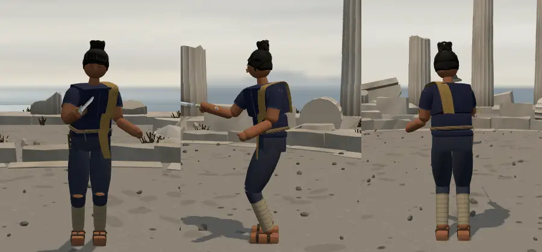

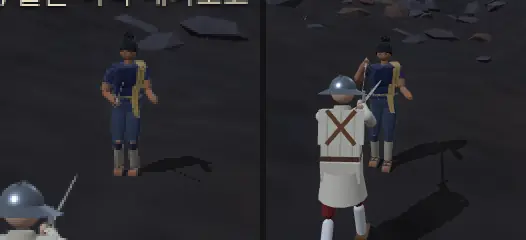

*인물 세 장은 샛별 빌드에서 AI 를 세워 두고 검사용 자유 카메라로(포세이돈 신전 낮 빛). 확대는 경기 카메라 화면(그림 1·2)을 잘랐다. 화면 배율 1 이라 폰(배율 2)보다 거칠다.*

### 3-1. 생김새 (v1)
- 38 세 여성 수문 관리인(샛별 복식 코드 주석 '크메르에서 착안'). 남색 짧은 상의(`#252c4b`) · 남회색 바지(`#353d50`) · 왼어깨 황토 어깨천(`#b49354`) · 구릿빛 피부(`#a96f4e`) · 검은 올림머리(`#161714`) · 허리 끈과 도구·눈금 막대 · 종아리 천(`#b0a58a`)·샌들. 공통 얼굴·눈·몸 규격, 금속 갑옷 없음. 색 5~6 — 우리 기준 안.
- 걸리는 점
  1. **앞에서 무릎에 구릿빛 둥근 틈**(허벅지·정강이 바지 조각 사이로 맨다리) — 찢어진 바지처럼 보인다(그림 10 앞). 2 m 거리에서도 점으로 보인다.
  2. 검은 머리 덩어리가 이마까지 덮어 앞에서는 모자처럼 읽힌다 [눈으로].

### 3-2. 결투 거리에서
- 5.6 m(판 시작): 키 약 67 px(화면 높이 17 %). 용암 산비탈에서는 남색이 검은 땅과 명도가 가까워 **피부·황토 어깨천·밝은 종아리 천**으로 읽힌다(그림 11 왼쪽). 밝은 무대에서는 더 잘 뜰 것 [추정].
- 2 m: 어깨천·허리 끈·올림머리까지 읽힌다. 실루엣이 플레이어(흰 옷)와 확실히 갈린다.

### 3-3. 무게
- 샛별 빌드(성 안뜰, 상대만 바꿈): 몸·옷 **15,160 · 메쉬 62** + 막야 5,534 · 20 = **20,694 · 82** — 목표(삼각형 ≤ 2.7 만 · 메쉬 ≤ 90) 안. 그리기 **+33**(이졸데 대비). 우리 막야는 5,994 · 21(기운 포함).
- 참고(본판 성 안뜰, 이졸데 230 대비): 라트나 296(+66) · 28,909 · 투야나 274(+44) · 27,244 · 랴오 247(+17) · 8,753.
- 복식 모듈은 우리 `newOutfitHelpers` 에 이미 있는 열쇠만 쓴다(`artoriaRoundedBox` 포함 — 라트나 이식 때 더함). `stockEyes`·`originalTorsoWidth` 도 우리 `looks.js` 가 받는다.

### 3-4. 무기 · 유파
- 샛별 5a242fa3 에서 세이버 → **막야**('오래전 물길을 따라 건너온 흰 검 막야를 수문의 열쇠처럼 물려받았다'). 우리 막야(레전드·불괴·먹빛 기운 · 91 cm · 1.12 kg · mCut 1.25 — 확인표 740~743·771)가 이미 있어 **새 무기 없음**.
- 유파: 무기 → 자동 판정 **동방**(`school 'chinese'`). 동방 인물은 지금 랴오(청강검, 숙련도 3) 하나 → 둘(병마용까지 셋).
- 레전드를 든 손님: 선례 아르토리아(엑스칼리버). 막야 기운의 점광원 하나가 함께 온다.

### 3-5. 숙련도 2 (결정됨) — 우리 AI 표에서
샛별에는 숙련도 칸이 없고 실력 이름 `level: 'normal'` 이다(우리 `AI_PROFICIENCY.ofLevel.normal` 도 2). 우리 `aiAtProficiency` 로 찬다 시트(무기 막야, 숙련도 2)를 계산했다.

| 칸 | 값 |
|---|---|
| 실력 숫자 이름 `ai.level` | **normal** (`AI_PROFICIENCY.levels[2]` — 반응 0.26 s · 막기 0.6 · 맞받기 0.2 · 속임 0.15 · 이어 치기 0.5 · 읽기 0.65 · 힘 1.0 · 실력 0.7) |
| 샛별 덮어쓰기(옮기면) | 실력 0.78 · 절제 0.84 · 힘 1 · 조급 0.78 — normal 위에 덮여 실효 실력 0.78 · 조급 0.78 · 절제 0.84 |
| `persona.proficiency` | `{ chinese: 2 }` |
| 고유 동작(동방, 단계 차례) | 체보요격(1) · 좌익격(2) — 둘 |
| 패시브 | 없음(자→격 고리는 4) |
| 비기 | 없음(연환삼격은 5) |
| 단계 이름 | 2 = 숙련자 (AI 는 인장 표시 안 함) |
| 무기 몫 | 막야 레전드 배율 1.2 |

- 숙련도 2 인물: 하인리히·토메·김씨·투야나·라트나 → 찬다·병마용을 더해 일곱. 동방 인물은 랴오(3)뿐이었고, 찬다·병마용은 랴오보다 고유 동작 하나(염시)가 적다.
- **기질이 라트나와 쌍둥이**: 샛별 찬다 값(pers 정확 0.8 · 자세 고집 2.8 · 겁 0.2 · 화 0.1 · 끈기 0.35 · 박자 2.8 · 공격 0.8 · 선수 0.4 / level 실력 0.78 · 절제 0.84 · 힘 1 · 조급 0.78)이 샛별 라트나 값과 칸마다 0~0.1 차이다. 우리 라트나는 그 값을 그대로 옮겼다. 유파(이베리아 ↔ 동방)가 달라 싸움 모습은 갈리지만, 기질을 따로 줄지 정할 일.

### 3-6. 대사 · 말투
- 칭호 '마지막 수문지기'(7 음절) · 시작 '지나가도 좋아요. 물길은 건드리지 마세요.'(taunt 겸) / '비는 그쳤어도, 물은 아직 내려오고 있어요.' · 이김 '칼을 거두세요. 아래쪽에는 사람이 살아요.' / '돌 하나에도 물이 가는 길이 달라져요.' — 시작·이김 둘씩(우리 관례는 셋씩).
- 말투 표(우리 본판):

| 말투 | 인물 |
|---|---|
| 합쇼체 | 토메 · 아르토리아 · 마야(+해요체) |
| 해요체 | 이졸데 · 미나미 · 투야나 · (마야) · **찬다** |
| 하게체 | 김씨 |
| 하오체 | 라트나 |
| 해라체(명령·평서) | 하인리히 · 광기의 하인리히 · 오마리 · 브란 · 랴오 · 마르그레테 |
| 소리 위주 | 다라이시('음.' · '…비켜.') |
| 고전 인용 | **병마용**(§4-7) |

  - 해요체 넷째(마야 포함 다섯째)가 된다.
  - '물길·물·길' 소재가 라트나('길은 잠겼을 뿐, 사라지지 않았소.' · '물자국은 거짓말을 하지 않소.')와 겹친다.
  - '칼을 거두세요'가 아르토리아('검을 거두세요. 여기서 끝냅시다.')·마야('무기를 거두세요.')와 겹친다.

### 3-7. 목소리
- 샛별 `voice: 'maya'`(마야 전용 녹음 묶음).
- 우리 묶음 쓰임(본판 — 목소리 id = `voice` → 변형 원본 → 자기 id): 토메 묶음 = 토메·김씨·라트나(셋) · 하인리히 묶음 = 하인리히·광기의 하인리히·다라이시(셋 — 다라이시는 10/14 18:3x 확정) · 이졸데 = 이졸데·미나미(둘) · 조용한 들숨 = 아르토리아·투야나(둘) · 마야·오마리·랴오·브란·마르그레테 = 하나씩.
- 찬다를 마야 묶음에 두면 **마야·찬다 둘**. 다른 안: 마르그레테 묶음(낮은 여성 목소리, 지금 하나 → 둘) · 이졸데 묶음(셋째) · 조용한 들숨(셋째).

### 3-8. 이름 · 문화 · 우리 습지와의 관계
- '찬다'는 크메르·산스크리트 계 여성 이름(달)으로 알려져 있다 [일반 지식]. 실존 인물 아님 [추정].
- 동남아 우림의 옛 물길에서 착안한 창작이고 특정 유적·복식 복원이 아니라고 샛별이 밝혔다. 고깔모자·이국 소품 같은 흔한 고정관념 소품은 없다. 동남아 사람이 중국 전설의 명검(막야)을 '물려받은' 설정은 창작 연결이다.
- **습지와**: 샛별 675233e2 의 `sluice`('잠든 물길' — 정글 수문)가 찬다의 첫 무대였고, 같은 파일이 뒤에(c082df7d → d5b3151a → bf202a00) 라트나·말레이곰의 습지로 바뀌었다 — 우리가 옮긴 '잠든 습지'가 그것이다. 그래서 찬다 설정(옛 수문을 지키는 관리인)은 우리 잠든 습지의 '옛 돌 수문'과 그대로 맞는다. 그러나 라트나(동남아 습지 안내인, 52 세)와 '동남아 물가 사람'이 겹친다. 지금 샛별에서 찬다는 무대 짝이 없다(미배정).
- 안: 짝 없음(손님 인물, 라트나·다라이시와 같게) / 잠든 습지 후보(라트나와 반반 — 대성당 마르그레테·아르토리아 선례) / 용암 산비탈.

## 4. 병마용 (샛별 id `terracotta`)

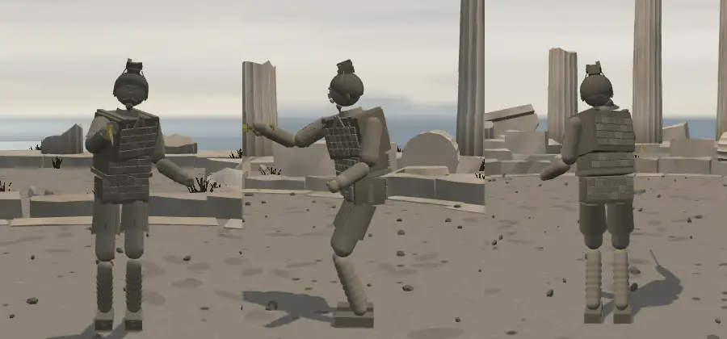

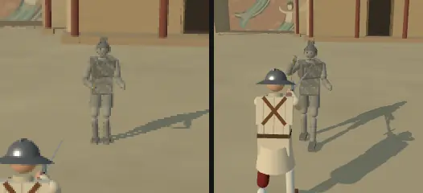

### 4-1. 생김새 (v1)
- 진나라 무덤 토우(창작) — 회갈색 흙 단색(`#929084`·`#a4a094`·`#7c7b70`) · 가슴·등 작은 갑옷 조각(4.6×4.2 cm 팔각 판, 엮은 끈) · 상투와 작은 관 · 머리 홈 · 콧수염·턱수염 새김 · 다리 감은 천. 남은 안료(붉은빛 `#887269` · 푸른빛 `#737c7b`)는 아주 옅다. 공통 몸·눈 규격, 금속 갑옷 보호 없음(흙 갑옷은 장식).
- 판 이력: b090ccc5 간장을 든 토우 → 901b1f39 피 없음 → 5a242fa3 '돌아가지 못한 월의 혼' + 월왕구천검 → 1890fdf1 대사 출처.

### 4-2. 결투 거리에서
- 5.6 m: 모래 위 회색 사람 꼴 + 가슴 격자(갑옷)로 읽힌다(그림 13 왼쪽). 2 m: 갑옷 조각 줄·상투가 보인다. 얼굴 새김·머리 홈은 안 보인다.
- 흙빛 회색은 둔황 모래보다 어두워 뜬다. 흰 바닥(눈 내린 성 안뜰 등)에서는 명도가 가까울 수 있다 [추정].

### 4-3. 무게 — 미니멀 기준과 잔선
- 샛별 빌드(성 안뜰): 몸·옷 **25,416 · 메쉬 69** + 월왕구천검 3,836 · 7 = **29,252 · 76** — 삼각형 목표(≤ 2.7 만)를 조금 넘는다. 그리기 **+30**(간장이면 +47 — 기운 입자·점광원).
- 몸·옷 안: 엮은 끈 6,912 · 갑옷 조각 6,480 · 공통 몸 5,888 · 머리 홈 2,280 · 얼굴 새김 648 · 나머지. **끈(관 반지름 1.4 mm)·머리 홈은 폰 1 화소 안** — 리뷰 4차 다라이시 v6 잔선과 같은 문제다(우리 디자인 언어 '머리카락 같은 가는 선은 쓰지 않는다').
- 끈·머리 홈을 덜면 몸·옷 약 1.6 만, 칼 포함 약 2.0 만 [계산]. 우리 판 공통 몸이 더 가벼워(같은 이졸데 몸이 샛별 5,948 · 본판 2,716) 옮기면 조금 더 줄 것 [추정].
- 샛별 기록: 첫 시안의 손이 검게 나왔다(손 형상에 없는 꼭짓점 색을 재질이 요구) — 병마용 재질만 고쳤다. 옮길 때 같은 자리를 확인할 것.

### 4-4. '피 없음 · 머리가 떨어져야만 죽음' — 샛별 방식과 우리 판에서 건드릴 자리
**샛별 방식(901b1f39)**: 인물 시트가 `physiology: { bleeds: false, deathRequiresHeadDetachment: true }` 를 주고, `main.js` 가 Fighter 를 만들 때 넘긴다. 이름·무기 분기 없이 공통 Fighter 가 처리한다.
- 출혈 0 · 혈액 1 고정.
- `die()`·`setState('dead')` 를 **목 관절이 떨어지기 전에는 거부** → 몸통 찌르기·내려찍기 마무리·출혈·환경 피해(용암)로 죽지 않는다. 팔다리 손상·절단·넘어짐은 그대로.
- 머리가 떨어지는 길(기존 사람 치명 문턱 재사용, 새 힘 배율 없음): 목 심각도 > 0.5(베기·찌르기 모두 — 사람은 '목을 가르고 지나간 베기'만 참수) · 머리 베기 > 0.8 · 머리 찌르기 > 0.5 · 머리·목 둔타로 의식 ≤ 0 → 목 관절을 떼고 사망.
- 겉모습: 핏방울·분출·붉은 상처·옷 피 번짐·**공격자 칼에 묻는 피** 없음 → 무광 잔금 자국 · 짧게 사라지는 흙 알갱이(5 J 넘는 타격마다 3 + E/18 개, 상한 12, 0.25~0.55 s) · 마른 타격음(뼈 소리 표본을 0.78 배 빠르기로 0.22 s). 목·팔다리 끝면 회갈색, 뼈 단면 없음. 사람과 같은 판에서 단면 색이 섞이지 않게 재질을 나눴다.
- 목소리 `silent`(mute) — 신음·숨·사망 소리 없음, 몸이 땅에 닿는 소리는 남김.

**우리 판에서 건드릴 자리**

| 파일 | 할 일 | 비고 |
|---|---|---|
| `fighter.js` | 생성자 `physiology` · `die()`·'dead' 거부 · `updateVitals`(혈액 1·출혈 0) · `applyWound`(출혈 0, 목·머리 갈래, 둔타 의식) · `decapitate`(출혈 0) · `limbSeverCheck`(절단 상처 출혈 0) | 우리 `die(cause, noRevive)` 는 찍기 힘 모드 인자를 받아 샛별과 갈래가 다르다 — 손으로 맞춤 |
| `main.js` `onWound` | 핏방울 → 흙 알갱이 · 자국(stab·cut·tear·soak → 잔금) · `bloodyBlade` 건너뜀 · `sound.cut/stab/bone` → 흙 소리 · Fighter 생성에 `physiology` | `updateDrips` 는 출혈 0 이라 저절로 멈춤 |
| `effects.js` | 흙 알갱이 · 'clay' 자국 | 우리에겐 **'피 끄기'**(`particles.bloodOn` — 회색 먼지·회색 단면·분출 없음) 갈래가 이미 있다 → 인물 단위로 켜는 꼴로 갈음할 수 있다 [추정] |
| `decap_fx.js` · `limb_fx.js` | 단면 회갈색·뼈 없음·분출 없음 | 우리 두 파일은 단면 재질을 모듈에서 함께 쓰고 매 프레임 색을 바꾼다(bloodOn) → 사람·병마용 동시 처리하려면 재질을 나눠야 함 |
| `sound.js` | `VOICES.silent = { mute: true }` · `clay()` 흙 타격음 | 우리 `death()` 에 mute 갈래가 이미 있으나 '목' 사망 때 피 끓는 소리(`wetHeavy`)를 낸다 → 병마용엔 빼야 함 |
| `ai.js` 685 · 718~721 | (고칠 것은 아님) 피 비교로 '이김·신중·조급'을 정한다 | 병마용 쪽은 늘 피 1 → '조급함'이 안 생기고, 플레이어가 피를 흘리면 '신중'해진다 [코드 읽음] |
| `revive.js` | (고칠 것은 아님) 이졸데 부활 전용 | `die()` 순서에서 '죽을 수 있나'를 먼저 봐야 함 |

**게임 규칙에 주는 영향**
- 우리 '내려찍기 즉사'(사장님 9/30 '맞으면 즉사') — 몸통 내려찍기는 병마용에게 안 듣는다(머리 찌르기 > 0.5 면 머리가 떨어져 사망). 출혈로 이기는 길이 없고, 용암으로도 안 죽는다. 판이 길어질 수 있다 [추정 — 판 수로 재지 않음].
- 결과 화면의 사망 원인은 '목'·'머리'만 나온다.
- 안: ① 샛별 그대로(피 없음 + 머리로만) ② **피만 없앰**(흙 알갱이·잔금·마른 소리) — 죽는 길은 사람과 같게 ③ 사람처럼(피 있음).

### 4-5. 무기 — 월왕구천검 (결정됨) · 유파
- 사장님 결정(10/14 18:3x): **월왕구천검을 가져온다.** 무기 이름 '월왕구천검'. 제원·등급 사실은 §5.
- 유파: 샛별 스펙에는 `school` 이 없다(샛별은 무기별 꾸러미로 중국 한손검을 씀). **그대로 옮기면 우리 자동 판정은 독일**(한손 · 베기·찌르기 1.05 = 두루) → 간장·막야처럼 `school: 'chinese'` 를 적어야 동방이 된다.
- 참고(쓰지 않는 안): 간장으로 갈음(샛별 첫 안 — 레전드·불괴·흰 기운, 새 무기 없음).

### 4-6. 숙련도 2 (결정됨) — 우리 AI 표에서
- 샛별 `level: 'normal'`(우리 `ofLevel` 도 2). 무기 월왕구천검을 `school: 'chinese'` 로 들이면 유파 동방이라 계산 결과는 §3-5 표와 같은 칸이다: 실력 **normal**(덮어쓰기 값이 없어 그대로 — 실력 0.7 · 조급 0.9 · 절제 0.85 · 힘 1.0) · `{ chinese: 2 }` · 고유 동작 체보요격(1)·좌익격(2) · 패시브·비기 없음 · 단계 이름 숙련자.
- 무기 몫: 월왕구천검 레어 배율 1.05(에픽으로 들이면 1.1 — 등급은 감독 추천).
- 기질 값이 없다(시트에 시작 자세 `pflugR` 만) → 동방 기본 기질. 랴오(동방 3, 기질 값 자세히)와는 갈린다.

### 4-7. 대사 · 말투
- 일곱 칸, 고유 다섯(모두 ASCII 큰따옴표로 감쌈): 도발·시작·이김에 '"너는 회계의 치욕을 잊었느냐?"'(『사기』 「월왕구천세가」) · 시작 '"오늘 밤은 무슨 밤인가."' · '"오늘은 무슨 날이기에, 왕자와 한 배를 타는가."' · 이김 '"산에는 나무가 있고 나무에는 가지가 있건만."' · '"그대를 좋아하는 내 마음을 그대는 모르네."'(넷 다 『설원』 「월인가」). 샛별 직역이고 고전 원문은 저작권 밖이다.
- 샛별 UI 는 `"대사"(『사기』)` 처럼 **출처를 붙여** 보인다(1890fdf1 — 공통 `formatCharacterLine`, 시작 칸·승리 알림·패배 결과창).
- 말투: 해라체 의문('잊었느냐?')과 옛 노래('-인가'·'-네') — 지금 인물 누구와도 다르다. 다만 마르그레테 '너에게도 회한이 있는가?'와 '너 … 느냐/는가?' 꼴이 겹친다.
- 걸리는 점
  1. 이긴 뒤 「월인가」 연가 두 줄('그대를 좋아하는 내 마음을 그대는 모르네')이 상대를 쓰러뜨린 다음에 나온다 — 그리움이라는 설정은 맞지만 때가 어색할 수 있다.
  2. '"너는 회계의 치욕을 잊었느냐?"'가 세 칸에 되풀이된다.
  3. 우리 UI 는 대사에 둥근 따옴표를 붙인다(`main.js` 세 곳) → 그대로 넣으면 “"…"” 이중 따옴표. 데이터에서 따옴표를 빼거나 UI 를 고친다.
  4. 출처 표기는 우리 게임에 없던 꼴이다(시작 칸·결과 화면이 길어짐).
- 샛별 쪽 추가 대사 후보 넷(『사기』 직역 — 구천·범려·오자서의 말)은 그쪽도 게임에 안 넣었다 — 이번에도 옮기지 않는다.
- 칭호 '돌아가지 못한 월의 혼'(9 음절) — 사장님이 10/11 칭호를 짧게 바꾸신 흐름('왕'·'수호자')보다 길다.

### 4-8. 목소리
- 샛별 `voice: 'silent'` = `{ mute: true }`. 우리 `VOICES` 에 mute 칸이 이미 있고 주석이 '지금은 쓰는 캐릭터가 없다'이다 — **첫 사용**. 새 묶음(혼자). 신음(`hurt`)은 녹음이 없어 저절로 안 난다. 다만 '목' 사망의 피 끓는 소리는 빼야 한다(§4-4).

### 4-9. 이름 · 실존 인물 · 문화
- '병마용'은 사람 이름이 아니라 **실존 유물 무리의 이름**(진시황릉 병마용, 유네스코 세계유산)이다. 인물 이름으로 쓰는 것은 처음이다.
- 실존 인물 **월왕 구천**(춘추 시대 월나라 왕)이 설정·대사 출처·무기 이름에 나온다. 우리 선례: 카드 글 '사사키 코지로의 노다치'(실존 인물 — 사장님 '열어 둠').
- 시대: 월(기원전 5 세기)·진(기원전 3 세기)·둔황 석굴(4~14 세기)을 엮은 창작 — 샛별이 설정 글에 '창작이며, 진이 월을 멸했다는 뜻은 아니다'를 넣었다. 회계 치욕(『사기』)·「월인가」(『설원』, 연가 — 군가 아님)를 구별해 썼다.
- 문화: 중국의 대표 문화재를 '혼이 깃든 흙 병사'로 쓰고 실존 불교 유적을 닮은 무대에서 싸우게 한다. 피가 없어 잔혹 표현은 줄었다. 고정관념 소품은 없다.
- 표기 방침: 샛별 화면 글 43 줄(병마용·찬다 시트, 월왕구천검 이름·카드 글)을 우리 `tools/text/texts.mjs` 의 검사 함수로 미리 훑었다 — 한자·가나 0 · **위반 0**. 월왕구천검 이름에 한자를 붙이면 '월왕구천검 (越王勾踐劍)' 꼴이어야 한다.

## 5. 월왕구천검 (샛별 id `goujian` — 가져오기로 결정, 무기 이름 '월왕구천검')

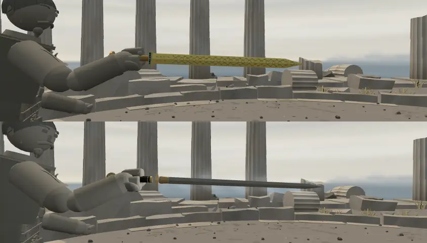

### 5-1. 제원

| | 실물 (샛별 조사) | 게임 (e7eb2f5c) |
|---|---|---|
| 길이 | 55.7 cm (소장 기관 현 기록 · 옛 소개 55.6 cm) · 폭 4.6 cm | **전체 85 cm**(손 기준 −0.09 ~ +0.76 m) · **날 67 cm** · 자루·코등이·폼멜 18 cm · 폭 4.6 cm |
| 질량 | 875 g (참고 사전) | **1.213 kg** = 날 0.843(80 cm 판 날 0.78 kg 을 날 길이 비로 늘림) + 손잡이 0.13 + 폼멜 0.14 + 코등이 0.10 |
| 무게 분포 | 기록 없음 | 날 무게중심 비 0.38 · 회전 반경 비 0.26 (구현 추정) |
| 쥠·재질 | 청동 직선 양날검 | 한손 · 재질 `steel`(청동 따로의 소리·충돌 없음) |

- 80 cm(c9719902) → 85 cm(e7eb2f5c)는 샛별 쪽 사용자 요청이다(모르겐슈테른 69 cm 이상). 85 cm 판의 샛별 시험: 형상·잡기·찌르기·파손 통과, 두 판 AI 대련에서 새 상처가 안 나와 23/24(실패로 보존), 고정 표적 접촉 8/8.

### 5-2. 등급 · 능력 · 모습 · 카드 글
- **샛별 값**: `tier: 'rare'` · 베기 1.05 · 찌르기 1.05 · 둔타 1.0 · 능력 없음 · 기운 없음 · 부러지면 칼날 절반 꼴(80 cm 판 기록 0.62 → 0.31 m). 샛별 쪽 사용자가 에픽을 말해 '효과와 함께 정할 일'로 남겼고, 특수 능력(저주·수은 독 같은 생각)은 감독 몫으로 남겨 두었다(샛별 기록 — 진시황릉 수은과 검의 독설은 구별한다고 적음).
- **우리 표의 레어 ↔ 에픽** (등급은 감독이 추천 — 여기는 사실만):

| 칸 | 레어 | 에픽 | 어디 |
|---|---:|---:|---|
| 위력 배율 power | 1.05 | 1.1 | `TIER_DEFAULTS` |
| 파손 계수 fragility | 0.032 | 0.0104 | `TIER_FRAGILITY` (충돌 한 번의 부러질 확률 = 계수 × min(1, J/6)², J = 충격량 N·s) |
| 뽑기 무게 | 27 | 16 | `TIER_DRAW` (카드 한 장의 등급 확률 %, 그 등급 안에서 고르게) |
| 지금 그 등급 무기 | 레이피어 · 모르겐슈테른 · 사인검 · 북부 대공의 검 (넷) | 모노호시자오 · 청강검 · 라이트세이버 · 플랑베르주 (넷) | `weapons.js` |

- 모습(`goujian_details.js`, 3,836 삼각형 · 메쉬 7): 금갈색 청동 날 · 검은 마름모 격자 상감 · 가운데 능선 · 칼막이 가까이 두 줄 여덟 글자 꼴 장식(조충서 느낌 — 탁본 아님) · 칼막이 앞 푸른 유리·뒤 청록 · 두 고리 손잡이 · 원반 폼멜의 동심원 11. 사진·새 질감 없음. 결투 거리에서는 금빛 날 하나로 읽히고 마름모 상감은 가까이서만 보인다(그림 14·5).
- 우리 다른 동방 칼과: 청강검 0.85 kg · 간장 0.95 · 사인검 1.0 · 막야 1.12 · **월왕구천검 1.21 kg(가장 무겁고 짧은 편)**.
- 카드 글(샛별): '검은 마름모 무늬와 청록 상감의 청동검.\n전체 85cm로 늘린 한손 양날검.' — 우리 글 규칙(숫자와 단위 띄움 '85 cm' · 두 문장 40 자 안)과 간장·막야 꼴('전체 N cm, 질량 N kg의 한손 양날검.')에 맞춰 손볼 곳. '늘린'은 실물보다 길다는 것을 숨기지 않는 낱말이다.

### 5-3. 간장·막야와 · 뽑기
- 월왕구천검은 간장·막야 묶음(`drawGroup 'ganjiang_moye'`)과 상관없다(다른 전설·한 자루).
- 뽑기(사장님 결정 — 등급과 따로): 넣으면 그 등급 칸이 넷 → 다섯이 되어 카드 한 장마다 같은 등급 무기 하나의 확률이 레어 6.75 % → 5.4 % · 에픽 4 % → 3.2 % 가 된다. 넣지 않으면 **병마용 전용**(하인리히의 복제 엑스칼리버처럼 `PLAYER_WEAPON_POOL` 에서 거름).
- 어느 쪽이든 `WEAPONS` 에 들어가므로 **weapon_smoke 무기 수 22 → 23**(관문 기대값을 바꿈), `weapon_measured.js` 간격 실측(생성), 카드 그림(우리 `weapon_thumbs` 도구), 표기 검사 화면 글 줄이 늘어난다.

## 6. 출처 · 파일 크기

| 무엇 | 출처 | 크기 | 우리에게 필요? |
|---|---|---|---|
| 무대 `stage_etna.js` · `etna_ground.js` · `terrain_navigation.js` | 샛별 절차 코드 | 27.3 · 7.7 · 3.2 KB | 예(규칙 결정대로) |
| 용암 산비탈 엔진 줄(fighter·gait·main·ai·effects·revive_fx·finish_entry·opportunity_target·sound·stage_detail_sound·stages) | 샛별 세 커밋 | 약 300 줄 | 예 — 손으로 옮김 |
| 무대 `stage_dunhuang.js` | 샛별 절차 코드(벽화는 코드로 그린 창작 그림) | 40.8 KB | 예(이름·벽화 결정대로) |
| 무대 질감(두 무대 각 다섯) | `canvasTex` 로 코드가 그림 | 파일 0 | — |
| 둔황 참고 사진 4 장 `public/references/dunhuang/*.jpg` | 위키미디어 공용 — 절벽 CC BY 2.0 · 월아천 CC BY-SA 4.0 · 285 굴 비천 벽화 퍼블릭 도메인 · 병마용 장군 머리 CC BY-SA 3.0(저작자·출처·해시는 그쪽 `credits.json`) | 1,135,740 B | **아니오** — 그쪽 제안 페이지만 쓴다. 게임 코드에서 그림을 읽는 줄 없음(grep: `drawImage`·`TextureLoader`·`.jpg` 0) |
| 소개 그림 `encounters/etna-*` 3 · `dunhuang-*` 4 · `terracotta-*` 2 · `chanda-*` 2 · 인물 도감 2 | 그쪽 게임 렌더(19 장 모두 눈으로 확인 — 로우폴리·조이스틱 보임) | 각 16~54 KB | 아니오 |
| 인물 시트 · 복식 `characters_terracotta.js` · `outfit_terracotta.js` · `outfit_chanda.js` · 찬다 항목 | 샛별 절차 코드 — 사진·질감 파일을 읽지 않음(코드 확인). 병마용은 제안 단계 참고 사진(장군 머리, 옛 조각상)을 보고 만든 것으로 보임 [추정] | 2.9 · 11.7 · 13.3 KB · 약 2 KB | 예(고쳐서) |
| 피 없음 줄(fighter·decap_fx·effects·limb_sever(_fx)·main·sound) | 샛별 901b1f39 | 약 130 줄 | 결정 뒤 — 손으로 옮김 |
| 월왕구천검 `goujian_details.js` + `weapons.js` 줄 | 샛별 절차 코드. 박물관·학술 자료는 본문만 읽고 그림은 복사 안 함(기록) | 12.1 KB + 약 1.4 KB | 결정 뒤 |
| 월왕구천검 보기 그림 `details/goujian-*` 5 · 카드 그림 `ui/weapons/goujian.webp` | 그쪽 게임 렌더 | 76,970 B · 3,566 B | 아니오(카드 그림은 우리 도구로 다시 찍음) |
| 소개·보기 페이지(`etna.html`·`dunhuang.html`·`dunhuang-proposal.html`·`goujian.html`) · 그쪽 검사·전달 도구 | 그쪽 | — | 아니오 |
| 소리 | 있는 녹음(`stepStone`·`step`·뼈 소리) + 절차 합성 | 새 파일 0 | 예(코드 몇 줄) |
| 병마용 대사 | 『사기』 권41 · 『설원』 권11 의 샛별 직역(고전 원문은 저작권 밖) | — | 결정대로 |

- 결론: 게임 쪽으로 들어올 파일에 사진·사진 질감·남의 그림은 없다(파일마다 확인). 사진 넷은 제안 페이지 전용이라 옮기지 않으면 우리 쪽에 저작자 표기 의무도 없다. 우리가 새로 만들 바이너리는 카드 뒷면 조각(각 100~250 B)과 월왕구천검 카드 그림뿐.

## 7. 위험
- 결정됨(사장님 10/14 18:3x): 숙련도 찬다 2 · 병마용 2 · 월왕구천검 가져옴(이름 '월왕구천검', 등급은 감독 추천) · 다라이시 목소리 하인리히 묶음 · 둔황 사실관계(모티브 철불 절벽 · 벽화 창작 · 불상 없음 — 확인함).

1. **용암 산비탈의 엔진 범위**: 비탈은 걸음·몸·AI·카메라·핏방울·부활 빛·마무리 판정까지 바꾼다. 우리 gait.js·fighter.js 가 샛별과 많이 갈라져 손으로 옮기므로, 평지 길이 바이트 같은지(관문)가 가장 큰 확인이다.
2. **용암 규칙**: 새 사망 원인('용암')·부활 예외·결과 화면 글. 사람만 스스로 피해야 해서 처음 하는 사람이 '갑자기 무릎 꿇고 죽는' 판이 될 수 있다 [추정].
3. **어두운 무대 + 남색 인물**: 용암 산비탈 첫 화면 밝기 39 — 폰 밝기·햇빛 아래에서는 더 어둡게 보일 수 있다 [추정].
4. **종교·실존 유적**: 둔황은 모티브가 철불 절벽이고 벽화는 창작·불상 없음(사장님 — 확인함). 남는 것은 벽화 인물의 비천 꼴(머리 뒤 둥근 테)·이름 후보의 '불(佛)'·'둔황'·'에트나', 인물 '병마용'(실존 유물 무리의 이름), 무기 '월왕구천검'(박물관에 있는 실존 유물 한 자루의 이름 — 가져오기로 결정, 사인검은 유형 이름이었다).
5. **병마용 규칙**: 피 없음·머리로만 죽음은 우리 '내려찍기 즉사' 원칙에 예외를 만든다. 피 끄기 설정·단면 재질을 사람과 함께 쓰는 곳(decap_fx·limb_fx)에서 서로의 색을 바꾸는 탈이 날 수 있다(샛별도 겪고 고침).
6. **겹침**: 찬다 ↔ 라트나(동남아 물가 · 기질 쌍둥이 · 습지 짝), 찬다 해요체 넷째, 병마용 ↔ 마르그레테 질문 꼴, 목소리 마야 묶음.
7. **성능**: 둔황 그림자(먼 절벽까지 통째로), 용암 점광원·빛나는 셰이더·14 MB 질감, 비탈 물리 그물 — 폰 프레임은 `?fps=1` 실기기로만 안다.
8. **겹치는 작업 파일**(§8-3): `stages.js`(import·BUILDERS·STAGE_NAME_KO·STAGE_FOE) · `sound.js`(STAGE_SOUND·VOICES) · `stage_detail_sound.js`(표 순서 = 씨앗) · `main.js`(PX_BACKS 한 줄 객체·onWound·대사 따옴표·바닥 만들기) · `outfits.js` · `looks.js` · `characters.js` · `weapons.js` · 카드 뒷면 도구 · `docs/strike/owner_defaults_table.md`(이번 몫은 이식 때 빈 줄 — 1340~1379 는 다른 작업이 씀).
9. **CHARACTERS 에 넣으면** 무작위 회전·인물 도는 도구(`characters_eval`·`revive_check`) 출력이 바뀐다 — 손님 인물(`CHARACTER_GUESTS`)이면 안 바뀐다.
10. 참고(범위 밖): 본판 모노호시자오는 손잡이 끈을 상자 메쉬 73 개로 따로 그려, 미나미·다라이시 판의 그리기가 약 +170(성 안뜰 404~408)이다. 이번 비교 표의 '인물 그리기' 값에는 넣지 않았다.

## 8. 이식 계획 (단계마다 관문)

### 8-1. 가져올 것 / 고쳐서 가져올 것 / 뺄 것
- **그대로**: 둔황 소리(`STAGE_SOUND.dunhuang`·바탕·`dunhuangWood`) · 용암 산비탈 소리(`etnaCrust`·바탕) · 찬다·병마용 복식 모듈의 큰 꼴.
- **고쳐서**: 둔황 — 결투장 띠 · 먼 경관 그림자 끔 · 이름·벽화(결정대로) / 용암 산비탈 — 경계 띠 · 용암 규칙(켬·약하게·끔 결정대로) · 점광원 덜기 검토 · 재 바닥 잔무늬 / 찬다 — 무릎 틈 · 시트 우리 꼴(숙련도·기질·칭호·대사 셋씩) / 병마용 — 끈·머리 홈 덜기(≤ 2.7 만) · 시트(대사 따옴표·출처 결정대로) · 몸 규칙(결정대로) / 월왕구천검(결정됨) — `school: 'chinese'` · 카드 글 · 등급(감독 추천) · 뽑기/전용.
- **뺄 것**: 참고 사진 넷 · 소개·보기 페이지와 그림 · 그쪽 검사·전달 도구 · 추가 대사 후보 넷 · 세르파·아르토리아 임시 배정 · 계정·성장 관련.

### 8-2. 단계
1. **무대 — 둔황**(물리 없음, 가장 쉬움): `stage_dunhuang.js`(+ 띠·그림자·이름·벽화) · `stages.js` BUILDERS·import·`STAGE_NAME_KO` · `STAGE_FOE` 는 4 단계 전엔 비움 · 여정 밖 · `test_pick.js` '무대' 줄 · `sound.js` 한 줄 · `stage_detail_sound.js`(**`etnaCrust` → `dunhuangWood` 두 줄을 이 차례로**, `hasStageDetails`, 바탕 갈래) · 카드 뒷면 넷 + 회색 + `PX_BACKS` · `docs/stages.md`.
   - 관문: fights12·live_battery 그대로(시뮬은 무대 안 읽음) · `npx vite build` · `stage_cost.mjs`(우리 도구로 다시 — 목표 삼각형 우리 범위 안) · 무대 세 바퀴 바꾸기 누수 없음 · 폰·도트 사진 · 콘솔 0 · 세부음 알림 수.
2. **인물 겉모습 — 찬다·병마용**: 복식 둘 + `outfits.js`(import 둘·OUTFITS 둘 — 열쇠 추가 없음) + `looks.js`(v1 + `CHARACTER_LOOK_VERSION`).
   - 관문: 인물 삼각형·메쉬·그리기(성 안뜰 — ≤ 2.7 만·≤ 90) · 앞·옆·뒤·결투 거리 사진 · 물리 스냅샷이 옷 없음과 같음(`look_hash`) · 병마용 손 색 · 콘솔 0.
3. **무기 — 월왕구천검**(결정됨 — 병마용 시트가 이 무기를 가리키므로 시트보다 먼저): `weapons.js` 에 `goujian`(이름 '월왕구천검' · `school: 'chinese'` · 등급은 감독 추천대로 · 목록 끝에 둬 다른 무기 차례·난수 그대로) · `goujian_details.js`(겉모습, 우리 `weapon_looks.js metalMat` 를 그대로 받음) · `weapon_measured.js`(같은 규칙으로 생성한 간격) · 카드 그림(`weapon_thumbs`) · 카드 글(우리 글 규칙) · 전용이면 `PLAYER_WEAPON_POOL` 에서 거름.
   - 관문: **weapon_smoke ' OK ' 22 → 23**(관문 기대값을 23 으로 바꾼다 — 다른 22 줄은 글자까지 같아야 함) · `weapon_break_check --weapons=goujian` · fights12·live_battery 그대로(롱소드만) · name_policy 위반 0 · 카드 앞면 넘침 점검(`face_check`) · 유파 동방 확인(`traditionOf`).
4. **인물 시트**: `characters.js` `CHARACTER_GUESTS` 둘(우리 꼴 `ai.proficiency: 2` — 결정됨 · 기질·칭호·대사·목소리는 결정대로) · `VOICES.silent` · 대사 따옴표(`main.js` 세 곳 또는 데이터) · `STAGE_FOE.dunhuang`(결정대로).
   - 관문: fights12 그대로 · `node tools/text/name_policy.mjs` 위반 0 · `characters_eval` 새 줄 · `revive_check` · 숙련도 확인(`?foe=…` 30 s × 3 판 — 쓴 고유 동작이 체보요격·좌익격 안, 비기 0) · 브라우저 스모크.
5. **병마용 몸 규칙**(결정되면): `fighter.js` · `main.js` onWound · `effects.js` · `decap_fx.js` · `limb_fx.js`(재질 나눔) · `sound.js`(clay · 목 사망 소리) · `revive.js` 순서.
   - 관문: fights12·live_battery·finish_thrust·corr_s0 바이트 같음(사람끼리 판) · `decap_check`·`limb_sever_check` 그대로 · 새 시험(병마용 출혈 0 · 머리가 떨어져야만 사망 · 사람과 같은 판에서 단면 색 안 섞임) · 브라우저(피 켬/끔 둘 다).
6. **무대 — 용암 산비탈**(가장 큼, 마지막): `etna_ground.js` · `terrain_navigation.js` · `stage_etna.js` · `main.js`(바닥 그물·`setSupportFloor`·벽 높이·용암 감지·카메라·해) · `fighter.js` · `gait.js` · `ai.js`(update 끝 — 습지 돌아가기와 같은 자리) · `effects.js` · `revive_fx.js` · 마무리 판정 · 소리 · 카드 뒷면 · `jelly_harness.mjs`(시험용 지형 인자만).
   - 관문: fights12·live_battery·finish_thrust·corr_s0 **바이트 같음**(평지 길 불변) · 비탈 걸음 시험(샛별 14 조건을 우리 판으로) · 용암 시험(결정한 규칙대로) · AI 시험 · 무대 세 바퀴(지형이 바뀌면 판을 새로) · 브라우저(터치로 용암 진입) · 콘솔 0.
7. **여정 자리**(사장님이 넣으라 하시면): `STAGE_ORDER` 와 여정 도는 도구 기대값.

### 8-3. 충돌 예상 파일
`src/stages.js` · `src/sound.js` · `src/stage_detail_sound.js` · `src/main.js`(PX_BACKS · onWound · 대사 따옴표 · 바닥) · `src/outfits.js` · `src/looks.js` · `src/characters.js` · `src/weapons.js` · `src/weapon_measured.js` · `src/test_pick.js` · `src/fighter.js` · `src/gait.js` · `src/ai.js` · `src/effects.js` · `src/decap_fx.js` · `src/limb_fx.js` · `src/revive_fx.js` · `tools/cardbacks/gen_pixel_cardbacks.py` · `public/ui/cardbacks/` · `docs/stages.md` · `docs/strike/owner_defaults_table.md`. 둔황·찬다만이면 물리 파일(`fighter.js`·`gait.js`·`ai.js`)은 손대지 않는다.

### 8-4. 관문에 주는 영향 (예상)

| 관문 | 1 둔황 | 2 겉모습 | 3 월왕구천검 | 4 시트 | 5 피 없음 | 6 용암 산비탈 |
|---|---|---|---|---|---|---|
| fights12 · live_battery | 그대로 | 그대로 | 그대로 | 그대로 | 그대로(사람끼리) | 그대로여야 함 |
| finish_thrust · corr_s0 | — | — | — | — | 그대로여야 함 | 그대로여야 함 |
| weapon_smoke | — | — | **22 → 23 (기대값 변경)** | — | — | — |
| name_policy | — | — | 무기 글 늘어남(위반 0 기대) | 인물 글 늘어남(위반 0 기대) | — | — |
| characters_eval · revive_check | — | — | — | 손님이면 그대로 | — | — |
| 게임(무작위) | 여정 그대로(밖) | — | 뽑기 확률(넣으면) | 손님이면 회전 그대로 | — | 여정 그대로(밖) |

### 8-5. 확인표에 올릴 값 (모두 샛별 값, 사장님 확인 전 — 아래 '예정 번호'는 이식 때 빈 줄로 다시 매긴다: 1340~1359 는 라트나 마른 길 AI, 1360~1379 는 다라이시 v10 이 먼저 씀)

| 예정 번호 | 값 | 어디 |
|---|---|---|
| 1340 | 용암 산비탈 지형: 명목 10° + 굴곡(0.085 m · 0.022 m), 결투장 표본 평균 10.28° · 2.59~17.69° · 계단 없음 | etna_ground.js |
| 1341 | 용암 가장자리 z 5.25 m · 용암면 −0.926 m(벽 안 넓이의 약 6 %) | etna_ground.js |
| 1342 | 물리 바닥 삼각형 그물(0.5 / 1 / 2 m 칸, ±30 m, 14,280 삼각형) · 마찰 0.9 · 벽은 지면 높이를 따라 올림 | etna_ground.js · main.js |
| 1343 | 화상: 다리·팔 기능 초당 −3 · 통증 첫 닿음 +0.8, 초당 +5(상한 2) | LAVA_BURN |
| 1344 | 화상 상처: 부위마다 하나, 심각도 0.5 + 초당 1(상한 1.5), 출혈 0 | etna_ground.js |
| 1345 | 6 s 지속 노출 사망('용암', 부활 없음) · 벗어나면 초당 0.5 s 식음 · 잃은 다리 기능은 안 돌아옴 | LAVA_BURN |
| 1346 | 탄 다리 하나가 0.25 아래면 무릎(기존 legHealth 문턱을 한쪽 다리에) · 칼 든 팔 0.15 아래면 칼 놓침(기존 값) | fighter.js · etna_ground.js |
| 1347 | 칼·떨어진 조각·잘린 부위는 화상 없음 · 양쪽 같은 규칙 | 규칙 |
| 1348 | AI 용암 피하기: 경고 1.25 m · 목표 1.75 m · 미리 보기 0.45 s · 안쪽으로 최대 0.6(×0.15) · 내리막 기술 걸음 취소 · 플레이어 도움 없음 | terrain_navigation.js |
| 1349 | 용암 연출: 점광원 둘(세기 2.25 · 1.95, 깜빡 ±0.12 · ±0.10, 거리 8 m) · 튀는 조각 16(7~14 s 마다, 높이 0.10~0.34 m) · 무늬 흐름 초당 0.006 | stage_etna.js |
| 1350 | 용암 산비탈 빛: 해 (−6, 8, −5) 1.8 · 반구광 1.65 · 안개 54~290 m · 인물 빛 0.87 · 테 1.0 | stage_etna.js |
| 1351 | 용암 산비탈 소리: 발소리 stepStone · 바탕 370 Hz 0.0038 + 95 Hz 0.0020 · `etnaCrust` 1.6 s · 0.032 · 8 s 첫 · 15~23 s 마다 · 최소 간격 20 s | sound.js · stage_detail_sound.js |
| 1352 | 둔황 빛: 해 (−12, 8, −9) 2.25 · 반구광 1.55 · 안개 95~330 m · 인물 빛 0.53 · 테 0.76 | stage_dunhuang.js |
| 1353 | 둔황 소리: 발소리 step + 절벽 반사 0.28 s · 바탕 760 Hz 0.0018 + 2100 Hz 0.00065 · `dunhuangWood` 1.65 s · 0.023 · 11 s 첫 · 31 s 마다 · 최소 간격 24 s | sound.js · stage_detail_sound.js |
| 1354 | 둔황 화면 이름 · 벽화 · 결투장 띠 · 먼 경관 그림자 | 사장님 결정 |
| 1355 | 용암 산비탈 화면 이름 · 용암 규칙 안 · 결투장 띠 | 사장님 결정 |
| 1356 | 두 무대 여정 자리 · 카드 뒷면 문양·바탕색 | 사장님 결정 · 우리 그림 |
| 1357 | 찬다: 숙련도 2(사장님 결정 10/14 18:3x) · 기질 값(샛별 값 그대로?) · 칭호 · 대사 · 목소리 · 무대 짝 · 무릎 틈 고침 | 사장님 결정 |
| 1358 | 병마용: 숙련도 2(사장님 결정 10/14 18:3x) · 무기 월왕구천검(사장님 결정) · 칭호 · 대사(따옴표·출처) · 목소리 없음 | 사장님 결정 |
| 1359 | 병마용 몸 규칙: 출혈 0 · 혈액 1 · 목 관절이 떨어져야만 사망(목 > 0.5 · 머리 베기 > 0.8 · 찌르기 > 0.5 · 둔타 의식 ≤ 0 — 기존 문턱) | fighter.js |
| 1360 | 흙 알갱이 5 J 넘으면 3 + E/18 개(상한 12) · 0.25~0.55 s · 잔금 자국 크기 · 흙 타격음(뼈 표본 0.78 배 · 0.22 s · 세기 0.18 + 0.42 × E/150) | effects.js · main.js · sound.js |
| 1361 | 병마용 겉모습: 끈·머리 홈 덜기 뒤 삼각형·메쉬 | 우리 손질 |
| 1362 | 월왕구천검(가져옴 — 사장님 결정 10/14 18:3x, 이름 '월왕구천검') 제원: 전체 85 cm(날 67) · 1.213 kg(날 0.843 · 손잡이 0.13 · 폼멜 0.14 · 코등이 0.10) · 무게중심 비 0.38 · 회전 반경 비 0.26 · 폭 4.6 cm | weapons.js |
| 1363 | 월왕구천검 배율·등급: 베기·찌르기 1.05 · 둔타 1.0 · 능력 없음 · `school 'chinese'` · 등급 샛별 레어 — 감독 추천(레어 power 1.05·파손 0.032·뽑기 27 / 에픽 1.1·0.0104·16) | weapons.js |
| 1364 | 월왕구천검 뽑기에 넣을지 / 병마용 전용 · 카드 글 · 간격 실측 | 사장님 결정 · 생성 |

## 9. 확인 (이 리뷰에서 한 것)
- 샛별 사본은 `git archive origin/main` 으로 빈 새 임시 폴더에 풀어, `package.json`(스크립트 dev·build·preview 뿐, 의존성 Rapier·three·계정용 라이브러리·Vite)과 `vite.config.js` 를 먼저 읽고 `npm ci --ignore-scripts`(28 꾸러미) 뒤 자기 포트의 Vite 로 띄웠다. 우리 본판(3295464)도 다른 자기 포트에서 임시 캐시 폴더로 띄워 같은 도구로 쟀다. 샛별 사본은 고치거나 받아 오지 않았다.
- 브라우저(헤드리스 크롬, SwiftShader, 화면 배율 1)는 127.0.0.1 밖 요청을 모두 막았다 — 막힌 요청 0(바깥으로 나가려 한 것이 없음). 찍고 잰 페이지 모두 콘솔 오류 0.
- 숫자: 그리기·삼각형은 `game.renderInfo()`(그림자 그리기 포함), 인물 삼각형은 그 인물의 몸·옷 메쉬와 칼 메쉬를 따로 센 값(컬링 전). 밝기는 판 시작 화면의 회색값 평균. 질감 크기는 캔버스 크기 × 4 바이트로 계산.
- 숙련도 결과는 우리 3295464 의 `characters.js aiAtProficiency`·`schools.js traditionOf`·`unique_assist.js aiUniqueStages`·`config.js AI_LEVELS` 를 그대로 불러 계산했다(48 판·긴 시뮬은 돌리지 않음). 표기 방침은 우리 `tools/text/texts.mjs` 검사 함수로 샛별 글자를 import 없이 읽어 훑었다.
- 둔황 불상·불교 도상 확인(사장님 10/14 18:3x 답 뒤): 무대 코드에서 형상 낱말(불상·연꽃·탑·광배·글씨 등)을 찾고, 무대가 더한 메쉬 이름 17 개와 짓는 함수를 훑었으며, 벽화 재질의 캔버스를 페이지에서 그대로 꺼내 봤다(그림 9b). 불상·조각 없음, 벽화 두 인물에 머리 뒤 둥근 테가 있음 — §2-4.
- 비탈·용암·피 없음의 동작은 샛별 코드와 기록으로만 봤다 — 우리 판에서 돌려 본 것이 아니다(옮기지 않았으므로).
- 프레임 시간은 SwiftShader 라 재지 않았다 — 실제 폰 확인 필요.
- 임시 도구·원본 화면·샛별 사본·의존성은 저장소 밖 임시 폴더에만 두었고 끝난 뒤 지웠다. 띄운 Vite 둘은 자기 프로세스만 껐다. 그림 15 장, 합 159,432 B(`docs/import/review5/`).
- 이 커밋의 관문(문서만): `npx vite build` 종료 0 · `node tools/text/name_policy.mjs` 위반 0 · 더한 줄의 금지어 검사 0.

## 10. 사장님께 물을 것
**결정됨(10/14 18:3x)**: 둔황 사실관계(모티브 철불 절벽 · 벽화 창작 · 불상 없음 — 확인함) · 숙련도 찬다 2 · 병마용 2 · 월왕구천검 가져옴(이름 '월왕구천검' — 등급은 감독 추천) · 다라이시 목소리 하인리히 묶음. 아래는 남은 것.

1. **용암 산비탈 화면 이름**: '용암지대 산비탈'(말씀하신 이름) / '검은 재의 능선'(샛별) / 다른 이름? ('에트나'는 빼기를 권합니다 — 우리 무대 이름엔 실제 지명이 없습니다)
2. **용암 규칙**: ① 샛별 그대로(다리 화상 → 무릎, 6 초 닿아 있으면 사망) ② 약하게(화상·무릎만, 사망 없음) ③ 용암은 경계 밖 그림만 — 진흙 감속처럼 '무대 특징'으로 둘까요?
3. **비탈**: 결투장 전체 불규칙 비탈(평균 10°, 샛별 그대로) / 결투장만 평평하게(비탈은 배경)?
4. **둔황 화면 이름**: '철불 절벽'(말씀하신 모티브) / '천불의 절벽'(샛별) / 불교 낱말 없는 이름(예: '석굴 절벽')? '둔황'을 넣을까요?
5. **둔황 벽화의 둥근 테**: 창작 벽화의 두 인물 머리 뒤에 둥근 테(광배 꼴)가 있어 비천으로 읽힐 수 있습니다 — 그대로 / 둥근 테만 뺌 / 사람 없는 무늬로?
6. **결투장 표시**: 두 무대 모두 바닥에 납작한 띠(물리 영향 없음)를 넣어도 될까요? (샛별 판엔 없음)
7. **여정 자리**: 둘 다 여정 밖(습지·소금 사막처럼 — 권함) / 여정에 넣기?
8. **병마용 몸 규칙**: ① 샛별 그대로(피 없음 + 머리가 떨어져야만 죽음 — 출혈·내려찍기·용암으로 못 이김) ② 피만 없앰(흙 알갱이·마른 소리, 죽는 길은 사람과 같게) ③ 사람처럼?
9. **월왕구천검 뽑기**: 카드 뽑기에 넣을까요(등급은 감독 추천대로), 병마용 전용으로 둘까요?
10. **칭호**: 찬다 '마지막 수문지기' / 짧게 '수문지기' · 병마용 '돌아가지 못한 월의 혼' / 짧게 '월의 혼'?
11. **목소리**: 찬다 — 마야 묶음(마야와 둘, 샛별 그대로) / 마르그레테 묶음(둘, 낮은 목소리)? · 병마용 — 목소리 없음(샛별 그대로)으로 둘까요?
12. **병마용 대사**: 출처 `"…"(『사기』)` 를 화면에 붙일까요, 대사만 둘까요? 이긴 뒤 연가 두 줄(「월인가」)도 그대로 둘까요?
13. **찬다 자리와 겹침**: 무대 짝 없음(손님) / 잠든 습지 후보(라트나와 반반) / 용암 산비탈? 라트나와 겹치는 '동남아 물가 사람'·기질 값은 그대로 둘까요, 찬다 쪽을 손볼까요?
