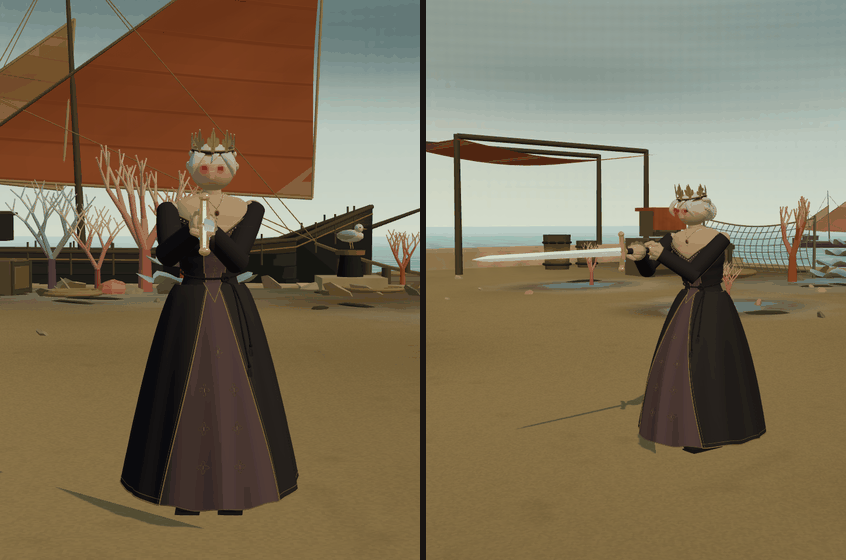
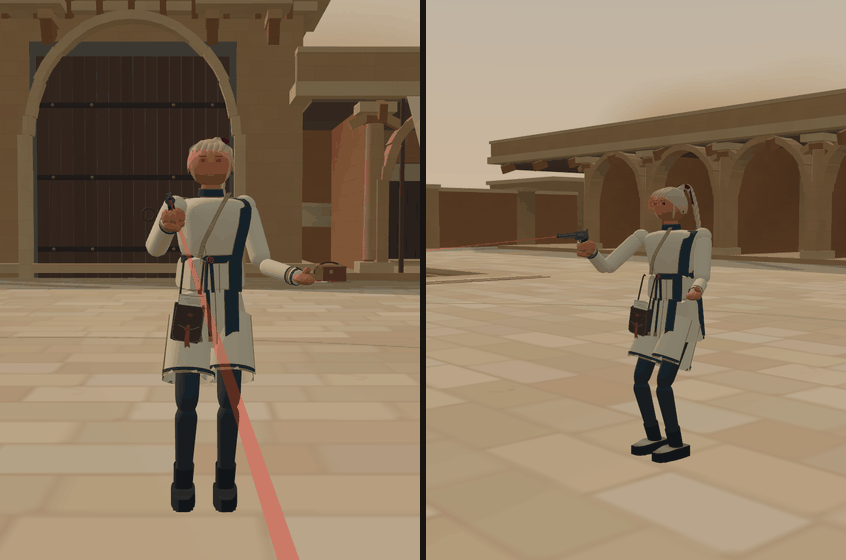
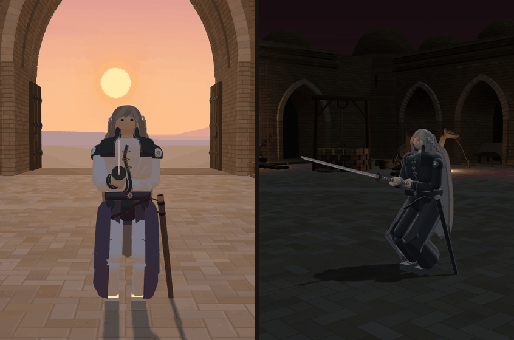
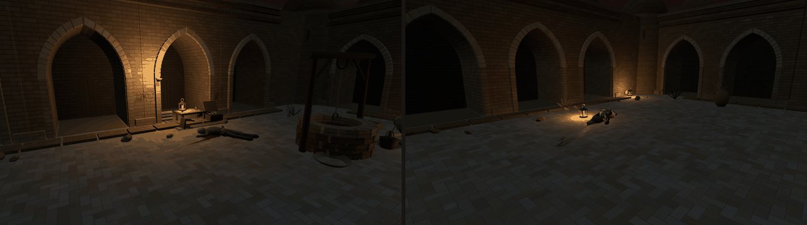
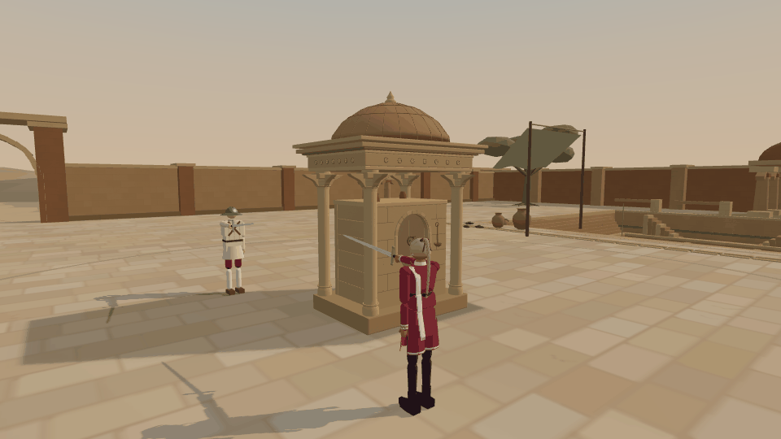
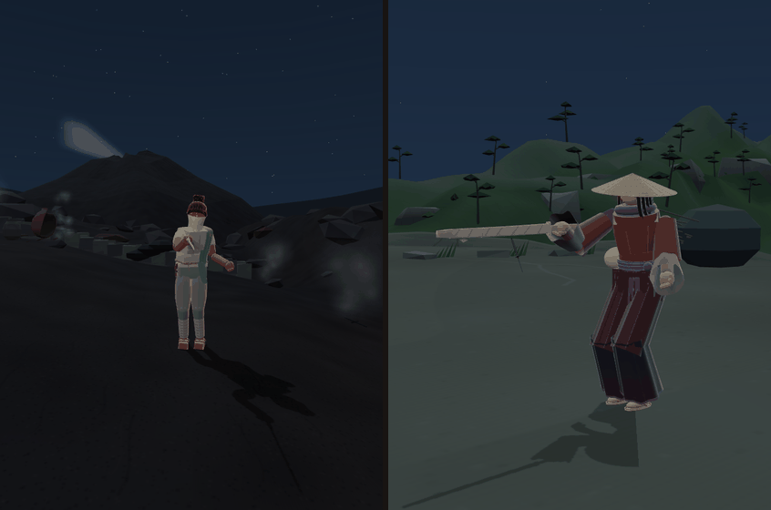
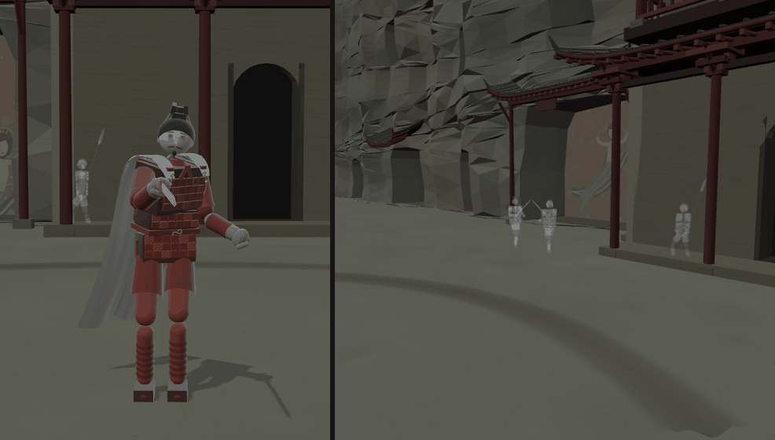
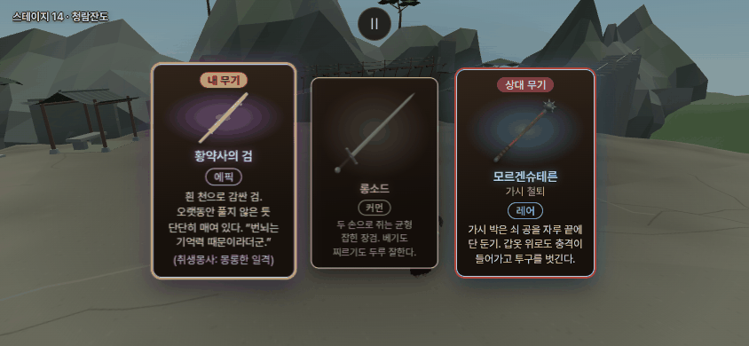

# 샛별 저장소 셋째 들여오기 — 새 밤 넷 · 봉인의 중정 · 얼터 여섯 · 황약사의 검 (2026-10-17)

- 사장님 원문(10/17 12:4x): "샛별의 메시지 확인해서 그의 개발내용 가져와"
- 감독(우화)이 맡김. 작업 가지 `worktree-agent-ada2743ea8ca777e3`(바탕 감독 가지 `db9ac3b7`).
- 가져온 범위: 샛별 저장소 `8233ac94`(10/16 들여오기의 바탕 — `docs/import/saetbyeol_night_2026-10-16.md`) → `429751b4`(그쪽 main, 10/17 12:1x). 그쪽 메모 둘(다음 전달 메모 · 10/17 교환 원고)을 먼저 읽고, 거절 · 대체된 판은 빼고 **마지막 상태만** 들였다. 그쪽 사본은 앞 기록이 얕게 받아져 있어(10/16 22:1x 앞 커밋은 하나씩 못 봄) 두 끝(`8233ac94` ↔ `429751b4`)의 파일 차이로 들였다.
- 한 줄 결과: 관문 다섯 · 이름 규칙 · 빌드 — 기댓값 그대로(무기 점검만 새 칼 한 줄이 늘어 24/24) · 단위 시험 92/92 · 실제 판 8 경우 · 낮 ↔ 밤 오가기 40 번 · 첫 화면 'Stage 1' · 황약사의 검 카드 — 콘솔 오류 0 · 낮 무대와 원래 밤 무대는 옛 빌드와 같은 그림(§5).

## 1. 무엇이 들어왔나 · 보는 법

주소에 `&weapon=longsword` 를 붙이면 카드 없이 롱소드로 바로 싸운다(메뉴의 '여정 시작'). 상대는 무대 짝(`STAGE_FOE`)이 자동 — 다른 상대는 `&foe=<id>`.

| 무엇 | 마지막 상태 (샛별 메모의 사장님 결정) | 보는 주소 |
|---|---|---|
| 밤 다섯째 — **밤의 화산섬 · 광기의 찬다** | 찬다 얼터: 눈 아래에서 묶어 턱 밑까지 늘어지는 **짧고 얇은 흰 가림천** · 흰빛 회색 옷. 밤: 마른 돌 물길이 식은 현무암 마개에서 끊김 · 깨진 물항아리와 부러진 운반대 · **땅 틈 열두 곳의 지열 수증기** · 하늘 · 빛을 낮춤. 땅(비탈 · 용암)은 낮 화산섬과 같다 | `?stage=etna_night` |
| 밤 다섯째 — **밤의 청람잔도 · 광기의 김씨** | 김씨 얼터: 붉은 갈색 옷 · 삿갓 밑으로 긴 머리 · 허리 칼을 손에 — **황약사의 검**(아래 줄). 밤: 한 방향에서 날아온 화살 열하나 · 버려진 짐 · **칼 일곱**(결투장 안 셋 · 밖 넷 — 그림뿐, 충돌 · 줍기 없음) · 밤에는 절벽 새가 날지도 울지도 않음 | `?stage=qinglan_night` |
| 밤 여섯째 — **밤의 철불 절벽 · 광기의 병마용** | 병마용 얼터: 채색 갑옷 · **창백한 사람 얼굴**(흙 부조 대신, 투명 0.88 · 안광 35 %) · **흰 비단 망토**. 밤: **오 · 월 망령 스물** — 사방에서 겨루는 여덟 쌍 · 절벽을 따라 행군하는 넷(창병 셋 · 검병 하나, **깃발 · 기수 없음**) · 창 2.51 m 는 그대로 손을 낮춰 듦. 낮 수레 · 짐 그대로 | `?stage=dunhuang_night` |
| 밤 일곱째 — **밤의 소금 사막(샛별 쪽 이름 '밤의 소금길 역참') · 광기의 다라이시** | 다라이시 얼터: **흑의(거의 중성 검정)** · 애쉬 실버 머리 · **붉은 머리끈**(끝 둘) · 허리 장식도 같은 붉은색 · 안광은 공통. 밤: **상인으로 위장한 암살단** — 낙타 셋 · 숨긴 단검 · 왕실 해 문장 도면 · 넘어진 의자 · **쓰러진 사람 셋**(모의 자리 둘 · 건너편 회랑 하나) · **등불 둘레만 밝게** · 채도를 낮춘 **검붉은 하늘** · 웅덩이 셋 · 가는 흐름 · 바닥 · **벽 비산** · 기어간 자국 | `?stage=dayr_night` |
| 새 무대 — **봉인의 중정 · 마야** | 라자스탄풍 사암 역참 안뜰 · 회랑 · 담장 · 들머리 · 깊은 계단 우물(바오리) · 모래바람 · 해 그늘을 구운 판석. **가운데 급수정은 실제 엄폐물**(충돌체 9 — 칼 · 몸 · 총알이 막힘, 사선이 막힌 총수는 걸어서 돌아감). 결투 반지름 9.19 m 그대로 · 두 사람은 옆으로 1.85 m 비켜 선다 | `?stage=courtyard` |
| 얼터 — **광기의 마야** | 모래빛 · 짙은 청색 배색 · 허리에 열린 문서 가방(부서진 붉은 밀랍). 외양만 | `?stage=courtyard&foe=samira_mad` |
| 얼터 — **광기의 아르토리아** | 검은 **궁정 예복 v4-alter13** — 긴 겹치마 · 포도주빛 문양 앞판 · 가는 소매 · 완만한 V 목선 · 좁은 V 목걸이 · 대관식 올림머리(원래 앞머리 셋 그대로) · 백합 금관(균등 72 % · 은은한 광택) · 가장 잘록한 허리의 **검은 꼬임 허리끈**. **실제 판금을 벗는다**(방어 11 → 0 · 갑옷 감속 없음 — 사장님 승인 예외, 그쪽 그대로) | `?stage=corsair&foe=artoria_mad&foeWeapon=excalibur` |
| 기본 — **다라이시 새 판 v7-silver-c** | 우리 v7 위에: 수직 S 곡선 앞섶 · 금실 잎 · 끈 여밈 셋 · 앞머리 한 가닥 · 옆머리 슬림 · 목 · 셔츠 연결 · 칼집 8 mm 안쪽 · **애쉬 실버 머리**(셋째 시안). 여정 마지막 판(소금 사막)의 다라이시가 이 모습 | `?stage=dayr` |
| 무기 — **황약사의 검** (id `brothers_sword`) | **에픽 한손 둔기 · 정식 카드 뽑기**. 1.6 kg · 둔타 1.6 · 파손 0 · 날 · 가시 없음. 능력 줄 '취생몽사: 몽롱한 일격'(이름만 — 상태 이상 없음). 설명 "흰 천으로 감싼 검. 오랫동안 풀지 않은 듯 단단히 매여 있다." + 인용 "번뇌는 기억력 때문이라더군." 에픽 공통 공격 × 1.1 은 우리 등급표가 그대로 곱한다(`TIER_DEFAULTS.epic.power` → 둔타 판정 에너지 × power 1.1 × mBlunt 1.6, `src/combat.js`) | 카드 뽑기 · `?weapon=brothers_sword` |
| 칭호 — **찬다 '식물학자'** | 원본 · 얼터 모두 (전 '수문지기') | `?stage=etna` |

- 여정 순서(`STAGE_ORDER`)는 **우리 것 그대로**(24 판 — 사장님 10/16 19:4x 낮 다섯 · 밤 다섯). 새 무대 다섯은 10/16 들여오기와 같이 주소로만 연다(§7-3).
- 카드 설명의 둘째 줄(인용)은 우리 카드 꼴대로 이어서 흘려 쓴다 — 그쪽 게임 화면도 같다(같은 카드 CSS). 따로 한 줄로 보이게 하려면 모든 카드에 닿는 CSS 손질이 필요해 하지 않았다(§7-4).
- 대기실 무기 칸(`LOBBY_ITEMS` = 나뭇가지)은 그대로 — 황약사의 검은 카드 뽑기로만 나온다.

## 2. 옮긴 자리

| 파일 | 무엇 |
|---|---|
| `src/stages.js` | 새 무대 다섯 짓는 함수 · 화면 이름 · 짝(`STAGE_FOE`) — 여정 순서는 그대로 |
| `src/stage_night_fifth.js` (새) | 밤의 화산섬 · 밤의 청람잔도 |
| `src/stage_dunhuang_night.js` · `src/stage_yue_apparitions.js` (새) | 밤의 철불 절벽 · 오 · 월 망령(인스턴스 메쉬 32 묶음 · 30 Hz) |
| `src/stage_dayr_night.js` · `stage_dayr_caravan.js` · `stage_dayr_blood.js` · `stage_dayr_far_side.js` (새) | 밤의 소금길 역참 · 대상단 · 핏자국(실제 판석 · 벽돌에 투영) · 건너편 회랑 |
| `src/stage_courtyard.js` · `src/stage_courtyard_cover.js` (새) | 봉인의 중정 · 급수정(보이는 돌과 충돌체를 한 설명으로) |
| `src/arena_obstacle.js` | 중정만 급수정 충돌체 등록 · 시작 자리 1.85 m · 사선이 막힌 총수 우회(`seekSight` — 습지 석상은 전과 같은 길) |
| `src/sound.js` · `src/stage_detail_sound.js` | 중정 발소리 · 울림 · 세 소리(있던 합성을 다시 씀 — 기존 무대 씨앗 차례 그대로) · 밤 넷의 무대 소리 · 밤 청람잔도 새 소리 끔 |
| `src/etna_ground.js` · `src/stage_etna.js` · `src/stage_qinglan.js` | 밤 화산섬도 같은 땅 · 땅 높이 함수 내보냄 · 청람잔도 `night` 갈래(새만) |
| `src/characters.js` | 찬다 칭호 · 새 얼터 여섯(찬다 · 김씨 · 병마용 · 다라이시 · 마야 · 아르토리아) · `retainBaseStats`(실력 숫자 +20 % 안 받음) |
| `src/outfit_alter.js` · `outfit_alter_fifth.js` · `outfit_alter_terracotta.js` · `outfit_yue_cloak.js` · `outfit_alter_daraishi.js` · `outfit_alter_royal_messenger.js` (새 다섯) | 얼터 배색 · 가림천 · 긴 머리 · 사람 얼굴 · 망토 · 붉은 끈 · 문서 가방 |
| `src/outfit_artoria_ballroom.js` (새) · `src/outfits.js` · `src/fighter.js` | 궁정 예복 · 옷 함수에 `groups`(부위 묶음)를 넷째 인자로 — 허리끈이 골반을 따라 그림만 휨(다른 옷은 안 읽음) |
| `src/looks.js` · `src/outfit_daraishi_front.js` (새) · `src/outfit_silver_wanderer*.js` | 다라이시 v7-silver-c · 앞판 · 목 · 칼집 8 mm |
| `src/mad_eyes.js` | 창백한 사람 얼굴(병마용 얼터)만 안광 35 % |
| `src/weapons.js` · `src/weapon_measured.js` · `src/renji_sword_wrap.js` (새) · `src/outfit_renji_baji.js` · `public/ui/weapons/brothers_sword.webp` | 황약사의 검 · 간격 · 천 감싼 꼴(허리 칼과 같은 꼴을 한 파일로) · 카드 그림 |
| `tools/pwa/build.mjs` | 오프라인 담기에서 `encounters`(소개 페이지 사진) 뺌 — §7-6 |
| `tools/sim/brothers_sword_check.mjs` · `tools/sim/courtyard_cover.mjs` (새) | 그쪽 점검 둘(주석만 우리 말로) |
| `tools/browser/alter_pair_capture.mjs` | 그쪽 새 판(보기 · 겉모습 판 · 원래 무기) — 크롬 경로를 `PW_CHROMIUM` 으로 |
| `tools/browser/round3_check.mjs` (새) | 이번 점검 하나로 — 그쪽 점검 여섯을 우리 판(숙련도 +1 규칙 · 우리 첫 화면 흐름)에 맞춰 모음 |

파일마다 어떻게 들였는지 · 해시는 [manifest](saetbyeol_round3_2026-10-17/manifest.json).

## 3. 맞추기 — 부딪힘 · 손질

- **우리 파일 = 그쪽 바탕(`8233ac94`)인 src 13 파일 + `alter_pair_capture.mjs`**: 그쪽 최종본 그대로(주석 · 아래 덜기만 손봄).
- **다라이시 세 파일**(`looks.js` · `outfit_silver_wanderer.js` · `outfit_silver_wanderer_detail.js`): 우리 지금 파일이 그쪽 `9003c0d5`(그쪽이 우리 v7 되돌림에 맞춘 판)와 **바이트 같음**을 확인 → 그 뒤 그쪽 변경(앞판 · 목 · 칼집 · 머리색)이 그대로 얹힘.
- **양쪽이 고친 5 파일 — 세 갈래 맞춤**(우리 · 그쪽 바탕 · 그쪽 최종본):
  - `fighter.js`(우리 스킬북 · 기력 주석 / 그쪽 `groups` 인자) · `sound.js`(Stillness 주석 / 중정 · 밤 소리 표) · `stages.js`(우리 4 막 · 낮 다섯 밤 다섯 순서 / 그쪽 새 무대) · `tools/pwa/build.mjs`(Stillness 머리말 / encounters 빼기) — 저절로 맞음.
  - **`characters.js` 한 곳 부딪힘**: 우리 '얼터 숙련도 맞춤'(사장님 10/16 22:3x '모든 얼터에 숙련도+1') 자리와 그쪽 새 얼터 여섯 자리가 겹침 → **그쪽 얼터를 먼저 만들고 우리 맞춤 고리를 뒤에** 둠. 그래서 새 얼터 여섯도 숙련도 +1(그쪽 판은 원본 숙련도 그대로였다): 찬다 2 → 3 · 김씨 2 → 3 · 병마용 2 → 3 · 다라이시 4 → **5** · 마야 1 → 2 · 아르토리아 4 → **5**. 실력 숫자 +20 % 는 그쪽 그대로 없음(`retainBaseStats` · `appearanceOnly`) — 확인표 2026.
- **거절 · 대체된 판 덜기**(그쪽 최종 코드에서 아무도 안 부르는 것):
  - 해변(비키니) 아르토리아 옷 `outfit_artoria_beach.js` — 파일 · `OUTFITS` 등록을 안 들임.
  - 다라이시 에메랄드 머리 `v7-front3` · 고르지 않은 은발 시안 `v7-silver-a` · `v7-silver-b` — `LOOK_ARCHIVE` 에서 뺌(지금 판 `v7-silver-c` 가 거치는 `v7-front1` · `v7-front2` · `v7-front4` 는 둠).
  - 첫 다라이시 얼터(먹청 · 동색 배색 · **끊어진 손목 족쇄** — 탈옥 이야기와 함께 거절) — 배색 · 족쇄 코드를 뺌. 지금 얼터는 늘 흑의(`daraishiBlack`)라 화면은 같다.
  - `drawWeaponCards` 의 `characterOnly` 거르기는 둠 — 그런 무기가 없어 뽑기 결과 · 난수 차례가 전과 같다(주석으로 적음).
- **글 손질**: 그쪽 영어 주석을 모두 우리 말로(사장님 결정은 날짜와 함께 — 새 파일은 주석을 뺀 코드가 그쪽과 같음을 rolldown(oxc) 줄이기로 비교, manifest `codeSameAsTheirs`) · 메타 글의 '사용자' → '사장님'(밤 철불 절벽 `storyRule`).
- 공통 코드가 기존 판을 바꾸지 않는지 읽은 것: `arena_obstacle.js`(`seekSight` 없는 습지 석상은 같은 식 — `Math.max(0, …)` · 같은 return) · `fighter.js`(옷 함수에 인자 하나 더 — 넷째 인자를 받는 옷은 궁정 예복 하나뿐, 모두 `isolatedVisual` 안) · `mad_eyes.js`(사람 얼굴 표시가 없는 머리는 1 배) · `weapons.js`(새 칼 · 거르기만 — 다른 무기 줄 그대로) · `characters.js`(`retainBaseStats` 는 새 얼터만) · `stages.js` · `sound.js` · `stage_detail_sound.js`(새 id 만) · `tools/pwa/build.mjs`(빼는 폴더 하나). 관문 다섯이 바이트 같음으로 확인(§5).
- 냉동 참치 2.4 · 고무 닭 1.2 · AI 리볼버 × 1.8(그쪽 메모의 '후속 작업 요청 — 그쪽 게임에도 미적용')은 감독 가지에서 다른 작업으로 반영(확인표 2020~2022) — 이 가지는 그 줄들을 건드리지 않았다.

## 4. 안 가져온 것

| 무엇 | 까닭 |
|---|---|
| 그쪽 AGENTS.md · docs 전부 | 경로 · 이름 규칙 — 필요한 결정은 이 문서와 확인표에 옮겨 적음 |
| 소개 페이지 9(새 8 · 고친 1) · 사진 · 영상(`public/encounters/` 39 폴더 약 440 파일) | 그쪽 검토 이력(거절판 전후 비교 · 해변 · 에메랄드 · 탈옥 · 앉은 사람 · 깃발 사진)이 섞여 있어 마지막 상태만 골라 내기 어렵다 — 이번엔 이 문서 사진(§6)으로 대신. `night_second_delivery.mjs` 의 새 페이지 목록도 같은 까닭으로 안 들임 |
| 그쪽 점검 · 탐침 13 · 사진 도구 6 (`tools/browser/*_check.mjs` 등) | 그쪽 저장 열쇠 · 대기실 흐름 · 문서 경로 · 크롬 경로에 묶여 있고, 얼터 AI 를 '원본과 같음'으로 본다(우리는 숙련도 +1) — 내용을 `round3_check.mjs` 하나로 옮김 |
| 거절 · 대체된 판 | §3 (해변 옷 · 에메랄드 · 은발 시안 둘 · 첫 다라이시 얼터와 족쇄). 탈옥 소품 · 앉은 사람 · 깃발 · 귀향배는 그쪽 최종 코드에도 없음 |

## 5. 점검

Node 22 · Three 0.186 · Rapier 0.19.3 · Chromium 141(SwiftShader) · 로컬 프로덕션 빌드(`npm run build` → `vite preview`). 관문은 `nice -n 10`, 무거운 것 둘까지 함께. 해시 = `grep -v 'deprecated parameters' <출력> | sha256sum | cut -c1-8`. 결과 파일은 [checks](saetbyeol_round3_2026-10-17/checks/).

| 점검 | 바탕 db9ac3b7 | 들인 뒤 |
|---|---|---|
| fights12 | 5dfe035c | **5dfe035c** |
| live_battery | 648aca66 | **648aca66** |
| finish_thrust 1 --stand | 2de06c03 | **2de06c03** |
| corr_s0 (한도 켬 · 끔 × 장면 a · b) | identical 12/12 | **12/12** (바뀐 줄은 걸린 초뿐) |
| weapon_smoke | OK 23/23 | **OK 24/24** — 늘어난 한 줄 `brothers_sword OK` 뿐(나머지 23 줄 바이트 같음) |
| name_policy | 위반 0 (화면 글 925 줄) | **위반 0** (983 줄 — 새 인물 · 무기 글) |
| npm run build | 성공 · PWA 507 파일 15.3 MB | **성공** · PWA 387 파일 7.6 MB(encounters 뺌 — §7-6) |
| 단위 시험 `node --test tools/sim/*.test.mjs` 11 파일 | — | **92/92** |
| `tools/sim/brothers_sword_check.mjs` | — | 통과 — 무유파 둔기 꾸러미(모르겐슈테른과 같은 기술 · 자세) · 에픽 1.1 · 능력 줄 · 뽑기 128 씨앗 중 4 번 나옴 · 지난 판 무기 빼기 · 충격 512 번에도 안 부러짐 · 둔타만(피 · 즉사 없음) · 실제 12 초 판 6 씨앗 × 양쪽 25 타 |
| `tools/sim/courtyard_cover.mjs` | — | 통과 — 급수정 뒤 총알은 돌에(가운데 · ±0.4 m) · 열린 옆(±2.5 m)은 몸에 · 몸이 우물을 못 지남 · 마야가 막힌 사선에서 돌아 나와 쏨(세 씨앗 · 6 발씩) · 캡슐이 돌 앞에서 멈춤 · 카메라 보호 · 무대 바꾸면 충돌체 수 원래대로 |
| `tools/browser/round3_check.mjs` ① 자료 | — | 얼터 여섯 × 숙련도 1~5 = 30 쌍(숙련도만 +1, 그 숙련도의 AI 는 원본과 같음 — 김씨는 꾸러미 이름만 다름) · 짝 · 여정 순서 24 판 그대로 · 황약사의 검 값 |
| ② 실제 판 8 경우 (주소로 열기 → 싸움 → **정지 · 계속** → 6~18 초) | — | 밤의 화산섬(가림천 · 수증기 움직임 · 땅 etna · 소리 etnaCrust) · 밤의 청람잔도(칼 7 · 안 3 · 긴 머리 · 황약사의 검 · springDrip · 절벽 새 없음) · 밤의 철불 절벽(망령 20 · 깃발 0 · 사람 얼굴 0.88 · 망토 · dunhuangWood) · 밤의 소금길 역참(해 숨김 · 낙타 3 · 쓰러진 사람 3 · 소품 결투장 밖 13 m · 족쇄 없음 · 붉은 끈 · caravanRing) · 중정 × 마야(실제로 쏨 · 충돌체 9 · 소리 셋) · 중정 × 마야 얼터(문서 가방) · 산호 항구 × 아르토리아 얼터(판금 0 · 예복 · 금관 · 허리끈 휨까지 그림) · 소금 사막 × 다라이시(앞판 · 목 · 앞머리 · 붉은 끈 없음) — **콘솔 · 페이지 오류 0** |
| ③ 오가기 | — | 화산섬 ↔ 밤 · 청람잔도 ↔ 밤 · 철불 절벽 ↔ 밤 · 소금 사막 ↔ 밤 · 중정 · 붉은 회랑 네 바퀴 40 번 지음 — 첫 바퀴(데우기) 뒤 둘째 · 셋째 · 넷째 바퀴 자원 수(꼴 · 무늬 · 셰이더) 같음 · 밤 이야기 묶음 · 중정 환경 · 급수정 충돌체가 그 무대에만 |
| ④ 첫 화면 → 'Stage 1' | — | 곧바로 여정(카드 고르기) · 포세이돈 — `to_lobby.mjs` departTitle |
| ④-2 황약사의 검 카드 | — | 이어하기 지점(청람잔도 · 카드 둘 = 황약사의 검 · 롱소드) → '이어하기' → 카드: 에픽 · 이름 · 설명 두 줄 · '(취생몽사: 몽롱한 일격)' · 그림 읽힘 → 그 칼로 싸움 power 1.1 · 둔타 1.6 · 파손 0 |
| ⑤ 옛 빌드와 같은 그림 (같은 주소 · 같은 시계 · 같은 카메라 · 싸움꾼 숨김) | — | 화산섬 · 소금 사막 · 밤의 성 안뜰 · 밤의 잠든 습지 **바이트 같음**. 청람잔도는 95 화소가 채널 1 만큼 다름 — 옛 빌드끼리 두 번 열어도 같은 두 그림이 번갈아 나와(SwiftShader 흔들림) 들여오기와 상관없음 |
| 무기 카드 그림 | — | 우리 도구(`tools/browser/weapon_thumbs.mjs`)로 다시 찍은 brothers_sword.webp = 그쪽 그림과 바이트 같음(같은 도구 · 같은 규칙 — 롱소드 · 모르겐슈테른도 다시 찍어 지금 파일과 같음) |

- 무대 짓는 시간(소프트웨어 GL — 참고): 새 무대 136~468 ms(밤의 화산섬 136 · 청람잔도 464 · 철불 절벽 357 · 소금길 역참 468 · 중정 328) — 원래 밤의 잠든 습지 725 · 성 안뜰 166 ms 와 같은 범위.
- 실제 iPhone 의 FPS · 귀로 듣는 소리는 이번 범위가 아니다.

재현(저장소 루트, `npm ci` · `npm run build` 뒤 `npx vite preview --port 4417` — 옛 빌드 비교는 바탕을 따로 빌드해 4418):

```sh
node tools/sim/brothers_sword_check.mjs /tmp/brothers.json
node tools/sim/courtyard_cover.mjs /tmp/cover.json
PW_CHROMIUM=<크롬> node tools/browser/round3_check.mjs http://127.0.0.1:4417 /tmp/round3.json --shots=/tmp/shots --same-as=http://127.0.0.1:4418
PW_CHROMIUM=<크롬> node tools/browser/alter_pair_capture.mjs http://127.0.0.1:4417 /tmp/portraits corsair:artoria_mad,courtyard:samira_mad --native-weapons --views=front,weapon
```

## 6. 사진 (들인 판 · 로컬 빌드 · SwiftShader)










## 7. 사장님께 여쭐 것

1. **새 얼터 숙련도 +1 의 결과**(확인표 2026): 우리 규칙(10/16 22:3x)대로 아르토리아 얼터 5(갑옷도 벗음) · 다라이시 얼터 5(일본 유파 5 = 비기 고노센)가 된다. 샛별 쪽 판은 원본 숙련도 그대로였다.
2. **'밤의 소금길 역참' 이름**(확인표 2032): 낮 이름은 '소금 사막'(사장님 10/14 08:1x)이라 우리 밤 이름 꼴('밤의 + 낮 이름')로는 '밤의 소금 사막'. 지금은 그쪽 이름 그대로.
3. **새 무대 다섯을 여정에 넣을지**(확인표 2035): 지금은 주소로만. 여정 규칙('밤 무대가 새로 생기면 같은 규칙으로 자리를 다시 잡는다')대로라면 둘째 밤 묶음에서 당겨 쓴 산사 · 얼어붙은 만의 밤 자리에 화산섬 · 청람잔도의 밤이 오고, 철불 절벽 · 소금 사막의 밤이 끝 묶음 뒤로 이어질 수 있다. 중정(마야)도 낮 자리가 없다.
4. **카드 인용 줄**: 둘째 줄 "번뇌는 기억력 때문이라더군."이 첫 문장 뒤로 이어 흘러 보인다(그쪽 화면도 같음). 따로 한 줄로 보이게 하려면 모든 카드의 설명 CSS 를 바꿔야 한다.
5. **다라이시 기본 모습**: 여정 마지막 판(소금 사막)의 다라이시가 v7-silver-c(앞판 · 애쉬 실버)로 바뀐다 — 샛별 쪽 사장님 결정.
6. **오프라인 담기**(확인표 2034): 소개 페이지 사진(10/16 것 포함)을 설치 묶음에서 뺐다(15.3 → 7.6 MB). 오프라인에서 소개 페이지를 열면 사진이 안 보인다 — 게임은 그대로.

## 8. 남은 것 · 위험 · 되돌림

- 광기의 아르토리아 허리끈은 그릴 때마다(그림자 포함) 꼭짓점을 골반 쪽으로 휜다 — 그 인물이 나올 때만(지금은 주소로만), 폰 CPU 몫은 재지 않았다.
- 봉인의 중정 판석 무늬는 1536 × 1536 캔버스 하나(GPU 약 9 MB + 밉맵) — 중정에서만. 짓는 시간은 다른 무대와 같은 범위였다(§5).
- 오 · 월 망령 스물은 30 Hz 로 인스턴스 행렬 약 400 개를 고친다 — 밤의 철불 절벽에서만.
- 밤 다섯째의 칼 일곱은 진짜 무기 꼴을 다시 쓰되 재질은 무대 것(싸움꾼 반사 환경과 안 섞임) — 충돌 · 줍기 없음(점검 ②).
- 확인표 2020~2022(감독 가지)와 이 가지의 2023~2035 가 확인표 끝에서 맞닿는다 — 합칠 때 두 덩어리를 차례로 두면 된다.
- 되돌림: 이 가지 커밋 넷을 역순으로 revert(기록 · 점검 → 무대 → 인물 · 옷 → 무기 — 하나씩 빌드되는 차례로 나눠 커밋함). 새 저장 열쇠 · 계정 자료 없음 — 지운 데이터 없음. 이어하기 지점이 새 무대를 가리킬 일은 없다(여정 순서 밖).

## 9. 사장님 답 (10/17 14:xx)

- 사장님: "밤 스테이지와 전용 얼터 캐릭터들은 바로 여정에 넣고, 다만 봉인의 증정은 디자인 리뷰를 진행해. 이대로 이식해도 좋을지. 봉인의 중정 이식이 끝나면 마야는 거기서만 나올거야. 예전에 네가 2막 인도양 순서에 마야를 넣자고 제안한 적 있어 그대로 해." · "밤 무대 이름은 네 제안대로 할게. 카드 설명의 인용문은 기존 것에 맞춰."
- **여정 스물여덟 판**(`src/stages.js` `STAGE_ORDER`): 낮 다섯 · 밤 다섯 규칙(10/16 19:4x)대로 — 둘째 밤 다섯 = 산호 항구 · 잠든 습지 · **화산섬 · 청람잔도** · 신목의 숲의 밤(당겨 쓰던 산사 · 얼어붙은 만의 밤은 제자리로) · 끝 낮 넷(산사 · 얼어붙은 만 · 철불 절벽 · 소금 사막) 뒤에 **그 넷의 밤**. 끝판 = 밤의 소금 사막(광기의 다라이시), 그다음은 다시 포세이돈.
- **전용 얼터**: 밤 넷의 짝(광기의 찬다 · 김씨 · 병마용 · 다라이시)은 무대 짝으로 함께 · 밤의 대성당 후보 아르토리아 → **광기의 아르토리아**(낮 대성당은 아르토리아 그대로). 광기의 마야는 자리 없음(마야는 중정에서만 — 중정은 낮 무대라 밤 짝이 없다) — 주소로만.
- **이름**: '밤의 소금길 역참' → **'밤의 소금 사막'**(낮 이름에 맞춤 · 위 §7-2).
- **카드 인용 줄**: 기존 카드(리볼버 — '어느 왕의 검을 녹여 총신을 만들었다.' 뒤 인용)와 같은 꼴 그대로 둠(첫 문장 뒤로 이어 흐름 — §7-4).
- **봉인의 중정**: 디자인 리뷰 중(작업자) — 결과를 보고 고친 뒤 **2 막 산호 항구와 잠든 습지 사이**(감독 10/16 제안)에 넣고, 붉은 회랑의 마야 후보는 뺀다(마야는 중정에서만). 그때 낮 묶음이 다섯씩 다시 갈린다.
