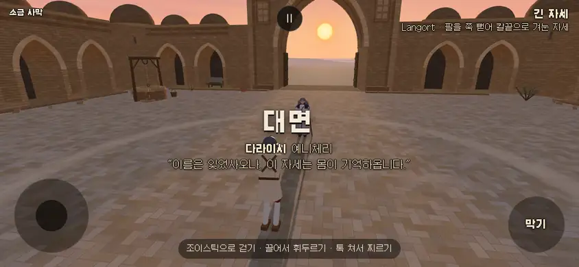
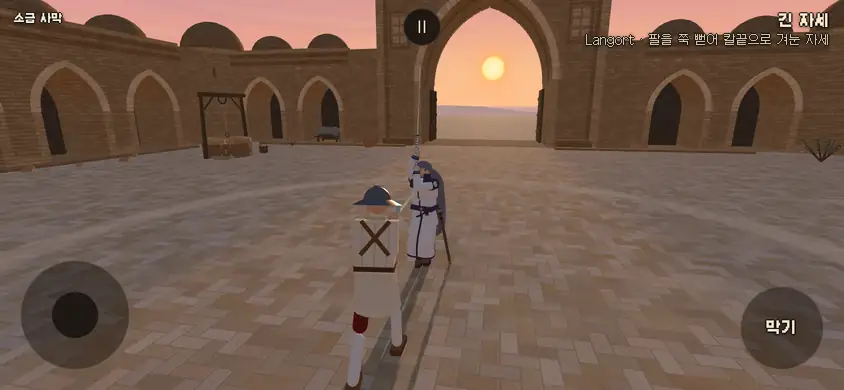
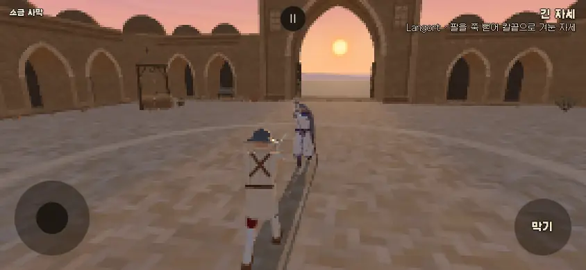
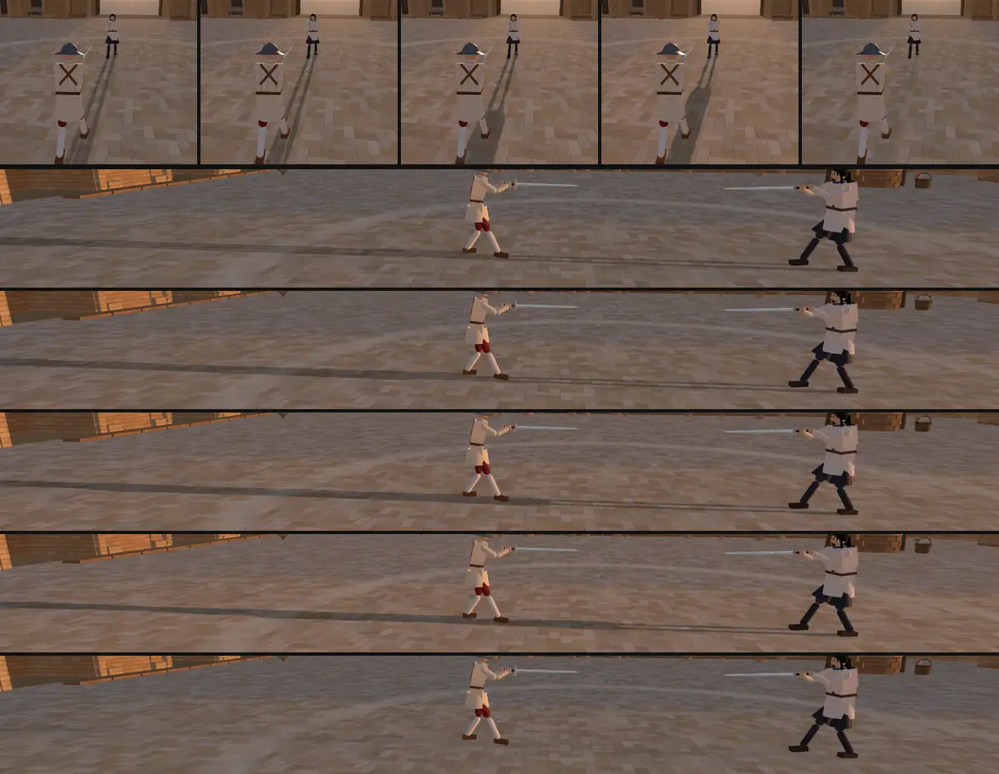
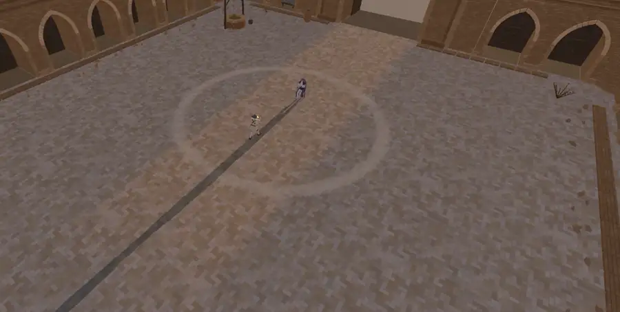
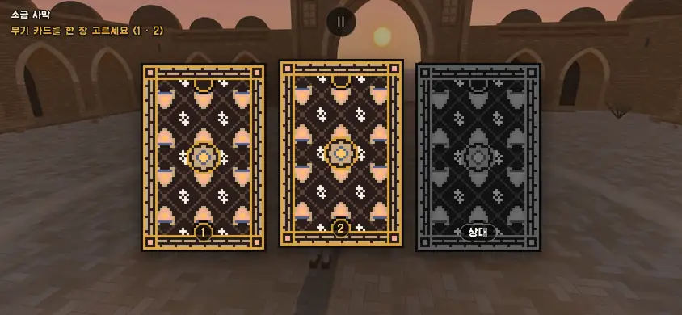
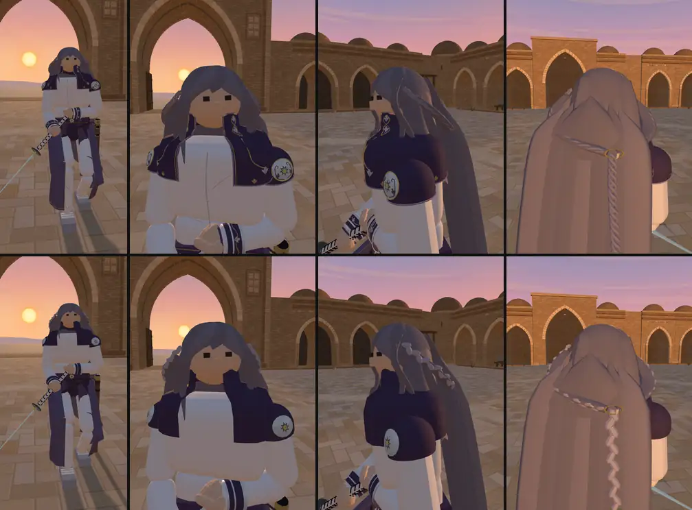
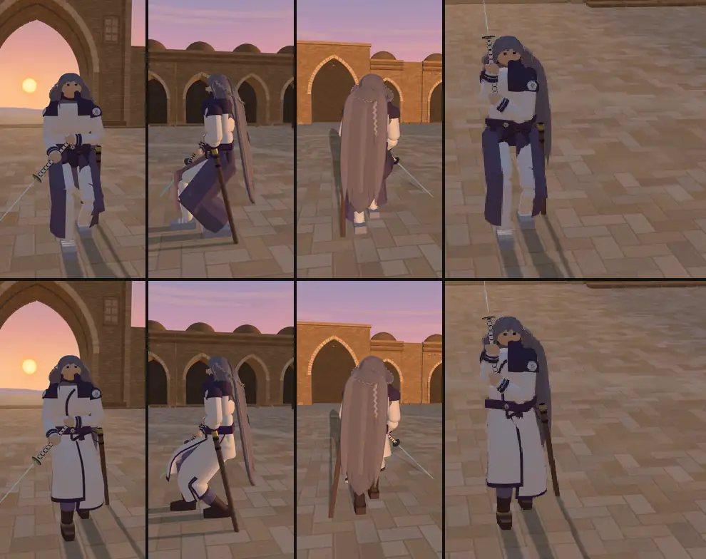
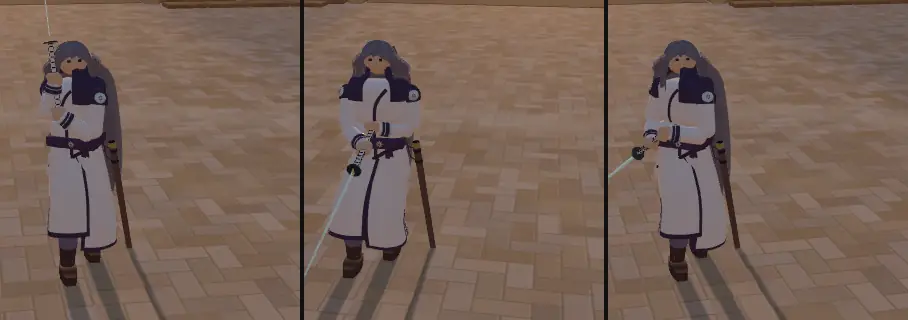

# 소금 사막(dayr) · 다라이시 옮김 — 여정 밖 무대와 손님 인물 (2026-10-14)

- 지시: 감독 10/14 — 샛별 저장소의 무대 '소금길의 (마지막) 역참'(코드 id `dayr`, 일몰판)과 인물 다라이시를 4차 디자인 리뷰(`docs/import/saetbyeol_review4_2026-10-14.md`)와 사장님 결정대로 옮긴다.
  - 사장님 결정 10/14 03:5x: 다라이시 숙련도 4.
  - 사장님 결정 10/14 08:1x: 화면 이름 '소금 사막' · 여정 밖(테스트 고르기 '무대' 줄 + `?stage=dayr`, `STAGE_ORDER` 에 안 넣음) · 칭호 '예니체리' · 손님 인물(`CHARACTER_GUESTS`, '상대' 줄 + `?foe=`) · "해는 그림자를 만들 수 있는 선에서 최대한 낮추고 그림자는 최대한 길게 뽑자. 그게 이 스테이지 특징이 되게." · 리뷰 추천 ①⑤⑥⑨⑩⑫ 반영.
  - 사장님 10/14 12:2x(감독 전달): "다라이시 외형은 어떻게 됐어? 지금에서 조금만 더 페르시안 귀족의 전통이 묻어나게 옷을 바꿀 수 있는지. 특히 하의 길이나 겹침이 좀 애매해 보이는데…" → 카바(§2-7).
- 출처: 샛별 저장소 origin/main **db729604**(무대 내용은 일몰판 **9cf69988** — 그 뒤는 기록 커밋뿐). 샛별 쪽은 읽기만 했고 `git archive` 로 꺼낸 사본만 읽고 돌렸다.
- 가지: …/salt-desert (본판 8979346 에서). 새 값은 모두 `docs/strike/owner_defaults_table.md` **1210~1234** 행(사장님이 정한 값은 '사장님 결정 10/14', 나머지 '사장님 확인 전').
- 커밋: ① 무대 e3cbcef · ② 인물 d21db39(겉모습 덜기 v7 + 카바 v8 — 카바는 아직 밀지 않은 ② 에 고쳐 넣었다) · ③ 이 기록. push 하지 않았다.

## 0. 한눈에

| 무엇 | 한 일 | 어디 |
|---|---|---|
| 무대 | 샛별 일몰판 역참을 옮김 · 화면 이름 '소금 사막'(id `dayr` 그대로) · 여정 밖 | §1-1 · §1-5 |
| 해 높이 | 2.1° → **6°** — 1.8 m 사람 그림자 **17.1 m**(키의 9.5 배) | §1-2 |
| 그림자 | 이 무대 전용 그림자 카메라(지도 1024² 그대로) · 화소 맞춤 · 그림자 진하기 · 건물은 안 드리움 | §1-3 |
| 결투장 띠 | 보이지 않는 벽 6.5 m 자리에 은은하게 닳은 둥근 띠 | §1-4 |
| 소리·카드 뒷면 | 세부음은 습지 셋 뒤(씨앗 순서 그대로) · `px_dayr_*` 새로 그림 | §1-6 · §1-7 |
| 인물 | 손님 인물 · 칭호 '예니체리' · 숙련도 4 · 참을성 기질 · 목소리 `heinrich` | §2-1~§2-5 |
| 말투 | **궁중 경어체**('-옵-·-사옵-·-소서') — 지금 인물 누구와도 안 겹침 | §2-3 |
| 겉모습 | v7 덜기(삼각형 46,934 → 20,406) → **v8 카바**(종아리 중간 긴 겉옷 · 왼 자락이 오른쪽으로 여밈 · 캄마르반드 · 옆트임 · 바지·장화) | §2-6 · §2-7 |
| 성능 | 무대 그리기 232 · 삼각형 8.7 만(우리 무대 안) · 인물 22,206 삼각형 · 메쉬 75 | §1-8 · §2-8 |

## 1. 무대 — 소금 사막 (`dayr`)

*개발 서버(이 가지)에서 `?stage=dayr&foe=silver_wanderer&weapon=longsword&foeWeapon=monohoshizao`, 헤드리스 SwiftShader. 바깥 요청은 막고 찍었다(막힌 요청 0 · 콘솔 오류 0).*

### 1-1. 옮긴 것 · 고친 것
- **옮긴 것(샛별 일몰판 그대로)**: 소금 벌판 가 벽돌 역참(카라반사라이) 안뜰 — 깊은 문루(이완)·아치 방·낮은 돔·네 귀퉁이 탑 · 닳은 벽돌 헤링본 바닥(캔버스 무늬, 그림 파일 0) · 문루 너머 소금 벌판과 낮은 능선 · 살구·산호 노을과 보랏빛 위 하늘 · 우물(줄 고리가 흔들림)·항아리·짐꾸러미·덤불. 결투장은 평평한 y 0, 카메라 궤도 10.5 m 안은 바닥뿐, 충돌체·지형 규칙 없음. 사원 요소·글씨·종교 상징 없음.
- **고친 것**(`src/stage_dayr.js` 머리말 ①~④):
  1. 해 높이 6°(§1-2) — 보이는 해 판·노을 빛무리도 같은 각을 따른다.
  2. 이 무대 전용 그림자 카메라 + 화소 맞춤(§1-3) — `stages.js useShadow`·`snapSun`, `main.js` 한 줄.
  3. 그림자 진하기 + 건물·소품은 움직이는 그림자를 드리우지 않음(§1-3).
  4. 결투장 띠(§1-4).
  5. 화면 이름·여정 밖(§1-5), 카드 뒷면(§1-7).
- 샛별 판의 무대 검객 짝(`STAGE_FOE.dayr`)은 잇지 않았다(습지·라트나와 같이 — 작업자 판단, 확인표 1214).

### 1-2. 해 높이 — 6° (확인표 1210)

사장님 말씀대로 '깨끗한 그림자가 나오는 가장 낮은 각'을 찾았다. 깨끗함의 셋 — **여드름 0**(받는 면과 드리우는 면을 나눠 생길 자리가 없다, §1-3) · **깜빡임 0**(화소 맞춤 — 과녁을 화소 1·2 칸 옮겨도 바닥 그림자 바뀐 화소 0) · **발과 붙음**(발바닥이 바닥 0.84~1.07 cm 아래 — 틈 없음) — 은 2° 부터 다 맞았다. 그래서 각을 정한 것은 남는 한계 둘이다:

1. **그림자 화소가 바닥에 닿는 길이 ≤ 5 cm** — 지도 화소 높이 ÷ sin(높이). 이보다 길면 해와 직각인 가장자리(어깨·머리·칼끝)의 번짐이 바닥에서 그만큼 늘어나고 PCF 점무늬가 넓게 일렁인다 → **≥ 5.6°**.
2. **결투장 가운데 선 1.8 m 사람의 그림자 끝이 서쪽 벽(18 m) 앞 바닥에 떨어짐** — 1.8 ÷ tan θ ≤ 18 → **≥ 5.7°**. 더 낮으면 그림자가 늘 벽에 잘려 올라탄다.

둘 다 맞는 가장 낮은 정수 각이 **6°** 다. 방위는 샛별 판 그대로(문루 한가운데 — 판 시작 카메라의 정면, 역광).

| 해 높이 | 1.8 m 사람 그림자 | 그림자 화소 바닥 길이 | 그림자 켬/끔 평균 밝기 차(경기 화면) | 12 넘게 바뀐 화소 |
|---|---:|---:|---:|---:|
| 2° | 51.5 m | — | 20.7 | 13,149 |
| 2.1°(샛별 판) | 49.1 m | 11.0 cm | 물리 그대로 5.5 | 물리 그대로 0 |
| 3° | 34.3 m | — | — | — |
| 4° | 25.7 m | 6.4 cm | 23.4 | 12,650 |
| 5° | 20.6 m | 5.4 cm | — | — |
| **6°** | **17.1 m** | **4.7 cm** | **27.7**(물리 그대로 10.1) | **19,778**(물리 그대로 1,931) |
| 8° | 12.8 m | 3.9 cm | 30.7 | 20,126 |

*밝기 차 = 해 그림자 켬/끔 두 장의 sRGB Y 평균 차(폰 가로 844×390 ×2, 판 시작 3.2 s, 상대 둘레). '물리 그대로' = §1-3 의 그림자 진하기 없이.*

### 1-3. 그림자 카메라 · 화소 맞춤 · 진하기 (확인표 1211 · 1212)
- **그림자 카메라(이 무대만)**: 해 쪽에서 본 직교 상자 — 가로 ±5 m(다른 무대 ±4) · 위 `2.8·cos θ + 7·sin θ + 0.4` = 3.92 m · 아래 `−(7·sin θ + 0.4)` = −1.13 m(든 칼끝 2.8 m 와 상대가 해 쪽 앞뒤로 7 m 떨어졌을 때의 기울기 몫) · 깊이 1~42 m. 지도는 다른 무대와 같은 **1024²**(사장님 '성능은 우리 무대 범위 안에서') — 같은 화소를 그림자가 생기는 곳에 모아 세로 화소 4.9 mm(다른 무대 7.8 mm). 결투장 어디에 서도 17 m 그림자가 잘리지 않는다. bias·normalBias 0.
- **무대를 바꾸면 되돌림**: 다른 무대는 처음 값(±4 · 1~25 m · 1024²)으로 돌아간다. 무대 바꾸기 세 바퀴 — 소금 사막에 올 때마다 그림 메모리(모양 132 · 질감 11 · 셰이더 51)가 같았다.
- **화소 맞춤**: 해·과녁이 싸우는 자리를 따라 움직일 때 해 쪽에서 본 평면 위 자리를 지도 화소 칸에 맞춰(반 칸 안에서 같이 옮김) 그림자 격자를 땅에 고정한다. 맞춤을 끄면 0.3 칸 옮김에 바닥 그림자 1,607 화소가 바뀌었다(움직일 때마다 가장자리가 기어다니며 깜빡임).
- **그림자 진하기**: 낮은 해는 바닥을 sin θ 만큼만 비춘다(6° 면 해빛의 10 %) — 물리대로면 그림자를 빼도 바닥이 거의 그대로다(샛별 판 2.1° 에서 인물 그림자가 '사라진' 까닭). 그래서 이 무대의 받는 면(바닥·띠·벽)은 해 그림자 안에서 하늘빛도 **0.62 배**로 줄였다(three r186 `lights_fragment_begin` 의 해 그림자 값을 붙잡아 곱함 — 그 줄을 못 찾으면 물리 그대로). 그림자 밖은 한 화소도 안 바뀐다(노을 색 그대로). [작업자 판단 — 양식화]
- **드리우는 것 · 받는 것 나누기**: 건물·소품은 그림자를 받기만 하고 드리우지 않는다(낮은 해에 벽이 드리우는 그늘은 바닥 꼭짓점 색에 이미 구워져 있다). 인물·칼은 드리우기만 한다 → 여드름이 생길 자리가 없고 bias 0 이라 발과 그림자 사이 틈도 없다. 샛별 판은 벽돌·장식·나무·항아리가 드리웠으나 작은 그림자 상자 밖이라 보이지 않았다.

### 1-4. 결투장 띠 (확인표 1213 — 리뷰 추천 ①)
- 보이지 않는 벽(ARENA 6.5 m, 충돌 면 6.55 m) 자리에 반지름 6.62 m · 가운데 폭 ±0.30 m + 녹아드는 폭 0.20 m · 알파 0.62 · 소금 먼지 빛 `#ead9b8` 의 띠. 둘레를 따라 닳음(사인 두 겹, 차 0.3)과 자리 흔들림(±7 cm)을 줘 칠한 선이 아니라 밟혀 닳은 자국으로 읽히게 했다. 꼭짓점 알파 고리 하나(160 마디), 그림만.

### 1-5. 이름 · 여정 밖 (확인표 1214)
- 화면 이름 **'소금 사막'**(사장님 결정). 코드 id 는 샛별 쪽 그대로 `dayr` — 주소(`?stage=dayr`)·카드 뒷면 파일 이름(`px_dayr_*`)·소리 표 열쇠가 모두 이 이름을 쓰고 화면에는 나오지 않는다. 바꾸면 샛별 쪽과 대조할 때만 헷갈리고 얻는 것이 없어 그대로 두었다. [작업자 판단]
- **여정 밖**: `STAGE_ORDER`·`STAGE_FOE` 에 없다. 테스트 고르기 '무대' 줄 '소금 사막 (여정 밖)'(판이 바뀌어도 이 무대) 또는 `?stage=dayr`. 왼쪽 위 무대 줄은 번호 없이 이름만.

### 1-6. 소리 (확인표 1216)
- 발소리 `stepStone` · 세부음 우물 고리 `caravanRing`(1.1 s · 세기 0.025 · 최소 간격 22 s · 670·1093·1771 Hz) · 바탕 마른 바람 두 겹(430 Hz 0.0017 · 1100 Hz 0.00075) — 샛별 값 그대로, 새 파일 없음.
- `caravanRing` 은 세부음 표의 **습지 셋 뒤(자리 13)** 에 붙였다 — 표 순서가 씨앗 순서라 앞의 무대들 소리는 그대로다. 무대 시계 11.1 · 44.1 · 77.2 s 에 울림(약 33 s 마다).

### 1-7. 카드 뒷면 (확인표 1215)
- `px_dayr_{tile,frame,center,plaque}{,_foe}.png` 여덟(109~240 B) — 짙은 저녁 벽돌빛 바탕 `#2a1d1b` · 벽돌빛 마름모 격자 · 문루 안에 걸린 낮은 해와 소금 결정 무리를 번갈아 · 띠는 엇갈려 쌓은 벽돌 · 가운데 팔각 별 안의 해. 있던 조각은 바이트 그대로.

### 1-8. 무대 성능
같은 상대(이졸데)·폰 가로 844×420·경기 카메라로 잰 그리기 호출 / 삼각형:

| 무대 | 그리기 | 삼각형 |
|---|---:|---:|
| 샛별 판 그대로(우리 빌드) | 235 | 116,282 |
| **소금 사막(우리 판)** | **232** | **87,370** |
| 성 안뜰 | 230 | 72,653 |
| 청람잔도 | 215 | 110,791 |
| 잠든 습지 | 206 | 146,082 |

- 건물이 그림자를 드리우지 않아 그림자 그리기 넷이 빠졌다(삼각형 −2.9 만). 결투장 띠로 투명 물체 1 → 2. 실기기 프레임은 재지 못했다(§6).

## 2. 인물 — 다라이시

### 2-1. 옮긴 것 (확인표 1217 · 1225)
- 샛별 저장소의 `silver_wanderer` — 인물 시트, 겉모습 v1·v2·v4·v5·v6(`looks.js`, 값 그대로), 복식 모듈 넷(`src/outfit_silver_wanderer.js` · `_detail.js` · `_full_hair.js` · `_court_hair.js`). 샛별 v1·v2·v4·v5·v6 꼭짓점 해시는 원본 모듈과 같다(v1 db10109f · v2 11160ea8 · v4 20e7edeb · v5 877abcdd · v6 34b82b4f).
- **머리 v3 는 옮기지 않았다**(상업 게임 인물을 참고한 머리 — 샛별 쪽에서도 쓰지 않음, 리뷰 4차 §출처). detail 모듈의 v3 import 와 갈래 둘도 뺐다.
- 손님 인물(`CHARACTER_GUESTS` — 라트나와 같은 방식): 테스트 고르기 '상대' 줄 '다라이시 · 예니체리 · 여정 밖'(목록은 시트에서 자동) · `?foe=silver_wanderer` · 무대 짝 없음. id 는 샛별 쪽 그대로(겉모습·복식 열쇠와 같게 — 화면엔 안 나옴).
- 숙련도 **4**(사장님 결정) → 실력 hard · 일본 고유 동작 넷(히라키기리 · 코테 · 츠바메가에시 · 코코 연타) · 비기 없음(고노센은 5). 무기 모노호시자오, 유파 일본.

### 2-2. 설정 문구 (확인표 1222)
- 칭호 **'예니체리'**(사장님 결정) · 출신 '출신 불명 · 술탄의 근위대' · 이야기 '…낯선 긴 칼로 보여 준 실력을 인정받아 **술탄의 근위대 예니체리**가 되었고, 지금은 다라이시라 불린다…'.
- 샛별 판의 '이란 왕실의 근위검사'는 쓰지 않았다 — '이란'은 사장님 결정으로 빼고, '왕실'은 예니체리(오스만 술탄의 근위 보병)와 어긋나 **특정 나라 이름 없이 '술탄의 근위대'** 꼴로 맞췄다. [감독 판단 — 사장님 확인 전]
- 카드 글(모노호시자오 = 사사키 코지로의 노다치)은 그대로 열어 두었다(사장님 결정). 의상 문양으로 실제 출신이나 역사적 유파를 확정하지 않는다는 줄도 시트에 그대로.

### 2-3. 말투 — 궁중 경어체 (확인표 1223)

| 인물 | 말투 | 예 |
|---|---|---|
| 토메 · 아르토리아 | 합쇼체 | '칼끝을 보십시오.' · '…남았습니다.' |
| 미나미 · 투야나 · 이졸데 | 해요체 | '금줄 안쪽은 내줄 수 없어요.' |
| 김씨 | 하게체 · 해라체 | '이걸로 하지.' |
| 라트나 | 하오체 | '길을 비켜 주시오.' |
| 하인리히 | 해라체 명령 | '무릎 꿇어라. 왕의 검 앞이다.' |
| **다라이시** | **궁중 경어체('-옵-·-사옵-·-소서')** | '술탄의 호송대이옵니다. 용건을 말씀하시옵소서.' |

- 대사 여섯: 시작 '술탄의 호송대이옵니다. 용건을 말씀하시옵소서.'(taunt 겸) · '이름은 잊었사오나, 이 자세는 몸이 기억하옵니다.' · '먼저 베지는 않겠사옵니다.' / 이김 '호송대는 무사하옵니다.' · '몸이 먼저 기억하였사옵니다.' · '이 길에서 다시 뵙지 않기를 바라옵니다.'
- 까닭: ① 사장님 '예의 바른 말투'이면서 지금 인물들의 말투(합쇼체·해요체·하게체·하오체·해라체) 어느 것과도 겹치지 않는다. ② 술탄의 궁에 몸담은 근위병이 궁 안의 높임말을 쓰는 꼴이라 설정과 맞고, 옛 높임말이 나라 이름·사투리 없이도 '낯설고 격식 있는' 결을 낸다. ③ 짧은 문장만 써서 과묵한 기질(§2-4)과 맞춘다. ④ 샛별 판의 '더 다가오지 마라'(하인리히와 같은 '왕 + 명령' 꼴)는 사장님 말씀대로 뺐다.
- 걸리는 점: 옛 궁중 말씨라 사극처럼 들릴 수 있다 — 사장님 확인 전.

### 2-4. 기질 — 과묵하고 참을성 있게 (확인표 1218, 리뷰 추천 ⑥)
- 미나미(같은 무기·같은 유파)와 가르는 새 값: level feint **0.12** · counter **0.45** · aggression **0.85** / pers aggr 0.8 · vor 0.6 · rhythm **7.5 s** · guardStick 5 · guardSpeed 0.6 · circleRate 0.08 · patienceTime **16 s** · fearful 0.1 · angry 0.05 · dogged 0.25. 간격·자세 취향은 일본 유파 기본 그대로.
- 더미 앞 60 s × 10: 분당 공격 **13.3**(미나미 20.5) · 분당 속임 **0.9**(5.6) · 첫 공격 **11.5 s**(8.3) · 자세 전환 0.30/s(0.37) · 평균 거리 2.25 m(2.55).
- 기본 AI(롱소드 normal) 45 s × 30 판: **17 승**(숙련도 4 기본 기질 16 · 미나미 19). 첫 안(간격 0.5 + 추단·핫소 취향)은 4 승으로 너무 약해 간격·취향을 뺐다(간격만 12 승, 간격 0.42 + 추단 11 승).

### 2-5. 목소리 (확인표 1224)
- `voice: 'heinrich'`(하인리히·광기의 하인리히와 같은 묶음 — 묶음 가운데 가장 높은 목소리, 웃음 결). 랴오 묶음(`'liao'` — 같은 배우를 작고 낮게, 한숨 결)과 한 줄로 바꿀 수 있다. 감독이 둘을 견주어 사장님께 여쭌다.

### 2-6. 겉모습 덜기 v7 (확인표 1219~1221 — 리뷰 추천 ⑤)
- 사장님 '폰에서 안 보이는 1~2 mm 문양은 빼고 실루엣은 유지 · 땋은 머리는 마디가 보이게(머리와 명도 차) · 인물 삼각형을 우리 인물 최대(약 2.7 만) 안팎으로'.
- 뺀 것: 1~3 mm 선(깃 테·깃 덩굴과 잎·앞섶 줄과 단추·박음질 50·띠 위 가는 줄·소매 단·손목 잎과 고리 줄·자락 솔기와 잎 테·각반 등줄·검집 가는 테와 고리)과 작은 쇠 장식. 남긴 큰 면: 어깨 원판(16 칸 × 고리 셋)과 그 위 팔각 꽃 둘 · 허리 띠의 팔각 꽃. 머리 층 칸 줄임(정수리 40×18 → 28×12 등) · 몸통 둥글리기 8 → 5 · 부위마다 같은 재질 합침. 샛별 줄은 그대로 두고 모듈에 `'── v7'` 줄로만 더했다.
- **땋은 머리 '마디 땋음'**: 세 가닥 꼰 관(머리와 명도가 같아 폰에서 안 보임) → 좌우로 엇갈린 비스듬한 잎꼴 마디, 머리(#77737F)보다 밝은 은빛 **#AEA9B8**(L* 약 +21, 평면 음영) — 땋음 삼각형 6,060 → 1,944.
- 빈 검집 0.66 → **0.94 m**(모노호시자오 날 0.90 m — 리뷰 4차 §2-4).
- 인물(칼 포함, 평소 놀이) **46,934 → 20,406 삼각형** · 메쉬 114 → 75 · 성 안뜰 그리기 350 → 272(이졸데 230 · 미나미 266) · 소금 사막 352 → 274.

### 2-7. 카바 v8 — 조금 더 페르시아 귀족의 옷으로 (확인표 1226~1234)

사장님 10/14 12:2x "지금에서 조금만 더 페르시안 귀족의 전통이 묻어나게 · 하의 길이나 겹침이 애매". v7 의 아래옷은 앞이 갈라진 치마 같은 보라 자락 두 장이 다리마다 바깥쪽만 덮고, 그 사이로 흰 바지와 은 각반이 보여 **자락이 어디서 겹치는지·어디서 끝나는지**가 읽히지 않았다(자락 끝도 다리마다 0.14·0.165 m 로 달랐다). 실루엣(보라 선 깃·짧은 어깨 망토·흰 소매·어깨 원판·긴 은발·땋음)은 그대로 두고 아래를 **카바(qaba)** 한 벌로 바꿨다 — 새 모듈 `src/outfit_silver_wanderer_qaba.js`, 겉모습 v8(`daraishiRevision 8`, 지금 쓰는 판 · v7 은 `?look=silver_wanderer:v7`).

- **한 벌**: 흰 긴 겉옷이 가슴부터 **종아리 중간(서 있을 때 0.30 m — 무릎 0.50 m 와 발목 0.08 m 의 가운데)** 까지, 앞뒤·좌우 같은 길이. 가슴·배의 흰 대표 메쉬가 그대로 카바 윗몸이 되고, 골반은 허리 아래 윗단(닫힌 통 1.035 → 0.82 m), 다리마다 한 장 자락이 이어진다. 옷단 너비 0.47 m 로 v7 자락과 같은 실루엣(A 자 — 다리 축에서 바깥 0.097 → 0.140 m · 앞뒤 반폭 0.124 → 0.148 m).
- **앞섶(두 자락이 겹치는 곳)**: 왼쪽 자락(겉자락)이 오른쪽으로 건너 여민다. 가슴은 목 왼쪽 깃 안(몸 가운데서 6.2 cm 왼쪽)에서 오른쪽 아래로 내려오는 사선 테, 가슴 밑부터는 몸 가운데 2 cm 오른쪽으로 곧게 — 허리 아래 자락 앞 가장자리도 같은 자리다(겉자락 2 cm 오른쪽까지 · 속자락 2 cm 왼쪽까지, 겹침 4 cm). 서 있을 때는 앞섶 테 한 줄과 옷단 테 한 줄만 보이고, 걸음·겨눔에서는 그 앞섶 자리에서 벌어진다(속자락 앞섶에도 테가 있어 벌어져도 가장자리가 읽힌다). 여미는 쪽은 페르시아 겉옷에서 흔한 꼴(겉자락이 몸 오른쪽으로)을 따랐다 [작업자 판단].
- **캄마르반드**: 가죽 허리띠 대신 높이 8.5 cm(1.03~1.11 m) 자두색 천 띠(배보다 2.5~2.8 cm 두툼) · 팔각 꽃(크기 v7 그대로 — 설정의 '허리의 팔각 꽃무늬'는 근위대 표식)은 띠 앞면에 붙이고 · 왼 앞 매듭과 늘어진 끝 둘(11 · 8.3 cm). 끝을 왼쪽에 둔 것은 오른쪽 앞섶 테를 가리지 않게.
- **옆트임**: 양옆(다리마다 바깥) 0.60 m(무릎 위 10 cm) → 옷단, 옷단에서 약 2.8 cm 벌어지고 트임 사이로 바지가 보인다.
- **바지·장화**: 통이 적당한 보랏빛 회색 바지(반지름 6.1 cm)가 장화 바로 위에서 6.45 cm 로 살짝 불룩했다가 부드러운 가죽 장화로 들어간다 — 옷단 아래 약 8 cm 가 보인다. 은 각반·은 띠 붙인 회색 신 대신 장화 목(0.219 m → 발목)과 앞코를 좁힌 둥근 장화 발.
- **문양은 큰 띠만**: 앞섶 테 2.2 cm · 옷단 테 3.4 cm · 트임 테 1.6 cm — 모두 망토·깃과 같은 짙은 보라. 다른 문양은 더하지 않았다(허리 팔각 꽃·어깨 원판은 v7 그대로).
- **예니체리 칭호와도 어긋나지 않는다** — 오스만 근위대의 카프탄도 앞을 여미는 긴 겉옷에 허리띠를 두르고 옆을 튼, 카바와 같은 실루엣이다.
- **자락이 다리를 따라가는 방법(스키닝, 그리기 전용)**: 첫 시안은 투야나 사제복·미나미 하카마처럼 허벅지·정강이 도막마다 따로 붙였는데, 무릎을 굽히면 두 도막 자락 사이가 벌어져 바지가 네모로 비치고 트임 테가 두 겹으로 어긋났다. 그래서 다리마다 자락 한 장(엉덩이 → 옷단)을 그 인물의 **골반·허벅지·정강이 부위 그룹을 뼈로 삼아 무게로 섞어** 따라가게 했다 — 무게 골반 0.5·smooth(0.84 → 0.95 m) · 정강이 0.75·smooth(0.585 → 0.43 m) · 나머지 허벅지. 무릎에서 천이 둥글게 굽고 틈이 없다. 옷단까지 허벅지 몫 0.25 를 남겨 무릎 꿇은 다리에서 자락 아랫도리가 가로누운 정강이를 따라 판자처럼 뒤로 뻗지 않고 바닥 쪽으로 처진다. **다리끼리는 섞지 않는다**(나간 다리가 반대쪽 자락을 끌고 가 다리가 자락을 뚫지 않게). 새 뼈·물리 몸 없음, 물리 해시 그대로. 뼈 텍스처는 꾸미기 안에서 미리 만들어 첫 그리기 때 전역 난수를 쓰지 않는다.
- **검집**: 자락이 아래로 퍼져 빈 검집 아래쪽이 왼다리 자락에 묻혀서, 입(위 끝)을 바깥으로 1.2 cm 옮기고 입을 축으로 바깥으로 0.12 rad 기울였다(끝은 약 12 cm 바깥, 매다는 끈도 늘임).
- **자락이 칼·다리를 뚫는가(낮은 자세까지)** — 임시 검사로 셌다: 다라이시 v8 과 기본 롱소드 AI 를 시드 셋 × 40 s 싸우게 두고(끝 6 s 는 무릎 꿇기), 0.05 s 마다(2,400 표본) 자락을 같은 무게 섞기로 세계 좌표에 펴서 선분이 자락 삼각형을 지나는지 셈.

| 무엇이 자락을 지나나 | 표본 | 무릎 꿇기 중 |
|---|---:|---:|
| 다라이시 자기 칼날(칼밑 → 칼끝) | **0 %** | 0 % |
| 빈 검집 축(기울기 0.08 rad · 옮김 없음일 때 3.0 %) | **1.6 %**(+ 2.2 cm 안으로 닿음 0.8 %) | 0 % |
| 다리 축이 제 다리 자락 | **0 %** | 0 % |
| 다리 축이 반대 다리 자락 | 15.3 % | 0 % |

  - 검집은 모두 왼다리 자락의 바깥·뒤이고 왼다리를 크게 벌리거나 비틀 때 잠깐이다. 반대 다리는 대부분 앞으로 나간 오른 정강이가 왼다리 겉자락의 앞 안쪽(몸 가운데 겹침 4 cm 자리)을 지나는 것 — 흰 자락끼리 겹치는 자리라 다섯 겨눔·싸움 중 다섯 장·무릎 꿇기 다섯 방향 그림에서 따로 드러나지 않았다. 그래도 셈은 그대로 남긴다(§6).
- 겨눔 다섯(긴 자세·핫소·바꿔 겨눔·게단·와키가마에)을 결투 거리 경기 카메라와 옆 두 방향에서, 싸움 중 다섯 순간을 경기 카메라와 옆에서, 무릎 꿇기를 다섯 방향에서 찍어 보았다 — 칼은 자락 앞·옆으로 지나고, 다리가 자락을 뚫고 나오는 장면은 없었다(앞섶·트임 사이로 바지가 보이는 것은 옷 꼴이다).

### 2-8. 인물 성능

| 판 | 몸·옷 삼각형 · 메쉬(node) | 평소 놀이 인물(칼 포함) 삼각형 · 메쉬 | 성 안뜰 그리기 | 소금 사막 그리기 |
|---|---:|---:|---:|---:|
| v6(샛별) | 42,528 · 102 | 46,934 · 114 | 350 | 352 |
| v7(덜기) | 16,000 · 63 | 20,406 · 75 | 272 | 274 |
| **v8(카바)** | **17,800 · 63** | **22,206 · 75** | **272** | **274** |

- 참고: 이졸데 7,458 · 미나미 16,514 · 우리 최대 투야나 약 2.7 만 삼각형. 그리기는 폰 가로 844×420 경기 카메라, 두 사람이 가만히 겨눈 자세.
- 꼭짓점 해시: v1~v6 은 샛별 원본 모듈과 같고, v7(205ada27)은 v8 을 더한 뒤에도 그대로. 물리 스냅샷(같은 시드 8 s): v1·v2·v4·v5·v6·v7·v8·옷 없음 모두 `e793e16e12cf` — 겉모습이 물리를 건드리지 않는다.

## 3. 값 · 확인표 (`docs/strike/owner_defaults_table.md`)

| 행 | 값 | 상태 |
|---|---|---|
| 1210 | 해 높이 6° · 방위 그대로 · 1.8 m 그림자 17.1 m | 확인 전 |
| 1211 | 이 무대 전용 그림자 카메라 · 지도 1024² · bias 0 · 화소 맞춤 | 확인 전 |
| 1212 | 그림자 안 하늘빛 0.62 배 · 건물은 안 드리움 | 확인 전 |
| 1213 | 결투장 띠(6.62 m · ±0.30 + 0.20 · 알파 0.62) | 확인 전 |
| 1214 | 화면 이름 '소금 사막' · 여정 밖 · id `dayr` · 짝 없음 | 이름·여정 밖은 사장님 결정 10/14 · id·짝은 확인 전 |
| 1215 | 카드 뒷면 `px_dayr_*` | 확인 전 |
| 1216 | 소리(샛별 값 그대로 · 표 자리 13) | 확인 전 |
| 1217 | 숙련도 4 | 사장님 결정 10/14 |
| 1218 | 기질(과묵·참을성) | 확인 전 |
| 1219 | 겉모습 v7 덜기 | 확인 전 |
| 1220 | 땋음 '마디 땋음' | 확인 전 |
| 1221 | 빈 검집 0.94 m | 확인 전 |
| 1222 | 칭호 예니체리 · '술탄의 근위대' 꼴 · '이란' 안 씀 · 코지로 열어 둠 | 칭호·이란·코지로는 사장님 결정 10/14 · 근위대 꼴은 확인 전 |
| 1223 | 대사 여섯 · 궁중 경어체 | 확인 전 |
| 1224 | 목소리 `heinrich` | 확인 전 |
| 1225 | 손님 인물 · 테스트 고르기 · id | 사장님 결정 10/14 (id·짝 없음은 확인 전) |
| 1226 | 겉모습 v8 카바(색 · 쓰는 판) | 확인 전 |
| 1227 | 길이 0.30 m · A 자 선 | 확인 전 |
| 1228 | 앞섶(왼 자락이 오른쪽으로 · 겹침 4 cm) | 확인 전 |
| 1229 | 테 너비(앞섶 2.2 · 옷단 3.4 · 트임 1.6 cm) | 확인 전 |
| 1230 | 옆트임 0.60 m → 옷단 | 확인 전 |
| 1231 | 자락 스키닝 무게 | 확인 전 |
| 1232 | 캄마르반드 | 확인 전 |
| 1233 | 바지·장화 | 확인 전 |
| 1234 | 검집 옮김 1.2 cm · 기울기 0.12 rad · 자락 뚫림 셈 | 확인 전 |

## 4. 관문 · 확인
- 커밋마다(①·② — ② 는 카바를 넣은 뒤 다시): fights12 **7c95ba21** · live_battery **e7ee3d96** · finish_thrust 1 --stand **433ac984** · corr_s0 identical **12** · weapon_smoke ' OK ' **22** · `npx vite build` rc **0** · `npm run build` rc **0**(PWA 323 파일) · `node tools/text/name_policy.mjs` 위반 **0**(화면 글 724 줄) · 본판 8979346 이후 더한 줄의 금지어 검사 비어 있음. 개발 서버는 이 가지에서 따로 띄우고 의존성 캐시는 임시 폴더로 — 공용 캐시는 건드리지 않았다(수정 시각 그대로).
- 브라우저(헤드리스, 바깥 요청 막음 — 막힌 요청 0 · 콘솔 오류 0):
  - 테스트 고르기: '상대' 줄에 '다라이시 · 예니체리 · 여정 밖', '무대' 줄에 '소금 사막 (여정 밖)' → 주소 `test=1&…&foe=silver_wanderer&stage=dayr` · 메뉴 한 줄 '… 상대 다라이시 · 무대 소금 사막 …' · 싸움: 모노호시자오 · 일본 유파 · hard · 숙련도 {japanese: 4} · 인내 16 s · 왼쪽 위 '소금 사막'.
  - 판 시작 소개 '다라이시 예니체리 “이름은 잊었사오나, 이 자세는 몸이 기억하옵니다.”' · 카드 뒷면(폰·PC) · 도트 모드 · 결투 거리 겨눔 셋(칼이 머리·자락과 갈림) · 카바 앞·옆·뒤·낮은 자리·무릎 꿇기 · 싸움 중.
  - 세부음: 무대 시계 11.1 · 44.1 · 77.2 s 에 `caravanRing`.

## 5. 출처
- 무대: 샛별 저장소 origin/main db729604(일몰판 9cf69988)의 소금길 역참 무대 모듈을 옮겨 고쳤다. 실존 역참 유적에서 착안한 창작 역참이고, 사진·사진 질감 파일은 없다(무늬는 모두 캔버스로 그림).
- 인물: 같은 커밋의 다라이시 인물 시트·겉모습 값·복식 모듈 넷을 옮겨 고쳤다. 머리 v3 는 옮기지 않았다. 카바(v8)·마디 땋음·기질·대사·설정 문구·카드 뒷면·결투장 띠·그림자 처리는 이 가지에서 새로 만들었다.
- 그림(`docs/import/salt_desert/` 아홉 장, 합 238,838 B): 모두 이 가지의 게임 렌더.

## 6. 못 한 것 · 한계
- **리뷰 4차 §7-11(첫 시안 그림 출처)은 확인하지 못했다.** 사장님이 인물까지 옮기라고 하셔서 옮겼다. 우리 저장소에 그 그림은 없고, 복식은 코드로 만든 것만 있다.
- 실기기 프레임(`?fps=1`)은 재지 못했다 — 헤드리스 SwiftShader 의 그리기 양만 쟀다.
- 그림자 진하기 0.62 는 물리가 아닌 양식화다(사장님 확인 전). three 판이 바뀌어 셰이더 줄을 못 찾으면 물리 그대로로 돌아간다(그림자가 다시 옅어짐 — 오류는 없음).
- 해가 6° 로 올라 지평선에 걸친 노을 해(샛별 판 2.1°)는 조금 떠 보인다. 건물 그늘은 바닥 꼭짓점 색에 구운 것이라 해 각을 바꿔도 따라오지 않는다.
- 그림자 상자는 내 몸 무게중심 둘레 가로 ±5 m — 둘이 해와 직각으로 5 m 넘게 떨어지면(결투장 지름 13 m 안에서 드묾) 먼 쪽 그림자 끝이 잘릴 수 있다.
- 카바 자락: 다리마다 한 장이라 걸음·겨눔에서 앞섶 자리가 벌어지고 그 사이로 반대 다리 바지가 보인다(앞이 트인 긴 겉옷의 꼴). 무게 섞기(선형)라 무릎을 깊이 굽히면 무릎 뒤 자락이 조금 안으로 줄고, 앞으로 크게 든 허벅지에서는 자락 앞이 허벅지를 따라 앞으로 들린다(바람·천 시뮬 없음). 반대 다리 축이 겉자락 겹침 자리를 지나는 15.3 % 와 검집 1.6 % 는 숫자로 남겨 둔다.
- 기질 시뮬은 기본 AI(롱소드 normal) 상대만 돌렸다. `foeWeapon=` 주소 길로 열면 모노호시자오가 메쉬 82 개로 늘어나는 것은 보기만 했다(평소 놀이는 12 개).
- 무대 짝(`STAGE_FOE`)은 잇지 않았다. 먼 바닥 잔무늬는 손대지 않았다. 인물 문서(`docs/characters*.md`)는 고치지 않았다.

## 10/14 13:4x~13:5x 사장님 — 말투·첫 시안 출처

- 말투: "엄청 짧고 무뚝뚝한 말투로 해. 사실 기억을 잃은 외국인이라 말을 잘 못해." · "으음. 음. 이런 말 위주로." → 궁중 경어체를 걷고 소리 위주로 바꿈 (시작 '으음.' · '…음.' · '……비켜.' / 이긴 뒤 '음.' · '…으음.' · '…끝.' / 도발 '…음.'). 기질 글에 '이곳 말이 서툴러 대개 "음." 한마디로 답한다'.
- 첫 시안 출처(리뷰 §7-11): 사장님 가족이 그린 그림 — 사장님 확인 10/14. 저장소에 그 그림 파일은 넣지 않는다(우리는 3D 모델만 옮겼다).
- 겉모습: "원래가 더 보랏빛도 많고 장식적이고 아름다운 거 같애. 현재와 원래의 절충점 찾아봐. 복식 고증에 집착할 필요 없어." — v7·v8 절충(v9)은 다음 작업.
