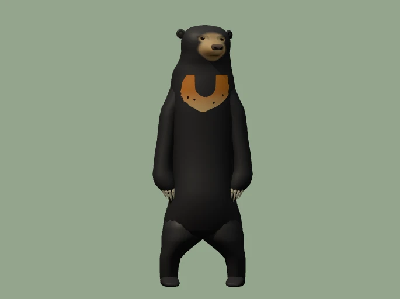
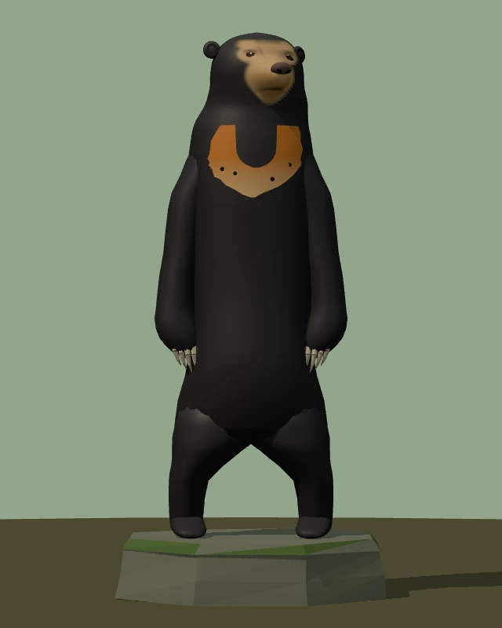
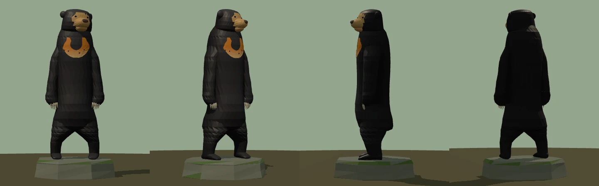
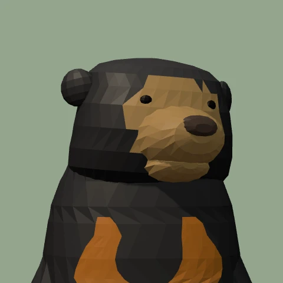
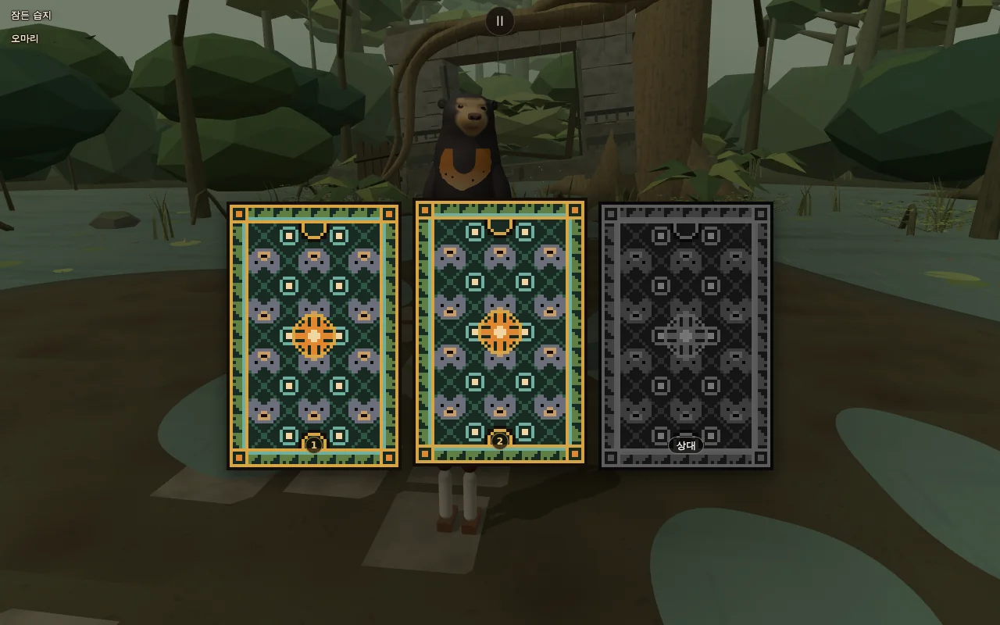
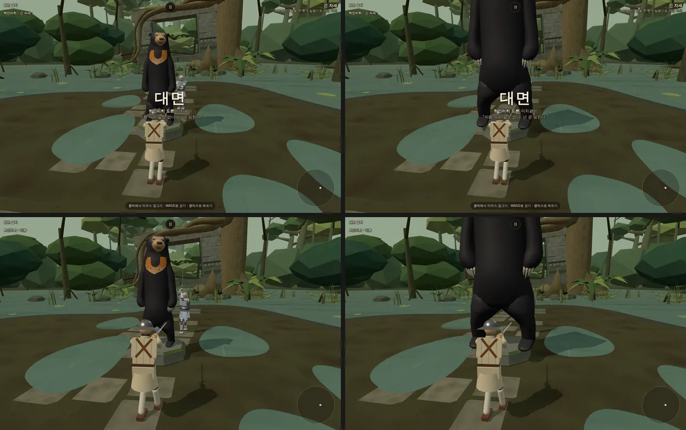
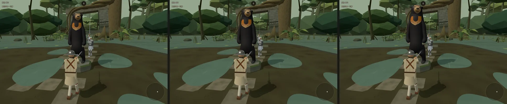

# 잠든 습지(sluice) 이식 — 가운데 말레이곰 석상 다시 조형 · 무대 옮김 · 고칠 점 (2026-10-14)

- 지시: 사장님 10/14 02:3x 결정(진흙 감속 켬 · 곰 석상은 결투장 가운데 충돌 · 곰은 사진과 '완전 똑같이' · 여정 밖) · 03:0x 결정(곰 약 3 m 승인 · 그리기 호출은 적정선까지만 · 나머지 디자인 결정 승인) + 감독 디자인 리뷰 고칠 점 A~O.
- 앞선 리뷰: `docs/import/saetbyeol_review3_2026-10-14.md` §0·§2·§5·§6 (샛별 af089dbb 기준 — 그 뒤 샛별이 ed736cf5 에서 곰을 회색 돌로 한 번 더 고쳤다).
- 출처: 샛별 저장소 origin/main 325a5c38 의 `src/stage_sluice.js` · `src/stage_sluice_bear.js` · `src/wetland_ground.js` · `src/arena_obstacle.js` 와 `fighter.js`·`gait.js`·`ai.js`·`main.js` 의 해당 줄을 옮겨 고침. 샛별 쪽은 `git archive` 로 꺼낸 사본만 읽었다.
- 가지: …/sluice-stage (본판 37fd2e3 에서). 새 값은 모두 `docs/strike/owner_defaults_table.md` 1110~ 행(사장님 확인 전).

## 1. 말레이곰 석상 (1단계)

*모두 게임 모델(`src/stage_sluice_bear.js`)을 무대와 같은 빛(반구광 1.23 · 해 1.42, 곰 오른쪽 앞 위)으로 찍은 렌더다(`node tools/browser/sluice_bear_shots.mjs <개발 서버>`). 사진 파일·사진에서 뜬 질감·사진이 들어간 그림은 저장소에 없다.*

### 1-1. 무엇을 했나
- 샛별 판(5.8 m, 회색 돌·부조 U, ed736cf5)의 짓는 틀(재질별 합치기·충돌체 꼴 내보내기)만 이어받고 **몸은 사진을 재어 새로 깎았다**. 고리를 쌓은 머리·목·몸통 한 덩이 + 다리·팔(앞발까지 한 고리)·발 + 넓적한 주둥이·큰 코·다문 입선·작은 눈·컵 귀 + 얼굴 무늬·가슴 말굽(겉면에 붙인 얇은 칠 조각) + 발톱 열 + 이끼 낀 팔각 받침.
- 사진은 정면 하나라서 정면 폭·무늬·얼굴은 사진에서 쟀고, 옆모습(주둥이 길이·목 앞 숙임·가슴 두께·배·엉덩이)은 말레이곰 해부 상식으로 채운 **추정**이다.
- **1b (감독 검수 10/14, a25f41e 뒤)** — 윤곽·비율은 그대로 두고 얼굴·표면을 고쳤다:
  1. 머리: 네모 통(두건) → 둥근 정수리·볼이 넓은 머리. 머리·목·몸통을 **고리 하나**로 이어 목 이음매를 없앴다(굵은 목이 비스듬한 어깨로 흘러내림). 머리 폭 0.174~0.185 — 어깨(0.30)보다 확실히 좁다.
  2. 얼굴 황갈색: 한쪽으로 쏠린 무늬 → **좌우 대칭**. 주둥이·턱 전체 황갈, 두 눈 둘레와 눈 위 눈썹 자리 옅은 황갈(위 가장자리가 두 눈썹 쪽으로 솟은 M 꼴), 이마 가운데·머리 옆 검정. 머리 겉면에 붙인 얇은 칠 조각이라 테두리가 또렷하다. 고개는 곰 왼쪽으로 7°·갸웃 2°만(사진의 24° 돌림은 저폴리에서 무늬가 비뚤어 보여 줄였다).
  3. 주둥이: 작은 상자 → 짧지만 넓적한 주둥이(폭 0.1) + 큰 짙은 회갈색 코(폭 0.042) + 다문 채 양 끝이 살짝 처진 입선. 눈은 작고 주둥이 쪽 가까이(두 눈 사이 0.072).
  4. 귀: 머리 옆 공(미키 귀) → 정수리 양옆 위의 작고 납작한 컵(앞면 가운데 어둡게).
  5. 가슴 말굽: 사진 6 배 확대에서 윤곽을 다시 따랐다 — 두 팔 위 가장자리는 어깨선(t 0.19)에서 가로로 곧고 굵게(0.04), 바깥선은 아래로 벌어져 t 0.24 에서 가장 넓고(0.18), 목 아래 검은 반원이 t 0.278 까지 둥글게, 아래 가장자리는 넓은 곡선(조금 울퉁불퉁)으로 t 0.332 에서 모인다. 위 짙은 주황 → 아래 크림, 검은 점 넷은 아래쪽.
  6. 어깨·몸통: 각진 어깨 → 목에서 팔로 비스듬히 흘러내리는 어깨, 엉덩이(0.31)가 몸통에서 가장 넓다.
  7. 팔 끝: 소매처럼 벌어지는 손목 → 굵은 아래팔이 잘록해지지 않고 **앞발 덩어리**로 이어져 안쪽·앞으로 꺾이고(가운데 0.151 → 0.125), 그 끝 안쪽에서 길고 휜 발톱 다섯(길이 0.05 — 사진에 보이는 발톱 0.045~0.06)이 아래로 휜다.
  8. 표면: 엇갈린 삼각 면(구겨진 은박지처럼 보임) → 띠 모양 고리 + **부드러운 법선**. 짧고 윤기 나는 털로 읽힌다(순검정 아님 — 숯빛 + 하늘 쪽 윤기 굽기 + 팔·몸 사이 그늘 + 해 반사).
- **1c (감독 검수 · 사장님 10/14 03:5x '곰 조각은 특히 눈과 눈 주위가 중요해. 거길 정밀 재현해야 표정이 같아져')** — 얼굴을 다시 깎았다:
  1. 눈·눈 둘레(가장 먼저): 작은 **아몬드꼴**(폭 0.0215 · 높이 0.0124, 바깥 눈꼬리 0.0036 처짐 + 0.12 rad 기울임 — 순하고 조금 시름겨운 인상), 얇은 짙은 테 · 짙은 갈색 눈동자 · 아주 작은 반사점(위 안쪽). 눈자리를 얕게 파고(0.0042) 위 눈두덩을 살짝 내밀어(0.0048) 눈 위에 그늘, 위 눈꺼풀 아래는 조금 어둡게. 두 눈 사이 0.078·눈 t 0.052~0.053 — 감독 측정 두 눈 (350, 66)·(383, 65) 과 모델 (347, 66)·(380, 67) [사진 픽셀].
  2. 눈 둘레 무늬: 두 눈을 감싸는 옅은 황갈 '안경'이 콧등(위로 갈수록 넓어짐)으로 이어져 주둥이와 한 판, 눈 위 옅은 눈썹 자리 둘이 이마 검정으로 부드럽게 녹아든다.
  3. 주둥이: 따로 얹은 공·턱 덩어리 → **머리 고리에서 앞으로 밀어 낸 한 덩어리**(짧은 원뿔꼴, 끝까지 0.058, 아래턱까지 이어지며 턱 쪽은 좁고 덜 나옴). 머리·목·몸통이 고리 하나(앞쪽 72 꼭짓점 — 얼굴 앞에 촘촘)라 이음매가 없다.
  4. 황갈색: 단색 원판 → **꼭짓점 색 그러데이션**(주둥이 끝이 가장 밝은 황갈 → 옆은 황갈 → 콧등·눈 둘레·눈썹 자리는 옅게 → 이마 검정). 날카로운 테두리 없음.
  5. 입: 주둥이 아래쪽의 얕은 홈 + 조금 어두운 선(양 끝 살짝 처짐) — 턱 덩어리 경계의 굵은 선 없앰. 큰 코(폭 0.043, 짙은 회갈색, 윗면 조금 밝게)에 콧구멍 둘.
  6. 고개: 사진처럼 곰 왼쪽으로 돌림(0.36 rad) — 코가 두 눈 가운데보다 사진 픽셀로 약 9 px 오른쪽(감독 측정 9 px). 머리 고리는 몸 가운데보다 키의 0.012 오른쪽(사진 그대로). 갸웃은 0.02 rad 만.
  7. 가슴 파임: 깊고 좁은 V → 넓고 둥근 **U**(폭 0.08, 곧은 옆 뒤 반원 — 무늬 높이의 약 60 % 인 t 0.275 까지만). 아래쪽은 크림빛으로 그러데이션, 바깥 테두리는 살짝 불규칙.
- **1d (감독 검수)** — 눈 둘레 표정을 사진에 더 붙였다:
  1. 황갈 판을 좁힘: 주둥이 + 두 눈 바로 둘레('안경' 가운데 x 0.036 · 반지름 0.0175) + 눈 위 이마 아래쪽(눈썹 자리 (0.034, 0.047))에 모으고, 눈 바깥 볼·관자놀이(|x| 0.051 ~ 0.067 에서 부드럽게)는 검정. 머리통도 고개를 따라 비틀어(목에서 0) 돌아간 쪽 볼의 검정이 가장자리에 남게 했다.
  2. 눈 1.3 배(폭 0.028 · 높이 0.0185, 머리 폭의 약 15 %) · 윗눈꺼풀 짙은 선(테를 위로 올려 굵게) + 눈 위 그늘 · 갈색 눈동자 가운데 짙은 동공 · 반사점은 그대로 작게.
  3. 주둥이 15 % 짧고(끝까지 0.049) 넓적하게(반폭 0.057 → 턱 0.04, 윗입술 자리가 넓다) · 코는 공 대신 **넓고 납작한 코**(폭 0.047, 위가 평평한 둥근 네모 단면, 콧구멍 둘 또렷).
- 웃는 입선 없음(다문 무표정).

### 1-2. 사진에서 잰 비율 ↔ 모델 (정수리 ~ 발바닥 = 1, 위에서부터 t · 폭은 몸 가운데 기준 x, + = 사진 오른쪽 = 곰 왼쪽)
사진은 685×512, 곰 정수리 y 43 · 발바닥 y 492(449 px), 몸 가운데 x 347 로 잡았다. 모델 값은 같은 구도의 직교 렌더(`bear_ortho.webp`)와 모델 수치에서 읽었다.

| 부위 | 감독 메모 | 사진(이번에 잼) | 모델 |
|---|---|---|---|
| 정수리 · 귀 | 귀 끝 0.00 | 정수리 0.000, 귀는 정수리 양옆 아래(가운데 t 0.042 · 0.051, x −0.085 · +0.109 — 고개가 돌아가 있음) | 정수리 0.000 · 귀 (−0.077, 0.037) · (+0.095, 0.041) |
| 눈 | 0.06 | (0.007, 0.051) · (0.085, 0.055) — 감독 측정 사진 픽셀 (350, 66) · (383, 65) | (0.001, 0.052) · (0.074, 0.053) = 사진 픽셀 (347, 66) · (380, 67) (1c) |
| 코끝(코 가운데) | 0.09 | (0.065, 0.085), 코 폭 0.039 · 감독 측정 (376, 81) | (0.059, 0.086) = (374, 82), 폭 0.043 |
| 턱 | 0.14 | 0.147 | 약 0.15 |
| 머리 폭 | 귀 빼고 0.18 · 귀 포함 0.20 | 정수리 높이 0.165 · 뺨 높이 0.21(목털 포함) · 귀 포함 0.227 | 눈 높이 0.174 · t 0.1 에서 0.185 (어깨보다 확실히 좁게 — 1b) |
| 어깨 | 0.21, 너비 0.30 | t 0.24 너비 0.244 → t 0.32 0.316(비탈진 어깨) | 0.247 → 0.314 |
| 팔 굵기 · 발톱 끝 | 0.07 · 0.66 | 0.071 · 0.661(오른발)~0.677(왼발), 보이는 발톱 길이 0.045~0.06 | 0.074~0.1 · 약 0.67, 발톱 0.05 |
| 팔꿈치 ~ 앞발 바깥 | — | t 0.44 0.35 · t 0.57 0.378 | 0.35 · 0.381 |
| 가슴 말굽 | 위 0.19 · 아래 0.34 · 너비 0.18 · 파인 곳 0.28 | 위 0.19 · 아래 0.332 · 너비 0.18 · 파인 곳 0.278 · 무늬 가운데 +0.009 · 점 넷 (6 배 확대에서 윤곽을 따라 잼) | 같은 표(16 줄)로 깎음 |
| 배(아랫배, 앞발 사이) | 0.25~0.27 | 0.24 | 0.24 |
| 엉덩이 | — | t 0.80 너비 0.306 | 0.31 |
| 가랑이 | 0.79 | 아치 꼭대기 0.817~0.825 (t 0.83 ±0.01 · 0.86 ±0.055 · 0.89 ±0.09) | 0.817 (0.83 ±0.021 · 0.86 ±0.057 · 0.89 ±0.086) |
| 무릎 · 다리 | 0.88, 살짝 O자 | 바깥선 t 0.88~0.91 에서 0.163~0.166 로 불룩 | 0.89 · 0.163~0.165 |
| 두 발 | 가운데 사이 0.21 | 가운데 사이 **0.258** (안쪽 틈 0.20 · 바깥 0.32) | 0.258 · 0.18~0.2 · 0.31 |

- 감독 메모와 다른 곳: 두 발 '가운데 사이 0.21' 은 사진에서 두 발 **안쪽 틈**(0.20)과 맞고 발 가운데 사이는 0.258 이라 사진 값을 따랐다. 가랑이도 사진 아치 꼭대기 0.817~0.825 를 따랐다(0.79 는 허벅지가 갈라져 보이기 시작하는 높이).
- 윤곽 겹침(자기 확인용, 저장소 밖): 렌더 윤곽선을 사진 위에 겹치면 머리·팔·앞발·다리·가랑이 아치가 대부분 키의 1 % 안에서 맞는다. 사진 왼팔(사진 왼쪽)은 t 0.39~0.48 에서 오른팔보다 0.01 더 벌어져 있고 모델은 좌우 같다.

### 1-3. 색·재질 (디자인 결정 A — 확인표 1111)
- 사진 색 그대로 칠한 석상: 윤기 검정 몸 · 주황금 가슴 말굽(위 짙게 → 아래 끝 크림빛) · 황갈색 주둥이·턱 · 옅은 황갈 눈 둘레·눈썹 자리 · 짙은 회갈색 큰 코 · 회백 발톱. 이끼 낀 낮은 팔각 돌 받침(높이 0.35 m)이 석상임을 보인다.
- 색은 `BEAR_COLORS` 상수 한 곳에 모았다 — 돌 회색판이 필요하면 값만 바꾸면 된다(스위치는 두지 않았다).
- 곰은 부드러운 법선(1b — 짧고 윤기 나는 털) · 거칠기 0.5(해에 은은한 반사) · 털 윤기는 꼭짓점 색에 구웠다. 받침 돌만 평면 음영(우리 무대 결).

### 1-4. 크기 (디자인 결정 B — 확인표 1110)
- 기본 3.0 m(정수리 ~ 발바닥, 받침까지 3.35 m) — 사장님 10/14 03:0x 승인. 경기 화면 확인과 5.8 m 비교는 §3.

### 1-5. 한계·추정
- 옆모습 전체가 추정이다(사진 정면 하나). 털결·눈 둘레 진한 황갈·발가락 마디 같은 잔 무늬는 뺐다.
- 1b 에서 고개를 7° 로 줄였다가 1c 에서 감독 측정(코가 두 눈 가운데보다 9 px 오른쪽)에 맞춰 0.36 rad(21°)로 되돌렸다. 얼굴 무늬는 머리 좌표에서 좌우 대칭이고 고개와 함께 돈다(1a 처럼 사진 정면 테두리를 그대로 칠하지 않는다).
- 머리통(고리)은 돌리지 않고 얼굴 쪽 깎기·칠·조각만 돌린다 — 둥근 머리라 티가 나지 않지만, 정수리 위에서 내려다보면 얼굴이 머리통보다 조금 더 돈다.
- 삼각형 12,644(곰 12,564 + 받침 80) — 얼굴을 깎으려고 머리·몸통 고리를 72 꼭짓점으로 촘촘히 했다(1b 7,844). 재질 둘(곰 · 받침) — 그리기 호출 2(그림자 그리기 별도). 받침까지 높이 3.35 m.

## 2. 무대 옮김 (2단계)

### 2-1. 무엇을 옮겼나
- `src/stage_sluice.js` — 샛별 무대 그대로(비 그친 한낮의 열대 담수 침수림: 진흙 섬 결투장 · 둘레 얕은 물 · 옛 돌 수문과 판근 큰 나무 · 고사리·토란잎·사초·수련 · 먼 숲 세 겹 · 앉은 새 하나). 바꾼 것은 가운데 곰을 우리 석상(`buildSluiceBear`)으로 바꾼 것뿐이다. 그림 손질(G~M)은 §4.
- `src/wetland_ground.js` — 진흙 웅덩이 정의 그대로(아래 2-2). 인물 신발의 감속 면제(`terrainTraits`)는 옮기지 않았다(디자인 결정 E).
- `src/arena_obstacle.js` — 석상 충돌체 · AI 돌아가기 · 카메라 보호를 우리 석상 꼴(받침 원기둥 + 캡슐 6)과 반지름 0.90 m 에 맞춰 옮겼다. 시작 자리 옆 비킴(`stageStartZ`)을 새로 더했다.
- `src/stages.js` — `BUILDERS.sluice` · 이름 `STAGE_NAME_KO.sluice = '잠든 습지'`. **`STAGE_ORDER`·`STAGE_FOE` 에는 넣지 않았다**(여정 밖 — 2-3).
- `src/main.js` — 판마다 석상 충돌체 만들기·지우기, 진흙 배율 켜기, 시작 자리 옆 비킴, 카메라 두 곳 자르기, 바닥 콜라이더 알리기, 진흙 알림 한 줄, 카드 뒷면 바탕색. `game.arenaObstacle`(시험 도구용) · `game.setStage` 가 석상·진흙도 지금 세계에 맞춘다.
- `src/fighter.js`(진흙 배율 한 줄 + 시작 z) · `src/ai.js`(update 끝에 돌아가기) · `src/gait.js`(바닥만 받침 — 2-2) · `tools/sim/jelly_harness.mjs`(바닥 알리기 한 줄).
- 소리 · 카드 뒷면 · 테스트 경로 무대 고르기(2-3 ~ 2-5).

### 2-2. 물리 규칙 (사장님 10/14 02:3x — 진흙 감속 켬 · 석상은 가운데 충돌)
- **진흙** (확인표 1116): 웅덩이 다섯(타원, 그림 윤곽과 판정이 같은 정의 `WETLAND_PUDDLES`) — 넓이 약 24.7 m², 결투장(반지름 6.5 m)의 **약 19 %**. 가장자리 0.3 m 에서 부드럽게, 한가운데서 **자발 이동 × 0.4**(조종 입력·기술 내딛기만). 균형 잡는 걸음·중력·공격·물리 시간은 그대로. 골반 수평 자리로 판정. **양쪽 모두** 느려진다(라트나 신발 면제는 안 옮김). 다른 무대는 배율이 정확히 1 이라 값이 비트 단위로 같다.
  - 진흙 알림: 샛별은 아래 가운데 새 칸에 '진흙 · 발이 느려집니다' 를 밟는 동안 내내 띄웠다. 우리는 아래 가운데에 안내·알림 줄이 이미 있어(`docs/ui/hud_type_system_2026-10-10.md`) **알림 줄(E)에 판마다 처음 밟을 때 한 번**(2 초)만 띄운다. 확인: 시작 뒤 오른쪽으로 걸어 2.5 초 만에 셋째 웅덩이에 들어서자 알림이 떴다.
- **석상 충돌체** (확인표 1115): 고정 몸체 하나에 받침 원기둥 + 캡슐 6, 몸·칼을 막는다(땅처럼 — 피해 특례·오르기·부수기 없음, `colliderInfo` 에 안 넣음). 판(물리 세계)마다 새로 만들고, 무대를 바꾸면 지운다.
- **AI 돌아가기** (확인표 1117 — 샛별 값 그대로, 반지름만 0.90): 상대에게 가는 길이 석상 반지름 + 0.5 m 안을 지나면 지금 각에서 0.58 rad 앞 · 반지름 + 0.5 + 0.75 m 자리로 **스틱 방향만** 돌린다(세기·멈춘 공격·물러남 그대로). 플레이어는 손대지 않는다.
- **카메라 보호** (확인표 1118 — 샛별 값 그대로): 카메라 목표와 실제 자리를 석상 반지름 + 0.28 m 원 밖으로 자른다(석상을 뚫거나 안으로 들어가지 않게).
- **시작 자리 옆 비킴** (디자인 결정 D, 확인표 1121): 석상은 정확히 가운데(0, 0), 두 사람을 +z 로 **0.45 m** 옮겼다. 판 시작 카메라(열림 1 · 0.5 · 0)에서 상대 머리·가슴(가운데·좌우 0.2 m)·골반·무릎까지 광선이 석상(곰 + 받침 그림)에 하나도 안 닿는 가장 작은 값(0.05 m 간격으로 잼). 다른 무대는 0.
- **발 체중 받침** (디자인 결정 F, 확인표 1120): 우리 `gait.js groundForce` 는 발이 고정 몸체에 닿은 접촉 충격을 방향 없이 모두 '바닥이 받치는 힘'으로 셌다 — 석상(고정 몸체)에 발이 부딪힌 힘도 체중 받침으로 들어간다. 이제 `setSupportFloor(world, 바닥)` 로 알린 **바닥 콜라이더 접촉만** 센다(main.js `newRound` · 시뮬 `jelly_harness` 가 바닥을 만들 때 알림). 바닥을 알리지 않은 세계는 전처럼 센다. 샛별은 '위 방향 성분만' 세게 고쳤는데, 우리는 바닥 판정이 한 콜라이더라 그 콜라이더만 세는 쪽이 더 단순하고 평평한 바닥에서 값이 정확히 같다. **관문 다섯 모두 바이트 같음**(경계 벽에 발이 닿는 판이 시험 묶음에는 없었다는 뜻이기도 하다).

### 2-3. 여정 밖 · 테스트 경로 · 화면 이름 (확인표 1119)
- `STAGE_ORDER` 에 넣지 않았다(감독 추천 D '여정 밖' — 물리 규칙을 시험하는 동안 여정을 안 건드림). 여는 길은 둘: **테스트 경로 고르기 화면의 새 '무대' 칸**(무작위(여정 무대) — 기본, 지금 그대로 / 잠든 습지(여정 밖) → `stage=sluice` 고정) · 주소 `?stage=sluice`.
- `STAGE_FOE` 에도 없다 → `?stage=sluice` 는 무작위 상대(어두운 홀과 같은 규칙). 라트나 짝은 라트나를 옮길 때(리뷰 단계 4).
- 왼쪽 위 무대 줄: 순서표 밖 무대는 **이름만**('잠든 습지' — `stageLabel` 지금 규칙 그대로, 어두운 홀과 같다). '스테이지 N' 번호가 없으면 여정 밖이라는 표시가 된다.
- 테스트 경로 메뉴 한 줄: '테스트 경로 · 무기 · 인물 · 상대 무작위 · 무대 잠든 습지 · …'. 고른 무대는 비기 판처럼 기억하지 않는다.

### 2-4. 소리 (새 파일 없음)
- 발소리: 우리에게도 있는 `stepMud` (`sound.js STAGE_SOUND.sluice`).
- 세부음 셋(`stage_detail_sound.js`, 절차 합성 — 샛별 값 그대로): 수문 물방울 `sluiceDrip`(샘 물방울 합성을 0.78 배 낮게) · 잎 바스락 `jungleRustle`(1250 Hz 거르개) · 먼 숲새 `jungleBird`(둥근 두 숨). 모두 눈에 보이는 움직임과 같은 때(`stage.onEvent('stageDetail')`) 나고, 바탕은 낮게 흐르는 물 두 겹. 샛별의 `dayr`(다른 무대) 줄은 옮기지 않았다. 새 세부음은 표 끝에 붙여 기존 세부음의 씨앗 번호가 그대로다.

### 2-5. 카드 뒷면 (디자인 결정 N, 확인표 1122)

- 샛별 쪽에 없어 새로 그렸다(`gen_pixel_cardbacks.py sluice()` + `grey_foe.py`, 우리 규칙 그대로: 16×32 바탕 · 20×20 테두리 · 14×14 가운데 · 10×10 배지, 180° 대칭, 색 수 제한). 짙은 늪빛 바탕 `#182a22` 에 이끼빛 마름모 격자, **말레이곰 얼굴**(둥근 귀 · 잿빛 머리 · 황갈 주둥이 · 짙은 눈·코)과 **물방울이 떨어진 둥근 물결**을 번갈아, 띠는 물 위로 솟은 갈대, 가운데는 '해곰'이라는 이름의 **해**(크림 가운데 · 주황 해 · 여덟 햇살). 주황은 해 한 곳만 — 무대에서도 곰 가슴의 주황이 단 하나의 강조색이다.
- 첫 시안(앉은 곰 전신 8×10)은 카드 크기에서 회색 덩어리로만 읽혀 얼굴(10×8)로 바꿨다. 기존 무대 조각은 바이트 그대로.

### 2-6. 확인
- 관문(본판 37fd2e3 값 그대로): fights12 7c95ba21 · live_battery e7ee3d96 · finish_thrust 433ac984 · corr_s0 IDENTICAL 12 · weapon_smoke 21 OK · `vite build`·`npm run build` 0 · 이름 검사 위반 0.
- 브라우저(헤드리스, 콘솔 에러 0): 테스트 경로에서 잠든 습지 고르고 시작 → `stage=sluice` 고정 · 석상 충돌체 7 · 두 사람 z 0.45 · 진흙 켜짐 · 왼쪽 위 '잠든 습지' / `?stage=sluice` 싸움 / `?pixel=1` 도트 모드(곰 얼굴·가슴 말굽이 읽힌다) / 카드 고르기 화면.
- 배경 바꾸기 세 바퀴(청람잔도 → 성 안뜰 → 잠든 습지, `game.setStage`): 같은 무대마다 GPU 모양·질감·셰이더 수가 같다(잠든 습지 153/10/35 · 청람잔도 155/9/34 · 성 안뜰 148/10/34), 물리 콜라이더 69 ↔ 76(석상 7 만 붙었다 떨어짐) — 누수 없음.
- 그리기 양(`stage_cost.mjs`, 844×420 경기 카메라, 헤드리스 — 폰 수치 아님, 손질 전): 잠든 습지 **249 호출 · 203,960 삼각형** · 투명 물체 4 / 같은 판 청람잔도 250 · 138,695 · 신목의 숲 205 · 156,640 · 성 안뜰 230 · 72,653. 줄인 뒤 값은 §4.

## 3. 크기와 판 시작 (디자인 결정 B · D)

- 경기 화면(1280×800, 상대 하인리히, 플레이어 가만히)에서 `BEAR_HEIGHT` 상수 하나만 바꿔 찍었다. **3.0 m 그대로**(사장님 승인 '약 3 m', ±0.2 m 안에서 다듬어도 된다 하셨지만 안 바꿈):
  - 2.8 · 3.0 · 3.2 모두 보통 싸움 거리에서 머리·가슴이 화면에 든다. 3.2 는 상대가 돌아 들어오는 6 초 무렵 귀가 화면 위 가장자리에 닿고, 2.8 은 석상의 무게가 줄어 3.0 이 가장 알맞다.
  - 5.8 m(샛별 판 키)는 보통 싸움 거리에서 다리·앞발만 보이고 머리·가슴 말굽이 화면 밖이며, 판 시작과 2.5 초에 상대가 곰 다리 뒤에 가려진다.
- **첫 접근 시간**(플레이어 가만히, 상대만 걸어 와 가슴 사이 2 m 까지의 게임 시간 — 2 초 정지 포함, 롱소드, 상대 셋):

| | 하인리히 | 브란 | 오마리 |
|---|---:|---:|---:|
| 석상 없는 무대(청람잔도, 같은 판) | 6.88 초 | 7.28 | 8.53 |
| 석상 가운데 · 옆 비킴 없음(0 m) | 11.97 | 9.57 | 9.68 |
| 석상 가운데 · **옆 비킴 0.45 m(이번)** | **9.92** | **8.63** | **9.13** |

  - 비킴으로 0.5~2.0 초 줄었고, 석상 없는 무대보다 0.6~3.0 초 길다(돌아오는 길). 샛별 판(5.8 m · 회피 반지름 1.35 m, 라트나)은 같은 잼으로 11.0 초였다. AI 난수가 있어 판마다 조금씩 다르다.
