# 잠든 습지(sluice) 이식 — 가운데 말레이곰 석상 다시 조형 · 무대 옮김 · 고칠 점 (2026-10-14)

- 지시: 사장님 10/14 02:3x 결정(진흙 감속 켬 · 곰 석상은 결투장 가운데 충돌 · 곰은 사진과 '완전 똑같이' · 여정 밖) · 03:0x 결정(곰 약 3 m 승인 · 그리기 호출은 적정선까지만 · 나머지 디자인 결정 승인) + 감독 디자인 리뷰 고칠 점 A~O.
- 앞선 리뷰: `docs/import/saetbyeol_review3_2026-10-14.md` §0·§2·§5·§6 (샛별 af089dbb 기준 — 그 뒤 샛별이 ed736cf5 에서 곰을 회색 돌로 한 번 더 고쳤다).
- 출처: 샛별 저장소 origin/main 325a5c38 의 `src/stage_sluice.js` · `src/stage_sluice_bear.js` · `src/wetland_ground.js` · `src/arena_obstacle.js` 와 `fighter.js`·`gait.js`·`ai.js`·`main.js` 의 해당 줄을 옮겨 고침. 샛별 쪽은 `git archive` 로 꺼낸 사본만 읽었다.
- 가지: …/sluice-stage (본판 37fd2e3 에서). 새 값은 모두 `docs/strike/owner_defaults_table.md` **1110~1130** 행(사장님 확인 전).
- 커밋: 1단계 곰 a25f41e → 감독 검수 1b 880b54c · 1c 173f8a7 · 1d 189aebe / 2단계 무대 옮김 22cefe2 / 곰 1e be7fc01 / 3단계 그림 손질 845b4b3 / 4단계 이 기록. push 하지 않았다.
- **곰 2 — 돌 석상 · 키 3.2 m (10/14 08:3x · 10:3x 사장님, …/bear-stone)**: 정수리 꺼짐 · 회색조 두 톤 돌 · 음각·양각 · 오래된 석상 · 키 3.2 m · 시작 옆 비킴 0.50 m — §6, 확인표 **1240~1252**. 아래 §1~§5 는 1e(칠한 석상, 3.0 m) 때 기록 그대로다.

| 디자인 결정 | 한 일 | 어디 |
|---|---|---|
| A 칠한 석상 + 이끼 낀 받침 → **곰 2: 오래된 돌 석상** | ~~윤기 검정 몸 · 주황금 가슴 말굽 · 황갈 주둥이~~ → 회색조 두 톤 돌(짙은 돌 · 밝은 돌) · 가슴 말굽 양각 · 얼굴 무늬 얕은 단 · 끌 자국 · 때·바램·이끼·깨짐 (사장님 10/14 08:3x) · 0.35 m 팔각 받침 | §1-3 · §6 |
| B 크기 | 3.0 m(경기 화면 2.8·3.0·3.2·5.8 비교) → **3.2 m** (사장님 10/14 10:3x) | §3 · §6-6 |
| C 충돌체 · AI 돌아가기 | 받침 원기둥 + 캡슐 6, 스틱 방향만 둘레로, 반지름 0.90 | §2-2 |
| D 가운데 + 시작 옆 비킴 | 석상 (0, 0) · 두 사람 +z 0.45 m → **0.50 m**(곰 3.2 m 에서 같은 잣대로 다시 잼) · 첫 접근 시간 전/후 | §2-2 · §3 · §6-6 |
| E 진흙 | 샛별 값 그대로, 양쪽 모두, 알림 줄 한 번 | §2-2 |
| F 발 받침 | 바닥 콜라이더만 · 관문 바이트 같음 | §2-2 |
| G~M 그림 | 웅덩이 · 디딤돌 · 수문 자리 · 빛줄기 · 숲 · 그리기 · 도트 모드 | §4 |
| N 카드 뒷면 | px_sluice_* + 회색 + PX_BACKS | §2-5 |
| O 이름 · 무대 줄 | '잠든 습지' · `sluice` · 여정 밖이라 번호 없이 이름만 | §2-3 |

## 1. 말레이곰 석상 (1단계)

*모두 게임 모델(`src/stage_sluice_bear.js`)을 무대와 같은 빛(반구광 1.23 · 해 1.42, 곰 오른쪽 앞 위)으로 찍은 렌더다(`node tools/browser/sluice_bear_shots.mjs <개발 서버>`). 사진 파일·사진에서 뜬 질감·사진이 들어간 그림은 저장소에 없다.*

### 1-1. 무엇을 했나
- 샛별 판(5.8 m, 회색 돌·부조 U, ed736cf5)의 짓는 틀(재질별 합치기·충돌체 꼴 내보내기)만 이어받고 **몸은 사진을 재어 새로 깎았다**. 고리를 쌓은 머리·목·몸통 한 덩이 + 다리·팔(앞발까지 한 고리)·발 + 넓적한 주둥이·큰 코·다문 입선·작은 눈·컵 귀 + 얼굴 무늬·가슴 말굽(겉면에 붙인 얇은 칠 조각) + 발톱 열 + 이끼 낀 팔각 받침.
- 사진은 정면 하나라서 정면 폭·무늬·얼굴은 사진에서 쟀고, 옆모습(주둥이 길이·목 앞 숙임·가슴 두께·배·엉덩이)은 말레이곰 해부 상식으로 채운 **추정**이다.
- **1b (감독 검수 10/14, a25f41e 뒤)** — 윤곽·비율은 그대로 두고 얼굴·표면을 고쳤다:
  1. 머리: 네모 통(두건) → 둥근 정수리·볼이 넓은 머리. 머리·목·몸통을 **고리 하나**로 이어 목 이음매를 없앴다(굵은 목이 비스듬한 어깨로 흘러내림). 머리 폭 0.174~0.185 — 어깨(0.30)보다 확실히 좁다.
  2. 얼굴 황갈색: 한쪽으로 쏠린 무늬 → **좌우 대칭**. 주둥이·턱 전체 황갈, 두 눈 둘레와 눈 위 눈썹 자리 옅은 황갈(위 가장자리가 두 눈썹 쪽으로 솟은 M 꼴), 이마 가운데·머리 옆 검정. 머리 겉면에 붙인 얇은 칠 조각이라 테두리가 또렷하다. 고개는 곰 왼쪽으로 7°·갸웃 2°만(사진의 24° 돌림은 저폴리에서 무늬가 비뚤어 보여 줄였다).
  3. 주둥이: 작은 상자 → 짧지만 넓적한 주둥이(폭 0.1) + 큰 짙은 회갈색 코(폭 0.042) + 다문 채 양 끝이 살짝 처진 입선. 눈은 작고 주둥이 쪽 가까이(두 눈 사이 0.072).
  4. 귀: 머리 옆 공(미키 귀) → 정수리 양옆 위의 작고 납작한 컵(앞면 가운데 어둡게).
  5. 가슴 말굽: 사진 6 배 확대에서 윤곽을 다시 따랐다 — 두 팔 위 가장자리는 어깨선(t 0.19)에서 가로로 곧고 굵게(0.04), 바깥선은 아래로 벌어져 t 0.24 에서 가장 넓고(0.18), 목 아래 검은 반원이 t 0.278 까지 둥글게, 아래 가장자리는 넓은 곡선(조금 울퉁불퉁)으로 t 0.332 에서 모인다. 위 짙은 주황 → 아래 크림, 검은 점 넷은 아래쪽.
  6. 어깨·몸통: 각진 어깨 → 목에서 팔로 비스듬히 흘러내리는 어깨, 엉덩이(0.31)가 몸통에서 가장 넓다.
  7. 팔 끝: 소매처럼 벌어지는 손목 → 굵은 아래팔이 잘록해지지 않고 **앞발 덩어리**로 이어져 안쪽·앞으로 꺾이고(가운데 0.151 → 0.125), 그 끝 안쪽에서 길고 휜 발톱 다섯(길이 0.05 — 사진에 보이는 발톱 0.045~0.06)이 아래로 휜다.
  8. 표면: 엇갈린 삼각 면(구겨진 은박지처럼 보임) → 띠 모양 고리 + **부드러운 법선**. 짧고 윤기 나는 털로 읽힌다(순검정 아님 — 숯빛 + 하늘 쪽 윤기 굽기 + 팔·몸 사이 그늘 + 해 반사).
- **1c (감독 검수 · 사장님 10/14 03:5x '곰 조각은 특히 눈과 눈 주위가 중요해. 거길 정밀 재현해야 표정이 같아져')** — 얼굴을 다시 깎았다:
  1. 눈·눈 둘레(가장 먼저): 작은 **아몬드꼴**(폭 0.0215 · 높이 0.0124, 바깥 눈꼬리 0.0036 처짐 + 0.12 rad 기울임 — 순하고 조금 시름겨운 인상), 얇은 짙은 테 · 짙은 갈색 눈동자 · 아주 작은 반사점(위 안쪽). 눈자리를 얕게 파고(0.0042) 위 눈두덩을 살짝 내밀어(0.0048) 눈 위에 그늘, 위 눈꺼풀 아래는 조금 어둡게. 두 눈 사이 0.078·눈 t 0.052~0.053 — 감독 측정 두 눈 (350, 66)·(383, 65) 과 모델 (347, 66)·(380, 67) [사진 픽셀].
  2. 눈 둘레 무늬: 두 눈을 감싸는 옅은 황갈 '안경'이 콧등(위로 갈수록 넓어짐)으로 이어져 주둥이와 한 판, 눈 위 옅은 눈썹 자리 둘이 이마 검정으로 부드럽게 녹아든다.
  3. 주둥이: 따로 얹은 공·턱 덩어리 → **머리 고리에서 앞으로 밀어 낸 한 덩어리**(짧은 원뿔꼴, 끝까지 0.058, 아래턱까지 이어지며 턱 쪽은 좁고 덜 나옴). 머리·목·몸통이 고리 하나(앞쪽 72 꼭짓점 — 얼굴 앞에 촘촘)라 이음매가 없다.
  4. 황갈색: 단색 원판 → **꼭짓점 색 그러데이션**(주둥이 끝이 가장 밝은 황갈 → 옆은 황갈 → 콧등·눈 둘레·눈썹 자리는 옅게 → 이마 검정). 날카로운 테두리 없음.
  5. 입: 주둥이 아래쪽의 얕은 홈 + 조금 어두운 선(양 끝 살짝 처짐) — 턱 덩어리 경계의 굵은 선 없앰. 큰 코(폭 0.043, 짙은 회갈색, 윗면 조금 밝게)에 콧구멍 둘.
  6. 고개: 사진처럼 곰 왼쪽으로 돌림(0.36 rad) — 코가 두 눈 가운데보다 사진 픽셀로 약 9 px 오른쪽(감독 측정 9 px). 머리 고리는 몸 가운데보다 키의 0.012 오른쪽(사진 그대로). 갸웃은 0.02 rad 만.
  7. 가슴 파임: 깊고 좁은 V → 넓고 둥근 **U**(폭 0.08, 곧은 옆 뒤 반원 — 무늬 높이의 약 60 % 인 t 0.275 까지만). 아래쪽은 크림빛으로 그러데이션, 바깥 테두리는 살짝 불규칙.
- **1d (감독 검수)** — 눈 둘레 표정을 사진에 더 붙였다:
  1. 황갈 판을 좁힘: 주둥이 + 두 눈 바로 둘레('안경' 가운데 x 0.036 · 반지름 0.0175) + 눈 위 이마 아래쪽(눈썹 자리 (0.034, 0.047))에 모으고, 눈 바깥 볼·관자놀이(|x| 0.051 ~ 0.067 에서 부드럽게)는 검정. 머리통도 고개를 따라 비틀어(목에서 0) 돌아간 쪽 볼의 검정이 가장자리에 남게 했다.
  2. 눈 1.3 배(폭 0.028 · 높이 0.0185, 머리 폭의 약 15 %) · 윗눈꺼풀 짙은 선(테를 위로 올려 굵게) + 눈 위 그늘 · 갈색 눈동자 가운데 짙은 동공 · 반사점은 그대로 작게.
  3. 주둥이 15 % 짧고(끝까지 0.049) 넓적하게(반폭 0.057 → 턱 0.04, 윗입술 자리가 넓다) · 코는 공 대신 **넓고 납작한 코**(폭 0.047, 위가 평평한 둥근 네모 단면, 콧구멍 둘 또렷).
- **1e (감독 검수 — 2단계 커밋 뒤)**:
  1. 눈동자: 거의 순검정이라 '구슬 눈'처럼 보였다 → **짙은 갈색 홍채**(`0x5a3a22`, 안쪽은 조금 밝은 `0x6e4a2c`)에 더 짙은 작은 동공(높이의 0.32), 반사점은 더 작게(0.0018). 테의 아랫선을 홍채 아랫선에 맞춰 올려 **윗눈꺼풀 선만** 짙고 아래눈꺼풀 선은 아주 옅은 그늘(0.1)로. 눈 바로 둘레는 옅은 살빛(`0xdcc39c`) 고리, 눈 위 그늘은 0.45 → 0.22 로 줄여 눈이 부드럽다. 눈 높이 0.0185 → 0.0205(사진 눈이 조금 더 둥근 아몬드).
  2. 이마 황갈 위 경계: 이마를 가로지르는 수평 직선(투구 챙처럼 보임) → **콧등 위가 가장 높고(y 0.049 — 사진 t 약 0.031) 바깥 눈썹 쪽으로 둥글게 내려가는 아치**(눈썹 가운데 0.041 · 바깥 눈꼬리 0.027, `BROW_ARCH`), 경계는 ±0.0075 로 부드럽게. 1d 의 직선은 t 0.02 로 사진보다 높았다 — 이마 검정이 사진처럼 넓어졌다.
  3. 턱: 아래턱 길이 20 % 짧게(`SNOUT.down` 0.053 → 0.0424), 입선을 코 쪽으로(y −0.04 → −0.035).
  4. 머리통: 위쪽이 좁은 둥근 지붕 → 관자놀이 쪽을 약 10 % 넓히고 정수리를 평평하게(t 0.02 폭 0.129 → 0.150, 사진 0.156). 귀는 넓어진 정수리 양옆 위 모서리로 조금 위·바깥(±0.092, 0.04 → ±0.098, 0.044).
- 웃는 입선 없음(다문 무표정).

### 1-2. 사진에서 잰 비율 ↔ 모델 (정수리 ~ 발바닥 = 1, 위에서부터 t · 폭은 몸 가운데 기준 x, + = 사진 오른쪽 = 곰 왼쪽)
사진은 685×512, 곰 정수리 y 43 · 발바닥 y 492(449 px), 몸 가운데 x 347 로 잡았다. 모델 값은 같은 구도의 직교 렌더(`bear_ortho.webp`)와 모델 수치에서 읽었다.

| 부위 | 감독 메모 | 사진(이번에 잼) | 모델 |
|---|---|---|---|
| 정수리 · 귀 | 귀 끝 0.00 | 정수리 0.000, 귀는 정수리 양옆 아래(가운데 t 0.042 · 0.051, x −0.085 · +0.109 — 고개가 돌아가 있음) | 정수리 0.000 · 귀 (−0.083, 0.033) · (+0.101, 0.037) (1e — 넓어진 정수리 모서리로 조금 위·바깥) |
| 눈 | 0.06 | (0.007, 0.051) · (0.085, 0.055) — 감독 측정 사진 픽셀 (350, 66) · (383, 65) | (0.001, 0.052) · (0.074, 0.053) = 사진 픽셀 (347, 66) · (380, 67) (1c) |
| 코끝(코 가운데) | 0.09 | (0.065, 0.085), 코 폭 0.039 · 감독 측정 (376, 81) | (0.059, 0.086) = (374, 82), 폭 0.043 |
| 턱 | 0.14 | 0.147 | 약 0.15 |
| 머리 폭 | 귀 빼고 0.18 · 귀 포함 0.20 | 정수리 높이 0.165 · 뺨 높이 0.21(목털 포함) · 귀 포함 0.227 | t 0.02 에서 0.150(1e, 사진 0.156) · 눈 높이 0.184 · t 0.1 에서 0.184 (어깨보다 확실히 좁게 — 1b) |
| 어깨 | 0.21, 너비 0.30 | t 0.24 너비 0.244 → t 0.32 0.316(비탈진 어깨) | 0.247 → 0.314 |
| 팔 굵기 · 발톱 끝 | 0.07 · 0.66 | 0.071 · 0.661(오른발)~0.677(왼발), 보이는 발톱 길이 0.045~0.06 | 0.074~0.1 · 약 0.67, 발톱 0.05 |
| 팔꿈치 ~ 앞발 바깥 | — | t 0.44 0.35 · t 0.57 0.378 | 0.35 · 0.381 |
| 가슴 말굽 | 위 0.19 · 아래 0.34 · 너비 0.18 · 파인 곳 0.28 | 위 0.19 · 아래 0.332 · 너비 0.18 · 파인 곳 0.278 · 무늬 가운데 +0.009 · 점 넷 (6 배 확대에서 윤곽을 따라 잼) | 같은 표(16 줄)로 깎음 |
| 배(아랫배, 앞발 사이) | 0.25~0.27 | 0.24 | 0.24 |
| 엉덩이 | — | t 0.80 너비 0.306 | 0.31 |
| 가랑이 | 0.79 | 아치 꼭대기 0.817~0.825 (t 0.83 ±0.01 · 0.86 ±0.055 · 0.89 ±0.09) | 0.817 (0.83 ±0.021 · 0.86 ±0.057 · 0.89 ±0.086) |
| 무릎 · 다리 | 0.88, 살짝 O자 | 바깥선 t 0.88~0.91 에서 0.163~0.166 로 불룩 | 0.89 · 0.163~0.165 |
| 두 발 | 가운데 사이 0.21 | 가운데 사이 **0.258** (안쪽 틈 0.20 · 바깥 0.32) | 0.258 · 0.18~0.2 · 0.31 |

- 감독 메모와 다른 곳: 두 발 '가운데 사이 0.21' 은 사진에서 두 발 **안쪽 틈**(0.20)과 맞고 발 가운데 사이는 0.258 이라 사진 값을 따랐다. 가랑이도 사진 아치 꼭대기 0.817~0.825 를 따랐다(0.79 는 허벅지가 갈라져 보이기 시작하는 높이).
- 윤곽 겹침(자기 확인용, 저장소 밖): 렌더 윤곽선을 사진 위에 겹치면 머리·팔·앞발·다리·가랑이 아치가 대부분 키의 1 % 안에서 맞는다. 사진 왼팔(사진 왼쪽)은 t 0.39~0.48 에서 오른팔보다 0.01 더 벌어져 있고 모델은 좌우 같다.

### 1-3. 색·재질 (디자인 결정 A — 확인표 1111)
- **곰 2(10/14 08:3x)에서 바뀜**: 칠한 색을 걷고 회색조 두 톤 돌로 — §6-3, 확인표 1241. 아래는 1e 까지의 기록이다.
- 사진 색 그대로 칠한 석상: 윤기 검정 몸 · 주황금 가슴 말굽(위 짙게 → 아래 끝 크림빛) · 황갈색 주둥이·턱 · 옅은 황갈 눈 둘레·눈썹 자리 · 짙은 회갈색 큰 코 · 회백 발톱. 이끼 낀 낮은 팔각 돌 받침(높이 0.35 m)이 석상임을 보인다.
- 색은 `BEAR_COLORS` 상수 한 곳에 모았다 — 돌 회색판이 필요하면 값만 바꾸면 된다(스위치는 두지 않았다).
- 곰은 부드러운 법선(1b — 짧고 윤기 나는 털) · 거칠기 0.5(해에 은은한 반사) · 털 윤기는 꼭짓점 색에 구웠다. 받침 돌만 평면 음영(우리 무대 결).

### 1-4. 크기 (디자인 결정 B — 확인표 1110)
- 기본 3.0 m(정수리 ~ 발바닥, 받침까지 3.35 m) — 사장님 10/14 03:0x 승인. 경기 화면 확인과 5.8 m 비교는 §3.
- **사장님 10/14 10:3x '곰 석상은 3.2m로 넣어' → 3.2 m**(받침까지 3.55 m) — §6-6, 확인표 1250.

### 1-5. 한계·추정
- 옆모습 전체가 추정이다(사진 정면 하나). 털결·눈 둘레 진한 황갈·발가락 마디 같은 잔 무늬는 뺐다.
- 1b 에서 고개를 7° 로 줄였다가 1c 에서 감독 측정(코가 두 눈 가운데보다 9 px 오른쪽)에 맞춰 0.36 rad(21°)로 되돌렸다. 얼굴 무늬는 머리 좌표에서 좌우 대칭이고 고개와 함께 돈다(1a 처럼 사진 정면 테두리를 그대로 칠하지 않는다).
- 머리통(고리)도 1d 부터 고개 돌림만큼 비틀어(목에서 0) 얼굴과 함께 돈다.
- 삼각형 12,676(곰 12,596 + 받침 80, 1e — 홍채 안쪽 원판 둘이 늘었다) — 얼굴을 깎으려고 머리·몸통 고리를 72 꼭짓점으로 촘촘히 했다(1b 7,844). 재질 둘(곰 · 받침) — 그리기 호출 2(그림자 그리기 별도). 받침까지 높이 3.35 m.

## 2. 무대 옮김 (2단계)

### 2-1. 무엇을 옮겼나
- `src/stage_sluice.js` — 샛별 무대 그대로(비 그친 한낮의 열대 담수 침수림: 진흙 섬 결투장 · 둘레 얕은 물 · 옛 돌 수문과 판근 큰 나무 · 고사리·토란잎·사초·수련 · 먼 숲 세 겹 · 앉은 새 하나). 바꾼 것은 가운데 곰을 우리 석상(`buildSluiceBear`)으로 바꾼 것뿐이다. 그림 손질(G~M)은 §4.
- `src/wetland_ground.js` — 진흙 웅덩이 정의 그대로(아래 2-2). 인물 신발의 감속 면제(`terrainTraits`)는 옮기지 않았다(디자인 결정 E).
- `src/arena_obstacle.js` — 석상 충돌체 · AI 돌아가기 · 카메라 보호를 우리 석상 꼴(받침 원기둥 + 캡슐 6)과 반지름 0.90 m 에 맞춰 옮겼다. 시작 자리 옆 비킴(`stageStartZ`)을 새로 더했다.
- `src/stages.js` — `BUILDERS.sluice` · 이름 `STAGE_NAME_KO.sluice = '잠든 습지'`. **`STAGE_ORDER`·`STAGE_FOE` 에는 넣지 않았다**(여정 밖 — 2-3).
- `src/main.js` — 판마다 석상 충돌체 만들기·지우기, 진흙 배율 켜기, 시작 자리 옆 비킴, 카메라 두 곳 자르기, 바닥 콜라이더 알리기, 진흙 알림 한 줄, 카드 뒷면 바탕색. `game.arenaObstacle`(시험 도구용) · `game.setStage` 가 석상·진흙도 지금 세계에 맞춘다.
- `src/fighter.js`(진흙 배율 한 줄 + 시작 z) · `src/ai.js`(update 끝에 돌아가기) · `src/gait.js`(바닥만 받침 — 2-2) · `tools/sim/jelly_harness.mjs`(바닥 알리기 한 줄).
- 소리 · 카드 뒷면 · 테스트 경로 무대 고르기(2-3 ~ 2-5).

### 2-2. 물리 규칙 (사장님 10/14 02:3x — 진흙 감속 켬 · 석상은 가운데 충돌)
- **진흙** (확인표 1116): 웅덩이 다섯(타원, 그림 윤곽과 판정이 같은 정의 `WETLAND_PUDDLES`) — 넓이 약 24.7 m², 결투장(반지름 6.5 m)의 **약 19 %**. 가장자리 0.3 m 에서 부드럽게, 한가운데서 **자발 이동 × 0.4**(조종 입력·기술 내딛기만). 균형 잡는 걸음·중력·공격·물리 시간은 그대로. 골반 수평 자리로 판정. **양쪽 모두** 느려진다(라트나 신발 면제는 안 옮김). 다른 무대는 배율이 정확히 1 이라 값이 비트 단위로 같다.
  - 진흙 알림: 샛별은 아래 가운데 새 칸에 '진흙 · 발이 느려집니다' 를 밟는 동안 내내 띄웠다. 우리는 아래 가운데에 안내·알림 줄이 이미 있어(`docs/ui/hud_type_system_2026-10-10.md`) **알림 줄(E)에 판마다 처음 밟을 때 한 번**(2 초)만 띄운다. 확인: 시작 뒤 오른쪽으로 걸어 2.5 초 만에 셋째 웅덩이에 들어서자 알림이 떴다.
- **석상 충돌체** (확인표 1115): 고정 몸체 하나에 받침 원기둥 + 캡슐 6, 몸·칼을 막는다(땅처럼 — 피해 특례·오르기·부수기 없음, `colliderInfo` 에 안 넣음). 판(물리 세계)마다 새로 만들고, 무대를 바꾸면 지운다.
- **AI 돌아가기** (확인표 1117 — 샛별 값 그대로, 반지름만 0.90): 상대에게 가는 길이 석상 반지름 + 0.5 m 안을 지나면 지금 각에서 0.58 rad 앞 · 반지름 + 0.5 + 0.75 m 자리로 **스틱 방향만** 돌린다(세기·멈춘 공격·물러남 그대로). 플레이어는 손대지 않는다.
- **카메라 보호** (확인표 1118 — 샛별 값 그대로): 카메라 목표와 실제 자리를 석상 반지름 + 0.28 m 원 밖으로 자른다(석상을 뚫거나 안으로 들어가지 않게).
- **시작 자리 옆 비킴** (디자인 결정 D, 확인표 1121): 석상은 정확히 가운데(0, 0), 두 사람을 +z 로 **0.45 m** 옮겼다. 판 시작 카메라(열림 1 · 0.5 · 0)에서 상대 머리·가슴(가운데·좌우 0.2 m)·골반·무릎까지 광선이 석상(곰 + 받침 그림)에 하나도 안 닿는 가장 작은 값(0.05 m 간격으로 잼). 다른 무대는 0.
- **발 체중 받침** (디자인 결정 F, 확인표 1120): 우리 `gait.js groundForce` 는 발이 고정 몸체에 닿은 접촉 충격을 방향 없이 모두 '바닥이 받치는 힘'으로 셌다 — 석상(고정 몸체)에 발이 부딪힌 힘도 체중 받침으로 들어간다. 이제 `setSupportFloor(world, 바닥)` 로 알린 **바닥 콜라이더 접촉만** 센다(main.js `newRound` · 시뮬 `jelly_harness` 가 바닥을 만들 때 알림). 바닥을 알리지 않은 세계는 전처럼 센다. 샛별은 '위 방향 성분만' 세게 고쳤는데, 우리는 바닥 판정이 한 콜라이더라 그 콜라이더만 세는 쪽이 더 단순하고 평평한 바닥에서 값이 정확히 같다. **관문 다섯 모두 바이트 같음**(경계 벽에 발이 닿는 판이 시험 묶음에는 없었다는 뜻이기도 하다).

### 2-3. 여정 밖 · 테스트 경로 · 화면 이름 (확인표 1119)
- `STAGE_ORDER` 에 넣지 않았다(감독 추천 D '여정 밖' — 물리 규칙을 시험하는 동안 여정을 안 건드림). 여는 길은 둘: **테스트 경로 고르기 화면의 새 '무대' 칸**(무작위(여정 무대) — 기본, 지금 그대로 / 잠든 습지(여정 밖) → `stage=sluice` 고정) · 주소 `?stage=sluice`.
- `STAGE_FOE` 에도 없다 → `?stage=sluice` 는 무작위 상대(어두운 홀과 같은 규칙). 라트나 짝은 라트나를 옮길 때(리뷰 단계 4).
- 왼쪽 위 무대 줄: 순서표 밖 무대는 **이름만**('잠든 습지' — `stageLabel` 지금 규칙 그대로, 어두운 홀과 같다). '스테이지 N' 번호가 없으면 여정 밖이라는 표시가 된다.
- 테스트 경로 메뉴 한 줄: '테스트 경로 · 무기 · 인물 · 상대 무작위 · 무대 잠든 습지 · …'. 고른 무대는 비기 판처럼 기억하지 않는다.

### 2-4. 소리 (새 파일 없음)
- 발소리: 우리에게도 있는 `stepMud` (`sound.js STAGE_SOUND.sluice`).
- 세부음 셋(`stage_detail_sound.js`, 절차 합성 — 샛별 값 그대로): 수문 물방울 `sluiceDrip`(샘 물방울 합성을 0.78 배 낮게) · 잎 바스락 `jungleRustle`(1250 Hz 거르개) · 먼 숲새 `jungleBird`(둥근 두 숨). 모두 눈에 보이는 움직임과 같은 때(`stage.onEvent('stageDetail')`) 나고, 바탕은 낮게 흐르는 물 두 겹. 샛별의 `dayr`(다른 무대) 줄은 옮기지 않았다. 새 세부음은 표 끝에 붙여 기존 세부음의 씨앗 번호가 그대로다.

### 2-5. 카드 뒷면 (디자인 결정 N, 확인표 1122)

- 샛별 쪽에 없어 새로 그렸다(`gen_pixel_cardbacks.py sluice()` + `grey_foe.py`, 우리 규칙 그대로: 16×32 바탕 · 20×20 테두리 · 14×14 가운데 · 10×10 배지, 180° 대칭, 색 수 제한). 짙은 늪빛 바탕 `#182a22` 에 이끼빛 마름모 격자, **말레이곰 얼굴**(둥근 귀 · 잿빛 머리 · 황갈 주둥이 · 짙은 눈·코)과 **물방울이 떨어진 둥근 물결**을 번갈아, 띠는 물 위로 솟은 갈대, 가운데는 '해곰'이라는 이름의 **해**(크림 가운데 · 주황 해 · 여덟 햇살). 주황은 해 한 곳만 — 무대에서도 곰 가슴의 주황이 단 하나의 강조색이다.
- 첫 시안(앉은 곰 전신 8×10)은 카드 크기에서 회색 덩어리로만 읽혀 얼굴(10×8)로 바꿨다. 기존 무대 조각은 바이트 그대로.

### 2-6. 확인
- 관문(본판 37fd2e3 값 그대로): fights12 7c95ba21 · live_battery e7ee3d96 · finish_thrust 433ac984 · corr_s0 IDENTICAL 12 · weapon_smoke 21 OK · `vite build`·`npm run build` 0 · 이름 검사 위반 0.
- 브라우저(헤드리스, 콘솔 에러 0): 테스트 경로에서 잠든 습지 고르고 시작 → `stage=sluice` 고정 · 석상 충돌체 7 · 두 사람 z 0.45 · 진흙 켜짐 · 왼쪽 위 '잠든 습지' / `?stage=sluice` 싸움 / `?pixel=1` 도트 모드(곰 얼굴·가슴 말굽이 읽힌다) / 카드 고르기 화면.
- 배경 바꾸기 세 바퀴(청람잔도 → 성 안뜰 → 잠든 습지, `game.setStage`): 같은 무대마다 GPU 모양·질감·셰이더 수가 같다(잠든 습지 153/10/35 · 청람잔도 155/9/34 · 성 안뜰 148/10/34), 물리 콜라이더 69 ↔ 76(석상 7 만 붙었다 떨어짐) — 누수 없음.
- 그리기 양(`stage_cost.mjs`, 844×420 경기 카메라, 헤드리스 — 폰 수치 아님, 손질 전): 잠든 습지 **249 호출 · 203,960 삼각형** · 투명 물체 4 / 같은 판 청람잔도 250 · 138,695 · 신목의 숲 205 · 156,640 · 성 안뜰 230 · 72,653. 줄인 뒤 값은 §4.

## 3. 크기와 판 시작 (디자인 결정 B · D)

- 경기 화면(1280×800, 상대 하인리히, 플레이어 가만히)에서 `BEAR_HEIGHT` 상수 하나만 바꿔 찍었다. **3.0 m 그대로**(사장님 승인 '약 3 m', ±0.2 m 안에서 다듬어도 된다 하셨지만 안 바꿈):
  - 2.8 · 3.0 · 3.2 모두 보통 싸움 거리에서 머리·가슴이 화면에 든다. 3.2 는 상대가 돌아 들어오는 6 초 무렵 귀가 화면 위 가장자리에 닿고, 2.8 은 석상의 무게가 줄어 3.0 이 가장 알맞다.
  - 5.8 m(샛별 판 키)는 보통 싸움 거리에서 다리·앞발만 보이고 머리·가슴 말굽이 화면 밖이며, 판 시작과 2.5 초에 상대가 곰 다리 뒤에 가려진다.
- **첫 접근 시간**(플레이어 가만히, 상대만 걸어 와 가슴 사이 2 m 까지의 게임 시간 — 2 초 정지 포함, 롱소드, 상대 셋):

| | 하인리히 | 브란 | 오마리 |
|---|---:|---:|---:|
| 석상 없는 무대(청람잔도, 같은 판) | 6.88 초 | 7.28 | 8.53 |
| 석상 가운데 · 옆 비킴 없음(0 m) | 11.97 | 9.57 | 9.68 |
| 석상 가운데 · **옆 비킴 0.45 m(이번)** | **9.92** | **8.63** | **9.13** |

  - 비킴으로 0.5~2.0 초 줄었고, 석상 없는 무대보다 0.6~3.0 초 길다(돌아오는 길). 샛별 판(5.8 m · 회피 반지름 1.35 m, 라트나)은 같은 잼으로 11.0 초였다. AI 난수가 있어 판마다 조금씩 다르다.

## 4. 그림 손질 G~M (3단계)

같은 카메라 전(왼쪽, 2단계 22cefe2 + 곰 1e) / 후(오른쪽). 경기 화면은 1280×800, 상대 하인리히, AI 멈춤. 자유 카메라 넷은 같은 자리·같은 방향.

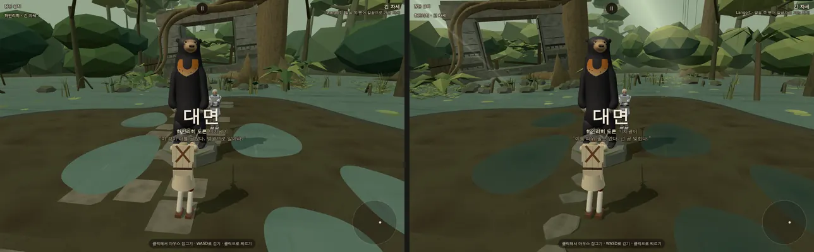

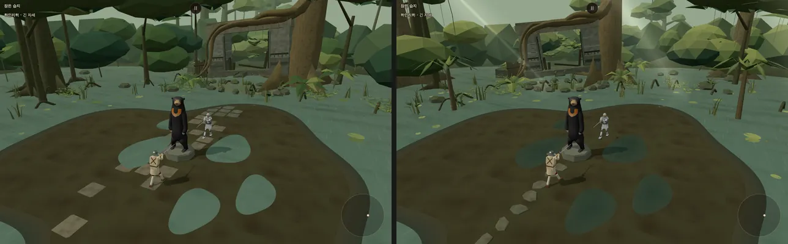

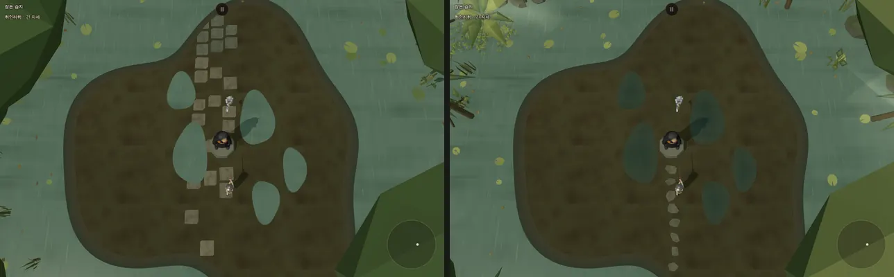

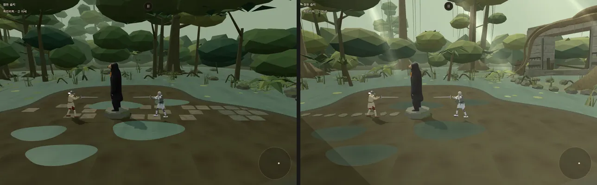

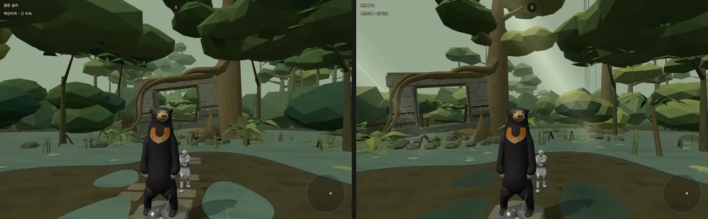

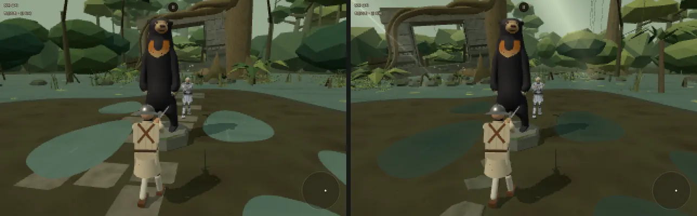

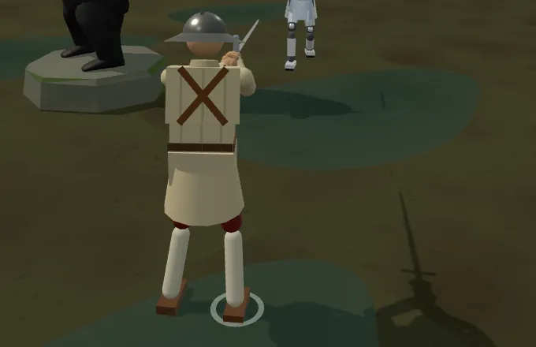

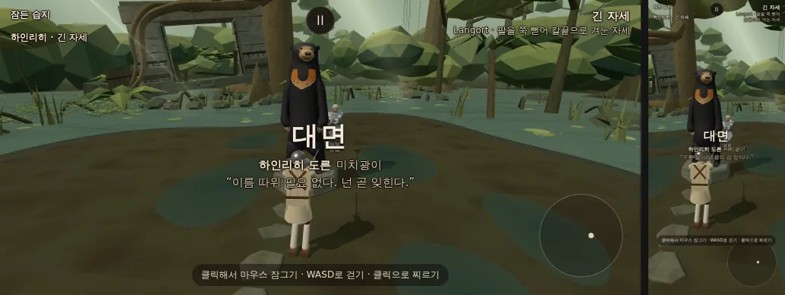

- **G 웅덩이** (확인표 1124): 옅은 물빛 판 → 진흙물로 짙게(가운데 `0x45554a` → 가장자리 흙빛 `0x5c6150`), 물 거칠기 0.26 → 0.2(햇빛 반사가 또렷한 젖은 윤기), 둘레에 **젖은 진흙 테**(물가 안쪽 0.06 m 에서 바깥 0.42 m 까지 짙고 윤기 나는 흙이 꼭짓점 알파로 흙빛에 녹아듦 — 메쉬 하나). **밟으면 물결**: 발이 떴다가 닿을 때(발 높이 0.09 → 0.06 m, 소리 발걸음과 같은 문턱) 그 자리 젖음이 0.2 를 넘으면 두 겹 물결(0.16 초 사이)이 1.15 초 동안 퍼진다. main.js 가 판마다 두 사람을 무대에 알린다(`arena.watchFighters` — 그림만, 다른 무대엔 이 함수가 없다). 샘 물방울 물결 셋도 같은 메쉬로 옮겨 그리기 셋 → 하나.
- **H 디딤돌** (확인표 1125): 샛별 판은 얇은 판석이 결투장을 가로질러 수문까지 곧게 뻗은 넓은 길(행진길처럼 읽힘)이었다. 결투장 −X 끝(판 시작 쪽)에서 곰 받침 앞까지 조금 굽이지며 다가가는 **디딤돌 여덟**으로 바꿨다 — 비뚤비뚤한 일곱~아홉 모 돌, 반지름 0.25~0.34 m, 윗면 가장자리를 깎아(0.035 m) 두께가 보이고 옆면은 짙게·이끼, 흙에 박혀 윗면 y 0.024(물리 바닥은 평평한 그대로 — 발이 2 cm 남짓 묻힐 뿐). 마지막 돌은 받침 앞 약 0.3 m 에서 멈춘다(순례길처럼). 옛 판석이 쓰던 난수 몫은 그대로 소비해 뒤 꾸밈(수문·숲)의 난수 순서를 바꾸지 않았다.
- **I 수문 자리** (확인표 1126): 수문과 거기 딸린 것(큰 나무·뿌리·샘·물방울·새·빛 숲·통로 쪽 빈자리, 세부음 자리)을 결투장 가운데 둘레로 **0.52 rad(약 30°)** 돌렸다 — 수문 가운데 (21.2, −1.6) → (17.6, −11.9), 거리는 그대로 약 21 m. 판 시작 카메라(1280×800 · 폰 가로 844×390 — 둘 다 찍어 봄)에서 수문 구멍·상인방이 곰 왼쪽에 따로 보이고, 큰 나무 줄기가 곰 뒤 배경이 된다. 세로 폰(390×844)은 화면이 좁아 수문 오른쪽 기둥만 왼쪽 가장자리에 보인다.
- **J 빛줄기** (확인표 1127): 비 갠 한낮, 숲 지붕 틈으로 내리는 햇빛 다섯 줄 — 해 쪽(`sunOffset`)으로 기운 더하기 섞기 평면(엇갈린 두 장씩, 한 메쉬, 안개 안 받음). 결투장 둘레 바깥 땅(반지름 9~14 m)에 닿게 두어 싸우는 두 사람·석상은 가리지 않는다. 세기는 꼭대기 0.1 로 옅게. **강조색**: 무대에 주황·빨강 같은 진한 색이 없다(이끼·흙·돌·잎뿐, 빛줄기는 옅은 흰빛) — 곰 가슴 주황이 단 하나의 강조색으로 남는다.
- **K 숲** (확인표 1128): 고르게 빽빽한 장대 숲을 덜고(키 큰 나무 88 → 46 · 가까운 나무 가지 5 → 3 · 어린 나무 70 → 40 · 지평선 묘목 56 → 28(루프 기준) · 섬 둘레 높은 나무 8 → 5) 열대 습지림의 표지를 세웠다: **숲 지붕 위로 솟은 거목 여섯**(키 30~34 m, 밝고 곧은 줄기, 판근 다섯, 납작하고 넓은 우산꼴 우듬지), **늘어진 덩굴**(거목마다 여덟 가닥이 물 위 3~7 m 까지, 가까운 나무 절반은 첫 가지에서 한 가닥), **물가 야자 여섯**(섬 둘레 얕은 물, 반지름 13.5 m 밖 — 잎 끝까지 카메라 궤도 밖, 수문 앞 화면 왼쪽은 비움). 경기 카메라는 위로 약 11~15° 까지만 보여 30 m 우듬지는 화면 밖이다 — 거목은 판근·줄기·덩굴로 읽힌다(넓은 장면에서만 우듬지가 보인다).
- **L 그리기** (확인표 1130): 재질별 한 메쉬는 샛별 판도 이미 그랬다. 작은 통 셋을 합치고(판석·얼룩 → 돌, 나무판 → 나무껍질) 샘 물결 셋을 물결 메쉬 하나로 — 새로 생긴 투명 셋(젖은 테·물결·빛줄기)을 넣고도 **무대 그리기 21 → 18**, 무대 삼각형 **115,539 → 89,906**(−22 %), 그림자 드리우는 삼각형 34,749 → 27,996 (`game` 장면에서 인물 빼고 셈, 상대 하인리히 같은 때). `stage_cost.mjs`(인물 포함, 844×420 — 잠든 습지는 무대 짝이 없어 상대가 무작위라 판마다 ±5 %): 249 호출 · 203,960 삼각형 → 222~226 · 149,614~159,374 (같은 판 청람잔도 250 · 138,695, 신목의 숲 205 · 156,640). 그리기 호출의 대부분(약 230)은 두 사람이다. 사장님 '적정선' 결정대로 더 줄이지 않았다.
- **M 도트 모드** (확인표 1129): 잎·우듬지의 위를 보는 면을 밝은 연두(`0xd8e08a`, 세기 0.30·0.36)로 구워 작은 해상도에서도 숲 지붕 겹이 갈라져 읽힌다(두 모드 모두 — 기본 모드에서도 한낮 햇빛으로 보인다). 도트 모드에서 곰 얼굴·눈·가슴 말굽이 읽히는 것을 다시 확인했다.
- 확인: 배경 바꾸기 세 바퀴(청람잔도 → 성 안뜰 → 잠든 습지) GPU 모양·질감·셰이더 150/10/37 그대로 — 누수 없음(셰이더 +2 는 꼭짓점 알파 물결·테와 더하기 섞기 빛줄기). 콘솔 에러 0(경기 · 도트 · 넓은 장면 · 웅덩이 걷기).

## 5. 한계 · 남은 것
- **사장님 확인 전**: 확인표 1110~1130 모두. 특히 여정 자리(지금 여정 밖 — 넣는다면 어디에), 곰 얼굴(1e 까지 감독 검수, 사장님 의견 오면 다음 판), 수문 자리(약 30° 돌림), 진흙 알림을 알림 줄 한 번으로 한 것.
- 곰 옆모습·뒷모습은 사진이 정면 하나라 해부 상식으로 채운 추정이다(§1-5).
- 라트나(이 무대의 짝)는 옮기지 않았다 — `STAGE_FOE.sluice` 가 없어 `?stage=sluice` 는 무작위 상대, 라트나 신발의 진흙 면제도 없다(디자인 결정 E). 그래서 `stage_cost.mjs` 수치가 판마다 ±5 % 흔들린다(무대만 센 값은 상대 하인리히로 고정해 쟀다).
- 디딤돌·석상 받침 둘레는 그림만 높다: 물리 바닥은 평평한 그대로라 발이 디딤돌 윗면에 2 cm 남짓 묻힐 수 있다.
- 물결은 발이 떴다 닿을 때만 난다(쓰러지는 몸·칼이 웅덩이에 떨어질 때의 물 튐은 없다).
- 거목의 납작한 우듬지(30 m 남짓)는 경기 카메라 화면 위로 벗어난다 — 경기 중엔 판근·줄기·늘어진 덩굴로 읽히고 우듬지는 넓은 장면에서만 보인다.
- 세로 폰(390×844)에서는 판 시작에 수문 오른쪽 기둥만 보인다(가로 폰·PC 는 수문 전체가 곰 왼쪽에).
- 시작 옆 비킴 0.45 m 를 넣어도 첫 접근이 석상 없는 무대보다 0.6~3.0 초 길다(돌아오는 길).
- 헤드리스 SwiftShader 라 프레임 시간은 참고치일 뿐이다 — 폰에서는 `?fps=1` 로 직접 본다.
- 관문(마지막 코드 845b4b3 기준): fights12 7c95ba21 · live_battery e7ee3d96 · finish_thrust 433ac984 · corr_s0 IDENTICAL 12 · weapon_smoke 21 OK · `vite build`·`npm run build` 0 · 이름 검사 위반 0 · 금지어 0 · 브라우저 콘솔 에러 0(테스트 경로 무대 고르기 · `?stage=sluice` · 도트 모드 · 카드 화면 · 웅덩이 걷기 · 배경 바꾸기 세 바퀴).

## 6. 곰 2 — 돌 석상 (10/14)

- 지시(원문): 사장님 10/14 08:3x "곰 석상. 정수리가 움푹 들어가야 저 곰의 특징이 나와. 색은 회색조 투톤 명암과 음각 양각 등으로 표현해서 오래된 실제 석상처럼 해보자." · 10:3x "곰 석상은 3.2m로 넣어."
- 가지: …/bear-stone (본판 8979346 에서). 새 값은 `docs/strike/owner_defaults_table.md` **1240~1252**. 앞선 1110(키) · 1111(칠한 색) · 1114(얼굴) · 1121(시작 옆 비킴) 행에는 바뀐 것을 적었다.
- 바뀐 파일: `src/stage_sluice_bear.js`(석상) · `src/arena_obstacle.js`(시작 옆 비킴 0.50) · `tools/browser/sluice_bear_page.js`(가까이 보기 `view=lens`) · `tools/browser/sluice_bear_shots.mjs`(`--stone` 그림 묶음). 무대의 다른 것·인물은 그대로.

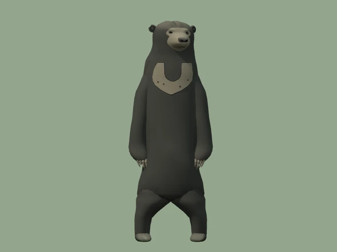

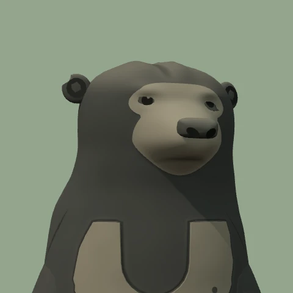

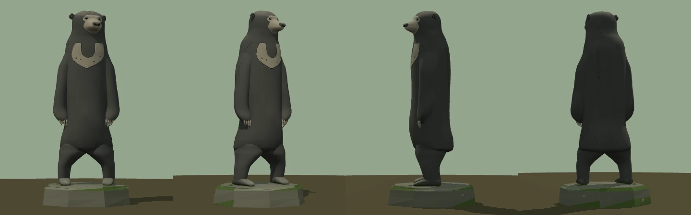

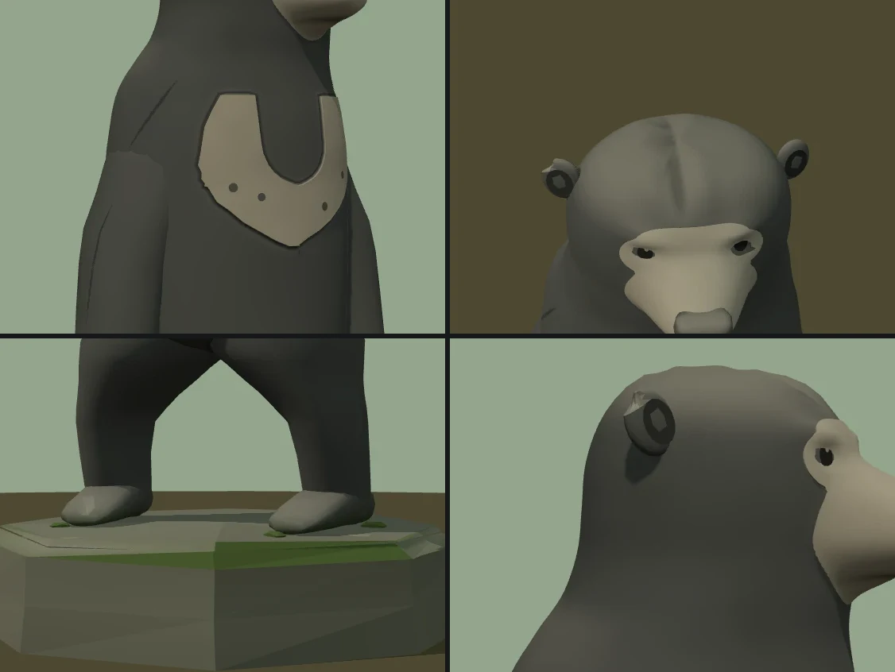

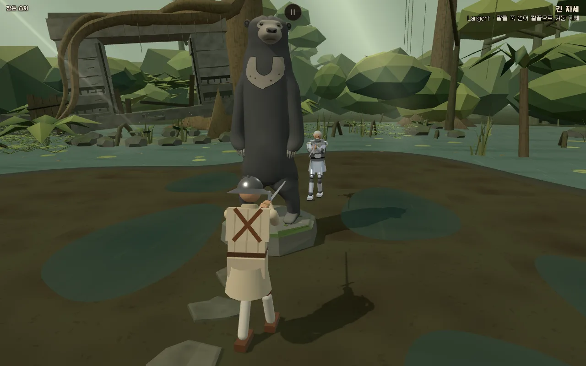

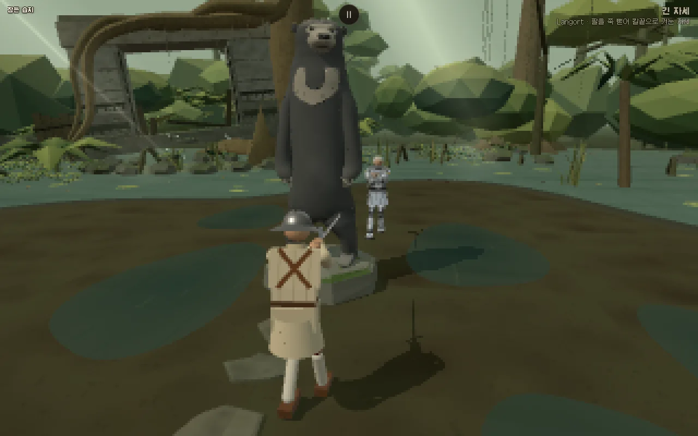

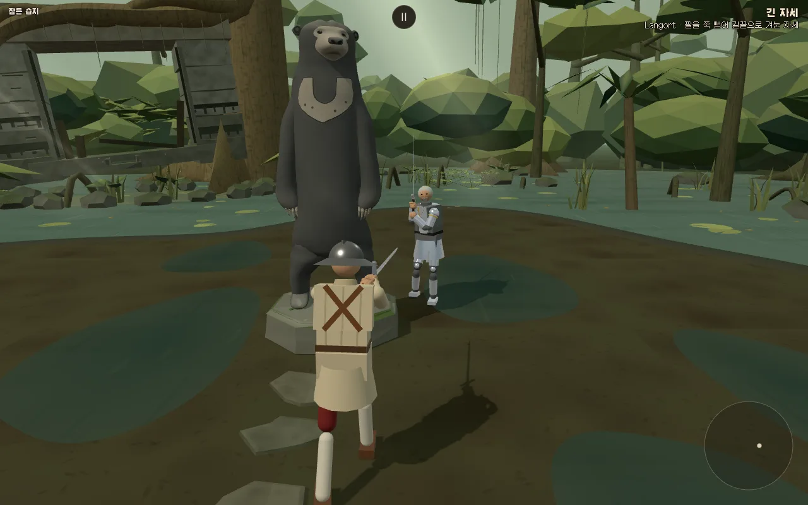

*모두 게임 모델을 무대와 같은 빛으로 찍은 렌더(`node tools/browser/sluice_bear_shots.mjs <개발 서버> --stone`). 사진과 나란히 놓은 비교(정면 전신 · 머리 4× · 눈 둘레 8×)는 사진이 들어가 저장소에 넣지 않았다.*

### 6-1. 무엇을 했나
1. **정수리 움푹** (확인표 1240): 머리 좌표에서 정수리를 앞뒤로 지나는 얕은 골 + 골 양옆 둔덕(`CROWN`). 앞에서 본 머리 윗선이 두 귀 사이에서 두 봉우리 사이로 오목하게 꺼지고, 위에서 보면 골이 정수리에서 이마 위쪽까지 앞뒤로 진다(골 바닥은 때 0.32). 이마·뒤통수 쪽으로 사라지게 두어 귀·관자놀이·얼굴(1e 눈·눈 둘레·주둥이·턱)은 건드리지 않았다. 사진에서 잰 값과 맞춘 결과는 6-2.
2. **회색조 두 톤 돌** (1241): 칠한 색을 모두 걷었다. 검은 털 자리 = 짙은 회색 돌 `0x575b5e`, 황갈·주황 자리(주둥이 · 눈 둘레 '안경' · 눈썹 자리 · 가슴 말굽)와 발톱 = 밝은 회색 돌 `0xb3afa5` — 밝기(선형) 비 약 4.2 배라 경기 화면·도트 모드에서 말레이곰 무늬가 그대로 읽힌다. 순검정·순백 없음(가장 짙은 드릴 구멍 그늘 `0x1f2122`, 가장 밝은 닳은 돌 `0xc6c3ba`). 털 윤기 굽기를 걷고 거칠기 0.5 → **0.92**(거친 돌), 부드러운 법선은 그대로(평면 음영은 고리 띠가 층층이 보이고 얼굴 판이 누빈 듯 보여 안 썼다).
3. **음각·양각** (1242 · 1243 · 1244 · 1248):
   - 가슴 말굽 **양각**: 사진에서 잰 윤곽(16 줄 표 그대로)을 몸 겉면에서 **0.0027**(키 3.2 m 에서 8.6 mm) 띄운 밝은 돌 판 + 둘레를 **음각 홈**으로 — 판 가장자리에서 벽(0.6 mm 바깥에서 겉면 높이로) · 홈 바닥(8 mm 까지, 때) · 바깥 둔덕(15 mm, 3 mm 솟음) · 몸에 녹아드는 끝(3 cm, 몸의 법선·색을 그대로 읽어 이음매 없음). 아래쪽 점 넷은 드릴로 판 얕은 점. 털 끝처럼 넣었던 바깥 테두리 들쭉날쭉은 줄마다 엇갈려 톱니로 보여 0.0018 → 0.0007 · 아래 끝 0.0025 → 0.0012 로 줄였다.
   - 얼굴 무늬 경계 **얕은 단**: 머리 고리의 꼭짓점 간격(4~8 mm)으로는 또렷한 경계가 계단으로 깨졌다(꼭짓점 색 경계를 좁히면 톱니). 그래서 밝은 돌 무늬를 따로 **얼굴 판**으로 지었다 — 머리 좌표 격자(3 mm 간격 · 키 3.2 m 에서 9.6 mm)에 머리 겉면을 그려 넣고(앞을 보는 삼각형만, z 버퍼) 무늬 세기 0.5 선에서 삼각형을 잘라 겉면에서 **0.0011**(3.5 mm) 띄운다. 경계마다 판 가장자리에서 겉면까지 벽을 세우고 벽 아래는 때(0.45). 머리 고리 자체는 모두 짙은 돌.
   - 경계가 또렷해지자 1e 의 부드러운 그러데이션이 '밝게 보이던' 자리보다 판이 작아져, 눈 위가 짙은 이마에 닿고 바깥 눈꼬리에 판 조각이 가늘게 끊겼다. 1e 와 사진에서 보이던 자리에 맞춰 '안경' 타원(0.036 · 0.0175 × 0.016 → **0.037 · 0.024 × 0.0185**), 이마 아치(콧등 위 0.049 → **0.05** · 눈 가운데 위 0.039 → **0.046** · 바깥 눈꼬리 0.027 → **0.034**, 2 제곱 → 4 제곱 꼴), 볼 경계(\|x\| 0.051~0.067 → **0.054~0.07**)를 옮겼다 — 사진처럼 가까운 눈 위에 밝은 띠가 남고, 바깥 눈꼬리 둘레에 격자 두 칸 넘는 띠가 남는다.
   - **눈(돌 조각)**: 1e 의 눈 자리 · 크기 · 처짐 · 기울임 · 겹 들림을 그대로 두고 판 두께만큼만 더 띄웠다 — 오목한 눈자리에 가장자리가 묻히는 꼴까지 1e 와 같아 아몬드꼴이 그대로 읽힌다. 윗눈꺼풀 = 음각 선(`0x26292a`), 눈알 = 짙은 돌(`0x54585a`), 홍채 자리는 조금 밝게(`0x5f6365`), 눈동자 = **드릴로 판 얕은 구멍**(`0x1f2122`, 구멍 아래 안벽은 빛을 받아 1.35 배), 1e 반사점 자리는 구멍에 남긴 **작은 돌 다리**(`0xa09e95`, 흰빛 아님). 판에 아몬드 구멍을 뚫어 눈을 음각으로 파 보기도 했는데, 구멍이 눈자리 안벽까지 드러내 눈이 크고 둥글게(놀란 눈) 보여 버렸다 — 사진·1e 와 8× 로 맞대어 '순하고 조금 시름겨운' 표정이 같은 쪽(구멍 없이 판 위에 얹기)을 골랐다.
   - **끌 자국**: 큰 털 덩어리마다 드문 음각 선 **16** — 뒤통수·목덜미 3 · 어깨 2 · 위팔 바깥 4 · 등 2 · 엉덩이 바깥 3 · 허벅지 바깥 2(가슴·배 앞은 비움). 폭 0.003~0.0036(약 1~1.15 cm), 길이 20~35 cm, 끝으로 가늘어지는 V 홈 — 가장자리는 밑면 색·법선 그대로, 가운데는 때(0.6), 두 벽 법선을 서로 기울여(0.5) 한쪽 벽이 빛을 받는다. 경기 거리에서는 거의 안 보이고 가까이서만 읽힌다(잔무늬 없음).
4. **오래된 실제 석상** (1245 · 1246 · 1247): 꼭짓점 색·형상만(질감 없음).
   - 때: 꼭짓점이 바라보는 쪽에 다른 덩어리(캡슐 어림 13)가 가까울수록 — 겨드랑이·팔과 몸 사이 · 가랑이·허벅지 안쪽 · 엉덩이 밑 · 턱 밑 · 귀 뒤 · 발목. 아랫면 때 0.24 · 허벅지와 엉덩이가 만나는 골 0.42 · 정수리 골 · 귀 컵 안 · 가슴 홈 · 입선 · 끌 자국. 등·옆구리에 빗물 자국 다섯(어깨·턱 아래에서 흘러내려 옅어짐, 가슴 앞은 비움).
   - 바램·닳음: 하늘을 보는 면은 비에 씻겨 바램(0.3 — 머리·어깨·팔 윗면), 코끝 윗면(0.5) · 주먹(앞발 앞·위, 0.4) · 발가락 끝 윗면(0.42)은 닳아 밝게, 밝은 돌의 눈썹뼈(0.4)·주둥이 끝은 가장 밝게. 돌 얼룩: 큰 얼룩(약 20 cm) ±14 % + 잔 얼룩(약 8 cm) ±6 %.
   - 이끼·지의류(절제): 발바닥에서 8 cm 까지 고르지 않은 이끼(0.7), 받침 윗면 발 가장자리에 낮은 이끼 덩이 넷, 받침 윗면 지의류 무리 다섯(하나는 누런빛) · 뒤쪽 그늘 옆면 둘. 받침 윗면 가장자리·옆 아래 이끼(1e)는 그대로.
   - 작은 깨짐 다섯: 오른 귀 위 바깥 테두리 · 오른 앞발 둘째 발톱 끝(둘째 마디 4 분의 3 에서 부러짐) · 오른발 앞 모서리 · 받침 위 모서리 둘(앞 오른쪽 · 왼쪽 뒤). 깨진 면은 평면 법선 + 새 돌빛(`0x9c9e9a`, 받침 `0x9a9c94`).
5. **키 3.2 m** (1250 · 1251, 6-5): `BEAR_HEIGHT` 3.0 → 3.2. 충돌체는 키를 따라 늘고, AI 돌아가기 반지름·카메라 보호는 받침에 묶여 그대로, 시작 옆 비킴은 같은 잣대로 다시 재어 0.45 → **0.50 m**.
6. 덤으로 고친 것(보이는 꼴 그대로, 1252): 허벅지 고리 위 두 줄(엉덩이 속, t 0.72 · 0.78)을 조금 안으로 — 엉덩이 겉면과 1 mm 안팎으로 겹쳐 들쭉날쭉한 밝은 띠로 비치던 이음매. 칠한 검정에선 안 보이던 것이 밝은 돌에서 드러났다.

### 6-2. 정수리 꺼짐 — 사진에서 잰 값 ↔ 모델 (키 = 1, 사진 구도 685×512 · 정수리~발바닥 449 px)
잰 방법: 열마다 맨 위 곰 픽셀(부분 픽셀 — 사진은 초록 기운 문턱, 렌더는 바탕과의 색 거리 문턱, 둘 다 3×3 평균). 꺼짐 = 두 봉우리 사이 가장 낮은 곳, '현 대비' = 두 봉우리를 잇는 선보다, '지붕 대비' = 바깥쪽(x 326~339 · 357~372)에 맞춘 2 차 곡선보다.

| | 사진 | 1e (전) | 곰 2 |
|---|---|---|---|
| 꺼짐 자리 x | **348** (몸 가운데 347 보다 +0.002 · 두 귀 가운데 352.5 보다 −0.010) | 없음 (윗선이 둥근 지붕, x 348~354 가 가장 높음) | **348** |
| 두 봉우리 | 340 · 354 (사이 **0.031**) | — | 341 · 354 (사이 0.029) |
| 현 대비 깊이 | 1.09 px = **0.0024** (키 3.2 m 에서 7.7 mm) | −0.01 px | 0.86 px = 0.0019 (6.1 mm) |
| 지붕 대비 깊이 | 1.57 px = **0.0035** | 0.13 px | 1.80 px = 0.0040 |

- 곰 2 값은 보라 바탕(바탕과 대비가 고른)으로 찍어 잰 것이다. 같은 모델도 바탕·밝기에 따라 ±0.2 px 흔들린다(무대 하늘 바탕 0.84 · 1.63 px, 색 다듬기 전 1.01 · 1.79 px) — 사진의 털 끝·JPEG 흐림만큼의 불확실성 안에서 맞췄다.
- 꼴(`CROWN`, 머리 좌표): 골 가운데 x0 **−0.009**(곰 오른쪽 — 사진 꺼짐이 두 귀 가운데보다 사진 왼쪽) · 골 깊이 **0.002**·폭 sx 0.008 · 양옆 둔덕 **0.004** 솟음(골에서 0.022, 폭 0.01) · 머리 높이 0.05 → 0.068 에서 차오르고 정수리 앞뒤 −0.05 ~ +0.08(±0.015) 에서만. 골 바닥은 둔덕 꼭대기보다 약 0.006(키 3.2 m 에서 1.9 cm) 낮다. 고개가 0.36 rad 돌아 있어 골은 정면에서 비스듬히 보이고(사진의 주름도 정수리에서 오른쪽 아래 이마로 흐른다), 처음처럼 가운데만 파면 둥근 지붕 꼭대기가 사라져 머리 윗선 전체가 1.7 px 낮아졌다 — 둔덕을 더해 봉우리 높이를 1e 그대로 지켰다.
- 경기 거리에서 윗선의 꺼짐(1 px 안팎)은 실루엣으로는 거의 안 보이고, 골의 그늘·때로 읽힌다(가까이 넷 둘째 칸).

### 6-3. 두 톤 색 (`BEAR_COLORS`, 확인표 1241)
| 자리 | 색 | | 자리 | 색 |
|---|---|---|---|---|
| 짙은 돌(검은 털 자리) | `0x575b5e` | | 밝은 돌(황갈·주황 자리 · 발톱) | `0xb3afa5` |
| 주둥이 끝(닳음) | `0xc0bcb2` | | 밝은 돌 닳음(눈썹뼈 · 눈 바로 둘레) | `0xc6c3ba` |
| 짙은 돌 닳음(코끝 · 주먹 · 발가락) | `0x8a8d8b` | | 바램(하늘 보는 면에 섞는 빛) | `0xcbc8bf` |
| 때 | `0x2c2f30` | | 깨진 자리 | `0x9c9e9a` |
| 눈알 · 홍채 자리 | `0x54585a` · `0x5f6365` | | 드릴 눈동자 · 돌 다리 | `0x1f2122` · `0xa09e95` |
| 윗눈꺼풀 음각 선 | `0x26292a` | | 코 · 콧구멍 | `0x5a5d5e` · `0x242627` |
| 귀 컵 안 | `0x2e3132` | | 가슴 판 위쪽 · 드릴 점 | 밝은 돌 × 0.94 · `0x5d605f` |
| 발 둘레 이끼 · 받침 이끼 | `0x58733f` | | 지의류 | `0xa8ac8d` · `0xb7aa78`(누런빛) — 받침 돌빛에 0.7 섞음 |

받침 돌 `0x7c8077` 은 그대로. 곰 재질: 꼭짓점 색 · 거칠기 0.92 · 금속 0 · 부드러운 법선 (받침은 평면 음영 0.95 그대로).

### 6-4. 눈 둘레 확인 (사장님이 가장 중요하게 보시는 곳)
- 사진 · 1e · 곰 2 를 같은 구도(머리 4× · 눈 둘레 8×)로 맞대어 보았다(저장소 밖). 눈 자리 (347, 66) · (380, 67) [사진 픽셀] · 아몬드 크기 · 바깥 눈꼬리 처짐 · 윗눈꺼풀 선 · 눈동자 둘레가 1e 와 같고, 눈 둘레는 밝은 돌 판이 감싸 사진처럼 '안경'이 읽힌다. 처음 시도(판에 눈 구멍)는 눈이 커 보여 버렸다(6-1 3).
- 도트 모드(1280×800 → 320×200)에서도 두 눈은 밝은 얼굴 안의 짙은 점으로 남는다.

### 6-5. 키 3.2 m (사장님 10/14 10:3x — 확인표 1250 · 1251)
- **충돌체**: `bearObstacleShapes` 가 키에 비례 — 다리 캡슐 반지름 0.174 → **0.186 m** · 몸통 0.375 → **0.40** · 팔 0.126 → **0.134** · 머리 0.264 → **0.282**. 받침 원기둥(반지름 0.82 · 높이 0.35)은 그대로.
- **AI 돌아가기 반지름 0.90 m · 카메라 보호(+0.28)**: 받침 바깥 반지름(0.86)에 묶여 그대로 — 3.2 m 곰도 받침 안에 든다(팔 바깥 ±0.61 m · 발끝 0.35 m · 주둥이 끝 0.53 m).
- **시작 옆 비킴 0.45 → 0.50 m**: 같은 잣대(판 시작 카메라 열림 1 · 0.5 · 0 → 상대 머리 · 가슴 가운데·좌우 0.2 · 골반 · 무릎 일곱 점, 석상 메쉬에 광선, 0.05 m 간격)로 다시 쟀다. 같은 탐침으로 3.0 m 를 재면 처음 막힘 없는 값이 0.45 로 앞선 값과 같고, 3.2 m 에서는 0.45 에서 열림 1 카메라 → 상대 가슴 오른쪽 0.2 광선 하나가 곰에 닿아 **0.50** 이 가장 작은 값이다.
- **귀와 화면 위 끝 (보고만 — 사장님 결정이라 안 바꿈)**: 1280×800, AI 그대로, 플레이어 가만히, 0.25 초마다 석상 맨 위를 화면에 비춰 잼. 앞선 측정(§3 — 3.2 m · 비킴 0.45)은 6 초쯤 귀가 위 끝에 닿았다. 이번(비킴 0.50)에는 세 상대 모두 첫 접근까지 **닿지 않았다**: 하인리히 세 판 6 초 **31 px** 아래 · 가장 가까울 때 28 px(약 9.3 초) / 브란 28 px(7.8 초) / 오마리 21 px(8.5 초). 판 시작 0.5 초 84~85 px, 2 초 뒤 33~35 px. AI 길이 판마다 달라 닿는 판이 있을 수 있다.

| 첫 접근 (가슴 사이 2 m, 2 초 정지 포함) | 하인리히 | 브란 | 오마리 |
|---|---:|---:|---:|
| 3.0 m · 비킴 0.45 (§3) | 9.92 초 | 8.63 | 9.13 |
| **3.2 m · 비킴 0.50 (이번)** | **9.25 · 9.28 · 9.35** | **7.93** | **8.85** |

### 6-6. 그리기 양 (stage_cost 방식 — 844×420 경기 카메라, 상대 하인리히 고정, AI 멈춤, 헤드리스 · 폰 수치 아님)
| | 1e (8979346) | 곰 2 |
|---|---:|---:|
| 석상 삼각형 (곰 + 받침) | 12,676 (12,596 + 80) | **17,108** (16,638 + 470) |
| 한 프레임 삼각형 (그림자 그리기 포함) | 147,514 | **156,378** (+8,864 = 석상 늘어난 몫 × 2) |
| 그리기 호출 | 239 | **239** (석상은 그대로 곰 · 받침 두 메쉬, 새 재질 없음) |
| 석상 짓는 시간 (노드, 데운 뒤) | 150~200 ms | **230~340 ms** |
| 무대 짓는 시간 (브라우저 `game.stage.buildMs`, 번갈아 두 번) | 520 · 484 ms | **584 · 642 ms** |

- 늘어난 삼각형: 얼굴 판·단의 벽 **2,950** · 가슴 홈 고리 **+584** · 끌 자국 **512** · 받침의 지의류·이끼 덩이·모따기 **+390** · 부러진 발톱 −28 (머리·몸 고리 7,772 · 나머지 얼굴 조각 904 는 그대로). 가슴 판 둘레를 몸에 붙이는 광선 약 540 개는 가슴 앞 삼각형만 쏘아(같은 결과 — 꼭짓점 전부 비교해 같음) 짓는 시간을 줄였다.
- 헤드리스 프레임 시간은 다른 작업의 기계 부하에 묻혀 전/후를 가릴 수 없었다(번갈아 잰 가운데값 283 · 300 ms ↔ 300 · 550 ms) — 폰에서는 `?fps=1` 로 직접 본다. 그리기 호출은 한 판에서 241 로 잡혔는데 석상과 상관없는 장면 상태 차이다(같은 판을 다시 재면 239).

### 6-7. 확인
- 관문(이 커밋): fights12 **7c95ba21** · live_battery **e7ee3d96** · finish_thrust **433ac984** · corr_s0 IDENTICAL **12** · weapon_smoke **22** OK · `vite build`·`npm run build` **0** · 이름 검사 위반 **0** · 8979346 부터 더한 줄의 금지어 **0**.
- 브라우저(헤드리스, 콘솔 에러 0): `?stage=sluice` 경기(판 시작 · 2.5 초 · AI 그대로 6~9 초 · 세 상대) · `?pixel=1` 도트 모드 · 석상 따로 그리기(정면 직교 · 머리 · 넷 · 가까이 넷) · 배경 바꾸기 세 바퀴(청람잔도 → 성 안뜰 → 잠든 습지, `game.setStage`): 잠든 습지 GPU 모양·질감·셰이더 149/10/37 매번 같음 · 물리 콜라이더 76 ↔ 69(석상 7 만 붙었다 떨어짐) — 누수 없음.

### 6-8. 한계 · 남은 것
- **사장님 확인 전**: 1240~1249 · 1252 의 수치(정수리 골 깊이 · 두 톤 색 · 양각 높이 · 얼굴 판 경계 옮김 · 끌 자국 · 때·이끼·깨짐). 1250(3.2 m) · 1251(비킴 0.50)은 사장님 결정을 따른 값.
- 정수리 꺼짐은 사진처럼 작아(키의 0.2~0.4 %) 경기 거리 실루엣으로는 안 보인다 — 골의 그늘·때로 읽히는 정도. 더 크게 하시려면 `CROWN.depth`·`lip` 두 값.
- 얼굴 판은 앞을 보는 겉면만 덮어, 턱 밑(아래를 보는 면)은 짙은 돌이다(1e 는 부드럽게 황갈이 비쳤다). 얼굴 무늬 경계를 또렷하게 하며 '안경' · 이마 아치 · 볼 경계를 옮겼다(6-1 3) — 1e 수치와 다르다.
- 해가 곰 오른쪽 앞에서 비쳐 왼쪽·뒤는 짙은 그늘이라, 그쪽 끌 자국·빗물 자국·지의류는 거의 안 보인다.
- 허벅지·엉덩이 이음매는 골의 때로 덮었지만 아주 가까이서는 꺾인 선이 남는다(고리 밀도가 다른 두 덩어리의 만남).
- 사진과 나란히 놓은 비교 그림은 저장소 밖(사진이 들어감). 사진 색·질감은 쓰지 않았다.
