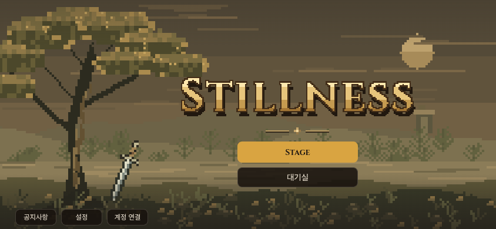
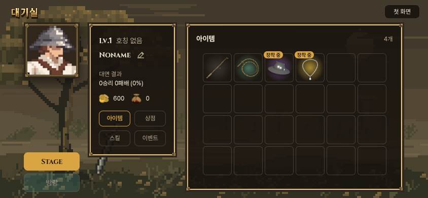

# 첫 화면의 Stage / 이어가기 · 대기실

2026-10-27 KST. 기준: 우화 main `367611a2361229e70d59d75dfc306875c5a72e83`.

사용자가 첫 화면의 버튼 배치 변경과 **우화 main 직접 반영**을 명시 승인했다. 이번 화면 변경에 한해 적용하며, 기존 적소검과 다른 개발 내용을 교체하지 않는다.

| 상태 | 첫 버튼 | 둘째 버튼 |
|---|---|---|
| 이어할 유효한 기록 없음 | Stage → 새 여정 | 대기실 → 바로 대기실 |
| 이어할 유효한 기록 있음 | 이어가기 → 저장한 무대 | 대기실 → 바로 대기실 |

대기실의 `Stage 입장`은 `Stage`로 변경했다. 출발할 때 유효한 기록을 다시 확인해 이어가거나 시작한다. 대기실만 열고 첫 화면으로 돌아오면 새 여정이나 카드 추첨을 만들지 않는다. 기존 장비·금화·기록을 초기화하지 않는다. 기존 공지·픽셀 배경·버튼 모양·계정 연결·방랑은 유지한다.

수정 범위는 `src/start_screen.js`, `src/game_entry.js`, `src/lobby.js`다. 기존 `main.js`의 `canContinueJourney()` / `launchJourney()`를 재사용한다. 게임 모듈이 준비되어 유효한 기록을 판별한 뒤 첫 화면 버튼을 활성화하며, 폐기된 화면의 늦은 로딩 결과는 무시한다. 표시뿐 아니라 누르는 순간에도 기록을 확인한다.

검토 도구 참고: 첫 버튼의 DOM ID는 기존 `newJourney`를 유지하지만 기록이 있으면 이어가기다. 이전 둘째 `continueJourney` 대신 `enterLobby`가 대기실을 연다. 이전 배치에 고정된 과거 캡처/연구 도구는 이 선택자·기대 문구를 조정해야 한다. 이번 흐름의 재현 도구는 아래 `check.mjs`다.

## 검증

- 실제 컴파일판, 모바일 844×390과 PC 1280×720에서 확인. 모바일에서는 터치 입력 사용.
- 처음 실행 → 대기실 → 첫 화면: 체크포인트 생성 없음, 뒤의 전투 시간0.
- 첫 Stage 출발 → 전투에서 대기실 → 첫 화면: 첫 버튼이 이어가기로 바뀜. 대기실 Stage 재출발 후 저장된 카드·무기·무대 그대로.
- 다음 무대 저장을 가진 PC: 첫 버튼으로 그 무대를 이어감.
- 깨진 JSON / 현재 없는 무대 저장: Stage로 표시하고 대기실을 통해 정상 시작.
- 저장 읽기·쓰기가 차단된 경우: 대기실에서 시작하고 같은 실행 안에서는 메모리 기록으로 이어가기.
- HTTP·JS 오류0. 물리5관문도 직전 기준 결과와 일치(corr_s0의 마지막 실행시간만 제외). 게임 빌드 통과.

이 검사는 새 브라우저 문맥의 시험 저장을 사용한다. 실제 사용자의 저장을 읽거나 바꾸지 않는다. 실제 휴대폰 하드웨어 성능 검사는 아니다.

```sh
npm run build
python3 -m http.server 5281 --directory dist
node docs/import/title_lobby_2026-10-27/check.mjs http://127.0.0.1:5281
```

공개판에서는 첫 인자에 `https://yoonjl-svg.github.io/halfsword`, 둘째 인자에 결과를 쓸 임시 폴더를 준다. 본 기록의 이미지는 컴파일한 실제 게임 화면이다. `results.json`과 `results/common.json`에 결과를 보존한다. 되돌림은 이 화면 변경 커밋만 반전하며, 진행 저장 형식은 바뀌지 않았다.

기록 없는 첫 화면:



기록 있는 첫 화면:


대기실의 Stage:


