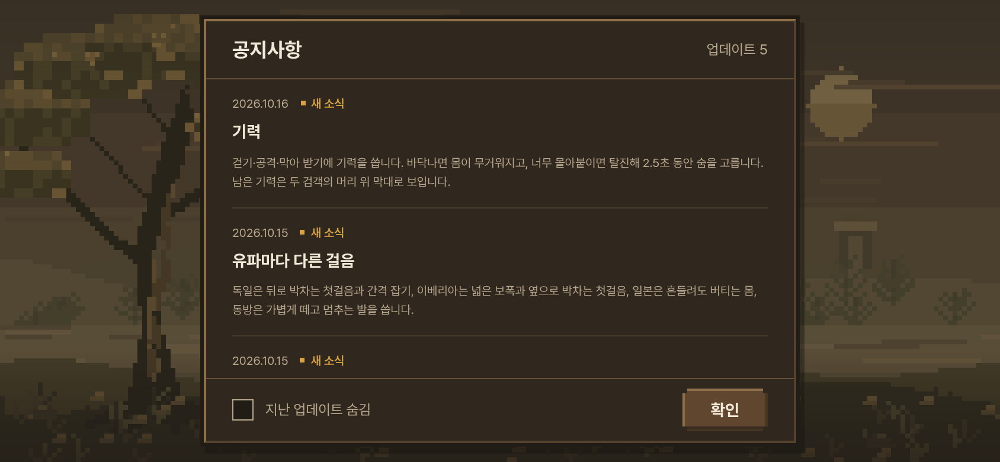
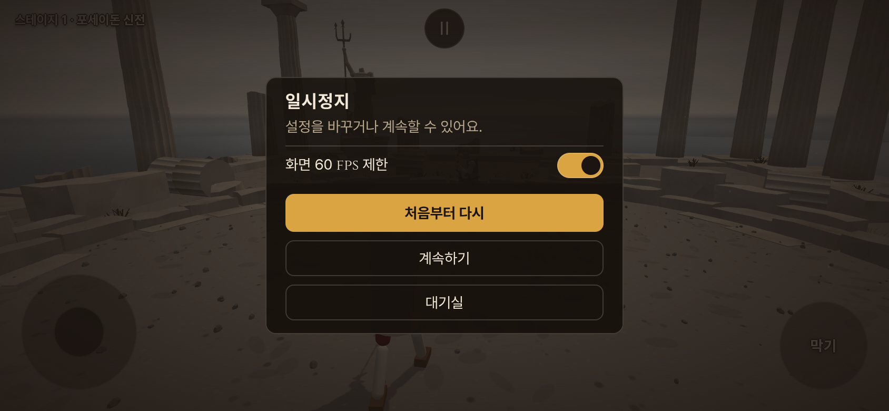
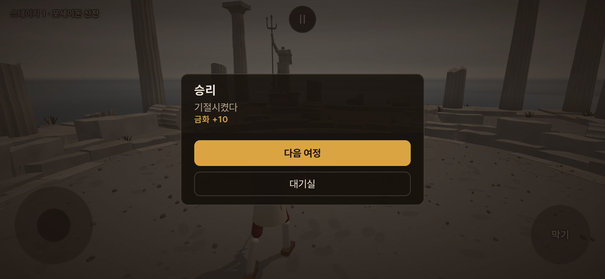
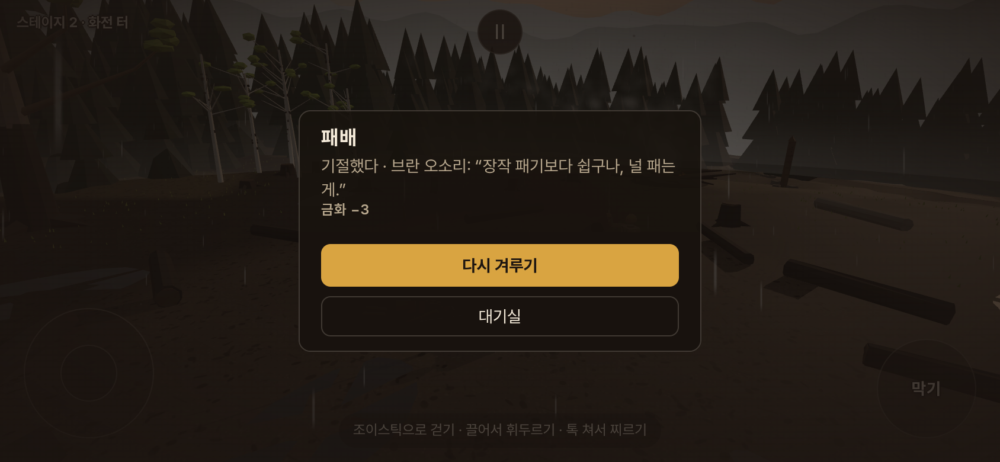
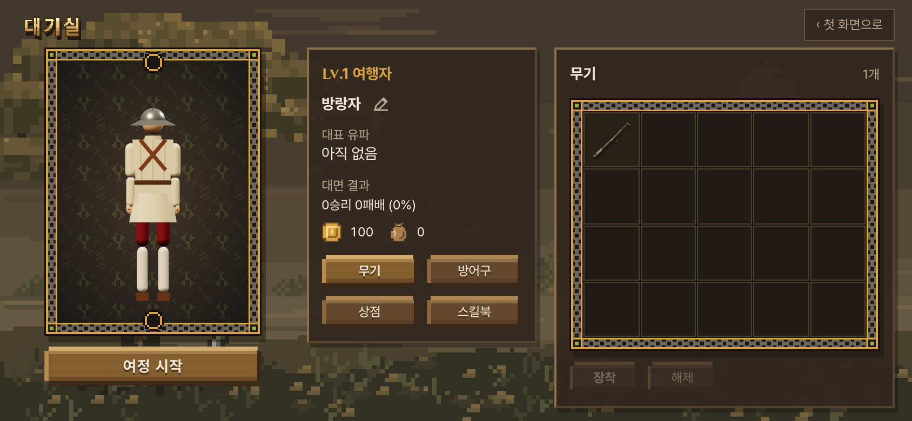
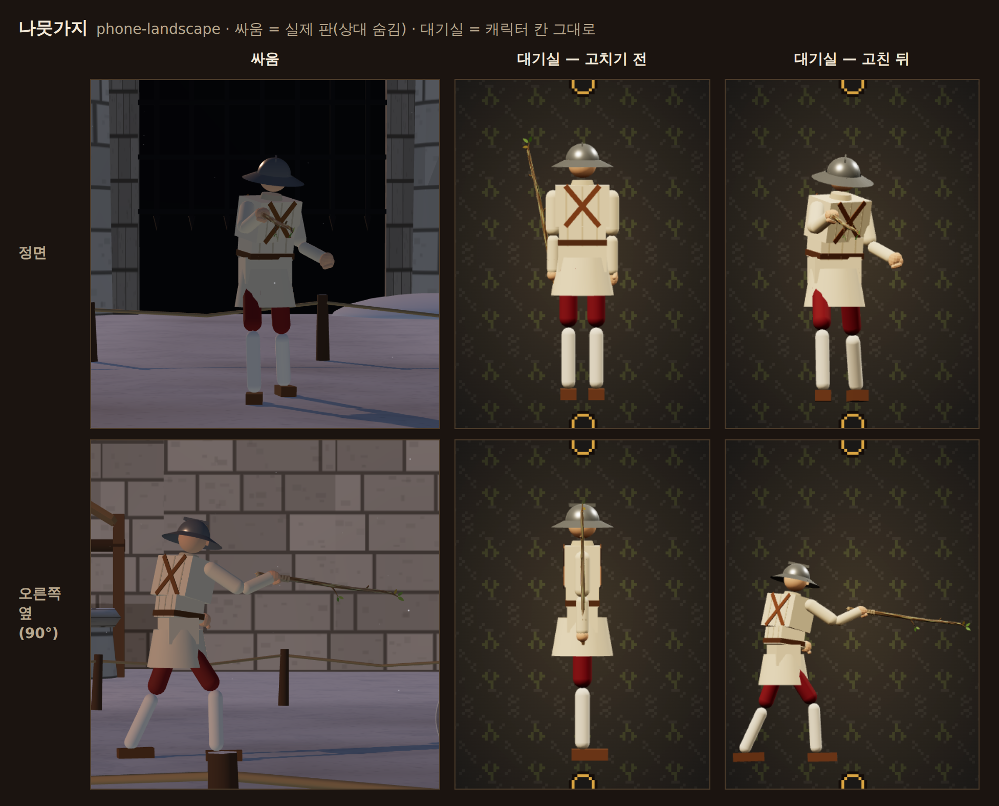
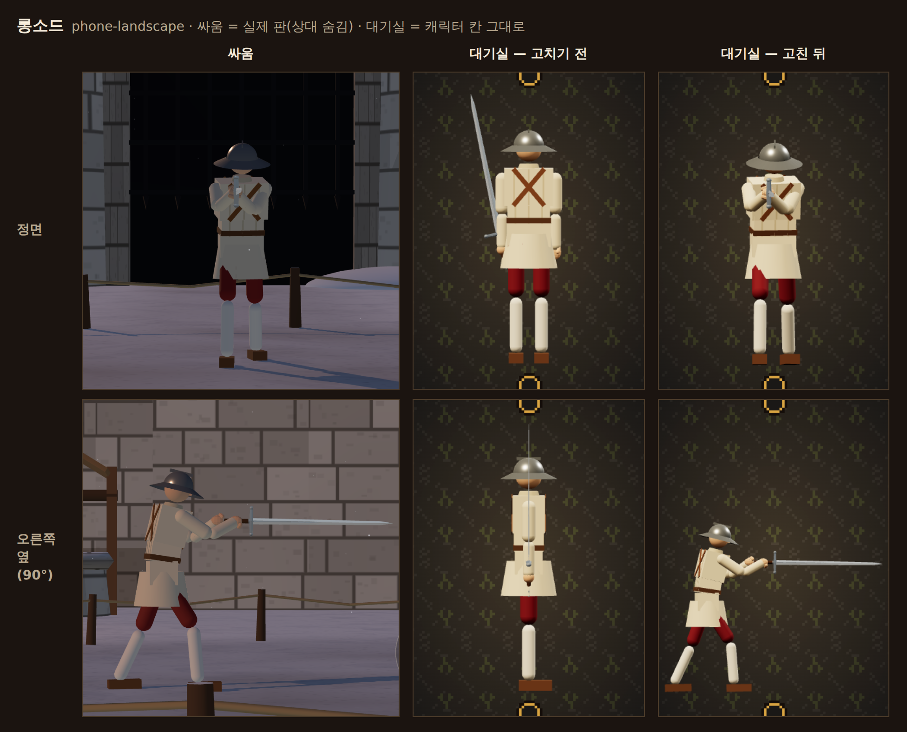
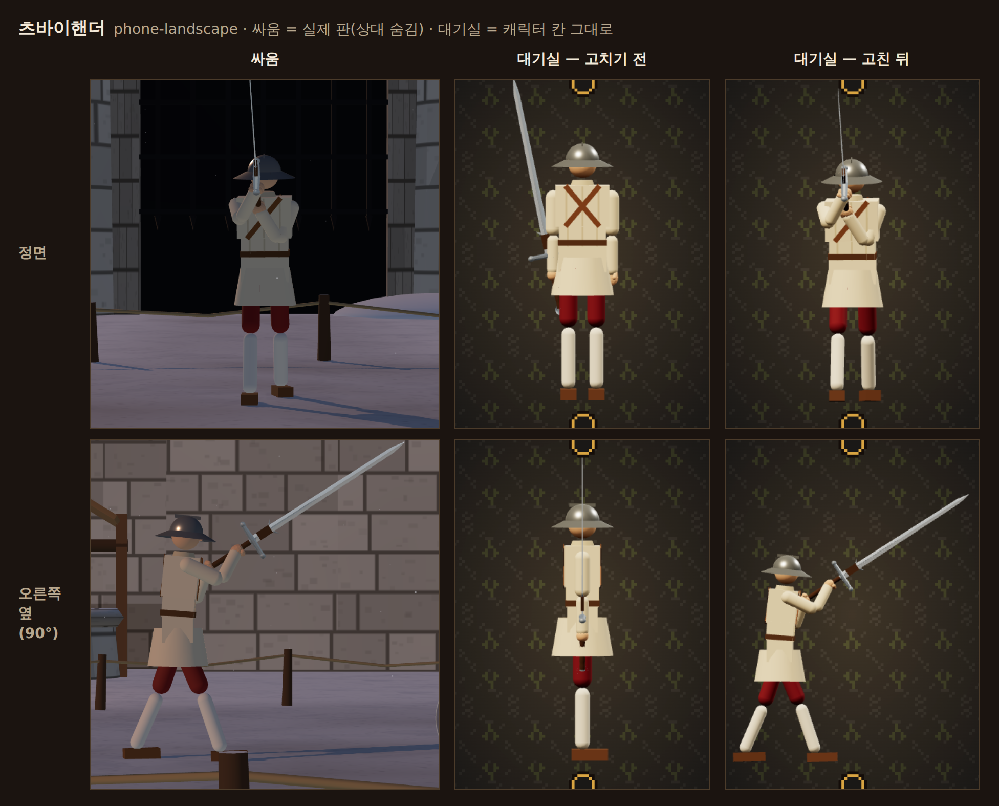

# 인장 없앰 이어서 · 화면 고침 · 대기실 무기 (2026-10-16)

- 지시 (사장님 원문):
  - 08:1x "인장 제도 없애. 아이템은 사라져도 효과는 그대로 둬."
  - 08:3x "공지사항 안의 글씨 더 작게 해. 공지사항 눌렀다가 확인 누르면 창이 닫히는 게 아니라 다시 애니메이션이 재생되는데 고칠 수 있나. 전투에서 대기실로 가는 기능이 필요해. 정지 누르면 거기에 넣어. 전투 승리나 패배 후 팝업에선 얻은 금화나 잃은 금화 표시하고, 그 화면에서 설정은 빼고, 다음 여정과 대기실 선택지로 줘. 대기실 캐릭터는 '드래그하여 회전' 문구 지우고 360도 회전은 안되나? 스테이지에서 보는 것처럼."
  - 08:4x (감독 전달) 일시정지에서 대기실로 갈 때 금화는 "깎지 마" · "캐릭터가 동작을 보여줄 수 있게 하려면 무기 장착도 정교해져야 돼. 지금 나뭇가지 장착해보면 전투 때 모습과 달라."
- 가지 `…/no-seals` — 앞 작업자의 a9f6109(인장 없앰, 점검 전)와 감독이 보존한 88bbddb(작업 중 멈춘 것 — 공지 글씨 · 공지 닫기 · 일시정지 '대기실' 일부) 위에 이어서 고쳤다. 두 커밋의 역사는 그대로 둔다.
- 새 값·자리는 `docs/strike/owner_defaults_table.md` **1928~** — 사장님 말로 정한 것은 '사장님 결정', 그 밖은 '사장님 확인 전'.
- 플레이어가 받는 것이 바뀐 곳은 `docs/strike/school_kit_map.md` §2 · §3 · §7 을 같은 커밋에서 고쳤다.

## 0. 한눈에

| 사장님 말 | 지금 가지에서 | 문서 |
|---|---|---|
| 인장 제도 없애 · 아이템은 사라져도 효과는 그대로 | a9f6109 점검 — 목록 모두 맞음 · 이미 받은 인장은 **판을 처음 연 때 한 번** 금화로(어느 길이든 — 인장 없앤 뒤 주소 판에서 깬 무대까지 금화가 되던 틈을 막음) · 케틀 햇 130 은 사장님 결정으로 적음 | §1 |
| 공지 글씨 더 작게 · 확인 누르면 애니메이션이 다시 | 본문·날짜 12 → 10 · 아래 줄에서 연 공지의 확인은 창만 닫음 | §2 |
| 정지 누르면 대기실 · 깎지 마 | 정지 창 '대기실'(첫 화면·대기실 여정만) · 금화·대면 결과·이어하기 지점 그대로 · 대기실은 '여정 이어가기' | §3 |
| 결과 창에 금화 · 설정 빼고 · 다음 여정과 대기실 | '금화 +12'/'금화 −3' · 설정 줄 없음 · 이김 '다음 여정' · '대기실' / 짐 '다시 겨루기' · '대기실' | §4 |
| 드래그 문구 지우고 360도 | 안내 줄 지움 · 돌림판(막는 각 없음 · 놓으면 조금 더 돎 · 움직일 때만 그림) | §5 |
| 무기 장착도 정교해져야 돼 — 나뭇가지가 전투 때와 달라 | 대기실 캐릭터 = **싸움과 같은 Fighter** 를 따로 된 작은 물리 세계에 세워 판에서 선 자세까지 — 판의 플레이어와 손목·칼끝 1 mm · 칼날 축 0.02° 안 | §6 |
| (나중) 책 '동작 재생' | 만들지 않음 — 할 일과 필요한 것만 | §7 |
| 관문 | 일곱 그대로(fights12 a071c0af · live 648aca66 · finish 2de06c03 · corr 12 · smoke 23 · 빌드 · 표기 0) | §9 |

## 1. 인장 없앰 — a9f6109 점검과 마무리 (08:1x)

감독이 준 목록대로 a9f6109 를 읽고 돌려 봤다.

| 할 일 | a9f6109 | 이어서 고친 것 |
|---|---|---|
| 인장 얻기 · 알림 · 안내 · 이름(견습생 · 숙련자 · 전문가 · 마스터 · 신) 없음 | 지움 — `unique_assist.js` 해금 갈래(`SEAL_NAMES` · `sealNotice` · `masteryOf` …) · `main.js` 판 끝 안내 | 남은 곳을 찾음 — 없다. 코드의 '인장'은 `seal_coins.js`(한 번 바꾸기) · 대기실 바꿈 알림 한 줄 · 주석뿐 |
| 인장 단계로 여는 고유 동작 없음 | `uniqueStageFor` 지움 → 고유자세 책 `kitUniqueStage` | — |
| 모든 판 = 산 책 · 테스트 경로는 모두 '사용' | `newRound` → `playerKit(유파, 산 책, { test, upTo })` | — |
| `?uniqueStage=N` 개발 인자 | `bookTierParam`: 0 = 책 없음 · N = 무기 유파의 N 급까지 · 5 = 모두(전과 같은 뜻) | 사진 도구 `unique_assist_shots` 의 `?clears=60` 경우 → `?uniqueStage=3`(고유 공격 넷) |
| 깬 무대 수 = 통계 | `journey_save.js` `journeyClears` · `addJourneyClear` (같은 열쇠 · 같은 조건) | — |
| 한 번 바꾸기 · 옛 셈은 얼린 상수 | `seal_coins.js` `OLD_SEALS = Object.freeze({ clearsPerSeal: 10, max: 25 })` · 인장마다 100 · 기록 있으면 다시 안 줌 | **바꾸는 때를 '판을 처음 연 때'로** (아래) |
| `CONVERT_FUTURE_SEALS` 없음 | 지움 | — |
| 케틀 햇: 판 중에 벗겨져도 그 판은 최대 기력 130 | 이미 그렇게 돎 · 주석(`main.js` `newRound` · `fighter.js` `knockOffHelmet`) · 확인표 1888 '사장님 결정' | `lobby_fix` 문서 §3 · §10-4 에도 결정을 적음 |

- **바꾸는 때 (확인표 1928)**: a9f6109 는 처음 대기실을 열 때 바꿨다. 그러면 대기실을 한 번도 안 연 채 옛 메뉴 · 주소 판(게임 인자가 있는 주소)으로 깬 무대가 — 인장을 없앤 **뒤**에 깬 것인데도 — 처음 대기실을 열 때 옛 셈으로 금화가 된다(앞 작업자가 1927 에 알림으로 적어 둔 틈). '이미 받은 인장'만 바꾸도록 이 판을 **처음 연 때** 한 번 바꾼다: `main.js` 가 모듈을 열 때 `convertSeals()` — 첫 화면 · 옛 메뉴 · 주소 판 어느 길이든(테스트 경로만 빼고). 알림 '인장 N개를 금화 …으로 바꿨습니다.'는 그 뒤 처음 연 대기실이 한 번 띄운다(기록 `notice` 표시 · `takeSealNotice`). 04:5x 판이 남긴 기록(그때 이미 알림을 봄)은 알림 없음.
- 새 프로필은 인장 0 → 기록만 남고 알림 없음. 테스트 경로는 바꾸지도 알리지도 않는다.
- `?clears=N` 은 a9f6109 에서 없앴다 — 쓰던 곳이 없다(바꾸기는 저장된 깬 수만 읽고, 통계는 화면에 안 나온다). 이제 모르는 인자라 다른 게임 인자처럼 첫 화면을 건너뛸 뿐이다.
- 시험: `lobby_fix.test` 에 '바꾼 알림은 한 번' 하나 더(35 → 300 · 그 뒤 깬 무대 0 · 알림 한 번 · 인장 0 · 04:5x 기록) · `no_seals_smoke` 에 '옛 메뉴로 먼저 연 사람'(깬 수 39 → 열 때 금화 400 · 주소 판에서 이겨 40 → 그대로 · 다음 대기실에서 알림 한 번 → 다시 열면 없음).

## 2. 공지 글씨 · 공지 닫기 (08:3x)

- **글씨**: 공지 안 본문과 날짜·읽음 줄만 한 단계 아래 **12 → 10**(`--fs-xs` — 글자 규칙 세 단계 12 · 14 · 17 의 한 단계 아래, 첫 화면·대기실에만 · 낮은 가로 대기실의 10 px 두 곳과 같은 크기). 공지 제목 14 · 창 제목 17 · '업데이트 5' · '지난 업데이트 숨김' 12 · 확인 단추는 그대로, 굵기·색·줄 간격 비율도 그대로. 값은 `src/entrance_type.css` 한 곳(싸움 화면 글자 규칙을 읽는 그 파일).
- **닫기**: 첫 화면 아래 줄 '공지사항'으로 연 공지는 확인(또는 Esc)이 **창만 닫는다** — 첫 화면은 그대로 서 있고(바람·제목 나타남을 다시 틀지 않음) 초점은 '공지사항' 단추로 돌아온다. 처음 들어올 때의 공지 → 첫 화면 넘어감은 그대로. 읽음 처리 · '지난 업데이트 숨김' 저장은 두 길 같다(`src/start_screen.js` `noticeFromTitle`).
- 88bbddb 에서 온 것: 두 가지 모두 그 커밋의 방법을 그대로 두고 점검했다 — 글자 값 자리를 파일 첫 `:host` 로 옮기고 같은 칸을 두 번 덮던 줄을 하나로 · 머리말 규칙에 한 줄 · 문서 주소 고침. 시험 `title_smoke` 15(공지 본문·날짜 10 · 제목 14 · 아래 줄 12 · 아래 줄에서 연 공지의 확인 = 창만 닫힘, 첫 화면 단계 바뀜 0 · 첫 화면 inert 아님).

## 3. 싸움 → 대기실 (08:3x '정지 누르면 거기에 넣어' · 08:4x '깎지 마')

- 정지 창 단추 셋: 처음부터 다시 · 계속하기 · **대기실**(부 단추, 맨 아래). **첫 화면·대기실로 연 여정만**(`journeySaves` + 대기실이 출발할 때 거는 `setLobbyReturn`) — 테스트 경로 · 주소 판(게임 인자가 있는 주소) · `?title=1` 에 무대·무기를 고정한 판은 지금 메뉴 그대로.
- 누르면 판을 떠나 대기실로: **금화 · 대면 결과는 안 바뀐다**(사장님 08:4x "깎지 마") · **이어하기 지점 그대로**(지금 무대 시작 — 카드를 펼쳤으면 그 카드, 무기를 골랐으면 그 무기 · 같은 상대) · 대기실 출발 단추는 **'여정 이어가기'** → 그 무대 시작부터. '‹ 첫 화면으로'를 누르면 첫 화면(이어하기 = 같은 지점).
- 뒤처리(확인표 1934): 대기실 동안 게임 소리는 멈추고 출발하면 되살린다(첫 화면·대기실이 앞이면 손을 대도 소리를 켜지 않음) · 막기 누름은 풀린다 · 싸우던 판은 덮개 뒤에 멈춘 채 두고 다시 출발하면 새 판을 연다. (86b94bc 에서는 대기실 캐릭터가 메뉴 뒤 판의 플레이어를 복제했기 때문에 싸우던 몸이 보이지 않게 메뉴 뒤 판을 새로 세웠다 — §6 에서 캐릭터가 따로 된 몸을 쓰게 되어 뺐다.)
- 자리: `src/main.js` `toLobby` · `setLobbyReturn` · `lobbyMenu` · `src/game_entry.js` `openHost` · `showLobby` · `backToLobby`.
- 88bbddb 에서 온 것: 단추 · `toLobby` 뼈대 · 소리 되살림 막기는 그대로. 그 커밋엔 `setLobbyReturn` 을 거는 곳이 없어 단추가 늘 숨어 있었다 → 들머리가 덮개(Shadow DOM)를 다시 열어 대기실을 띄우는 길을 이었고, 막기 풀기를 더했다.

## 4. 결과 창 (08:3x)

- 첫 화면·대기실 여정의 판 끝: 제목(승리 · 패배) · 한 줄(한 일 · 졌으면 상대 대사) · **'금화 +12' / '금화 −3'**(머리를 얻었으면 ' · 머리 +1' — 그대로) · 단추 둘: 이김 = **'다음 여정'**(주) · **'대기실'** / 짐 = **'다시 겨루기'**(주 — 같은 무대, 진 판은 넘어가지 않음) · **'대기실'**.
- **설정 줄(화면 60 fps 제한)은 이 결과 창에서만 뺐다** — 정지 창 · 첫 화면 설정에는 그대로.
- 결과 창의 '대기실'은 판이 끝난 뒤라 금화는 판 끝에 정해진 대로(이긴 판 +5~15 · 진 판 −1~5). 이어하기 지점은 이긴 판이면 다음 무대, 진 판이면 같은 무대 — '대기실' → '여정 이어가기'는 '다음 여정' · '다시 겨루기'와 같은 곳으로 간다.
- 테스트 경로 · 주소 판의 결과 창은 그대로(설정 줄 있음 · 대기실 없음 · 테스트 경로 '다음 판 (무작위)' · '테스트 고르기로').

 

## 5. 대기실 캐릭터 돌리기 (08:3x '드래그하여 회전 문구 지우고 360도 회전은 안되나?')

- '↔ 드래그하여 회전' 줄을 지웠다(화면 읽기 글 '캐릭터 360도 보기. 드래그 또는 좌우 방향키로 회전, Home으로 정면'은 그대로 — 보이지 않는 글).
- **돌림판**: 끄는 동안은 손가락 그대로(칸 너비 = 한 바퀴) · **막는 각 없음**(몇 바퀴든) · 놓을 때 손가락이 움직이고 있었으면(마지막 0.1 s) 그 빠르기로 **조금 더 돌다 선다** — 시정수 0.2 s · 빠르기 상한 한 바퀴/s → 더 도는 각 = 빠르기 × 0.2 s(반 바퀴/s 로 튕기면 36° · 가장 많이 72°) · 0.08 s 넘게 멈췄다 놓으면 그 자리 · 좌우 방향키 22.5° · Home(가까운 쪽 정면)도 부드럽게 돈다. 값은 `src/lobby_character.js` `TURN` 하나(확인표 1933).
- **그리기는 움직일 때만**: 화면 한 장에 한 번(requestAnimationFrame 으로 모음) · 서면 그리지 않는다(`ui_fix_smoke` — 선 뒤 0.7 s 동안 그린 수 0).
- 안내 줄을 지우며 칸이 아래로 길어져 발이 아래 틀 장식에 가렸다 → 바라보는 높이 0.5 h → 0.46 h(발밑에 칸 높이의 8 %).
- 원래도 끌기에 막는 각은 없었다(칸 너비 = 한 바퀴). 손을 떼면 그 자리에서 딱 서고 안내 줄이 '끌어서 돌리는 그림'처럼 보여, 돌림판처럼 손을 놓아도 이어 도는 느낌을 더했다. '스테이지에서 보는 것처럼' 무기를 든 모습까지 싸움과 맞추는 일은 §6.

## 6. 대기실 무기 = 싸움 무기 (08:4x '무기 장착도 정교해져야 돼. 지금 나뭇가지 장착해보면 전투 때 모습과 달라')

### 6-1. 어디가 달랐나 — 맞대기

같은 무기를 실제 판(상대 AI 멈춤 · 판 시작 발 묶임 뒤 자세를 고쳐 딛고 선 때 · 상대는 숨김)과 대기실 캐릭터 칸에서 같은 각(정면 · 돌림판 90° 오른쪽 옆)으로 찍었다 — `tools/browser/uifix_weapon_capture.mjs`, 사진 `docs/handoff/uifix_weapon_<무기>_<크기>.png`(§8). 고치기 전 칸은 고치기 전 커밋(86b94bc)에 사진용 고리만 단 빌드에서 찍었다(무기 칸엔 나뭇가지뿐이라 롱소드 · 츠바이핸더도 그 고리로 걸어 봄).

| 무엇 | 싸움 (실제 판) | 대기실 — 고치기 전 |
|---|---|---|
| 몸 자세 | 그 무기의 겨눔 자세(자세표 · 서보 · 무게) · 유파 걸음의 발 너비 · 골반 높이 | 메뉴 뒤 판에서 **물리를 한 번도 안 돌린** 만든 그대로의 몸 — 두 발 모음 · 빈팔은 앞으로 |
| 칼팔 | 겨눔 자리로 뻗은 팔(IK) | 어깨에서 90° 내린 팔 |
| 무기 자리(쥠 점) | 아래팔 끝 공 관절 (0.13, 0, 0) | 같은 점 (0.13, 0, 0) — **이것만 같았다** |
| 무기 방향 | 자세표가 겨누는 칼끝 · 날 세우기(칼 면 몸 오른쪽) · 손목 원뿔 | 팔과 상관없이 모형 틀에 고정한 각(x 0.2 rad · y 90°) — 나뭇가지·칼이 늘 거의 곧게 섬 |
| 손 | 벙어리장갑 주먹(쥠 규칙 α·β·θ — 무기마다) · 두손 무기는 빈손도 자루 끝(gripAlong) | 공 모양 손 · 빈손은 앞으로 뻗은 채 자루에 안 닿음 |
| 축척 | 무기 모양 = weapons.js buildParts → partMesh → decorate | 같은 함수 — 크기는 같았다 |

### 6-2. 고른 길 — (a) 실제 Fighter 를 작은 물리 세계에서 세워 그 자세를 쓴다

감독이 준 셋을 견줬다.

| 길 | 판과 같은가 | 값 · 위험 | 동작 재생(§7)으로 |
|---|---|---|---|
| **(a) 따로 된 작은 물리 세계에 진짜 Fighter** (바닥 하나 · 상대 없음 — 자세가 설 때까지 몇 초 돌리고 멈춤) | **같은 코드** — 쥠 관절 · 칼 몸 · 손목 원뿔 · 주먹 · 자세표 · 서보 · 걸음까지 판 그대로라 맞추는 셈이 따로 없다 | 장착을 바꿀 때 한 번 몸 만들기(약 10~25 ms) + 물리 720 스텝(이 상자 node 230~400 ms — 브라우저에선 화면 한 장에 8 ms 씩 나눔). 게임 판 · 물리 세계 · 난수 순서를 안 건드림 | 같은 몸에 손 목표를 먹이며 step 만 돌리면 판과 같은 움직임 |
| (b) 멈춘 게임 장면의 진짜 플레이어를 대기실 카메라로 | 같은 몸이지만 메뉴 뒤 판은 물리를 안 돌려 겨눔 자세가 아니다 — 돌리려면 게임 세계(상대·무대 포함)를 돌려야 하고, 무기를 바꾸면 판을 새로 세워야 함 | 무대 빛 · 안개 · 상대를 가려야 하고, 대기실이 게임 판 상태(싸우던 몸 · 이어하기)에 묶인다 | 게임 세계를 돌리는 동안 상대 AI · 판 시계가 같이 돎 |
| (c) 판의 쥠 · 붙임 셈을 미리보기에 다시 씀 | 손 자리 · 칼 방향을 운동학으로 흉내 — 서보가 무게를 받치는 처짐 · 손목 원뿔 · 두손 빈손 IK · 걸음 자세를 다시 짜야 하고, 판 코드가 바뀌면 둘이 어긋남 | 물리는 없지만 같은 셈을 두 곳에서 지켜야 함 | 움직임을 다시 만들어야 함(유령 동작 위험) |

(a) 를 골랐다: 판과 **같은 코드라 어긋날 곳이 없고**, 비용은 장착을 바꿀 때만 들며, 나중 동작 재생도 같은 몸으로 된다.

### 6-3. 만든 것

- `src/lobby_rig.js` `createLobbyRig(RAPIER, 묶음, spec)`: 작은 세계(바닥 8 × 8 m · 받침 바닥 알림 — 세계마다 따로) + 판의 플레이어와 같은 값의 Fighter(겉모습 · 무기 · 스킬북 보법·막기 · 검술 층 보정 0.7 · corr · autoGuard — `main.js lobbyRigSpec`) + 주먹(hands.js) + 칼날 접촉 훅(Combat — 상대가 없어 상처는 안 남). 판의 한 스텝과 같은 차례로 돈다. 바라보는 곳은 앞 +x 멀리(판 첫 자리에서 상대 골반 쪽).
- **자세 잡기 = 판에서 가만히 선 몸까지 6 s**: 판 시작 발 묶임 2 s(시뮬 도구의 판 시작과 같은 값 — 브라우저 판은 무대 훑기 길이로 바뀌는 값이라 고정) 뒤 걸음이 자세를 고쳐 딛고(발 너비 · 골반) 선다. 나뭇가지 4.1 · 롱소드 5.1 · 츠바이핸더 4.6 s 에 0.1 s 동안 손목·칼끝 1 mm 안으로 선다. 일본 무기(우치가타나 · 모노호시자오)는 판에서도 6 s 뒤까지 조금씩(0.1 s 에 약 1 cm) 흔들려 그 한 때를 보인다.
- 브라우저에선 화면 한 장에 8 ms 까지만 돌려 나눈다(`RIG.budget`) — 그동안 지난 모습을 두고, 처음 열 때는 맨손 모습을 먼저. 이 상자(소프트웨어 GL 헤드리스) 장착 → 선 자세 0.5~1.0 s. 잡은 자세는 이번 실행 동안 기억(같은 무기 · 책이면 대기실을 다시 열어도 바로).
- **물리 · 그리기는 움직일 때만**: 자세를 잡는 동안만 물리 · 다 잡으면 한 번 그림 · 그 뒤 돌림판을 돌릴 때만 그림. 서 있을 때는 물리도 그리기도 없다.
- 맨손(장착 없음)은 물리 없이 만든 그대로의 몸에서 칼팔만 내린다(전 미리보기와 같은 꼴 — 무기가 없으면 싸움은 카드로 고른다) · 두 손 모두 편 손.
- 책을 사거나 사용/봉인하면(`skill_tree.js onBooks`) 그 무기 유파 보법이 바뀔 수 있어 몸 값이 달라졌을 때만 다시 세운다.
- 돌림판 축 = 골반. 틀(확인표 1936): 인물 축척은 그대로(2.16 m — 무기가 더 높으면 그 높이) · 돌려서 칼이 옆으로 뻗으면 보이는 폭에 맞춰 화면 가운데를 옮기고 많아야 1.6 배 물러난다(정면에선 칼끝이 이쪽을 향해 그대로) · 그래도 못 담으면(세로 폰의 좁은 칸) 몸은 늘 칸 안에 두고 칼끝 쪽을 자른다 · 발밑 8 %.
- 투구(케틀 햇)는 보이기/숨기기 — 몸 · 물리는 같다(판의 맨머리 겉모습 `LOOK_BAREHEAD` 와 같은 꼴).
- 지운 것: `src/lobby_weapon.js`(고정 각 무기 모형 — 이제 판의 무기 그대로) · 싸움 → 대기실 때 메뉴 뒤 판 새로 세우기(§3).
- 게임 쪽은 그대로: 대기실 몸은 세계가 따로라 게임 판 · 물리 · 판 시계(`simTime` 0)를 안 건드린다(game_entry · lobby_equipment 시험 그대로 통과) · 파손 굴림 씨앗을 넘겨 '몇 번째 싸움꾼' 셈을 안 늘림 · 겉모습 난수는 원래 따로.

### 6-4. 결과

- node 맞대기 `tools/sim/lobby_rig_probe.mjs`(판 = harness 판 · 상대 AI 멈춤, 대기실 몸 = 같은 값, 6 s · 골반 기준 몸 틀):

| 무기 | 손목 | 칼끝 | 칼날 축 | 칼 면 | 몸 14 곳 가장 큰 차 | 골반 높이 | 서는 때 |
|---|---|---|---|---|---|---|---|
| 나뭇가지 | 0.00 cm | 0.00 cm | 0.00° | 0.00° | 0.27 cm | 0.00 cm | 4.1 s |
| 롱소드 | 0.00 cm | 0.00 cm | 0.02° | 0.00° | 0.23 cm | 0.01 cm | 5.1 s |
| 츠바이핸더 | 0.02 cm | 0.02 cm | 0.00° | 0.00° | 1.09 cm(앞발) | 0.10 cm | 4.6 s |

- 실제 브라우저 `ui_fix_smoke` ⑤: 대기실에서 나뭇가지를 장착한 몸 ↔ 그 장착으로 연 여정 판의 플레이어(브라우저 판 발 묶임 3.3 s · 선 뒤) — 손목 **0.03 cm** · 칼끝 **0.04 cm** · 칼날 축 **0°**.
- 맞대기 사진(§8): 고치기 전은 나뭇가지·칼이 내린 팔 옆에 곧게 서고 빈손이 앞으로 떠 있었다 → 고친 뒤는 판과 같은 한손 겨눔(나뭇가지) · 두손 중단(롱소드) · 두손 높은 겨눔(츠바이핸더), 발 너비까지 같다.
- 그리기 호출: 맨손 41 · 나뭇가지 장착 60(칼 · 주먹이 더해짐) — 그릴 때만.

## 7. 나중 — 책 '동작 재생' (사장님 계획 · 이번엔 만들지 않음)

스킬북 설명 카드에 '동작 재생' 단추 → 대기실 캐릭터가 그 책의 동작을 해 보인다. 필요한 것:

- **몸은 이미 있다**: §6 의 대기실 몸이 판과 같은 Fighter 라, 손 목표를 먹이며 `step` 을 돌리면 판과 같은 움직임이 나온다. 재생하는 동안만 물리 · 그리기(1/120 s 스텝을 실제 시간대로, 화면마다 그림) · 끝나면 자세를 다시 잡거나(같은 spec 으로 새 몸) 기억한 자세로 돌아간다 — 기억한 자세(`restore`)는 몸 자리만 되돌리고 걸음·검술 층의 속 상태는 되돌리지 않으니, 재생 뒤엔 새 몸이 맞다.
- **책마다 무엇을 보일지**(사장님 정할 것): ① 보법 — 스틱 입력 몇 초(그 유파 걸음 · 박차기 · 박자 걸음 — 몸이 움직이니 돌림판 틀이 따라가거나 제자리로) ② 막기 — 막기 단추를 누른 손(유파 막기 자리 여섯 — 들어오는 칼이 없으면 자리 순서대로 보이거나, 연습 상대를 세움) ③ 고유자세 — 그 유파 고유 공격 넷을 여는 손가락 길(`unique_assist.js PLAYER_UNIQUE` 의 긋기 조건 · 길)을 먹이고 `PlayerUniqueAssist` 를 단다 — 플레이어가 실제로 쓰는 길로만(유령 동작 없음) ④ 패시브 — 아직 사람 몫이 없음 ⑤ 비기 — 조건이 상대에 묶여(`PlayerSecretWatch`) 연습 상대(같은 작은 세계에 두 번째 Fighter — 숨기거나 허수아비로)가 필요.
- **손가락 길 대본**: 시간 → 손 목표 움직임(dx, dy)·톡·스틱. 판의 입력 길(main.js 프레임: `handOffset` · `skill.uniq.feed` · `inputActive` · `handHeld`)과 같은 차례로 먹인다 — 대본은 책마다 한 곳에.
- **무기**: 그 책 유파의 무기가 손에 있어야 한다. 장착한 무기가 다른 유파(나뭇가지 = 유파 없음)면 그 유파 대표 무기로 잠깐 바꿔 보일지 · 안 산 책도 미리 보여 줄지 — 사장님 정할 것.
- **화면**: 재생 동안 돌림판 각(옆 90° 가 칼길이 잘 보임) · 틀은 동작 폭에 맞춰 물러남(§6 틀 맞춤을 재생 중엔 움직임 전체 폭으로).
- 값: 재생 2~3 s 동안 물리 + 그리기만 — 서 있을 때 0 그대로.

## 8. 사진 (우리 게임 실제 화면 — `tools/browser/uifix_capture.mjs`)

`docs/handoff/uifix_<장면>_<크기>.png` — 크기 `phone-landscape`(844 × 390 · 화소 비 2 · 터치) · `phone-portrait`(390 × 844 · 화소 비 2 · 터치). 세로에서는 싸움 화면을 '폰을 가로로 돌려 주세요'가 덮으므로 정지 · 결과 창 셋은 창 꼴만 보려고 터치 없이 찍었다(그래서 창 아래 안내 목록이 마우스 글이다).

| 장면 | 보이는 것 |
|---|---|
| `notices` | 공지 — 본문 · 날짜 10 · 제목 14 |
| `lobby` | 대기실 — '드래그하여 회전' 없음 |
| `pause` | 정지 창 — 설정 줄 · 처음부터 다시 · 계속하기 · **대기실** |
| `result-win` | '승리' · '금화 +14' · 설정 줄 없음 · **다음 여정** · **대기실** |
| `result-loss` | '패배' · 상대 대사 · '금화 −4' · **다시 겨루기** · **대기실** |

무기 맞대기(§6 — `tools/browser/uifix_weapon_capture.mjs`): `docs/handoff/uifix_weapon_<무기>_<크기>.png` — 무기 `tree_branch`(나뭇가지 · 한손 · 유파 없음) · `longsword`(롱소드 · 두손 · 독일) · `zweihander`(츠바이핸더 · 두손 큰 칼). 칸 셋 × 줄 둘: 싸움(실제 판 — 상대 AI 멈춤 · 상대 숨김 · 우리 게임 카메라를 화각 12° 로 11.4 m 앞·옆에, 거의 정사영) · 대기실 고치기 전 · 대기실 고친 뒤 / 정면 · 오른쪽 옆(돌림판 90°). 싸움 칸은 두 크기에 같은 것, 대기실 칸은 그 크기의 캐릭터 칸 그대로(고친 뒤 옆 칸은 틀 맞춤으로 조금 물러나 칼이 다 보인다 — 세로 폰의 좁은 칸에선 몸을 다 담고 칼끝이 조금 잘린다).

## 10. 사장님 확인할 것

1. 정지 창 **'대기실'** 자리(맨 아래 부 단추)와 글 · 결과 창 설정 줄은 **첫 화면·대기실 여정에서만** 뺐다(테스트 경로 · 주소 판의 결과 창은 그대로).
2. 공지 본문·날짜 **10 px**(한 단계 아래) — 폰에서 읽기 괜찮은지.
3. 돌림판 관성 — 시정수 0.2 s · 빠르기 상한 한 바퀴/s(많아야 72° 더 돎).
4. 대기실 캐릭터 틀 — 칼이 옆으로 뻗는 각에서 화면이 옮겨 가며 많아야 1.6 배 물러난다(칼이 칸 밖으로 안 나가게). 인물 축척을 그대로 두고 칼끝이 잘리는 쪽이 나은지.
5. 대기실 몸이 자세를 잡는 동안(이 상자 0.5~1.0 s · 폰은 더 걸릴 수 있음) 지난 모습(처음엔 맨손)을 보인다 — 같은 무기 · 책이면 이번 실행 동안 기억해 바로.
6. 맨손(장착 없음) 미리보기는 전처럼 칼팔을 내린 모습 — 장착이 없으면 판은 카드로 무기를 고른다.
7. 이미 받은 인장을 바꾸는 때를 '처음 대기실을 열 때' → **'이 판을 처음 연 때'**로 옮겼다(인장 없앤 뒤 주소 판에서 깬 무대가 금화가 되던 틈 — 1927).
8. 책 '동작 재생'(§7) — 책마다 보일 동작 · 안 산 책도 보일지 · 장착 무기가 다른 유파면 대표 무기로 바꿔 보일지.
