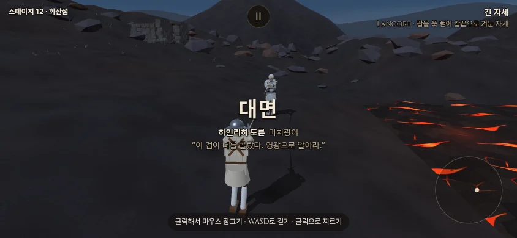
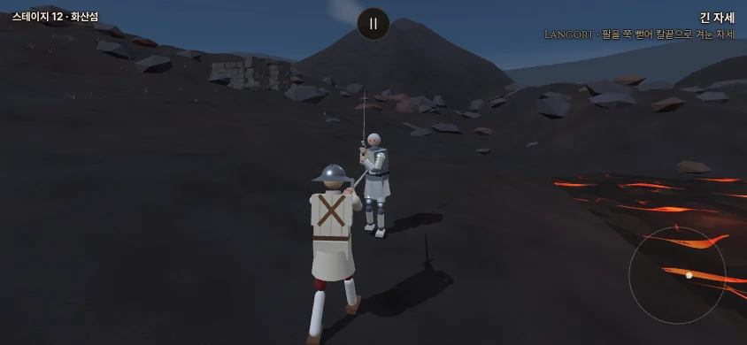
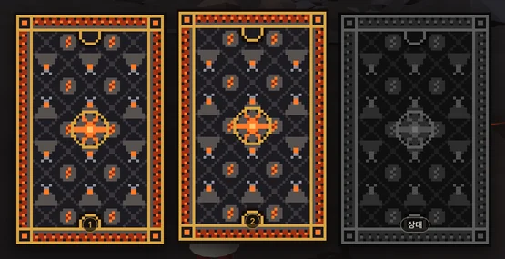
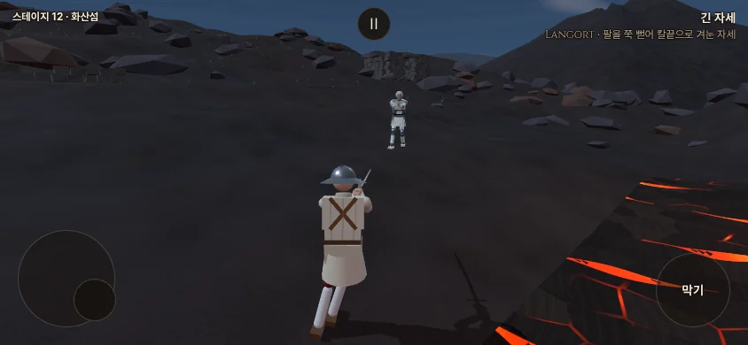
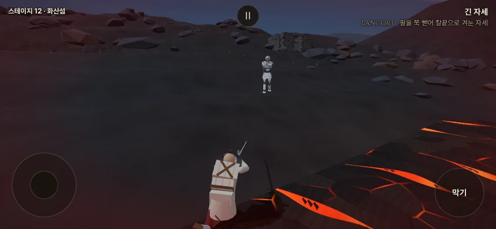
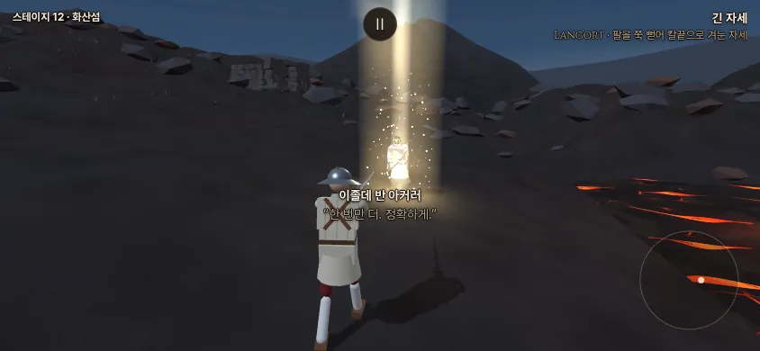
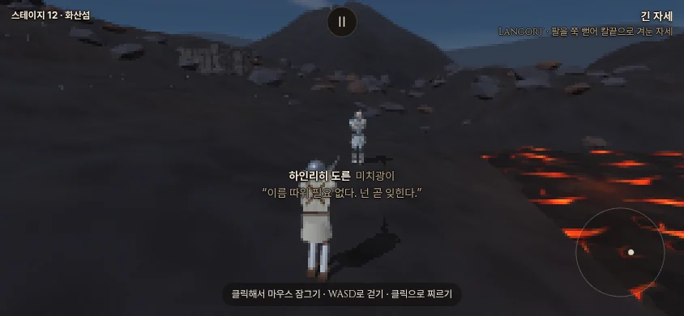

# 화산섬(etna) 이식 — 결투장 전체 산비탈 · 용암 '약하게' (2026-10-14)

- 지시: 사장님 10/14 19:4x 샛별 5차 결정(`docs/decisions.md`) — 화면 이름 **'화산섬'** · **비탈은 결투장 전체에 그대로**("비탈 그대로 가. 함 해보자. 새로운 도전이야. 자부심을 가지자!") · 용암 규칙 **약하게**(화상과 그 결과만, 용암 사망 없음) · **결투장 띠 없음** · 전용 상대 **찬다** · 습지·소금 사막·철불 절벽과 함께 **정식 경로**.
- 앞선 리뷰: `docs/import/saetbyeol_review5_2026-10-14.md` §1(용암지대 산비탈) · §8-2 6 단계 · §8-5.
- 출처: 샛별 저장소 origin/main 7684c732 — 커밋 0116047c(7° 비탈 + 즉사) → 37c8857b(10° · 흐르는 용암 · 열 상처 · 6 s 노출 사망) → 53188ff8(결투장 전체 불규칙 비탈)의 `etna_ground.js` · `terrain_navigation.js` · `stage_etna.js` 와 fighter·gait·main·ai·effects·revive_fx·finish_entry·opportunity_target·sound·stage_detail_sound·stages 의 해당 줄, 그쪽 시험 도구(`etna_gait_gate` · `etna_hazard_gate` · `etna_ai_gate` · `etna_surface_gate`)와 문서 셋. 샛별 쪽은 `git archive` 로 꺼낸 사본만 읽었다.
- 가지: …/volcano (본판 8b91637 에서 — 보고 직전 본판 3b1e97e(월왕구천검 · 철불 절벽 · 여정 정식 경로 세 무대)를 합침, §1 · §6-1). push 하지 않았다. 새 값은 `docs/strike/owner_defaults_table.md` **1460~1483** 행.
- **가장 중요한 원칙 — 평지 길은 바이트 그대로**: 지형 정보가 없는 무대(지금의 모든 평지 무대)는 바꾼 엔진 코드에서 '지형 있을 때만' 갈래를 하나도 타지 않는다. 우리 `gait.js`(80 KB)·`fighter.js`(241 KB)는 샛별 것(63·162 KB)과 많이 갈라져 있어 줄을 붙이지 않고, 샛별이 바꾼 뜻을 우리 코드에 손으로 옮겼다(§3). 관문 일곱 그대로(§6-1).

| 디자인 결정 | 한 일 | 어디 |
|---|---|---|
| 화면 이름 '화산섬' (사장님) | `STAGE_NAME_KO.etna` · 테스트 경로 '무대' 줄 — 실제 지명은 화면에 없다. 코드 id·파일 이름은 샛별 것(`etna`) | §1 |
| 결투장 전체 비탈 (사장님) | 샛별 53188ff8 지형 그대로 — 삼각형 그물 하나를 그림·물리·발·AI 가 함께 읽는다 | §2 |
| 용암 약하게 (사장님) | 화상(기능 감소·통증·출혈 0) + 기존 문턱의 무릎 꺾임·칼 놓침 · 사망 없음 | §4 |
| 결투장 띠 없음 (사장님) | 띠를 그리지 않음(샛별 판에도 없음) | §1 |
| 정식 경로 · 전용 상대 찬다 (사장님) | `STAGE_ORDER` **14 번째** — 철불 절벽 뒤 · 소금 사막 앞(소금 사막은 15 로 밀림) · `STAGE_FOE.etna` 는 찬다가 본판에 들어오면(지금은 주석만) | §1 · §8 |
| 비탈 자동 시험 | `tools/sim/slope_check.mjs` — **이식 검증 도구(필요할 때 돌림)**. 관문·정기 절차가 아니다(사장님 10/14 21:1x '새 몸놀림마다 비탈에서도 맨날 시험할 필요는 없다') | §6 |

## 1. 무엇을 옮겼나
- `src/stage_etna.js` — 샛별 무대 그대로(해 뜨기 전 화산 능선: 검은 현무암·재 비탈, 낮은 쪽 +z 의 굳은 껍질 사이로 붉은 틈이 보이는 용암, 관측소 터, 먼 분화구 원뿔·재 연기, 별과 옅은 달). 바꾼 것은 주석(한국어)과 땅 모듈 이름뿐이다. 그림 파일 0(캔버스 질감 다섯), 메쉬 11, 삼각형 35,691(샛별 기록 — 같은 코드).
- `src/etna_ground.js` — 땅 계약(높이·법선·그물)과 지형 무대 바닥 만들기·용암 화상(§2·§4). `src/terrain_navigation.js` — AI 용암 피하기(§5).
- `src/stages.js` — `BUILDERS.etna` · `STAGE_NAME_KO.etna = '화산섬'` · `STAGE_ORDER` 의 철불 절벽 뒤에 `'etna'`(아래) · `STAGE_FOE` 에는 주석만.
  - 여정 자리: 사장님 '정식 경로 포함' · 감독 안 차례 '청람잔도 → 잠든 습지 → 철불 절벽 → 화산섬 → 소금 사막'. 이 가지의 기준(8b91637)에는 습지·철불 절벽·소금 사막이 아직 순서표에 없어 처음엔 화산섬만 맨 끝(청람잔도 뒤)에 붙였고, 보고 직전 본판(3b1e97e — 철불 절벽 이식이 세 무대를 순서표에 넣고 화산섬 자리를 비워 둠)을 합치며 **철불 절벽 뒤 14 번째**로 옮겼다 — 왼쪽 위 '스테이지 14 · 화산섬'. 소금 사막은 15 번째로 밀렸다(테스트 고르기 '소금 사막 (여정 15)'). 여정 도구 두 벌(`tools/browser/stages_sb_shots.mjs` 기대 순서 · `stage_cost.mjs` 기본 목록)에도 `etna` 를 넣었다.
  - 전용 상대: 찬다가 본판에 없어(이식 중 — 합친 본판에도 아직 없음) `STAGE_FOE.etna` 를 넣지 않았다(주석만) — 그 전엔 무작위 상대.
- `src/test_pick.js` — 테스트 경로 '무대' 줄에 '화산섬 (여정 14)'(`stage=etna` 고정, 기억 안 함 — 습지·철불 절벽·소금 사막 줄과 같은 꼴).
- 소리(새 파일 없음): 발소리 `stepStone` · 세부음 `etnaCrust`(먼 굳은 껍질이 부서지는 소리 1.6 s — **세부음 표 끝(자리 15 — 본판을 합치며 철불 절벽 `dunhuangWood`(자리 14) 뒤로)에 붙여 있던 열다섯의 씨앗·PCM 그대로** — 노드에서 본판과 PCM 해시 열다섯 견줌. 샛별 표에선 자리 14 라 변형 셋의 잡음 결은 샛별 판과 다르다 — 합성 꼴·길이·세기·나는 때는 같다) · 바탕 능선 바람 두 겹. 무대 시계 8 s 에 첫 알림이 오고 소리 쪽이 받는 것을 브라우저에서 확인(받음 1 · 거절 0). 불 굉음·폭발 없음.
- 카드 뒷면 `px_etna_*` 넷 + 회색 넷(`gen_pixel_cardbacks.py etna()` · `grey_foe.py` · `main.js PX_BACKS` 바탕 `#1d1b21`): 짙은 현무암빛 바탕에 굳은 용암 판 격자, 분화구 원뿔(재 연기 · 꼭대기 주황)과 주황 틈이 갈라진 현무암 판을 번갈아, 띠는 밧줄 꼴로 굳은 용암 물결(짙은 다홍에 주황 심), 가운데는 여섯 갈래 틈이 모이는 용암 웅덩이. 다른 무대 조각 128 개(합친 뒤 — 철불 절벽 여덟 포함) 바이트 그대로.

## 2. 땅 — 그물 하나를 모두가 읽는다
- **지형**(샛별 53188ff8 그대로): +z 가 내리막, 명목 10° 에 넓은 굴곡(0.085 m)과 짧은 턱(0.022 m). 물가 선(z 5.25 m)에서는 굴곡을 빼서 높이가 곧게 용암면(−0.926 m)이 된다. 결투장(6.5 m) 용암 위쪽 0.1 m 표본 12,608 점: **평균 10.3° · 2.6~17.7°**(샛별 기록 10.279 · 2.588 · 17.693 과 같음), 계단·수직 단차 없음.
- **그물**: 결투장·카메라 둘레(|p| < 12 m) 0.5 m 칸, 30 m 까지 1 m, 그 밖 2 m(그림 56 m 까지). 물리는 ±30 m 의 삼각형 14,280(Rapier `trimesh`, 마찰 0.9). `heightAt`·`normalAt` 은 같은 칸을 같은 대각선으로 나눈 삼각형 안 평면 보간이라 **그림·충돌·발 높이·법선·AI 가 같은 면을 본다** — Rapier 아래 방향 광선 995 개(삼각형 안쪽 점)와 높이 차 최대 1.3e−6 m · 법선 차 최대 1.2e−7.
- **바닥 만들기**(`createTerrainGround` — main.js `newRound` · 시뮬 `jelly_harness` 가 지형 있을 때만): 그물 충돌체 → `setSupportFloor` 로 알림 · 보이지 않는 경계 벽 32 마디(반지름 6.75 m)를 **마디 가운데 땅 위 1.2 m 로 올림**(샛별) + **땅속으로 0.3 m 더 묻음**(우리 판 — 마디 약 1.4 m 끝의 땅이 가운데보다 최대 0.22 m 낮아 상자 밑에 틈이 생기던 것) · 용암 감지 상자(윗면 = 보이는 용암면, 힘·벽 아님). 평지 무대는 main.js·jelly_harness 의 원래 상자 바닥 줄을 그대로 탄다.
- **무대 바꾸기**: 지형 ↔ 평지가 바뀌는 `game.setStage` 는 판을 새로 세운다(옛 바닥 충돌체·걸음 높이 기억을 다른 그림 밑에 남기지 않게 — 샛별과 같음). 평소 흐름(판을 열 때 무대 바꿈 → `newRound`)은 원래 판을 새로 세운다.
- **카메라·해·그림자**: 카메라 높이·바라보는 높이·해 자리·그림자 과녁을 내 무게중심 밑 땅 높이만큼 올리고, 비탈 위쪽으로 돈 카메라는 그 자리 땅 위 0.45 m 밑으로 내려가지 않게(샛별 값). 그림자 카메라 크기는 다른 무대와 같다(±4 m · 1~25 m) — 사진에서 인물 그림자가 비탈에 바로 앉는다.

## 3. 엔진에서 바꾼 곳 — 파일 · 함수 · '지형 있을 때만' 갈래
모든 갈래는 `fighter.terrain`(또는 `particles.terrain` · `DEBRIS.terrain` · `arenaGround`)이 있을 때만 탄다. 없으면 원래 식을 그대로 둔 다른 갈래(`T ? 새 식 : 원래 식`, `if (terrain) … else 원래 줄`)라 평지 결과가 바이트 같다.

| 파일 | 함수 | 지형 있을 때만 바뀌는 것 (샛별 출처) |
|---|---|---|
| `src/fighter.js` | constructor | `this.terrain` · 시작 자리를 그 자리 땅 높이만큼 올려 세움 (0116047c) |
| | `groundHeightAt` · `groundVelocityAt` (새) | 땅 높이 · 비탈을 따라 오르내리는 수직 빠르기 (0116047c) |
| | `driveBalance` | 서는 높이 = 골반 밑 땅 + 0.95 − … · 수직 감쇠는 비탈 몫을 뺀 속도 (0116047c) |
| | `updateFooting` | 캡처 포인트 높이(무게중심 − 땅) · 발 닿음 0.09 m · 받침 정도 0.16 m 를 그 발 밑 땅 위로 = **넘어짐 판정** (0116047c) |
| | `applyPose` | 걸음이 발을 맡지 않는 동안(쓰러짐·무릎·일어서기) 발목 목표를 땅 기울기만큼 — 정강이 목표 틀에서 월드 기울기를 표현 (0116047c) |
| | `legsCannotSupport` (새) · `updateState` 두 곳 | 용암에 탄 다리 하나라도 0.25 아래면 무릎 (37c8857b) — 덴 적 없으면 `legHealth < 0.25` 와 같음 |
| `src/gait.js` | `enter` | 높이 목표 h·hNom 은 월드, 거르는 자세 높이 hNomF·hv 는 땅 위 (0116047c) |
| | `sense` | 발바닥·발끝 높이를 땅 위로 |
| | `update` | 골반이 오르내린 땅 높이만큼 h·hNom 을 옮김(몸이 아니라 목표만) · 자세 고치기 → 걷기 바꿈의 발목 높이 · hNom = 땅 + hNomF · 다리가 닿는 높이를 딛은 발목의 실제 높이에서 · 뒤꿈치 든 높이는 비탈 면 기준 |
| | `guardSpot` · `begin` · `target` | 디딜 자리 발목 높이 = 땅 + 0.062 / 법선 y (`target` 은 어느 갈래로 정했든 끝에서 한 번 — 우리 판의 기술·끌어붙임·따라붙임 갈래까지) |
| | `plantAt` | 딛은 발목·붙잡는 자리를 땅 위로, 뒤꿈치 든 채 디뎠는지는 땅 법선 기준 |
| | `poseLegs` | 내딛는 발 높이를 지나는 자리의 땅 위로 |
| | `toePivot` · `legIK` | 발 틀 = 앞(yaw 를 비탈 면에 눕힌 것) · 위(땅 법선) — 발바닥이 비탈과 나란히 |
| | `groundForce` | 접촉 충격 × 법선의 **위 방향 성분만** 받침으로 (평지 무대는 1120 그대로 방향 없이 — 감독 지시 '바뀐 셈은 지형이 있을 때만') |
| | `pinFeet` → `pinTerrainFoot` (새) | 같은 하중 한계의 정지 마찰을 비탈 면 안에서 · 쿨롱 한계 = μ × 받침 ÷ 법선 y · 발 돌림은 법선 축 (0116047c) |
| | `ankleHeight` · `floorFrame` (새) | 위 두 셈의 도우미 |
| `src/ai.js` | `update` 끝 | `avoidEtnaLava(this)` — 습지 돌아가기와 같은 자리 (평지에선 첫 줄에서 돌아감) |
| `src/main.js` | `newRound` | 지형 바닥(위 §2) 또는 원래 상자 바닥 · `particles.terrain` · `DEBRIS.terrain` · 싸움꾼에 `terrain` |
| | `frame` | 물리 스텝마다 `combat.afterStep` 뒤 `applyTerrainHazards` (지형 무대만 부름) |
| | `updateCamera` | 카메라·바라봄·해·그림자 과녁 높이 + 카메라 최저 땅 위 0.45 m |
| | `game.setStage` · `game.terrain` · `game.arenaGround` | 지형이 바뀌면 판을 새로 · 시험 도구용 |
| `src/effects.js` | `Particles.update` | 핏방울이 그 자리 땅 위에 앉고(얼룩은 비탈과 나란히), 용암면 밑으로 들어가면 사라짐 (0116047c) |
| `src/revive_fx.js` | `update` | 부활 빛 그룹을 그 자리 땅 높이에, 땅의 빛 고리를 비탈과 나란히 (0116047c) |
| `src/finish_entry.js` | `lowFinishPosture` | 쓰러진 상대의 높이를 골반 밑 땅 위로 (0116047c) |
| `src/vital_target.js` | `findVital` | 내려찍기가 맡는 낮은 몸 판정을 같은 기준으로 (샛별 `opportunity_target` 의 같은 줄) |
| `src/sound.js` | `BodySounds.update` | 발소리·몸 떨어짐(높이 + 비탈 몫 뺀 수직 속도) · 칼 떨어짐 · **떨어진 머리(참수) 닿음** 높이를 땅 위로 · `STAGE_SOUND.etna` |
| `src/debris.js` | `tickDebris` | 흩어지는 칼·방어구 조각의 바닥을 그 자리 땅 높이로 (우리 판 — 샛별 판엔 이 모듈이 없다) |
| `src/stage_detail_sound.js` | 표 · `synthStageDetail` · 바탕 | `etnaCrust` (표 끝 — 자리 15) · 바탕 두 겹 · `hasStageDetails` |
| `tools/sim/jelly_harness.mjs` | `newRound` · `G.step` | `opts.stageId` 를 줄 때만 지형 바닥·시작 z·방향·땅·화상 (안 주면 원래 줄) |

옮기지 않은 것: 샛별의 6 s 지속 노출 사망과 식음(`fatalExposureSeconds` · `coolingPerSecond`) · 사망 원인 '용암' 결과 글 · 부활 예외(사장님 '약하게') · `harness_m.mjs` 지형 인자(관문 도구는 jelly_harness 만 바꿈) · 세르파·아르토리아 임시 상대 · 안내·보기 페이지와 그쪽 검사·전달 도구.

## 4. 용암 — 약하게 (사장님 결정 10/14)
- 용암은 감지 상자다(윗면 = 보이는 용암면). 물리 스텝마다(그림 프레임이 아니라) 겹친 '붙어 있는 몸 부위'만 덴다 — **칼·떨어진 조각·잘린 부위는 화상 없음**, 양쪽 같은 규칙.
- **화상**: 닿은 다리·팔 기능이 초당 −3(다리 1 → 0.25 문턱까지 0.25 s), 통증 처음 +0.8 · 닿는 동안 초당 +5(기존 상한 2 — 기존 붉은 가장자리의 통증 몫 0.35 가 켜짐), 부위마다 'burn' 상처 하나(심각도 0.5 + 초당 1, 상한 1.5, **출혈 0** — 피·핏방울·출혈 사망과 무관, 기존 신음은 남).
- **그 결과(기존 문턱)**: 탄 다리 하나가 0.25 아래면 기존 무릎 꿇기(`knockDown(false)`) — 다리 평균이 아니라 탄 다리 하나로(멀쩡한 다리와 평균을 내 다시 서는 것만 막음). 칼 든 팔이 0.15(`VITALS.dropSwordArm`) 아래면 칼을 놓친다. 벗어나면 새 피해만 멈추고 잃은 기능은 돌아오지 않는다(기존 상처와 같다).
- **용암 사망 없음** — 새 사망 원인·부활 예외·결과 화면 글이 생기지 않았다. 몸을 직접 옮기거나 위치·속도를 덮어쓰지 않는다.
- 겉모습: 다리가 녹는 형상 변형은 없다(샛별과 같음) — 기능 손상과 물리 무릎 꺾임으로 보인다.

## 5. AI — 용암 피하기 · 내리막 기술 걸음 취소
- `avoidEtnaLava`(샛별 값 그대로): 지금 내리막 관성·이동 요청·앞선 발을 0.45 s 미리 보고, 용암 물가 1.25 m 앞에서 스틱 방향을 오르막·조금 안쪽(0.15 × x, 최대 0.6)으로 돌린다(목표 물가 1.75 m 밖, 최소 0.5 m 오르막). 세기·감정 배수는 그대로. 내리막으로 부탁해 둔 기술 걸음(`gait.req`)은 취소 — 균형 잡는 걸음은 그대로. **밀리면 들어간다**(보이지 않는 벽 아님). 플레이어는 손대지 않는다.
- **간격표는 수평 거리 그대로**(감독 지시 '크면 보고만'): 비탈에서 칼이 닿은 때 두 가슴의 높낮이 차 평균 0.27 m(최대 0.46 m) — 3 차원 거리는 수평 거리보다 평균 3 cm(최대 8 cm) 길 뿐이다(닿는 거리 약 1.4~1.5 m 의 2 % 안팎). 새 문턱을 만들지 않았다(§6-8).

## 6. 시험 결과 — 이식 검증 도구 `tools/sim/slope_check.mjs` (필요할 때 돌림 · 관문 아님)
`node tools/sim/slope_check.mjs [--only=surface,gait,lava,ai,fx,reach] [--out=/tmp/…json]` — 실제 Fighter·Gait·Combat·AI·Rapier 를 jelly_harness 의 지형 갈래로 돌려 읽기만 한다(장면마다 난수 씨앗 고정). 한 번에 약 2~3 분. **새 몸놀림을 넣을 때마다 돌리는 정기 시험이 아니다**(사장님 10/14 21:1x) — 비탈 쪽이 의심될 때 돌린다. 아래 값은 본판 3b1e97e 를 합친 뒤 다시 돌려도 모두 같았다(못 미침 0).

### 6-1. 관문 (평지 길 바이트 그대로 — 자기 임시 폴더 출력, `grep -v 'deprecated parameters' | sha256sum`)
fights12 **7c95ba21** · live_battery **e7ee3d96** · finish_thrust 1 --stand **433ac984** · corr_s0 (limits on,off · scenes a,b) **identical 12** · weapon_smoke **' OK ' 22** · `npx vite build` **0** · `node tools/text/name_policy.mjs` **0** — 본판 8b91637 값 그대로(엔진 바꾼 뒤 두 번).
본판 3b1e97e 를 합친 뒤 한 번 더: 위 넷 해시·12 줄 그대로 · weapon_smoke **' OK ' 23**(합친 본판에 월왕구천검이 들어와 22 → 23 — 그쪽 기대값) · 빌드 0 · 이름 규칙 0.

### 6-2. 땅 (surface)
광선 995 · 높이 차 최대 1.26e−6 m · 법선 차 최대 1.20e−7 · 기울기 평균 10.3°(2.6~17.7°, 0.1 m 표본 12,608) — 못 미침 0.

### 6-3. 걸음 — 샛별 14 조건 (같은 장면·같은 문턱)
| 조건 | 나아감 m | 발 접촉 | 서 있음 | 땅 위 골반 m | 몸 기울기 최대 | 발바닥 침투 mm |
|---|---:|---:|---:|---|---:|---:|
| 가만히 위(z −2) | — | 100.0 % | 100 % | 0.883~0.889 | 14.1° | 3.2 |
| 가만히 아래(z 2) | — | 100.0 % | 100 % | 0.883~0.891 | 14.3° | 2.5 |
| 오르막 | 2.80 | 96.7 % | 100 % | 0.861~0.959 | 21.6° | 8.7 |
| 내리막 | 3.20 | 98.9 % | 100 % | 0.843~0.960 | **28.1°** | **10.0** |
| 가로 | 2.90 | 98.5 % | 100 % | 0.864~0.951 | 22.3° | 5.8 |
| 옆걸음 오르막 | 1.14 | 98.1 % | 100 % | 0.858~0.948 | 15.8° | 8.0 |
| 옆걸음 내리막 | 1.13 | 97.4 % | 100 % | 0.863~0.944 | 15.8° | 6.0 |
| 위쪽 비탈 오르막(z −3.5) | 2.71 | **95.6 %** | 100 % | 0.877~0.956 | 22.0° | 9.1 |
| 일어서기 위 · 아래 | — | 100 % · 100 % | 100 % | 0.872~0.893 | 15.4° · 14.6° | 4.4 · 2.1 |
| 완만한 자리(2.9°) 가만히 · 일어서기 | — | 100 % · 100 % | 100 % | 0.880~0.893 | 14.5° · 16.5° | 2.8 · 3.9 |
| 가파른 자리(17.2°) 가만히 · 일어서기 | — | 100 % · 100 % | 100 % | 0.873~0.887 | 14.6° · 15.9° | 2.1 · 3.2 |

- 14 조건 모두 샛별 문턱(발 접촉 > 90 % · 서 있음 100 % · 땅 위 골반 0.72~1.12 m · 기울기 < 40° · 침투 < 45 mm · 나아감 > 2 m(옆 0.6) · 가만히 미끄럼 < 0.15 m · 8 s 안 일어섬)을 넘는다.
- **샛별이 그쪽 판에서 잰 값과 견줌**: 발 접촉 최저 **95.56 %**(샛별 ≥ 94.81 — 맞음) · 발바닥 침투 최대 **10.01 mm**(샛별 ≤ 10.81 — 맞음) · 몸 기울기 최대 **28.07°**(샛별 ≤ 27.69 — **0.38° 못 미침**, 내리막 걸음. 샛별 문턱 40° 안). 가만히 선 몸 기울기 14° 안팎은 평지에서도 같다(평지 13.7°).

### 6-4. 일어서기 (완만·가파른 자리)
- 샛별 조건(쓰러뜨리고 가슴 55 N·s)과 우리 판 더한 넷(120 N·s — 실제로 땅에 눕힌 뒤) 모두 **4.21 s 에 서고** 끝 2 s 동안 서 있음 100 %·땅 위 골반 0.85~0.894 m·발 접촉 100 %.
- 넘어진 뒤 일어서기 전 땅 위 골반 최저: 55 N·s 0.18~0.24 m · 120 N·s 0.13~0.19 m(위 z −2 · 아래 z 2 · 완만 2.9° · 가파름 17.2°) — 상태 이름만이 아니라 몸이 실제로 눕고 다시 섰다. 앞다리가 먼저 펴는 우리 일어서기(`getupLead`)는 그대로다(다리 관절 목표 · 발목만 땅 기울기).
- 참고: 장치에 따라(가까이 선 상대를 끈 채 가슴만 55 N·s 로 미는 임시 탐침) 비탈의 '쓰러짐' 2 s 동안 몸이 다 눕지 않고 바로 일어서기로 넘어가는 판도 있었다(평지에서도 넘어지는 데 1.2~2 s 걸리는 느린 넘어짐이라 자리마다 갈림) — 도구의 120 N·s 장면(일어서기 넷 + 마무리 진입 하나)은 모두 실제로 누웠다.

### 6-5. 용암 (약하게)
감지 장치 열둘(작은 상자 몸 + 가짜 싸움꾼, 실제 `applyTerrainHazards`) · 실제 싸움꾼 셋 — **못 미침 0**:
- 용암면 1 mm 위 화상 없음 / 1 mm 아래 발 → 화상 · 머리가 닿아도 화상만(사망 없음) · 칼만 닿으면 없음 · 잘린 팔 없음
- 닿은 다리만 기능 감소(legF 0 · legB 1)·무릎 전이·부위마다 상처 하나 · 다리 0.25 문턱까지 **0.250 s** · 한 다리 여러 마디가 닿아도 한 번 · 60/120 Hz 같은 피해 · 벗어나면 멈춤·잃은 기능 그대로 · 칼 든 팔 0.15 아래 칼 놓침
- **20 s 계속 닿아도 사망 없음**(통증 2 에서 멈춤)
- 실제 플레이어·상대 첫 닿음: 살아 있고 화상·통증·출혈 0 (양쪽 같은 규칙)
- 실제 내리막 조종 입력으로 걸어 들어감(위치·피해를 넣지 않음): 4.80 s 에 닿음 → 2 s 뒤 무릎(무릎 꿇음 1)·땅 위 골반 0.905 → 0.352 m·붉은 가장자리 0.35 → **10 s 뒤에도 무릎 꿇은 채 살아 있음**
- 브라우저(폰 가로, 터치 조이스틱만, 상대 AI 멈춤): 9.1 s 에 닿음 → 2.4 s 뒤 일어서기(무릎) · 땅 위 골반 0.942 → 0.407 m · 두 다리 0 · 통증 2 · 붉은 가장자리 0.35 → 10 s 더 지나 '무릎 꿇음' · 살아 있음 · 판은 계속(콘솔 오류 0).

### 6-6. AI
- 칼 놓은 상대가 내리막(물가 가까이 z 4.4)에 가만히 — 실제 AI 가 다가가며 **내리막 요청을 348 번 돌림**(6 s) · AI 골반 최대 z 3.23(물가 5.25) · 화상 없음.
- 칼 든 상대가 물가 가까이(z 3.9 · 4.7)에 가만히 — AI 가 치는 동안(12 s) 상처 6 · 5 를 내고 **용암 밖**(골반 최대 z 2.80 · 3.59), z 4.7 에서 **내리막 기술 걸음 취소 1 번**.
- 밖에서 민 충격(모든 몸에 질량 × 7 m/s — 시험 장치, 특정 기술의 힘 아님): 물가를 넘어 들어가(골반 최대 z 6.33) 2.45 s 에 닿고, 무릎 꿇은 채 **10 s 뒤에도 살아 있음**(용암 사망 없음).
- **남는 위험(보고만)**: 플레이어가 용암에 걸어 들어가 무릎 꿇은 뒤 AI 를 켜면 — 시드 셋 모두 **30 s 안에 끝내지 못했다**. AI 는 용암 피하기 여유(경고 1.25 m + 앞선 발 · 미리 보기)로 골반 z 3.37~3.48 까지만 오고, 가슴 수평 거리가 2.165~2.227 m 밑으로 줄지 않는다. 무릎 꿇은 사람은 움직이지 못하고 용암은 죽이지 않으므로 **판이 끝나지 않는다**(플레이어는 '처음부터 다시'로만 빠져나옴). 거꾸로 AI 가 밀려 들어가 무릎 꿇으면 사람은 물가에서 칠 수 있다. → §8-1 사장님 결정 필요.

### 6-7. 효과·판정 (fx)
- 핏방울: 오르막 땅(z −4)에 떨어지면 땅 위 0.002 m 에 얼룩으로 앉고, 용암면 밑으로 들어간 것은 사라짐.
- 마무리 진입 높이: 오르막(땅 0.85 m)에서 120 N·s 로 눕힌 상대 — 몸 꼭대기 땅 위 0.56 m → **지금 판정 '낮은 몸'**(땅을 빼지 않던 판정이면 열리지 않음).
- 부활 빛(브라우저, 화산섬에서 이졸데를 쓰러뜨림): 빛 그룹 높이 = 그 자리 땅 높이(0.0889 m) · 땅의 빛 고리가 비탈 법선으로 기울어짐 · 콘솔 오류 0.

### 6-8. 간격표 (reach — AI 대 AI, 보고만)
| 놓은 자리 | 칼 닿음 | 가슴 수평 거리 평균 | 높낮이 차 평균 (최대) | 3 차원 − 수평 평균 (최대) |
|---|---:|---:|---:|---:|
| 비탈 위아래(+z · −z, 시드 둘 × 20 s) | 92 | 1.433 m | 0.269 m (0.459) | 0.029 m (0.079) |
| 가로(같은 높이에서 시작) | 20 | 1.547 m | 0.222 m (0.609) | 0.033 m (0.103) |

### 6-9. 브라우저 (헤드리스 SwiftShader · 화면 배율 1 · 127.0.0.1 밖 요청 막음 · 자기 포트 5402)
- 폰 가로 844×390: 판 시작 · 싸움 중 · 용암 근처 · 무릎 · 도트 모드(`?pixel=1` — 원뿔·관측소·용암이 그대로 읽힘) · 카드 고르기 화면.
- 무대 세 바퀴(청람잔도 → 성 안뜰 → 화산섬 × 3, `game.setStage` — 화산섬으로 바뀔 때마다 판을 새로): GPU 모양·질감·셰이더가 2·3 바퀴에서 같은 무대마다 같다(청람잔도 155/10/48 · 성 안뜰 148/11/48 · 화산섬 143/12/50 — 1 바퀴는 화산섬 점광원 셰이더를 아직 안 만든 때라 셰이더 34) · 물리 콜라이더 평지 69 ↔ 화산섬 70(상자 바닥 1 대신 그물 1 + 용암 감지 1) · 몸체 33 그대로 · 힙 133~153 MB 늘지 않음 — 누수 없음.
- 여정 한 바퀴(본판을 합친 뒤, `tools/browser/stages_sb_shots.mjs --journey` — 주소 인자 없이 판을 열고 상대를 쓰러뜨려 '다음 여정'): 열다섯 판 + 처음 — 순서·짝 맞음, **14 번째 화산섬**(무작위 상대 — 이번엔 랴오 쓰위엔 · 모양 134 · 질감 17 · 짓기 214 ms) → 15 번째 소금 사막(다라이시) → 열여섯째 판 포세이돈 · 콘솔 오류 0 · 도구 종료 0. (합친 바로 뒤 첫 실행에서는 순서·짝은 같았으나 모듈 요청이 끊긴 '요청 실패'가 여럿 찍혔다 — 콘솔·페이지 오류는 없었고, 코드를 그대로 두고 다시 돌리니 없었다. 원인은 확인하지 못했고, 합친 직후 개발 서버가 바뀐 파일을 다시 읽던 때로 본다)
- 콘솔 오류 0(모든 장면).

## 7. 성능
**그리기** (`tools/browser/stage_cost.mjs` 방식 — 844×420 경기 카메라, 두 사람 가만히, 롱소드, 헤드리스 · 폰 수치 아님):

| 무대 | 상대 | 그리기 호출 | 삼각형 | 투명 물체 |
|---|---|---:|---:|---:|
| **화산섬** | 이졸데 | **225** | **72,315** | 1 |
| 화산섬 (도구 그대로 — 무대 짝이 없어 무작위 상대) | 무작위 | 225 · 254 | 72,315 · 108,087 | 1 |
| 성 안뜰 | 이졸데 | 230 | 72,653 | 2 |
| 소금 사막 | 이졸데 | 232 | 87,370 | 2 |
| 청람잔도 | 이졸데 | 215 | 110,791 | 0 |

- 리뷰 5차 추정(우리 판에서 약 224 · 7.2 만)과 맞는다 — 우리 무대 범위의 가벼운 끝.
- **용암 연출 비용**(같은 판에서 켜고 끔, 헤드리스 프레임은 참고치):

| 경우 | 그리기 | 삼각형 | 프레임 ms(헤드리스) |
|---|---:|---:|---:|
| 켬 (샛별 그대로 — 점광원 둘 · 용암 판 · 튀는 조각 16) | 225 | 72,315 | 683 |
| 점광원 둘 끔 | 225 | 72,315 | 633 (−7 %) |
| 점광원 · 용암 판 · 튀는 조각 끔 | 223 | 72,232 | 583 |

  - 그리기 호출로는 거의 공짜(−2)이고, 비용은 **점광원 둘**이 빛 받는 모든 재질(무대·인물)의 화소 셈에 더해지는 것과 빛나는 용암 셰이더다. 헤드리스에선 점광원 둘이 프레임의 약 7 %.
  - **점광원 덜기 안(넣지 않음 — 폰 `?fps=1` 확인 뒤 사장님/감독 결정)**: ① 둘 → 하나(물가 가운데 (0.5, −0.2, 7.8) 쯤, 세기 합쳐 약 3) — 화소 셈 절반, 인물이 물가에서 주황으로 물드는 연출은 남음 ② 없앰 — 땅 꼭짓점 색에 이미 구운 물가의 따뜻한 빛(0.025)을 조금 키워 대신, 인물 물듦은 사라짐 ③ 그대로 두고 거리 8 → 5 m(빛 받는 화소만 줄고 셰이더 셈은 같음 — 효과 적음).
- **물리**(노드 · 이 기계 · 잡음 큼): 같은 AI 대 AI 판 한 스텝 평지 약 3.2 ms ↔ 화산섬 약 3.9 ms, 그중 `world.step` 0.7 ↔ 1.0 ms — 바닥이 상자 1 에서 삼각형 14,280 그물로 바뀐 몫. 폰 CPU 는 재지 않았다.
- 질감: 캔버스 다섯(1024² 셋 — 약 14 MB, 소금 사막 약 8.5 MB) · 짓기 약 430 ms(바쁜 개발 기계 첫 짓기).

## 8. 알려진 한계 · 남은 위험
1. **(결정 필요) 용암 속에서 무릎 꿇은 사람을 AI 가 끝내지 못한다** — §6-6. 약하게 규칙에선 판이 끝나지 않는다. 고칠 안(새 규칙·값이라 넣지 않음): ① 상대가 용암 속에서 무릎 꿇었거나 쓰러져 있을 때만 AI 가 물가까지(용암 밖) 다가가 끝내게(피하기 경고 거리를 그때만 줄임) ② 화상이 쌓이면 의식이 줄어 기존 '기절'로 끝나게 ③ 샛별 '켬'(6 s 노출 사망)으로 — 사장님이 고르신 '약하게'와 어긋남.
2. 몸 기울기 최대 28.07° — 샛별 기록 27.69° 보다 0.38° 큼(내리막 걸음, 문턱 40° 안).
3. 첫 화면이 어둡다(리뷰 5차: 판 시작 평균 밝기 39) · 재 바닥 잔무늬 촘촘함 — 리뷰에서 '덜기 추천'이었으나 이번 지시 범위 밖이라 그대로.
4. 여정 자리는 합치며 '철불 절벽 → 화산섬 → 소금 사막'으로 맞췄다(§1). `STAGE_FOE.etna = 'chanda'` 는 찬다가 본판에 들어온 뒤(지금은 주석만) — 그 전엔 화산섬 상대가 무작위라, 전용 상대 찬다가 비탈·용암에서 어떻게 움직이는지는 재지 않았다.
5. 이베리아 '피해' 셈(상처 수가 늘었나)은 화상 상처도 센다 — 물가에서 이베리아 비기를 맺는 드문 판에서 한 번 더 셀 수 있다(샛별과 같은 꼴, 손대지 않음).
6. 걸음 시험은 멀리 세운 상대(AI 끔) 앞에서의 걸음이다 — 싸움 중 비탈 걸음의 넘어짐 비율·모든 무기·상처 조합·긴 판은 재지 않았다(48 판 결투 안 돌림 — 지시).
7. 헤드리스 SwiftShader 라 프레임 시간은 참고치 — 폰에서는 `?fps=1` 로 점광원·용암 셰이더·삼각형 그물 물리를 직접 본다.
8. 다리가 녹는 형상 변형은 없다(기능 손상·무릎 꺾임으로만) — 샛별과 같음.
9. 합친 본판의 월왕구천검 '와신상담'은 다친 정도 d 에 화상 상처·팔다리 기능 감소도 센다 — 용암에 덴 월왕구천검 주인은 공격력이 오른다(다친 것으로 셈 — 규칙대로라 손대지 않음).

## 9. 확인표 줄 (`docs/strike/owner_defaults_table.md` 1460~1483)
- 사장님 결정 10/14: 1460 화면 이름 · 1461 결투장 전체 비탈 · 띠 없음 · 1462 용암 약하게 · 1463 정식 경로 14 번째·전용 상대 찬다(자리는 감독 안).
- 사장님 확인 전: 1464~1480 (지형 · 용암 물가 · 그물 · 벽 · 발 받침 · 몸 땅 기준 · 화상 피해·상처·결과 · 화상 없는 것 · AI 피하기 · 용암 연출 · 빛 · 소리 · 카드 뒷면 · 테스트 경로 · 효과 땅 기준).
- 알림: 1481 간격표(수평 거리 그대로) · 1482 용암 속 무릎 꿇은 사람 — **사장님 결정 필요** · 1483 성능.
