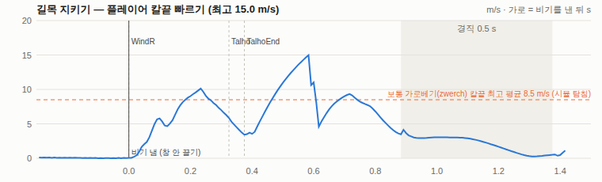
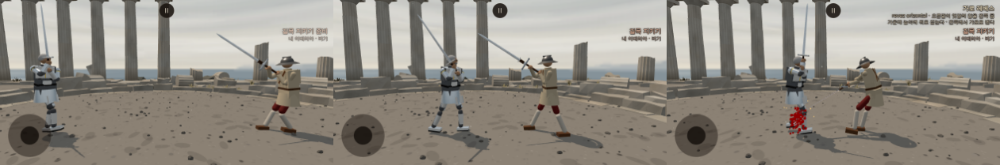

# 이베리아 비기 v6 — 길목 지키기 · 낮은 자세 · 올려 맞받기 (2026-10-11, 2 등급 작업자)

가지 `…/ib-gilmok-2q36ha` (origin/main a46838c 에서). main 푸시 없음.

- 사장님 10/11 03:1x: "이베리아 비기 좀 다른 아이디어가 필요해. 인간이 플레이할 때 비기가 너무 자주 나와. … 일본의 경우를 보면, 노리고 쓰면 한 판에 2-3회 시도할 수 있는데, 타이밍상 실패하기도 하고, 실제 발동은 1-2회, 정확히 안 들어가면 카운터로 손실도 보는.. 그런 컨셉이 좋아보여."
- 사장님 10/11 03:2x: "안2는 꼭 비기가 아니어라도 굉장히 좋은 설정인데 고유 동작으로 넣는 건 어떤가. 칼을 아래로 떨어트린 준비 동작을 지금은 안 쓰고 있나? 꽤 큰 차별성 같은데."
- 사장님 10/11 03:3x: "길목 지키기 비기로 해보자."

**한 줄**: v5 의 조건 '호 안쪽'(상태 — 맞붙은 거리 내내 창이 열림)을 걷어 내고, 일본 고노센과 같은 틀 **준비 → 순간 → 한 칼 → 경직**으로 바꿨다. 일본이 '때(상대의 공격)'를 노린다면 이베리아는 '자리(내 칼끝 선)'를 지킨다. 플레이어 쪽은 의도대로 걸러진다(맞붙어 계속 휘두르면 창 0 — v5 는 같은 대본에서 20 s 에 2). **그러나 AI 대 AI 48 판에서 한 칼이 한 번도 맞지 않았다**(§6 — 가장 먼저 여쭐 것).

## 1. 컨셉 (세 줄)

1. 몬탄테는 자리를 지키는 칼이다 — 피 단Ⅶ 「This rule serves to deter people in a street and impede them moving from one end to another」 [원문 영역] · 길목을 지킨다 [해석].
2. 간격 밖에서 칼을 몸 옆으로 감아 기다리다(준비), 상대가 내 칼끝 선을 넘어 드는 그 순간 한 칼로 둘러 벤다. 안에 머무는 것은 기회가 아니다.
3. 한 번 준비에 한 번 기회. 놓치거나 틀리면(헛침·막힘) 경직 0.5 s 의 대가를 치른다.

## 2. 원전 근거

| 자리 | 글 | 쓴 곳 |
|---|---|---|
| 피 단Ⅶ · 복Ⅶ | 「This rule serves to deter people in a street and impede them moving from one end to another」 · 「… until the people stop」 [원문 영역] | 길목(내 칼끝 선)을 지킨다 — 순간 = 경계 넘음 [해석] |
| 피 단Ⅺ · 복Ⅺ | 「talho orizontal」 · 「revez orizontal cingido」 [원문] | 준비 자세 = 옆 자세(칼을 몸에 감아 뒤로) · 한 칼 = 둘러 벰 |
| 고 규칙 9 | 「Tajos … in mittlerer Höhe zu einer der Seiten」 [원문 독일어 역] | 한 칼의 높이 = 몸 가운데 |
| 피 복Ⅶ | 「in each step you must give a blow」 [원문 영역] | 걸음 — 넣지 않음(§3-3) |
| 피 단Ⅰ · 복Ⅰ · 복Ⅶ | 모든 규칙은 칼끝 땅에서 시작해 끝남 · 「from where the montante comes to a stop you will give a talho from low to high」 · 「always from low to high」 [원문 영역] | 낮은 자세(아래 탈류·아래 레베스)를 기다리는 자세로 · 올려 맞받기 [해석] |

- 준비 셈·경계 넘음을 순간으로 삼는 것·한 번 준비에 한 번은 [해석]. 수는 모두 [추정] · 사장님 확인 전(확인표 870~878). 이름 '길목 지키기'·'올려 맞받기'는 가칭.

## 3. 동작 차례 (할 일 A)

| # | 단계 | 무엇 | 코드 |
|---|---|---|---|
| ① | 준비 | 상대 가슴이 내 칼끝 거리(reach) 밖에 `gilmokArmTime` 1.5 s · 공격·막기 아님 → armed (경계 안에 들어와도 `gilmokArmGrace` 0.5 s 남음). AI 는 칼을 몸 옆으로 감은 **옆 자세**(가로 탈류 G.sideR · 가로 레베스 G.sideL — 그때 자세의 쪽, 가운데면 오른쪽)를 잡고 **먼저 치지 않고 칼끝 선 밖에 선다**. 플레이어는 ② 칸에 '길목 지키기 준비'(일본 '고노센 준비'와 같은 자리·꼴) | secret.js `IaiArm('gilmokArmTime','gilmokArmGrace')` · ai.js update·watch·holdDist · main.js |
| ② | 순간 | armed 인 채 상대 가슴이 reach 를 **다가오며 넘는 스텝**(지난 거리 ≥ reach > 이번 거리, 상대 가슴 다가옴 > `iberianInsideClosing` 0.3 m/s — 내가 걸어 들어간 것은 아님). 플레이어는 창 `playerWindow` 0.5 s, AI 는 곧장. 창을 열거나 내면 준비가 풀림 | secret.js `gilmokEvent` · `IaiArm.consume` |
| ③ | 한 칼 | 감아 둔 쪽에서 가운데 점 [0, −0.1] → 반대쪽 옆 자세. 두 토막: 가운데 문 front(칼끝이 가슴 앞) · 끝 문 past(칼끝이 반대쪽), 문마다 최대 0.3 s(v5 FLOW_GATE_MAX), 맞히면 곧장. 물리 서보 길 · 힘 창 `iberianPower` 1.6 · 보조 힘 `iberianStrength` 1.5 재사용. 플레이어 손이 옆 자세에서 0.15 밖이면 먼저 그 쪽으로 감는 토막(문 = 칼끝이 그 쪽 · 뒤) | secret.js `gilmokSeq` · `flowGate` · v5 흐름 틀 그대로(ai.js secretStrikeEnd · skill.js) |
| ④ | 끝 | 경직 `SECRET.stiff.iberian` 0.5 s 그대로 · 맞히면 결정타 `hitMul` 1.3 그대로. v4 '막히면 밀어냄'(iberianShove)은 넣지 않음 | — |

### 3-1. 한 칼의 길이 왜 바뀌었나 (탐침 `tools/sim/iberian_flow_probe.mjs`, AI 츠바이핸더 대 서 있는 롱소드 몸)

| 판 | 칼끝 앞(가슴 기준) 최고 | 칼끝 높이(가슴 기준) | 맞힘 |
|---|---|---|---|
| 지시 그대로 (cutMid [0, 0.1] → 옆 자세, 문 없음) | — | — | 손 목표가 0.1 s 에 끝나 칼이 **경직 동안에야** 건너감 |
| 끝에만 문 past | **0.06 m** — 칼끝이 머리 위 뒤로 돌아 건너감 | +1.0 | 0 |
| 가운데 문 front + 끝 문 past | 1.28 m | +0.8~+1.5 (상대 머리 위) | 맞닿기에서 낸 8 번 중 아픔 눈 1 |
| **+ 가운데 점 [0, −0.1] (지금)** | 1.3 m | −0.5~+1.4 | 맞닿기에서 낸 8 번 중 아픔 눈 8 (상처는 8~10 J 둘) |

- 옆 자세는 칼이 몸 뒤(옆 각 130°)로 감겨 있다. 손 목표가 가운데를 순식간에 지나면 칼끝이 앞으로 돌아 나오지 않고 머리 위 뒤로 돈다 → 가운데 문.
- 가운데 점을 0.2 패드 낮춘 것은 **지시와 다르다**(확인표 873).

### 3-2. 빠르기 — 사장님 10/9 원칙 '비기는 통상의 움직임보다 훨씬 빨라야'

| | 칼끝 최고 (m/s) | 칼끝 옆 폭 |
|---|---|---|
| 보통 가로베기 zwerch (같은 길, 같은 자리에서 `CMP=zwerch ARM=0`, 6 판) | 4.7~10.2 · 평균 **8.5** | 0.3~1.2 m — 반대쪽까지 못 건너가는 일이 잦음 |
| 길목 한 칼 (AI, 탐침 8 판) | **16~19 · 평균 17.3** | 2.6~3.0 m (끝에서 끝까지) |
| 길목 한 칼 (플레이어, 브라우저) | **15.2** | — |

- 보통 가로베기의 약 2 배다. 골반·가슴 돌림은 자세표 옆 자세(골반 35°·가슴 45°) → 반대쪽 옆 자세(−30°·−40°)로 약 75~85° 돈다(세 순간 그림 셋째 칸).

### 3-3. 걸음

- 넣지 않았다. 대안으로 앞발 lunge 0.6 m(일본 japaneseStep 값)를 48 판 재 봤다: 맞힘 0 그대로(§6).

## 4. 판 스위치

- `SECRET.iberianSecret` 'gilmok'(기본) · 'flow'(v5) · 'v4'. 주소 `?ibSecret=flow|v4|gilmok` · test.html '이베리아 비기' 셋 고르기(src/test_pick.js — 기본이 아니면 주소에 실음).

## 5. 낮은 자세 · 올려 맞받기 (할 일 B)

- **낮은 자세**: `IBERIAN_GUARDS` 에 아래 탈류(wechselR, w 1.6) · 아래 레베스(wechselL, w 1.5)를 더했다(threat·high·low 는 칼끝 땅에와 같은 수). 칼끝 땅에(w 0.4)는 그대로.
  - **10/10 판단과 다른 해석이다**: 10/10 은 바꿈 자리를 '원전에 기다리는 자세로 없음'으로 뺐다. 원전은 이 자리를 '떨어진 칼이 멈춘 자리'로 적었고(피 복Ⅰ), 거기서 바탕 베기(아래에서 위로)가 곧장 나간다 — 멈춘 자리에서 다음 칼을 기다리는 것을 기다리는 자세로 읽었다 [해석]. schools.js 머리말에 적었다.
  - 화면 이름은 자세표 이름 그대로(아래 탈류 · 아래 레베스 · 칼끝 땅에).
- **올려 맞받기**(패시브 contraBaixo): when foeRaise · cond = 지금 낮은 자세(세 자세 가운데 하나를 골랐고 손이 그 자리 0.15 패드 안 — 길목 준비로 옆 자세가 덮었으면 아님) · 거리 = preThreat 의 reach + 0.3 그대로 · 길 = unterhau/unterhauL(talhoRevezBaixo 의 한 반, 손에서 가까운 쪽) + 앞 걸음 0.3(talhoRodeado 값) · p 0.6(일본 데바나 값). 벤 칼은 높이 비낌으로 넘어가고, 헛치거나 막히면 기존 '이어 돌기'가 잇는다(새 고리 없음). AI 만.

## 6. 측정 — 48 판 대 롱소드 (`node tools/sim/hybrid.mjs motion_lab.mjs duel <무기> 24 main`, GUARD_DWELL=1)

전 = a46838c (v5 멈추지 않는 흐름) · 후 = 이 가지.

| | 츠바이핸더 전 | 츠바이핸더 후 | ice 전 | ice 후 |
|---|---|---|---|---|
| 승/패/무 · 승률 (95 %) | 13/29/6 · 27 % (17~41) | 8/37/3 · **17 %** (9~30) | 12/29/7 · 25 % (15~39) | 11/30/7 · **23 %** (13~37) |
| 판마다 준비 · 창(경계 넘음) · 낸 · 맞힘 | — · — · 0.88 · 0.42 | **1.06 · 1.02 · 1.02 · 0** | — · — · 1.46 · 0.63 | **1.08 · 1.08 · 1.06 · 0** |
| 비기 낸 / 맞힘 (모두) | 42 / 20 | 49 / **0** | 70 / 30 | 51 / **0** |
| 넘어짐 모두 · 비기 동안·뒤 1 s | 41 · 9 | 46 · 11 | 57 · 16 | 44 · 10 |
| 경직 든 수 · 경직 동안 맞은 상처 · 비기 끝 뒤 1 s 맞은 상처 | 24 · 6 · 44 | 41 · **58 · 104** | 40 · 15 · 80 | 47 · **42 · 77** |
| 간 보기 중 길목 준비(옆 자세) 몫 | — | 85 % | — | 74 % |

- 승률을 보고 값을 고르지 않았다.
- **창 수는 사장님 숫자(판마다 2~3)보다 적다(≈ 1)**. 간 보기가 판마다 약 4 s 뿐이라(판 첫머리 다가설 때) 준비가 판마다 한 번이다 — 일본 '전투 초반 서로 가까워질 때 1~2번'과 같은 결이다. 맞붙은 뒤에는 둘 다 칼끝 거리 밖으로 1.5 s 떨어지는 일이 드물다.
- **맞힘 0** (상처도 0). 상대가 reach(2.08 m)를 넘는 순간에 내면 상대 가슴은 1.8~2.0 m — 걸음 없는 한 칼의 칼끝은 앞 1.3 m 남짓이고 높이도 머리 위로 뜬다(§3-1). 그래서 헛치고 경직·그 뒤에 맞는다(경직 동안·뒤 맞은 상처가 크게 늚 — '정확히 안 들어가면 손실'이 지나치게 셈).
- 걸러 본 판 (모두 츠바이핸더 48 판, 보고만):

| 판 | 창/판 | 맞힘 | 까닭 |
|---|---|---|---|
| 첫 꼴 (AI 걸쇠 없음 · 문 끝에만) | 0.04 (ice 0.77) | 0 | 상대가 칼끝 거리에 들자마자 AI 가 먼저 공격을 열어 준비가 풀림 · 칼끝이 머리 위 뒤로 돎 |
| 경계를 맞닿기(contact 1.66 m)로 | **0** | — | 상대 롱소드 AI 가 reach 와 contact 사이(1.85~1.96 m)에 서서 유예 0.5 s 안에 contact 를 안 넘음 (진단 4 판) → 되돌림 |
| 지금 + 앞발 lunge 0.6 m | 1.02 | **0** | 걸음으로도 안 닿음(21 %, 경직 동안·뒤 56·78) |

## 7. 낮은 자세 · 올려 맞받기 측정 (같은 48 판)

| | 츠바이핸더 전 | 츠바이핸더 후 | ice 전 | ice 후 |
|---|---|---|---|---|
| 고른 자세 머묾 — 간 보기 모두 | 곧은 42 · 귀 앞 39 · 칼끝 땅에 8 · 왼 높이 8 · 비낀 3 % | 곧은 50 · 귀 앞 21 · 왼 높이 9 · **아래 탈류 8 · 칼끝 땅에 7 · 아래 레베스 4** · 비낀 2 % | 곧은 44 · 귀 앞 38 · 칼끝 땅에 8 · 왼 높이 7 · 비낀 3 % | 곧은 47 · 귀 앞 21 · 칼끝 땅에 9 · 왼 높이 8 · **아래 레베스 7 · 아래 탈류 6** · 비낀 2 % |
| 고른 자세 머묾 — **길목 준비가 아닐 때** | — | **칼끝 땅에 45 · 곧은 41 · 아래 탈류 11** · 높이 비낌 1·1 · 아래 레베스 1 % (낮은 셋 57 %) | — | 곧은 36 · **칼끝 땅에 35** · 귀 앞 13 · **아래 레베스 7 · 아래 탈류 4** % (낮은 셋 46 %) |
| 몸이 실제로 가장 가까운 자세 | 황소 41 · 곧은(추단) 37 % … | **옆 자세 71 · 왼 옆 자세 13** · 곧은 6 % … | — | 옆 자세 62 · 왼 옆 자세 12 · 곧은 7 · 바꿈 5 % … |
| 올려 맞받기 낸/굴림 · 맞힘 · 동안·뒤 1 s 맞은 상처 | — | **2/4 · 0 · 7** | — | **0/4 · 0 · 0** |

- 낮은 자세는 길목 준비가 아닐 때 **곧은 자세와 나란히 가장 잦게** 고른다(낮은 셋 57 % · 46 %). 그러나 간 보기의 74~85 % 를 길목 준비 옆 자세가 덮어, 몸이 실제로 낮은 자세에 있는 몫은 몇 % 뿐이다. 그래서 올려 맞받기가 거의 안 나온다(굴림 4 번씩).
- 두 지시(준비 = 옆 자세 · 낮은 자세 = 기다리는 자세)가 같은 간 보기 시간을 다툰다 — 여쭐 것 3.

## 8. 플레이어 확인 (브라우저, 콘솔 에러 0)

`tools/browser/iberian_gilmok_probe.mjs` (츠바이핸더 플레이어 · 상대 롱소드 AI 살아 있음 · 미리보기 4195) → `tools/browser/iberian_gilmok_chart.mjs`.

| 대본 | 판 | 시간 | 휘두르기 | 창 | 낸 | 준비 켜진 시간 |
|---|---|---|---|---|---|---|
| press — 맞붙어(칼끝 거리 안 100 %) 0.35 s 마다 좌우 끌기 | **gilmok** | 20.0 s | 420 | **0** | 0 | 0 s |
| 같은 대본 | flow (v5) | 19.5 s · 19.1 s (두 번) | 400 · 414 | **2 · 2** | 2 · 2 | — |
| hold — S 로 물러나 칼끝 거리 밖에 버팀 | gilmok | 판 시작 2.6 s 에 준비(이미 1.5 s 넘게 밖) → 4.6 s 뒤 상대가 2.07 m 로 넘어 들 때 창 → 끌기 한 번으로 냄 | — | 1 | 1 | — |

- ① 준비 표시: 칼끝 거리 밖에 1.5 s 가 차면 ② 칸에 '길목 지키기 준비'(세 순간 그림 첫 칸 오른 위). 창이 열리면 비기 이름으로 바뀐다.
- ② 창: 상대가 다가오며 reach 를 넘는 스텝에 열렸다(거리 2.07 m).
- ③ 맞붙어 계속 휘두르면 창이 열리지 않는다(v5 는 같은 대본에서 20 s 에 2 번 — 둘 다 그대로 비기가 됨).
- ④ 발동: 감음 0.32 s(손이 옆 자세 밖이었음) → 가운데 0.04 s → 둘러 벰 0.52 s → 경직 0.49 s. 칼끝 최고 15.2 m/s.

## 9. 구현

| 파일 | 바꾼 것 |
|---|---|
| `src/schools.js` | `IBERIAN_SECRET_GILMOK` · 판 getter 'gilmok' 기본 · (B) IBERIAN_GUARDS 아래 탈류·아래 레베스 · IBERIAN_PASSIVES contraBaixo |
| `src/secret.js` | `IaiArm` 열쇠 일반화(일본은 인자 없이 — 전과 같음)·`ons`·`consume` · `gilmokEvent` · `gilmokSeq` · flowGate `front`·`past` · PlayerSecretWatch `gilArm` |
| `src/ai.js` | 길목 준비 셈·옆 자세 덮기 · 준비 동안 watch 걸쇠·holdDist · secretScan 창 재기·준비 풀기 · secretStrikeEnd 마지막 토막 문 · (B) passiveFor cond.low · passiveGo 걸음·이름 덧씌움 |
| `src/skill.js` | 마지막 토막 문(v5 마지막 토막은 문이 없어 전과 같음) |
| `src/main.js` | `?ibSecret=gilmok` · '길목 지키기 준비' 표시 |
| `src/config.js` | `iberianSecret: 'gilmok'` · `gilmokArmTime` · `gilmokArmGrace` |
| `src/test_pick.js` | 이베리아 비기 셋 고르기 |
| `tools/sim/motion_lab.mjs` | 길목 줄(준비·창·낸·맞힘 판마다 · 준비 자세 몫) · 길목 준비 아닐 때 자세 머묾 · 올려 맞받기 동안·뒤 맞은 상처 (길목 AI 가 있을 때만 찍음) |
| `tools/sim/iberian_flow_probe.mjs` | ARM · CMP · WALK · FIRE · STEPF · CUTMID 칸 |
| `tools/browser/iberian_gilmok_probe.mjs` · `iberian_gilmok_chart.mjs` | 플레이어 확인 · 그림 |

## 10. 관문 (a46838c 대비)

| 관문 | 기대 | 결과 |
|---|---|---|
| fights12 | cc4e62b1 | cc4e62b1 ✓ |
| live_battery | e7ee3d96 | e7ee3d96 ✓ |
| finish_thrust 1 --stand | 433ac984 | 433ac984 ✓ |
| corr_s0 --limits=on,off --scenes=a,b | IDENTICAL 12/12 | 12/12 ✓ |
| weapon_smoke | OK 21/21 | 21/21 ✓ |
| npx vite build | 종료 0 | ✓ |
| name_policy | 위반 0 | 0 ✓ |
| 이베리아가 아닌 무기 duel 24 main (a46838c 사본 대 이 가지, 'deprecated parameters' 뺀 sha256 앞 8) | 같음 | 롱소드 86029ced · 모노호시자오 4304b1f5 · 냉동 참치 9abf111a · 레이피어 ca7ce481 · 청강검 e2e4294a — 다섯 모두 같음 ✓ |

## 11. 사장님께 여쭐 것

1. **길목 한 칼이 AI 대 AI 에서 맞지 않는다 (48 판 × 2 · 맞힘 0).** 순간(상대가 칼끝 거리 reach 를 넘음)에 상대는 1.8~2.0 m 에 있고, 걸음 없는 둘러 베기는 앞 1.3 m 남짓에서 그친다. 고를 길:
   - (가) 순간은 그대로 두고, 한 칼을 상대가 맞닿기(contact)에 들 때까지 붙잡았다가 낸다(일본 v3 '터뜨림 창'과 같은 꼴 — 붙잡는 최대는 기존 releaseMaxHold 재사용)
   - (나) 한 칼에 크게 내딛는 걸음(시험한 lunge 0.6 m 로는 0 — 더 큰 값은 새 값)
   - (다) 경계를 reach 보다 안쪽 선으로(맞닿기 선은 상대 AI 가 그 사이에 서서 창 0 — 그 사이 값은 새 값)
2. **창 수 ≈ 판마다 1** (사장님 숫자 2~3). 간 보기가 판 첫머리뿐이라서다. 준비 시간 1.5 → 더 짧게(확인표 871) 하면 맞붙은 뒤에도 기회가 생길지 볼 수 있다 — 1 번을 고친 뒤 재는 것이 맞아 보인다.
3. **준비 자세(옆)와 낮은 자세가 간 보기 시간을 다툰다.** 길목 준비 아닐 때는 낮은 셋을 57 %·46 % 고르지만, 준비가 간 보기의 74~85 % 를 덮어 올려 맞받기가 거의 안 나온다(굴림 4·4). (가) 그대로 (나) 준비 자세를 낮은 자세로(옆 자세 대신 — 아래에서 올리는 길목 칼) (다) 낮은 자세를 골랐으면 준비 자세로 바꾸지 않음.
4. **AI 는 길목 준비 동안 먼저 치지 않고 칼끝 선 밖에 선다**(확인표 874) — 이것 없이는 창 0.
5. **한 칼 가운데 점을 지시([0, 0.1])보다 0.2 낮춤**(확인표 873) · 두 토막(가운데 문).
6. **창을 열면 준비가 풀림**(한 번 준비에 한 번 — 확인표 872).
7. 새 값 = 확인표 870~878 (사장님 확인 전).

## 12. 2차 (디렉터 10/11 — '칼끝 선에서 실제로 닿게 · 준비 동안은 낮은 자세로')

컨셉('상대가 칼끝 선에 들어선 그 순간, 칼끝에서 맞는다')은 그대로다. 붙잡았다 내기·경계 안쪽으로 옮기기는 하지 않았다.

### 12-1. 닿기 — 뻗음 + 높이 + 디딤

- **덧씌우기 자세** (secret_instant.js `gilmokCutPose`, AI·플레이어 같은 함수): 두 토막 동안 덧씌우기 칸(skill.thrustPose)에 손·칼날 방향·몸 돌림 목표를 준다. 물리 서보 목표이고, 스텝마다 자리를 지정하지 않는다.
  - 수는 일본 발도 길 `SECRET.iaiPath` 의 가운데(M)·끝(E)을 거울로 다시 썼다(새 값 아님 — 확인표 879).
  - 가운데 = 손 앞 0.5 · 위 0.1 · 칼날 수평(−3°). 팔을 앞으로 뻗는다.
  - 끝 = 반대쪽 앞으로 다 뻗고 칼날 반대쪽 75° · 칼 든 어깨가 앞.
- **디딤**: 첫 토막에 앞 0.3 m(talhoRodeado 값 — 확인표 880). 0.6(japaneseStep)도 재 봤으나 나아지지 않았다.
- **탐침** (`node tools/sim/hybrid.mjs iberian_flow_probe.mjs <무기> 8`, `WALK=0.5` — 상대가 걸어 듦). 칼끝이 가운데 선(옆 0)을 지날 때:

| | 칼끝 앞 (가슴 기준) | 칼끝 높이 (가슴 기준) |
|---|---|---|
| 1차 (덧씌우기 없음) | 1.3 m | +0.8~+1.5 m (상대 머리 위) |
| **2차 츠바이핸더** | **1.79~1.89 m** | **−0.13~+0.35 m** |
| 2차 ice | 1.88~1.89 m | +0.53~+0.65 m |

- 실제 판에서 길목 칼이 닿은 순간의 가슴 거리: 츠바이핸더 1.75 m · ice 1.74 m (motion_lab '닿는 순간').

### 12-2. 준비 자세 — 낮게 기다리고, 다가오면 감는다 (확인표 881)

- 준비가 켜지면 지금 자세가 낮지 않을 때 손에서 가장 가까운 낮은 자세(아래 탈류·아래 레베스·칼끝 땅에)로 옮긴다. 거기서 기다린다.
- 상대가 다가오는 중(foeClosing > 0.3)이고 가까울 때(< reach + 다가옴 × 0.4 + 0.3 — preThreat '가까움' 꼴)만 그 쪽 옆 자세로 감는다.
  - 감은 뒤 0.5 s(gilmokArmGrace)는 유지한다.
  - 쪽: 아래 레베스면 왼쪽, 아니면 오른쪽.
- 거리 조건 없이 '다가오면 감음'만 두면, 판 첫머리에 걸어오는 내내 감겨 있었다. 그래서 몸에 보이는 낮은 자세가 14~16 % 뿐이었다(아래 표 '거리 조건 없음').

### 12-3. 48 판 (`… duel <무기> 24 main`, 전 = a46838c v5)

| | 츠바이핸더 전 | 1차 | **2차** | ice 전 | 1차 | **2차** |
|---|---|---|---|---|---|---|
| 승률 (95 %) | 27 % (17~41) | 17 % | **40 % (27~54)** | 25 % (15~39) | 23 % | **17 % (9~30)** |
| 판마다 준비 · 창 · 낸 | — | 1.06 · 1.02 · 1.02 | 1.02 · 0.98 · 0.98 | — | 1.08 · 1.08 · 1.06 | 1.02 · 1.02 · 1.02 |
| **맞힘률** (맞힘 / 낸) | 48 % (v5 흐름) | 0 % | **38 % (18/47)** | 43 % | 0 % | **6 % (3/49)** |
| 길목 칼 상처 J 평균 / 최대 (상처 수) | 66 / 374 | — | **288 / 399 (34)** | 63 / 304 | — | 307 / 387 (4) |
| 넘어짐 모두 · 비기 동안·뒤 1 s | 41 · 9 | 46 · 11 | 32 · 5 | 57 · 16 | 44 · 10 | 42 · 6 |
| 경직 동안 · 끝 뒤 1 s 맞은 상처 | 6 · 44 | 58 · 104 | **64 · 78** | 15 · 80 | 42 · 77 | **41 · 91** |
| **몸에 보이는 낮은 자세** (간 보기, 몸에 가장 가까운 표 자세) | 바보 3 · 바꿈 2 % | 2~3 % | **64 %** (칼끝 땅에 35 · 아래 탈류 20 · 아래 레베스 9) · 옆 자세 24 % | 바보 3 · 바꿈 0 % | 3~5 % | **55 %** (28 · 20 · 7) · 옆 자세 25 % |
| 올려 맞받기 낸/굴림 | — | 2/4 | 0/0 | — | 0/4 | 1/2 |

- 걸러 본 판 (보고만, 승률로 고르지 않음):
  - **거리 조건 없음** (다가오면 늘 감음): 츠바이핸더 맞힘 44 %(21/48)·승률 50 %·낮은 자세 14 %. ice 맞힘 8 %·낮은 자세 16 %. → 낮은 자세가 보이게 하라는 지시에 따라 거리 조건을 둠.
  - **디딤 0.6**: 츠바이핸더 맞힘 42 %, ice 6 %(같은 수).
- 읽기 [해석]:
  - **츠바이핸더는 닿는다.** 한 칼 상처는 평균 288 J 로 보통 베기(zornhauL 평균 ~50 J)의 약 6 배다. 힘 창 1.6 × 보조 힘 1.5 × hitMul 1.3 에 칼끝 19 m/s 가 겹친 결과다. 결정타로는 맞지만 세기가 지나칠 수 있다 — 여쭐 것.
  - **ice 는 거의 안 닿는다.** ice 의 칼끝 거리 reach 가 2.32 m(츠바이핸더 2.08)라 경계를 넘는 순간 상대가 더 멀다. 칼끝은 앞 1.9 m 남짓에서 그치고 높이도 뜬다(+0.5~0.65).
  - 헛치면 경직 동안·뒤에 크게 맞는다(64·78 / 41·91). '정확히 안 들어가면 손실'이다.

### 12-4. 플레이어 확인 (브라우저, 콘솔 에러 0)

- 맞붙어 계속 휘두르기(20 s, 316 번): **창 0** 그대로.
- 간격 밖에서 버티다 다가오는 상대(4 번 돌림):
  - 판 시작 2.6 s 에 '길목 지키기 준비'가 뜬다.
  - 4.2~4.8 s 뒤 상대가 2.06~2.07 m 로 넘어 들 때 창이 열린다.
  - 끌기 한 번으로 낸다. **4 번 모두 맞았다**(상처 2~4 개). 칼끝 최고 14.9~15.2 m/s.
  - 맞은 자리는 **넓적다리(thighB 세기 1.8~2.0)·정강이**다. 플레이어 판은 몸통보다 낮게 지난다(시뮬 AI 판은 −0.13~+0.35 m).
- 세 순간 그림(준비 · 창 · 한 칼이 닿은 순간 — 셋째 칸 상대 다리에 피): `docs/handoff/iberian_gilmok_strip.png`
- 칼끝 빠르기 그래프: `docs/handoff/iberian_gilmok_tipspeed.png`

### 12-5. 여쭐 것 (2차)

1. **ice 맞힘 6 %**: reach 2.32 m 경계에서 칼이 못 미친다. 고를 길:
   - (가) 그대로
   - (나) ice 만 AI 쪽 붙잡기 시험
   - (다) 무기마다 디딤(새 값)
2. **길목 칼 세기**: 츠바이핸더 평균 288 J(보통 베기의 약 6 배)·승률 40 %. 힘 창·보조 힘·hitMul 이 겹친다. 밸런스 단계에서 볼지.
3. **플레이어 한 칼이 넓적다리 높이**로 지난다. 덧씌우기 높이(발도 M 의 위 0.1)를 플레이어 쪽만 올릴지(새 값).
4. 새 값·장치 = 확인표 879~881 (사장님 확인 전).

### 12-6. 관문 (2차, a46838c 대비)

fights12 cc4e62b1 ✓ · live_battery e7ee3d96 ✓ · finish_thrust 433ac984 ✓ · corr_s0 IDENTICAL 12/12 ✓ · weapon_smoke 21/21 ✓ · vite build ✓ · name_policy 0 ✓ ·
이베리아가 아닌 다섯 무기 duel 24 main 바이트 같음 (롱소드 86029ced · 모노호시자오 4304b1f5 · 냉동 참치 9abf111a · 레이피어 ca7ce481 · 청강검 e2e4294a) ✓

## 13. 3차 (디렉터 10/11 — '칼끝 높이를 상대 몸통에 맞추는 규칙 · 북부 대공의 검 디딤')

가지 `…/ib-gilmok-2q36ha` (main db48a3b 를 받은 뒤). 길목 칼 세기(평균 288 J)는 건드리지 않았다.

### 13-1. 바꾼 것

- **높이 각 계산** (확인표 882): 덧씌우기의 칼날 높이 각을 발도 길의 고정값(−3°) 대신 스텝마다 계산한다. AI·플레이어 같은 함수다.
  - sin(el) = (상대 가슴 몸체 높이 − 내 칼자루 높이) / (칼자루 → 칼끝 길이)
  - 기하에서 나오는 값이라 고르는 수가 없다.
- **감는 토막에 자세표 옆 자세** (확인표 883): 플레이어가 옆 자세 밖에서 창을 받으면 감는 토막이 앞에 붙는다. 덧씌우기 없이 감으면 칼이 머리 위를 돌아 떨어지면서, 그 힘으로 칼자루가 가슴 −0.26 m 까지 처졌다.
- **간격 맞춤 디딤** (확인표 884): 넣어서 재 봤으나 맞힘이 내려가 껐다. 디딤은 0.3 고정이다. 코드는 do.step.max 칸으로 남겼다.

### 13-2. 칼끝 높이 · 맞은 자리

| | 츠바이핸더 AI | 북부 대공의 검 AI | 츠바이핸더 플레이어 | 북부 대공의 검 플레이어 |
|---|---|---|---|---|
| 2차 칼끝 높이 (가운데 선, 가슴 기준) | −0.13~+0.35 m | +0.53~0.65 m | 넓적다리 높이 | — |
| **3차 칼끝 높이** (탐침 평균) | +0.42 (−0.34~+1.05) | +0.68 (0.06~1.30) | **−0.49** | **−0.07** |
| 3차 칼끝 앞 (가슴 기준) | 1.59 m | 1.55 m | 1.42 m | 1.71 m |
| **맞은 자리** (48 판 · 탐침) | **몸통 22/22** · 몸통 19/19 | **몸통 8/8** · 몸통 18/18 | 탐침 맞힘 0 · 브라우저 0/2 | 탐침 몸통 18/18 |

- AI 탐침은 상대가 걸어 들어와 1.0~1.2 m 까지 붙은 판이다. 그래서 가운데 선 높이가 실제 판보다 높게 나온다.
- 실제 48 판에서 길목 칼이 낸 상처는 **모두 몸통**이다.
- **플레이어 츠바이핸더는 여전히 낮다**: 칼자루는 목표 높이에 있지만, 둘러 베는 동안 칼끝이 명령보다 0.6 m 쯤 처진다(서보가 무거운 칼의 돌림을 못 버팀).
  - 브라우저 2 번 모두 헛쳤다. 2차에서는 넓적다리에 4/4 닿았다.

### 13-3. 48 판 (`… duel <무기> 24 main`)

| | 츠바이핸더 전 (a46838c) | 2차 (b707f94) | **3차** | ice 전 | 2차 | **3차** |
|---|---|---|---|---|---|---|
| 승률 (95 %) | 27 % | 40 % (27~54) | **40 % (27~54)** | 25 % | 17 % (9~30) | **27 % (17~41)** |
| 맞힘률 | 48 % (v5) | 38 % | **21 % (10/48)** | 43 % (v5) | 6 % | **6 % (3/52)** |
| 길목 칼 상처 J 평균 / 최대 | 66 / 374 (v5) | 288 / 399 | **124 / 387** | 63 / 304 | 307 / 387 | **140 / 290** |
| 맞은 자리 | — | (미집계) | **몸통 22/22** | — | (미집계) | **몸통 8/8** |
| 경직 동안 · 끝 뒤 1 s 맞은 상처 | 6 · 44 | 64 · 78 | **55 · 80** | 15 · 80 | 41 · 91 | **37 · 89** |
| 넘어짐 비기 동안·뒤 1 s | 9 | 5 | 4 | 16 | 6 | 9 |
| 몸에 보이는 낮은 자세 | 5 % | 64 % | 60 % | 3 % | 55 % | 54 % |

- 읽기 [해석]: 2차의 높은 상처(288 J)와 맞힘률은 칼끝이 가슴 위(목·머리 높이)를 지나서 나온 몫이 컸던 것으로 보인다. 몸통을 겨누자 맞힘은 줄고 상처는 보통 결정타 크기(124 J)로 내려왔다. 승률은 보고만 한다.
- 간격 맞춤 디딤(확인표 884): 츠바이핸더 19 % · 북부 대공의 검 2 % (승률 23 % · 13 %).

### 13-4. 플레이어 확인 (브라우저, 콘솔 에러 0)

- 맞붙은 휘두르기 20 s: **창 0** 그대로.
- 다가오는 상대에게 준비 · 창 · 한 칼: 창은 열리고 칼은 나가지만 **2 번 모두 헛침**(츠바이핸더).
  - '몸통 높이로 닿는 그림'은 아직 없다. 그림(`docs/handoff/iberian_gilmok_strip.png`)은 2차의 넓적다리에 닿은 장면 그대로 뒀다.

### 13-5. 여쭐 것

1. **플레이어 츠바이핸더 칼끝 처짐**: 높이 각은 맞게 명령해도 둘러 베는 동안 칼끝이 0.6 m 쯤 처진다. 고를 길:
   - (가) 플레이어 한 칼에 AI 와 같은 보조 힘을 확인
   - (나) 처짐을 되먹임으로 보정 — 새 이득 값
   - (다) 2차(고정 −3°)로 플레이어만 되돌림 — 넓적다리라도 닿음
2. **북부 대공의 검 맞힘 6 %**: 높이·디딤으로는 나아지지 않았다. 경계(reach 2.32 m)가 날 길이에 비해 멀다. 무기마다 경계를 칼끝 앞 거리로 정할지는 컨셉 결정이다.
3. 새 확인표 882~884 (사장님 확인 전).

### 13-6. 관문 (3차, a46838c 대비)

fights12 cc4e62b1 ✓ · live_battery e7ee3d96 ✓ · finish_thrust 433ac984 ✓ · corr_s0 IDENTICAL 12/12 ✓ · weapon_smoke 21/21 ✓ · vite build ✓ · name_policy 0 ✓ ·
이베리아가 아닌 다섯 무기 duel 24 main 바이트 같음 (86029ced · 4304b1f5 · 9abf111a · ca7ce481 · e2e4294a) ✓

## 14. 4차 (디렉터 10/11 — 플레이어 칼끝 처짐 원인 · 북부 대공의 검 경계 스위치)

### 14-1. 플레이어 처짐 원인

디렉터가 짚은 세 후보를 탐침(플레이어 몸, 상대 롱소드 멈춤)으로 하나씩 확인했다.

| 후보 | 확인 | 결과 |
|---|---|---|
| ① 힘 창·보조 힘이 플레이어에도 걸리나 | 한 칼 동안 powerMul 1.60 · strength 1.50 | 걸림. 따라 지나감에서 1 로 돌아가는 것도 AI 와 같다 |
| ② 보정 v2 · 되돌아옴이 덧씌우기와 싸우나 | 보정 v2 / 옛 보정(AI 와 같음) × 되돌아옴 켬/끔 | 칼끝 바닥 −0.75 / −0.80 / −0.88 m — 거의 같아 원인 아님 |
| ③ 손 속도·서보 | 같은 AI 보통 난이도 빠르기 | 차이 없음 |
| **감는 토막** | 손을 미리 옆 자세에 두고 내기(AI 준비와 같은 처음 자리) | **칼끝 가슴 +0.1~+0.3 m** — 처짐이 사라짐 |

- 원인 [해석]: 플레이어는 손이 옆 자세 밖에서 창을 받으니 '감는 토막'이 앞에 붙는다. 높은 자세에서 감는 칼이 머리 위(칼끝 +0.9~1.0 m)를 돌아 떨어지고, 그 아래로 향한 힘이 한 칼로 이어진다. AI 는 준비 동안 이미 옆 자세라 감지 않는다.
- 3차에서 감는 토막에 자세표 옆 자세를 덧씌운 것(883)은 이 힘을 더 키웠다. 브라우저 2/2 헛침이 그 결과다.
- 고친 것: **883 을 거뒀다**(확인표 885). 감는 토막은 덧씌우지 않는다. 높이 각 계산(882)은 AI 와 같은 함수 그대로다.
- 브라우저 결과: **2/2 닿음, 넓적다리**(thighB 세기 1.7~2.0) — 2차와 같은 자리.
- 몸통까지 올리려면 감는 힘을 지워야 한다. 새 이득 값은 넣지 않았다(지시).
- 시도했다가 뺀 것 (탐침):
  - 감는 문을 'low'로: 칼끝 −0.44 · 북부 대공의 검 맞힘 0
  - 칼끝이 가라앉을 때까지(6 m/s, 따라 지나감 문턱) 기다림: 문이 0.33 s 만료까지 안 열림 · 칼끝 −0.44
  - 플레이어만 고정 각(−3°) + 감음 덧씌우기: 브라우저 0/2

### 14-2. 맞힘 · 맞은 자리

| | AI 48 판 (reach) | AI 48 판 (cut) | 플레이어 브라우저 |
|---|---|---|---|
| 츠바이핸더 | 23 % (11/49) · 몸통 29/29 | 27 % (13/49) · 몸통 28/28 | 2/2 · 넓적다리 |
| 북부 대공의 검 | 8 % (4/52) · 몸통 6/6 | **43 % (19/44)** · 몸통 46/46 | (안 잼) |

### 14-3. gilmokEdge 'cut' (스위치 — 기본은 'reach' 그대로, 확인표 886)

- 'cut' 경계 = 덧씌우기 가운데 손 앞 0.5 + 날 길이 + 디딤 0.3. 계산하면 츠바이핸더 2.02 m · 북부 대공의 검 2.01 m (reach 는 2.08 · 2.32).
- 시뮬: `node tools/sim/with_config.mjs SECRET.gilmokEdge=cut hybrid.mjs motion_lab.mjs duel <무기> 24 main`.

| | 츠바이핸더 2차 (b707f94) | reach (4차) | **cut** | ice 2차 | reach (4차) | **cut** |
|---|---|---|---|---|---|---|
| 승률 (승률 보고 값 안 고름) | 40 % | 38 % (25~52) | 29 % (18~43) | 17 % | 27 % (17~41) | **38 % (25~52)** |
| 판마다 준비 · 창 · 낸 | 1.02 · 0.98 · 0.98 | 1.04 · 1.02 · 1.02 | 1.13 · 1.02 · 1.02 | 1.02 · 1.02 · 1.02 | 1.08 · 1.08 · 1.08 | 1.02 · 0.92 · 0.92 |
| 맞힘률 | 38 % | 23 % | 27 % | 6 % | 8 % | **43 %** |
| 길목 칼 상처 평균 | 288 J | 103 J | 132 J | 307 J | 165 J | 199 J |
| 경직 동안 · 끝 뒤 1 s 맞은 상처 | 64 · 78 | 57 · 80 | 58 · 82 | 41 · 91 | 39 · 94 | **34 · 52** |
| 몸에 보이는 낮은 자세 | 64 % | 61 % | 62 % | 55 % | 54 % | 49 % |

### 14-4. 플레이어 확인 (브라우저, 콘솔 에러 0)

- 맞붙은 휘두르기 20 s(522 번): **창 0**.
- 다가오는 상대: 2/2 닿음(넓적다리). 세 순간 그림(셋째 칸이 닿은 순간): `docs/handoff/iberian_gilmok_strip.png`.

### 14-5. 관문 (4차, a46838c 대비)

fights12 cc4e62b1 ✓ · live_battery e7ee3d96 ✓ · finish_thrust 433ac984 ✓ · corr_s0 IDENTICAL 12/12 ✓ · weapon_smoke 21/21 ✓ · vite build ✓ · name_policy 0 ✓ ·
이베리아가 아닌 다섯 무기 duel 24 main 바이트 같음 (86029ced · 4304b1f5 · 9abf111a · ca7ce481 · e2e4294a) ✓

### 14-6. 여쭐 것

1. **gilmokEdge 기본**: 'reach' 그대로 둘지 'cut' 으로 바꿀지. 'cut' 이면 북부 대공의 검 맞힘이 8 → 43 % 로 오르고, 츠바이핸더는 23 → 27 % 로 비슷하다(확인표 886).
2. **플레이어 한 칼 높이**: 지금은 넓적다리(2차와 같음). 감는 힘을 지우려면 새 값이 필요하다.
   - 예: 감는 토막의 손 빠르기를 받아 막기 빠르기로 낮춤, 또는 감음 뒤 짧은 멈춤 — 둘 다 새 값

## 15. 5차 (디렉터 10/11 — 플레이어도 준비 중 손을 떼면 AI 와 같은 준비 자세로)

### 15-1. 바꾼 것 (확인표 887)

- 플레이어 길목이 준비(armed)이고 손가락을 떼고 있으면, 쉴 목표를 AI 준비 자세와 같은 함수로 정한다(secret.js `gilmokLowGuard` · `gilmokWindT`).
  - 기본은 낮은 자세(손에서 가까운 아래 탈류·아래 레베스·칼끝 땅에)다.
  - 상대가 다가오고 가까우면 옆 자세로 감고, 감은 뒤 0.5 s 는 유지한다.
  - 손 빠르기는 쉴 자세로 돌아가는 빠르기(SKILL.recoverSpeed) 그대로다.
- 손가락을 대고 있으면 플레이어 손 그대로다.
- AI 쪽도 같은 함수를 부르게 바꿨다. AI 48 판 출력은 4차와 바이트 같다(츠바이핸더·북부 대공의 검 `cmp` 같음).

### 15-2. 플레이어 확인 (브라우저, 콘솔 에러 0)

| | 결과 |
|---|---|
| 준비 중 자세 | 손을 떼고 버티면 **낮은 자세(아래 탈류 [0.38, −0.44])** 로 쉬다가, 상대가 다가오면 옆 자세로 감는다. 창이 열릴 때 손은 [0.52, 0.06](옆 자세) |
| 감는 토막 | **없이 나간다** (토막: 가운데 → 둘러 벰, 칼끝 최고 19~20 m/s) |
| 가운데 선 칼끝 | 앞 **1.56~1.58 m** · 높이 **가슴 −0.51~−0.53 m** · 그때 상대 가슴 1.74~1.76 m |
| 맞힘 | **0/5** (4차는 감는 토막이 붙어 2/2 넓적다리) |
| 맞붙은 휘두르기 | 20 s · 376 번 — **창 0** |

- 그림: 준비 중 낮은 자세 → 감기 시작 → 창 — `docs/handoff/iberian_gilmok_arm_strip.png`.
- 읽기 [해석]:
  - 감는 토막을 없애니 시간이 짧아졌다. 칼이 지날 때 상대는 아직 1.75 m 에 있고, 칼끝은 1.57 m 에서 그친다. 4차는 감는 0.3 s 동안 상대가 더 들어와 다리가 닿았다.
  - 높이도 가슴 −0.5 m 다. 탐침에서 손을 그 자리에 박아 두면 +0.1~0.3 m 였는데, 그보다 낮다. 쉴 빠르기로 막 감겨 들어온 칼이 아직 흔들리는 중(창 때 칼끝 0.8 m/s)인 것으로 보인다 [추정].
  - AI 도 reach 경계에서는 맞힘이 23 % 다. 'cut' 경계(2.02 m)라면 플레이어도 더 가까운 순간에 창이 열린다 — 사장님 답(확인표 886)과 함께 볼 것.

### 15-3. 관문 (5차, a46838c 대비)

fights12 cc4e62b1 ✓ · live_battery e7ee3d96 ✓ · finish_thrust 433ac984 ✓ · corr_s0 IDENTICAL 12/12 ✓ · weapon_smoke 21/21 ✓ · vite build ✓ · name_policy 0 ✓ ·
이베리아가 아닌 다섯 무기 duel 바이트 같음 ✓ · AI 이베리아 48 판(츠바이핸더·북부 대공의 검) 4차와 바이트 같음 ✓

## 16. 6차 (디렉터 10/11 — 마지막 점검: 플레이어 디딤 · 감긴 칼)

### 16-1. 디딤

- 브라우저에서 gait.requestStep 기록을 남겨 확인했다. 첫 토막 lunge 0.3 은 **받아 준다**(ok). 뒤 토막도 '닿기 모자람' 걸음 pass 0.6 을 받아 준다.
- 그러나 가운데 선까지 몸이 **0.01~0.02 m** 만 옮겨졌다. 다리는 내딛는데 플레이어 스틱(조작 없음 = 0)이라 몸 목표가 거의 따라가지 않는다.
- AI 는 내딛는 동안 스틱을 앞으로 민다(ai.js moveFeet fwd 1, STEP_T 0.3 s).
- 같게 맞췄다(확인표 888, 길목만): 걸음을 받은 뒤 0.3 s 동안 스틱 앞 1. 그래도 몸 옮김은 **0.01~0.09 m** 였다. 디딤이 칼끝 앞 거리를 메우지 못한다.

### 16-2. 감긴 칼

- 창이 열린 순간 플레이어 칼끝은 옆 1.27 · 앞 −0.62 · 높이 +0.32 m · 0.15~0.8 m/s 다.
- AI 준비 자세(탐침, 낸 순간)는 옆 1.13~1.16 · 앞 −0.74 · 높이 +0.29~0.35 · 0.6~1.2 m/s 다.
- **같은 자리이고 덜 흔들린다** → 원인이 아니다.
- 손 빠르기를 AI 감기 빠르기(parrySpeed 4.5 m/s)로 올리는 것은 하지 않았다. 손 목표가 휘두르기 문턱(swingSpeed 1.5)을 넘으면 검술 층이 '휘두르기'로 보고 준비가 풀린다. 쉴 빠르기 1.2 그대로다.

### 16-3. 브라우저 5 번씩 (다가오는 상대, 손 뗀 채 버팀)

| 경계 | 맞힘 | 맞은 자리 | 가운데 선 칼끝 앞 · 높이 | 그때 상대 가슴 |
|---|---|---|---|---|
| reach (기본) | 1/5 | 넓적다리 | 1.54~1.59 m · −0.50~−0.58 m | 1.70~1.77 m |
| cut | 0/5 | — | 1.55~1.57 m · −0.52~−0.57 m | 1.70~1.73 m |

- 맞붙은 휘두르기 창 0 은 5차와 같다(이번 차에 바꾼 것은 디딤 스틱뿐).

### 16-4. 판단 자료 — 플레이어를 4차로 둘지 5·6차로 둘지

| | 4차 (손 그대로, 감는 토막 붙음) | 5·6차 (손 떼면 준비 자세) |
|---|---|---|
| 맞힘 (브라우저) | **2/2** (넓적다리) | 0/5 → 1/5 (넓적다리) |
| 감는 모습 | 창이 열린 뒤 칼이 머리 위를 돌아 떨어짐 | 준비 중 낮은 자세 → 다가오면 옆 자세(AI 와 같은 예고) |
| 칼끝 (가운데 선) | 낮음 (넓적다리) | 앞 1.55 m · 가슴 −0.5 m — 상대에 못 미침 |
| 남은 원인 [해석] | 감는 0.3 s 동안 상대가 더 들어와 닿음 | 플레이어 한 칼의 칼끝이 AI(앞 1.8~1.9 m · 몸통)보다 0.3 m 짧고 0.6 m 낮다. 힘 창·보조 힘·보정 층·디딤 걸음 승인은 AI 와 같다. 몸이 디딤만큼 앞으로 가지 않는 것까지는 찾았으나, 칼끝이 낮은 까닭은 못 찾았다 |

- 맞힘만 보면 4차가 낫다. 낮은 자세 → 감기 예고(사장님 '큰 차별성')는 5·6차에만 있다.
- 플레이어 쪽 시도는 이번 차로 멈춘다(지시).

### 16-5. 관문 (6차)

fights12 cc4e62b1 ✓ · live_battery e7ee3d96 ✓ · finish_thrust 433ac984 ✓ · corr_s0 IDENTICAL 12/12 ✓ · weapon_smoke 21/21 ✓ · vite build ✓ · name_policy 0 ✓ ·
이베리아가 아닌 다섯 무기 duel 바이트 같음 ✓ · AI 이베리아 48 판(츠바이핸더·북부 대공의 검) 4차와 바이트 같음 ✓

## 17. 플레이어 한 칼 — 원인과 고침 (디렉터 10/11 13:0x · 사장님 결정 13:2x, 가지 `…/ib-player-cut-2q36ha`)

### 17-1. 같은 장면 맞대기 탐침 (`node tools/sim/gilmok_pair_probe.mjs zweihander <씨앗>`)

같은 츠바이핸더 · 같은 상대(롱소드 몸, 멈춤) · 같은 거리에서 ① AI 몸(ai.js secretGo) ② 플레이어 몸(skill.js secret — 보정 v2·autoGuard 게임과 같음)이 길목 한 칼을 내게 하고 물리 스텝마다 적었다.

**시작 자세를 같게 두면(옆 자세로 감긴 준비, 손을 뗀 쉼 무게 1) 두 칼은 같다.** 처음 갈리는 스텝(|차| > 0.03):

| 값 | 처음 갈린 스텝 | AI | 플레이어 | 읽기 |
|---|---|---|---|---|
| 덧씌우기 무게 thrustPose.w | 0 (t 0.008) | 0.93 | 1.00 | AI 쪽 버릇: AI 몸의 skill.update 가 `gilCutW > 0` 줄에서 gilmokCutPose(seg 없음)를 불러 한 틱 걷음(1 − dt/0.12). 플레이어가 뜻한 값 |
| 스틱 | 0 | 0 · −0.21 | 0 · 0.63 | AI moveFeet 뒤로 당김 / 플레이어 검술 층 내딛기 |
| 칼끝 | 10 (t 0.092) | [−0.62, 0.30, 1.36] | [−0.61, 0.34, 1.37] | 4 cm |
| 칼날 방향 | 14 (t 0.125) | — | — | 3 cm 안팎 |
| 높이 각 입력(상대 가슴 · 내 칼자루) | 상대 가슴 갈림 없음 · 칼자루 55 (t 0.467, 가운데 선 뒤) | 1.36 | 1.33 | 같은 몸을 가리킴 |
| 패드 목표 | 83 (t 0.70, 경직) | | | |
| **가운데 선 칼끝 (앞 · 높이, 가슴 기준)** | | **1.51 · −0.60** | **1.50 · −0.62** | 같음 |
| 걸어 듦(WALK=1, GAP 2.6) | | 1.57 · −0.43 · 골반·다리 | 1.62 · −0.45 · 다리·골반 | 같음 |
| 제 준비·제 창(NATURAL=1, 상대 1 m/s 로 걸어 듦) | | 1.88 · −0.14 · 가슴·배 290 J | 1.77 · −0.21 · 가슴·배 300 J | 같음 |

- 처음 탐침(손가락을 댄 채 준비)은 스텝 0 부터 칼날·몸 돌림이 갈렸다(칼날 AI [−0.64, 0.21, 0.74] · 플레이어 [0.76, −0.04, 0.64] · 가슴 −0.77 / −0.15 rad). 손가락을 대면 보정 v2 가 날것 매핑이라 '옆 자세'가 몸 뒤로 감기지 않는다. 손을 떼면(쉼 무게 1 — 옛 자세 지도) AI 와 같은 감긴 모습이 된다 — 5차가 그 자리다.
- 원인 후보 확인: 손 패드 한도(덧씌우기가 손을 다 덮어 무관) · 매 프레임 덮어쓰기(없음 — 브라우저 main.js 도 실행 중엔 손을 안 옮김) · autoGuard(실행 중 꺼짐) · 걸음(플레이어가 오히려 더 나감) · IK 기준·높이 각 참조(같음). **플레이어만의 원인은 없다.**

### 17-2. 'AI 는 1.8~1.9 m · 몸통'의 출처

- 그 수는 2차 탐침(`WALK=0.5`, 높이 각 계산 전)에서 나왔다. 3차 이후 그 탐침의 AI 는 상대가 1.0~1.2 m 까지 붙은 채(칼이 몸에 걸려 올라감) 쟀다.
- 실제 AI 48 판(츠바이핸더, `GIL_MID=1` 계기 — 켤 때만 찍음): **가운데 선 칼끝 앞 1.50 m (0.89~1.95) · 높이 −0.31 m (−1.04~+1.41) · 그때 상대 1.70 m · 낸 때 2.07 m**, 맞힘 23 %. 북부 대공의 검 1.61 · −0.27 · 1.94 · 2.31, 맞힘 8 %.
- 플레이어 브라우저(5·6차를 얹은 창 순간 낸 칼): 1.56~1.60 · −0.46~−0.54 · 상대 1.76~1.80 — **AI 와 같은 칼, 같은 결과**. 맞은 자리 '몸통' 셈에는 골반·배가 든다.
- 남는 낮음은 AI·플레이어 같은 몫이다: 높이 각 명령 −3~−6° 에 비해 둘러 베는 동안 칼날이 −29° 까지 처진다(무거운 칼의 서보 뒤처짐 — 13-2 와 같은 관찰). 고치려면 공용 칼(AI 도 바뀜)이나 새 값이 든다 → 하지 않음.

### 17-3. 고친 것

- 플레이어 한 칼 실행에는 고칠 것이 없었다(같은 장면에서 같은 칼).
- **5차·6차 다시 얹음** (974675f · 9245427 그대로 체리픽 — 확인표 887·888): 준비 중 손을 떼면 낮은 자세 → 다가오면 옆 자세로 감음 · 디딤 스틱.
- **사장님 결정 10/11 13:2x — 준비가 켜진 뒤 언제든** (확인표 889): 플레이어만, 길목 준비(armed — 경계 안 유예 0.5 s 포함)가 켜져 있으면 공격 입력(톡·휘두르기) 하나가 곧 길목 한 칼. 쓰면 준비가 풀린다(한 번 준비에 한 번). 보정 없음 · 새 값 없음. secret.js `PlayerSecretWatch.fireArmed` · main.js. 경계 넘음 창은 그대로 남아 늦은 쪽 길이 된다(창 길이 0.5 s 는 그대로). AI 는 바꾸지 않음.
- 도구: `tools/sim/gilmok_pair_probe.mjs`(맞대기 — GAP·WALK·NATURAL·HELD·ROWS) · `motion_lab.mjs` `GIL_MID=1` 계기 · 브라우저 hold 대본 `FIRE=early|right|late`.

### 17-4. 플레이어 확인 (브라우저 hold, 츠바이핸더 대 롱소드 AI, 콘솔 에러 0)

| 낼 때 | 낸 때 상대 가슴 | 맞힘 | 맞은 자리 | 가운데 선 칼끝 앞 · 높이 (그때 상대) |
|---|---|---|---|---|
| ① 이르게 (상대 > reach + 0.5) | 4.99~5.01 m | 0/3 헛침 | — | 1.69~1.85 · −0.72~−1.00 (4.50~4.73) |
| ② 알맞게 (상대 ≤ 1.75 m) | 1.73 m (2 번) · 1 번은 상대가 1.75 안으로 안 들어와 못 냄 | **2/2** | 넓적다리 (thighB 2.75~2.89 · thighF 1.55~1.88) | 칼에 걸려 가운데 선 전 닿음 — 닿은 순간 상대 1.58 m |
| ③ 늦게 (창 끝 무렵 0.42 s) | 1.74~1.75 m | 1/3 | 넓적다리 (thighB 2.72) | 1.49~1.51 · −0.62~−0.63 (1.78~1.79) |
| 참고: 창 순간 (전과 같은 대본) | 2.05 근처 | 0/3 | — | 1.56~1.60 · −0.46~−0.54 (1.76~1.80) |

- ② 는 닿지만 **몸통이 아니라 넓적다리**다(17-2 의 공용 처짐). ① 은 헛치고, 상대가 이 동안 멈춰 있어 경직 중 맞지는 않았다. ③ 은 상대가 1.75 m 근처에서 서 버려(롱소드 AI 의 간 보기 거리) '안쪽이라 걸림'이 아니라 '못 미침'이 났다.
- press 대본(맞붙어 휘두르기 20 s · 249~277 번): **창 0**. 낸 1 은 대본 첫 휘두르기(걸어 드는 동안 준비가 켜져 있었고 유예 0.5 s 안 — 결정대로)다. 맞붙어 휘두르는 동안 준비 0 s · 비기 0.
- 그림(준비 낮은 자세 → 감음 → 알맞게 낸 한 칼이 닿는 순간 — 넓적다리): `docs/handoff/iberian_gilmok_ready_strip.png`.

### 17-5. 관문 (main 4577da9 대비)

fights12 cc4e62b1 ✓ · live_battery e7ee3d96 ✓ · finish_thrust 433ac984 ✓ · corr_s0 IDENTICAL 12/12 ✓ · weapon_smoke 21/21 ✓ · vite build ✓ · name_policy 0 ✓ ·
AI 이베리아 48 판(츠바이핸더 100a1aef · 북부 대공의 검 2df696cb, GUARD_DWELL=1 GIL_MID=1) main 과 바이트 같음 ✓

### 17-6. 여쭐 것

1. 몸통 높이: AI·플레이어 공용 칼이 둘러 베는 동안 칼날이 명령보다 20° 넘게 처진다. 몸통으로 올리려면 공용 칼을 바꾸거나(AI 도 바뀜) 새 값이 든다.
2. 이른 칼의 벌: 상대가 멀면 헛쳐도 맞지 않는다(상대가 경직 동안 닿지 않음). 지금은 물리 그대로 둠.
