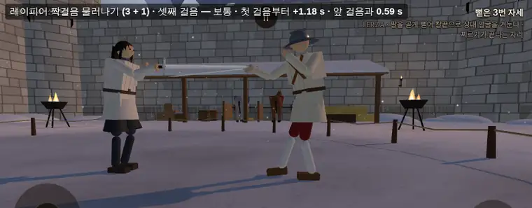
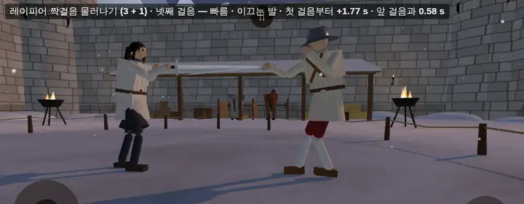
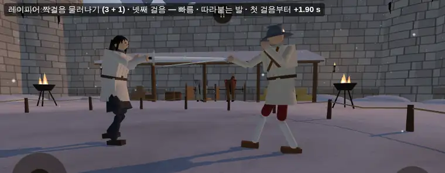
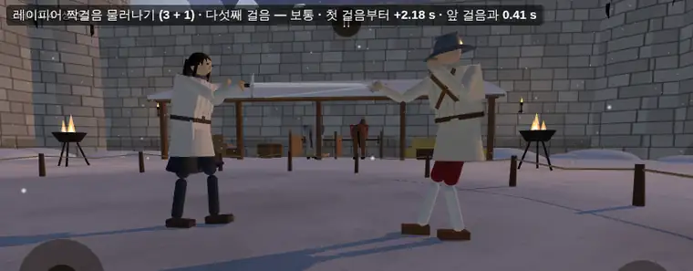

# 이탈리아 박자 걸음 — 3 + 1 (2026-10-15)

- 가지 `…/it-rhythm` · 바탕 main `fdd6455`. 감독(우화)이 맡김. 유파 기술 지도 `docs/strike/school_kit_map.md` §2 보법 칸을 바꾼다(같은 커밋에서 고침).
- 사장님 말씀 (10/15, 원문): "이탈리아: 앞이든 뒤든 4걸음마다 다음 1걸음이 50% 빨라질 수 있어? 전투가 자연스럽게 보법의 리듬을 따르게 될거 같은데. makesense하다면 수치 미세튜닝은 나중에 해도 됨. 아니 3걸음마다 1걸음이 더 박자 감각이 생길까?"
- 감독 답: 말이 된다. **3 + 1** 을 기본으로 권한다(4 박 한 마디 — '하나·둘·셋·빠르게', 박자를 세기 쉽고 빠른 걸음이 25 %).
- 바탕: 10/15 보법 점검에서 이탈리아 보법은 사람에게 보이는 이점도 숨은 이점도 확인되지 않았다(짧은 보폭 0.45 · 빠른 박자 2.6 · 상대 2.8 m 안 follow 짝걸음 · 베기 걸음 런지 0.85 배 + 끌어붙임).

## 1. 한 줄

앞뒤 걸음 **셋마다 넷째 걸음이 빠르다** — 그 걸음 동안 몸이 나가는 빠르기 × 1.5, 발 박자 × 1.5(한 걸음 시간 ÷ 1.5). 사람·AI 같이. 화면 글은 없고 빠른 걸음 발소리만 조금 또렷하다.
주기는 손잡이 하나 `ITALIAN_GAIT.rhythm.every`(기본 3) — 주소 `?itRhythm=4` = 4 + 1(다섯째가 빠름) · `?itRhythm=0` = 끔(칸 없는 것과 같은 길).

## 2. 규칙과 구현

| 규칙 | 정한 것 | 근거 |
|---|---|---|
| 한 걸음 | **follow 짝걸음 안: 이끄는 발로 여는 한 짝**(이끄는 발 + 따라붙는 발 + 짝 사이 쉼) · **밖(지나 딛기): 걷는 동안 몸을 옮기는 한 디딤** — walk 걸음과 걷는 중 catch 걸음 | 짝걸음은 코드에서도 한 짝이 한 단위다 — 박자 상한 `pair.stride`·몸 박자 `leadV`·`trailV`·`restV` 가 한 짝 평균으로 나뉜다(펜싱의 advance = 앞발 + 뒷발). 지나 딛기는 디딤마다 몸이 한 보폭 나간다(passata). catch 도 세는 까닭: 스틱 끝까지 앞으로 달리면 레이피어 앞발 디딤이 **박자 걸음 전에도** 늘 catch 로 열린다(다리가 닿는 거리 규칙) — 안 세면 두 디딤에 하나만 센다 |
| 세는 걸음 | 가려는 속도의 앞뒤 몫이 옆 몫보다 큰 걸음만(짝걸음 PR 과 같은 가름) · 앞 ↔ 뒤로 바꿔도 셈은 이어짐 | 감독 규칙 2 |
| 세지도 끊지도 않는 걸음 | 옆 걸음 · 기술 걸음(req — 베기 걸음·비껴 딛기·비기 걸음 · draw 끌어붙임) · 짝걸음 안 catch · 자세 고치기 | 감독 규칙 2(옆) + 작업자 판단(기술 걸음은 칼의 일 — 빨라지지 않고 셈도 그대로) |
| 처음부터 | 걸음이 끝난 뒤(디딘 뒤) **0.7 s**(`rhythm.idle`) 안에 새 걸음을 떼지 않으면 0 · 자세 고치기 걸음은 걸음으로 치지 않음 | 걷는 동안 가장 긴 틈 = 가장 느린 짝걸음의 짝 사이 쉼 0.52 s(스틱 앞 0.12·뒤 0.25 — §4-4), 지나 딛기 0.13 s 아래 → 0.18 s 여유 |
| 빠른 걸음 | every 번 센 다음 걸음: 가려는 속도 × 1.5(몸 전체 — 한 걸음 길이를 그대로 두려고 앞뒤만이 아니라 걸음 전체) · 한 걸음 시간 sT = stepT ÷ 1.5 | 감독 규칙 4 · 이베리아 `sideMul` 과 같은 결(gait.js 의 몸 일, 플레이어·AI 같이) |
| 발 박자 | 지나 딛기: 발 뜬 시간·두 발 디딤 ÷ 1.5 · 짝걸음: 한 짝 박자(2 × sT)를 **짝 사이 쉼에서** 줄임(이끄는·따라붙는 발 뜬 시간은 그대로) · 디딜 자리·몸 박자 셈도 sT | 짝걸음 발 뜬 시간은 이미 0.1 s 안팎 — 그것까지 줄이면(0.067·0.059 s) 일찍 디딤 0 → 3/21, 뒤에 남은 발을 따라붙이기를 되풀이하며 빠른 몸이 이어짐(작업 중 잼) |
| 빠른 걸음 끝 | 다음 걸음을 뗄 때 · 짝걸음은 이끄는 발 + 첫 따라붙는 발 + 짝 사이 쉼까지(두 번째 따라붙기부터는 끝) · 걷지 않으면 · 스틱 앞뒤가 뒤집히면 | 작업자 판단(되풀이 따라붙기 · 멈춰 서는 동안 서두름 막기) |
| 미룸 | 몸이 아직 반대쪽으로 **0.2 m/s**(`rhythm.brake` — `GAIT.walkMin` 과 같은 크기) 넘게 가는 동안 뗀 걸음은 빠른 걸음을 다음 앞뒤 걸음으로 미룸(셈은 함 — 마디는 그대로 이어짐) | 스틱 끝 앞 ↔ 뒤 번갈아 12 갈래 붙잡기 반사: 끔 6.92 s · 미루기 없이 7.80 s(+13 %) · 미룸 6.69 s(§4-3). 늘어난 몫은 몸 배율이 아니라 멈춰 서는 디딤의 발 박자를 줄인 데서 왔다(몸 배율을 빼도 7.68 s) |
| 세지 않는 때 | 판 시작 정지(`feetHeld`) · 넘어짐(서 있을 때만 걸음이 돈다 — 일어서면 `enter` 가 처음부터) · 마무리 중(`finish.amt > 0.5`) | 감독 규칙 5 |
| 바이트 그대로 | rhythm 칸이 없는 유파(독일·이베리아·일본·동방·무유파)는 `fastK` 가 늘 1 → sT = stepT, 셈 블록은 칸이 있을 때만 | 시뮬 관문 일곱(§7) |

구현 자리

| 무엇 | 어디 |
|---|---|
| 값 | `src/schools.js` `ITALIAN_RHYTHM = { every: 3, mul: 1.5, idle: 0.7, brake: 0.2, accent: { gain: 1.3, rate: 1.06 } }` → `ITALIAN_GAIT.rhythm` |
| 셈·빠른 걸음 정하기 | `src/gait.js` `fastBegin`(③ 새 걸음을 뗄 때) |
| 발 박자 | `src/gait.js` `update` — `sT`(한 걸음 시간) · `swT`(발 뜬 시간 바탕: 짝걸음이면 stepT) · `target` 의 디딜 자리 셈(`this.sT`) |
| 몸 빠르기 | `src/gait.js` `update` — 짝걸음 몸 박자 뒤 `want × fastK`(follow·박자 판단 speedF·cad 뒤에 둔다 — 빠른 걸음이 follow 를 끄거나 박자를 두 번 올리지 않게. 이베리아 `sideMul` 은 update 처음) |
| 셈 끊기·세지 않는 때 | `src/gait.js` `update`(③ 뒤 rhyIdle · 박자 앞 feetHeld·마무리·걷지 않음·스틱 뒤집힘) · `enter`/`exit` |
| 발소리 | `src/gait.js` 걸음을 뗄 때 `leg.fastStep` = 강조 배율 · `src/sound.js` `BodySounds.update` → `footstep(speed, pos, accent)` |
| 주소 | `src/main.js` `?itRhythm=N` |

## 3. 표시 — 빠른 걸음 발소리

- 빠른 걸음으로 뗀 발이 디딜 때 같은 발소리 표본을 **세기 × 1.3 · 높이(재생 빠르기) × 1.06** 으로. 새 파일 없음 · 표본 고르기·겹 고르기·난수 차례 그대로(배율만 곱함) · 세부음 씨앗·다른 무대 소리 순서 그대로.
- 발소리는 BodySounds 판정(발 몸체 0.09 m 위로 떴다가 0.06 m 아래로) 그대로라, 발을 낮게 드는 레이피어 걸음은 디딤마다 소리가 나지는 않는다(박자 걸음 전에도 같음). 브라우저: 3 + 1 다섯 걸음 동안 발소리 부름 12(두 사람) 중 강조 1 · 4 + 1 열 걸음 24 중 2 · 끔 22 중 0.
- 화면 글자 없음(미니멀).

## 4. 측정

도구: `node tools/sim/rhythm_step_feel.mjs [무기] [주기들] [대본들]`(플레이어 · 결정적) · `node tools/sim/fast_step_duel.mjs [X] [상대] [씨앗] [초] [주기들]`(AI 대 AI) · `node tools/browser/it_rhythm_shots.mjs <주소> <출력>`.
대본 A~C 는 상대를 멀리 치운 혼자 걷기(스틱 끝이면 어차피 지나 딛기 — follow 문턱 followVmax 0.8 m/s 위), D~F 는 상대가 가슴 거리 2.3 m 를 지키는 follow 짝걸음. 다가가기·쉼은 주기 끔으로(켬·끔 출발 자리가 같다).

### 4-1. 요약 (레이피어 플레이어)

빠름 ÷ 이웃 = 빠른 걸음마다 바로 앞·뒤 보통 걸음 평균과 견줌(출발 가속 걸음이 섞인 '보통 평균'보다 정직한 견줌). 안정 칸은 대본마다 갈래 셋 합(A·B 스틱 1.0·0.9·0.8 · C 번갈아 0.75·0.6·0.9 s · D~F 지키는 거리 2.3·2.0·2.6 m).

| 대본 | 주기 | 빠른 걸음 차례 | 빠름 ÷ 이웃: 빠르기 · 시간 · 거리 · 최고 빠르기 | 넘어짐 · 붙잡기 반사 s · catch · 일찍 디딤 |
|---|---|---|---|---|
| A 앞 끝 3 s | 끔 | - | - | 0 · 0.00 · 3 · 0/26 |
| | 3 + 1 | 4·8 | 0.97 · 0.58 · 0.56 · 1.05 | 0 · 0.00 · 7 · 0/26 |
| | 4 + 1 | 5·10 | 1.00 · 0.58 · 0.58 · 1.09 | 0 · 0.00 · 3 · 0/27 |
| B 뒤 끝 3 s | 끔 | - | - | 0 · 0.00 · 0 · 0/21 |
| | 3 + 1 | 4 | 1.13 · 0.67 · 0.76 · 1.20 | 0 · 0.00 · 0 · 0/23 |
| | 4 + 1 | 5 | 0.96 · 0.65 · 0.63 · 1.12 | 0 · 0.00 · 0 · 0/21 |
| C 앞 끝 ↔ 뒤 끝 0.75 s 씩 3 s | 끔 | - | - | 0 · 1.25 · 0 · 0/26 |
| | 3 + 1 | 6 (4·5 미룸) | 0.87 · 0.84 · 0.89 · 0.85 | 0 · 1.19 · 1 · 0/26 |
| | 4 + 1 | 6 (5 미룸) | 0.87 · 0.84 · 0.89 · 0.85 | 0 · 1.23 · 1 · 0/25 |
| D 짝걸음 앞 0.3 · 6 s | 끔 | - | - | 0 · 0.00 · 1 · 0/63 |
| | 3 + 1 | 4·8 | 1.18 · 0.67 · 0.79 · 1.40 | 0 · 0.00 · 1 · 0/67 |
| | 4 + 1 | 5·10 | 1.19 · 0.67 · 0.79 · 1.39 | 0 · 0.00 · 1 · 0/67 |
| E 짝걸음 뒤 0.6 · 6 s | 끔 | - | - | 0 · 0.00 · 0 · 0/60 |
| | 3 + 1 | 4·8 | 1.22 · 0.71 · 0.86 · 1.10 | 0 · 0.00 · 0 · 1/65 |
| | 4 + 1 | 5 | 1.23 · 0.71 · 0.86 · 1.09 | 0 · 0.00 · 0 · 0/64 |
| F 짝걸음 앞 0.3 ↔ 뒤 0.6 1.2 s 씩 6 s | 끔 | - | - | 0 · 0.00 · 1 · 2/64 |
| | 3 + 1 | 4·8 | (방향 바뀜 걸음과 섞여 흔들림) | 0 · 0.00 · 1 · 4/65 |
| | 4 + 1 | 5 | (같음) | 0 · 0.00 · 1 · 1/65 |

읽기
- **박자(시간)는 1.5 배 빨라진다**: 빠른 걸음 시간 = 이웃의 0.58~0.71 배(짝걸음 0.55 → 0.37 s, 뒤 끝 0.41 → 0.28 s). 넷째(4 + 1 은 다섯째) 걸음마다 어김없이 온다 — 셈이 앞 ↔ 뒤로 이어진다(C·F).
- **몸 빠르기는 1.5 배까지 못 간다**: 그 걸음 평균 빠르기는 짝걸음·뒤 걸음 1.13~1.23 배, 최고 빠르기 1.1~1.4 배. 스틱 끝 앞 달리기(2.4 m/s)는 1.0 배 — 빠른 걸음이 짧고 잦은 한 디딤(보폭 0.56 배)으로 보인다. 까닭은 몸 가속 한도 `GAIT.maxAccel` 3.2 m/s²: 한 걸음(0.15~0.37 s) 안에 목표의 1.5 배까지 오르지 못한다. 남는 빠르기는 다음 걸음으로 넘어간다(D 다섯째 걸음 0.335 m — 보통 0.31 m).
- **안정은 늘지 않았다**: 넘어짐 0 → 0 · 붙잡기 반사 같거나 덜함(C 1.25 → 1.19 s) · 일찍 디딤 E 0 → 1/65 · F 2 → 4/65(4 + 1 은 1/65) · catch 는 A 3 → 7(스틱 끝 앞 달리기 — 그 걸음은 박자 걸음 전에도 앞발 디딤이 catch 로 열리는 자리).

### 4-2. 걸음마다 (3 + 1 · 첫 갈래 · 시각은 대본 시작부터)

A 앞 끝 3 s (지나 딛기)

| 걸음 | 시각 s | 디딤 | 시간 s | 거리 m | 빠르기 m/s | 최고 m/s | |
|---|---|---|---|---|---|---|---|
| 1 | 0.00 | walk | 0.375 | 0.040 | 0.11 | 0.38 | |
| 2 | 0.37 | walk | 0.292 | 0.286 | 0.98 | 1.51 | |
| 3 | 0.67 | walk | 0.258 | 0.464 | 1.80 | 2.57 | |
| 4 | 0.93 | walk | 0.158 | 0.323 | 2.04 | 2.84 | **빠름** |
| 5 | 1.08 | walk | 0.267 | 0.631 | 2.37 | 2.76 | |
| 6 | 1.35 | catch | 0.275 | 0.635 | 2.31 | 3.07 | |
| 7 | 1.63 | walk | 0.275 | 0.665 | 2.42 | 3.26 | |
| 8 | 1.90 | catch | 0.150 | 0.351 | 2.34 | 3.21 | **빠름** |
| 9 | 2.05 | walk | 0.258 | 0.638 | 2.47 | 2.94 | |
| 10 | 2.31 | catch | 0.267 | 0.574 | 2.15 | 2.79 | |
| 11 | 2.58 | walk | 0.275 | 0.626 | 2.28 | 3.17 | |

B 뒤 끝 3 s (지나 딛기)

| 걸음 | 시각 s | 시간 s | 거리 m | 빠르기 m/s | 최고 m/s | |
|---|---|---|---|---|---|---|
| 1 | 0.00 | 0.417 | 0.014 | 0.03 | 0.32 | |
| 2 | 0.42 | 0.400 | 0.194 | 0.49 | 0.90 | |
| 3 | 0.82 | 0.408 | 0.369 | 0.90 | 1.15 | |
| 4 | 1.23 | 0.275 | 0.300 | 1.09 | 1.52 | **빠름** |
| 5 | 1.50 | 0.408 | 0.421 | 1.03 | 1.39 | |
| 6 | 1.91 | 0.425 | 0.405 | 0.95 | 1.31 | |
| 7 | 2.33 | 0.408 | 0.372 | 0.91 | 1.15 | |

C 앞 끝 ↔ 뒤 끝 0.75 s 씩 3 s — 넷째(0.93 s, 첫 뒤 걸음)·다섯째(1.29 s)는 몸이 아직 앞으로 미끄러지는 멈춰 서는 디딤이라 미룸 → 여섯째(1.69 s — 다시 앞으로 가는 첫 걸음, 몸이 거의 멈춰 있어 미루지 않음)가 빠름. 셈은 앞 ↔ 뒤 내내 이어짐

| 걸음 | 시각 s | 쪽 | 시간 s | 거리 m | 빠르기 m/s | |
|---|---|---|---|---|---|---|
| 1 | 0.00 | 앞 | 0.375 | 0.040 | 0.11 | |
| 2 | 0.37 | 앞 | 0.292 | 0.286 | 0.98 | |
| 3 | 0.67 | 앞 | 0.267 | 0.406 | 1.52 | |
| 4 | 0.93 | 뒤 | 0.358 | 0.297 | 0.83 | 미룸 |
| 5 | 1.29 | 뒤 | 0.400 | 0.051 | 0.13 | 미룸 |
| 6 | 1.69 | 앞 | 0.275 | 0.201 | 0.73 | **빠름** |
| 7 | 1.97 | 앞 | 0.258 | 0.400 | 1.55 | |
| 8 | 2.23 | 앞 | 0.292 | 0.450 | 1.54 | |
| 9 | 2.52 | 뒤 | 0.392 | 0.282 | 0.72 | |

D 짝걸음 앞 0.3 · 6 s (follow — 한 걸음 = 한 짝)

| 걸음 | 시각 s | 시간 s | 거리 m | 빠르기 m/s | 최고 m/s | |
|---|---|---|---|---|---|---|
| 1 | 0.28 | 0.567 | 0.299 | 0.53 | 0.80 | |
| 2 | 0.85 | 0.550 | 0.295 | 0.54 | 0.88 | |
| 3 | 1.40 | 0.550 | 0.310 | 0.56 | 0.88 | |
| 4 | 1.95 | 0.367 | 0.256 | 0.70 | 1.26 | **빠름** |
| 5 | 2.32 | 0.550 | 0.337 | 0.61 | 0.88 | |
| 6 | 2.87 | 0.550 | 0.309 | 0.56 | 0.87 | |
| 7 | 3.42 | 0.550 | 0.312 | 0.57 | 0.96 | |
| 8 | 3.97 | 0.367 | 0.255 | 0.69 | 1.28 | **빠름** |
| 9 | 4.33 | 0.550 | 0.335 | 0.61 | 0.89 | |

4 + 1 (D 같은 대본): 다섯째(2.50 s)·열째(5.07 s)가 빠름 — 0.367 s · 0.256 m · 0.70 m/s(보통 0.550 s · 0.31 m · 0.57 m/s).

### 4-3. 스틱 끝 앞 ↔ 뒤 번갈아 12 갈래(0.5~1.2 s 주기, 36 s) — 붙잡기 반사

| 판 | 붙잡기 반사 s | catch | 일찍 디딤 |
|---|---|---|---|
| 끔 | 6.92 | 5 | 0/106 |
| 3 + 1, 미루기·뒤집힘 끝 없이(작업 중 판) | 7.80 | 2 | 0/117 |
| 3 + 1, 몸 배율 없이 발 박자만(시험) | 7.68 | — | — |
| 3 + 1 (넣은 판 — brake 0.2 · 뒤집히면 끝) | **6.69** | 3 | 0/113 |
| 4 + 1 (넣은 판) | **6.66** | 2 | 0/112 |

### 4-4. 느린 짝걸음 (스틱 앞 0.12 · 뒤 0.25) — 셈 끊김 시간 고르기

| 대본 | 주기 | 한 짝 시간 s(보통 → 빠름) | 걷는 틈 최대 s | 빠름 ÷ 보통 빠르기 | 넘어짐 · 붙잡기 반사 · 일찍 디딤 |
|---|---|---|---|---|---|
| 앞 0.12 | 끔 / 3 + 1 | 0.85 → 0.58 | 0.52 / 0.52 | 1.33 | 0 · 0 · 0/42 → 0/44 |
| 뒤 0.25 | 끔 / 3 + 1 | 0.85 → 0.57 | 0.52 / 0.52 | 1.46 | 0 · 0 · 0/41 → 0/44 |

### 4-5. AI 판 (레이피어 AI 대 롱소드 AI · 씨앗 1001~1006 × 40 s · 벽 — 48 판 아님)

판마다 싸움이 갈라지므로(맞고 다치는 때가 다름) 씨앗별 값보다 합을 본다. 붙잡기 반사 괄호 = 빠른 걸음 동안과 그 뒤 0.5 s 몫 · 다리 다친 뒤 몫.

| 주기 | 빠른 걸음 (분당) | 그 걸음 중 공격 / 공격 | 넘어짐 | 붙잡기 반사 s | catch | 일찍 디딤 (빠른 걸음 발) | 싸운 시간 |
|---|---|---|---|---|---|---|---|
| 끔 | 0 | 0 / 90 | 1 | 11.72 (0.00 · 1.35) | 16 | 2/267 (0) | 136.6 s |
| 3 + 1 | 19 (11.0) | 1 / 49 | 0 | 13.64 (1.10 · 2.61) | 9 | 6/175 (1) | 103.8 s |
| 4 + 1 | 24 (10.9) | 3 / 82 | 0 | 10.76 (0.57 · 0.23) | 21 | 6/278 (1) | 132.7 s |

- 3 + 1 붙잡기 반사가 많은 몫은 씨앗 1002(8.67 s) — 가슴 베임 203 J 뒤 4.7 s · 머리 158 J 로 무릎 꿇기 앞뒤 1.4 s 등 맞은 뒤 몫이고, 빠른 걸음 0.5 s 안 몫은 0.93 s(그 사이에도 연달아 맞음). 일찍 디딤 여섯 가운데 빠른 걸음 발은 하나.
- AI 빠른 걸음은 분당 11 남짓 · 공격과 겹치는 일은 드물다(AI 공격은 대개 기술 걸음 — 기술 걸음이 시작되면 빠른 걸음은 끝).
- (고침 — 둘째 커밋) 빠른 걸음 세기에서 짝걸음이 아닌 걸음의 지난 `pairStep` 값을 따라붙는 발로 잘못 빼던 것을 고쳐 3 + 1 이 18 → 19(분당 10.4 → 11.0). 몸·판 결과는 그대로(다른 칸 모두 같음).

### 4-6. 브라우저 (테스트 경로 `?test=1&weapon=rapier&hero=player&foe=isolde&stage=castle` · 자기 포트 5404 · 헤드리스)

레이피어 플레이어 스틱 뒤 0.6(짝걸음 물러나기) · 상대는 거리 2.3 m 를 지킴 · 상처 끔. 걸음(한 짝) 시간 첫째 0.59 s · 둘째 0.59 s · 셋째 0.58 s · **넷째 0.41 s(빠름 — 0.70 배)**. `?itRhythm=4` → 열 걸음 가운데 5·10째가 빠름 · `?itRhythm=0` → 없음. **콘솔 오류 0** (세 번 열어 모두).

| | |
|---|---|
|  |  |
|  |  |

(왼쪽 위 글은 시험 도구가 붙인 설명 — 게임 화면 글이 아니다. 네 장 합 62 KB)

## 5. 시험해 본 뒤 넣지 않은 것

| 갈래 | 결과 | 넣지 않은 까닭 |
|---|---|---|
| 빠른 걸음 동안 몸 가속 한도도 × 1.5 (fighter.js `driveBalance`) | 빠름 ÷ 보통 빠르기 짝걸음 1.35~1.41 · 뒤 끝 1.73 | 뒤 짝걸음 일찍 디딤 1 → 9~10/65 |
| 빠른 짝 동안 몸 박자(leadV·trailV·restV) 끄고 고르게 × 1.5 | 짝걸음 이웃 대비 1.18 → 1.32 | 뒤 짝걸음 일찍 디딤 1 → 4/65 |
| 짝걸음 발 뜬 시간까지 ÷ 1.5 | 발 뜬 0.067 · 0.059 s | 일찍 디딤 0 → 3/21 · 따라붙기 되풀이(빠른 몸이 0.8 s 이어짐) |
| 멈춰 서는 디딤도 빠른 걸음 | 번갈아 12 갈래 붙잡기 반사 6.92 → 7.80 s | 미룸(brake 0.2)으로 6.69 s |

## 6. 남은 조정 손잡이 (사장님 '수치 미세튜닝은 나중에')

| 손잡이 | 지금 | 바꾸면 |
|---|---|---|
| `ITALIAN_GAIT.rhythm.every` | 3 (3 + 1) | 4 = 4 + 1 (`?itRhythm=4`) · 0 = 끔 |
| `rhythm.mul` | 1.5 | 박자·목표 빠르기 배율 — 실제 몸 빠르기는 가속 한도에 묶여 1.0~1.2 배(§4-1). 1.3 이면 번갈아 붙잡기 반사가 미루기 없이 7.70 s(작업 중 잼) |
| `rhythm.idle` | 0.7 s | 0.52 s 아래로 내리면 느린 짝걸음 사이 쉼에 셈이 끊김 |
| `rhythm.brake` | 0.2 m/s | 크게 할수록 방향 바꿀 때도 빠른 걸음(0.5 면 번갈아 붙잡기 반사 6.84 s) |
| `rhythm.accent` | 세기 × 1.3 · 높이 × 1.06 | 발소리 강조 |
| 몸 빠르기를 1.5 배까지 | — | 가속 한도·몸 박자를 같이 손봐야 한다(§5 — 지금은 일찍 디딤이 늘어 넣지 않음) |

## 7. 관문 (바이트 그대로 — 롱소드 = 독일 판)

| 명령 | 기대 | 결과 |
|---|---|---|
| `node tools/sim/fights12.mjs` | `7c95ba21` | `7c95ba21` |
| `node tools/sim/live_battery.mjs` | `e7ee3d96` | `e7ee3d96` |
| `node tools/sim/finish_thrust.mjs 1 --stand` | `433ac984` | `433ac984` |
| `node tools/sim/corr_s0.mjs --limits=on,off --scenes=a,b` | identical 12 | IDENTICAL 12 |
| `node tools/sim/weapon_smoke.mjs` | OK 23 | OK 23 |
| `npx vite build` (자기 캐시·출력 폴더) | rc 0 | rc 0 |
| `node tools/text/name_policy.mjs` | rc 0 | rc 0 (위반 0) |

(해시는 출력에서 `deprecated parameters` 줄을 뺀 sha256 앞 8 자리)
