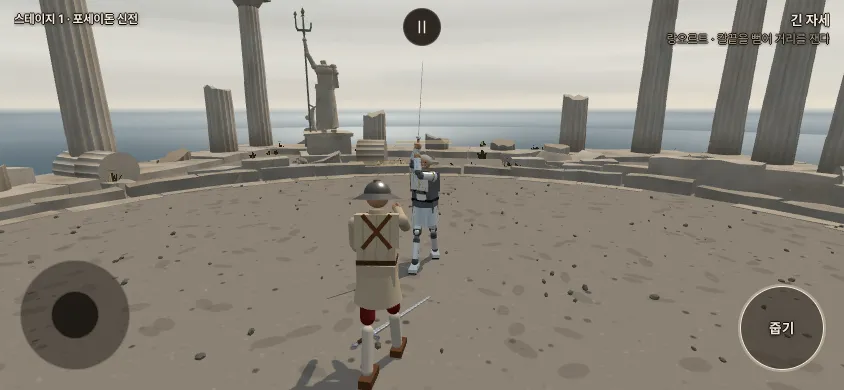
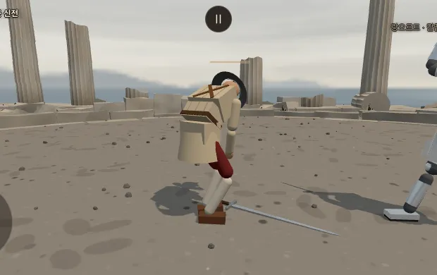
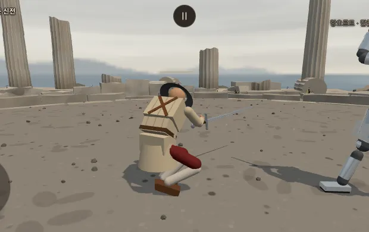
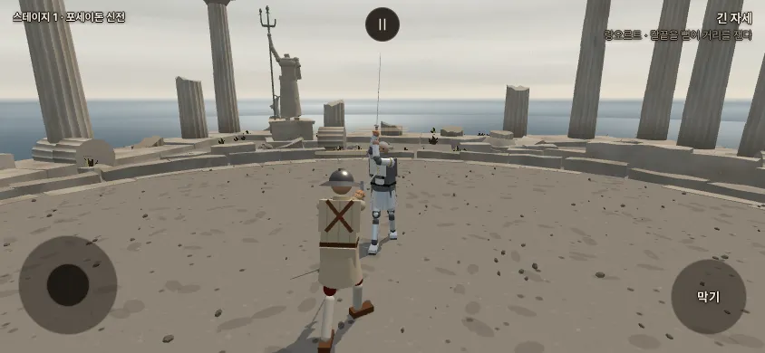

# 손목 치기 떨굼 늘림 · 떨어진 칼 줍기 · 2026-11-05

작업 가지 `wk/kote-pickup` (바탕 dev `2e7660b4`). **main · dev 에 안 넣음.** 확인표 줄 3390 ~ 3399.

사장님 11/04 (그대로): "코테는 칼을 더 자주 떨어트리게 해. 단 떨어진 무기를 줍는 동작을 신설하자. 무기 주위로 가서 막기 버튼을 누르거나 혹은 주위로 가면 자동으로 줍게, 적은 추가 비용으로 개발이 가능한가?"

## 한눈에 (물음에 먼저 답)

1. **적은 비용으로 됩니다 — 이미 만들어 두었습니다.** 새 파일 하나(`src/pickup.js` 212 줄 · 주석 빼면 약 160 줄) + 다른 파일 갈고리 약 40 줄.
   칼을 손에 다시 붙이는 일은 **부활할 때 칼이 손으로 날아오는 길(`src/revive.js`)을 그대로 다시 씀** — 새 물리 장치는 없습니다. 줍기를 끄면 지금 판과 바이트 같음(관문 다섯 그대로).
   위험은 낮음 ~ 보통: 고친 결함 둘(§2-6) 뒤 남은 것은 그림 몫(§4).
2. **손목 치기 떨굼**: 손목 치기가 상대 아래팔이나 상대 칼 손 쪽 절반에 **닿았을 때 칼을 떨군 몫 9 % → 28 %**. 확률 50 %(사장님 10/24)는 그대로 두고, 닿았는데도 안 세던 판정 문만 넓혔습니다.
   손목 치기만 쓰는 손가락 봇 48 판에서 상대 칼을 떨군 판 13 → 27. 일본 손목 치기(J7 · J8)만. 값은 사장님 확인 전 · 전 판은 `?koteEase=0`.
3. **줍기**: 두 방식 다 넣음 — **막기 단추**(`?pickup=block` — 칼 곁에 서면 단추 글이 '줍기'로 바뀜 · PC 는 F) · **저절로**(`?pickup=auto`). **기본은 끔**(오늘 그대로).
   줍는 동작 = 칼 쪽으로 돌며 웅크려 손을 뻗기 0.4 s + 쥐고 일어서며 칼을 손으로 올리기 0.2 s = **0.59 실제 s 동안 막지도 베지도 못함**(칼이 없음).
   칼을 놓친 뒤 다시 쥘 때까지(걸어가기 · 반응 포함) 가운데 1.4 s · 그동안 받은 칼날 상처는 줍기를 끈 때(같은 4 s 안)의 0.4 배.
4. **AI 줍기**도 쌌습니다(같은 동작 · 걸어가기 30 줄): `?pickupAi=1` — 칼을 놓친 AI 가 물러나기만 하던 것을 걸어가 줍습니다(48 판에 36 / 36 다시 쥠). 기본 끔.
5. **권함: 막기 단추 방식 + AI 줍기 켬.** 까닭은 §3.
6. 알아 둘 것: **지금은 AI 가 사람 칼을 손목 치기로 떨구지 않습니다**(`koteDrop.ai 0` — 10/24 감독 결정). 사람이 칼을 놓치는 길은 칼 팔을 크게 다침뿐이고 그때는 팔 힘이 없어 줍지 못합니다.
   그래서 **사람 줍기가 실제로 쓰이려면 AI 손목 치기 떨굼도 켜야** 합니다(§1-4 — 켜면 일본 AI 상대 8 판에 1 번꼴로 사람이 칼을 놓침). 여쭐 것.

(실제 빌드 · 폰 가로 844 × 390 · 롱소드 대 롱소드 · 상대는 멈춰 둠 · `tools/browser/kote_pickup_shots.mjs` — ①④ 게임 카메라 · ②③ 칼 든 쪽 옆 눈)

## 1. 손목 치기 떨굼

### 1-1. 무엇이 막았나 (재기)

일본 손가락 봇(실제 Input 터치 길 — `school_balance.mjs` · 유파 기술 몫 0.6 이 모두 손목 치기) 대 숙련 3 AI(롱소드 · 우치가타나) · 30 실제 s · 48 판.
닿음 = 손목 치기 긋기 동안(또는 끝난 뒤 0.4 s 안)에 내 칼날이 상대 아래팔(손 · 손목은 아래팔 끝)에 물리로 닿음, 또는 상대 칼 손 쪽 절반과 새로 부딪힘 — 에너지 · 빠르기와 상관없이.

| 판정 | 판 | 낸 손목 치기 | 닿음 | 그 가운데 판정 문을 통과 | 굴림 | 떨굼 | **떨굼 / 닿음** | 떨굼 / 낸 수 | 상대 칼을 떨군 판 |
|---|---:|---:|---:|---:|---:|---:|---:|---:|---:|
| 10/24 판 (지금 본판) | 48 | 501 | 141 (28 %) | 28 (20 %) | 28 | 13 | **9 %** | 3 % | 13 / 48 |

닿았는데 굴리지 않던 까닭(닿은 손목 치기 105 개 아래팔 · 57 개 칼):
- **에너지**: 아래팔 닿음의 가운데 에너지 3.2 J — 판정 문턱(`STRIKE.minEnergy` 6 J)을 넘는 닿음은 1/3 뿐. 짧은 0.22 패드 내려 긋기라 느림. 6 J 밑은 판정 자체가 안 나서 굴림까지 못 감.
- **칼 부딪힘 빠르기**: 손목 치기가 상대 칼에 닿는 빠르기 가운데 1.5 m/s — 문턱 3 m/s 를 넘는 것은 7 개 가운데 1 개꼴.
- **기술 이름 창**: 닿음의 1/4 이 손목 치기 긋기가 끝난 뒤 0.2 s(기술 이름이 남는 창)를 지나 남.
- 굴림 확률 · 한 번만 · AI 제외는 이 판(사람이 침)에서는 막지 않음. `p` 를 1 로 올려도 22 %(§1-3).

### 1-2. 넓힌 것 — `UNIQUE_ASSIST.koteDrop.ease` 1 (사장님 확인 전 · `?koteEase=0` = 10/24 판)

- **easeE 2 J**: 아래팔 닿음은 판정 문턱 6 J 밑이라도 2 J 넘으면 굴림 (상처 · 판정은 그대로 없음 — 떨굼 굴림만).
- **easeAfter 0.4 실제 s**: 손목 치기 긋기가 끝난 뒤 0.4 s 안 닿음도 (시간 사다리 · 다음 긋기 · 탭이 시작되면 끝).
- **easeVn 1.5 m/s**: 상대 칼 손 쪽 절반을 친 빠르기 문턱 (전 3 m/s).
- 그대로: 확률 50 % · 부위(칼 쥔 손 아래팔 · 두 손으로 쥔 빈손 쪽) · 칼 손 쪽 절반 · 사람만(`ai 0`) · 손목 치기 한 번에 한 번 · J8 을 익혀야.
- 고친 곳: `src/combat.js` strike(문턱 밑 닿음 → koteCheck) · koteOn(끝난 뒤 창 — koteAfter) · koteSword(문턱) · `src/config.js` · `src/main.js ?koteEase`.

### 1-3. 결과 (같은 봇 · 같은 시드 48 판)

| 판정 | 낸 손목 치기 | 닿음 | 판정 문 통과 | 굴림 | 떨굼 | **떨굼 / 닿음** | 떨굼 / 낸 수 | 상대 칼을 떨군 판 | 봇 이김 · 짐 |
|---|---:|---:|---:|---:|---:|---:|---:|---:|---:|
| 10/24 판 · 50 % | 501 | 141 | 28 | 28 | 13 | **9 %** | 3 % | 13 / 48 | 3 · 11 |
| 10/24 판 · 100 % (견줌) | 564 | 110 | 24 | 24 | 24 | **22 %** | 4 % | 24 / 48 | 3 · 9 |
| **11/05 넓힘 · 50 % (이 가지 기본)** | 525 | 97 | 61 | 58 | 27 | **28 %** | 5 % | **27 / 48** | 2 · 10 |
| 11/05 넓힘 · 60 % (견줌) | 539 | 88 | 55 | 52 | 30 | **34 %** | 6 % | 30 / 48 | 2 · 10 |

- 떨구면 그 판엔 더 닿을 칼이 없어서 넓힐수록 '닿음' 수가 줄어 보입니다(떨군 뒤 닿음이 없음). 떨굼 / 닿음은 그대로 읽어도 됩니다(닿을 때마다 같은 확률이면 같은 값).
- **제안: 넓힘 + 50 % = 닿은 손목 치기의 28 %** (목표 20 ~ 30 % 안). 확률만 100 % 로 올리는 길은 22 % — 닿았는데도 안 세던 손목 치기는 여전히 안 셈.
- 이김 · 짐이 그대로인 까닭: 칼 없는 AI 는 물러나 피하기만 해서 봇이 끝내지 못함(10/24 기록과 같음 — 2397). AI 줍기(§2-5)를 켜면 이 긴 쫓기가 없어짐.

### 1-4. AI 손목 치기 (여쭐 것 — 기본 그대로 `koteDrop.ai 0`)

`koteDrop.ai 1` 로 재 봄: 사람 손가락 봇(독일 롱소드 · 이탈리아 레이피어 · 이베리아 츠바이핸더 · 일본 우치가타나) 대 **일본 우치가타나 AI** · 30 s · 48 판.
- AI 손목 치기 굴림 12 ~ 14 번 · **사람 칼 떨굼 6 번(8 판에 1 번꼴)** + 팔 다침 1 번.
- 줍기 끔: 그 뒤 4 s 안 받은 칼날 심각도 판당 0.60 · 의식 0.43 · 줍기(막기 단추): 6 / 7 다시 쥠 · 가운데 1.45 s · 받은 심각도 0.11 · 의식 0.18.
- 사람 줍기는 이것을 켜야 실제로 쓰입니다. 켜면 '사람만' 이점이던 J8 이 일본 AI 에게도 생김 — 사장님 결정.

## 2. 떨어진 칼 줍기

### 2-1. 오늘 칼을 놓치면 (조사)

- **칼을 놓치는 길**: 손목 치기 떨굼(사람이 AI 칼만) · 칼 쥔 팔 기능이 0.15 밑(크게 다침 · 잘림 — `VITALS.dropSwordArm`) · 판 이어하기 때 팔 기능이 그 밑.
- **맨손**: 주먹은 없음 — 칼 아닌 몸은 상처를 못 냄(`combat.pairOf`). 근접 밀치기만 됨. 손은 펼친 손 그림(`hands.js`). 화면 표시 없음 · 막기 단추는 아무 일도 안 함.
- **칼 놓친 AI**: 하던 공격을 거두고 간격 + 0.6 m 로 물러나 피하기만(`ai.js`). 상대가 칼을 놓치면 AI 는 쫓아와 끝내러 옴(`chasing`).
- **판 규칙**: 칼을 놓쳐 지는 규칙은 없음 — 죽어야 끝(1:1 · 방랑 · 생사전 같음). 놓친 칼은 그 판 끝까지 땅에 · 부활하는 인물만 일어설 때 칼이 돌아옴.
- **이어하기**(방랑 · 생사전 몸 사본 `fight_snapshot.js`): 칼 놓침을 적지 않았음 → 다시 열면 칼을 쥔 채 시작.

### 2-2. 동작 (`src/pickup.js` · 값은 모두 사장님 확인 전)

| 때 | 무엇 | 값 |
|---|---|---|
| 시작 | 칼을 놓쳤고 · 서 있고 · 칼 팔에 힘이 있고(0.15 넘음) · 칼이 멈췄고(1.5 m/s 밑) · **골반에서 칼자루까지 0.6 m 안** | `PICKUP.reach` 0.6 m (걸음 사다리) · `settle` 1.5 |
| 굽힘 | 칼 쪽으로 몸을 돌리며 웅크림(골반 0.4 m 낮춤 · 몸통 60° 숙임) · 칼 손을 칼자루로 | `PICKUP.bend` 0.4 s (시간 사다리) · `SECRET.stance.pickup` |
| 쥠 | 손이 칼자루 0.3 m 안에 오면(또는 0.4 s 가 차면) 쥠 — 웅크린 손은 땅까지 0.2 ~ 0.4 m 못 닿아 남은 틈은 다음 칸이 메움 | `PICKUP.grab` 0.3 m |
| 올림 | 일어서며 칼이 손으로 올라와 쥐는 자세가 됨(부활의 칼 돌아옴과 같은 길 — 그동안 칼 충돌 끔) → 손목 관절 · 손목 원뿔을 다시 걸고 칼을 쥠 | `PICKUP.lift` 0.2 s |
| 맞춤 | 쥔 칼이 상대 몸 · 칼 · 제 몸통과 겹쳐 있으면 겹침이 풀릴 때 칼 충돌을 켬 (겹친 채 켜면 튐) | 늦어도 `settleMax` 0.4 s (재기에서 거의 0) |

- 넘어지면 그만두고 칼은 땅에 남음(다시 서면 다시 주울 수 있음). 줍다가 죽어 부활하면 칼은 부활 길에 넘김.
- 못 줍는 것: **남의 칼**(칼 주인 · 충돌 비트 · 무기 값 · AI 간격을 옮기는 일이 커서 안 함) · 휘는 마디 무기(채찍 — 마디가 늘어남) · 잘린 팔과 함께 간 칼 · 칼 팔 힘이 문턱 밑.
- 권총도 같은 길로 주움(시험함). 죽음의 일격(칼날을 거꾸로 쥔 채) 도중 놓친 칼은 보통 쥠으로 다시 쥠.

### 2-3. 두 방식

- **막기 단추** (`PICKUP.mode 'block'` · `?pickup=block`): 칼 곁(위 시작 조건)에 서면 오른쪽 아래 단추 글이 **'막기' → '줍기'**로 바뀌고 테두리가 밝아짐. 누르면 주움. PC 는 F. 칼이 없을 때 막기 단추는 원래 아무 일도 안 해서 겹치는 뜻이 없음.
- **저절로** (`'auto'` · `?pickup=auto`): 칼 곁에 가면 바로 주움. 단추 글은 그대로.
- 끔(`0` — 지금 기본 · `?pickup=0`).

### 2-4. 재기 — 사람 줍기 (`kote_pickup.mjs pick`)

사람 손가락 봇(실제 입력 길) 6 무기(독일 롱소드 · 일본 우치가타나 · 이탈리아 레이피어 · 이베리아 츠바이핸더 · 동방 환도 · 모르겐슈테른) 대 롱소드 AI · 8 시드 = 48 판.
판 시작 6 s 에 내 칼을 떨굼(손목 치기 떨굼과 같은 길) → 봇은 0.22 s 늦게 보고 칼로 걸어가 (막기 단추면 단추 글이 '줍기'일 때) 누름. 상대 AI 는 그대로 싸움(칼 없는 사람을 쫓아옴).

| 묶음 | 떨굼 | 다시 쥠 | 다시 쥠까지 (가운데 · 90 %) | 줍는 동작 | 떨굼 뒤 받은 칼날 심각도 | 칼날 맞음 | 의식 | 넘어짐 | 상대 공격 시작 | 칼 한 스텝 최대 | NaN |
|---|---:|---:|---:|---:|---:|---:|---:|---:|---:|---:|---:|
| 막기 단추 | 35 | **31** | **1.43 · 3.08 s** | 0.59 s | **0.20** | 0.69 | 0.04 | 3 | 0.86 | 0.10 m | 0 |
| 저절로 | 35 | **31** | **1.19 · 2.96 s** | 0.59 s | **0.18** | 0.51 | 0.05 | 3 | 0.89 | 0.11 m | 0 |
| 줍기 끔 (견줌) | 35 | 0 | – | – | 0.50 | 1.49 | 0.24 | 5 | 1.83 | 0.07 m | 0 |

- 받은 것 = 떨군 때부터 다시 쥘 때까지(못 쥐면 4 s 까지) · 떨굼 한 번당. 넘어짐 = 그 사이 서 있다가 무너진 수(35 번 가운데).
- 못 다시 쥔 4 번: 떨군 뒤 0.9 s 에 죽음 1 · 웅크린 사이 다리를 베여 쓰러짐 뒤 판이 끝남 1 · 상대가 피를 흘려 먼저 죽음 1 · 칼 팔이 잘려 칼 팔 힘 0.03(줍지 못하는 것이 맞음) 1. **주울 수 있던 31 번은 모두 첫 시도에 주움.**
- **드러나는 시간**: 줍는 동작 자체 0.59 s(웅크려 칼 쪽을 봄 → 상대에게 등 · 옆을 보일 수 있음). 걸어가는 시간까지 합쳐 칼 없는 시간은 가운데 1.4 s(저절로 1.2 s).
- 이김 · 짐(봇): 막기 단추 16 · 6 / 저절로 14 · 4 / 끔 14 · 5 — 48 판 소음 안.

### 2-5. 재기 — AI 줍기 (`kote_pickup.mjs aipick` · `PICKUP.ai` 1)

같은 48 판 · 판 시작 6 s 에 AI 칼을 떨굼 · 봇은 보통대로 침.

| 묶음 | 떨굼 | 다시 쥠 | 다시 쥠까지 (가운데 · 90 %) | AI 가 받은 칼날 심각도 | 넘어짐 | 봇 이김 · 짐 |
|---|---:|---:|---:|---:|---:|---:|
| AI 줍기 켬 | 36 | **36** | 1.54 · 4.08 s | 0.06 | 0 | 17 · 3 |
| AI 줍기 끔 (견줌 — 오늘) | 36 | 0 | – | 0.15 | 2 | 16 · 1 |

- AI 는 물러나기 대신 제 칼로 걸어가(스틱 = 몸 틀 앞 · 옆 몫 · 가까워질수록 늦춤) 칼 곁에서 같은 누름. 줍는 동안은 발을 멈춤.

### 2-6. 물리 검사 · 고친 결함

- 넘어짐: 줍기가 늘리지 않음(위 표 3 · 3 대 끔 5). 웅크림은 비기 자세와 같은 틀(골반 낮춤 · 몸통 숙임 — 넘어짐 판정은 일부러 숙인 각을 뺌).
- **고친 결함 1 — 칼 튐 0.48 m**: 올리는 동안 몸이 상대 쪽으로 돌면 '쥐는 자세'(몸 방향 기준)가 함께 돌아, 땅 자세 ↔ 쥐는 자세 구면 보간이 반대쪽으로 뒤집혀 칼이 한 스텝에 0.48 m 튐(1/40 s 동안).
  → 쥘 때 쥐는 자세를 정해 두고(`flySword` 의 `S.hold` — 부활은 그대로) 칼을 쥘 때까지 쥔 자리를 봄. 고친 뒤 한 스텝 최대 0.10 m(칼이 손으로 올라오며 도는 빠르기 · 순간이동 아님).
- **고친 결함 2 — 구르는 칼**: 잔 모양 손잡이 레이피어가 땅에서 1 m/s 로 6 s 동안 굴러 '멈춘 칼(0.6 m/s 밑)'이 안 되어 못 주움 → `settle` 1.5 m/s.
- 제 몸 충돌: 칼을 쥔 직후 칼이 겹친 채 충돌을 켜지 않음(맞춤 칸). 긴 칼(츠바이핸더 · 우치가타나)은 일어서는 동안 칼날이 제 허벅지에 기대 미끄러지는 판이 몇 있음(제 몸 충돌은 원래 설계 · 튐 · 넘어짐 없음).
- 상대가 바로 앞에 있으면 쥔 직후 올라오는 칼이 상대 다리를 툭 침(둔타 6 ~ 30 J · 드물게 얕은 베기).
- 부활 점검(`revive_check.mjs 8`) 출력이 dev 와 바이트 같음 — 부활 길은 안 바뀜.

### 2-7. 이어하기 (몸 사본)

- 칼을 놓친 채 저장되면 사본에 `disarmed` 를 적음(쥔 몸은 칸 없음 — 옛 꼴 그대로).
- 줍기가 켜진 몸(사람 = `PICKUP.mode` · AI = `PICKUP.ai`)만 새 판도 칼을 놓친 채 시작 — 칼은 발 앞에 떨어져 있고 주우면 됨. 줍기가 꺼진 몸은 오늘처럼 칼을 쥔 채(못 줍는 칼을 판 내내 놓친 채 두지 않게).
- 주운 뒤 사본은 쥔 몸 그대로.

## 3. 권함 — 막기 단추 방식

1. **원할 때만 웅크림.** 저절로 방식은 칼 곁을 지나기만 해도 0.6 s 웅크려 칼 쪽을 봄 — 상대가 치고 들어오는 그 순간에 줍기가 시작될 수 있음(되돌릴 수 없음). 단추면 사람이 때를 고름.
2. **폰에서 알기 쉬움.** 칼 곁에 서면 늘 보던 단추가 '줍기'로 바뀜 — 새 단추 · 새 몸짓 없음. 칼이 없을 때 막기 단추는 원래 아무 일도 안 해서 헷갈릴 일이 없음.
3. **잰 값 차이는 작음.** 다시 쥐기까지 1.43 s 대 1.19 s · 받은 상처 0.20 대 0.18 — 단추 한 번 누르는 0.2 s 만큼.
4. **AI 줍기는 켜기를 권함.** 칼 없는 AI 가 물러나기만 하는 긴 쫓기(10/24 기록)가 없어지고, 손목 치기 떨굼이 '판 끝'이 아니라 '1.5 s 틈'이 됨 — 떨굼을 늘린 만큼 판이 끌리지 않음.
5. **사람 줍기를 쓰이게 하려면 AI 손목 치기(§1-4)를 켤지 정해 주세요.** 안 켜면 사람은 칼을 놓칠 일이 거의 없음.

## 4. 비용 · 위험 · 남은 것

- 비용: `src/pickup.js` 212 줄(새) · `config.js` +20 · `main.js` +18(주소 · 단추 글 · 누름) · `combat.js` +21(손목 치기) · `revive.js` +8(내보내기 · 줍기 칸 — 부활 값 그대로) · `fight_snapshot.js` +6 · `fighter.js` +4 · `ai.js` +3 · `secret_instant.js` +3 · `index.html` +1.
- 끄면 지금과 같음: `PICKUP.mode 0 · ai 0` 이면 줍기 길을 아예 안 부름. 손목 치기 넓힘은 사람의 일본 손목 치기(J8)만 바꿔 관문(AI 끼리 · 롱소드)에 안 닿음.
- 남은 것 (그림 · 사장님 보실 것):
  - 웅크린 손은 땅까지 0.2 ~ 0.4 m 못 닿아 칼이 손으로 0.2 s 에 '빨려 올라옴'(②③ 그림). 손을 더 내리려면 무릎 꿇기 자세를 섞어야 함(일이 더 큼).
  - 쥔 뒤 0.1 ~ 0.2 s 칼이 손에서 조금 흔들림(칼끝 빠르기 5 m/s 밑).
  - 몸은 칼 쪽으로 돌아 칼을 보는데, 칼이 바로 뒤에 있으면 도는 데 시간이 더 듦(몸 돌림 2.4 rad/s).

## 5. 시험 · 관문

- 새 시험 `tools/sim/kote_pickup.test.mjs` 9 개(기본값 · 문턱 밑 닿음 굴림 · 끝난 뒤 창 · 칼 반쪽 문턱 · 줍기 끔 · 저절로 · 막기 단추 · 못 주움 · AI 줍기 · 몸 사본).
- `tools/sim/skill_tree.test.mjs` 칼 떨구기 시험 한 줄을 넓힌 문턱에 맞춤(칼 반쪽 문턱 = `easeVn`).
- 시험 전체 `node --test tools/sim/*.test.mjs` **711 / 711 통과 · 실패 0**.
- 관문(가지 끝 — measure_only 와 같은 셈): fights12 `ee193a89` · live_battery `e8127a92` · finish_thrust 1 --stand `9630b5d3` · corr_s0 12/12 · weapon_smoke 34/34 · 이름 규칙 0 · 표기 방침 통과 · 빌드 0 — **기준 그대로 · 바꿀 것 없음**.
  줍기를 켜도(`with_config.mjs PICKUP.mode=block PICKUP.ai=1 fights12.mjs`) `ee193a89` — 그 열두 판엔 주울 수 있는 칼 놓침이 없음. 부활 점검 `revive_check.mjs 8` 은 dev 와 바이트 같음(그 도구의 한 판 FAIL 은 dev 에도 있음).

## 6. 도구 · 다시 재기

- 손목 치기: `node tools/sim/kote_pickup.mjs rate --cells=japanese:uchigatana:longsword,japanese:uchigatana:uchigatana --seeds=1-24 [--set=UNIQUE_ASSIST.koteDrop.ease=0] [--json=파일]` · `… agg <json …>`
- 사람 줍기: `node tools/sim/kote_pickup.mjs pick --cells=german:longsword:longsword,… --seeds=1-8 --mode=block|auto|0 [--json=파일]` · `… pickagg <json …>`
- AI 줍기: `node tools/sim/kote_pickup.mjs aipick … --mode=1|0`
- AI 손목 치기가 사람을 떨굼: `node tools/sim/kote_pickup.mjs pick --cells=german:longsword:uchigatana,… --dropAt=none --dur=30 --set=UNIQUE_ASSIST.koteDrop.ai=1 --mode=block|0`
- 그림: `npx vite build && python3 -m http.server 5493 -d dist &` · `node tools/browser/kote_pickup_shots.mjs http://127.0.0.1:5493 docs/strike/kote_pickup_2026-11-05`
- 손가락 봇(`school_balance.mjs`)에 둘을 더함(재기만 — 게임 값 아님): `focus 'kote'`(유파 기술 몫이 모두 손목 치기) · `onRound` · `botHook` 갈고리 · 막기 단추 = 줍기 누름(main.js 와 같은 차례).

## 7. 한계

- 봇은 사람 손가락 흉내 · 상대는 숙련 3 AI. 손목 치기 재기는 손목 치기만 쓰는 판(보통 판보다 손목 치기가 몇 배 많음) — 비율(떨굼 / 닿음)로 읽음.
- 줍기 재기는 판 시작 6 s 에 억지로 떨군 판 — 손목 치기로 떨군 자리 · 때와는 조금 다를 수 있음(떨어진 칼 거리 가운데 0.62 m — 손목 치기 떨굼과 같은 dropSword 길).
- 폰 손맛(단추 누르는 때 · 칼 쪽으로 걷기)은 사람 손으로 안 쟀음.
