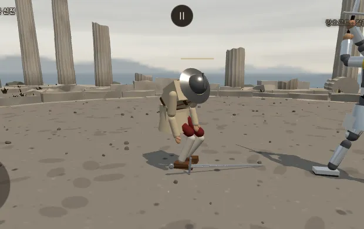
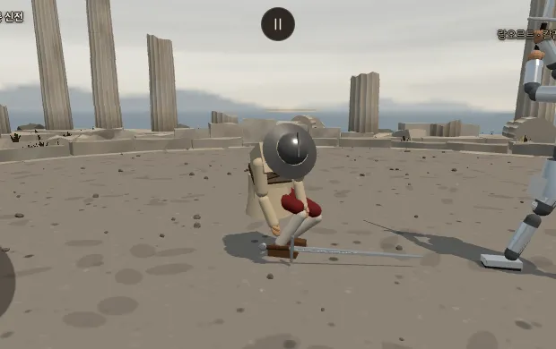
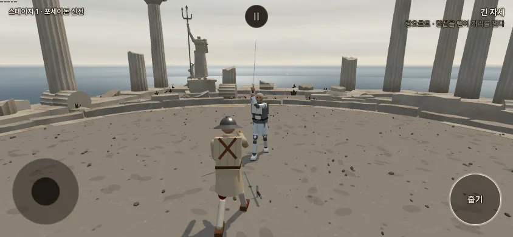
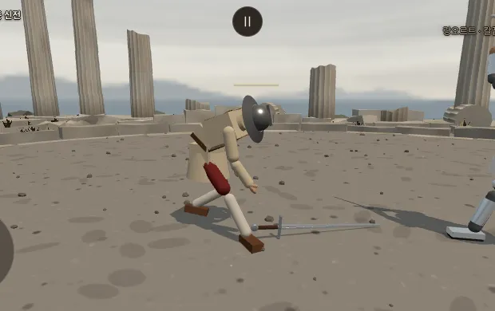
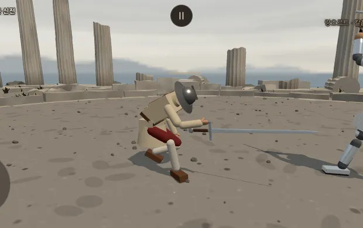

# 떨어진 칼 줍기 거리 늘림 — 0.6 → 0.9 m · 먼 칼은 반걸음 내디딤 · 2026-11-16

바탕 = 개발 가지 머리 (`ac40f25f`). 확인표 4590 ~ 4597. 앞 기록 `docs/strike/kote_pickup_2026-11-05.md`.

사장님 11/16 (그대로): "지금 칼 줍는 기능이 잘 안쓰게 돼. 활성화되는 거리를 늘려."

## 한눈에

1. **왜 잘 안 켜졌나 — 칼이 0.6 m 밖에 떨어짐.** 떨어진 칼자루는 멈춘 때 골반에서 가운데 **0.75 m**(90 % 1.4 ~ 1.7 m) — 0.6 m 안은 **⅓**, 0.9 m 안은 **⅔**.
   서서 칼을 놓치기만 해도 롱소드 0.71 · 세이버 · 모르겐슈테른 0.86 · 환도 1.02 · 레이피어 1.06 m (우치가타나 0.58 · 츠바이핸더 0.60 만 안). 그래서 단추가 '막기' 그대로이고 걸어가야 함.
   - 사람이 **눈에 보이는 칼 곁**(칼 몸 어디든 골반 0.45 m 안)에 서서 누르면 칼자루는 가운데 **0.98 m** — 첫 누름의 **54 %가 헛누름**(줍기 안 시작).
   - 다른 문은 작은 몫: 칼이 아직 구름(settle 1.5 m/s) = 막힌 시간의 14 % · 누름은 '누르고 있기'라 단추를 쥔 채 다가가면 됨(누른 때 탓 아님).
2. **0.9 m** (걸음 사다리 다음 칸 · 마지막 칸) — `PICKUP.reach` 0.6 → 0.9. 서서 놓친 롱소드는 바로 단추가 '줍기'(그림 ①).
3. **먼 칼은 반걸음** — 웅크린 손은 0.6 m 넘게 먼 칼자루 위까지 못 닿아(0.9 m 면 손이 칼자루에서 옆으로 0.27 m · 칼이 손으로 날아옴) **0.6 m 넘으면 웅크리며 칼 쪽으로 0.3 m 내디딤**(앞쪽 칼 = 앞발 · 뒤쪽 칼 = 뒷발 · 몸이 따라 실림). 손이 닿을 때까지 굽힘 0.4 → 최대 0.6 s.
   쥘 때 손 ↔ 칼자루 가운데 0.42 → **0.30 m**(사람 봇) · 0.37 → **0.30 m**(AI) — 11/05 판보다 오히려 가까움.
4. **결과 (48 판 묶음 · 떨굼 뒤 다시 쥘 때까지)**

| 누가 | 다시 쥠 | 다시 쥠까지 가운데 · 90 % (실제 s) | 첫 누름에 시작 |
|---|---:|---:|---:|
| 사람 봇 (칼자루로 걸어감) | 35 → 34 / 37 | 1.73 · 3.35 → **1.61 · 2.97** | 30 → 30 / 36 |
| 사람 흉내 (보이는 칼로 걸어감) | 34 → **36** / 37 | 1.74 · 3.84 → **1.72 · 3.35** | 17 → **20** / 37 |
| AI | 37 → 36 / 38 | 1.20 · 3.46 → **1.14 · 2.81** | – |
| 손목 치기 떨굼 AI (일본 봇이 떨굼) | 20 → 20 / 24 | 1.29 · 3.79 → **1.12 · 3.43** | – |

5. **관문 그대로** — fights12 `a3971c0a` · live_battery `cd211727` · finish_thrust 1 --stand `ba9c958b` · corr IDENTICAL 12/12 · weapon_smoke OK 34/34 (이 판들엔 줍는 칼 놓침이 없음). 0.6 · 내딛지 않음으로 돌리면 11/05 판과 바이트 같음(재기 96 판 견줌 0 차이).

## 1. 왜 잘 안 켜졌나 (재기)

`tools/sim/kote_pickup.mjs pick` · `aipick` — 사람 손가락 봇(실제 입력 길) 6 무기(독일 롱소드 · 일본 우치가타나 · 이탈리아 레이피어 · 이베리아 츠바이핸더 · 동방 환도 · 모르겐슈테른) 대 롱소드 AI · 씨앗 1 ~ 8 = 48 판 · 판 시작 6 s 에 칼을 떨굼(손목 치기 떨굼과 같은 `dropSword`).
손목 치기 떨굼 판: 사람 4 무기 대 일본 우치가타나 AI(AI 손목 치기가 사람 칼을 떨굼 — `koteDrop.ai` 1) 48 판 · 30 s / AI 쪽은 일본 봇이 손목 치기만(`--focus=kote`) 4 짝 48 판.

새로 더한 봇 하나 — **사람 흉내** (`--aim=sword`): 11/05 봇은 칼자루 자리를 알고 그리로 걸어가 단추 글이 '줍기'일 때만 누름(가장 잘하는 사람). 사람 흉내는 **눈에 보이는 칼(칼자루 ~ 칼끝)에서 가장 가까운 자리**로 걸어가 그 자리가 골반 0.45 m 안이면 서서 단추를 누른 채 · 0.6 s 지나도 안 되면 칼자루 쪽으로 걸음.

### 1-1. 칼이 멈춘 자리 (11/05 판 · 줍기 문 settle 밑 · 칼자루가 골반 밑이 된 첫 때)

| 묶음 | 칼자루 거리 가운데 · 90 % | ≤ 0.6 m | ≤ 0.9 m | 떨군 때 골반 자리에서 가운데 | 칼자루 방향 앞 · 옆 · 뒤 |
|---|---:|---:|---:|---:|---:|
| 사람 (판 시작 6 s 떨굼) | 0.75 · 1.43 | 35 % | 68 % | 0.98 | 25 · 12 · 0 |
| 사람 (AI 손목 치기 떨굼 · 7 번) | 0.87 · 1.15 | 14 % | 57 % | 0.92 | 4 · 3 · 0 |
| AI (판 시작 6 s 떨굼) | 0.47 · 1.97 | 66 % | 79 % | 0.48 | 22 · 15 · 1 |
| AI (일본 봇 손목 치기 떨굼) | 0.51 · 1.28 | 57 % | 83 % | 0.51 | 12 · 11 · 0 |

- 서서 놓친 칼 (상대 멈춤 · 씨앗 셋 같음): 롱소드 0.71 · 우치가타나 0.58 · 츠바이핸더 0.60 · 세이버 0.86 · 모르겐슈테른 0.86 · 환도 1.02 · 레이피어 1.06 m. 한손 칼은 겨눔에서 손이 앞으로 나가 있어 더 멀리 떨어짐.
- 사람은 칼이 떨어지는 동안 이미 걸어가기 시작해(0.22 s 뒤) 멈춘 때 거리가 떨군 자리에서보다 0.2 m 남짓 가까움.

### 1-2. 누른 채 막힌 까닭 (사람 흉내 37 번 떨굼 · pickupReady 문 차례 그대로 첫 막힌 문)

| 까닭 | 누른 채 막힌 실제 s 합 (11/05 판) |
|---|---:|
| 칼자루가 0.6 m 밖 (`reach`) | **16.5** (첫 막힌 누름 때 칼자루 가운데 0.98 m) |
| 칼이 아직 구름 (`settle` 1.5 m/s) | 2.7 |
| 넘어짐 · 칼이 골반 위 · 칼 팔 힘 | 0.1 |

- **첫 누름에 시작 17 / 37 (46 %)**. 롱소드 1.2 m 가운데쯤에 서면 칼자루는 0.6 m 넘게, 칼끝 쪽이면 1 m 넘게 떨어짐.
- 누름은 막기 단추를 '누르고 있기'(`pickupPress` — 쥔 동안 매 스텝 봄)라 쥔 채 다가가면 문 안에 든 스텝에 바로 시작. 탭으로 누르면 그 순간만 봄 — 단추 글이 '줍기'로 바뀌는 것이 그 때를 알림.
- AI 는 칼자루로 걸어가 0.85 × reach 안에서 누름 — 막히는 것은 칼이 아직 골반 높이에 걸린 때(칼이 손에서 막 떨어짐 · 0.1 s 남짓)뿐.

## 2. 바꾼 것

| 자리 | 무엇 |
|---|---|
| `src/config.js` `PICKUP` | `reach` 0.6 → **0.9** [사장님 11/16 결정] · 새 `step` **0.3** · `stepFrom` **0.6** · `stepWait` **0.2** [감독 · 사장님 확인 전] |
| `src/pickup.js` | `pickupStep` (새) — 굽히는 동안 칼자루가 `stepFrom` 넘게 멀면 칼 쪽으로 반걸음(gait 기술 걸음 — 칼이 몸 앞쪽 반이면 'lunge' 앞발 · 뒤쪽 반이면 'retreat' 뒷발 · 몸 기준 앞 · 옆 몫으로 칼자루 쪽 · 몸 따라감 `SECRET.stepPush` 2.0 — 비기 걸음과 같은 수). 걸음을 못 받는 스텝(앞으로 내딛는데 스틱이 물러남)은 다음 스텝에 다시 · 굽힘 0.4 s 가 차면 그만 · 내디딘 줍기는 손이 칼자루 0.3 m 안에 들 때까지 굽힘을 0.2 s 더 · 줍기 기록에 `step` |
| `src/pickup.js` 그만둠 | 굽히는 동안 칼자루가 `reach × 1.5` → **`reach + 0.3`** 넘게 멀어지면 그만둠 (0.6 판에선 둘 다 0.9 — 바이트 같음 · 0.9 판 1.2 m. × 1.5 = 1.35 면 밀려난 몸이 내디뎌도 손이 0.5 m 넘게 못 미치는 칼을 쥐러 감) |
| AI 다가가기 (`aiPickup`) | 그대로 — `reach × 0.85`(0.51 → **0.77 m**) 안에서 누름 · 그 밖 0.6 m 띠에서 늦춤. 0.6 넘는 자리에서 시작하면 반걸음 |
| `src/main.js` | `?pickupReach=0.6` (11/05 판) · `?pickupStep=0` (내딛지 않음) |
| `tools/sim/kote_pickup.mjs` | `--aim=grip\|sword` · `--near` · `--giveUp` · `--focus` · 둘째 표(멈춘 자리 · 누름 마디 · 막힌 까닭 · 쥘 때 손 ↔ 칼자루 · 시작 거리 · 내디딤) |
| `tools/browser/kote_pickup_shots.mjs` | 넷째 인자 = 이 판만의 PICKUP 값 · 다섯째 = 그림 이름 앞 · 쥐는 순간 옆 눈 그림 |
| `tools/sim/kote_pickup.test.mjs` | 기본값(0.9 · 0.3 · 0.6 · 0.2 · 사다리) · 새 장면 시험 하나(0.85 m 칼 — 0.6 판은 시작 안 함 · 0.9 판은 반걸음 · 손이 칼자루 위 · 넘어짐 없음 · 칼 순간이동 없음) |

## 3. 동작 — 손이 칼자루에 닿나 (멈춘 칼을 몸 기준 자리에 두고 누름 · 롱소드 · 우치가타나 · 레이피어 · 츠바이핸더 · 방향 7 ~ 10 개)

쥘 때 손 ↔ 칼자루 — 옆(수평) · 위(손이 땅까지 못 내려감 — 웅크림 그대로 0.3 m 안팎):

| 칼자루 거리 | 11/05 동작 (내딛지 않음) 옆 · 위 | 반걸음 옆 · 위 | 줍는 동작 실제 s | 골반 옮김 |
|---|---:|---:|---:|---:|
| 0.45 | 0.10 · 0.31 | (안 내딛음) | 0.55 | 0.17 |
| 0.6 | 0.12 · 0.32 | (안 내딛음) | 0.56 | 0.17 |
| 0.75 | 0.19 · 0.33 | **0.11** · 0.32 | 0.58 → 0.76 | 0.18 → 0.35 |
| 0.9 | 0.27 · 0.36 | **0.15** · 0.33 | 0.59 → 0.77 | 0.18 → 0.35 |
| 0.45 칼이 뒤쪽 (135 ~ 180°) | 0.38 · 0.37 | (안 내딛음) | 0.59 | 0.17 |
| 0.9 칼이 뒤쪽 (135 ~ 180°) | 0.74 · 0.42 | **0.54** · 0.34 | 0.59 → 0.80 | 0.17 → 0.23 |

- 앞 · 옆 칼은 반걸음으로 0.6 m 판 손 자리(옆 0.12)로 돌아옴. 몸 따라감(`stepPush`)을 실은 까닭은 뒤쪽 칼 — 뒷발만 디디면 골반이 0.16 m 만 옮아 손이 옆 0.6 m 남짓 못 미침(실으면 0.54 · 앞 · 옆 칼은 0.16 → 0.15 로 거의 같음).
- **뒤쪽 칼은 여전히 손이 덜 닿음**(옆 0.54 — 11/05 판에서도 0.45 m 뒤쪽 칼은 0.38). 몸이 칼 쪽으로 도는 빠르기(2.4 rad/s) 탓 · 싸움 판에서 시작 때 칼자루가 뒤쪽인 것은 3 ~ 4 / 37. 칼 넘어짐 · 튐 없음(칼 한 스텝 최대 0.10 m).
- 싸움 판 줍는 동작 가운데: 칼자루로 걸어가는 봇 0.59 → 0.71 s(0.67 m 에서 시작 — 늘 반걸음) · 사람 흉내 · AI 0.59 그대로(가까이 떨어진 칼이 많음). 그래도 다시 쥘 때까지는 줄어듦(걸음이 줄어서).

(실제 빌드 · 폰 가로 844 × 390 · 롱소드 대 롱소드 · 상대 멈춤 · 서서 칼을 놓침 → W 로 단추가 '줍기'가 될 때까지 걷고 F · ② 이후 칼 든 쪽 옆 눈 · `tools/browser/kote_pickup_shots.mjs <주소> docs/strike/pickup_reach_2026-11-16 reach=0.6,step=0 old` · `… "" new`.
새 판은 놓친 칼이 이미 0.76 m 라 걷지 않고 바로 누름 → 0.77 m 에서 반걸음 · 11/05 판은 0.43 m 까지 걸어와 누름.)

## 4. 결과 — 전 · 후 (같은 판 · 같은 씨앗)

| 묶음 | 떨굼 | 다시 쥠 | 다시 쥠까지 가운데 · 90 % | 줍는 동작 가운데 | 쥘 때 손 ↔ 칼자루 가운데 · 90 % | 시작 거리 가운데 · 90 % (내디딤) | 받은 칼날 심각도/떨굼 | 넘어짐 | 제 몸 닿음 스텝 |
|---|---:|---:|---:|---:|---:|---:|---:|---:|---:|
| 사람 봇 0.6 | 37 | 35 | 1.73 · 3.35 | 0.59 | 0.42 · 0.54 | 0.44 · 0.45 (0) | 0.17 | 3 | 101 |
| 사람 봇 **0.9** | 37 | 34 | **1.61 · 2.97** | 0.71 | **0.30 · 0.46** | 0.67 · 0.67 (26) | 0.27 | 2 | 8 |
| 사람 흉내 0.6 | 37 | 34 | 1.74 · 3.84 | 0.59 | 0.40 · 0.52 | 0.45 · 0.60 (0) | 0.27 | 3 | 8 |
| 사람 흉내 **0.9** | 37 | **36** | **1.72 · 3.35** | 0.59 | 0.41 · 0.52 | 0.45 · 0.90 (11) | 0.17 | 1 | 6 |
| 사람 봇 · AI 손목 치기 떨굼 0.6 | 7 | 4 | 1.96 · 2.42 | 0.59 | 0.42 · 0.51 | 0.45 (0) | 0.97 | 2 | 11 |
| 사람 봇 · AI 손목 치기 떨굼 **0.9** | 7 | 4 | 1.83 · 3.00 | 0.80 | 0.45 · 0.89 | 0.67 (5) | 0.86 | 2 | 4 |
| 사람 흉내 · AI 손목 치기 떨굼 0.6 · 0.9 | 7 | 5 | 1.84 · 4.29 | 0.59 | 0.42 · 0.51 | 0.60 → 0.68 (3) | 0.69 | 1 | 21 |
| AI 0.6 | 38 | 37 | 1.20 · 3.46 | 0.59 | 0.37 · 0.68 | 0.44 · 0.51 (0) | 0.09 | 1 | 14 |
| AI **0.9** | 38 | 36 | **1.14 · 2.81** | 0.59 | **0.30 · 0.58** | 0.46 · 0.76 (12) | 0.17 | 1 | 3 |
| AI · 손목 치기 떨굼 0.6 | 24 | 20 | 1.29 · 3.79 | 0.59 | 0.44 · 0.65 | 0.51 (0) | 0.08 | 1 | 1 |
| AI · 손목 치기 떨굼 **0.9** | 24 | 20 | **1.12 · 3.43** | 0.59 | 0.42 · 0.64 | 0.61 · 0.76 (15) | 0.08 | 1 | 0 |

- 사람 흉내: 누른 채 0.6 m 밖이라 막힌 시간 합 16.5 → **8.2 s** · 첫 누름에 시작 17 → **20 / 37** · 넘어짐 · 줍다 쓰러짐 3 · 2 → 1 · 0. 첫 막힌 누름의 칼자루 거리 가운데 1.13 m(0.9 판에서 남은 헛누름은 칼끝 쪽에 선 때).
- 다시 못 쥔 판이 바뀐 것: 사람 봇 1(우치가타나 씨앗 8 — 줍는 동안 상대 칼에 죽음 · 11/05 판은 1.4 s 에 주움) · AI 2(판이 갈려 AI 가 먼저 죽음 · 넘어진 채 판이 끝남). 사람 흉내 2 판은 못 쥐다가 쥠.
- 받은 칼날 심각도는 엇갈림(사람 봇 0.17 → 0.27 · 사람 흉내 0.27 → 0.17 · AI 0.09 → 0.17) — 판이 갈린 몫 · 37 번 떨굼 소음 안. 상대 공격 시작 수는 그대로(0.78 → 0.73 · 0.86 → 0.78).
- 칼 한 스텝 최대 0.10 → 0.11 m · 값 깨짐 0 · 칼을 쥔 뒤 제 몸에 닿는 스텝은 오히려 줄어듦(101 → 8 · 14 → 3 — 칼자루 위에서 쥐니 칼이 몸을 덜 쓸고 올라옴).
- 쥘 때 손이 먼 판 하나(사람 봇 손목 치기 떨굼 · 0.89 m): 넘어졌다 막 일어서 근육이 0.6 인 몸이 줍기 시작 — 팔이 늦게 와 굽힘이 다 참. 11/05 판에선 이 판에 줍기 자체가 없었음.

## 5. 관문 · 시험

- 관문 (`run_expect.sh` 와 같은 명령 — 올리기 없음): fights12 `a3971c0a` · live_battery `cd211727` · finish_thrust 1 --stand `ba9c958b` · corr IDENTICAL 12/12 · weapon_smoke OK 34/34 — **바탕과 바이트 같음**. 이름 규칙 위반 0 · 빌드 0.
- 시험 `node --test tools/sim/*.test.mjs` 1055 개 · 통과 1054 · **실패 1 = 바탕에도 있음**: `it_outbox.test.mjs` '스위치 끔이면 전 판 …' 의 독일 세이버 판 해시(기대 `436777985e44` · 실제 `1f22102e6b27`) — 바탕 머리 `ac40f25f` 그대로 떠서 돌려도 같은 값 · 이 판엔 줍기가 없음(줍기 끔 · 0.6 · 0.9 모두 같은 해시). 이 일과 무관 · 묶지 않음.
- 그때 판으로 묶은 옛 장면 시험: **없음** (줍기 시험 파일의 옛 장면은 0.9 에서도 기준 그대로 통과 · 기본값 시험만 결정대로 고침).

## 6. 다시 재기

- 사람 봇 · 사람 흉내: `node tools/sim/kote_pickup.mjs pick --cells=german:longsword:longsword,japanese:uchigatana:longsword,italian:rapier:longsword,iberian:zweihander:longsword,chinese:hwando:longsword,none:morgenstern:longsword --seeds=1-8 --mode=block --aim=grip|sword [--set=PICKUP.reach=0.6,PICKUP.step=0] --json=파일`
- AI: `… aipick (같은 칸) --mode=1` · 손목 치기 떨굼 AI: `… aipick --cells=japanese:uchigatana:longsword,japanese:uchigatana:uchigatana,japanese:uchigatana:rapier,japanese:uchigatana:zweihander --seeds=1-12 --dropAt=none --dur=30 --focus=kote --tech=0.6 --mode=1`
- AI 손목 치기가 사람을 떨굼: `… pick --cells=german:longsword:uchigatana,italian:rapier:uchigatana,iberian:zweihander:uchigatana,japanese:uchigatana:uchigatana --seeds=1-12 --dropAt=none --dur=30 --mode=block --aim=grip|sword`
- 묶음 표: `… pickagg <json …>` (둘째 표 = 멈춘 자리 · 막힌 까닭 · 내디딤)

## 7. 한계 · 남은 것

- 사람 흉내 봇은 '칼 곁에 서서 누르고, 안 되면 칼자루 쪽으로'를 흉내 낸 것 · 폰 손맛(단추를 탭으로 누르는지 · 칼 어디로 걷는지)은 사람 손으로 안 쟀음.
- 칼끝 쪽에 서면 0.9 에서도 칼자루가 1 m 넘음(남은 헛누름의 까닭). 거리를 칼자루 대신 '칼 몸에서 가장 가까운 점'으로 재면 없어지나 동작(손이 칼자루로)과 어긋나 이번엔 안 함 — 여쭐 것.
- 뒤쪽 칼은 반걸음 뒤에도 손이 칼자루에서 0.5 m 남짓 — 몸 돌림 빠르기 몫(11/05 기록 §4 와 같은 남은 일).
- 사람은 줍는 동안에도 스틱으로 걸을 수 있음(11/05 그대로 · AI 는 발을 멈춤).
